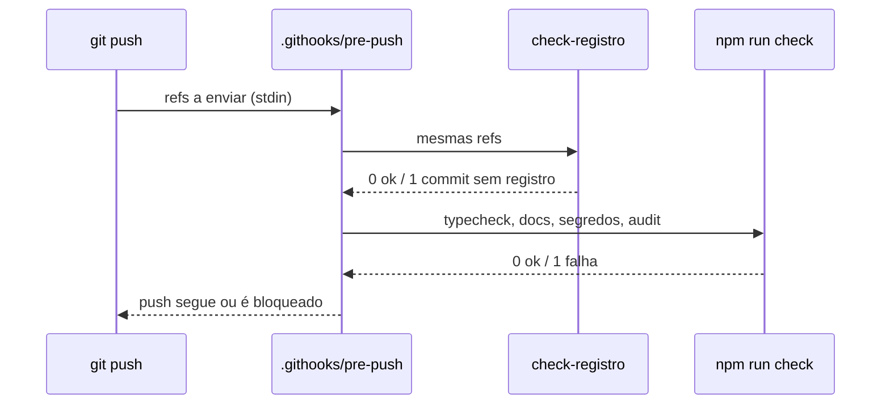

# .githooks

## Cabeçalho

| Campo | Valor |
|---|---|
| Id | DIR-githooks |
| Título | `.githooks` |
| Tipo | hooks do Git versionados (DevSecOps) |
| Data | 2026-11-16 |
| Usuário responsável | TokumoH |
| Status | ativo |
| Commits | commit que introduz este arquivo — `git log --format=%h -- .githooks/README.md` |
| Arquivos | `README.md`, `pre-push` |

## Propósito

Hooks do Git versionados no repositório, para que todos os clones rodem as mesmas checagens localmente antes de enviar código ao GitHub. É a primeira barreira do processo do [CORE](../CLAUDE.md). A segunda é a CI do PR.

## Origem

Sugestão S3, aprovada como implementação. Registro: [VER-003](../docs/verificacoes/2026-11-16-003-devsecops-checagens-e-ci.md).

## Organização

- Um arquivo por hook, com o nome exato que o Git espera (`pre-push`), sem extensão e executável.
- Ativação via `git config core.hooksPath .githooks`, feita automaticamente pelo `npm install` (script `prepare` → [`scripts/install-hooks.mjs`](../scripts/install-hooks.mjs)).

## Por que esta organização

- `core.hooksPath` é nativo do Git (desde a 2.9), então não precisa de dependência.
- `.git/hooks/` não é versionado; esta pasta é.
- Os hooks só orquestram: a lógica fica em `scripts/`, reaproveitada pela CI.

## Por que não outras organizações

| Opção | Motivo de descarte |
|---|---|
| Husky | Dependência a mais para o mesmo resultado de `core.hooksPath` |
| Copiar para `.git/hooks/` | Não é versionado; cada clone precisaria copiar à mão |
| Hook `pre-commit` | O CORE exige registro por commit, e checar no push permite corrigir commits locais antes de enviar; `npm audit` a cada commit seria lento |

## Onde

| Arquivo ou subdiretório | O que contém |
|---|---|
| [`README.md`](README.md) | Este arquivo |
| [`pre-push`](pre-push) | Roda `check-registro --pre-push` (commits ainda não enviados) e `npm run check`; qualquer falha bloqueia o push |

## Lógica



## Exemplo

Ativar num clone já existente (sem rodar `npm install`):

```bash
node scripts/install-hooks.mjs
```

Conferir: `git config core.hooksPath` → `.githooks`. Um push com commit sem registro mostra `ERRO [check-registro] commit sem registro em docs/verificacoes/: <hash> <título>`.

## Verificação

- Simulação num repositório isolado: o hook bloqueou o push com commit sem registro e liberou com registro. Detalhes no VER-003.
- Todo arquivo deste diretório listado em "Onde" (conferido pelo `check-docs`).

## Riscos

- `git push --no-verify` pula o hook. A CI do PR cobre essa brecha.
- O clone precisa ter rodado `npm install` (ou `install-hooks.mjs`) para o hook valer.
- No Windows, o hook roda pelo `sh` do Git for Windows, e o `node` precisa estar no PATH.
- `npm audit` sem internet falha e bloqueia o push.
