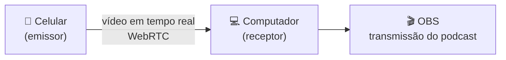
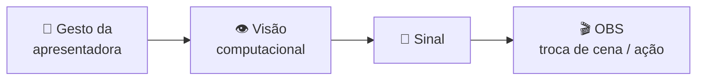

# 🎥 RevocastCameras

**Câmeras do celular controladas por gestos para as transmissões do [RevoCast](https://revocast.vercel.app)**
*o podcast da Atlética Revoada*

---

## 📌 Sobre

O **RevocastCameras** transforma o celular em uma câmera sem fio para a transmissão
do RevoCast. A imagem sai do navegador do celular e chega ao computador da
transmissão em tempo real, sem cabos e sem aplicativo instalado.

Projeto pessoal, feito por diversão. 💜

## 📡 Como funciona a transmissão

1. O computador abre a página **receptora** e fica aguardando.
2. O celular abre a página **emissora** e liga a câmera.
3. A conexão é feita direto entre os dois aparelhos e o vídeo aparece no computador,
   pronto para entrar no OBS.

## 🚀 Projeção

A meta é que a transmissão **reaja às apresentadoras**: um gesto feito para a câmera
do celular vira um comando para o OBS, que troca de cena ou executa uma ação,
sem ninguém precisar tocar no computador.

| Etapa | Objetivo |
|---|---|
| 1. Transmissão | Levar a câmera do celular até o computador do OBS |
| 2. Reconhecimento de gestos | Identificar os gestos das apresentadoras na imagem da câmera |
| 3. Comandos no OBS | Transformar cada gesto em troca de cena ou ação |

> A análise dos gestos poderá rodar **no próprio celular** (que envia só o sinal)
> ou **no computador do OBS** (que analisa o vídeo recebido). Essa escolha faz
> parte da projeção.
