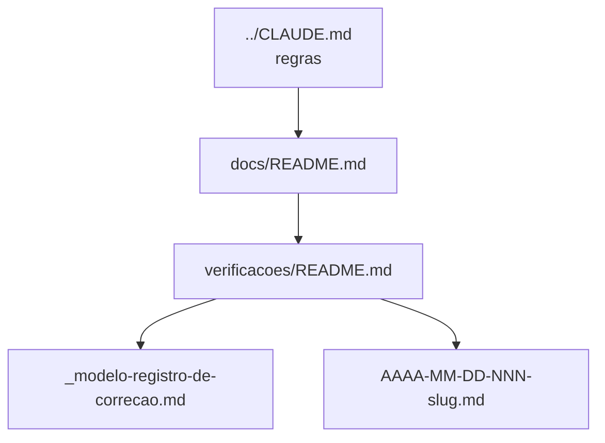

# docs

## Cabeçalho

| Campo | Valor |
|---|---|
| Id | DIR-docs |
| Título | `docs` |
| Tipo | documentação do projeto |
| Data | 2026-11-16 |
| Usuário responsável | TokumoH |
| Status | ativo |
| Commits | commit que introduz este arquivo — `git log --format=%h -- docs/README.md` |
| Arquivos | `README.md`, `verificacoes/` |

## Propósito

Raiz da documentação versionada do RevocastCameras. Reúne os registros de verificação de cada mudança e, no futuro, outras documentações do projeto (arquitetura, decisões, guias). As regras de processo ficam no [CORE](../CLAUDE.md).

## Origem

Criado em 2026-11-16 para cumprir as regras do CORE "todo commit leva documento em `docs/verificacoes/`" e "todo diretório criado deve ter um `README.md`". Aprovado pelo usuário como S2. Registro de origem: [VER-001](verificacoes/2026-11-16-001-core-e-estrutura-docs.md).

## Organização

- Um subdiretório por tipo de documentação, cada um com o seu `README.md`.
- Nomes de subdiretórios em português, minúsculas, sem acentos.
- Hoje há só `verificacoes/`.

## Por que esta organização

- Separar por tipo mantém cada README curto e com um propósito claro.
- Nomes sem acento evitam problemas de codificação em links, URLs e terminais.

## Por que não outras organizações

| Opção | Motivo de descarte |
|---|---|
| Registros soltos na raiz de `docs/` | Misturaria tipos; a regra do CORE nomeia `docs/verificacoes/` |
| Wiki do GitHub | Não é versionada junto com o código nem revisada no PR |
| Documentação dentro de `src/` | Mistura documentação de processo com código-fonte |

## Onde

| Arquivo ou subdiretório | O que contém |
|---|---|
| [`README.md`](README.md) | Este arquivo |
| [`verificacoes/`](verificacoes/README.md) | Registros de correção/decisão (um por commit aprovado) e o modelo de registro |

## Lógica

1. O `CLAUDE.md` define as regras e aponta para cá.
2. Este README lista os subdiretórios; cada subdiretório se explica no próprio README.
3. Ao criar um subdiretório novo: criar o README dele e acrescentar a linha em "onde" aqui, no mesmo commit.

## Exemplo

Para achar como uma mudança foi verificada: abrir [`verificacoes/README.md`](verificacoes/README.md), localizar o registro na tabela "onde" e ler a seção "Verificação".

## Verificação

- Links relativos resolvidos por script (VER-001, V1): 0 quebrados.
- Todo item da pasta listado em "onde" e nenhum item listado inexistente (VER-001, V2).
- Subdiretório `verificacoes/` tem README próprio.

## Riscos

- Desde o VER-003, `npm run check-docs` (hook pre-push e CI) acusa diretórios sem README e READMEs incoerentes; os diretórios anteriores à regra (`public`, `src`, `src/assets`) estão isentos até ganharem README.
