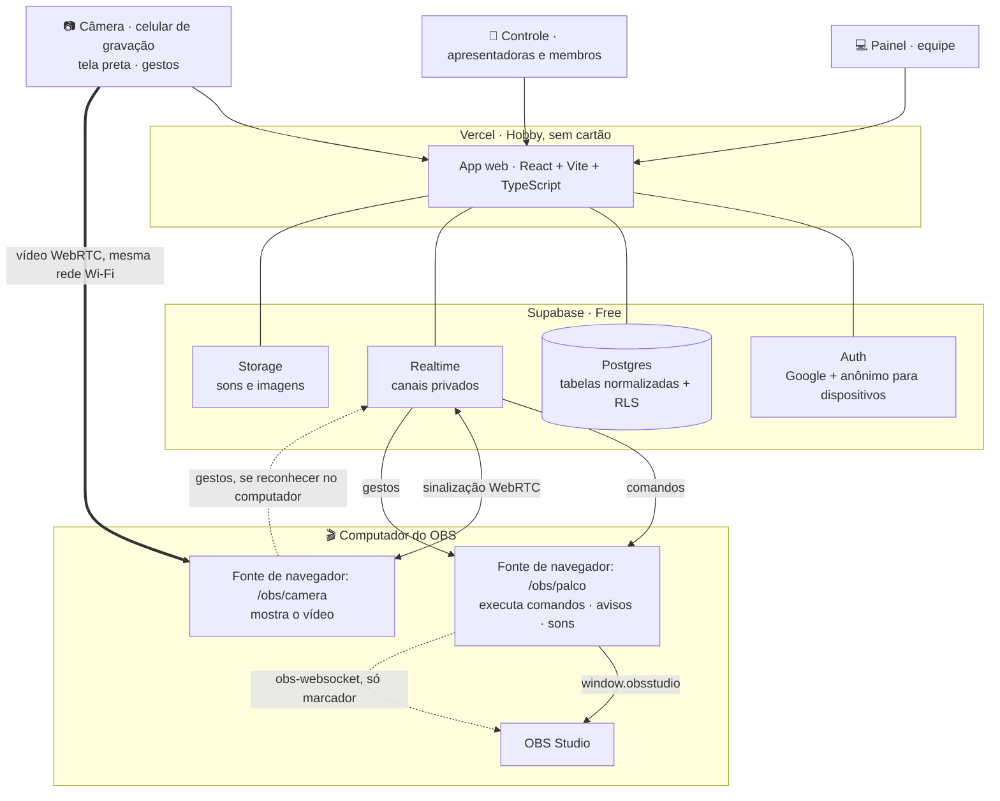
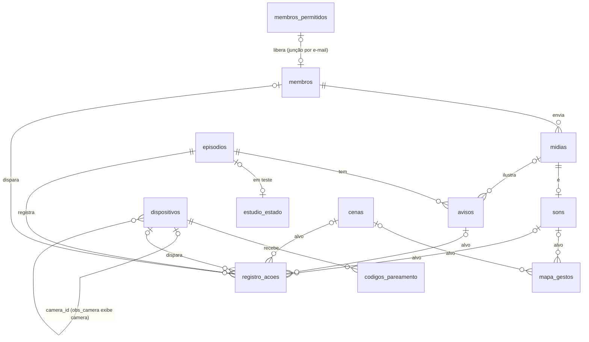

# Desenho — RevocastCameras (recomeço do zero)

| Campo | Valor |
|---|---|
| Id | DES-001 |
| Título | RevocastCameras: celular como câmera do OBS e comandos por gesto e por toque |
| Data | 2026-11-16 |
| Usuário responsável | TokumoH |
| Status | rascunho em verificação (ver VER-005) |
| Base | Sessão de desenho de 2026-11-16 |

## 1. Intenção e porquê

Sistema de câmera e comandos ao vivo para o [RevoCast](https://revocast.vercel.app), o podcast da Atlética Revoada (IFSP Birigui). O protótipo atual (`send.html`, `receive.html`, `src/`, `public/`) foi feito à mão só para testar conceitos (WebRTC com PeerJS) e será descartado. O projeto recomeça do zero na branch `branchTrabalho`.

O RevoCast é **ao vivo e gravado**: a transmissão acontece em tempo real e depois saem **cortes para as redes**. Existe uma equipe de transmissão (com computadores). As apresentadoras, durante o programa, têm no máximo um celular.

Resultado desejado: as apresentadoras **comandam a transmissão** (cena, sons, avisos na tela, clipes e marcadores) **com gestos** feitos para a câmera de um celular, ou **com toques** no celular de qualquer membro autorizado. A equipe prepara tudo antes, de qualquer lugar, num painel com a cara do RevoCast.

## 2. Objetivos, não-objetivos e antiobjetivos

### Objetivos

| # | Função | Gatilho |
|---|---|---|
| O1 | **Clipe**: salvar o momento em arquivo (Replay Buffer do OBS) | gesto ou toque |
| O2 | **Marcador** de capítulo na gravação completa | gesto ou toque |
| O3 | **Troca de cena** no OBS | gesto ou toque |
| O4 | **Sons** (efeitos) tocados na transmissão | gesto ou toque |
| O5 | **Avisos na tela**: nome de quem fala, links, eventos da faculdade, inscrições | gesto ou toque |
| O6 | **Celular de gravação** como câmera do OBS, com **tela preta** e gestos reconhecidos; **só vídeo** (o áudio vem dos microfones do estúdio) | — |
| O7 | **Painel** da equipe para preparar avisos, links, sons, imagens, cenas e gestos, com **envio de arquivos do computador** | — |
| O8 | **Tela de controle para celular**, usada pelas apresentadoras e por qualquer membro, com o interruptor **gestos ligados/desligados** e a confirmação de cada gesto reconhecido | — |
| O9 | **Acesso remoto seguro** com login Google, só para membros cadastrados | — |
| O10 | **Pareamento da câmera por QR code** | — |
| O11 | Interface **simples com a cara do RevoCast** | — |

### Não-objetivos (fora desta versão)

Votação na tela, avançar pauta, câmera de convidado por QR, clipe automático por risada, filtros no rosto, clipes verticais automáticos, legenda ao vivo (já existe o plugin LocalVocal), troca automática de câmera por quem fala, aplicativo nativo, várias câmeras simultâneas (o modelo de dados já permite; a interface não), integração no código do site do RevoCast (só um link, em outro repositório e em outra tarefa).

### Antiobjetivos (falha mesmo que funcione)

- **Exigir cartão de crédito** em qualquer serviço.
- **Custo mensal** acima de zero.
- Um **gesto acidental** disparar ação no ar com frequência (o programa vira bagunça).
- Alguém **de fora da equipe** conseguir disparar comandos ou ver dados.
- **Senha do OBS** ou chaves secretas saindo do computador do OBS ou do servidor.
- Interface **complicada** para as apresentadoras no meio do ao vivo.

## 3. Restrições

| Restrição | Origem | Efeito no desenho |
|---|---|---|
| Totalmente grátis e sem cartão | requisito do projeto | Vercel Hobby + Supabase Free + STUN público; TURN só de reserva sem cartão (Metered Open Relay) |
| Pausa do Supabase Free após ~1 semana de pouca atividade é aceitável | requisito do projeto | "Acordar o projeto" entra no checklist do episódio; sem tarefa para manter ativo |
| Câmera do celular exige HTTPS | navegadores | Hospedagem na Vercel (HTTPS) |
| Celular de gravação pode ser **qualquer modelo** (Android ou iPhone), filmando com a **câmera traseira** | requisito do projeto | A tela fica de costas para as apresentadoras: a **confirmação do gesto aparece no `/controle` e no painel**, não no celular de gravação. Celulares fracos precisam do reconhecimento no computador (seção 4.2). iPhone: trava de tela (Wake Lock) só a partir do iOS 16.4. |
| Computador do OBS: Windows, com suporte também a macOS e Linux; versão do OBS a confirmar | requisito do projeto | Versão mínima **OBS 30.2** (Hybrid MP4 e marcadores) no checklist; o palco lê a versão do OBS pelo obs-websocket (`GetVersion` → `obsVersion`; `window.obsstudio.pluginVersion` é só a versão do plugin de navegador, usada como indicação) e o painel avisa se faltar recurso |
| O celular só deixa uma página usar a câmera por vez | navegadores móveis | Captura, gestos e envio de vídeo na **mesma página** |
| Com a tela bloqueada ou em segundo plano, o navegador corta a câmera | Chrome/Safari móveis | "Tela preta" com a tela ligada (Wake Lock), não tela desligada |
| Plano grátis do Supabase: 1 GB de arquivos, 50 MB por arquivo | Supabase | Limite de envio no painel |
| Arquitetura DDD + GRASP Pure Fabrication + Componentes; banco normalizado | `CLAUDE.md` | Seções 6 e 7 |
| DevSecOps do CORE | `CLAUDE.md` | `rpc:grants-check` e `data-api:check` passam a existir (seção 13) |

## 4. Abordagens consideradas

### 4.1 Transmissão de vídeo do celular

| Opção | Trade-off | Escolha |
|---|---|---|
| Página própria no celular: câmera + gestos + WebRTC | Uma aba só; controle total; a transmissão é nossa | ✅ **escolhida** |
| VDO.Ninja para o vídeo + gestos no PC | Melhor vídeo, mas disputa a câmera com os gestos (ou exige análise no PC) | ❌ |

### 4.2 Onde reconhecer o gesto

| Opção | Trade-off | Escolha |
|---|---|---|
| No celular de gravação, a ~10 quadros/s | Não pesa no PC que já codifica a transmissão; gasta bateria (celular no carregador) | ✅ **padrão** |
| No PC, sobre o vídeo recebido (`/obs/camera`) | Celular mais leve; PC mais carregado; vídeo já comprimido | ✅ **também implementada**, como opção por dispositivo: necessária para celulares fracos |

### 4.3 Servidor (dados, login, tempo real)

| Opção | Trade-off | Escolha |
|---|---|---|
| **Supabase Free + Vercel** | Login Google, Postgres, tempo real e arquivos prontos; grátis e sem cartão; pausa por inatividade | ✅ **escolhida** |
| Cloudflare Workers + Durable Objects | Grátis e sempre ligado, mas login e tempo real feitos por nós; TURN da Cloudflare pede cartão | ❌ |
| Render | Grátis dorme e não tem disco; pago custa ~US$ 7/mês | ❌ custo |
| Servidor no PC do OBS + túnel | Grátis, mas exige o PC ligado para preparar | ❌ |
| Sem servidor (P2P puro) | Sem login de verdade; preparo por arquivo | ❌ |

### 4.4 Controle do OBS

| Opção | Trade-off | Escolha |
|---|---|---|
| **Páginas do app como Fonte de navegador no OBS**, usando `window.obsstudio` | Sem senha, sem túnel, sem a pergunta de "rede local" do Chrome; cena (ADVANCED) e clipe (BASIC) | ✅ **escolhida** |
| obs-websocket a partir do navegador | Precisa de senha e da permissão de rede local | só para o **marcador** (não existe em `window.obsstudio`) |
| Agente local em Node | Mais uma peça instalada no PC | ❌ |

## 5. Visão geral



## 6. Domínios (DDD)

| Contexto | Responsabilidade | Agregados / entidades | Onde roda |
|---|---|---|---|
| **Acesso** | Quem entra e com qual papel; pareamento de dispositivos | `Membro`, `Papel`, `Dispositivo`, `CodigoDePareamento` | banco + todas as telas |
| **Preparação** | Biblioteca de mídia, cenas, sons, episódios e avisos, mapa de gestos | `Midia`, `Cena`, `Som`, `Episodio` (raiz) → `Aviso`; `MapaDeGestos` (agregado próprio, global) | painel |
| **Ao vivo** | Comandos, estado no ar, registro de ações | `SessaoAoVivo`, `Comando`, `EstadoNoAr`, `RegistroDeAcao` | controle, palco, painel |
| **Captura** | Câmera, reconhecimento de gesto, confirmação, envio de vídeo | `Gesto`, `GestoConfirmado` (após segurar ~1 s) | celular de gravação, ou `/obs/camera` quando o dispositivo está configurado para reconhecer no computador |
| **Integração OBS** | Camada anticorrupção: traduz `Comando` em chamadas do OBS | `ExecutorOBS` | palco (Fonte de navegador) |

Linguagem ubíqua: **episódio**, **episódio ativo** (o episódio `ao_vivo`; sem nenhum, o episódio do modo teste gravado em `estudio_estado`), **aviso**, **som**, **cena**, **clipe**, **marcador**, **gesto**, **comando**, **no ar**, **palco** (página do OBS que executa comandos), **câmera** (celular de gravação), **controle** (tela de celular dos membros).

### 6.1 Componentes e Pure Fabrication

As regras de domínio não conhecem Supabase, WebRTC, MediaPipe nem OBS. Cada tecnologia fica atrás de uma fabricação pura (classe/módulo sem significado de domínio, criada para isolar a infraestrutura):

| Fabricação pura | Isola | Usada por |
|---|---|---|
| `RepositorioSupabase<T>` (um por agregado) | consultas ao Postgres | Preparação, Acesso |
| `CanalAoVivo` | Supabase Realtime, três canais privados: `estudio` (presença dos dispositivos, mudança de episódio ativo e de modo teste, mudança de configuração de dispositivo e avisos de revogação), `episodio:<id>:controle` (comandos e estado no ar, inclusive o texto do aviso) e `episodio:<id>:video` (sinalização WebRTC e gestos reconhecidos) | Ao vivo, Captura, palco |
| `SinalizacaoWebRTC` | troca de oferta/resposta/candidatos pelo canal `episodio:<id>:video` | Captura, `/obs/camera` |
| `ConexaoDeVideo` | `RTCPeerConnection` (STUN/TURN) | Captura, `/obs/camera` |
| `ReconhecedorDeGestos` | MediaPipe Gesture Recognizer em Web Worker | Captura (no celular ou em `/obs/camera`) |
| `ArmazenamentoDeMidia` | Supabase Storage | Preparação, palco |
| `AdaptadorOBS` | `window.obsstudio` + obs-websocket | Integração OBS |
| `TravaDeTela` | Wake Lock API | Captura |

Estrutura de pastas proposta (espelha o site do RevoCast, que já usa `src/domains` + `src/shared`):

```
src/
├── app/            # entrada, rotas e composição das telas
├── domains/
│   ├── acesso/     # membros, papéis, pareamento
│   ├── preparacao/ # mídia, cenas, sons, episódios, avisos, gestos
│   ├── aovivo/     # comandos, estado no ar, registro
│   ├── captura/    # câmera, gestos, envio de vídeo
│   └── obs/        # executor e adaptador do OBS
└── shared/
    ├── infra/      # fabricações puras (Supabase, WebRTC, MediaPipe, Wake Lock)
    ├── ui/         # componentes visuais com a cara do RevoCast
    └── styles/     # tokens.css, base.css
supabase/
├── migrations/     # SQL versionado (tabelas, RLS, funções, grants)
└── tests/          # testes de RLS e de funções
```

## 7. Modelo de dados (Postgres normalizado, 3FN)



| Tabela | Colunas principais | Regras |
|---|---|---|
| `membros_permitidos` | `email` (PK, minúsculo), `papel` (`admin`/`equipe`/`apresentadora`), `criado_por` | Só `admin` escreve. É a **lista de acesso** e a fonte única do papel. O primeiro `admin` é inserido pela migração inicial (e-mail definido nos pré-requisitos, seção 12). |
| `membros` | `id` (= `auth.users.id`), `email` (único), `nome` | Perfil criado no primeiro login de qualquer conta Google (**só para contas não anônimas**: o gatilho ignora `is_anonymous = true`, usado pelos dispositivos). **Não é chave estrangeira** para `membros_permitidos` e **não guarda papel**: o papel vem de uma junção por e-mail que pode não achar par. Sem par, a pessoa não tem papel e a RLS nega tudo. Assim, mudar ou remover um e-mail da lista vale **na hora no banco** (o perfil fica, sem acesso), e quem entrou antes de ser liberado ganha acesso assim que for adicionado. Canais de tempo real já abertos seguem a seção 8 (Revogação). |
| `midias` | `id`, `tipo` (`som`/`imagem`), `nome`, `caminho` (Storage), `mime`, `tamanho_bytes` (≤ 50 MB), `enviado_por` | Leitura: membros; escrita: `equipe`/`admin`. |
| `sons` | `id`, `midia_id` (FK `midias`, tipo `som`), `rotulo`, `emoji`, `volume` (0–1), `ordem` | |
| `cenas` | `id`, `nome_exibicao`, `nome_obs` (único; nome exato da cena no OBS), `ordem` | |
| `episodios` | `id`, `titulo`, `data`, `estado` (`rascunho`/`ao_vivo`/`encerrado`), `gestos_ligados` (booleano, padrão falso), `criado_por` | No máximo um `ao_vivo` por vez (índice parcial único). `gestos_ligados` só muda pela função `definir_gestos_ligados(episodio_id, ligado)`, que aceita qualquer membro; depois de chamá-la, o cliente publica um aviso em `:controle`, e o palco republica o estado no ar com o novo valor; o UPDATE direto em `episodios` fica só para `equipe`/`admin` (RLS filtra linhas, não colunas). |
| `avisos` | `id`, `episodio_id` (FK), `titulo`, `texto`, `link` (opcional, `https://`), `imagem_midia_id` (FK `midias`, tipo `imagem`, opcional), `duracao_s` (padrão 10), `ordem` | |
| `mapa_gestos` | `gesto` (PK: `Closed_Fist`, `Open_Palm`, `Pointing_Up`, `Thumb_Down`, `Thumb_Up`, `Victory`, `ILoveYou`), `acao` (`clipe`/`marcador`/`cena`/`som`/`proximo_aviso`/`ocultar_aviso`/`proxima_cena`/`nenhuma`), `cena_id` (FK, opcional), `som_id` (FK, opcional) | `CHECK` de equivalência: `acao = 'cena'` ⇔ `cena_id` não nulo; `acao = 'som'` ⇔ `som_id` não nulo. Mapa global (vale para todos os episódios). |
| `dispositivos` | `id`, `tipo` (`camera`/`obs_palco`/`obs_camera`), `rotulo` (ex.: "PC do estúdio"), `reconhecer_no` (`celular`/`computador`, só para `camera`; alterado por `definir_reconhecimento(dispositivo_id, local)`, só `equipe`/`admin`), `camera_id` (FK para `dispositivos`; obrigatório só para `obs_camera`, indica qual câmera ela exibe), `usuario_anonimo_id` (preenchido no pareamento; **índice único** entre os não nulos: uma sessão anônima pertence a no máximo um dispositivo), `pareado_em`, `revogado_em`, `criado_por` | **Dispositivo fixo, não preso a episódio**: depois de pareado, vale até ser revogado e sempre segue o **episódio ativo**. |
| `codigos_pareamento` | `id`, `dispositivo_id` (FK), `codigo_hash`, `expira_em` (2 min), `usado_em` | Código guardado só como hash; uso único. Separado de `dispositivos` para permitir parear de novo o mesmo dispositivo. |
| `estudio_estado` | `id` (sempre 1; tabela de uma linha), `episodio_teste_id` (FK `episodios`, opcional), `atualizado_por`, `atualizado_em` | Guarda o **modo teste** no banco, para sobreviver a recarregamentos e ao fechamento do painel. O **episódio ativo** é o de `estado = 'ao_vivo'`; sem nenhum, o `episodio_teste_id`. Escrita só por `equipe`/`admin`. Iniciar ou encerrar o ao vivo **limpa** `episodio_teste_id`, e `episodio_ativo()` só considera o teste se o episódio estiver em `rascunho`. |
| `registro_acoes` | `id`, `episodio_id`, `origem` (`gesto`/`toque`), `acao`, `cena_id`, `som_id`, `aviso_id` (opcionais), `membro_id` ou `dispositivo_id` (exatamente um), `teste` (booleano), `criado_em` | Apenas inserção (pelo `obs_palco`, que executa as ações); leitura por membros. |

Mapa de gestos **padrão** (editável no painel). Os gestos de som começam como `nenhuma`, porque a migração não cria sons; o painel sugere ligá-los quando a equipe enviar os sons "aplauso" e "buuu":

| Gesto | Ação |
|---|---|
| 🤟 `ILoveYou` | clipe |
| ✊ `Closed_Fist` | marcador |
| ✌️ `Victory` | próxima cena |
| 👍 `Thumb_Up` | som "aplauso" (depois de enviado) |
| 👎 `Thumb_Down` | som "buuu" (depois de enviado) |
| ☝️ `Pointing_Up` | próximo aviso |
| ✋ `Open_Palm` | ocultar aviso |

## 8. Segurança

| Camada | Medida |
|---|---|
| Login | Supabase Auth com **Google**. Entra quem quiser, mas só ganha papel se o e-mail estiver em `membros_permitidos`. |
| Papéis | `admin` (gerencia membros), `equipe` (prepara e opera), `apresentadora` (controle ao vivo); dispositivos pareados, sem login de pessoa: `camera`, `obs_palco` e `obs_camera`. |
| Modelo de autorização | Os papéis do app (`admin`, `equipe`, `apresentadora`, `camera`, `obs_palco`, `obs_camera`) **não são papéis do Postgres**: toda sessão logada, inclusive qualquer conta Google fora da lista e qualquer sessão anônima (a *anon key* é pública), usa o papel `authenticated`. Por isso o papel do app é sempre conferido **dentro** do banco, por duas funções auxiliares `SECURITY DEFINER`: `papel_atual()` (junção do e-mail da sessão não anônima com `membros_permitidos`; nulo se não houver par) e `dispositivo_atual()` (dispositivo com `usuario_anonimo_id = auth.uid()` e `revogado_em` nulo). Elas são usadas nas políticas de RLS, em `realtime.messages`, em `storage.objects` e no começo de cada função. |
| Banco | **RLS em todas as tabelas**, com políticas baseadas em `papel_atual()`/`dispositivo_atual()`. Tabelas acessadas **só por funções** (`codigos_pareamento`) ficam com RLS ativa, **sem nenhuma política** (nega tudo) e com `REVOKE ALL` de `anon`/`authenticated`; nenhuma outra tabela fica sem política. Toda função: `SECURITY DEFINER` com `search_path` fixo, `REVOKE EXECUTE` de `public` e `anon`, `GRANT EXECUTE` só a `authenticated`, e conferência interna do papel do app (nega no resto). Exceções, que não conferem papel: as próprias `papel_atual()` e `dispositivo_atual()`; o gatilho que cria o perfil em `membros` no primeiro login (quando ainda não há papel); e `parear_dispositivo(código)`, que aceita qualquer `authenticated` porque quem a chama ainda não é dispositivo, e só tem efeito com um código válido. |
| Tempo real | **Canais privados** (`private: true`): `estudio`, `episodio:<id>:controle` e `episodio:<id>:video`, com políticas em `realtime.messages` por papel e tipo de dispositivo (as políticas distinguem o canal, não o conteúdo da mensagem; por isso o estado no ar, que contém o texto dos avisos, fica só em `:controle`). Acesso público ao Realtime **desligado** nas configurações. |
| Pareamento | `criar_codigo_pareamento(tipo, rotulo, dispositivo_id opcional, camera_id opcional)` (só `equipe`/`admin`; `camera_id` é obrigatório para `obs_camera`; com `dispositivo_id`, gera novo código para parear de novo um dispositivo existente) devolve um código aleatório de 128 bits; o banco guarda o hash. A câmera abre `/camera#<código>` (fragmento não vai a servidores), entra com **login anônimo do Supabase** e chama `parear_dispositivo(código)`, que vincula o usuário anônimo ao dispositivo, marca o código como usado e falha se o código estiver expirado ou usado. Se a sessão anônima que chama já estiver ligada a outro dispositivo, esse vínculo antigo é desfeito (o outro dispositivo fica sem sessão até ser pareado de novo). Parear de novo um dispositivo (com `dispositivo_id`) **limpa `revogado_em`** e troca o `usuario_anonimo_id`: a sessão anônima antiga perde acesso na hora no banco, e os canais abertos seguem a regra de Revogação. |
| Sessão dos dispositivos | O login anônimo do Supabase guarda a sessão (com renovação automática) no armazenamento local do navegador, com **uma chave de armazenamento por tipo de dispositivo** (`storageKey` distinto no cliente Supabase de cada rota: `/camera`, `/obs/palco`, `/obs/camera`). Isso é obrigatório porque todas as Fontes de navegador do OBS dividem o mesmo perfil e o mesmo domínio: sem chaves separadas, o pareamento de uma Fonte substituiria a sessão da outra. **Recarregar** a página ou reiniciar o OBS **não exige parear de novo**; o `#código` só é usado na primeira vez. |
| Episódio ativo | Função `episodio_ativo()` (só tem efeito para membro com papel ou dispositivo não revogado, conferido por dentro) devolve só o id e o modo (`ao_vivo`/`teste`) do episódio ativo. Todo cliente a chama **ao conectar e ao reconectar**; o canal `estudio` só avisa que mudou. |
| Estado no ar | Membros publicam presença em `:controle`, e o `obs_palco` a lê; o palco publica de novo o estado no ar sempre que alguém entra no canal e a cada 30 s, para quem abre o `/controle` ou o painel no meio do programa. |
| Todos os dispositivos | Leem `estudio` e **só publicam presença** nele (o painel mostra quem está conectado); seguem o **episódio ativo**. |
| Dispositivo `camera` | Lê o próprio registro em `dispositivos` (`reconhecer_no`) ao conectar e de novo ao receber em `estudio` o aviso de mudança de configuração; envia e recebe em `:video` (sinalização WebRTC e gestos, quando reconhece no celular). Não acessa `:controle`, avisos, mídias nem membros. |
| Dispositivo `obs_camera` | Lê o registro da câmera indicada em `camera_id` (`reconhecer_no`) ao conectar e ao receber o aviso de mudança de configuração; envia e recebe em `:video` (sinalização e gestos, quando o reconhecimento é no computador). Não acessa `:controle`, avisos nem mídias. |
| Dispositivo `obs_palco` | Recebe em `:video` (gestos) e em `:controle` (comandos e presença, com `extension = 'presence'`); publica o estado no ar em `:controle`; lê avisos, sons, cenas, `midias`, `mapa_gestos` e `episodios` (estado e `gestos_ligados`); **lê os arquivos do bucket privado de mídias** (política em `storage.objects`); insere em `registro_acoes`. Não escreve na preparação. |
| Membros | Todo membro (qualquer papel) **lê** `episodios`, `avisos`, `sons`, `cenas`, `midias`, `mapa_gestos`, `estudio_estado` e `registro_acoes`, e altera os gestos por `definir_gestos_ligados`. `equipe`/`admin` leem `membros` (`id`, `nome`, para o registro de ações e a aba Membros); `admin` lê e escreve `membros_permitidos`. `admin`/`equipe`/`apresentadora` enviam e recebem em `:controle` (comandos e presença) e leem `estudio` (com presença); **só `equipe`/`admin` enviam broadcast em `estudio`** (mudança de episódio ativo, mudança de configuração de dispositivo e avisos de revogação), separado da presença pela coluna `extension` das políticas; só `equipe`/`admin` escrevem a preparação e `estudio_estado`, e leem e escrevem o bucket de mídias (leitura necessária para a prévia na Biblioteca e para sobrescrever arquivos), leem `dispositivos`, revogam por `revogar_dispositivo(id)` e escolhem onde reconhecer por `definir_reconhecimento(dispositivo_id, local)`. |
| Dispositivos do OBS | Um por Fonte de navegador, pareados **uma vez** por computador. Sem episódio ativo, ficam em espera. |
| Revogação | No banco vale **na hora**: `revogar_dispositivo` marca `revogado_em` e **invalida os códigos de pareamento pendentes** daquele dispositivo (senão um código gerado antes desfaria a revogação); quando o e-mail sai da lista, as políticas passam a negar. No tempo real, a autorização de um canal é conferida ao entrar e fica válida durante a conexão (é refeita ao reconectar ou na renovação do token; validade do JWT: 10 min); o vídeo WebRTC já aberto também continua. Por isso o painel publica um **aviso de revogação** em `estudio`; o cliente revogado (`camera`, `obs_palco`, `obs_camera` ou membro) sai dos canais, encerra a sessão e fecha o `RTCPeerConnection`, e os demais aparelhos descartam mensagens desse remetente **e fecham o `RTCPeerConnection` com ele** (`obs_camera` ao revogar a `camera`, e o inverso), ignorando novas ofertas dele; assim o vídeo direto, que não passa pelo Supabase, também é cortado pelo lado que não foi revogado. Esse descarte **só vale para clientes que cooperam**: o Broadcast não autentica o remetente de cada mensagem (ele vem no conteúdo), então o corte garantido de um cliente revogado é a revalidação na renovação do token; por isso a validade do JWT é reduzida para **10 min** nas configurações do Supabase. Pelo mesmo motivo, `membro_id`/`dispositivo_id` em `registro_acoes` é a autoria **declarada pelo cliente**. |
| Segredos | Só a chave pública (*anon key*) vai para o navegador. Nenhuma chave de serviço no app. Senha do obs-websocket fica no armazenamento local da Fonte de navegador do OBS. |
| Vídeo | WebRTC criptografado de ponta a ponta (DTLS-SRTP). |
| Entradas | Links de aviso aceitam só `https://`; textos exibidos sem HTML (sem `innerHTML`). |

## 9. Telas

Visual do site do RevoCast (`src/shared/styles/tokens.css` e `ui.css` do repositório `TokumoH/RevoCast_Site`): papel `#fffaf4` pontilhado, tinta `#1b1b22`, rosa `#d83868`, ciano `#27bfe8`, areia `#d8b888`; fontes **Lilita One**, **Nunito** e **Caveat**; borda de 3 px, sombra dura deslocada, botões em pílula, cartões-adesivo. O app copia os **tokens** (não importa código do site). Logo: `public/images/brand/logo.png` do site.

| Rota | Quem | Conteúdo |
|---|---|---|
| `/entrar` | todos | Botão "Entrar com Google"; mensagem clara se o e-mail não estiver liberado. |
| `/painel` | equipe, admin | Abas: **Episódios** (criar, editar avisos, iniciar/encerrar o ao vivo), **Biblioteca** (arrastar sons e imagens do computador), **Cenas**, **Gestos**, **Membros** (só admin), **Ao vivo** (botões de todas as ações, registro em tempo real, dispositivos pareados com QR e revogar, checklist do episódio). |
| `/controle` | apresentadora, equipe, admin | Mobile-first: estado (ao vivo, cena, aviso no ar), interruptor **gestos ligados/desligados** (qualquer membro pode mudar), aviso do último gesto reconhecido, avisos, sons, cenas e botões **CLIPE** e **MARCAR**. |
| `/camera#código` | câmera | Tela preta com um ponto discreto; toque mostra o status por 3 s (conectado, último gesto, bateria onde o navegador permitir); botão de prévia para enquadrar. Usa a câmera traseira. |
| `/obs/camera#código` | `obs_camera` | Só o vídeo da câmera, em tela cheia, fundo transparente; reconhece os gestos quando a câmera está configurada para reconhecer no computador. |
| `/obs/palco#código` | `obs_palco` | Fundo transparente; mostra o aviso no ar; toca os sons; executa cena, clipe e marcador; publica o estado no ar. |

Esboço do `/controle`:

```
┌────────────────────────────┐
│ [logo] RevoCast   ● AO VIVO│
│ Cena: Geral · No ar: JIF   │
│ Gestos: (● ligados)  🤟 ✓  │
│ ╭─ Avisos ───────────────╮ │
│ │ (📢 Inscrições JIF  ▶) │ │
│ │ (🎉 Festa Revoada   ▶) │ │
│ ╰────────────────────────╯ │
│ ╭─ Sons ─────────────────╮ │
│ │ (👏) (😂) (🥁) (📯)    │ │
│ ╰────────────────────────╯ │
│ ( Geral ) ( Close ) (Conv.)│
│ [        ✂️ CLIPE        ] │
│ [        🔖 MARCAR       ] │
└────────────────────────────┘
```

## 10. Fluxos principais

### 10.1 Gesto vira ação

```mermaid
sequenceDiagram
    participant C as 📷 Câmera
    participant R as Realtime (canal do episódio)
    participant P as 🎬 /obs/palco
    participant O as OBS
    C->>C: MediaPipe a ~10 quadros/s (Web Worker)
    C->>C: mesmo gesto por ≥ 1 s e fora do intervalo de 3 s
    C->>R: gesto {ILoveYou} no canal :video
    P->>P: lê episodios.gestos_ligados no banco; desligado → ignora
    P->>P: consulta o mapa de gestos → ação "clipe"
    P->>R: "🤟 reconhecido → clipe" no canal :controle (imediato)
    P->>P: clipe já pendente? se sim, ignora o repetido
    P->>P: espera 5 s (captura a reação)
    P->>O: window.obsstudio.saveReplayBuffer()
    P->>R: estado {último: clipe salvo} no canal :controle
    Note over R: /controle e painel mostram "🤟 clipe" na hora e "clipe salvo" depois
```

O **palco** é o único executor: gesto e toque viram o mesmo `Comando`, e o palco resolve o mapa de gestos, executa e grava `registro_acoes`.

### 10.2 Pareamento por QR

1. Na aba **Ao vivo**, a equipe clica "Parear câmera"; o painel chama `criar_codigo_pareamento` **passando o `dispositivo_id` da câmera existente**, quando houver (trocar de celular reaproveita o mesmo dispositivo `camera`, e o `obs_camera` continua exibindo-a pelo `camera_id`), e mostra o QR de `https://<app>/camera#<código>`. Só se não houver câmera cadastrada é criado um dispositivo novo.
2. O celular de gravação lê o QR, abre a página, entra como anônimo e chama `parear_dispositivo`.
3. O painel mostra "📷 Câmera conectada" com o botão **Revogar**.
4. O mesmo fluxo gera, **uma única vez por computador**, os links de `/obs/palco` e `/obs/camera` (tipos `obs_palco` e `obs_camera`) para colar nas Fontes de navegador do OBS. Depois disso as Fontes ficam fixas: a sessão sobrevive a recarregamentos e reinícios.
5. Um **modo teste** no painel escolhe um episódio em rascunho e o anuncia no canal `estudio`; sem episódio ao vivo, a câmera e as Fontes do OBS passam a seguir esse episódio. Os comandos de teste executam normalmente (para conferir sons, avisos e cenas antes do programa) e entram em `registro_acoes` com `teste = verdadeiro`.

### 10.3 Vídeo

A câmera publica oferta/resposta/candidatos no canal `episodio:<id>:video` do episódio ativo; `/obs/camera` responde. Como os dispositivos seguem também o episódio do modo teste, dá para **enquadrar e testar os gestos antes de iniciar o ao vivo**. ICE: STUN público (`stun:stun.l.google.com:19302`); **mesma rede Wi-Fi** como caminho principal; TURN **opcional** do Metered Open Relay (conta grátis, sem cartão, 20 GB/mês), configurado por variável de ambiente se a rede bloquear.

### 10.4 Episódio (checklist no painel)

1. Acordar o projeto no Supabase, se estiver pausado.
2. No OBS: Replay Buffer configurado (tempo sugerido: 60 s) e **iniciado**, gravação em **Hybrid MP4** e **iniciada** (o clipe exige o Replay Buffer ativo e o marcador exige a gravação em andamento), Fontes de navegador `/obs/palco` (permissão **ADVANCED**, áudio controlado pelo OBS) e `/obs/camera`, cada uma criada **uma única vez** e colocada nas demais cenas **por referência** (colar referência ou cena aninhada), nunca por cópia (duas cópias dividem a mesma sessão e executariam cada comando duas vezes); `/obs/palco` presente em **todas** as cenas, senão sons e avisos somem ao trocar de cena; "Desligar a fonte quando não estiver visível" desmarcado nas duas. Servidor **WebSocket do OBS** ativado (porta 4455, com senha) e a senha informada no palco pelo "Interagir" da Fonte (usada pelo marcador e por `GetVersion`).
3. Conferir se a câmera e as Fontes do OBS aparecem como conectadas (parear só se for aparelho novo); usar o modo teste para enquadrar e testar sons, avisos e gestos; iniciar o ao vivo no painel.

## 11. Tecnologias

| Uso | Escolha | Observação |
|---|---|---|
| Interface | React 19 + Vite + TypeScript | Mesma base do site do RevoCast |
| Dados, login, tempo real, arquivos | `@supabase/supabase-js` | |
| Gestos | `@mediapipe/tasks-vision` (Gesture Recognizer) | Modelo e WASM servidos pelo próprio app (sem CDN externo em produção) |
| OBS | `window.obsstudio` + `obs-websocket-js` (só marcador, `CreateRecordChapter`) | |
| QR code | biblioteca pequena de geração de QR | a definir na implementação |
| Testes | Vitest (unidade), testes SQL de RLS no Supabase, Playwright (fluxos) | |
| Hospedagem | Vercel Hobby | |
| Banco versionado | Supabase CLI (`supabase/migrations`) | |

## 12. Pré-requisitos de configuração

Feitos antes da E0, fora do código (nenhum exige cartão):

1. Projeto no **Supabase** (plano Free): anotar URL e *anon key*; ativar o provedor **Google** e o **login anônimo**; **desligar o provedor Email** (vem ligado por padrão); desligar o acesso público ao Realtime; reduzir a validade do JWT para 10 min.
2. Credencial **OAuth do Google** (Google Cloud Console, sem faturamento) com o endereço de retorno do Supabase.
3. Projeto na **Vercel** (Hobby) ligado ao repositório, com as variáveis de ambiente da seção 13.
4. E-mail do primeiro `admin`, usado pela migração inicial.
5. Opcional: conta grátis no Metered (Open Relay) para o TURN de reserva.

## 13. Impacto no processo do repositório

- O protótipo (`send.html`, `receive.html`, `src/`, `public/`) sai; o histórico do Git guarda. Com isso, a lista `LEGADO` de `scripts/check-docs.mjs` fica vazia e os novos diretórios ganham README.
- Novas checagens do CORE: **`rpc:grants-check`** (toda função tem `REVOKE` de `public`/`anon` e `GRANT` só a `authenticated`, nenhuma `SECURITY DEFINER` sem `search_path`, e toda função, exceto `papel_atual`, `dispositivo_atual`, o gatilho de criação de perfil e `parear_dispositivo`, chama `papel_atual()` ou `dispositivo_atual()`) e **`data-api:check`** (toda tabela tem RLS ativa; toda tabela tem políticas, exceto as de uma lista explícita de tabelas só-funções, como `codigos_pareamento`, que devem ter `REVOKE ALL` de `anon`/`authenticated`), lendo `supabase/migrations`.
- Variáveis de ambiente (públicas; ver seção 12): `VITE_SUPABASE_URL`, `VITE_SUPABASE_ANON_KEY`; opcionais: `VITE_TURN_URL`, `VITE_TURN_USUARIO`, `VITE_TURN_SENHA` (credencial do Metered, que é por natureza exposta ao navegador).
- `README.md` da raiz continua só descrição e projeção.
- Cada etapa entra com registro em `docs/verificacoes/`.

## 14. Etapas de entrega

Cada etapa termina usável e verificável.

| Etapa | Entrega | Usável para |
|---|---|---|
| E0 | Limpeza do protótipo; esqueleto React com a cara do RevoCast; migrações iniciais no projeto Supabase já criado (seção 12); novas checagens | base |
| E1 | Login Google, lista de acesso, papéis, painel vazio, aba Membros | equipe entra |
| E2 | Biblioteca (envio de sons e imagens), cenas, episódios e avisos, mapa de gestos | preparar um episódio |
| E3 | Pareamento de dispositivos (código/QR) + `/controle` + `/obs/palco` + modo teste: cena, som, aviso, clipe e marcador **por toque** | **primeiro ao vivo por toque** |
| E4 | `/camera` com tela preta (pareada pelo QR da E3) e vídeo até `/obs/camera` | celular como câmera |
| E5 | Gestos (MediaPipe, segurar 1 s, intervalo 3 s), interruptor ligados/desligados, confirmação no `/controle` e no painel, reconhecimento no celular **ou** no computador por dispositivo | comandar por gesto em qualquer celular |
| E6 | Registro de ações no painel, checklist do episódio, ajustes de uso real | polimento |

## 15. Riscos

| Risco | Mitigação |
|---|---|
| Rede da faculdade bloquear WebRTC | Mesma rede Wi-Fi (ou roteador/hotspot do PC); TURN de reserva do Metered |
| Gesto falso durante a conversa (de qualquer pessoa na imagem) | Interruptor gestos ligados/desligados + segurar 1 s + intervalo 3 s + histórico no painel |
| Bateria e desempenho do celular de gravação | Carregador no tripé; tela preta; reconhecimento a ~10 quadros/s; celular fraco: reconhecer no computador (seção 4.2) |
| iPhone pausar a câmera | Tela preta evita bloqueio; detectar `mute`/`ended` e pedir a câmera de novo |
| Fonte de navegador do OBS sem WebRTC ou sem `window.obsstudio` em alguma versão ou sistema (Windows/macOS/Linux) | Versão mínima OBS 30.2 no checklist; o palco detecta e o painel avisa; testar nos três sistemas na E3/E4 |
| Marcador via obs-websocket bloqueado pela política de rede local do navegador embutido | Marcador é secundário; reserva: atalho de teclado do OBS |
| Pausa do Supabase esquecida | Item 1 do checklist do episódio |
| Limites grátis (1 GB arquivos, Realtime) | Limite de 50 MB por envio; mostrar uso no painel |

## 16. O que fica para a implementação

- Biblioteca de QR code e de roteamento. As rotas são **por caminho** (`/painel`, `/camera`, `/obs/palco`…), com *rewrite* de SPA na Vercel; o fragmento (`#`) fica reservado para o código de pareamento. Por isso o app **não** usa o roteamento por hash do site do RevoCast.
- Detalhes visuais dentro dos tokens do RevoCast.
- Nomes exatos de funções SQL e de mensagens do canal, desde que respeitem a seção 8 (inclusive as chaves de armazenamento separadas por tipo de dispositivo).
- Tempo exato de espera do clipe (padrão 5 s) e do Replay Buffer (sugestão 60 s), configuráveis.
