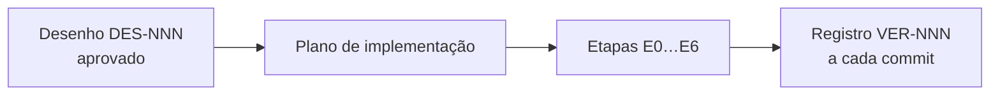

# docs/desenho

## Cabeçalho

| Campo | Valor |
|---|---|
| Id | DIR-docs-desenho |
| Título | `desenho` |
| Tipo | documentação · documentos de desenho (arquitetura e escopo) |
| Data | 2026-11-16 |
| Usuário responsável | TokumoH |
| Status | ativo |
| Commits | commit que introduz este arquivo — `git log --format=%h -- docs/desenho/README.md` |
| Arquivos | `README.md`, `2026-11-16-revocast-cameras-desenho.md` |

## Propósito

Guarda os documentos de desenho do sistema: o que será construído, por quê, as abordagens consideradas, a arquitetura (DDD, GRASP Pure Fabrication, Componentes), o modelo de dados, a segurança, as telas e as etapas de entrega. É a referência para planejar e implementar; cada implementação depois gera seu registro em [`../verificacoes/`](../verificacoes/README.md).

## Origem

Criado para o recomeço do projeto do zero (sessão de desenho de 2026-11-16), com o documento [DES-001](2026-11-16-revocast-cameras-desenho.md).

## Organização

- Um arquivo por desenho: `AAAA-MM-DD-slug-desenho.md`, com Id `DES-NNN` no cabeçalho.
- Desenhos aprovados não são reescritos: mudanças grandes geram um novo desenho que referencia o anterior; ajustes pequenos são registrados em `docs/verificacoes/`.

## Por que esta organização

- Separar desenho (o que e por quê, antes de construir) de registro de verificação (o que mudou e como foi provado, a cada commit) evita misturar intenção com histórico.
- A data no nome ordena a evolução do sistema.

## Por que não outras organizações

| Opção | Motivo de descarte |
|---|---|
| Desenho dentro de `docs/verificacoes/` | Registro é por commit; o desenho orienta várias etapas e commits |
| `docs/superpowers/specs/` | Dois diretórios a mais (cada um com README) sem ganho |
| Desenho no `README.md` da raiz | O README da raiz é só descrição e projeção |

## Onde

| Arquivo ou subdiretório | O que contém |
|---|---|
| [`README.md`](README.md) | Este arquivo |
| [`2026-11-16-revocast-cameras-desenho.md`](2026-11-16-revocast-cameras-desenho.md) | DES-001 — celular como câmera do OBS e comandos por gesto e por toque |

## Lógica

## Exemplo

Para saber por que o projeto usa Supabase e não Cloudflare: abrir o DES-001, seção 4.3 ("Servidor"), tabela de abordagens.

## Verificação

- Links relativos, "Onde" e campo "Arquivos" conferidos por `npm run check-docs`.

## Riscos

- O DES-001 cita limites de planos grátis (Supabase, Metered) verificados em 2026-11-16; podem mudar.
