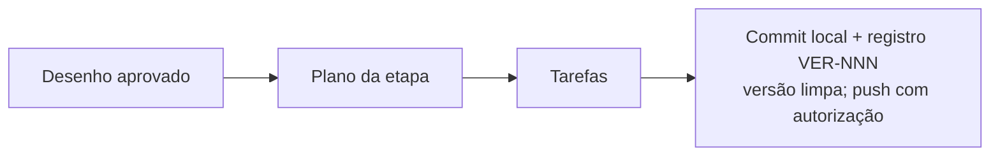

# docs/planos

## Cabeçalho

| Campo | Valor |
|---|---|
| Id | DIR-docs-planos |
| Título | `planos` |
| Tipo | documentação · planos de implementação |
| Data | 2026-11-17 |
| Usuário responsável | TokumoH |
| Status | ativo |
| Commits | commit que introduz este arquivo — `git log --format=%h -- docs/planos/README.md` |
| Arquivos | `README.md`, `2026-11-17-e0-fundacao.md`, `2026-11-26-e1-entrada-e-membros.md` |

## Propósito

Guarda os planos de implementação: para cada etapa de um desenho aprovado (`docs/desenho/`), as tarefas em ordem, os arquivos tocados, as interfaces entre tarefas, os testes que provam cada uma e o que fica para a etapa seguinte.

## Origem

Criado para o plano da etapa E0 do [DES-001](../desenho/2026-11-16-revocast-cameras-desenho.md), aprovado em 2026-11-17.

## Organização

- Um arquivo por etapa: `AAAA-MM-DD-eN-slug.md`, com Id `PLA-NNN` no cabeçalho.
- Cada tarefa termina com um commit e o seu registro em [`../verificacoes/`](../verificacoes/README.md).

## Por que esta organização

- Separar desenho (o que e por quê), plano (como, em passos) e registro (o que mudou e como foi provado) mantém cada documento com um papel só.
- Um plano por etapa mantém o tamanho legível e permite aprovar uma etapa de cada vez.

## Por que não outras organizações

| Opção | Motivo de descarte |
|---|---|
| Plano dentro do desenho | O desenho é aprovado uma vez; os planos mudam por etapa |
| `docs/superpowers/plans/` | Dois diretórios a mais, cada um com README, sem ganho |
| Um plano único para E0–E6 | Grande demais para revisar; as etapas seguintes dependem do que a anterior ensinar |

## Onde

| Arquivo ou subdiretório | O que contém |
|---|---|
| [`README.md`](README.md) | Este arquivo |
| [`2026-11-17-e0-fundacao.md`](2026-11-17-e0-fundacao.md) | PLA-001 — etapa E0: limpeza, esqueleto, cliente Supabase, banco com RLS testada e checagens do banco |
| [`2026-11-26-e1-entrada-e-membros.md`](2026-11-26-e1-entrada-e-membros.md) | PLA-002 — etapa E1: domínio Acesso, login Google com PKCE, guarda por papel, tela de erro de configuração, painel vazio com abas e aba Membros; migração nova só de políticas (nenhum admin altera nem remove a própria linha da lista) |

## Lógica

## Exemplo

Para saber quais testes provam as regras de acesso do banco: abrir o PLA-001, Tarefa 3, tabela de testes do passo 2. Para saber como a E1 trata quem não está na lista de acesso: abrir o PLA-002, "Foco da revisão", item 1, e seguir os nomes dos testes até a tarefa dona.

## Verificação

- Links relativos, "Onde" e campo "Arquivos" conferidos por `npm run check-docs`.

## Riscos

- Versões de bibliotecas fixadas no PLA-001 foram conferidas em 2026-11-17 e podem envelhecer até a execução.
