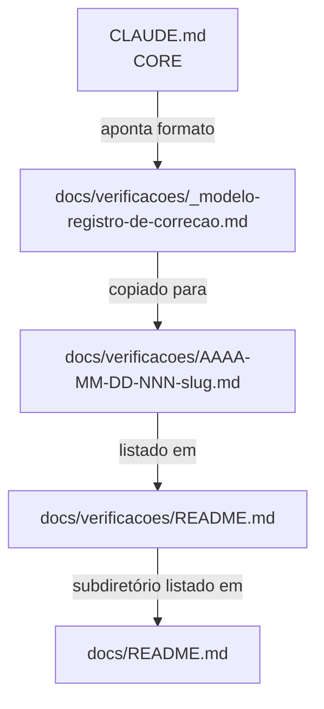

# VER-001 — CORE permanente (`CLAUDE.md`) e estrutura de documentação (`docs/`)

## Cabeçalho

| Campo | Valor |
|---|---|
| Id | VER-001 |
| Título | CORE permanente (`CLAUDE.md`) e estrutura de documentação (`docs/`) |
| Gravidade | média |
| Tipo | documentação · processo |
| Data | 2026-11-16 |
| Usuário responsável | TokumoH |
| Status de implementação | somente documentação |
| Commits | commit que introduz este arquivo — `git log --format=%h -- docs/verificacoes/2026-11-16-001-core-e-estrutura-docs.md` |
| Arquivos | `CLAUDE.md`, `docs/README.md`, `docs/verificacoes/README.md`, `docs/verificacoes/_modelo-registro-de-correcao.md`, `docs/verificacoes/2026-11-16-001-core-e-estrutura-docs.md` |

## Problema

O usuário definiu um CORE de regras permanentes (papel, arquitetura, autorização, dupla verificação, formatos de sugestão/documentação/README, commit, Modo VARREDURA). O repositório não tinha onde guardar isso:

| Pressuposto do CORE | Situação antes deste commit | Efeito |
|---|---|---|
| Valer em todas as sessões, mesmo após compactação | Sem `CLAUDE.md` nem `.claude/` | Uma sessão nova começava sem o CORE |
| `docs/verificacoes/_modelo-registro-de-correcao.md` | Sem pasta `docs/` | Nenhum commit podia seguir a regra "todo commit leva documento" |
| Checagens DevSecOps | `package.json` só com `dev`, `build`, `preview` | Nenhuma checagem roda (tratado como pendência S3) |

## Era proposital?

Não. O histórico tem 2 commits (`ef0207a` "Primeiro teste camera", `d099629` "renomeando botao"), ambos de protótipo de câmera (Vite + TypeScript + PeerJS). Nenhum arquivo, comentário ou commit trata de documentação ou de regras de processo; a ausência é por o projeto estar no início, não por decisão.

## Solução

1. **S1** — `CLAUDE.md` na raiz com o CORE completo, organizado em seções, carregado automaticamente pelo Claude Code em toda sessão do repositório.
2. **S2** — `docs/README.md`, `docs/verificacoes/README.md` e `docs/verificacoes/_modelo-registro-de-correcao.md`, seguindo os formatos de README e de documentação do CORE.
3. Este registro (VER-001) como primeiro uso real do modelo.

Aprovação do usuário (2026-11-16): "aprovado S1 e S2 como documentação; S3 do zero".

## Por que esta solução

- `CLAUDE.md` na raiz é o mecanismo nativo do Claude Code para instruções de projeto: é versionado, vale para qualquer sessão (local ou nuvem) e sobrevive à compactação porque é recarregado do disco.
- O modelo de registro é um arquivo separado (prefixo `_` para aparecer primeiro e não ser confundido com registro) e é referenciado pelo `CLAUDE.md` em vez de duplicado: uma única fonte do formato (reuso, referências independentes).
- Nome dos registros `AAAA-MM-DD-NNN-slug.md`: ordena cronologicamente no `ls` e o `NNN` dá Id único (`VER-NNN`) mesmo com vários registros no mesmo dia.

## Por que não outras soluções

| Opção | Motivo de descarte |
|---|---|
| Manter o CORE só na conversa/memória da sessão | Perde-se ao encerrar a sessão; o container na nuvem é efêmero |
| `.claude/settings.json` ou hooks | Servem para permissões e automações, não para texto de instruções |
| CORE dentro de `docs/README.md` | Não é carregado automaticamente pelo Claude Code |
| Registros numerados só por sequência (`001-slug.md`) | Perde a data no nome; dificulta localizar por período |
| Uma pasta por registro | Excesso de estrutura para um arquivo por registro; exigiria um README por pasta |

## Onde

| Arquivo | Linhas | O que mudou |
|---|---|---|
| [`CLAUDE.md`](../../CLAUDE.md#L1-L117) | 1–117 | Novo: CORE completo em seções, com links para o modelo e para este registro |
| [`docs/README.md`](../README.md#L1-L76) | 1–76 | Novo: README da pasta `docs/` |
| [`docs/verificacoes/README.md`](README.md#L1-L91) | 1–91 | Novo: README da pasta `docs/verificacoes/` |
| [`docs/verificacoes/_modelo-registro-de-correcao.md`](_modelo-registro-de-correcao.md#L1-L83) | 1–83 | Novo: modelo de registro com as 11 seções do formato de documentação |
| [`docs/verificacoes/2026-11-16-001-core-e-estrutura-docs.md`](2026-11-16-001-core-e-estrutura-docs.md) | todas | Novo: este registro |

## Lógica

| Passo | Antes | Depois |
|---|---|---|
| 1. Abrir sessão nova | Claude sem o CORE | Claude carrega `CLAUDE.md` com o CORE |
| 2. Mudança aprovada | Sem lugar para o registro | Copia `_modelo-registro-de-correcao.md` → `AAAA-MM-DD-NNN-slug.md` |
| 3. Diretório novo | Sem regra aplicada | README criado no mesmo commit, conferido por "onde" |
| 4. Varredura (objetivo 15) | Nada a conferir | Confere README de cada diretório contra o conteúdo real |

## Exemplo

Antes: `ls -a` na raiz → `.git .gitignore package-lock.json package.json public receive.html send.html src tsconfig.json vite.config.ts` (0 arquivos de documentação; 0 diretórios com README).

Depois: 1 `CLAUDE.md` + 2 diretórios novos (`docs/`, `docs/verificacoes/`), cada um com `README.md` (2/2); 1 modelo; 1 registro (VER-001). Nenhum arquivo de código alterado (`git diff --stat -- src public *.html *.ts *.json` vazio).

## Verificação

| # | Abordagem | Comando / método | Resultado |
|---|---|---|---|
| V1 — rodada 1 | Script Node: resolve todo link Markdown relativo (fora de blocos de código e comentários), confere existência do alvo, que âncoras `#Lx-Ly` não passam do fim do arquivo e que âncoras de título existem | `node check-links.mjs` | **5 erros**: 4 âncoras de linha estimadas além do fim dos arquivos (ex.: `CLAUDE.md#L1-L131` com 117 linhas) e 1 link de exemplo do modelo para arquivo inexistente (`caminho/arquivo.ts`). Corrigidos (âncoras pelo `wc -l` real; exemplo trocado por `src/send.ts#L1-L10`); contagem reiniciada |
| V1 — rodada 2 | Mesmo script | `node check-links.mjs` | 0 erros (1 aviso esperado: link de exemplo do modelo cobre só L1–L10) |
| V2 | Abordagem diferente (shell): `find docs -type d` × `ls -A` de cada pasta × alvos da tabela "Onde" e do campo "Arquivos" de cada README; nenhum item listado inexistente; toda pasta com README; varredura de segredos/dados pessoais (regex de e-mail, tokens do GitHub e da AWS e atribuições de chave de API, senha ou segredo); nenhum arquivo de código alterado (`git status` em `src`, `public`, `*.html`, `*.ts`, `*.json`) | `bash check-readmes.sh` | 0 erros |
| V1 + V2 finais | Ambos novamente após registrar estes resultados | ambos | 0 erros / 0 erros |
| Sabotagem 1 | Mover temporariamente o modelo | `mv` + V1 | 3 erros de link (esperado); revertido |
| Sabotagem 2 | Criar `docs/verificacoes/extra.md` não listado | `touch` + V2 | 2 erros: não listado em "Onde" e no campo "Arquivos" (esperado); removido |
| Sabotagem 3 | Criar `docs/semreadme/` vazio | `mkdir` + V2 | 3 erros, incluindo "sem README.md" (esperado); removido |
| Sabotagem 4 | Acrescentar em `docs/README.md` uma linha fictícia atribuindo valor a uma chave de API | V2 | "possível segredo/dado pessoal" (esperado); revertido |
| Sabotagem 5 | Trocar âncora `#riscos` por `#riscoz` no `CLAUDE.md` | V1 | 1 erro de âncora de título (esperado); revertido |
| Não regressão | Build do projeto (nenhum código tocado) | `npm run build` | ✓ build concluído (`tsc` + `vite build`) |

Nits corrigidos (não zeram a contagem): nenhum. Os 5 erros da rodada 1 eram afirmações falsas (âncoras inexistentes), por isso reiniciaram a contagem.

## Riscos

- **S3 (DevSecOps) pendente:** os nomes `rpc:grants-check` e `data-api:check` do CORE vêm de projeto com banco/API; aqui serão definidos do zero em sugestão própria. Até lá, nenhuma checagem automática roda.
- **Âncoras de linha** em "onde" valem para a versão deste commit; edições futuras desses arquivos podem deslocá-las (os registros são históricos; não se reescrevem).
- **Campo "Commits"** usa o comando `git log` em vez do hash, porque o hash só existe depois do commit.
- **`CLAUDE.md` é instrução, não trava:** não impede tecnicamente commits fora do processo; a trava técnica (hooks) é parte da S3.
- **Scripts de verificação não versionados:** `check-links.mjs` e `check-readmes.sh` rodaram no diretório temporário da sessão; versioná-los (ex.: `scripts/` + `npm run check-docs`) entra na proposta S3.
- Não foi verificada a renderização visual dos Markdown/Mermaid no GitHub (só a estrutura e os links).
- Diagramas Mermaid dependem de visualizador que os renderize (o GitHub renderiza).
