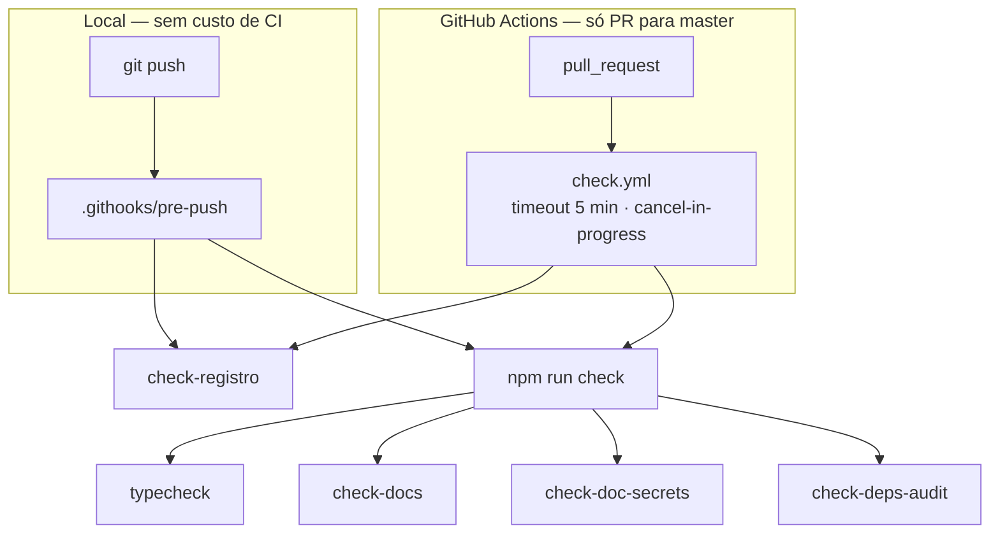

# VER-003 — Checagens DevSecOps (`scripts/`), hook pre-push e CI econômica

## Cabeçalho

| Campo | Valor |
|---|---|
| Id | VER-003 |
| Título | Checagens DevSecOps (`scripts/`), hook pre-push e CI econômica |
| Gravidade | média |
| Tipo | segurança · processo · CI |
| Data | 2026-11-16 |
| Usuário responsável | TokumoH |
| Status de implementação | implementado |
| Commits | commit que introduz este arquivo — `git log --format=%h -- docs/verificacoes/2026-11-16-003-devsecops-checagens-e-ci.md` |
| Arquivos | `scripts/*` (6), `.githooks/*` (2), `.github/README.md`, `.github/workflows/*` (2), `package.json`, `CLAUDE.md`, `docs/README.md`, `docs/verificacoes/README.md`, este registro |

## Problema

Nenhuma regra do CORE era verificada automaticamente:

| Regra do CORE | Antes | Efeito |
|---|---|---|
| Todo commit leva registro em `docs/verificacoes/` | Só disciplina | Um commit sem registro passaria sem aviso |
| Todo diretório tem README coerente | Só disciplina | No VER-001 e no VER-002, as checagens temporárias acharam 5 + 1 erros de âncora que teriam passado |
| DevSecOps (`check-deps-audit`, `check-doc-secrets`, pre-push) | `package.json` só com `dev`/`build`/`preview` | Nenhuma auditoria de dependências nem varredura de segredos |
| — | Scripts de verificação no diretório temporário da sessão | Não reproduzíveis, perdidos ao fim da sessão (risco registrado no VER-001) |

## Era proposital?

Não. O projeto tinha 2 commits de protótipo (`ef0207a`, `d099629`) sem nenhuma infraestrutura. O VER-001 registrou a ausência como pendência S3, e o usuário aprovou: "S3 com CI, aprovado como implementação, atenção para não esgotar os créditos do github".

## Solução

1. **`scripts/`** (Node, sem dependências): `_lib.mjs` (utilitários), `check-docs.mjs`, `check-doc-secrets.mjs`, `check-registro.mjs`, `install-hooks.mjs`.
2. **`package.json`**: `typecheck`, `check-docs`, `check-doc-secrets`, `check-deps-audit` (`npm audit --audit-level=high`), `check-registro`, `check` (conjunto) e `prepare` (ativa os hooks).
3. **`.githooks/pre-push`**: `check-registro --pre-push` + `npm run check`; ativado por `core.hooksPath`.
4. **`.github/workflows/check.yml`**: a mesma checagem no PR para `master`, com medidas de economia de minutos.
5. Documentação: README em `scripts/`, `.githooks/`, `.github/` e `.github/workflows/`; `CLAUDE.md`, `docs/README.md` e `docs/verificacoes/README.md` atualizados para o novo estado.
6. `rpc:grants-check` e `data-api:check` declarados não aplicáveis (o projeto não tem banco nem API própria; é PeerJS ponto a ponto).

## Por que esta solução

- **Arquitetura (GRASP Pure Fabrication + Componentes):** `_lib.mjs` concentra Git e disco, e cada `check-*` é um componente com uma regra. O hook e a CI reutilizam os mesmos componentes via `npm run check`.
- **Segurança:** o Git é executado sem shell (`execFileSync`, sem injeção); `--range` só aceita caracteres de referência Git; na CI, `permissions: contents: read`, `persist-credentials: false`, actions fixadas por SHA, `npm ci --ignore-scripts` e `base_ref` passado por variável de ambiente.
- **Economia (pedido do usuário):** a CI só roda em PR para `master` ou manualmente, cancela a execução anterior do mesmo PR, tem limite de 5 min, usa 1 job em ubuntu (1x) e cache do npm. A barreira do dia a dia é o hook local, que não gasta minutos.
- **Portabilidade:** Node roda igual em Windows, Linux e macOS; o hook usa `sh`, que o Git for Windows inclui.

## Por que não outras soluções

| Opção | Motivo de descarte |
|---|---|
| Husky / lint-staged | Dependência a mais; `core.hooksPath` é nativo do Git ≥ 2.9 (aqui 2.43) |
| gitleaks / trufflehog | Binário externo por máquina; volume atual não justifica |
| markdown-link-check | Dependência externa e não confere "Onde"/"Arquivos" nem registros |
| CI também em todo `push` | Dobra o consumo de minutos; o hook já cobre o push |
| Matriz de SO/Node na CI | Multiplica minutos sem ganho para este projeto |
| Hook `pre-commit` | Rodaria `npm audit` (rede) a cada commit; checar no push permite corrigir commits locais antes de enviar |
| Registro por push (não por commit) | O CORE diz "todo commit leva documento" |
| Scripts em bash | Não rodam no Windows sem Git Bash ou WSL |

## Onde

| Arquivo | Linhas | O que mudou |
|---|---|---|
| [`scripts/_lib.mjs`](../../scripts/_lib.mjs#L1-L39) | 1–39 | Novo: `git()`, `trackedFiles()`, `trackedDirs()`, `reporter()` |
| [`scripts/check-docs.mjs`](../../scripts/check-docs.mjs#L1-L78) | 1–78 | Novo: links/âncoras, README por diretório, "Onde"/"Arquivos", padrão e `NNN` dos registros |
| [`scripts/check-doc-secrets.mjs`](../../scripts/check-doc-secrets.mjs#L1-L33) | 1–33 | Novo: varredura de segredos e e-mails em arquivos de texto rastreados (inclui `package-lock.json`) |
| [`scripts/check-registro.mjs`](../../scripts/check-registro.mjs#L1-L45) | 1–45 | Novo: todo commit não-merge adiciona/altera um registro |
| [`scripts/install-hooks.mjs`](../../scripts/install-hooks.mjs#L1-L12) | 1–12 | Novo: `core.hooksPath = .githooks` (ignora quando não é repositório Git) |
| [`scripts/README.md`](../../scripts/README.md) | todas | Novo |
| [`.githooks/pre-push`](../../.githooks/pre-push#L1-L7) | 1–7 | Novo: hook pre-push |
| [`.githooks/README.md`](../../.githooks/README.md) | todas | Novo |
| [`.github/workflows/check.yml`](../../.github/workflows/check.yml#L1-L39) | 1–39 | Novo: CI do PR |
| [`.github/workflows/README.md`](../../.github/workflows/README.md) | todas | Novo |
| [`.github/README.md`](../../.github/README.md) | todas | Novo |
| [`package.json`](../../package.json#L9-L16) | 9–16 | Scripts `prepare`, `typecheck`, `check-*`, `check` |
| [`CLAUDE.md`](../../CLAUDE.md#L17) | 17 | Situação DevSecOps atualizada (antes: "nenhuma dessas checagens existe ainda") |
| [`docs/README.md`](../README.md#L76) | 76 | Risco atualizado: README agora é checado |
| [`docs/verificacoes/README.md`](README.md#L14) | 14 | Campo "Arquivos" inclui VER-003 |
| [`docs/verificacoes/README.md`](README.md#L56) | 56 | Linha do VER-003 em "Onde" |
| [`docs/verificacoes/README.md`](README.md#L76-L79) | 76–79 | Exemplo hipotético passa a usar `004` |
| [`docs/verificacoes/README.md`](README.md#L86-L87) | 86–87 | "Verificação" aponta para `npm run check-docs` |
| [`docs/verificacoes/README.md`](README.md#L93) | 93 | Risco atualizado: registro agora é checado |

## Lógica

| Passo | Antes | Depois |
|---|---|---|
| `npm install` | Instala dependências | Também ativa `.githooks/` (`prepare`) |
| `git push` | Envia direto | `check-registro` (commits ainda não enviados) → `typecheck` → `check-docs` → `check-doc-secrets` → `check-deps-audit`; qualquer falha bloqueia |
| PR para `master` | Nada roda | CI: `npm run check` + `check-registro --range origin/master..HEAD` (~1 min) |
| Verificar docs num registro | Script temporário | `npm run check-docs`, versionado |

## Exemplo

Simulação num repositório isolado (cópia da árvore, remoto *bare* local):

| Caso | Antes (sem hook) | Depois |
|---|---|---|
| Commit `952b69c` "sem registro" (altera só `src/send.ts`) | Push aceito | `ERRO [check-registro] commit sem registro em docs/verificacoes/: 952b69c sem registro`, push recusado |
| Mesmo commit emendado com `docs/verificacoes/2026-11-17-004-teste.md` | Push aceito | `check-registro: 0 erro(s) — 1 commit(s)`, `check-docs: 0`, `check-doc-secrets: 0`, push aceito |
| Exclusão de branch remota | — | `check-registro: 0 commit(s) verificados`, aceito |

Consumo estimado da CI: cerca de 1 min faturado por execução. Com 20 atualizações de PR por mês, uns 20 min/mês, 1% da franquia gratuita de 2.000 min/mês de repositório privado.

## Verificação

| # | Abordagem | Comando / método | Resultado |
|---|---|---|---|
| Base | Estado atual de cada checagem | `npm run typecheck`, `check-doc-secrets`, `check-deps-audit` | 0 erros · 0 achados · "found 0 vulnerabilities" |
| Base | `check-docs` antes dos READMEs | `npm run check-docs` | 4 erros esperados (`.githooks/`, `.github/`, `.github/workflows/`, `scripts/` sem README), o que prova a regra |
| Falso positivo | `package-lock.json` (1.273 linhas) incluído na varredura de segredos | `check-doc-secrets` | 0 achados, então ficou incluído (sem exceção) |
| Hook | Simulação de ponta a ponta (ver "Exemplo") | `git push` num remoto *bare* | bloqueou sem registro, liberou com registro e na exclusão |
| Injeção | `--range 'x;rm -rf /'` | `check-registro` | rejeitado com uso incorreto (código 2) |
| YAML | Parser | `python3 -c "yaml.safe_load(...)"` | válido; gatilhos `pull_request: [master]` e `workflow_dispatch` |
| SHAs | `git ls-remote` nos repositórios oficiais | `actions/checkout` v7.0.1 = `3d3c42e…`; `actions/setup-node` v7.1.0 = `949feb2…` | tags leves apontando para commits (conferido sem `^{}`) |
| Sabotagem 1 | Registro com nome fora do padrão | `check-docs` | acusou |
| Sabotagem 2 | `NNN` duplicado | `check-docs` | acusou "VER-004 duplicado" |
| Sabotagem 3 | Âncora `#L1-L999` | `check-docs` | acusou "passa do fim (132 linhas)" |
| Sabotagem 4 | Arquivo listado removido | `check-docs` | acusou link e item inexistentes |
| Sabotagem 5 | Diretório novo `src2/` sem README (não isento por prefixo de `src`) | `check-docs` | acusou |
| Sabotagens 6–10 | E-mail, token do GitHub, chave AWS, chave privada, atribuição de API key | `check-doc-secrets` | acusou cada um com o tipo correto |
| Sabotagem 11 | Erro de tipo em `src/send.ts` | `tsc --noEmit` | TS2322 |

Rodadas de dupla verificação: na seção "Resultados das rodadas".

### Resultados das rodadas

| Rodada | Abordagem | Resultado |
|---|---|---|
| A | Repositório real, sem commit: `npm run check` completo + conferência automática de cada âncora de "Onde" contra os trechos do `git diff -U0` | `check` código 0 (typecheck, check-docs 0, check-doc-secrets 0, audit 0 vulnerabilidades); âncoras 8/8 OK |
| B | Outra abordagem: clone do histórico real num remoto *bare* isolado, commit simulado com os 16 arquivos desta mudança, push pelo próprio hook e simulação do passo da CI | hook: check-registro 0 (1 commit), check-docs 0, check-doc-secrets 0, audit 0, push aceito; CI `--range origin/master..HEAD`: 0 erros em 3 commits (`b809a9e`, `6a8d3e6` e o simulado) |

Achado durante a rodada B (no ambiente de teste, não no código): a primeira tentativa de `git add` com exclusão de `node_modules` no pathspec falhou e o commit simulado não foi criado. A rodada foi refeita com `git add -A` (o `.gitignore` já exclui `node_modules`). Não afeta nenhum arquivo desta mudança.

Nits corrigidos (não zeram a contagem): nenhum.

## Riscos

- **CI não executada de verdade:** a primeira execução só acontece no primeiro PR para `master`. Para tornar o check obrigatório, é preciso configurar uma regra de proteção de branch no GitHub (fora do código).
- **`--no-verify`** pula o hook. A CI cobre isso no PR, mas não cobre push direto na `master`, o que só a proteção de branch impede.
- **`npm audit` precisa de internet:** offline, o push é bloqueado. Nesse caso, usar `--no-verify` com consciência e deixar a CI conferir.
- **Exclusão de branch também roda `npm run check`:** passa se o estado local estiver ok; um pequeno custo de tempo aceito para manter o hook simples.
- **Diretórios legados** (`public`, `src`, `src/assets`) isentos de README até uma sugestão futura.
- **`.github/README.md` vira a página inicial do repositório no GitHub** enquanto não houver `README.md` na raiz. Sugere-se um README de projeto em sugestão futura.
- **Varredura por regex:** não detecta segredos fora dos formatos conhecidos.
- **Actions fixadas por SHA** não se atualizam sozinhas; revisar na VARREDURA (objetivo 14).
- Este clone ainda não tem `core.hooksPath` ativado (nenhum `npm install` foi rodado após a mudança). Ativação sugerida antes do próximo push: `node scripts/install-hooks.mjs`.
