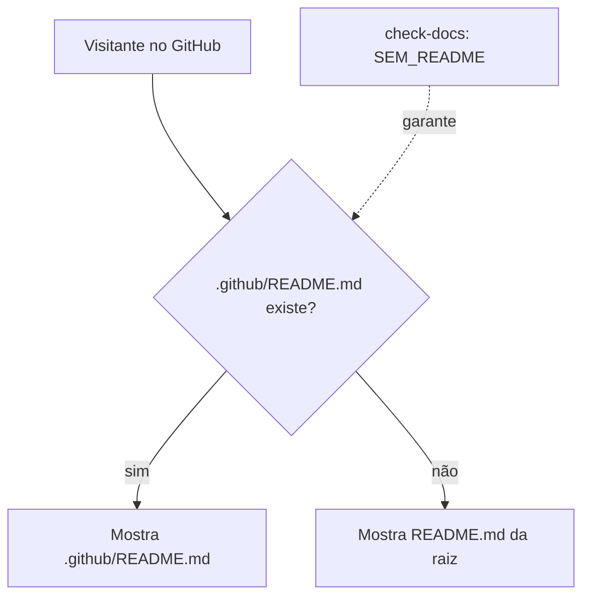

# VER-004 — README da raiz (descrição e projeção) e exceções de README

## Cabeçalho

| Campo | Valor |
|---|---|
| Id | VER-004 |
| Título | README da raiz (descrição e projeção) e exceções de README |
| Gravidade | baixa |
| Tipo | documentação · correção de registro |
| Data | 2026-11-16 |
| Usuário responsável | TokumoH |
| Status de implementação | implementado |
| Commits | commit que introduz este arquivo — `git log --format=%h -- docs/verificacoes/2026-11-16-004-readme-raiz.md` |
| Arquivos | `README.md` (novo), `.github/README.md` (removido), `.github/workflows/README.md`, `CLAUDE.md`, `scripts/check-docs.mjs`, `scripts/README.md`, `docs/verificacoes/README.md`, `docs/verificacoes/2026-11-16-003-devsecops-checagens-e-ci.md`, este registro |

## Problema

1. O repositório não tinha apresentação: a página inicial do GitHub mostrava o `.github/README.md` (documento técnico da pasta de CI).
2. Um README de apresentação (só descrição e projeção, pedido do usuário) contraria a regra do CORE de que todo README segue a estrutura de 11 seções.
3. O GitHub prioriza `.github/README.md` sobre o `README.md` da raiz. Com o `.github/README.md` mantido, o README novo nunca apareceria.
4. **Erro no VER-003:** o risco registrado dizia que o `.github/README.md` seria a página inicial "enquanto não houver `README.md` na raiz". É falso: a prioridade vale mesmo com README na raiz.

## Era proposital?

- Itens 1 a 3: não. O protótipo (`ef0207a`, `d099629`) nunca teve README. O `.github/README.md` foi criado no VER-003 só para cumprir a regra "todo diretório tem README".
- Item 4: não. Foi uma premissa não conferida no VER-003. A documentação oficial diz: "If a repository contains more than one README file, then the file shown is chosen from locations in the following order: the `.github` directory, then the repository's root directory, and finally the `docs` directory" ([About READMEs](https://docs.github.com/en/repositories/managing-your-repositorys-settings-and-features/customizing-your-repository/about-readmes)).

## Solução

1. **`README.md` na raiz**, com o texto aprovado pelo usuário: título, frase de destaque, badges, "Sobre", "Como funciona a transmissão" e "Projeção" (gestos → OBS, em 3 etapas). Fatos de origem: respostas do usuário e o site [revocast.vercel.app](https://revocast.vercel.app) ("o podcast da Atlética Revoada").
2. **Exceções no `CLAUDE.md`** ("Organização da documentação"): o README da raiz é só apresentação, e `.github/` fica sem README.
3. **`.github/README.md` removido.** A documentação da pasta passa para `.github/workflows/README.md`.
4. **`check-docs.mjs`:** novo mapa `SEM_README` com `.github`. Esse diretório deixa de exigir README e passa a **proibi-lo**, para evitar que alguém recrie o arquivo e esconda o README da raiz.
5. **VER-003 anotado:** o link para o arquivo removido foi desativado e a afirmação falsa recebeu nota de correção. O texto original foi mantido.
6. `scripts/README.md` e `docs/verificacoes/README.md` atualizados (exceções, VER-004 listado, exemplo hipotético passa a `005`).

## Por que esta solução

- O usuário pediu explicitamente um README só com descrição e projeção, e aprovou as duas exceções ("3. ok").
- Codificar a exceção no `check-docs` (em vez de só documentá-la) impede a regressão. O mapa `SEM_README` guarda o motivo ao lado, em referência independente.
- Anotar o VER-003, em vez de reescrevê-lo, preserva o histórico e corrige a afirmação falsa.

## Por que não outras soluções

| Opção | Motivo de descarte |
|---|---|
| Manter `.github/README.md` | O GitHub o mostraria no lugar do README da raiz |
| Renomear `.github/README.md` (ex.: `LEIAME.md`) | O GitHub reconhece qualquer `README.*`, e um nome diferente quebraria a convenção do CORE sem necessidade |
| README da raiz na estrutura de 11 seções | O usuário pediu só descrição e projeção |
| Documentar `.github/` no README da raiz | O README da raiz é só apresentação |
| Só documentar a exceção, sem mudar o `check-docs` | O push seria bloqueado (`.github/ sem README.md`) e a regressão não seria detectada |
| Reescrever o VER-003 | Registros são históricos; a correção fica rastreável por anotação |

## Onde

| Arquivo | Linhas | O que mudou |
|---|---|---|
| [`README.md`](../../README.md#L1-L59) | 1–59 | Novo: apresentação do projeto |
| `.github/README.md` | todas | Removido |
| [`.github/workflows/README.md`](../../.github/workflows/README.md#L20-L25) | 20–25 | Documenta a pasta-mãe `.github/` (exceção) |
| [`.github/workflows/README.md`](../../.github/workflows/README.md#L28) | 28 | "Origem" cita o VER-004 |
| [`.github/workflows/README.md`](../../.github/workflows/README.md#L83) | 83 | Risco: não recriar `.github/README.md` |
| [`CLAUDE.md`](../../CLAUDE.md#L74-L79) | 74–79 | Exceções de README (raiz e `.github/`) |
| [`scripts/check-docs.mjs`](../../scripts/check-docs.mjs#L4-L5) | 4–5 | Comentário da regra 2 com as exceções |
| [`scripts/check-docs.mjs`](../../scripts/check-docs.mjs#L16-L23) | 16–23 | Mapa `SEM_README` |
| [`scripts/check-docs.mjs`](../../scripts/check-docs.mjs#L58-L61) | 58–61 | Diretório em `SEM_README`: proíbe README e pula as conferências |
| [`scripts/README.md`](../../scripts/README.md#L52) | 52 | Descrição do `check-docs` com as exceções |
| [`scripts/README.md`](../../scripts/README.md#L91) | 91 | Risco: `.github/` sem README e raiz não conferida |
| [`docs/verificacoes/README.md`](README.md#L14) | 14 | Campo "Arquivos" inclui VER-004 |
| [`docs/verificacoes/README.md`](README.md#L57) | 57 | Linha do VER-004 em "Onde" |
| [`docs/verificacoes/README.md`](README.md#L80) | 80 | Exemplo hipotético passa a `005` |
| [`docs/verificacoes/2026-11-16-003-devsecops-checagens-e-ci.md`](2026-11-16-003-devsecops-checagens-e-ci.md#L75) | 75 | Link para `.github/README.md` desativado, com nota |
| [`docs/verificacoes/2026-11-16-003-devsecops-checagens-e-ci.md`](2026-11-16-003-devsecops-checagens-e-ci.md#L160) | 160 | Nota de correção da afirmação falsa |

## Lógica

| Passo | Antes | Depois |
|---|---|---|
| Visitante abre o repositório | Vê o `.github/README.md` (CI) | Vê o `README.md` da raiz (apresentação) |
| `check-docs` em `.github/` | Exige README | Proíbe README (`SEM_README`) |
| Alguém recria `.github/README.md` | Passaria | `ERRO [check-docs] .github/README.md existe, mas .github/ está em SEM_README` |
| Regra de README no CORE | Sem exceções | Duas exceções registradas, com motivo |

## Exemplo

| Situação | Antes | Depois |
|---|---|---|
| READMEs no repositório | `.github/`, `docs/`, `docs/verificacoes/`, `scripts/`, `.githooks/`, `.github/workflows/` | Raiz, `docs/`, `docs/verificacoes/`, `scripts/`, `.githooks/`, `.github/workflows/` |
| Página inicial (regra do GitHub) | `.github/README.md` | `README.md` (raiz) |
| `npm run check-docs` com `.github/README.md` recriado | 0 erros | 1 erro (sabotagem, ver "Verificação") |

## Verificação

| # | Abordagem | Comando / método | Resultado |
|---|---|---|---|
| Fonte | Documentação oficial do GitHub sobre prioridade de README | WebFetch em docs.github.com, "About READMEs" | Ordem `.github` → raiz → `docs` confirmada |
| Links externos | Badges e site | `curl -w '%{http_code}'` | 4/4 HTTP 200 (shields.io SVG, revocast.vercel.app) |
| Estrutura do README | Script Node: cercas de código pareadas, `
` balanceado, sintaxe das linhas dos 2 diagramas Mermaid, títulos | `node -e …` | 4 cercas (pares), 1/1 div, 2 diagramas sem linha fora do padrão, 4 títulos |
| Base | `check-docs` antes deste registro existir | `npm run check-docs` | 7 erros, todos por `2026-11-16-004-readme-raiz.md` inexistente |

Rodadas de dupla verificação: em "Resultados das rodadas".

### Resultados das rodadas

| Rodada | Abordagem | Resultado |
|---|---|---|
| 1 | Repositório real, sem commit: `npm run check` + conferência automática de cada âncora de "Onde" contra o `git diff HEAD -U0` + 3 sabotagens | `check` código 0; âncoras 14/14 OK. Sabotagem 1 (recriar `.github/README.md`) → erro "existe, mas .github/ está em SEM_README"; sabotagem 2 (desligar a exceção) → ".github/ sem README.md"; sabotagem 3 (`.github/teste/` sem README) → exigido normalmente. Tudo revertido. |
| 2 | Outra abordagem: clone do histórico real, commit simulado (9 arquivos), push pelo hook para remoto isolado, CI simulada e `git ls-tree` dos READMEs na ordem de prioridade do GitHub | hook: check-registro 0, check-docs 0, check-doc-secrets 0, audit 0, push aceito; CI `--range origin/master..HEAD`: 0 erros em 4 commits; READMEs: `.github/` nenhum → raiz `README.md` (o que o GitHub mostrará) |

Nits corrigidos (não zeram a contagem): linha em branco sobrando entre itens da lista "Riscos" de `.github/workflows/README.md`, corrigida antes da rodada 1.

## Riscos

- **Renderização dos diagramas Mermaid não verificada:** o teste com o Mermaid real no navegador foi bloqueado pelo controle de permissões da sessão (ele baixa um script externo). A sintaxe foi conferida por script estrutural. A confirmação visual fica para a página do GitHub após o push.
- **Página inicial não conferida no GitHub:** a troca vale quando o commit estiver na branch padrão (`master`), não em `branchTrabalho`.
- **Badges dependem do shields.io:** se o serviço cair, aparecem imagens quebradas (sem impacto no código).
- **Exceções exigem disciplina:** novas exceções de README devem entrar em `SEM_README` com o registro de origem.
