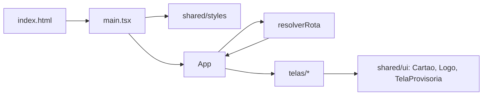

# VER-008 — E0, Tarefa 1: limpeza do protótipo e esqueleto React com a cara do RevoCast

## Cabeçalho

| Campo | Valor |
|---|---|
| Id | VER-008 |
| Título | E0, Tarefa 1: limpeza do protótipo e esqueleto React com a cara do RevoCast |
| Gravidade | média |
| Tipo | implementação · estrutura · DevSecOps (testes no `check`) |
| Data | 2026-11-17 |
| Usuário responsável | TokumoH |
| Status de implementação | implementado |
| Commits | commit que introduz este arquivo — `git log --format=%h -- docs/verificacoes/2026-11-17-008-e0-limpeza-e-esqueleto.md` |
| Arquivos | removidos: `send.html`, `receive.html`, `src/send.ts`, `src/receive.ts`, `src/assets/hero.png`, `src/assets/typescript.svg`, `src/assets/vite.svg`, `public/favicon.svg`, `public/icons.svg`; novos: `index.html`, `vercel.json`, `src/README.md`, `src/main.tsx`, `src/app/` (`README.md`, `rotas.ts`, `rotas.test.ts`, `App.tsx`, `App.test.tsx`), `src/app/telas/` (`README.md` e sete telas), `src/shared/README.md`, `src/shared/styles/` (`README.md`, `tokens.css`, `base.css`), `src/shared/ui/` (`README.md`, `Cartao.tsx`, `Logo.tsx`, `TelaProvisoria.tsx`, `logo.png`); modificados: `package.json`, `package-lock.json`, `vite.config.ts`, `tsconfig.json`, `scripts/check-docs.mjs`, `docs/verificacoes/_modelo-registro-de-correcao.md`, `README.md`, `CLAUDE.md`, `docs/README.md`, `scripts/README.md`, `.githooks/README.md`, `.github/workflows/README.md`, `docs/verificacoes/README.md`; este registro |

## Problema

A branch ainda tinha o protótipo de testes de conceito: duas páginas soltas (`send.html` e `receive.html`) com PeerJS, sem rotas, sem testes, sem a identidade visual do RevoCast e com diretórios isentos da regra "todo diretório tem README" (`LEGADO` com `public`, `src` e `src/assets`). A E0 do [PLA-001](../planos/2026-11-17-e0-fundacao.md) precisava de um ponto de partida limpo: app React com rotas por caminho, as telas do [DES-001](../desenho/2026-11-16-revocast-cameras-desenho.md) como provisórias, testes no `npm run check` e o restante das versões da seção "Tecnologias" do plano já instaladas.

## Era proposital?

Sim, até aqui. O protótipo foi feito à mão pelo responsável para testar os conceitos, e ele pediu para recomeçar o projeto do zero nesta branch. A remoção, as rotas e as versões estão definidas na Tarefa 1 do PLA-001, aprovado no [VER-007](2026-11-17-007-plano-e0.md). Nada foi removido sem estar na lista da tarefa.

## Solução

1. **Limpeza:** remove os nove arquivos do protótipo e o `peerjs`; `LEGADO = new Set()` no `check-docs`.
2. **Dependências fixas da seção "Tecnologias"** (React 19.3.1, Vite 8.3.5, Vitest 5.1.0, jsdom 31.0.1, Testing Library, supabase-js 2.119.0, PGlite 0.5.16 e outras), com o lockfile gerado pelo npm 11 com `--before=2026-11-14` e os 10 campos `libc` preservados.
3. **Rotas por caminho** (`src/app/rotas.ts`): `/entrar`, `/painel`, `/controle`, `/camera`, `/obs/palco`, `/obs/camera`; `/` leva a `entrar`; barras finais são ignoradas; o resto vai para "Página não encontrada". O `#` fica livre para o código de pareamento (DES-001). `vercel.json` reescreve tudo para o `index.html`.
4. **Telas provisórias** com logo, título e a etapa em que ficam prontas (E1, E3 ou E4, conforme a seção 14 do DES-001); `App` define o `document.title` como `<título> · RevoCast Câmeras`.
5. **Identidade visual** (`src/shared/styles`): tokens do modo claro tirados do site do RevoCast, modo escuro deste projeto e fundo de papel pontilhado; componentes `Cartao`, `Logo` e `TelaProvisoria` em `src/shared/ui`. O logo é o mesmo arquivo do site (sha256 `22f36ca8…5be63f`).
6. **Testes no `check`:** `npm test` (Vitest) roda logo depois do `typecheck` no `npm run check`, no hook pre-push e na CI.
7. **Documentação:** um README por diretório novo (formato do CORE) e os documentos que descrevem o `check` atualizados.
8. **Decisão 3 do PLA-001 (aprovada):** o texto do [`README.md`](../../README.md#L17-L37) da raiz é mantido. As seções "Sobre" e "Como funciona a transmissão" descrevem no presente as páginas emissora e receptora, que esta tarefa remove e que só voltam na E4: o texto descreve o produto, não o estado da branch. Só o selo "WebRTC-PeerJS" virou "WebRTC".

## Por que esta solução

- **Componentes e GRASP Pure Fabrication:** `resolverRota` é uma função pura sem React, testada sem DOM; `App` só junta rota, título e tela; `Cartao`, `Logo` e `TelaProvisoria` são reaproveitados por todas as telas. Os estilos ficam num lugar só (`tokens.css`), então mudar a identidade é mudar um arquivo.
- **DDD:** as pastas de domínio (`src/domains/*`) só nascem na etapa que lhes dá código (E1 em diante), como manda o PLA-001; nada é criado vazio.
- **Segurança:** versões exatas, lockfile com data de corte e `npm ci --ignore-scripts`; nenhuma dependência nova fora do plano; nenhum segredo.
- **Otimização:** rota resolvida uma vez por carga; sem roteador externo para seis caminhos.
- **Rastreabilidade:** cada afirmação dos READMEs foi conferida contra o código e as fontes, e as âncoras de linha dos registros antigos foram preservadas.

## Por que não outras soluções

| Opção | Motivo de descarte |
|---|---|
| Manter o protótipo e evoluir | O responsável pediu recomeço do zero; o protótipo não tinha rotas, testes nem identidade |
| React Router | Dependência a mais para seis caminhos fixos; uma função pura de 31 linhas resolve e é testável |
| Rotas por `#` (hash) | O `#` é reservado ao código de pareamento (DES-001) |
| Tailwind ou biblioteca de componentes | Dependência a mais; o visual já está definido pelo site do RevoCast |
| Regerar o lockfile com o npm 10 local | O npm 10 apaga os 10 campos `libc` e quebraria a instalação em outras plataformas |
| Versões mais novas que as do plano | O PLA-001 aprovado fixa as versões; mudá-las é decisão do responsável |
| Passar o texto do README da raiz para o futuro | Decisão 3: o texto descreve o produto, não o estado da branch |

## Onde

| Arquivo | Linhas | O que mudou |
|---|---|---|
| `send.html`, `receive.html`, `src/send.ts`, `src/receive.ts`, `src/assets/*` (3), `public/*` (2) | — | Removidos (protótipo) |
| [`package.json`](../../package.json#L16-L36) | 16–17, 20–26, 28–29, 32–34 | `check` com `npm test`; script `test` por último (preserva a âncora `#L9-L16` do VER-003); dependências exatas do plano; `peerjs` removido |
| [`package-lock.json`](../../package-lock.json) | — | Gerado com npm 11 e `--before=2026-11-14`; 10 campos `libc`; 147 pacotes |
| [`vite.config.ts`](../../vite.config.ts#L1-L13) | 1–13 | `vitest/config`, plugin React, entrada padrão, `test.include` |
| [`tsconfig.json`](../../tsconfig.json#L16-L25) | 16, 22–23, 25 | `jsx: react-jsx`, `noImplicitReturns`, `include` com `src` e `supabase/tests` |
| [`index.html`](../../index.html#L1-L19) | 1–19 | Novo: fontes do site (Lilita One, Nunito, Caveat) e `/src/main.tsx` |
| [`vercel.json`](../../vercel.json#L1) | 1 | Novo: reescreve todo caminho para `/index.html` |
| [`src/main.tsx`](../../src/main.tsx#L1-L11) | 1–11 | Novo: importa os estilos e monta `<App caminho={window.location.pathname} />` |
| [`src/app/rotas.ts`](../../src/app/rotas.ts#L1-L31) | 1–31 | Novo: `NomeDaRota`, `Rota`, `resolverRota` |
| [`src/app/rotas.test.ts`](../../src/app/rotas.test.ts#L1-L22) | 1–22 | Novo: 11 casos com nome e título literais |
| [`src/app/App.tsx`](../../src/app/App.tsx#L1-L27) | 1–27 | Novo: resolve a rota, define o título, escolhe a tela |
| [`src/app/App.test.tsx`](../../src/app/App.test.tsx#L1-L39) | 1–39 | Novo: Controle com logo; "Página não encontrada" no cartão rosa com link para `/entrar`; nas 7 rotas, título, `document.title`, frase e logo |
| [`src/app/telas/`](../../src/app/telas/README.md) | — | Novo: sete telas (seis provisórias e `NaoEncontrada`) e README |
| [`src/shared/styles/tokens.css`](../../src/shared/styles/tokens.css#L1-L40) | 1–40 | Novo: tokens claros (do site) e escuros (do projeto) |
| [`src/shared/styles/base.css`](../../src/shared/styles/base.css#L1-L63) | 1–63 | Novo: reset, fundo pontilhado, `.cartao`, `.botao`, `.tela` |
| [`src/shared/ui/`](../../src/shared/ui/README.md) | — | Novo: `Cartao`, `Logo`, `TelaProvisoria`, `logo.png` (473 039 bytes) e README |
| [`src/README.md`](../../src/README.md), [`src/app/README.md`](../../src/app/README.md), [`src/shared/README.md`](../../src/shared/README.md) | — | Novos: README de cada diretório no formato do CORE |
| [`scripts/check-docs.mjs`](../../scripts/check-docs.mjs#L4-L14) | 5, 13–14 | `LEGADO` vazio; comentários atualizados no lugar (91 linhas, âncoras do VER-003 e VER-004 intactas) |
| [`docs/verificacoes/_modelo-registro-de-correcao.md`](_modelo-registro-de-correcao.md#L8) | 8, 55 | Exemplo `src/send.ts` vira `package.json` (o arquivo segue com 83 linhas) |
| [`README.md`](../../README.md#L10) | 10 | Selo "WebRTC-PeerJS" vira "WebRTC" (decisão 3: texto mantido) |
| [`CLAUDE.md`](../../CLAUDE.md#L17) | 17 | `check` com `npm test` desde este registro |
| [`docs/README.md`](../README.md#L78) | 78 | `LEGADO` vazio desde este registro |
| [`scripts/README.md`](../../scripts/README.md#L52) | 52, 61, 90 | `LEGADO` vazio; diagrama com `npm test` |
| [`.githooks/README.md`](../../.githooks/README.md#L61) | 61 | Diagrama: o `check` inclui testes |
| [`.github/workflows/README.md`](../../.github/workflows/README.md#L68) | 68 | A CI roda os testes no `check` |
| [`docs/verificacoes/README.md`](README.md) | — | VER-008 em "Arquivos" e "Onde"; exemplo passa para 009 |

## Lógica

| Passo | Antes | Depois |
|---|---|---|
| 1. Abrir `/painel` | 404 (só existiam `send.html` e `receive.html`) | `index.html` → `main.tsx` → `App` → tela "Painel" |
| 2. Recarregar `/painel` na Vercel | — | `vercel.json` devolve o `index.html` (a conferir no Passo 14) |
| 3. Caminho desconhecido | 404 do servidor | Tela "Página não encontrada" com link para `/entrar` |
| 4. `npm run check` | typecheck, docs, segredos, audit | typecheck, **testes**, docs, segredos, audit |
| 5. Diretório sem README | `src` e `public` isentos (`LEGADO`) | Nenhum isento por ser antigo; `.github` segue sem README (VER-004) |

## Exemplo

| Caminho | `resolverRota` | Título da aba | Frase |
|---|---|---|---|
| `/` | `entrar` | Entrar · RevoCast Câmeras | Em construção — etapa E1 |
| `/painel//` | `painel` | Painel · RevoCast Câmeras | Em construção — etapa E1 |
| `/obs/palco` | `obs_palco` | Palco (OBS) · RevoCast Câmeras | Em construção — etapa E3 |
| `/obs` | `nao_encontrada` | Página não encontrada · RevoCast Câmeras | Esse endereço não existe. |

Números do estado final: 2 arquivos e 20 testes; `check-docs` com 0 erros em 26 arquivos `.md` e 8 registros; `found 0 vulnerabilities`; build com `dist/index.html` de 0,77 kB, JS de 221,66 kB e logo de 473 kB.

## Verificação

A Tarefa 1 foi executada por um subagente implementador (passos 1 a 12). O agente principal fez as rodadas A (conferência prática própria) e despachou, a cada rodada B, um revisor novo e independente, com sabotagens em cópias fora do repositório. Foram 14 revisores até duas verificações seguidas limpas.

| Rodada | Resultado | Achados e correção |
|---|---|---|
| R1 | aprovada com sugestões | Título com fonte única, componente `Logo`, risco da `TelaProvisoria`, `CLAUDE.md` → incorporados (correção 1) |
| R2 | reprovada | Teste de títulos tautológico; README afirmava checagem de exaustividade inexistente (→ `noImplicitReturns`); lockfile sem `libc` → correção 2 |
| R3 | rodada A achou | Lockfile novo subiu o vite para 8.3.8 → fixado 8.3.5 com `--before=2026-11-14` (correção 3) |
| R4 | reprovada | Lockfile reescrito pelo npm 10 (sem `libc`); cor fixa em `base.css` → `--on-accent` (correção 4) |
| R5 | reprovada | `docs/README.md` afirmava "nenhum diretório isento" (falso: `.github`); contraste sem números → corrigido e recalculado |
| R6 | reprovada | PGlite 0.5.16 faltando; origem dos tokens falsa; risco do foco não registrado → correção 5 |
| R7 | reprovada | Teste do `App` não distinguia telas (sabotagem verde) → frase por rota (correção 6) |
| R8 | aprovada | Logo nas 7 rotas e caso `/painel//` sem teste → incorporados (correção 7), contagem zerada |
| R9 | aprovada | README dizia que o teste "distingue as telas entre si" (exagero) → corrigido como afirmação falsa, contagem zerada |
| R10 | aprovada | `tom` do `Cartao` sem teste (3º revisor a apontar) → teste do cartão rosa, contagem zerada |
| R11 | reprovada | Comentário de `LEGADO` falso (escrito pelo agente principal: `src` não saiu, ganhou README) → corrigido |
| R12 | aprovada | Link "Ir para a entrada" sem teste → teste incorporado, contagem zerada |
| R13 | reprovada | Script `test` deslocou a âncora `package.json#L9-L16` do VER-003 → `test` movido para depois de `check` |
| **V1** (rodada A após R13) | **limpa** | `npm run check` 0 erros, 20 testes; 10 `libc`; `package.json` com 36 linhas e igual a `packages[""]`; diagrama Mermaid validado |
| **V2** (R14, revisor independente) | **limpa** | Spec ✅, qualidade aprovada; varredura das 25 âncoras que apontam para arquivos tocados: nenhuma deslocada pela tarefa |

Sabotagens pegas pelos testes ou pelo typecheck (em cópias): barra final sem tratamento; `/` levando a outra rota; `/obs` aceito; sem `document.title` (7 falhas); título fixo na tela (6 a 7 falhas); sem logo ou `alt` vazio (até 8 falhas); `Painel` trocado por `Camera`; etapa trocada; `NaoEncontrada` sem `tom` ou `Cartao` ignorando `tom`; link para `/painel`; regex `/\/$/` (só uma barra); nome novo em `NomeDaRota` sem `case` (TS7030). Outras conferências: sha256 do logo igual ao de um clone anônimo do site; tokens iguais aos do site; contrastes recalculados; `npm ci --ignore-scripts` numa cópia sem mudar o lockfile; lockfile regerado byte a byte igual; Chromium em modo claro e escuro, de 320 a 375 px, sem rolagem lateral.

Ficaram de fora, com motivo:

| Sugestão | Motivo |
|---|---|
| `"typescript": "7.0.2"` exato | A linha `~7.0.2` já existia antes da tarefa; o lockfile fixa 7.0.2 e não há 7.0.x posterior; mudar exigiria regerar o lockfile sem efeito prático |
| Remover o teste "Controle com logo" (repete o `test.each`) | É o teste literal pedido no Passo 6 do plano |
| Devolver "seu README é só apresentação" ao comentário do `check-docs.mjs` | A informação está em `scripts/README.md:91` e no `CLAUDE.md`; o comentário ficou curto para manter as 91 linhas e as âncoras |
| Classe `tela__logo` no `Logo` sem CSS | Adiado para a E1, quando as telas ganham layout próprio |

Nits corrigidos (não zeram a contagem): `src/app/telas/README.md:68` (onde as frases de etapa se repetem), reconferido com `npm run check-docs` (0 erros); links deste registro acrescentados em `CLAUDE.md:17`, `docs/README.md:78` e `scripts/README.md:90`. Último ato antes do pedido de commit: `npm run check` com 0 erros.

## Riscos

- **Contraste (decisão pendente do responsável):** texto `#1b1b22` sobre o rosa `#d83868` dá 3,82:1 (o site usa `#fff`, 4,48:1); os dois ficam abaixo do AA de 4,5:1 para o botão de 20 px. O contorno de foco ciano dá 2,09:1 sobre o papel (mínimo 3:1). Herdados do site; registrados em `src/shared/styles/README.md`.
- **Passo 14 pendente:** a reescrita do `vercel.json` só se confirma no deploy de prévia (abrir `/painel`, `/obs/palco`, `/xyz` e recarregar `/painel`). O resultado vai para o VER-009.
- **Sem teste automático do `main.tsx`:** trocar `pathname` por `hash` passaria no typecheck e nos testes; só o preview manual e a Vercel pegam.
- **Telas da mesma etapa com conteúdo idêntico:** trocar `Entrar` por `Painel` (ou `Controle`/`ObsPalco`, `Camera`/`ObsCamera`) não muda o que aparece e não é detectado pelos testes, até as telas ganharem conteúdo (E1+).
- **Maiúsculas:** `/PAINEL` leva a "Página não encontrada"; o comportamento não está definido no desenho.
- **Sem favicon:** o navegador pede `/favicon.ico` (404 no `vite preview`; na Vercel a reescrita devolve o `index.html`). Pendência: favicon a partir do logo.
- **Logo de 473 kB sem otimização;** classe `.botao--ciano` ainda sem uso (parte da base visual).
- **Dependências recentes:** as versões do plano têm de 4 a 13 dias de publicadas (corte `--before=2026-11-14`).
- **Node mínimo 22.22.2** (exigido pelo jsdom): a CI e a máquina local atendem; o hook pre-push numa máquina com Node 22 mais antigo falharia no `npm test`. Não há `engines` no `package.json`.
- **Lockfile e npm 10:** rodar `npm install` com o npm 10 dentro do repositório apaga os campos `libc`; usar `npx npm@11`.
- **Âncoras antigas já deslocadas antes desta tarefa** (não mexidas, pendência para uma correção própria): VER-001 (`CLAUDE.md#L1-L117`, `docs/README.md#L1-L76`), VER-002 (`CLAUDE.md#L126-L131`), VER-003 (`scripts/check-docs.mjs#L1-L78`, `docs/README.md#L76`) e VER-005 (`docs/README.md#L14`). As âncoras do VER-003 (`#L76-L79`, `#L86-L87`, `#L93`) e do VER-004 (`#L80`) para `docs/verificacoes/README.md` já apontavam para linhas erradas no HEAD; a linha deste registro em "Onde" as empurra mais uma linha. É estrutural: todo registro novo acrescenta uma linha antes delas. As âncoras para as linhas 14, 56 e 57 seguem intactas.
