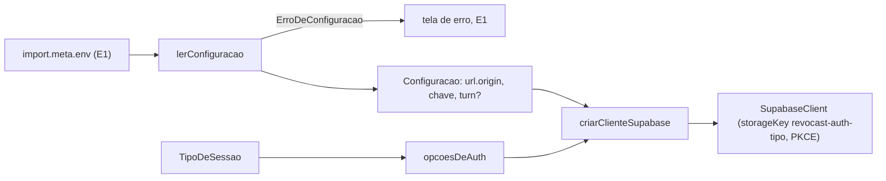

# VER-009 — E0, Tarefa 2: configuração e cliente Supabase

## Cabeçalho

| Campo | Valor |
|---|---|
| Id | VER-009 |
| Título | E0, Tarefa 2: configuração e cliente Supabase |
| Gravidade | média |
| Tipo | implementação · infraestrutura · segurança |
| Data | 2026-11-17 |
| Usuário responsável | TokumoH |
| Status de implementação | implementado |
| Commits | commit que introduz este arquivo — `git log --format=%h -- docs/verificacoes/2026-11-17-009-e0-supabase-cliente.md` |
| Arquivos | novos: `src/shared/infra/` (`README.md`, `configuracao.ts`, `configuracao.test.ts`, `supabase.ts`, `supabase.test.ts`), `.env.example`; modificados: `.gitignore`, `src/shared/README.md`, `docs/verificacoes/README.md`; este registro |

## Problema

O app da E0 ([VER-008](2026-11-17-008-e0-limpeza-e-esqueleto.md)) não tinha como ler a configuração do Supabase nem criar o cliente com as opções de segurança do [DES-001](../desenho/2026-11-16-revocast-cameras-desenho.md): PKCE, uma sessão guardada por tipo (membro, câmera, palco do OBS, câmera do OBS) e só o membro lendo o retorno do login pela URL. Sem isso, a E1 (login Google) começaria sem a base, e um erro de configuração (variável vazia, URL errada, chave secreta no lugar da pública) só apareceria depois, como erro genérico do supabase-js.

## Era proposital?

Sim, a ausência: a Tarefa 2 do [PLA-001](../planos/2026-11-17-e0-fundacao.md) é a que cria essa base. Nenhum código anterior lia variáveis de ambiente.

## Solução

1. **`lerConfiguracao(env)`** (`configuracao.ts`): recebe o ambiente como argumento e valida:
   - `VITE_SUPABASE_URL` e `VITE_SUPABASE_PUBLISHABLE_KEY` obrigatórias (ausente, vazia ou só espaços → `ErroDeConfiguracao` com o nome da variável; pontas aparadas);
   - a URL em três checagens: começa com `https://`; `new URL` a aceita; o texto, sem uma barra final, é igual à origem (`url.origin`) — o que recusa caminho (ex.: `/rest/v1` colado do painel), `?`, `#`, credenciais, barra invertida, tab e quebra de linha no meio e `:443`. Devolve `url.origin`;
   - chave com prefixo `sb_secret_` é recusada (iria para o navegador), sem repetir o valor na mensagem;
   - TURN (`VITE_TURN_URL`, `VITE_TURN_USUARIO`, `VITE_TURN_SENHA`) só entra completo.
2. **`criarClienteSupabase(config, tipo)`** (`supabase.ts`): `createClient(url, chave, { auth: opcoesDeAuth(tipo) })`, com `storageKey` `revocast-auth-<tipo>`, `flowType: 'pkce'`, `persistSession` e `autoRefreshToken` ligados e `detectSessionInUrl` só para `membro`.
3. **`.env.example`** com os nomes, sem valores; **`.gitignore`** passa a ignorar `.env`, `.env.*` (menos `.env.example`) e a pasta transitória `.vitest/`.
4. README de `src/shared/infra/` e `src/shared/README.md` atualizados.
5. **Passo 14 da Tarefa 1** (deploy de prévia na Vercel, do responsável): **pendente** — o resultado ainda não foi informado; o PLA-001 manda levá-lo ao VER-011 se continuar pendente.

## Por que esta solução

- **GRASP Pure Fabrication:** leitura de ambiente e criação do cliente ficam numa fabricação pura de infraestrutura (`shared/infra`), sem conhecer telas; os domínios da E1 em diante só a consomem.
- **Testável:** o ambiente entra como argumento, então os testes não mexem em variáveis globais; o `createClient` é simulado nos testes de repasse e foi conferido de verdade pelos revisores.
- **Segurança:** PKCE em todos os clientes; chave de sessão separada por tipo, para que as duas Fontes do OBS (que dividem o perfil do navegador) não se sobrescrevam; recusa da chave secreta; `.env*` fora do Git.
- **Falha cedo e com nome:** todo erro de configuração vira `ErroDeConfiguracao` citando a variável, em vez de um erro genérico do supabase-js mais adiante.

## Por que não outras soluções

| Opção | Motivo de descarte |
|---|---|
| Ler `import.meta.env` dentro do módulo | Não testável sem manipular o ambiente global |
| Criar o cliente na carga do módulo | Quebraria ao importar quando faltasse variável, antes de a tela poder mostrar o erro |
| Uma chave de sessão só (padrão `sb-<ref>-auth-token`) | Sessões de tipos diferentes no mesmo navegador se sobrescreveriam |
| Validar a URL com várias regex (tentativas das correções 1–2) | Sempre sobrava um formato estranho aceito (barra invertida, credenciais, quebra de linha); a igualdade com `url.origin` cobre todos de uma vez |
| Aceitar `:443` normalizando antes | O painel do Supabase nunca mostra `:443`; recusar é mais simples e está testado e documentado |
| Ignorar só `.env` (pedido mínimo do plano) | `.env.production` e `.env.development`, que o Vite carrega, ficariam versionáveis |

## Onde

| Arquivo | Linhas | O que mudou |
|---|---|---|
| [`src/shared/infra/configuracao.ts`](../../src/shared/infra/configuracao.ts#L1-L58) | 1–58 | Novo: `Configuracao`, `ErroDeConfiguracao`, `lerConfiguracao` |
| [`src/shared/infra/configuracao.test.ts`](../../src/shared/infra/configuracao.test.ts#L1-L104) | 1–104 | Novo: 11 testes |
| [`src/shared/infra/supabase.ts`](../../src/shared/infra/supabase.ts#L1-L29) | 1–29 | Novo: `TipoDeSessao`, `chaveDeArmazenamento`, `opcoesDeAuth` (tipo de retorno explícito), `criarClienteSupabase` |
| [`src/shared/infra/supabase.test.ts`](../../src/shared/infra/supabase.test.ts#L1-L73) | 1–73 | Novo: 6 testes (`createClient` simulado) |
| [`src/shared/infra/README.md`](../../src/shared/infra/README.md#L1-L95) | 1–95 | Novo: README no formato do CORE |
| [`.env.example`](../../.env.example#L1-L11) | 1–11 | Novo: nomes das variáveis, sem valores |
| [`.gitignore`](../../.gitignore#L25-L32) | 25–32 | `.env`, `.env.*`, `!.env.example`, `.vitest/` |
| [`src/shared/README.md`](../../src/shared/README.md#L14) | 14, 18, 26, 46, 57, 71 | `infra/` em Arquivos, Propósito, Organização, Onde, diagrama e Riscos |
| [`docs/verificacoes/README.md`](README.md) | — | VER-009 em "Arquivos" e "Onde"; exemplo passa para 010 |

## Lógica

| Entrada | Antes | Depois |
|---|---|---|
| `VITE_SUPABASE_URL` vazia | — (não havia leitura) | `ErroDeConfiguracao`: "Variável de ambiente ausente ou vazia: VITE_SUPABASE_URL" |
| `https://<ref>.supabase.co/rest/v1` | o supabase-js montaria `/rest/v1/rest/v1` | recusada: "deve ser só a origem do projeto" |
| chave `sb_secret_...` | iria para o bundle do navegador | recusada, sem repetir o valor |
| câmera e membro no mesmo navegador | mesma chave padrão, sessões se sobrescrevendo | `revocast-auth-camera` × `revocast-auth-membro` |

## Exemplo

`lerConfiguracao({ VITE_SUPABASE_URL: 'HTTPS://ABC.supabase.co/', VITE_SUPABASE_PUBLISHABLE_KEY: ' sb_publishable_x ' })` devolve `{ supabaseUrl: 'https://abc.supabase.co', supabaseChavePublica: 'sb_publishable_x' }`; com esse resultado, o `createClient` real (supabase-js 2.119.0, conferido pelos revisores) monta `https://abc.supabase.co/rest/v1` e `/auth/v1`. `criarClienteSupabase(config, 'camera')` usa a chave `revocast-auth-camera`, `flowType: 'pkce'` e `detectSessionInUrl: false`.

## Verificação

Implementação por subagente; o agente principal fez as rodadas A (conferência própria: testes, typecheck, checagens, leitura do código contra o plano) e despachou um revisor independente novo em cada rodada B, com sabotagens em cópias fora do repositório e o `createClient` real.

| Rodada | Resultado | Achados e correção |
|---|---|---|
| R1 | reprovada | Teste de espaços que nunca falhava; README afirmava sabotagem de todos os testes sem prova; `.gitignore` sem `.env.*` (segurança) → correção 1 |
| R2 | reprovada | "ou de outra câmera" falso (a chave é por tipo); `shared/README` dizia que telas já usavam `infra`; TURN sem casos; `https:abc` aceito → correção 2 |
| R3 | reprovada | URL aceitava barra invertida, credenciais, quebra de linha; dois testes nunca falhavam → regra única de igualdade com `url.origin` (correção 3) |
| R4 | reprovada | Teste com credencial seguida de domínio real (parece e-mail) acusado pelo `check-doc-secrets` (quebraria o `check`) → credencial com `localhost` (correção 4) |
| R5 | reprovada | "Espaços no meio" atribuídos à checagem errada; teste de clientes diferentes passava isolado com cache → correção 5 |
| R6 | reprovada | Fábrica conferida só para 3 dos 4 tipos → teste de repasse com os 4 tipos e valores literais; `.vitest/` no `.gitignore` (correção 6) |
| R7 | aprovada | Sugestão de segurança incorporada: recusar `sb_secret_` (correção 7), contagem zerada |
| R8 | reprovada | Nenhum teste conferia `ErroDeConfiguracao extends Error` → correção 8, com tabela consolidada |
| **V1** (rodada A após R8) | **limpa** | 17 testes, typecheck, `check-doc-secrets` 0, tipo de retorno explícito |
| **V2** (R9, revisor independente) | **limpa** | Spec ✅, qualidade aprovada; reproduziu as 18 linhas da tabela abaixo |

Sabotagens no código final (cópia nova; controle: 17 testes passando). Cada uma derruba o teste na suíte e rodando isolado com `-t`:

| Teste | Sabotagem (troca exata) | Suíte | Isolado |
|---|---|---|---|
| lê as variáveis obrigatórias | `const supabaseChavePublica = supabaseUrl` | 5 falham | 1 falha |
| nomeia a variável que falta | `valor === ''` em vez de `!valor` | 1 falha | 1 falha |
| variável vazia ou só com espaços conta como ausente | `obrigatoria` sem `trim` | 3 falham | 1 falha |
| remove espaços nas pontas dos valores | `obrigatoria` sem `trim` | 3 falham | 1 falha |
| recusa URL sem https, inclusive formas malformadas | checagem só por `startsWith('https')` | 2 falham | 1 falha |
| aceita a origem do projeto e devolve url.origin | devolver o texto em vez de `url.origin` | 1 falha | 1 falha |
| recusa URL inválida, citando a variável | mensagem `'não é uma URL válida'` → `'URL ruim'` | 1 falha | 1 falha |
| recusa o que não é só a origem | `if (...)` da comparação com a origem → `if (false)` | 1 falha | 1 falha |
| TURN só entra completo; valores aparados | TURN aceito só com a URL | 1 falha | 1 falha |
| recusa chave secreta, sem vazar o valor | sem a checagem de `sb_secret_` | 1 falha | 1 falha |
| o erro se chama ErroDeConfiguracao | sem `this.name` | 1 falha | 1 falha |
| o erro se chama ErroDeConfiguracao (herança) | classe sem herdar de `Error` | 7 falham | 1 falha |
| cada tipo de sessão tem chave própria | `storageKey` fixo | 4 falham | 1 falha |
| segue o formato revocast-auth-&lt;tipo&gt; | prefixo `auth-` | 3 falham | 1 falha |
| PKCE sempre; sessão na URL só para membro | `detectSessionInUrl` sempre `true` | 3 falham | 1 falha |
| todos os tipos: PKCE, sessão persistida, renovação, chave própria | `autoRefreshToken: false` para `obs_camera` | 2 falham | 1 falha |
| repassa URL, chave e opções literais dos 4 tipos | `flowType: 'implicit'` só para `camera` | 3 falham | 1 falha |
| clientes de tipos diferentes recebem chaves diferentes | cache de cliente por URL | 2 falham | 1 falha |

Ficaram de fora, com motivo:

| Sugestão | Motivo |
|---|---|
| Mensagem de recusa citando também `:443` e punycode | Preferência de UX; a mensagem é verdadeira e o README documenta os dois casos |
| Frase "conferido pelo `check-docs`" mais precisa (só itens faltantes) | Frase verdadeira, padrão de todos os READMEs do repositório |

Nits corrigidos (não zeram a contagem): parêntese ambíguo em `configuracao.ts:38` e no README de infra ("o `URL` remove tab e quebra de linha"), reconferido com `npx vitest run src/shared/infra` (17), `npm run typecheck` e `npm run check-docs` (0 erros); trocas exatas na tabela acima; link deste registro no README de infra.

## Riscos

- **Passo 14 da Tarefa 1 pendente** (deploy de prévia na Vercel); vai para o VER-011 se continuar pendente.
- O cliente ainda não é usado por nenhuma tela; nenhuma tela mostra o `ErroDeConfiguracao` (E1).
- Testes do cliente usam `createClient` simulado; o real foi conferido pelos revisores, não por teste automático, e nunca contra um projeto Supabase de verdade.
- A chave de sessão é por tipo, não por dispositivo: duas câmeras no mesmo navegador dividem `revocast-auth-camera`; e não inclui o ref do projeto: dois projetos Supabase na mesma origem (ex.: localhost entre dev e prod) dividem a sessão.
- `https` obrigatório recusa o Supabase local da CLI (`http://127.0.0.1:54321`).
- A recusa de chave secreta só reconhece o prefixo novo `sb_secret_`; chaves JWT antigas `service_role` passam.
- `VITE_TURN_SENHA`, como toda variável `VITE_`, vai para o bundle do navegador (o DES-001 reconhece).
- Domínio próprio com acento precisa ser escrito em punycode (`xn--…`).
