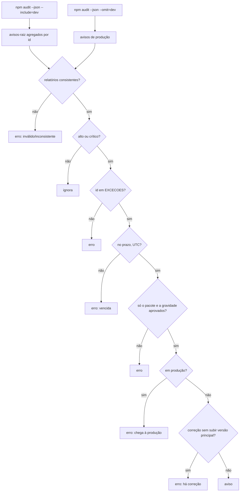

# VER-012 — `check-deps-audit` com exceções explícitas e com prazo

## Cabeçalho

| Campo | Valor |
|---|---|
| Id | VER-012 |
| Título | `check-deps-audit` com exceções explícitas e com prazo |
| Gravidade | alta |
| Tipo | DevSecOps · segurança · correção |
| Data | 2026-11-18 |
| Usuário responsável | TokumoH |
| Status de implementação | implementado |
| Commits | commit que introduz este arquivo — `git log --format=%h -- docs/verificacoes/2026-11-18-012-audit-excecao-com-prazo.md` |
| Arquivos | novos: `scripts/check-deps-audit.mjs`, `scripts/tests/check-deps-audit.test.mjs`, `scripts/tests/README.md`; modificados: `package.json`, `scripts/README.md`, `docs/verificacoes/README.md`; este registro |

## Problema

Em 2026-11-17, durante a execução da E0, o `npm audit` passou a acusar o aviso [GHSA-fc5q-39xc-vjpf](https://github.com/advisories/GHSA-fc5q-39xc-vjpf): ReDoS no `picomatch` (gravidade alta, CVSS 7,5, `AV:N/AC:L/PR:N/UI:N/S:U/C:N/I:N/A:H`), em todas as versões até a 4.0.7 — a mais nova; não há versão corrigida. O `picomatch` 4.0.7 chega ao projeto por `vite` 8.3.5 e `vitest` 5.1.0 (direto e via `tinyglobby` → `fdir`), só em dependências de desenvolvimento; o `npm audit` marca 6 pacotes como altos. Efeito: `npm run check-deps-audit` (`npm audit --audit-level=high`) sai com código 1, o que reprova o `npm run check`, o hook pre-push e a CI — e bloqueia o push de qualquer commit, inclusive o da Tarefa 2 ([VER-009](2026-11-17-009-e0-supabase-cliente.md)), que fica só no container temporário.

## Era proposital?

Não. O `check-deps-audit` (desde o [VER-003](2026-11-16-003-devsecops-checagens-e-ci.md)) passou no último `npm run check` do VER-009, rodado em 2026-11-17 numa árvore só com a Tarefa 2 (`found 0 vulnerabilities`); a falha veio de um aviso novo no registro do npm, não de mudança no código. Nenhuma dependência foi trocada (lockfile igual ao do `8adb4fb`).

## Solução

Decisão do responsável (2026-11-18): exceção explícita e com prazo.

1. **`scripts/check-deps-audit.mjs`** substitui o comando `npm audit --audit-level=high`. Roda `npm audit --json` duas vezes — completo (`--include=dev --offline=false`) e de produção (`--omit=dev --offline=false`) — e reprova todo aviso alto ou crítico, exceto os listados em `EXCECOES`.
2. Cada exceção tem `id` (GHSA), `pacote`, `severidade` aprovada, `motivo` e `revisarAte` (data em UTC, inclusive). Ela só vale se tudo for verdadeiro; qualquer item falso volta a reprovar:
   - o aviso aparece só naquele pacote e com gravidade não maior que a aprovada;
   - hoje (UTC) ≤ `revisarAte`;
   - o aviso **não** aparece no relatório de produção;
   - o pacote do aviso não tem correção que não suba versão principal (`fixAvailable` igual a `true`, ou objeto sem `isSemVerMajor`).
3. **Falha fechada:** relatório inválido (sem rede, saída não-JSON, `error`, formato diferente da versão 2, `vulnerabilities` ausente ou em lista), aviso sem identificação ou nomeado com outro pacote, `via` que não é lista, e inconsistência **pacote a pacote** — cada pacote alto ou crítico precisa alcançar um aviso-raiz com a gravidade dele (nos próprios ou nos dos pacotes que ele cita, recursivamente; os citados precisam estar no relatório, como chave própria) e a contagem da metadata precisa bater com os pacotes de cada gravidade — tudo reprova, mesmo com uma exceção ativa. A conferência sobe pelas citações ao contrário a partir dos avisos-raiz, em tempo proporcional ao tamanho do relatório; ciclos e a ordem dos pacotes não mudam o resultado. Aviso grave que aparece no relatório de produção com gravidade maior que no completo (ou ausente nele) também reprova. Avisos repetidos em vários pacotes são agregados (maior gravidade, todos os pacotes, correção de qualquer um). `hoje` é obrigatório.
4. Exceção cujo aviso sumiu vira **aviso** ("remova-a de EXCECOES"), não erro, para não travar o push quando a correção sair.
5. Primeira e única exceção: `GHSA-fc5q-39xc-vjpf` (`picomatch`, alta), até **2026-12-17**.
6. Testes em `scripts/tests/check-deps-audit.test.mjs` (53), sem rede, inclusive da linha de comando: `principal` e `auditar` com o `npm audit` simulado, `principal` com o relógio simulado (data padrão) e o script executado como processo com um npm falso (guarda de execução e código de saída). Um teste exige que toda exceção vença em no máximo 90 dias a partir de hoje (renovação curta obrigatória). README do diretório novo; `scripts/README.md` atualizado.
7. Número: VER-012, porque VER-010 e VER-011 estão reservados pelo [PLA-001](../planos/2026-11-17-e0-fundacao.md) para as Tarefas 3 e 4 da E0, ainda em verificação, e já são citados nos arquivos delas; o `check-docs` exige só número único. Pelo mesmo motivo, o exemplo da seção "Exemplo" de `docs/verificacoes/README.md` continua com 010: é o próximo registro a nascer.

## Por que esta solução

- **Mantém a vigilância:** qualquer aviso novo, alto ou crítico, em qualquer dependência continua reprovando; a exceção é por id **e** pacote **e** gravidade.
- **Não deixa a exceção apodrecer:** vence sozinha em 30 dias e cai quando houver correção sem subir versão principal ou quando o pacote chegar à produção.
- **Risco real baixo:** o ReDoS exige padrões de arquivo controlados por quem ataca; aqui os padrões são do próprio projeto (`vite.config.ts`, `vitest`) e o `picomatch` não vai para o app publicado (auditoria de produção: 0 vulnerabilidades).
- **Componentes / Pure Fabrication:** a regra fica em funções puras (`avaliarAuditoria`, `avisosRaiz`), testáveis sem rede; a execução do npm fica na borda (`principal`/`auditar`), e o relatório usa o `reporter()` de `_lib.mjs` como as outras checagens.
- **Portável e robusto:** pelo `npm run`, usa `npm_execpath` com o próprio Node (sem shell, também no Windows); `cwd` fixo na raiz do repositório e tempo limite de 2 minutos; `--include=dev` e `--offline=false` impedem que o ambiente (`NODE_ENV=production`, `npm_config_omit=dev`, `npm_config_offline=true`) esvazie a auditoria.

## Por que não outras soluções

| Opção | Motivo de descarte |
|---|---|
| `npm audit --omit=dev` | Deixa de vigiar para sempre as ferramentas de build; uma ferramenta de build comprometida injeta código no app |
| `npm audit fix --force` (o "fix" sugerido) | Volta `vite`, `vitest` e `@vitejs/plugin-react` de versão principal (6.2.7, 3.1.4, 5.2.0), contra as versões aprovadas no PLA-001 |
| `npm audit fix` sem `--force` | Não resolve: o `picomatch` não tem versão corrigida; no relatório, `fixAvailable: true` aparece só no `fdir`, que é afetado indiretamente (o `npm audit fix --dry-run` do npm 10.9.9 falha neste projeto, então o efeito exato não foi observado) |
| Fixar `picomatch` por `overrides` | Não existe versão corrigida para onde ir |
| Esperar a correção | Push parado sem data; os commits ficam só no container temporário |
| `git push --no-verify` | Pula a barreira do processo (CORE) |
| `npm audit --audit-level=critical` | Afrouxa para todos os avisos altos, não só este |
| Exceção só por id ou só por pacote | O mesmo id em outro pacote, ou um aviso futuro no mesmo pacote, passaria sem análise |

## Onde

| Arquivo | Linhas | O que mudou |
|---|---|---|
| [`scripts/check-deps-audit.mjs`](../../scripts/check-deps-audit.mjs#L1-L195) | 1–195 | Novo: `EXCECOES` (L13), `argumentosAuditoria` (L29), `hojeUtc` (L36), `avisosRaiz` (L55), consistência pacote a pacote (L79), `avaliarAuditoria` (L133), `auditar` (L174), `principal` (L188) |
| [`scripts/tests/check-deps-audit.test.mjs`](../../scripts/tests/check-deps-audit.test.mjs#L1-L327) | 1–327 | Novo: 53 testes |
| [`scripts/tests/README.md`](../../scripts/tests/README.md) | — | Novo: README do diretório no formato do CORE |
| [`package.json`](../../package.json#L14) | 14 | `check-deps-audit` passa a ser `node scripts/check-deps-audit.mjs`, na mesma linha |
| [`scripts/README.md`](../../scripts/README.md#L55) | 14, 18, 29, 55, 57, 68, 81, 85, 93 | Arquivos; Propósito (auditoria de dependências); Organização (testes usam Vitest); "Onde" com `check-deps-audit.mjs` e `tests/`; diagrama; parágrafo do Exemplo unido ao anterior; Verificação; risco do prazo |
| [`docs/verificacoes/README.md`](README.md) | — | VER-012 em "Arquivos" e "Onde" |

## Lógica



| Situação | Antes (`npm audit --audit-level=high`) | Depois |
|---|---|---|
| Aviso alto novo, não listado | reprova | reprova |
| `GHSA-fc5q-39xc-vjpf` hoje | reprova (6 pacotes) | aviso, aprova |
| Mesmo aviso em 2026-12-18 (UTC) | reprova | reprova ("exceção vencida") |
| Mesmo id em outro pacote, ou reclassificado como crítico | reprova | reprova |
| Sai `picomatch` corrigido | reprova | reprova até atualizar; depois do `npm audit fix`, a exceção vira "sem uso" |
| Sem internet / saída inválida | reprova | reprova ("relatório inválido", com o motivo do npm) |
| `NODE_ENV=production` ou `offline` no ambiente | aprovava (auditoria vazia) | audita mesmo assim |

## Exemplo

Antes (commit `8adb4fb`): `npm run check-deps-audit` → `6 high severity vulnerabilities`, código 1.

Depois:

```
AVISO [check-deps-audit] GHSA-fc5q-39xc-vjpf (picomatch, high) em exceção até 2026-12-17: ReDoS no picomatch <= 4.0.7 sem versão corrigida; só chega por vite e vitest (desenvolvimento), com padrões de arquivo do próprio projeto
check-deps-audit: 0 erro(s) — 1 aviso(s)
```

código 0. O mesmo com `node scripts/check-deps-audit.mjs` direto e com `NODE_ENV=production npm_config_offline=true npm_config_omit=dev` no ambiente.

## Verificação

Implementado numa cópia separada (worktree destacado) do commit `8adb4fb`, sem o trabalho em andamento das Tarefas 3 e 4.

Sabotagens, cada uma numa cópia nova, contra os testes (todas derrubam ao menos um teste). As da primeira tabela rodaram contra os 31 testes da rodada A2; as da segunda, contra os 40 testes da rodada A3; as da terceira, contra os 47 testes da rodada A4; as da quarta, contra os 53 testes finais:

| Sabotagem | Testes que falham |
|---|---|
| Não checar o prazo | 2 |
| Prazo exclusivo (`>=` no lugar de `>`) | 1 |
| Não checar o pacote | 1 |
| Não checar a gravidade aprovada | 1 |
| Não checar produção | 1 |
| Não checar correção | 2 |
| Objeto `fixAvailable` sem `isSemVerMajor` não conta como correção | 1 |
| Correção de pacote afetado indiretamente conta | 1 |
| Moderado conta como grave | 1 |
| Qualquer exceção cobre qualquer aviso | 1 |
| Id sem normalizar maiúsculas | 1 |
| Sem id por `source` numérico | 1 |
| Aviso sem `severity` não herda a do pacote | 1 |
| Sem a checagem de consistência | 2 |
| `via` que não é lista ignorada | 1 |
| Sem agregar avisos repetidos | 1 |
| `hoje` opcional | 1 |
| Relatório completo sem `--include=dev` | 1 |
| `principal` audita produção no lugar do completo | 2 |
| `principal` não reporta os erros | 1 |
| Motivo do npm perdido na mensagem | 1 |
| Sem o aviso de exceção sem uso | 2 |

| Sabotagem (rodada A3, 40 testes) | Testes que falham |
|---|---|
| Saída não-JSON vira relatório vazio | 1 |
| `auditar` ignora o tipo (produção nos dois) | 1 |
| Regra do pacote só com `has` (aceita o id em vários pacotes) | 1 |
| `hojeUtc` em hora local | 1 |
| Regex do id sem âncora no fim e sem `/advisories/` (as duas partes juntas) | 1 |
| `auditar` fora da raiz do repositório | 2 |
| Sem a consistência pacote a pacote | 3 |
| Citação de pacote ausente ignorada | 2 |
| Aviso só de produção ignorado | 1 |
| Não checar prazo / produção / correção / gravidade | 2 / 1 / 2 / 1 |
| `hoje` opcional | 1 |
| `principal` audita produção no lugar do completo | 2 |
| Moderado conta como grave | 1 |

| Sabotagem (rodada A4, 47 testes) | Testes que falham |
|---|---|
| Sem o conjunto de visitados (ciclo) | a suíte trava num laço infinito; o Vitest não interrompe laço síncrono, só o tempo limite externo (na CI, 5 min) |
| Recursão só no primeiro nível | 2 |
| Regex do id sem o `$` | 1 |
| Regex do id sem o `/advisories/` | 1 |
| `auditar` com tempo limite 0 | 2 |
| `auditar` sem `maxBuffer` | 1 |
| `shell` sempre ligado | 1 |
| Aviso nomeado com outro pacote ignorado | 1 |
| `error` junto de `vulnerabilities` ignorado | 1 |
| Versão do formato não checada | 1 |

Mutante equivalente para relatórios do npm (que sempre trazem `name` no aviso): usar `via.name` em vez da chave do pacote, porque nome divergente já reprova por inconsistência.

| Sabotagem (código final, 53 testes) | Troca exata em `scripts/check-deps-audit.mjs` | Testes que falham |
|---|---|---|
| principal com data fixa | `hoje = hojeUtc(),` → `hoje = "2026-11-18",` | 1 |
| hojeUtc com parâmetro padrão fixo | `export function hojeUtc(agora = new Date())` → `export function hojeUtc(agora = new Date("2026-11-18T00:00:00Z"))` | 1 |
| guarda sempre falsa | `try { return fs.realpathSync(process.argv[1]) === fileURLToPath(import.meta.url); } catch { return false; }` → `return false;` | 1 |
| guarda sem realpathSync | `fs.realpathSync(process.argv[1])` → `process.argv[1]` | 1 |
| citação conferida por índice | `if (typeof via === "string" && !Object.hasOwn(vulns, via)) erros.push(` → `if (typeof via === "string" && !vulns[via]) erros.push(` | 1 |
| metadata ignorada | `if (meta[g] != null && meta[g] !== n) erros.push(` → `if (false) erros.push(` | 1 |
| metadata só acima | `meta[g] !== n) erros.push(` → `meta[g] > n) erros.push(` | 1 |
| gravidade do pacote antes da do aviso | `const severidade = via.severity ?? v.severity;` → `const severidade = v.severity ?? via.severity;` | 1 |
| produção só por presença | `(!t \|\| (PESO[t.severidade] ?? 0) < (PESO[a.severidade] ?? 0))` → `!t` | 1 |
| sem propagação | `for (const q of citadoPor.get(fila.pop()) ?? [])` → `for (const q of (fila.pop(), []))` | 30 |
| propagação sem marcar visitados | `if (!conj.has(q)) { conj.add(q); fila.push(q); }` → `{ conj.add(q); fila.push(q); }` | TRAVA (laço infinito) |
| propagação no sentido errado | `(citadoPor.get(via) ?? citadoPor.set(via, []).get(via)).push(p);` → `(citadoPor.get(p) ?? citadoPor.set(p, []).get(p)).push(via);` | 30 |
| crítico com limiar de alto | `critical: alcancam(PESO.critical)` → `critical: alcancam(PESO.high)` | 1 |
| limiar estrito | `?? 0) >= limiar))` → `?? 0) > limiar))` | 32 |
| gravidade do pacote na propagação | `(PESO[via.severity ?? v.severity] ?? 0) >= limiar` → `(PESO[v.severity] ?? 0) >= limiar` | 1 |
| sem prazo | `if (hoje > ex.revisarAte)` → `if (false)` | 3 |
| sem checar pacote | `else if (!(a.pacotes.size === 1 && a.pacotes.has(ex.pacote)))` → `else if (false)` | 2 |
| sem checar gravidade aprovada | `else if ((PESO[a.severidade] ?? 0) > (PESO[ex.severidade] ?? PESO.high))` → `else if (false)` | 2 |
| sem checar produção | `else if (raizProd.has(a.id))` → `else if (false)` | 1 |
| sem checar correção | `else if (a.correcao)` → `else if (false)` | 2 |
| auditar ignora o tipo | `const args = argumentosAuditoria(tipo);` → `const args = argumentosAuditoria("producao");` | 2 |
| saída não-JSON vira vazio | `catch { return { message:` → `catch { return { auditReportVersion: 2, vulnerabilities: {}, metadata: {} }; return { message:` | 1 |
| moderado conta como grave | `PESO.high;` → `PESO.moderate;` | 2 |

Mutante equivalente: aceitar citação herdada (`constructor`) na propagação, porque ela parte só dos pacotes do relatório e a citação ausente já reprova.

| Rodada | Resultado | Achados e correção |
|---|---|---|
| A1 (controlador) | limpa | 14 testes, 10 sabotagens, `npm run check` com código 0 |
| B1 (revisor independente) | reprovada | Correção com `--force` sem subir versão principal tratada como "sem correção"; falha aberta em relatórios inconsistentes; linha de comando sem teste; ambiente podia esvaziar a auditoria; exceção cobria outro pacote e gravidade maior; afirmações imprecisas e âncoras mal atribuídas → todos corrigidos, inclusive os nits |
| A2 (controlador) | limpa | 31 testes, 22 sabotagens, `npm run check` com código 0 |
| B2 (revisor independente) | reprovada | Consistência global (não pacote a pacote) não agia com a exceção ativa; `auditar` sem teste; regra "só aquele pacote" sem teste → corrigidos; nits incorporados (teste de `hojeUtc` independente do fuso, limite de 90 dias documentado e relativo a hoje, `npm_config_include=dev` nos riscos, âncora da regex testada, Propósito do `scripts/README.md`, texto sobre `npm audit fix`, decisão do exemplo 010) |
| A3 (controlador) | limpa | 40 testes, 16 sabotagens novas, `npm run check` com código 0 |
| B3 (revisor independente) | reprovada | Ciclo entre pacotes podia reprovar por engano, dependendo da ordem (valor parcial guardado); a âncora no fim da url não tinha teste que a provasse sozinha (a linha da regex na tabela da A3 só valia com as duas partes juntas) → corrigidos; nits incorporados (tempo limite, `maxBuffer` e `shell` conferidos no teste de `auditar`; aviso nomeado com outro pacote e `error` junto de `vulnerabilities` reprovam; formato exigido na versão 2) |
| A4 (controlador) | limpa | 47 testes, 10 sabotagens novas, `npm run check` com código 0 |
| B4 (revisor independente) | reprovada | Data padrão de `principal`/`hojeUtc` e guarda de execução sem teste (a exceção poderia nunca vencer, ou a checagem não rodar) → teste com relógio simulado e teste do script como processo com npm falso; nits incorporados (`Object.hasOwn` nas citações, metadata por gravidade, produção comparada por gravidade, prioridade da gravidade do aviso testada, texto do mutante equivalente e do laço infinito, desempenho: busca trocada por propagação linear — 5000 pacotes em cerca de 55 ms) |
| A5 (controlador) | limpa | 53 testes, 20 sabotagens, `npm run check` com código 0 |
| B5 (revisor independente) | aprovada | Sem crítico nem importante. Nits: guarda sem teste por link simbólico; metadata testada só num sentido; duas contagens da tabela final não reproduziam (o "limiar estrito" derrubava 32, não 31, depois do teste novo; a troca do `hojeUtc` não estava escrita) → os três corrigidos; como um deles era número falso no registro, a contagem recomeçou |
| A6 (controlador) | limpa | 53 testes, as 23 sabotagens da tabela final com as trocas exatas, `npm run check` com código 0 |
| B6 (revisor independente) | aprovada | Sem crítico nem importante; reproduziu as 23 linhas da tabela final. Nits: citação imprecisa sobre âncoras do VER-002 (corrigida); `timeout` no `spawnSync` do teste de ponta a ponta (fica de fora: preferência de robustez, nenhuma sabotagem chega a esse caso e a CI já tem limite de 5 min) |

Duas verificações seguidas limpas: A6 e B6. Nit corrigido sem zerar a contagem: a citação das âncoras do VER-002, reconferida com `npm run check-docs` e `npx vitest run scripts/tests`.

## Riscos

- **Prazo:** em 2026-12-18 (UTC; 21h de 17/12 em Brasília) o `check` volta a reprovar se o aviso continuar sem correção; a exceção precisa ser revista (renovada com novo motivo e registro, ou removida).
- O ReDoS continua presente nas ferramentas de desenvolvimento até sair um `picomatch` corrigido.
- O formato do `npm audit --json` é o da versão 2 do relatório (npm 10); a checagem exige `auditReportVersion: 2` e falha fechada se o npm mudar a versão. Uma mudança de forma que mantenha a versão 2 pode não ser detectada.
- Uma correção só por versão principal (objeto com `isSemVerMajor`) não derruba a exceção, por decisão: subir versão principal exige plano próprio.
- Sem internet, a checagem reprova (como antes). Com outro gerenciador (pnpm, yarn) no `npm_execpath`, a saída é outra e a checagem reprova (falha fechada).
- Com `npm_config_include=dev` no ambiente, o relatório de produção passa a incluir as dependências de desenvolvimento e a checagem reprova ("chega às dependências de produção"): falha fechada, mas é uma reprovação que o comando antigo não dava.
- **Âncoras e referências de linha:** as âncoras `#L52` e `#L91` do VER-004 e a linha 90 citada pelo VER-008 em `scripts/README.md` continuam no mesmo lugar, assim como `package.json#L9-L16` (VER-003) e `#L16-L36` (VER-008). A referência "61" do VER-008 (diagrama de `scripts/README.md`, coluna de linhas, sem âncora) passa para a linha 63, por causa das duas linhas novas em "Onde". As âncoras antigas para `docs/verificacoes/README.md` a partir da L63 (VER-002, VER-003, VER-004) já estavam deslocadas antes (as do VER-003 e do VER-004 registradas pelo VER-008; as do VER-002 também, conferido no `8adb4fb`); a linha deste registro em "Onde" as empurra mais uma linha.
- **Integração com as Tarefas 3 e 4:** o trabalho em andamento delas também cria `scripts/tests/README.md` e muda `scripts/README.md` e `package.json`; ao retomar, as versões precisam ser unidas (o registro de cada tarefa descreve a união).
