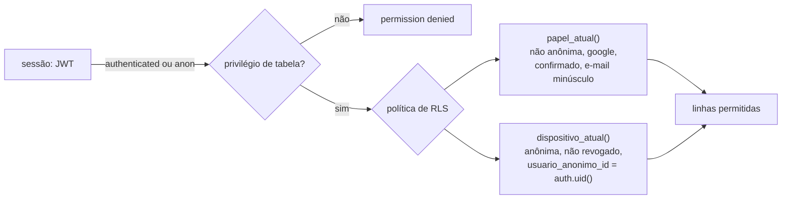

# VER-010 — E0, Tarefa 3: migração inicial do banco com RLS testada em PGlite

## Cabeçalho

| Campo | Valor |
|---|---|
| Id | VER-010 |
| Título | E0, Tarefa 3: migração inicial do banco com RLS testada em PGlite |
| Gravidade | alta |
| Tipo | implementação · banco de dados · segurança |
| Data | 2026-11-22 (data do commit; todas as datas deste registro em UTC). O [PLA-001](../planos/2026-11-17-e0-fundacao.md) previa o nome `2026-11-17-010-e0-banco.md`; vale a restrição global do plano (data do commit no nome), como no VER-013 |
| Usuário responsável | TokumoH |
| Status de implementação | implementado |
| Commits | commit que introduz este arquivo — `git log --diff-filter=A --format=%h -- docs/verificacoes/2026-11-22-010-e0-banco.md` |
| Arquivos | novos: `supabase/README.md`, `supabase/migrations/` (`README.md`, `20261117000000_fundacao.sql`), `supabase/tests/` (`README.md`, `simulacao-supabase.sql`, `dono-migracao.sql`, `banco.ts`, `rls.test.ts`, `restricoes.test.ts`, `matriz.test.ts`), este registro; modificados: `CLAUDE.md` (linha DevSecOps), `scripts/README.md` (linhas do `check-doc-secrets`), `docs/desenho/2026-11-16-revocast-cameras-desenho.md`, `docs/desenho/README.md`, `scripts/check-doc-secrets.mjs`, `docs/verificacoes/README.md` (17 arquivos) |

## Problema

O app da E0 ([VER-008](2026-11-17-008-e0-limpeza-e-esqueleto.md), [VER-009](2026-11-17-009-e0-supabase-cliente.md)) não tinha banco. Sem a migração inicial, a E1 (login Google e aba Membros) não teria tabelas, papéis nem RLS, e nenhuma regra de segurança do [DES-001](../desenho/2026-11-16-revocast-cameras-desenho.md) (seções 7 e 8) estaria provada: quem lê e quem escreve cada tabela, o que `papel_atual()` e `dispositivo_atual()` aceitam, o que o gatilho cria e quais dados o banco recusa. Também faltava aplicar ao DES-001 as decisões 1 e 2 do PLA-001 (primeiro `admin` fora da migração; aplicação pelo editor SQL e testes em PGlite) e liberar o domínio de teste `revocast.test` no `check-doc-secrets`, que não lia `.sql`, `.toml` nem `.env.example`.

## Era proposital?

Sim, a ausência: a Tarefa 3 do PLA-001 é a que cria o banco. As divergências em relação ao texto do plano foram decididas durante as rodadas e não são acidentais:

- **Privilégios de tabela explícitos.** O PLA-001 (Tarefa 3, Passo 1) manda simular os privilégios padrão do Supabase com `grant all` em tabelas, sequências e funções. Essa premissa já estava desatualizada quando o plano foi escrito: desde 2026-05-30 nos projetos novos e desde 2026-10-30 em todos, o Supabase não dá mais `select`, `insert`, `update` e `delete` automáticos em tabelas novas de `public` ([changelog](https://supabase.com/changelog/45329-breaking-change-tables-not-exposed-to-data-and-graphql-api-automatically)). A revisão 13 achou isso; a migração passou a dar `grant` explícito (Correção 13).
- **Dono da migração sem superusuário** (`postgres_sim`) e **`service_role` revogado**: acréscimos das Correções 11, 12 e 14, que o plano não pedia, para os testes refletirem o Supabase real.
- **Matriz de permissões** (`matriz.test.ts`): o plano pede 25 + 15 testes nomeados; a revisão 7 mostrou 100 células da matriz do DES-001 §8 sem teste, e a matriz declarada fechou isso (Correção 7).

## Solução

1. **Migração** [`20261117000000_fundacao.sql`](../../supabase/migrations/20261117000000_fundacao.sql): 8 tipos, 12 tabelas com as restrições do DES-001 §7 (índice parcial único de `ao_vivo`, `CHECK` de equivalência de `mapa_gestos`, linha única de `estudio_estado`, índice único de `usuario_anonimo_id`, `camera_id` só no `obs_camera`, chaves estrangeiras compostas de tipo de mídia, e-mail em minúsculas), 3 funções `security definer` com `search_path = ''` (`papel_atual`, `dispositivo_atual`, `criar_perfil_membro` com o gatilho em `auth.users`), RLS nas 12 tabelas com 33 políticas (nenhuma em `codigos_pareamento`), privilégios de tabela explícitos e os dados iniciais (7 gestos, linha 1 de `estudio_estado`). Sem e-mail (decisão 1).
2. **Privilégios:** `revoke all` em todas as tabelas e sequências de `public` para `anon`, `authenticated` e `service_role`; `grant` a `authenticated` só das operações que alguma política usa; nada para `anon`, nada em `codigos_pareamento`, nada para `service_role`; `alter default privileges ... revoke all` para tabelas e sequências futuras; `revoke execute` das 3 funções de `public`, `anon` e `service_role`.
3. **Testes em PGlite** (`supabase/tests/`): simulação do Supabase no padrão vigente, dono `postgres_sim`, `banco.ts` (fabricação pura) e 493 testes: 51 em `rls.test.ts`, 32 em `restricoes.test.ts` e 410 em `matriz.test.ts` (396 células papel × tabela × operação e 14 estruturais).
4. **DES-001** ajustado nas passagens das decisões 1 e 2 (seção 7, `membros_permitidos`; seção 11, Testes e Banco versionado; seção 12, item 4), cada uma com "(ajustado no VER-010)", e linha "Ajustes" no cabeçalho.
5. **Regra nova em [`docs/desenho/README.md`](../desenho/README.md):** o desenho aprovado admite ajustes pequenos aprovados pelo responsável, feitos nele mesmo, com a nota em cada passagem e a linha "Ajustes" no cabeçalho, registrados em `docs/verificacoes/`.
6. **`check-doc-secrets`:** `PERMITIDOS = ["@revocast.test"]` comparado pelo fim da ocorrência, sem diferenciar maiúsculas, em cada ocorrência da linha (`matchAll` com regex globais); `EXT_TEXTO` com `sql`, `toml` e `.env(.<nome>)?.example`.
7. **READMEs** de `supabase/`, `supabase/migrations/` e `supabase/tests/`, com o manual de aplicação pelo editor SQL, a alternativa pela CLI (com `migration repair`) e o comando do primeiro `admin`.
8. **Linha DevSecOps do `CLAUDE.md`** (Passo 9): o banco existe desde este registro, e `rpc:grants-check` e `data-api:check` entram na Tarefa 4 da E0. **`scripts/README.md`:** a linha do `check-doc-secrets` em "Onde" (extensões novas, cada ocorrência, `PERMITIDOS` com `@revocast.test`) e o risco de `PERMITIDOS`. Os dois arquivos entram neste commit em versão intermediária, só com essas linhas; o próximo item, a Tarefa 4 (VER-011), altera os mesmos arquivos de novo.
9. **Tempo limite dos hooks** (Correção 16): a constante `TEMPO_LIMITE_HOOK_MS = 120_000`, em `banco.ts`, é o terceiro argumento do `beforeAll` e do `afterAll` dos três arquivos de teste. O `beforeAll` cria o PGlite, aplica a simulação e a migração e semeia; com a máquina carregada passava dos 10 s padrão do Vitest. O `vite.config.ts` não foi mexido, para não mudar a configuração global do Vitest. O teste `mesmo-catalogo-com-tabelas-expostas`, que cria 3 bancos a mais, usa o dobro (`2 * TEMPO_LIMITE_HOOK_MS`; Correção 18).
10. **Texto sobre o uso futuro de `service_role`** (Correção 17, só texto e comentários, nit N3 da revisão r17 da Tarefa 4): a migração, os READMEs e um comentário de teste apresentavam o `grant` a `service_role` como o caminho para um uso futuro no servidor, mas a partir do VER-011 o `data-api:check` acusa qualquer privilégio de `service_role` (e o `rpc:grants-check`, o `EXECUTE` dele em funções). Agora dizem que esse uso pede decisão própria, com o `grant` explícito e o ajuste da checagem. Nenhuma asserção nem comando SQL mudou.

## Por que esta solução

- **DDD e GRASP Pure Fabrication:** o papel do app é conferido dentro do banco por duas funções (`papel_atual`, `dispositivo_atual`), e as políticas só as consultam; nos testes, banco, sessão e semeadura ficam em `banco.ts`, e os arquivos de teste só descrevem cenários. A matriz é dado (`MATRIZ`): mudar a regra de um papel é mudar uma linha.
- **Segurança em profundidade:** a RLS decide dentro do privilégio, e o privilégio decide antes dela. Uma política indevida sem `grant` continua pega pela matriz (a célula confere o `permission denied` e, depois, com os privilégios dados na transação do teste, a recusa da RLS). `truncate`, que passa por cima da RLS, não fica com nenhum papel da API (`anon`, `authenticated`, `service_role`); só o dono o mantém (`postgres_sim` nos testes, `postgres` no Supabase).
- **Mesmo resultado em qualquer padrão do Supabase:** começar com `revoke all` torna o catálogo de privilégios igual com "Automatically expose new tables" desligado (padrão de hoje) ou ligado (ou num projeto antigo), o que o teste `mesmo-catalogo-com-tabelas-expostas` prova.
- **Dono comum, mais restrito que o real:** no Supabase quem aplica a migração é o papel `postgres`, que não é superusuário. Nos testes o dono é `postgres_sim`, também sem superusuário e, de propósito, sem `BYPASSRLS` (o real tem). Os ganhos de fidelidade são dois: as funções `security definer` leem `auth.users` com os privilégios que o dono recebe (`grant all on auth.users`, [`dono-migracao.sql`](../../supabase/tests/dono-migracao.sql#L34), como o `postgres` real), e não por ser superusuário; e os `alter default privileges` da migração valem para o mesmo papel que cria as tabelas (criadas "pelo mesmo papel que roda as migrações", [`migrations/README.md`](../../supabase/migrations/README.md#L30); a tabela futura de `privilegios-de-tabela` é criada como `postgres_sim`). A falta de `BYPASSRLS` é o que exercita a RLS forçada: `force row level security` em `dispositivos` derruba 368 dos 493 testes; com `BYPASSRLS`, como no real, só cai o teste estrutural `dono-da-migracao-sem-superusuario` (Correção 11), e o caso protege a regra "a migração não depende de `BYPASSRLS`", não um comportamento do Supabase de hoje.
- **Otimização:** `(select public.papel_atual())` é avaliado uma vez por consulta; um banco por arquivo e uma transação desfeita por teste. Os 493 testes levam cerca de 10 s (limite do job da CI: 5 min).

## Por que não outras soluções

| Opção | Motivo de descarte |
|---|---|
| Simular `grant all` (texto do PLA-001, Passo 1) | Não é mais o Supabase de hoje: a suíte passava sem nenhum `grant`, e a migração real daria `permission denied` em tudo (revisão 13) |
| Depender dos privilégios padrão e só revogar `truncate`/`references`/`trigger` (Correções 1 e 2) | Quebra com o padrão novo e deixa `maintain` (Postgres 17+); `revoke all` cobre tudo sem citar a palavra, que não existe no Postgres 15 |
| `grant` a `authenticated` em tudo e deixar a RLS filtrar | Um `grant` sem política alarga a superfície sem motivo; o `grant` por operação é o que a [documentação do Supabase](https://supabase.com/docs/guides/api/hardening-data-api) recomenda |
| Deixar `service_role` no padrão do projeto (sugestão de texto da revisão 14) | Ele manteria `truncate`, `references`, `trigger` e `maintain` nas 12 tabelas, inclusive `codigos_pareamento`; revogar é o lado seguro, e um uso futuro no servidor pede decisão própria, com o `grant` explícito a `service_role` e, a partir do VER-011, o ajuste do `data-api:check` (tabelas) ou do `rpc:grants-check` (`EXECUTE` em funções), que acusam qualquer privilégio de `service_role` (Correção 17) |
| Aplicar a migração como superusuário nos testes | Esconde a falta de privilégio do dono (leitura de `auth.users` pelas funções, privilégios padrão "do mesmo papel") e, por passar por cima da RLS, também o `force row level security` |
| `postgres_sim` com `BYPASSRLS`, igual ao real | O `force row level security` voltaria a passar sem falha; a migração não deve depender de um atributo que ela não controla |
| Testes de RLS no Supabase real ou no Supabase local (Docker) | Exigem conta, rede ou Docker no hook e na CI |
| Só os 40 testes nomeados do plano | 100 células da matriz do DES-001 §8 ficavam sem teste que as derrubasse (revisão 7) |
| Primeiro `admin` na migração (texto original do DES-001) | Poria um e-mail real no repositório (decisão 1) |
| Função auxiliar para conferir o tipo da mídia | Seria barrada pelo `rpc:grants-check`; a chave estrangeira composta garante o mesmo sem código |
| Ajuste pequeno só no registro, sem tocar o desenho | O desenho continuaria afirmando o que já não vale |

## Onde

| Arquivo | Linhas | O que mudou |
|---|---|---|
| [`supabase/migrations/20261117000000_fundacao.sql`](../../supabase/migrations/20261117000000_fundacao.sql#L13-L24) | 13–24 | Novo: 8 tipos |
| [`supabase/migrations/20261117000000_fundacao.sql`](../../supabase/migrations/20261117000000_fundacao.sql#L32-L169) | 32–169 | 12 tabelas, restrições nomeadas e os 2 índices parciais únicos |
| [`supabase/migrations/20261117000000_fundacao.sql`](../../supabase/migrations/20261117000000_fundacao.sql#L179-L241) | 179–241 | `papel_atual`, `dispositivo_atual`, `criar_perfil_membro` e o gatilho; `revoke execute ... from public, anon, service_role` e `grant` a `authenticated` |
| [`supabase/migrations/20261117000000_fundacao.sql`](../../supabase/migrations/20261117000000_fundacao.sql#L248-L360) | 248–360, 389–393 | RLS nas 12 tabelas e 33 políticas, todas `to authenticated` (as 2 de `registro_acoes` em 389–393, depois do bloco de privilégios) |
| [`supabase/migrations/20261117000000_fundacao.sql`](../../supabase/migrations/20261117000000_fundacao.sql#L361-L387) | 361–387 | `revoke all` de `codigos_pareamento`; privilégios de tabela explícitos e privilégios padrão futuros; o comentário de `service_role` (373–375) reescrito na Correção 17 |
| [`supabase/migrations/20261117000000_fundacao.sql`](../../supabase/migrations/20261117000000_fundacao.sql#L399-L409) | 399–409 | Dados iniciais |
| [`supabase/tests/simulacao-supabase.sql`](../../supabase/tests/simulacao-supabase.sql#L11-L28) | 1–63 (11–28) | Novo: papéis `anon`, `authenticated`, `service_role` (`BYPASSRLS`) e `supabase_auth_admin`; privilégios padrão de 2026-10-30, com fonte e data (11–28); `auth.users`, `auth.jwt()`, `auth.uid()` |
| [`supabase/tests/dono-migracao.sql`](../../supabase/tests/dono-migracao.sql#L27-L41) | 1–41 (27–41) | Novo: `postgres_sim`, seus privilégios e os privilégios padrão `for role postgres_sim` |
| [`supabase/tests/banco.ts`](../../supabase/tests/banco.ts#L51-L86) | 1–199 (51–86) | Novo: `criarBanco` (simulação e dono como superusuário, migração como `postgres_sim`; variante `exporTabelasNovas`), `EXPOR_TABELAS_NOVAS`, `TEMPO_LIMITE_HOOK_MS` (76–83: comentário e constante, Correções 16 e 18), `DONO_MIGRACAO`, `semearDados`, `comoSessao`, `cadastrarUsuario`, `membroGoogle`, `sessaoAnonima` |
| [`supabase/tests/rls.test.ts`](../../supabase/tests/rls.test.ts#L654-L799) | 1–922 (34, 42–43, 538–547, 654–799, 720) | Novo: 51 testes; `beforeAll`/`afterAll` com `TEMPO_LIMITE_HOOK_MS` (import na 34; 42–43); `mesmo-catalogo-com-tabelas-expostas` com `2 * TEMPO_LIMITE_HOOK_MS` (720, Correção 18; antes, 60 s fixos); `service-role-nao-executa-funcoes` (538–547, comentário das linhas 541–542 reescrito na Correção 17); catálogo de privilégios (`acl-de-tabelas-e-sequencias`, `mesmo-catalogo-com-tabelas-expostas`, `privilegios-de-tabela`) e `dono-da-migracao-sem-superusuario` |
| [`supabase/tests/restricoes.test.ts`](../../supabase/tests/restricoes.test.ts#L239-L301) | 1–371 (7, 14–15, 239–301) | Novo: 32 testes; `beforeAll`/`afterAll` com `TEMPO_LIMITE_HOOK_MS` (import na 7; 14–15); catálogo das 21 chaves estrangeiras e 6 `unique` |
| [`supabase/tests/matriz.test.ts`](../../supabase/tests/matriz.test.ts#L122) | 1–408 (77, 122, 252–253, 273, 337) | Novo: `MATRIZ`, `temPrivilegio` e as 396 células por `test.each`; 14 testes estruturais (284–335); `beforeAll`/`afterAll` com `TEMPO_LIMITE_HOOK_MS` (import na 77; 252–253) |
| [`supabase/README.md`](../../supabase/README.md#L68-L87) | 1–104 (68–87, 97) | Novo: manual de aplicação (editor SQL, CLI, primeiro `admin`); risco de `service_role` (97) alinhado na Correção 17 |
| [`supabase/migrations/README.md`](../../supabase/migrations/README.md#L81-L86) | 1–100 (81–86, 92) | Novo: o que a suíte prova, o que só as checagens de banco cobrem, decisão de leitura, mutações equivalentes e "Sem teste"; risco de `service_role` (92) alinhado na Correção 17 |
| [`supabase/tests/README.md`](../../supabase/tests/README.md#L100-L106) | 1–118 (36, 63, 100–106, 110) | Novo: organização dos testes, verificação; tempo limite dos hooks em "Por que" (36), na linha do `banco.ts` em "Onde" (63) e em "Riscos" (110, com os 240 s do teste de 3 bancos) |
| [`docs/desenho/2026-11-16-revocast-cameras-desenho.md`](../desenho/2026-11-16-revocast-cameras-desenho.md#L11) | 11 | Linha "Ajustes" no cabeçalho |
| [`docs/desenho/2026-11-16-revocast-cameras-desenho.md`](../desenho/2026-11-16-revocast-cameras-desenho.md#L205) | 205 | Seção 7, `membros_permitidos`: primeiro `admin` pelo editor SQL (decisão 1) |
| [`docs/desenho/2026-11-16-revocast-cameras-desenho.md`](../desenho/2026-11-16-revocast-cameras-desenho.md#L340) | 340, 342 | Seção 11: testes de RLS em PGlite; migrações aplicadas pelo editor SQL e `migration repair` (decisão 2) |
| [`docs/desenho/2026-11-16-revocast-cameras-desenho.md`](../desenho/2026-11-16-revocast-cameras-desenho.md#L351) | 351 | Seção 12, item 4 (decisão 1) |
| [`docs/desenho/README.md`](../desenho/README.md#L27) | 27, 41 | Regra de ajustes pequenos; linha nova em "Por que não outras organizações" |
| [`scripts/check-doc-secrets.mjs`](../../scripts/check-doc-secrets.mjs#L6) | 6, 8–9, 11–17, 21–26, 33 | `EXT_TEXTO`; regex globais; `PERMITIDOS` e `permitido()`; `matchAll` |
| [`scripts/README.md`](../../scripts/README.md#L53) | 53 | Linha do `check-doc-secrets` em "Onde": `.sql`, `.toml` e `.env.example`, cada ocorrência da linha, `PERMITIDOS` só com o fim `@revocast.test` |
| [`scripts/README.md`](../../scripts/README.md#L92) | 92 | Risco de `PERMITIDOS`: hoje só `@revocast.test` (VER-010), comparado pelo fim da ocorrência |
| [`CLAUDE.md`](../../CLAUDE.md#L17) | 17 | Linha DevSecOps: o banco existe desde o VER-010 (`supabase/migrations/`, testes de RLS em PGlite dentro do `npm test`); `rpc:grants-check` e `data-api:check` entram na Tarefa 4 da E0 |
| [`docs/verificacoes/README.md`](README.md#L14) | 14, 63 | VER-010 no campo "Arquivos" (14) e na tabela "Onde" (63) |
| [`docs/verificacoes/README.md`](README.md#L85-L88) | 85–88 | Seção "Exemplo": o exemplo hipotético `2026-11-17-010-exemplo.md`, que agora seria o número deste registro, passa a `2026-11-23-014-exemplo.md` (de 2026-11-23) |

Os arquivos citados por âncoras de registros antigos não encolheram: DES-001 com 395 linhas (mínimo 394), `docs/desenho/README.md` com 69 (mínimo 68), `check-doc-secrets.mjs` com 37 (mínimo 33); `CLAUDE.md` e `scripts/README.md` só têm linhas editadas no lugar (âncoras `#L17`, `#L52` e `#L91` dos registros antigos continuam apontando para o mesmo conteúdo). Linhas de `CLAUDE.md` e `scripts/README.md` citadas como ficam neste commit; a Tarefa 4 muda esses arquivos depois.

## Lógica

| Passo | Antes | Depois |
|---|---|---|
| Banco | nenhum | migração única com tipos, tabelas, funções, gatilho, RLS, privilégios e dados iniciais |
| Tempo limite dos `beforeAll`/`afterAll` | 10 s padrão do Vitest (0/493 com a máquina carregada); 60 s fixos em `mesmo-catalogo-com-tabelas-expostas` | `TEMPO_LIMITE_HOOK_MS = 120_000` nos três arquivos (Correção 16); o dobro no teste que cria 3 bancos (Correção 18) |
| Privilégio de tabela de `authenticated` | dependia do padrão do projeto (`grant all` no antigo; nada de `select`/`insert`/`update`/`delete` no novo) | `grant` explícito por operação usada por política; `revoke all` antes |
| `anon` e `service_role` | padrão do projeto (`truncate`, `references`, `trigger`, `maintain` no novo; tudo no antigo) | nenhum privilégio de tabela, de sequência nem `EXECUTE` nas 3 funções |
| Dono da migração nos testes | — | `postgres_sim`: `NOSUPERUSER CREATEDB CREATEROLE LOGIN REPLICATION`, sem `BYPASSRLS` |
| Matriz do DES-001 §8 | 40 testes nomeados no plano | 493 testes: 396 células, cada uma derrubada pela própria sabotagem, 83 testes nomeados e 14 testes estruturais da matriz |
| Primeiro `admin` | na migração (DES-001 original) | comando único no editor SQL, nunca versionado |
| `check-doc-secrets` | `includes` na 1ª ocorrência; sem `.sql`, `.toml`, `.env.example` | `endsWith` em minúsculas em cada ocorrência; com essas extensões |

**Decisões do controlador** (cada uma registrada no ledger da execução e nos READMEs):

| Decisão | Motivo |
|---|---|
| I2: `mapa_gestos` e `estudio_estado` só `update` para `equipe`/`admin` (revisão 8) | DES-001 §7: os 7 gestos são a chave fixa semeada e `estudio_estado` tem linha única; um insert não tem linha nova possível e um delete quebraria o mapa ou o modo teste. 8 células proibidas; o responsável pode reverter numa migração nova |
| `reconhecer_no` por implicação: só a `camera` pode ter valor, nulo permitido (revisão 1) | DES-001 diz "só para camera"; `criar_codigo_pareamento` (E3) não recebe o campo |
| Matriz declarada com `test.each` (revisão 7) | Fecha a cobertura de forma estrutural em vez de caso a caso |
| Incorporar os nits N1, N2 e N4 da revisão 11, aprovada | CORE: sugestão importante não fica de fora (N2: dono superusuário escondia o `force row level security`) |
| `postgres_sim` com os atributos do `postgres` real, exceto `BYPASSRLS` (Correções 11 e 12) | Fonte: `ALTER ROLE postgres NOSUPERUSER CREATEDB CREATEROLE LOGIN REPLICATION BYPASSRLS` no repositório `supabase/postgres`. Sem `CREATEROLE`/`CREATEDB`, um `create role` legítimo falharia por engano nos testes e nas checagens; sem `BYPASSRLS`, de propósito, para a migração não depender dele |
| `grant` explícito por tabela só a `authenticated`, conforme as políticas; nada a `anon`, a `codigos_pareamento` e a `service_role` (revisão 13) | Padrão novo do Supabase; menor privilégio; nenhuma política é para `anon` |
| `revoke all` inicial e `alter default privileges ... revoke all` para o futuro (Correção 13) | Mesmo resultado nos dois padrões; cobre `maintain`; cada migração futura dá os seus `grant` |
| Simulação no padrão de 2026-10-30, com fonte e data no arquivo, e variante "expor tabelas novas" (Correções 13 e 14) | A suíte deve provar o Supabase de hoje e o resultado igual no padrão antigo |
| `service_role` revogado em tabelas, sequências, privilégios padrão e no `EXECUTE` das 3 funções (revisão 14; o `EXECUTE` foi proposto pelo implementador e aceito) | Torna verdadeiro, pelo lado seguro, o texto "sem privilégio"; DES-001: `GRANT EXECUTE` só a `authenticated`; o gatilho não precisa de `EXECUTE` para disparar. Um uso futuro no servidor pede decisão própria, com o `grant` explícito a `service_role` e, a partir do VER-011, o ajuste do `data-api:check` (tabelas) ou do `rpc:grants-check` (`EXECUTE` em funções), que acusam qualquer privilégio de `service_role` (texto alinhado na Correção 17) |
| Linha "Ajustes" do DES-001 sem data (revisão 4) | A data é a do commit deste registro |

**Mudança de plataforma do Supabase.** O changelog 45329 (lido em 2026-11-22 pelo implementador e pelo controlador, e relido pelos revisores 16 e 17) diz que, desde 2026-05-30 em projetos novos e desde 2026-10-30 em todos, tabelas novas em `public` deixam de receber `select, insert, update, delete` (e sequências, `usage, select`) para `anon`, `authenticated` e `service_role`, salvo com a opção "Automatically expose new tables" ligada. A página `hardening-data-api` completa: tabelas novas mantêm `truncate`, `references`, `trigger` e `maintain`, sequências novas mantêm `update` e funções novas continuam executáveis por todos os papéis. A migração ficou correta nos dois padrões porque não depende de nenhum privilégio automático: tira tudo e dá só o que precisa. O teste `mesmo-catalogo-com-tabelas-expostas` aplica a migração nas duas variantes da simulação e exige o mesmo catálogo (ACL das relações e privilégios padrão do dono), com controle de que as variantes diferem antes da migração.

## Exemplo

- **Padrão novo sem `grant`** (revisão 13, suíte de 490): tirando da simulação os privilégios padrão antigos, a migração de então deu 430 falhas e 60 testes passando; as 75 células permitidas da matriz caíram com `permission denied for table ...`. Num Supabase de hoje, nenhum membro nem dispositivo acessaria nada. Depois da Correção 13: 491/491, também com a simulação no padrão antigo; sem os 4 `grant`, as 75 células permitidas caem. Desde a Correção 14: 493/493; o teste `mesmo-catalogo-com-tabelas-expostas` prova o mesmo catálogo com a exposição ligada (a suíte inteira no padrão antigo ou exposto dá 492/493: só cai o controle desse teste, que exige que as variantes difiram).
- **Dono sem `BYPASSRLS`:** com a migração aplicada como superusuário, `force row level security` em `dispositivos` dava 0 falhas (revisão 11); com `postgres_sim` sem `BYPASSRLS`, derruba 368 dos 493 testes; com `postgres_sim` com `BYPASSRLS` (os atributos do `postgres` real), só 1 (`dono-da-migracao-sem-superusuario`). As 368 falhas vêm da restrição proposital, não da fidelidade ao dono real.
- **Apresentadora se promovendo** (revisão 8, sonda P2): uma política de `update` da própria linha de `membros_permitidos` só para a apresentadora passava pelos 470 testes de então, porque a constante do `update` (`papel = 'apresentadora'`) já era o valor da linha dela. Com constantes que diferem de toda linha (Correção 8), P1–P4 caem pela célula da matriz.
- **ACL final** (`acl-de-tabelas-e-sequencias`): `membros_permitidos`, `midias`, `sons`, `cenas`, `episodios`, `avisos` → `authenticated` com `SELECT, INSERT, UPDATE, DELETE`; `mapa_gestos`, `estudio_estado` → `SELECT, UPDATE`; `membros`, `dispositivos` → `SELECT`; `registro_acoes` → `SELECT, INSERT`; `codigos_pareamento` → nenhum; nenhuma entrada para `anon` ou `service_role`.

## Verificação

Implementação por subagente; o agente principal fez uma rodada A (testes, typecheck, checagens e leitura do código contra o plano) depois de cada correção e despachou um revisor independente novo em cada rodada B, com sabotagens em cópias fora do repositório. Todas as rodadas A foram limpas; as rodadas B estão abaixo.

| Rodada | Spec / qualidade | Achado principal | Correção seguinte |
|---|---|---|---|
| r1 | ✅ / reprovada | READMEs com afirmações falsas; regras do DES-001 sem teste (15 sabotagens sobreviveram); ordem dos comandos da CLI | C1: 14 testes novos, `revoke truncate, references, trigger`, `reconhecer_no` por implicação |
| r2 | ✅ / reprovada | Auto-promoção por `update` sem `where` sem teste; membros inserindo em `registro_acoes`; confirmação lida pelo `uid`; tabelas futuras; `camera_id` nos outros tipos | C2: testes e `alter default privileges` |
| r3 | ✅ / reprovada | Escrita direta de dispositivos em `dispositivos`/`registro_acoes` sem teste; negativos de leitura e insert do §8 | C3 |
| r4 | ✅ / reprovada | Nenhum teste com `anon` nas tabelas; lista "só estática" incompleta; data na linha "Ajustes" | C4: `supabase_auth_admin` na simulação, `anon-nao-le-nem-escreve` |
| r5 | ❌ / reprovada | Dispositivos escrevendo na preparação sem teste (README afirmava o contrário); auto-inscrição na lista; `email_verified` do JWT | C5 |
| r6 | ✅ / reprovada | `update`/`delete` de `anon` sem teste | C6 |
| r7 | ✅ / reprovada | README afirmava cobertura não provada; 100 células da matriz sem teste | C7: `matriz.test.ts` (396 células) |
| r8 | ✅ (ressalva) / reprovada | Constante do `update` igual a valor existente (P2); 8 células sem decisão e citação falsa do PLA-001; "sem teste" de `on delete` falso; READMEs contraditórios | C8 e decisão I2 |
| r9 | ✅ / reprovada | Auto-vínculo em `dispositivos` (B07, B08) e ação em nome próprio (R37) passavam | C9 e 9b (texto das checagens por catálogo) |
| r10 | ✅ / reprovada | Célula permitida aceitava alcance parcial (X01–X04) | C10 |
| r11 | ✅ / aprovada (4 nits) | Nits importantes: formas de valor, dono superusuário escondendo `force`, padrões citados no §7 | C11 (contagem volta a zero) |
| r12 | ✅ / reprovada | Nenhuma das 19 chaves estrangeiras simples tinha teste | C12: catálogo de FKs e `unique`; `postgres_sim` com `CREATEROLE`/`CREATEDB` |
| r13 | ❌ / reprovada | Migração dependia dos privilégios padrão antigos (changelog 45329) | C13: privilégios explícitos |
| r14 | ✅ / reprovada | Texto falso: `service_role` "sem privilégio de tabela" | C14: `service_role` revogado; variante exposta |
| r15 | ✅ / reprovada | `migrations/README.md:84` desatualizado depois da C14 | C15: só texto (varredura de `supabase/`) |
| **r16** | **✅ / aprovada** | 1ª verificação limpa; 1 nit | nit corrigido pelo controlador |
| **r17** | **✅ / aprovada** | 2ª verificação limpa seguida; 1 nit e a observação de que este registro entra no mesmo commit | nit corrigido pelo controlador |

Sabotagens (uma de cada vez, em cópias; detalhes nos relatórios da execução):

| Etapa | Lote | Resultado |
|---|---|---|
| Passo 4 | migração ausente; migração vazia | os 2 arquivos de teste falham |
| Implementação | 45 (S01–S45) | 44 caem; S14 não (só a política de `update` da lista; pega desde a C2 pelo `update` sem `where`) |
| **Passo 7** | as 10 do plano (S01–S10) | as 10 derrubam exatamente o teste pedido; refeitas pela revisão 12 (as 10) e, em parte, pela 11, com o mesmo resultado |
| C1 a C6 | 98, 162, 190, 237, 261 e 283 | 95, 155, 181, 219, 241 e 263 caem; as restantes são esperadas e classificadas (só checagem de banco, equivalentes ou "Sem teste") |
| C7 a C14 | por célula | 396/396: cada célula invertida sozinha derruba o teste da própria célula, sem equivalentes |
| C7 a C13 | as 283 da C6 contra a suíte de cada correção | as mesmas 263 caem (0 regressões) e algumas antes esperadas passaram a cair; na C13, 248 + 10 com trecho que não existe mais (equivalentes novos caem) + 5 equivalentes documentados |
| C9 | 91 (as 37 da revisão 9, entre elas B07, B08 e R37, e 54 próprias, V01–V54) | 86 caem; R18 e R34 documentadas, V53 e V54 equivalentes, T01 cai à parte |
| C12 | 68 (21 `references`, ações `on delete`, 6 `unique`) | 68/68 |
| C13 | 113 (`grant`/`revoke`) | 111 caem; não caem a simulação no padrão antigo (491/491, prova do resultado igual) e o `revoke` de sequências (não há sequência) |
| C14 | 45 (`service_role`) | 42 caem; 3 equivalentes documentadas |
| C16 | `TEMPO_LIMITE_HOOK_MS = 1_000` numa cópia | os 3 arquivos caem ("Hook timed out in 1000ms", 493 pulados); com 120 s, 493/493 |
| C17 | só texto e comentários (sem sabotagem) | reconferência: 493/493, `tsc --noEmit`, `check-docs` e `check-doc-secrets` com 0 erros |
| C18 | tempo limite do teste de 3 bancos e comentários (sem sabotagem) | só reconferência pontual: 493/493, `tsc --noEmit`, `check-docs` e `check-doc-secrets` com 0 erros |
| r16 e r17 | 9 + 21 próprias dos revisores | todas caem, menos o `revoke all` explícito de `codigos_pareamento` (equivalente documentado) |

Sabotagens do **Passo 8** (`check-doc-secrets`, cópia Git com `scripts/` e `supabase/`): base 0 erros; e-mail de teste e, depois, de outro domínio na mesma linha (e na ordem inversa) → acusa; e-mail terminado em `revocast.test.com.br` → acusa (prova o `endsWith`); e-mail de teste em maiúsculas → passa; e-mail de outro domínio em `.sql`, `.toml`, `.env.example`, `.env.local.example` → acusa cada um. Variantes do script: sem `matchAll` não acusa o segundo e-mail; com `includes` não acusa `revocast.test.com.br`; sem minúsculas acusa o e-mail de teste em maiúsculas; a versão anterior não lê `.sql`, `.toml` nem `.env.example`. Os e-mails de outro domínio foram montados em tempo de execução, fora do repositório.

**V1 (r16) e V2 (r17)**, revisores novos e independentes, com abordagens diferentes (r16: 9 sabotagens próprias e conferência dos `grant` contra as políticas célula a célula; r17: 21 sabotagens próprias, incluindo a simulação no padrão antigo e o gatilho com `security invoker`): spec ✅ e qualidade aprovada nas duas, 493 testes (51 + 32 + 410), 33 políticas conferidas com `grep -c "^create policy"`, fonte da simulação relida em 2026-11-22.

Verificação do commit candidato (clone com exatamente o conteúdo do commit, depois de r17), cada rodada com um verificador factual e um adversarial, novos e independentes:

| Rodada | Resultado | O que mudou |
|---|---|---|
| v1 factual | com erros: 1 Importante, 2 nits | Exemplo dizia 493/493 "depois da Correção 13" (eram 491; a variante exposta e os 493 vêm da C14; a suíte inteira no padrão antigo dá 492/493); linha do README de verificacoes sem a troca do exemplo; textos de `supabase/` no presente sobre a Tarefa 4 → só o registro mudou |
| v1 adversarial | com erros: 1 Importante, 4 nits | As 368 falhas do `force row level security` atribuídas à fidelidade ao dono real (vêm da falta de `BYPASSRLS`); soma dos testes sem os 14 estruturais; risco do `auth.users` genérico → só o registro mudou |
| v2 factual | com erros: 3 Importantes, 2 nits | Lista incompleta dos trechos de `supabase/` sobre a Tarefa 4; sentido do deslocamento das âncoras do VER-013; composição do lote C9; intervalo das políticas; linha em branco na Solução → só o registro mudou |
| v2 adversarial | com erros: 2 Importantes, 2 nits | `beforeAll` com o limite padrão de 10 s (0/493 com a máquina carregada) → Correção 16 (código; as verificações recomeçam); mesma lista incompleta; `truncate` fica com o dono |
| v3 factual | limpa, com 5 nits | Linhas do tempo limite no "Onde"; linha 63 de `tests/README.md`; citação não literal de `migrations/README.md:30`; dois trechos com "Tarefa 4" fora da lista dos Riscos; medida do hook no comentário de `banco.ts` → corrigidos |
| v3 adversarial | com erros: 2 Importantes e 3 nits, todos de gravidade aceitável (decisão do usuário abaixo) | `mesmo-catalogo-com-tabelas-expostas` com 60 s fixos caía sob carga ("Test timed out in 60000ms"); a mesma lista incompleta; linhas do "Onde"; medida do hook; linha da v3 por preencher → Correção 18, com reconferência pontual e sem v4, por decisão do usuário |

**Decisão do usuário (2026-11-22):** "Se a gravidade de erros for aceitável, prossiga sem necessidade de refazer dois testes seguidos". Aplicação pelo controlador: é **aceitável** o nit ou o erro de texto ou documentação sem impacto em segurança, sem mudar o comportamento do código e sem enfraquecer o que um teste prova; ele é corrigido, recebe reconferência pontual e vai para o commit. **Não é aceitável** o achado de segurança, de comportamento de código, de teste ou de escopo, que é corrigido e verificado de novo. Os achados da v3 foram classificados como aceitáveis e corrigidos na Correção 18, sem rodada v4.

Nits corrigidos (não zeram a contagem), com reconferência pontual:

- r16 N1: `supabase/migrations/README.md:98` trazia um endereço de e-mail de teste completo; o plano reserva os e-mails completos a `supabase/tests/`. Trocado por descrição; `check-docs` e `check-doc-secrets` com 0 erros.
- r17 N1: `supabase/tests/simulacao-supabase.sql:17` dizia que o changelog não muda funções; passou a citar a documentação (funções novas continuam executáveis por todos os papéis). 493 testes do banco, `check-docs` e `check-doc-secrets` com 0 erros.

Ficou de fora, com motivo: o `grant execute ... to authenticated` explícito das 3 funções é mutação equivalente (os privilégios padrão já dão `EXECUTE`), mantido por clareza e para não depender do padrão do projeto; o `revoke all` explícito de `codigos_pareamento`, redundante desde a C13, mantido por clareza da intenção.

## Riscos

- **Premissas desatualizadas no PLA-001, não editadas (pendência):** Tarefa 3, Passo 1 ([L221](../planos/2026-11-17-e0-fundacao.md#L221)) manda simular `grant all` em tabelas, sequências e funções; as restrições globais ([L27-L28](../planos/2026-11-17-e0-fundacao.md#L27-L28)) e o Passo 5 ([L255](../planos/2026-11-17-e0-fundacao.md#L255)) não exigem `grant` explícito por tabela nem `revoke all` inicial, e citam só `public, anon`/`anon, authenticated` (sem `service_role`).
- **Premissas desatualizadas no DES-001, não editadas (pendência):** §8, linha "Banco" ([L237](../desenho/2026-11-16-revocast-cameras-desenho.md#L237)), sem a regra de privilégios de tabela explícitos (`grant` a `authenticated` só do que as políticas usam, nada a `anon`); nada sobre `service_role` (§7 e §8); a descrição de `data-api:check` ([L357](../desenho/2026-11-16-revocast-cameras-desenho.md#L357)) não cobre `grant` de tabela. Ajustar exige aprovação do responsável (regra de ajustes de `docs/desenho/README.md`).
- **A premissa da plataforma vem do changelog e da documentação** do Supabase (lidos em 2026-11-22), não de um projeto real. A migração dá o mesmo catálogo nos dois padrões, o que reduz o risco, mas não o elimina.
- **A migração ainda não foi aplicada num Supabase real** (passo do responsável, pelo editor SQL, seguido do comando do primeiro `admin`). Diferenças de versão do Postgres (por exemplo, `on delete set null (coluna)` exige 15 ou mais novo) e os privilégios reais do `postgres` só se confirmam ao aplicar. Não conferidos num projeto real: o `create trigger ... on auth.users` da migração e a leitura de `auth.users` pelas funções `security definer` (`papel_atual`); os dois dependem dos privilégios do `postgres` no schema `auth`, que a simulação dá como `grant all on auth.users` ([`dono-migracao.sql`](../../supabase/tests/dono-migracao.sql#L16-L18), fonte no repositório `supabase/postgres`). Depois de aplicada, a migração nunca mais é editada.
- **`service_role` sem privilégio:** uma Edge Function ou serviço futuro com a chave secreta pede decisão própria, com o `grant` explícito a `service_role` e, a partir do VER-011, o ajuste do `data-api:check` (tabelas) ou do `rpc:grants-check` (`EXECUTE` em funções), que acusam qualquer privilégio de `service_role` (Correção 17); tabela criada por outro papel (por exemplo, pelo painel) recebe os privilégios padrão do projeto, também para `service_role`; funções futuras recebem `EXECUTE` padrão para `anon`, `authenticated` e `service_role`, o que nenhum teste deste commit acusa (o `rpc:grants-check` que acusa isso vem no VER-011).
- **Checagens de banco ainda fora do `npm run check`:** `rpc:grants-check` e `data-api:check` só entram no `npm run check` no VER-011 (Tarefa 4), o próximo commit, que vai no mesmo push; até lá, o que só elas cobrem (por exemplo, o `search_path` das funções e a RLS de `codigos_pareamento`, listados em `supabase/migrations/README.md`) não é conferido neste commit. Busca mecânica (`grep -rn "rpc:grants-check\|data-api:check\|_catalogo\|check-rpc-grants\|check-data-api\|Tarefa 4" supabase/`, mais "checagens de banco"): os trechos abaixo descrevem no presente (ou citam o VER-011 com qualificador de tempo) as checagens da Tarefa 4, que só passam a existir com o VER-011, o próximo commit, no mesmo push. Não foram editados: `supabase/` é código revisado, e o comentário da migração não muda depois de aplicada.
  - [`fundacao.sql:7`](../../supabase/migrations/20261117000000_fundacao.sql#L7): as checagens "aplicam as migrações num PGlite e leem o catálogo";
  - [`migrations/README.md:28`](../../supabase/migrations/README.md#L28): as checagens "não leem o texto: aplicam as migrações num PGlite ... e conferem o catálogo";
  - [`migrations/README.md:83`](../../supabase/migrations/README.md#L83): "Só as checagens de banco", que "aplicam as migrações num PGlite e leem o catálogo", e a conferência de 2026-11-21 contra as checagens reescritas;
  - [`migrations/README.md:84`](../../supabase/migrations/README.md#L84): o `rpc:grants-check` "não pode pegar, porque lê o catálogo";
  - [`migrations/README.md:93`](../../supabase/migrations/README.md#L93): "hoje isso só é coberto pelo `rpc:grants-check`" (o `EXECUTE` padrão em funções futuras). **Neste commit nada cobre isso**; a frase só fica verdadeira com o VER-011;
  - [`fundacao.sql:373-375`](../../supabase/migrations/20261117000000_fundacao.sql#L373-L375), [`migrations/README.md:92`](../../supabase/migrations/README.md#L92) e [`supabase/README.md:97`](../../supabase/README.md#L97): "a partir do VER-011, o ajuste do `data-api:check`, que acusa qualquer privilégio de `service_role`" (Correção 17);
  - [`rls.test.ts:541-542`](../../supabase/tests/rls.test.ts#L541-L542): "a partir do VER-011, o ajuste do rpc:grants-check, que acusa EXECUTE de service_role" (Correção 17);
  - [`supabase/README.md:92`](../../supabase/README.md#L92): "o que só as checagens de banco cobrem" (remete a `migrations/README.md`);
  - [`supabase/README.md:99`](../../supabase/README.md#L99): "Nos testes e nas checagens de banco, o dono é `postgres_sim`";
  - [`tests/README.md:27`](../../supabase/tests/README.md#L27): "as checagens de banco da Tarefa 4 também o carregam";
  - [`tests/README.md:62`](../../supabase/tests/README.md#L62): "dono das migrações nos testes e nas checagens de banco";
  - [`tests/README.md:106`](../../supabase/tests/README.md#L106): "O que só as checagens de banco (... que leem o catálogo) cobrem";
  - [`tests/README.md:113`](../../supabase/tests/README.md#L113): as checagens "também carregam `dono-migracao.sql`";
  - [`tests/dono-migracao.sql:11`](../../supabase/tests/dono-migracao.sql#L11): "nas checagens de banco, que também carregam este arquivo";
  - [`tests/dono-migracao.sql:24-25`](../../supabase/tests/dono-migracao.sql#L24-L25): "As checagens de banco (scripts/_catalogo.mjs, Tarefa 4) também carregam este arquivo" (`scripts/_catalogo.mjs` não existe neste commit).
  A [`migrations/README.md:45`](../../supabase/migrations/README.md#L45) cita o `rpc:grants-check` no condicional ("seria ... barrada") e não afirma nada sobre este commit.
- **Limites documentados nos READMEs de `supabase/`:** a simulação cobre só o que a migração usa (forma exata das claims e colunas de `auth.users` não testadas); `postgres_sim` não foi conferido num Supabase real e é mais restrito (sem `BYPASSRLS`); a matriz deriva o privilégio esperado de si mesma (`temPrivilegio`), então um `grant` futuro sem política exige mudar o teste; formas de linha e de valor não semeadas (por exemplo, política que deixe a equipe inserir só `papel = 'apresentadora'`, R18, V2) não são vistas; "Sem teste": `avisos_duracao_positiva`, `tamanho_bytes > 0`, `like` × `ilike` no link, `providers` com `google`, valores padrão que o DES-001 não cita.
- **Riscos de modelo para etapas futuras:** `reconhecer_no` nulo na `camera` = padrão do app (E3); `camera_id` não garante que o alvo seja `camera` (E3 confere); `registro_acoes.episodio_id` em `cascade` contorna o "apenas inserção" (revisitar na E3); `estudio_estado.atualizado_em` não muda no `update` sem gatilho; `criado_por`, `enviado_por`, `atualizado_por` e a autoria de `registro_acoes` declarados pelo cliente; cena ou som usado em `mapa_gestos` não pode ser apagado; segundo cadastro com o mesmo e-mail em outra caixa falha no gatilho; o comando do primeiro `admin` depende do e-mail digitado certo.
- **Tempo limite dos hooks:** com `TEMPO_LIMITE_HOOK_MS = 120_000`, um `beforeAll` travado (por exemplo, um laço na migração) leva até 120 s para falhar em cada arquivo, em vez de 10 s, e `mesmo-catalogo-com-tabelas-expostas`, que usa o dobro, até 240 s, em vez dos 60 s de antes (Correção 18); o job da CI tem limite de 5 min. Com a máquina leve, o hook levou de 1,4 a 1,8 s na Correção 16 e de 3 a 6 s na verificação v2.
- **Âncoras deslocadas no `docs/verificacoes/README.md`:** a linha nova do VER-010 em "Onde" (63) faz o conteúdo seguinte descer uma linha; as âncoras `README.md#L64`, `#L68`, `#L72` e `#L76` do VER-013 ficam e passam a apontar para o conteúdo anterior (a `#L64` cai na linha do VER-012, que antes era a 63). O arquivo não encolheu (regra do PLA-001), e o mesmo deslocamento já acontecia antes (âncora `#L63` do VER-002).
- As citações ao VER-010 nos READMEs de `supabase/`, no DES-001 e em `check-doc-secrets.mjs` são texto, sem link.
