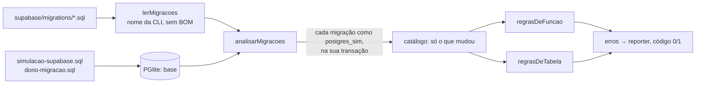

# VER-011 — E0, Tarefa 4: checagens de banco `rpc:grants-check` e `data-api:check` pela leitura do catálogo

## Cabeçalho

| Campo | Valor |
|---|---|
| Id | VER-011 |
| Título | E0, Tarefa 4: checagens de banco `rpc:grants-check` e `data-api:check` pela leitura do catálogo |
| Gravidade | alta |
| Tipo | implementação · DevSecOps · segurança |
| Data | 2026-11-22 (data do commit; todas as datas deste registro em UTC). O [PLA-001](../planos/2026-11-17-e0-fundacao.md) previa o nome `2026-11-17-011-e0-checagens-banco.md`; vale a restrição global do plano (data do commit no nome), como no VER-010 e no VER-013 |
| Usuário responsável | TokumoH |
| Status de implementação | implementado |
| Commits | commit que introduz este arquivo — `git log --diff-filter=A --format=%h -- docs/verificacoes/2026-11-22-011-e0-checagens-banco.md` |
| Arquivos | novos: `scripts/_catalogo.mjs`, `scripts/check-rpc-grants.mjs`, `scripts/check-data-api.mjs`, `scripts/tests/catalogo.test.mjs`, `scripts/tests/check-rpc-grants.test.mjs`, `scripts/tests/check-data-api.test.mjs`, `scripts/tests/executaveis.test.mjs`, este registro; modificados: `package.json`, `scripts/README.md`, `scripts/tests/README.md`, `.github/workflows/README.md`, `.githooks/README.md`, `CLAUDE.md` (linha 17), `docs/verificacoes/README.md` (15 arquivos) |

## Problema

O CORE exige `rpc:grants-check` e `data-api:check` no DevSecOps, e o DES-001 (seções 8 e 13) as prevê, mas desde o VER-003 elas "não se aplicavam" por falta de banco. Com a migração do [VER-010](2026-11-22-010-e0-banco.md), uma migração futura podia criar função sem `SECURITY DEFINER` ou sem `search_path`, deixar `EXECUTE` para `anon`, criar tabela sem RLS ou com privilégio para `anon`, e nada no `npm run check`, no hook ou na CI acusaria. Os testes de `supabase/tests/` provam a migração atual; não protegem as próximas.

## Era proposital?

Sim, a ausência: a Tarefa 4 do PLA-001 cria as checagens. Os desvios em relação ao texto do plano foram decididos durante as rodadas:

- **Leitura do catálogo, e não do texto (decisão do usuário, 2026-11-21).** O plano pede `verificarGrants(sql: string): string[]` por expressões regulares (Passo 3). Em 11 revisões (r1–r11) sempre aparecia SQL válido que enganava a leitura por texto (`U&"..."`, `$é$`, `\r`, `create rule`, `do $$ execute $$`, corpo errado, etc.); o controlador concluiu que a abordagem não convergia e parou a tarefa. O usuário escolheu a opção recomendada: aplicar as migrações num PGlite com a simulação do Supabase e ler o catálogo. A API passou a assíncrona (`Promise<string[]>`), aceitando texto ou lista de arquivos.
- **Regras do PLA-001 que saíram ou mudaram na reescrita:** acusar `create table`/`create function` sem schema explícito (`<nome>: objeto sem schema public explícito`) saiu, porque o catálogo mostra o schema real e todo objeto fora de `public` é acusado; o `revoke` textual com `public` e `anon` e o `grant execute` explícito a `authenticated` deram lugar ao privilégio efetivo (`PUBLIC`, `anon` e `service_role` sem `EXECUTE`; `authenticated` com `EXECUTE`, mesmo que venha do padrão das funções do Supabase). A lista completa está em [`scripts/README.md`](../../scripts/README.md#L97), linha 97.
- **Regras além do texto do plano:** o padrão novo do Supabase (VER-010, Correção 13) e o `service_role` (VER-010, Correção 14) mudaram o que "privilégio correto" quer dizer; as revisões r12–r18 acharam formas de contornar a RLS que o plano não cita (gatilhos, papéis novos, transação única). Cada regra nova tem decisão do controlador (seção "Lógica").

## Solução

1. **`scripts/_catalogo.mjs`** (Pure Fabrication): `analisarMigracoes(entrada)` cria um PGlite, carrega `supabase/tests/simulacao-supabase.sql` e `supabase/tests/dono-migracao.sql`, tira o retrato de base do catálogo e aplica cada migração como `postgres_sim` (`set session authorization`), cada uma como sessão nova e na sua transação. Com duas ou mais migrações, cada uma tem commit real numa instância descartável restaurada da base (`dumpDataDir`); com uma só, transação desfeita no fim e commit simulado (`set constraints all immediate`), refeita com commit real se sobrar objeto temporário. Devolve `{erro, catalogo}` com só o que as migrações criaram, alteraram ou removeram. Também lê o diretório de migrações (nome no padrão da Supabase CLI, sem BOM) e faz a linha de comando das duas checagens.
2. **`scripts/check-rpc-grants.mjs`**: `verificarGrants()` e `regrasDeFuncao()` para cada função e procedure criada: `SECURITY DEFINER`; `search_path` vazio e nenhum outro `SET`; `PUBLIC`, `anon` e `service_role` sem `EXECUTE` (efetivo); `authenticated` com `EXECUTE`; `EXECUTE` só para `authenticated` e o dono, sem grant option; corpo com chamada de `public.papel_atual()`/`public.dispositivo_atual()` (exceto `SEM_CHAMADA_DE_PAPEL`), lido no corpo real; função de gatilho `SECURITY DEFINER` ligada a relação criada pelas migrações recusada; mais as formas não suportadas.
3. **`scripts/check-data-api.mjs`**: `verificarDataApi()` e `regrasDeTabela()` para cada relação criada: RLS e ao menos uma política; `codigos_pareamento` sem política e sem privilégio; nenhum privilégio de `anon`, `PUBLIC`, `service_role` ou de qualquer papel além de `authenticated` (o dono fica isento); `authenticated` sem `TRUNCATE`, `REFERENCES`, `TRIGGER`, `MAINTAIN` e sem privilégio em sequência; política só `to authenticated`; `grant` × política por operação; view com `security_invoker`; papéis novos sem `SUPERUSER`, `BYPASSRLS`, `REPLICATION`; nenhuma participação envolvendo `anon`/`authenticated`; privilégios padrão do dono no estado final; formas não suportadas.
4. **`scripts/tests/`**: 582 testes (172 de `check-rpc-grants`, 243 de `check-data-api`, 70 de `catalogo`, 44 de `executaveis`, 53 de `check-deps-audit`, este de antes).
5. **`package.json`**: scripts `rpc:grants-check` e `data-api:check`; o `check` passa a incluí-los depois de `check-doc-secrets` (Passo 7).
6. **READMEs e CORE**: `scripts/README.md` e `scripts/tests/README.md` descrevem regras, formas não suportadas, falsos positivos, desempenho e riscos; `.githooks/README.md`, `.github/workflows/README.md` e a linha DevSecOps do `CLAUDE.md` passam a citar as duas checagens.

## Por que esta solução

- **Catálogo em vez de texto:** o Postgres resolve sozinho aspas, `search_path`, sobrecarga, `create or replace`, `drop`, `alter` e o estado final de várias migrações; a checagem julga o que de fato existe depois delas, não o que o texto parece dizer. Só o corpo das funções (onde o Postgres não registra chamadas) continua lido como texto, com as premissas do léxico conferidas no próprio Postgres.
- **GRASP Pure Fabrication e Componentes:** `_catalogo.mjs` aplica e lê; as regras ficam puras em `regrasDeFuncao`/`regrasDeTabela`, sobre um objeto de catálogo; nenhuma checagem importa a outra.
- **Mesmo dono e mesma simulação dos testes de banco:** as checagens carregam os arquivos da Tarefa 3 (`simulacao-supabase.sql`, `dono-migracao.sql`), então testes e checagens julgam a migração no mesmo modelo de Supabase.
- **Falha fechada:** o que a checagem não sabe julgar (controle de transação, temporário sobrando, gatilho adiável, `INSTEAD OF`, troca do usuário da sessão, regras, objetos pré-existentes alterados) vira erro, em vez de passar.

## Por que não outras soluções

| Opção | Motivo de descarte |
|---|---|
| Leitura por expressões regulares (texto do PLA-001) | 11 revisões sem convergir: sempre havia SQL válido que enganava o parser (r10, r11); cada correção abria outra borda |
| Lista de formas permitidas (allowlist) sobre o texto | Opção apresentada ao usuário com a de catálogo; descartada por ele em 2026-11-21 |
| Aceitar os limites da leitura por texto | Falsos negativos de segurança conhecidos ficariam no `check` |
| Supabase real ou local (Docker) na checagem | Exige conta, rede ou Docker no hook e na CI |
| Aplicar como superusuário | Esconde o que o `postgres` do Supabase não consegue; alinhado com a Tarefa 3 na correção 14 |
| Todas as migrações numa transação só (até a correção 17) | `alter type ... add value` numa migração e o uso na seguinte dava falso positivo (r16, I2) |
| Commit real também na migração única | Equivalente (mutante W02 sobrevive), mas a suíte vai de 45 s para 135 s |
| Privilégios padrão de `anon` "inertes sob RLS" (desvio da reescrita) | Premissa falsa: `anon` gravava por gatilho (r14, I1); com o padrão novo do Supabase, voltou a regra literal |

## Onde

| Arquivo | Linhas | O que mudou |
|---|---|---|
| [`scripts/_catalogo.mjs`](../../scripts/_catalogo.mjs#L1-L8) | 1–663 | Novo. Base com simulação e dono e cópia do diretório de dados ([235–267](../../scripts/_catalogo.mjs#L235-L267)); `analisarMigracoes`/`analisar` com o caminho de uma e de várias migrações ([294–323](../../scripts/_catalogo.mjs#L294-L323)); migração como `postgres_sim` e recusa de BOM ([331–356](../../scripts/_catalogo.mjs#L331-L356)); commit por migração ([385–401](../../scripts/_catalogo.mjs#L385-L401)); fim da migração ([441–463](../../scripts/_catalogo.mjs#L441-L463)); linha do erro sem posição ([491](../../scripts/_catalogo.mjs#L491)); leitura do catálogo ([529](../../scripts/_catalogo.mjs#L529)); leitura do diretório e linha de comando ([606–663](../../scripts/_catalogo.mjs#L606-L663)) |
| [`scripts/check-rpc-grants.mjs`](../../scripts/check-rpc-grants.mjs#L23-L82) | 1–199 (23–82, 92–199) | Novo: `regrasDeFuncao` (23–82); `chamaPapel` e `codigoDoCorpo` (92–199) |
| [`scripts/check-data-api.mjs`](../../scripts/check-data-api.mjs#L42-L181) | 1–207 (42–181, 189–203) | Novo: `regrasDeTabela` (42–181); `grantsEPoliticas` (189–203) |
| [`scripts/tests/check-rpc-grants.test.mjs`](../../scripts/tests/check-rpc-grants.test.mjs#L1) | 1–768 | Novo: 172 testes |
| [`scripts/tests/check-data-api.test.mjs`](../../scripts/tests/check-data-api.test.mjs#L1) | 1–990 | Novo: 243 testes |
| [`scripts/tests/catalogo.test.mjs`](../../scripts/tests/catalogo.test.mjs#L162-L170) | 1–316 (162–170) | Novo: 70 testes; o de exatamente duas migrações (162–170, revisão 18) |
| [`scripts/tests/executaveis.test.mjs`](../../scripts/tests/executaveis.test.mjs#L1) | 1–304 | Novo: 44 testes da linha de comando das duas checagens |
| [`package.json`](../../package.json#L16-L19) | 16–19 | `check` com `rpc:grants-check` e `data-api:check`; os dois scripts novos depois de `test` |
| [`CLAUDE.md`](../../CLAUDE.md#L17) | 17 | Linha DevSecOps: o `check` inclui as duas checagens, que leem as migrações e falham também sem migração |
| [`.githooks/README.md`](../../.githooks/README.md#L48) | 48, 61 | O `npm run check` do hook inclui as checagens de banco (tabela e diagrama) |
| [`.github/workflows/README.md`](../../.github/workflows/README.md#L68) | 68, 74 | O job roda as duas checagens; estimativa de tempo e minutos com medidas datadas |
| [`scripts/README.md`](../../scripts/README.md#L48-L51) | 14, 17, 20, 23–24, 26, 29, 40, 48–51, 61, 66, 79–81, 85, 94–102 | Arquivos, Propósito, Origem, Organização, Por que, Onde (4 linhas novas em 48–51), diagrama, Exemplo, Verificação e 9 riscos novos (94–102). As linhas em branco depois de 5 títulos (Propósito, Origem, Organização, Por que esta organização e Lógica) saíram para manter as âncoras `#L52`, `#L90` e `#L91` (idênticas ao ccec797) |
| [`scripts/tests/README.md`](../../scripts/tests/README.md#L53-L63) | 14, 18, 22, 26–31, 35–38, 47–51, 58–61, 68–76, 79–83, 87–88, 93–95, 99–103, 107–110 | Modificado (o arquivo existe desde o VER-012): os 4 arquivos de teste novos em Arquivos (14), Propósito (18), Origem (22), Organização (26–31), Por que (35–38), Por que não (47–51), Onde (58–61), Lógica (68–76, 79–83), Exemplo (87–88, 93–95), Verificação (99–103) e Riscos (107–110) |
| [`docs/verificacoes/README.md`](README.md#L14) | 14, 64 | VER-011 no campo "Arquivos" (14) e na tabela "Onde" (64) |

## Lógica

| Passo | Antes | Depois |
|---|---|---|
| `npm run check` | typecheck, testes, docs, segredos, audit | + `rpc:grants-check` e `data-api:check` sobre `supabase/migrations/` |
| Sem migração | nada a conferir | erro: "nenhuma migração .sql ... a checagem não conferiu nada" |
| Migração com função sem `revoke` de `anon` | passava | `public.f: anon com EXECUTE (falta revoke execute ... from anon)` |
| Tabela sem RLS | passava | `public.t: sem row level security (falta alter table ... enable row level security)` |

**Decisões do controlador** (ledger da execução; cada uma documentada em `scripts/README.md`):

| Decisão | Motivo |
|---|---|
| Reescrita por catálogo (decisão do usuário, 2026-11-21) | A leitura por texto não convergiu em 11 revisões |
| Sintaxe não suportada falha fechada (r10, ainda na leitura por texto; mantido no catálogo) | Reduz a superfície de borda; uma migração legítima com essas formas precisa ser reescrita |
| `postgres_sim` como dono nas checagens (correção 14), com `CREATEROLE`/`CREATEDB` como o `postgres` real (Tarefa 3, correção 12; testes ajustados na correção 15) | Testes e checagens julgam no mesmo modelo de dono; sem esses atributos, `create role` legítimo falharia por engano |
| Papel novo com `REPLICATION` = erro (15b) | Pela replicação, um papel lê todos os dados por fora da RLS; `LOGIN`, `CREATEROLE`, `CREATEDB` aceitos porque o dono real os tem |
| `anon` literal: qualquer privilégio = erro (r14) | O desvio "privilégios padrão de anon inertes sob RLS" era falso (`anon` gravava por gatilho); com o padrão novo do Supabase (VER-010) a migração já não dá nada a `anon` |
| Política só `to authenticated` (r14) | Nenhuma sessão do app usa outro papel; política para outro papel abre acesso que a matriz não prevê |
| Gatilho `INSTEAD OF` = forma não suportada (r14) | A função grava pela view por fora da RLS da tabela de baixo, como uma regra `INSTEAD` |
| `grant` × política por operação (correção 16, depois da Tarefa 3 c13) | Grant sem política é privilégio sem uso (vira acesso se a RLS for desligada); política sem grant não vale no Supabase de hoje (`permission denied`) |
| `MAINTAIN` de `authenticated` proibido (16b) | O padrão novo ainda o dá; permite `VACUUM`/`LOCK` sem necessidade |
| Sequência sem privilégio de `authenticated` (16b) | `generated ... as identity` funciona sem privilégio (sonda); `serial`/`bigserial` vira falso positivo documentado |
| Função de gatilho `SECURITY DEFINER` em relação criada pelas migrações = erro; `auth.users` fora (r15, opção b da 17b) | O `WITH CHECK` não contém o gatilho e a função grava como o dono; a migração real precisa de `criar_perfil_membro` `DEFINER` em `auth.users`, onde só o Auth insere |
| `service_role` sem `EXECUTE` em funções (17b) e sem privilégio em relação, coluna e sequência (17c) | Acompanha o VER-010 (Correção 14): DES-001 dá `EXECUTE` só a `authenticated`; `service_role` passa por cima da RLS |
| Só `authenticated` com privilégio de relação; o dono isento (correção 18, r16) | `TRUNCATE` dado a um papel novo com `LOGIN` ou a `supabase_auth_admin` ignorava a RLS e passava |
| Commit por migração, com caminho rápido para migração única (correção 18, r16) | Corrige o falso positivo de `alter type ... add value`; mantém o isolamento entre migrações da correção 13; o caminho rápido é equivalente e 3 vezes mais rápido |
| Gatilho de constraint adiável recusado (correção 13; justificativa reescrita nos nits da r17) | Falha fechada: o gatilho adiável muda o momento em que a regra roda |
| Objeto temporário sobrando, troca do usuário da sessão, nome fora do padrão da CLI, BOM = erro (correções 12–14) | Falha fechada para estados que mudariam a migração seguinte ou que a CLI não aplicaria |
| Workers do Vitest não limitados (r12, N3) | O limite de 2 processos pesados vale para agentes numa máquina compartilhada, não para a CI |

**Interação com o VER-010.** O padrão novo do Supabase (desde 2026-10-30, sem `select/insert/update/delete` automáticos) e o `service_role` revogado entraram nas checagens depois das Correções 13 e 14 da Tarefa 3: as regras passaram a exigir o `grant` explícito de cada operação com política e a recusar qualquer privilégio de `anon`, `service_role` e de outros papéis. As checagens carregam a simulação e o dono da Tarefa 3, e sobre a migração real dão `check-rpc-grants: 0 erro(s) — 1 migração(ões)` e `check-data-api: 0 erro(s) — 1 migração(ões)`. Os trechos de `supabase/` que o VER-010 listou nos Riscos como "passam a valer com o VER-011" foram conferidos contra o código deste commit e agora são verdadeiros: `fundacao.sql:7` e `:373-375`; `migrations/README.md:28`, `:83` (as mensagens citadas existem em `check-rpc-grants.mjs:45` e `check-data-api.mjs:54-55`), `:84`, `:92` e `:93` (as regras de `EXECUTE` de `PUBLIC`, `anon`, `service_role` e de `authenticated` estão em `check-rpc-grants.mjs:52-56`); `supabase/README.md:92`, `:97` e `:99`; `tests/README.md:27`, `:62`, `:106` e `:113`; `tests/dono-migracao.sql:11` e `:24-25` (`_catalogo.mjs` carrega o arquivo e aplica cada migração como `postgres_sim`); `tests/rls.test.ts:541-542`.

## Exemplo

- **Passo 5 (migração real):** `node scripts/check-rpc-grants.mjs` → `check-rpc-grants: 0 erro(s) — 1 migração(ões)`; `node scripts/check-data-api.mjs` → `check-data-api: 0 erro(s) — 1 migração(ões)`.
- **Passo 6 (sabotagem, numa cópia):** sem o `revoke` de `papel_atual`, 5 erros em `public.papel_atual` (`PUBLIC com EXECUTE`, `anon com EXECUTE`, `service_role com EXECUTE` e "EXECUTE concedido a" `anon` e `service_role`), código 1; sem o `enable row level security` de `cenas`, `public.cenas: sem row level security ...`, código 1. Restaurada: 0 e 0.
- **Revisão 16, I1:** `grant truncate on all tables in schema public to r` (papel novo com `LOGIN`) passava; depois da correção 18 dá 12 erros `public.<tabela>: r com TRUNCATE (só authenticated pode ter privilégio)`.
- **Revisão 14, I1:** com o padrão antigo de `anon` por `grant` explícito, um gatilho `INSTEAD OF` numa view deixava `anon` gravar na tabela de baixo e as duas checagens aprovavam; agora a política sem grant e o `INSTEAD OF` são acusados, e com os grants corretos o insert real como `anon` dá `permission denied`.

## Verificação

Implementação por subagente; o agente principal fez uma rodada A (testes, `npm run check`, sondas, âncoras de `scripts/README.md`) depois de cada correção, todas limpas, e despachou um revisor independente novo em cada rodada B, com mutações e sondas em cópias.

| Rodada | Spec / qualidade | Achado principal | Correção seguinte |
|---|---|---|---|
| r1 | ✅ / reprovada | Migração posterior redefinindo objeto (falso negativo); 8 sintaxes válidas que passavam; README atribuindo regras ao plano | C1 (28 mutações, todas derrubadas) |
| r2 | ✅ / reprovada (9 Importantes) | `drop` de assinatura diferente, junção de migrações sem `;`, `revoke grant option for`, aspas, `search_path from current`, testes discriminantes, riscos | C2 |
| r3 | ✅ / reprovada | Troca de assinatura + `drop` escondendo função nova; identificador acentuado; `drop policy if exists`; README falso | C3 |
| r4 | ✅ / reprovada | Schema ≠ `public` com mensagem enganosa; sem teste de `search_path = 'public'` | C4 |
| r5 | ✅ / reprovada | Sem teste de `grant all` (formato do `db diff`) | C5 |
| r6 | — | Interrompida pela pausa pedida pelo responsável, sem resultado | retomada e r6b |
| r6b | ✅ / reprovada | Origem de `tests/`, exagero e texto perdido em `scripts/README.md`; escopo de schema sem teste | C6 |
| r7 | ✅ / reprovada | 7 mutações não equivalentes sobreviviam (uma era falso negativo em regra de segurança) | C7 |
| r8 | ✅ / reprovada | Sem teste do `\b` na chamada de papel | C8 |
| r9 | ✅ / reprovada | `\(` na chamada de papel; `security_invoker=1/yes`; `alter function` antes do `create` | C9 (varredura sistemática: 530 mutações) |
| r10 | ✅ / reprovada | `t*` desligando RLS; 13 "equivalentes" falsos; `create schema` com `grant` embutido | C10 (840 mutações) |
| r11 | ✅ / reprovada | `\r` e `$é$`, `U&"..."`, corpo errado, `create rule`, 7 equivalentes falsos, falha fechada parcial | tarefa parada; **decisão do usuário: catálogo** |
| r12 | ❌ / reprovada | `begin atomic` com `papel_atual()` em valor padrão de parâmetro contava como chamada; mutante 503 não equivalente | C12 |
| r13 | ❌ / reprovada | Migrações na mesma sessão/transação (temporária e gatilho adiado escondiam `disable` RLS); `REFERENCES` por coluna | C13 |
| r14 | ❌ / reprovada | `anon` gravava por gatilho (`INSTEAD OF`/`BEFORE`); o desvio da reescrita era falso | C14 e C15 (dono `postgres_sim`), C16 e 16b |
| r15 | ✅ / reprovada | `authenticated` gravava por gatilho `SECURITY DEFINER`; mutantes M10/M12/M14 vivos | C17, 17b, 17c |
| r16 | ✅ / reprovada | `TRUNCATE` para papel novo ou `supabase_auth_admin` passava; transação única dava falso positivo em `add value` | C18 |
| **r17** | **✅ / aprovada** | 1ª verificação limpa; 3 nits (justificativa do gatilho adiável, cabeçalho da data-api, `grant` a `service_role` sempre acusado) | nits corrigidos com reconferência pontual (581 testes, `check-docs` 0) |
| **r18** | **✅ / reprovada por I1** (gravidade aceitável) | Sem teste com exatamente duas migrações (mutante `> 1` → `> 2` vivo); N1 filtro `attisdropped` sem efeito; N2 caso `pg_read_server_files` | correções com reconferência pontual, sem nova rodada (decisão do usuário abaixo) |
| v1 do commit, factual | limpa, com 4 nits | Número de títulos sem linha em branco; deslocamentos de âncoras do VER-012 e do VER-010; `scripts/tests/README.md` descrito como novo; medidas de tempo e memória misturadas → nits corrigidos (este registro e `scripts/README.md:99`) com reconferência pontual |
| v1 do commit, adversarial | limpa, com 2 nits | Regras do PLA-001 que saíram na reescrita não registradas; autor e mensagem do commit candidato fora do padrão (processo: vale para o commit real) → corrigidos com reconferência pontual; pela decisão do usuário, sem nova rodada |

**Decisão do usuário (2026-11-22):** "Se a gravidade de erros for aceitável, prossiga sem necessidade de refazer dois testes seguidos". Aplicação pelo controlador: é **aceitável** o nit, o erro de texto ou documentação ou o teste a mais, sem impacto em segurança, sem mudar o comportamento do código executável e sem enfraquecer o que um teste prova; ele é corrigido, recebe reconferência pontual e segue. A r17 foi limpa; os achados da r18 (um teste novo, um comentário e um texto) foram classificados como aceitáveis e corrigidos com reconferência pontual: 582 testes de `scripts/tests`, `check-docs` com 0 erros e as linhas 52, 90 e 91 de `scripts/README.md` idênticas ao ccec797, sem nova rodada de revisão do código.

Mutações e sabotagens (em cópias; detalhes nos relatórios da execução):

| Etapa | Lote | Resultado |
|---|---|---|
| Passos 1–4 | 11 sabotagens | todas derrubam testes |
| C1 a C8 (texto) | 28, 46, 60 + 20 do revisor, 38, mutações dos revisores, 38, 35 + 38, mut8 | todas derrubadas ou equivalentes explicadas (por exemplo, N5/N5b, x15, p24) |
| C9 e C10 (texto) | varredura sistemática: 530 e depois 840 | 459 e 755 mortas; 71 e 85 equivalentes classificadas |
| Reescrita por catálogo | varredura: 754 | 678 derrubadas; 76 sobreviventes classificadas (desempenho, redundantes, inalcançáveis, campos de objetos que a base não tem) |
| C12 | 123 (sobreviventes, linhas alteradas, 19 à mão) | 46 derrubadas, 2 por quebra de carga, 75 equivalentes revistas |
| C13 | 34 nas linhas alteradas | 30 derrubadas, 2 equivalentes, 2 linhas removidas |
| C14 | 41 | 34 derrubadas, 5 resolvidas (código removido ou teste novo), 2 equivalentes |
| C15 e 15b | 7 e 6 | todas derrubadas |
| C16 e 16b | 34 e 6 | 33 + 6 derrubadas; M31 (`order by` das políticas) sobrevive, não equivalente e sem teste determinístico possível (aceito); M10/M12/M14 achados pela r15 derrubados na C17 |
| C17b e 17c | 12 e 10 | 11 + 10 derrubadas; T05 (`not tgisinternal`) saiu como código sem efeito |
| C18 | 21 | 18 derrubadas; W05 saiu como código sem efeito; W02 e X02 equivalentes de desempenho |
| r18 | mutante `> 1` → `> 2` | derrubado pelo teste novo de duas migrações |

**Passo 6** (sabotagens do plano): refeito a cada correção desde a onda 2; no código final, refeito nesta redação numa cópia fora do repositório, com o resultado do "Exemplo" (5 erros e código 1; 1 erro e código 1). **Números atuais** (conferidos nesta redação): `npx vitest run scripts/tests --maxWorkers=2` → 582 (172 + 243 + 70 + 44 + 53), cerca de 38 a 45 s; `npx vitest run --maxWorkers=2` → 1112 testes em 12 arquivos, 45 s; as duas checagens sobre a migração real: 0 erros. Na correção 18: CLI de 2,5 a 2,9 s e de 724 a 753 MB de memória residente (`maxRSS`) sobre a migração real (3,0 s e 768 a 800 MB com mais uma migração; `scripts/README.md:99` arredonda para 720 a 760 MB e até 800 MB); cadeia do `npm run check` em 60 s com 2 workers.

**Passos do responsável da E0:** o Passo 14 da Tarefa 1 (deploy de prévia na Vercel), que o VER-009 deixou pendente, continua sem resultado informado: fica como **pendência da E0**. O Passo 10 desta tarefa (aplicar a migração pelo editor SQL depois do push autorizado, inserir o primeiro `admin` e conferir as 12 tabelas com RLS no painel) também fica pendente.

## Riscos

- **PGlite com a simulação não é o Supabase:** a simulação cobre `anon`, `authenticated`, `service_role`, `supabase_auth_admin`, os privilégios padrão de `public`, `auth.users` (só as colunas usadas), `auth.jwt()` e `auth.uid()`; não há `storage`, `realtime`, schema `extensions` nem extensões. O PGlite é Postgres 18, e o dono é simulado (`postgres_sim`, sem `BYPASSRLS`). As políticas de `storage.objects` (E2) e `realtime.messages` (E3) cairão em "política em relação pré-existente" ou "fora do schema public", e as regras terão de mudar nessas etapas.
- **Premissa do padrão do Supabase vinda de changelog e documentação** (lidos em 2026-11-22), não de um projeto real; as regras de `grant` × política e de privilégios padrão dependem dela.
- **O que não é conferido:** o conteúdo das políticas (por exemplo, `using (true)` para `authenticated`); o uso que a função faz de `papel_atual()` (só a presença da chamada); uma tabela `public.papel_atual` criada em tempo de execução pelo corpo; o corpo das funções isentas; o que a função de um gatilho `BEFORE` ou de comando faz (a `INVOKER` fica sob a RLS); gatilho `DEFINER` em outra relação pré-existente de `auth.*` (ou futuramente `storage.*`); gatilho `INSTEAD OF` em relação pré-existente.
- **Desvio residual:** a migração pode trocar para superusuário e voltar ao dono antes do fim; aí só o catálogo acusa, e o que não deixa marca, ou deixa marca que nenhuma regra julga (por exemplo, `grant pg_read_server_files to postgres_sim`, caso N2 da r18), passa. No Supabase essa migração falha, porque o `postgres` não é superusuário.
- **Formas não suportadas (falha fechada):** controle de transação na migração; objeto temporário sobrando; gatilho de constraint adiável; `INSTEAD OF`; função de gatilho `DEFINER` em relação das migrações; troca do usuário da sessão; nome fora do padrão da CLI; BOM; regras, gatilhos de evento, extensões, `alter role/database set` e o resto da lista `OUTROS`; schema, papel, relação ou política pré-existentes alterados. Uma migração futura legítima com essas formas precisa ser reescrita ou de uma decisão.
- **Falsos positivos documentados:** objeto fora de `public`; tipos de intervalo (funções construtoras); migração que não revogue os privilégios padrão; coluna `serial`/`bigserial` (use `identity`); partição exige RLS, política e `grant` próprios; política `for all` exige os quatro grants; um `grant` a `service_role` numa migração futura é sempre acusado (um uso no servidor pede decisão própria).
- **Mutante sobrevivente aceito:** M31 (ordem das mensagens de várias políticas sem `order by`), não equivalente e sem teste determinístico possível.
- **Desempenho e memória na CI:** cada processo das checagens sobe um PGlite (2,5 a 2,9 s e 720 a 760 MB sobre a migração real; cerca de 3,0 s e até 800 MB com mais uma migração); a suíte não limita os workers do Vitest: no runner de 4 vCPUs e 16 GB, até 3 dos 7 arquivos com PGlite ao mesmo tempo, pico esperado de 3 a 3,5 GB; o tempo da CI foi medido localmente com 2 workers (a CI real ainda não rodou). Uma migração com laço infinito trava a checagem até o limite de 5 min do job.
- **Não conferido na fonte da Supabase CLI:** se o `db push` usa uma conexão só e o padrão exato do nome dos arquivos.
- **Interface diferente do plano:** `verificarGrants`/`verificarDataApi` são assíncronas e leem o catálogo (decisão do usuário); as regras do PLA-001 que saíram ou mudaram (objeto sem schema explícito, `revoke` textual com `public`/`anon`, `grant execute` explícito a `authenticated`) estão em `scripts/README.md:97`; o PLA-001 continua descrevendo a leitura por texto, sem edição (pendência, como as do VER-010).
- **Âncoras de registros antigos deslocadas por este commit:** os dois scripts novos do `package.json` empurram duas linhas as dependências que o VER-008 cita (`package.json#L16-L36`, linhas 20–26, 28–29 e 32–34), e `test` deixa de ser o último script; `#L9-L16` (VER-003, VER-008, VER-012) e `#L14` (VER-012) continuam no bloco de scripts. No VER-012, a coluna "Linhas" de `scripts/README.md` (18, 29, 57, 68 e 81) passa a apontar para outro conteúdo, porque saíram as linhas em branco depois de 5 títulos; o link `#L55` continua certo. A linha nova do VER-011 em "Onde" de `docs/verificacoes/README.md` (64) faz o conteúdo seguinte descer mais uma linha: as âncoras `README.md#L64`, `#L68`, `#L72` e `#L76` do VER-013, que o VER-010 já tinha deslocado em uma linha, passam a apontar duas linhas antes do conteúdo original (a `#L64` cai agora na linha do VER-011), e a âncora `README.md#L85-L88` do VER-010 (seção "Exemplo") desce uma linha. Os arquivos não encolheram (regra do PLA-001).
- **Pendências da E0:** Passo 14 da Tarefa 1 (Vercel) e Passo 10 desta tarefa (aplicar a migração no Supabase real), ambos do responsável.
