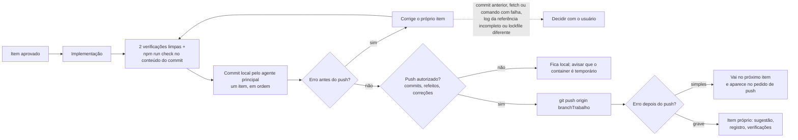

# VER-013 — Commits locais pelo agente principal, só de versões limpas; push continua com o usuário

## Cabeçalho

| Campo | Valor |
|---|---|
| Id | VER-013 |
| Título | Commits locais pelo agente principal, só de versões limpas; push continua com o usuário |
| Gravidade | média |
| Tipo | processo · CORE · documentação |
| Data | 2026-11-22 (data do commit; todas as datas deste registro em UTC) |
| Usuário responsável | TokumoH |
| Status de implementação | somente documentação |
| Commits | commit que introduz este arquivo — `git log --diff-filter=A --format=%h -- docs/verificacoes/2026-11-22-013-commits-locais-pelo-agente.md` |
| Arquivos | modificados: `CLAUDE.md`, `docs/planos/2026-11-17-e0-fundacao.md`, `docs/planos/README.md`, `docs/verificacoes/README.md`, `docs/README.md`; novo: este registro (6 arquivos) |

## Problema

Desde o [VER-002](2026-11-16-002-autorizacao-git-e-branch-trabalho.md) (commit 6a8d3e6), cada commit pedia autorização explícita própria, além da aprovação da sugestão. Efeito: toda tarefa verificada esperava duas autorizações seguidas (commit e push), e o trabalho pronto ficava sem commit no container temporário enquanto a autorização não vinha.

## Era proposital?

Sim, na origem: o VER-002 (6a8d3e6) nasceu de um incidente em que conteúdo entrou no histórico e foi enviado sem o usuário ver. Em 2026-11-21 o responsável decidiu mudar: "MUDE CORE. Pode gerenciar commits locais. somente os pushs precisam de aprovação. Mas mantenha uma ordem de commits, NUNCA pode acontecer de um commit logo depois do outro por correção de erros simples, as versões devem ser limpas".

O responsável decidiu também quatro pontos que a frase deixava abertos (em 2026-11-21 e 2026-11-22):

- **Erro simples depois do push** (o commit enviado não pode ser refeito): vai no próximo item; nunca vira commit só de correção. Erro grave vira item próprio.
- **"Somente os pushs"**: criar, renomear ou apagar branch, merge, PR, e descartar ou fundir commits locais de itens diferentes continuam pedindo autorização. Por cautela, o agente estendeu a mesma lista a duas ações vizinhas que a decisão não citou e que tiram do usuário o controle do conteúdo: trazer conteúdo de outra branch ou do remoto (pull, rebase sobre outra base, reset para outra referência; antes coberto por "atualizar branches") e descartar stash ou alteração não commitada. O responsável pode tirá-las. Também não entra nessa lista desfazer as sabotagens temporárias que o próprio agente faz para testar (planos da E0): elas rodam em cópias ou, no repositório, são desfeitas revertendo só a edição da sabotagem a partir de uma cópia do arquivo guardada antes; nunca com `git checkout`, `git restore`, `git clean` ou `git stash`, que apagariam trabalho não commitado de outros itens.
- **Refazer commit anterior:** depois de onze versões em que o procedimento automático de rebase abria um caso de borda novo a cada verificação, o responsável decidiu: refazer o último commit, ainda não enviado, é gestão local; refazer um commit anterior é decidido com ele, sem rebase automático.
- **Forma da regra:** depois de três versões detalhadas reprovadas nas verificações (cada detalhe de procedimento no CORE abria uma brecha nova), o responsável escolheu deixar no `CLAUDE.md` só os princípios, com o procedimento e os limites neste registro.

Do VER-002, fica coberto o que sai do container (push), o que mexe em branches e o que descarta trabalho. Fica aceito por decisão do responsável, e não coberto, que um commit local entre no histórico sem ele ver antes; o pedido de push atenua isso, porque mostra cada commit, os refeitos e as correções que vão junto antes de qualquer coisa sair.

## Solução

No `CLAUDE.md`, só princípios (algumas observações entre parênteses são só deste registro):

1. **Commit local é do agente principal** (subagente nunca faz commit no repositório do projeto, como já dizia o aviso aos agentes do PLA-001, linha 3), sem pedir autorização, e só de **versão limpa**: item aprovado pelo usuário (sugestão ou tarefa de plano), duas verificações seguidas sem erro e `npm run check` com 0 erros sobre exatamente o conteúdo do commit.
2. **Um item = um commit, em ordem:** item é uma tarefa de plano ou uma sugestão aprovada; nenhum commit entra antes de outro de que dependa. O número do registro pode ter sido reservado antes e não seguir a ordem dos commits (o VER-012 entrou antes do VER-010 e do VER-011).
3. **Nunca um commit logo depois do outro para corrigir erro simples:** antes do push, a correção entra no commit do próprio item, refeito e verificado de novo pelas regras da dupla verificação (o último commit o agente refaz; um commit anterior, só com decisão do usuário); depois do push, o commit enviado não é reescrito, a correção simples vai no próximo item ainda não commitado e é mostrada no pedido de push seguinte, e erro grave vira item próprio.
4. **Continuam com autorização:** push; criar, renomear ou apagar branch; merge, PR, trazer conteúdo de outra branch ou do remoto (pull, rebase sobre outra base, reset para outra referência), descartar trabalho (commit, stash ou alteração não commitada) ou fundir commits de itens diferentes. Refazer o último commit, ainda não enviado, não é descarte.
5. **Pedido de push:** commits não enviados, em ordem, com hash e resumo, os refeitos e as correções simples que vão junto; a autorização vale para essa lista, e qualquer mudança nela pede autorização de novo; lembra que o container é temporário.

Textos ajustados nos lugares vivos que diziam o contrário: `CLAUDE.md` (Autorização, Commit, Branch e Git, Organização da documentação, Modo VARREDURA, "Why", fluxograma), o PLA-001 (aviso aos agentes, restrições globais, parágrafo dos registros, fechamento das Tarefas 3 e 4), `docs/planos/README.md`, `docs/verificacoes/README.md` (propósito, passos 1 e 5, fluxograma, e a entrada deste registro) e `docs/README.md`; no PLA-001, também os mínimos de linhas da linha 37. Ficam com o texto antigo, por serem histórico: os passos das Tarefas 1 e 2 no PLA-001 (linhas 141 e 194), o trecho do VER-007 na linha 95 e os registros 001 a 012.

## Por que esta solução

- **Cumpre a decisão do responsável**, nas leituras que ele escolheu.
- **Princípios no CORE, procedimento no registro:** o CORE diz o que precisa ser verdade (versão limpa, ordem, sem commit de correção seguido, push com autorização); o como pode melhorar sem reescrever o CORE a cada caso novo.
- **"Versão limpa" usa critérios que já existem** (aprovação, dupla verificação, `npm run check`), com uma exigência a mais que a torna verificável: o `check` vale para o conteúdo do commit, não para a working tree com trabalho de outras tarefas.
- **A fronteira é o push, que o usuário controla:** antes dele corrige-se o próprio commit; depois, a correção simples viaja com o próximo item, à vista no pedido de push.

## Por que não outras soluções

| Opção | Motivo de descarte |
|---|---|
| Manter autorização por commit | Contraria a decisão do responsável |
| Commits livres, inclusive de trabalho em andamento | Contraria "as versões devem ser limpas" |
| Corrigir com commit novo antes do push | Contraria "nunca um commit logo depois do outro por correção" |
| Reescrever commit já enviado (force push) | O responsável escolheu não reescrever o que foi enviado |
| Liberar todas as operações locais | O responsável escolheu manter branch, merge, PR, descarte e fusão com autorização |
| Procedimento detalhado dentro do `CLAUDE.md` (versões 1 a 3) | Seis verificações reprovadas: cada detalhe abria uma brecha nova; o responsável escolheu princípios |
| `npm run check` na working tree | Com trabalho não commitado de outras tarefas, o `check` não prova que o commit é limpo |

## Onde

| Arquivo | Linhas | O que mudou |
|---|---|---|
| [`CLAUDE.md`](../../CLAUDE.md#L21) | 21 | "Nunca sem autorização": push, branch, merge, PR, conteúdo de outra branch ou do remoto, descarte e fusão; commit local remete à seção Commit |
| [`CLAUDE.md`](../../CLAUDE.md#L56) | 56 | princípios do commit local e link para este registro |
| [`CLAUDE.md`](../../CLAUDE.md#L62-L68) | 62–68 | lista de ações com autorização; commit local; estado no pedido de push; origem |
| [`CLAUDE.md`](../../CLAUDE.md#L72) | 72 | READMEs: "commit local só de versão limpa" |
| [`CLAUDE.md`](../../CLAUDE.md#L118) | 118 | saída da varredura |
| [`CLAUDE.md`](../../CLAUDE.md#L122) | 122 | "Why" |
| [`CLAUDE.md`](../../CLAUDE.md#L132-L133) | 132–133 | fluxograma |
| [`docs/planos/2026-11-17-e0-fundacao.md`](../planos/2026-11-17-e0-fundacao.md#L3) | 3 | aviso aos agentes |
| [`docs/planos/2026-11-17-e0-fundacao.md`](../planos/2026-11-17-e0-fundacao.md#L33-L34) | 33–34 | restrições globais |
| [`docs/planos/2026-11-17-e0-fundacao.md`](../planos/2026-11-17-e0-fundacao.md#L37) | 37 | mínimos de linhas: `CLAUDE.md` 133 (âncora `#L132-L133` deste registro); corrigidos os que já estavam abaixo das âncoras existentes (`docs/README.md` 78, `package.json` 36) e incluídos `docs/planos/README.md` 68, `src/shared/infra/README.md` 95 e o próprio plano 315 |
| [`docs/planos/2026-11-17-e0-fundacao.md`](../planos/2026-11-17-e0-fundacao.md#L95) | 95 | última frase do parágrafo dos registros |
| [`docs/planos/2026-11-17-e0-fundacao.md`](../planos/2026-11-17-e0-fundacao.md#L260) | 260 | fechamento da Tarefa 3 |
| [`docs/planos/2026-11-17-e0-fundacao.md`](../planos/2026-11-17-e0-fundacao.md#L304) | 304 | fechamento da Tarefa 4 |
| [`docs/planos/README.md`](../planos/README.md#L55) | 55 | fluxograma |
| [`docs/verificacoes/README.md`](README.md#L14) | 14 | campo "Arquivos" |
| [`docs/verificacoes/README.md`](README.md#L18) | 18 | propósito (um registro por commit de item aprovado) |
| [`docs/verificacoes/README.md`](README.md#L64) | 64 | linha do VER-013 em "Onde" |
| [`docs/verificacoes/README.md`](README.md#L68) | 68 | passo 1 de criação: item aprovado (sugestão ou tarefa de plano) |
| [`docs/verificacoes/README.md`](README.md#L72) | 72 | passo 5 de criação |
| [`docs/verificacoes/README.md`](README.md#L76) | 76 | fluxograma: "Item aprovado" |
| [`docs/README.md`](../README.md#L50) | 50 | descrição da pasta de registros |

## Lógica



Antes: sugestão aprovada → verificações → **pedir autorização do commit** → commit → pedir autorização do push. Depois: item aprovado → verificações e `check` sobre o conteúdo do commit → commit local do agente principal → pedido de push com a lista (hash, resumo, refeitos, correções que vão junto).

**Procedimento** (como o agente cumpre os princípios; pode melhorar sem mudar o CORE: a melhoria é feita neste registro, no commit do item que a motivou, e citada no registro desse item):

1. **`check` sobre o conteúdo do commit:** clonar o repositório no scratchpad (`git clone`), aplicar ali exatamente o conteúdo a commitar e ligar o `node_modules` do repositório (link simbólico). Isso só vale se o `package-lock.json` do commit for igual ao da working tree, de onde o `node_modules` foi instalado (`cmp` dos dois); se for diferente, não rodar `npm ci` nem `npm install` no clone (pelo link, apagariam o `node_modules` do repositório, e o npm local, 10.9.9, reescreve o lockfile gerado pelo npm 11, como registrado no VER-008): decidir com o usuário. Commitar no clone (o commit do clone é descartável e nunca sai dele) e conferir que `git rev-parse HEAD^{tree}` no clone é igual ao `git write-tree` do índice do repositório e que `git status --porcelain` no clone está vazio (sem arquivo não rastreado, que o `check-docs` leria). Rodar `npm run check` no clone. O `check` grava cache do Vitest em `node_modules/.vite` pelo link, sem efeito no conteúdo do commit. Uma cópia por `git archive` não serve: `check-docs` e `check-doc-secrets` usam `git ls-files`.
2. **Arquivo com trabalho de outro item:** o conteúdo do commit é montado a partir do HEAD com as edições do item, gravado com `git hash-object -w` e posto no índice com `git update-index --cacheinfo`, com o modo do arquivo no HEAD (`git ls-tree HEAD -- <arquivo>`). Arquivo novo, que não existe no HEAD, também pode ter trabalho de outro item (o `git diff` não mostra isso): o conteúdo dele é lido inteiro, e o que for de outro item fica fora do conteúdo commitado, montado como acima (`git hash-object -w` de uma cópia só com a parte do item e `git update-index --add --cacheinfo <modo>,<hash>,<arquivo>`, com modo `100755` se o arquivo for executável e `100644` se não for); a working tree recebe as mesmas edições; antes e depois do commit, `git diff --cached` e `git diff` confirmam que só o trabalho do outro item ficou fora.
3. **Refazer o commit do item antes do push** (qualquer erro achado antes do push, simples ou grave, entra no commit do próprio item):
   - **último commit, ainda não enviado:** primeiro `git fetch --no-prune origin` (só atualiza as referências `origin/*`, não traz nada para a branch e, com `--no-prune`, não apaga referência remota mesmo que `remote.origin.prune` ou `fetch.prune` estejam ligados; `git remote prune` também não é usado, porque apagar a referência apaga a prova de que um commit foi enviado); se ele falhar, decidir com o usuário. O commit conta como enviado se for ancestral de qualquer valor que a `origin/branchTrabalho` já teve, lido no arquivo de log local da referência (valor antigo e novo de cada mudança, desde que o log começou). O log só vale se for uma cadeia contínua: começa no hash nulo, cada linha começa no valor em que a anterior terminou, e a última termina no valor atual da `origin/branchTrabalho`; se o arquivo não existir, estiver vazio ou tiver lacuna, decidir com o usuário. Num repositório criado por `git clone`, a referência nasce sem log, a primeira linha não começa no hash nulo e a resposta é sempre `DECIDIR` (falha segura: nesse caso, refazer o último commit também passa pelo usuário). Além disso, `git branch -r --contains HEAD` precisa sair vazio. Em comandos (testados em simulação; saída `ENVIADO`, `NAO-ENVIADO` ou `DECIDIR`):

   ```bash
   L=$(git rev-parse --git-path logs/refs/remotes/origin/branchTrabalho)
   Z=0000000000000000000000000000000000000000
   if [ ! -s "$L" ]; then echo DECIDIR; else
     ant=$Z; ok=1
     while read velho novo resto; do [ "$velho" = "$ant" ] || ok=0; ant=$novo; done < "$L"
     [ "$ant" = "$(git rev-parse origin/branchTrabalho)" ] || ok=0
     if [ $ok = 0 ]; then echo DECIDIR; else
       e=0
       for h in $(awk '{print $1; print $2}' "$L" | sort -u); do
         [ "$h" = "$Z" ] && continue
         git merge-base --is-ancestor HEAD "$h"; r=$?
         [ $r = 0 ] && [ $e != 2 ] && e=1
         [ $r -gt 1 ] && e=2
       done
       [ $e != 2 ] && [ -n "$(git branch -r --contains HEAD)" ] && e=1
       if [ $e = 2 ]; then echo DECIDIR; elif [ $e = 1 ]; then echo ENVIADO; else echo NAO-ENVIADO; fi
     fi
   fi
   ```

   Se for enviado, o caso é do passo 4 (erro simples) ou vira item próprio (erro grave); erro de comando, decidir com o usuário. Se não for enviado: montar a correção no índice (como no passo 2, se houver trabalho de outro item no mesmo arquivo), fazer as verificações da dupla verificação (nit: reconferência pontual) e o passo 1 sobre o conteúdo corrigido; só então repetir o `git fetch --no-prune origin` e a conferência abaixo (o estado pode ter mudado durante as verificações), anotar o hash curto atual, `git commit --amend` e procurar o hash antigo na working tree, inclusive em arquivos não rastreados (`git grep -n --untracked -e <hash>`); onde aparecer, corrigir antes de seguir;
   - **commit anterior (há commits locais depois dele):** não há rebase automático. A correção fica guardada como diff no scratchpad, sem commit nenhum, e o agente decide com o usuário como refazer;
   - registro nenhum cita pelo hash um commit ainda não enviado, só pelo número (VER-NNN), porque o hash muda quando o commit é refeito.
4. **Correção simples depois do push:** entra no próximo item ainda não commitado, citada no registro dele e listada no pedido de push; se a etapa acabou, entra no primeiro item da etapa seguinte. Enquanto espera, fica anotada no scratchpad da sessão e é dita ao usuário a cada status, para que fique também na conversa.
5. **Pedido de push:** conforme o `CLAUDE.md` (Branch e Git): commits em ordem, com hash e resumo, cada commit refeito com o motivo e as correções simples que vão junto; a autorização vale para essa lista, e qualquer mudança nela pede autorização de novo; lembrar que o container é temporário.

## Exemplo

Este próprio registro. O commit do VER-013 é o primeiro sob a regra nova e é feito pelo agente com base na decisão do responsável ("Pode gerenciar commits locais") e nas escolhas dele registradas acima. As duas extensões declaradas (que pedem autorização para mais coisas, não para menos) e as exceções dos Riscos aparecem para ele no pedido de push, junto com o texto final, e ele pode retirá-las. O VER-013 é commitado antes do VER-010 e do VER-011 (Tarefas 3 e 4), porque ficou limpo antes e não depende deles. O `CLAUDE.md` tem na linha 17 uma alteração não commitada das Tarefas 3 e 4, que fica fora do commit pelo passo 2 do procedimento; os outros 5 arquivos não têm alteração pendente e entram com `git add`. O `npm run check` roda num clone com exatamente esse conteúdo (passo 1). Depois do commit, `git diff CLAUDE.md` mostra só a linha 17.

Mais tarde, se um revisor achar antes do push um erro de texto no VER-010 e ele for o último commit, a correção entra no próprio commit do VER-010 (passo 3), e não num commit "corrige VER-010"; se o VER-011 já estiver por cima, o agente guarda a correção e decide com o usuário. Ao pedir o push: "commits locais não enviados, em ordem: `<hash>` VER-013 (regra de commits; 6 arquivos), `<hash>` VER-010 (banco com RLS; …), `<hash>` VER-011 (checagens; …); refeito: VER-010 (motivo: texto do registro)".

## Verificação

Dupla verificação do CORE: em cada versão, conferência própria do agente (aplicar as edições num clone, `check-docs`, `check-doc-secrets`, `npm run check` no clone com o conteúdo exato, parser oficial do Mermaid 11.4.1 nos fluxogramas e, desde a v16, o trecho bash do passo 3 rodado em repositórios de teste) e duas verificações independentes por agentes novos: uma factual e de coerência, outra adversarial, ambas com simulações próprias. Relatórios guardados no scratchpad da sessão (`core-commits/v1` a `v36`).

| Versão | Verificação factual | Verificação adversarial | Mudança principal na versão seguinte |
|---|---|---|---|
| v1 | 4 importantes | 12 importantes | definições de ordem, push, descarte, subagente |
| v2 | 5 | 6 | `check` em clone, próximo item, linha 32 |
| v3 | 2 | 5 | decisão do responsável: **princípios no CORE** |
| v4 | limpa | 4 | pull/rebase/reset para outra referência voltam a pedir autorização |
| v5 | limpa | 3 | autorização de push presa à lista com hash |
| v6 | 2 | 1 | commit de fixup não pode ficar no histórico |
| v7 | limpa | 1 | conferir que o alvo não foi enviado |
| v8 | limpa | 2 | nunca `npm ci` pelo `node_modules` ligado |
| v9 | 1 | 2 | prova da árvore com commit no clone; hashes antigos |
| v10 | 1 | 1 | comando de busca de hashes executável |
| v11 | 1 | 2 | decisão do responsável: **rebase só com ele** |
| v12 | 2 | 1 | ordem do amend; linha 32 de volta ao original |
| v13 | 1 | 2 | guarda de "enviado" pelo log da referência |
| v14 | limpa | 1 | log vazio leva a decidir |
| v15 | limpa | 1 | log como cadeia contínua (trecho bash) |
| v16 | limpa | 3 | arquivo novo com trabalho alheio; clone novo; erro de comando |
| v17 | 1 | 1 | `git fetch --no-prune` |
| **v18** | **limpa** | **limpa** | — |

Duas verificações seguidas sem erro: as duas da v18 (só nits). Nits incorporados sem zerar a contagem, por serem texto ou procedimento sem afirmação falsa: uma convenção de fuso (UTC); repetir o `fetch` e a conferência logo antes do `--amend`; como desfazer sabotagem sem apagar trabalho alheio; mais comandos que apagam a referência remota, nos Riscos. Reconferência pontual depois dos nits: `check-docs` e `check-doc-secrets` com 0 erros, Mermaid válido nos quatro arquivos, trecho bash extraído de novo do registro e rodado (enviado → `ENVIADO`; novo → `NAO-ENVIADO`; lacuna → `DECIDIR`), `npm run check` com código 0 no clone com o conteúdo exato do commit e árvore do clone igual à do índice do repositório.

## Riscos

- **Exceções que estão só neste registro:** `git fetch` (atualiza `origin/*`, não traz nada para a branch) e desfazer as sabotagens temporárias do próprio agente não pedem autorização; o `CLAUDE.md` não as cita.
- **Do VER-002, aceito e não coberto:** commit local entra no histórico sem o usuário ver antes; só o pedido de push mostra.
- **Sem trava técnica:** o `check-registro` aceita um commit que só altera um registro existente, então um commit "corrige VER-010" passaria no hook e na CI. A regra depende do agente; o pedido de push é onde o usuário vê.
- **Pre-push e CI:** o hook roda o `check` uma vez, na working tree (com trabalho não commitado e arquivos não rastreados de outros itens), e não em cada commit; a CI roda em PR e por disparo manual. Nenhum prova que cada commit é limpo: quem prova é o passo 1, antes de cada commit. Se trabalho de outro item barrar o hook, o caminho (esperar o item ou guardar o trabalho temporariamente) é decidido com o usuário no pedido de push.
- **Pendência para o VER-010 e o VER-011:** o trabalho não commitado das Tarefas 3 e 4 se cruza em vários arquivos (por exemplo, a linha 17 do `CLAUDE.md`, o `scripts/README.md`, o parágrafo "Estimativa de consumo" de `.github/workflows/README.md` e textos de `supabase/` que já descrevem as checagens da Tarefa 4). Para o VER-010 ser versão limpa, é preciso montar um estado só com a Tarefa 3, ou commitar as duas tarefas numa ordem que respeite a dependência; isso será decidido e verificado no commit do VER-010.
- **Correção pendente depois do push:** fica no scratchpad (temporário) e na conversa até o próximo item; se a sessão terminar antes, só a conversa guarda.
- **Remoto alterado por outra sessão ou pelo GitHub:** se a `origin/branchTrabalho` avançar, o push é recusado e trazer o remoto exige autorização. Se for reescrita à força, a conferência do passo 3 lê o arquivo de log local da referência (valores antigo e novo de cada mudança), então um commit que já passou pelo remoto enquanto o log existia continua contando como enviado. Isso falha em três casos, todos tratados: (a) entradas apagadas pelo `git gc` (padrão de 30 e 90 dias; aqui o `gc` automático está desligado, `gc.auto=0`) quebram a cadeia contínua e levam a `DECIDIR`; (b) num repositório criado por `git clone`, o log nasce sem a entrada de criação e a resposta é sempre `DECIDIR`; (c) apagar a referência remota (`fetch --prune`, `git remote prune`, ou um `fetch` comum com `remote.origin.prune`/`fetch.prune` ligados) apaga a prova, por isso o procedimento usa `git fetch --no-prune` e não usa `git remote prune`. Fora do procedimento, `git reflog expire --rewrite` ou `git reflog delete --rewrite` apagariam entradas mantendo a cadeia, e `git branch -dr`, `git update-ref -d` ou `git remote remove/rename` apagariam a referência, que o `fetch` seguinte recriaria com log novo; o agente não usa esses comandos. Mesmo nesses casos, um commit já enviado e refeito por engano não sai sem o usuário: o push seguinte é recusado e só passaria com force push, que pede autorização.
- **Refazer commit anterior depende do usuário:** a correção espera, como diff no scratchpad (temporário), até a decisão; se a sessão terminar antes, só a conversa guarda o que era.
- **Hashes de commits não enviados:** mudam quando o último commit é refeito; registros citam esses commits pelo número (VER-NNN), e o passo 3 procura o hash antigo na working tree. O campo "Commits" do modelo de registro aceita hash curto ou comando; o hash curto vale para commits já enviados, e este registro usa o comando (`git log --diff-filter=A`), que não depende do hash.
- **Dependências:** se o lockfile do commit for diferente do instalado (por exemplo, quando a E1 acrescentar pacotes), o `check` no clone não pode usar o `node_modules` do repositório, e rodar `npm ci` pelo link apagaria o `node_modules` do repositório; o passo 1 manda decidir com o usuário (um `node_modules` próprio no clone, instalado com a versão do npm do lockfile, é o caminho provável).
- **Tarefas de plano não têm sugestão própria** a aprovar (foram aprovadas no plano): a correção simples que vai junto aparece no registro e no pedido de push.
- **Passo fora do comum** (índice montado à mão): conferido por `git diff` antes e depois.
- O container é temporário: commits locais não enviados se perdem se a sessão terminar.
- "Erro simples" e "erro grave" depois do push são classificados pelo agente, sem lista fechada no `CLAUDE.md`; exemplos de grave: falha de segurança, funcionalidade quebrada, `check` vermelho.
