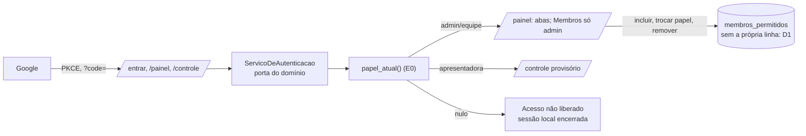

# VER-014 — Plano de implementação da etapa E1 (PLA-002): entrada e membros

## Cabeçalho

| Campo | Valor |
|---|---|
| Id | VER-014 |
| Título | Plano de implementação da etapa E1 (PLA-002): entrada e membros |
| Gravidade | média |
| Tipo | documentação · planejamento |
| Data | 2026-11-26 (data do commit, em UTC) |
| Usuário responsável | TokumoH |
| Status de implementação | somente documentação |
| Commits | commit que introduz este arquivo — `git log --diff-filter=A --format=%h -- docs/verificacoes/2026-11-26-014-plano-e1.md` |
| Arquivos | `docs/planos/2026-11-26-e1-entrada-e-membros.md` (novo), `docs/planos/README.md`, `docs/verificacoes/README.md`, este registro (4 arquivos) |

## Problema

A etapa E0 terminou com o banco, as checagens e o cliente Supabase ([VER-010](2026-11-22-010-e0-banco.md), [VER-011](2026-11-22-011-e0-checagens-banco.md)), mas a E1 do [DES-001](../desenho/2026-11-16-revocast-cameras-desenho.md) (login Google, guarda por papel, aba Membros) não tinha plano com tarefas, arquivos, interfaces, testes e ordem. Também faltava registrar as decisões do responsável que mudam o processo a partir daqui (autonomia e dependências) e as lacunas do desenho que a E1 encontra.

## Era proposital?

Não. O plano é o passo seguinte natural depois da E0, como o PLA-001 foi depois do DES-001 ([VER-007](2026-11-17-007-plano-e0.md)).

## Solução

1. **PLA-002** em [`docs/planos/2026-11-26-e1-entrada-e-membros.md`](../planos/2026-11-26-e1-entrada-e-membros.md): decisões vigentes do responsável, restrições globais revistas a partir do PLA-001 (as que mudaram dizem desde quando), decisões D1 a D8 sobre lacunas do desenho, foco da revisão (13 situações perigosas, cada uma com teste na tarefa dona), estrutura de arquivos e seis tarefas: domínio Acesso; migração `membros_sem_autoalteracao` e testes de banco da E1; adaptadores Supabase e composição; entrada, guarda por papel e telas de erro; painel com abas e aba Membros; conferência no navegador e guia do login para o responsável. Cada tarefa tem registro próprio (VER-015 a VER-020), dupla verificação, `npm run check` como último ato, commit e push.
2. **`docs/planos/README.md`**: o PLA-002 no campo "Arquivos", em "Onde" e no "Exemplo".
3. **`docs/verificacoes/README.md`**: o VER-014 em "Arquivos" e "Onde"; o exemplo hipotético, que citava o número 014 (agora deste registro), passa a `2026-11-30-021-exemplo.md`, um número que o PLA-002 não reserva (ele reserva 015 a 020).

**Decisões do responsável** (registradas no plano, seção "Decisões vigentes do responsável"):

| Data | Citação literal | Aplicação |
|---|---|---|
| 2026-11-22 | "Se a gravidade de erros for aceitável, prossiga sem necessidade de refazer dois testes seguidos" | Achado de texto, documentação, nit ou teste a mais, sem tocar segurança, sem mudar comportamento de código e sem enfraquecer teste: corrigir com reconferência pontual registrada; qualquer outro achado: corrigir e verificar de novo, até duas rodadas seguidas sem erro |
| 2026-11-26 | "Seja autonomo, pode seguir e me entregar o projeto completo" | Dada em resposta ao pedido de push. O agente principal segue sem pedir aprovação a cada plano ou tarefa e faz commit e push de cada item verificado (`git push origin branchTrabalho`): a frase vale como autorização explícita e **permanente**, até ser revogada pelo responsável, para o push de cada item verificado da entrega, no lugar do pedido a cada push que a seção "Branch e Git" do `CLAUDE.md` exige. Cada push continua informando o estado (commits enviados, em ordem, com hash e resumo). **O `CLAUDE.md` não foi editado**; se a autorização for revogada, volta a regra dele. Continuam proibidos sem pedido explícito: criar, renomear ou apagar branch; merge; PR; trazer conteúdo de outra branch ou do remoto; descartar trabalho; reescrever commit enviado; fundir commits de itens diferentes |
| 2026-11-26 | "Resolve" (sobre dependências) | Dependência npm nova só quando a etapa precisar de verdade (a E1 não precisa de nenhuma), instalada com o npm 11 via `npx -y npm@11` (11.21.2), nunca com o npm 10.9.9 local; a regra foi comprovada idempotente numa cópia: `npx -y npm@11 install --package-lock-only --ignore-scripts` regenerou o `package-lock.json` idêntico, com os campos `libc` preservados |

**Decisões D1 a D8 do plano**, propostas pelo agente sob a autonomia e aceitas pelo controlador (seção "Decisões sobre lacunas e divergências do desenho"):

| # | Decisão |
|---|---|
| [D1](../planos/2026-11-26-e1-entrada-e-membros.md#L61) | Nenhum `admin` altera nem remove a própria linha, garantido no banco: a migração nova `membros_sem_autoalteracao` (Tarefa 2) recria as políticas de update e delete de `membros_permitidos` com `email <> (select lower(auth.jwt() ->> 'email'))`; a interface também esconde os controles da própria linha e recusa rebaixar o último `admin` (defesa em profundidade). Conferido numa sonda em PGlite, com as duas checagens de banco em 0 erros sobre as duas migrações |
| [D2](../planos/2026-11-26-e1-entrada-e-membros.md#L76) | `/controle` ganha a mesma guarda de membro (três papéis) e continua provisório até a E3; `apresentadora` vai para `/controle` depois do login |
| [D3](../planos/2026-11-26-e1-entrada-e-membros.md#L78) | Quem não está na lista vê o e-mail usado e o aviso, a sessão local é encerrada (o `SIGNED_OUT` que ela emite não apaga a mensagem) e "Entrar com outra conta" pede a escolha de conta ao Google |
| [D4](../planos/2026-11-26-e1-entrada-e-membros.md#L80) | O aviso de revogação de membro pelo canal `estudio` fica para a E3; na E1 a revogação vale na hora no banco e na tela na próxima reavaliação |
| [D5](../planos/2026-11-26-e1-entrada-e-membros.md#L82) | O login anônimo do Supabase pode ficar desligado até a E3 |
| [D6](../planos/2026-11-26-e1-entrada-e-membros.md#L84) | Aba Membros: incluir, trocar papel e remover (sem editar e-mail); repositório do agregado de acesso sem classe genérica |
| [D7](../planos/2026-11-26-e1-entrada-e-membros.md#L86) | As premissas desatualizadas do PLA-001 e do DES-001 (Riscos do VER-010 e do VER-011) não são editadas na E1; o plano carrega as regras atuais, e o ajuste do DES-001 (privilégios, a regra da D1 e as Redirect URLs) é oferecido ao responsável na Tarefa 6 |
| [D8](../planos/2026-11-26-e1-entrada-e-membros.md#L88) | As abas do painel trocam por estado do componente, sem rota nova; recarregar volta para "Episódios" |

## Por que esta solução

- Um plano por etapa continua permitindo executar e registrar uma etapa de cada vez, agora sem a aprovação manual de cada tarefa (decisão de 2026-11-26), mas com a mesma dupla verificação e o mesmo registro por commit.
- **DDD, GRASP Pure Fabrication e Componentes:** o domínio `src/domains/acesso/` nasce com regras puras e portas, sem importar Supabase nem React; os adaptadores ficam em `shared/infra`; as telas recebem serviços pela composição, o que permite testar a interface com serviços falsos.
- **Segurança:** quem nega é o banco (RLS da E0 e, na D1, a política nova); a interface só escolhe o que mostrar. O foco da revisão lista as situações perigosas (fora da lista, maiúsculas, sessão anônima, erro do Google na URL, retorno relido, redirecionamento aberto, nome com HTML) e o teste de cada uma; o passo do responsável proíbe curinga de host nas Redirect URLs.
- **Uma migração nova, só de políticas, e nenhuma dependência nova:** o lockfile fica como está, e a migração passa pelos testes em PGlite e pelas duas checagens de banco.

## Por que não outras soluções

| Opção | Motivo de descarte |
|---|---|
| Implementar a E1 direto, sem plano | Decisões de segurança e as lacunas do desenho ficariam implícitas |
| Proteção do último `admin` só na interface (primeira versão do plano) | Um `admin` com acesso à API tiraria o próprio acesso; a política com a condição de e-mail resolve no banco com custo pequeno (revisão 1, I8) |
| Gatilho contando os admins em `membros_permitidos` | A função de gatilho teria de ser `SECURITY INVOKER`, a contagem sob a RLS some quando o `admin` se rebaixa, e mudaria o `rpc:grants-check` e a lista de exceções do DES-001 (D1) |
| Editar o PLA-001, o DES-001 e o `CLAUDE.md` agora | O PLA-001 é um plano executado; o DES-001 só admite ajustes pequenos aprovados pelo responsável (D7); a autorização de push está registrada no plano e neste registro, sem mudar o CORE |
| Instalar dependências com o npm 10 local | Regeraria o lockfile sem os campos `libc` do npm 11 (VER-008) |
| Redirect URL com curinga de host para as prévias da Vercel | Qualquer pessoa cria um projeto com nome que casa com o curinga e recebe o código do login (revisão 1, I1) |
| Abas do painel por rota | Exigiria caminhos novos no `vercel.json` (D8) |

## Onde

| Arquivo | Linhas | O que mudou |
|---|---|---|
| [`docs/planos/2026-11-26-e1-entrada-e-membros.md`](../planos/2026-11-26-e1-entrada-e-membros.md#L1-L713) | 1–713 | Novo: PLA-002. Decisões do responsável ([21–29](../planos/2026-11-26-e1-entrada-e-membros.md#L21-L29)); restrições globais, com a regra de dependências ([31–57](../planos/2026-11-26-e1-entrada-e-membros.md#L31-L57)); D1 a D8 ([59–88](../planos/2026-11-26-e1-entrada-e-membros.md#L59-L88)); foco da revisão ([90–106](../planos/2026-11-26-e1-entrada-e-membros.md#L90-L106)); tarefas 1 a 6 ([152](../planos/2026-11-26-e1-entrada-e-membros.md#L152), [333](../planos/2026-11-26-e1-entrada-e-membros.md#L333), [413](../planos/2026-11-26-e1-entrada-e-membros.md#L413), [496](../planos/2026-11-26-e1-entrada-e-membros.md#L496), [635](../planos/2026-11-26-e1-entrada-e-membros.md#L635), [680](../planos/2026-11-26-e1-entrada-e-membros.md#L680)); passo do responsável ([694](../planos/2026-11-26-e1-entrada-e-membros.md#L694)); "Ao fim da E1" ([705–713](../planos/2026-11-26-e1-entrada-e-membros.md#L705-L713)) |
| [`docs/planos/README.md`](../planos/README.md#L14) | 14, 48, 61 | PLA-002 no campo "Arquivos" (14), em "Onde" (48) e no "Exemplo" (61) |
| [`docs/verificacoes/README.md`](README.md#L14) | 14, 67, 87, 90 | VER-014 no campo "Arquivos" (14) e em "Onde" (67); exemplo hipotético passa a 2026-11-30 e ao número 021 (87, 90) |

## Lógica

| Passo | Antes | Depois |
|---|---|---|
| Executar a E1 | Sem roteiro | Seis tarefas em ordem, cada uma com testes, sabotagens, registro, commit e push |
| Aprovação e push | Cada sugestão e cada push pediam autorização | Autonomia (2026-11-26): commit e push de cada item verificado, de forma permanente até ser revogada; branch, merge, PR, descarte e reescrita continuam proibidos sem pedido |
| Erros de gravidade aceitável | Refaziam as duas verificações | Corrigidos com reconferência pontual (2026-11-22) |
| Dependência nova | Sem regra escrita | Só se necessária, com `npx -y npm@11`, versão exata, diff do lockfile conferido e justificativa no registro |
| `admin` mexendo na própria linha | A RLS da E0 deixava | Migração `membros_sem_autoalteracao`: 0 linhas na própria linha, inclusive pela API |

## Exemplo

Foco da revisão, item 1: uma conta Google fora da lista entra. Esperado: a tela mostra o e-mail usado, diz que um `admin` precisa incluí-lo, encerra a sessão local e mantém a mensagem depois do `SIGNED_OUT`; no banco, `papel_atual()` devolve nulo e a RLS nega tudo (E0). D1: o `admin`, mesmo com o e-mail em maiúsculas na sessão, apaga ou altera 0 linhas da própria linha e consegue apagar outro `admin` (sonda em PGlite, 2026-11-26).

## Verificação

| # | Abordagem | Resultado |
|---|---|---|
| Regra do npm 11 | `npx -y npm@11 install --package-lock-only --ignore-scripts` numa cópia | Lockfile regenerado idêntico, com os campos `libc` preservados |
| Revisão 1 do plano | Revisor independente, contra o DES-001, o `CLAUDE.md`, o repositório e as decisões do responsável, com sondas próprias | Com erros: 8 Importantes e 7 nits. Principais: I1 (segurança), a Redirect URL com curinga de host permitia tomar a conta; I8, a guarda do último `admin` cabia no banco por política. Os outros tratavam de reavaliação e avisos da sessão, erro do `getSession`, uma sabotagem que não provava o que dizia, a prova de que as rotas de dispositivo não criam o cliente e a leitura da autonomia contra o `CLAUDE.md` (I7). Todos corrigidos |
| Revisão 2 do plano | Revisor novo, conferindo os 15 achados anteriores e procurando novos, com simulação própria | Os 15 achados anteriores resolvidos. Novos: 1 Importante, não de segurança (I-A: avaliações concorrentes perdiam a mensagem; solução: serializar as avaliações), e 3 nits. Todos corrigidos |
| Decisão do controlador | — | O plano é commitado sem uma terceira revisão do documento: o desenho do I-A foi provado em simulação pelo próprio revisor, e o código real é revisado na Tarefa 4; o custo, se estiver errado, é retrabalho na Tarefa 4 |
| `npm run check` sobre o conteúdo do commit | Controlador, como último ato antes do commit | Feito pelo controlador antes do commit |
| Redação | `node scripts/check-docs.mjs` e `node scripts/check-doc-secrets.mjs` | 0 erros |

## Riscos

- **Passos do responsável:** sem eles o login real não funciona. São os da Tarefa 6, Passo 5, em ordem: aplicar no editor SQL a migração de fundação da E0 e o comando do primeiro `admin` (se ainda pendentes) e, **depois**, a migração nova da E1, `membros_sem_autoalteracao`; credencial OAuth e tela de consentimento publicada no Google Cloud; provedor Google ligado e Email desligado no Supabase; Redirect URLs sem curinga de host; validade do JWT; variáveis na Vercel e novo deploy; conferência real com duas contas. Até lá, os testes provam o fluxo só com serviços falsos e em PGlite.
- **D1, o que sobra:** dois admins que se removem um ao outro **no mesmo instante** (transações concorrentes, cada uma vendo a outra linha ainda lá) podem zerar os admins. É risco de disponibilidade, não de segurança, com recuperação pelo comando do primeiro `admin` no editor SQL.
- **D7:** as premissas desatualizadas do DES-001 (§8 "Banco" e §13, sem os privilégios explícitos nem o `service_role`; sem a regra da D1; Redirect URLs) e do PLA-001 continuam sem edição; quem ler só o DES-001 vê a regra antiga. O ajuste é oferecido ao responsável na Tarefa 6.
- **Autonomia:** commit e push saem sem pedido enquanto a autorização de 2026-11-26 valer; o `CLAUDE.md` continua pedindo autorização a cada push, e a exceção está só no plano e neste registro. O que fica de fora (branch, merge, PR, descarte, reescrita) depende de o agente seguir a lista do plano.
- **Sem terceira revisão do plano:** o desenho do I-A só foi provado em simulação; o código é revisado na Tarefa 4.
- Versões de bibliotecas fixadas podem envelhecer até a execução; a E1 não acrescenta nenhuma.
- A linha nova em "Onde" de `docs/verificacoes/README.md` (67) fica depois de todas as âncoras de linha de registros antigos para essa tabela, mas desloca uma linha a seção "Exemplo", que o VER-010 cita (`README.md#L85-L88`); o arquivo não encolheu.
