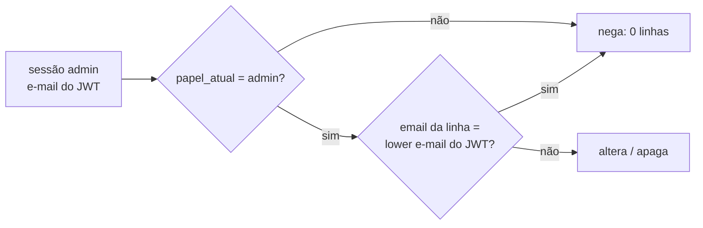

# VER-016 — E1, Tarefa 2: migração `membros_sem_autoalteracao` e testes de banco da E1

## Cabeçalho

| Campo | Valor |
|---|---|
| Id | VER-016 |
| Título | E1, Tarefa 2: migração `membros_sem_autoalteracao` e testes de banco da E1 |
| Gravidade | média |
| Tipo | implementação · segurança · decisão de arquitetura |
| Data | 2026-11-26 (data do commit, em UTC) |
| Usuário responsável | TokumoH |
| Status de implementação | implementado (no repositório; a aplicação da migração no Supabase real é passo do responsável, Tarefa 6 do PLA-002) |
| Commits | commit que introduz este arquivo — `git log --diff-filter=A --format=%h -- docs/verificacoes/2026-11-26-016-e1-banco-membros.md` |
| Arquivos | `supabase/migrations/20261126142500_membros_sem_autoalteracao.sql` (novo), `supabase/tests/banco.ts`, `supabase/tests/rls.test.ts`, `supabase/tests/matriz.test.ts`, `supabase/tests/README.md`, `supabase/migrations/README.md`, `supabase/README.md`, `scripts/README.md`, `docs/verificacoes/README.md`, este registro (10 arquivos) |

## Problema

1. **Um `admin` podia tirar o próprio acesso.** Na migração de fundação, as políticas `membros_permitidos_admin_altera` e `membros_permitidos_admin_apaga` deixam o `admin` alterar e apagar **qualquer** linha da lista de acesso, inclusive a própria. Um `delete from public.membros_permitidos` sem `where` feito pelo único `admin` esvaziava a lista (prova: sem a migração nova, `e1-sempre-sobra-um-admin` dá `expected [] to deeply equal [ Array(1) ]`), e um `update ... set papel = 'equipe'` na própria linha o rebaixava. A interface da E1 (Tarefa 5) esconde esses controles, mas quem tem a chave publicável e a sessão chama a Data API direto: só o banco garante a regra. Efeito: o projeto ficava sem `admin` e só o dono, pelo editor SQL, devolvia o acesso.
2. **Os testes de banco só aplicavam a migração de fundação.** `supabase/tests/banco.ts` importava `20261117000000_fundacao.sql` de forma estática: uma migração nova não entraria nos testes.
3. **O comportamento da E0 de que a E1 depende não tinha teste nomeado:** troca de papel e remoção valendo na hora, quem entra antes de ser liberado ganhando acesso quando o `admin` o inclui, a equipe sem escrita na lista nos comandos que o adaptador manda (`where` + `returning`).

## Era proposital?

Não. O DES-001 (§8, "Membros") diz só que "`admin` lê e escreve `membros_permitidos`"; nada sobre a própria linha ou o último `admin`. A primeira versão do PLA-002 aceitava o risco com proteção só na interface; o controlador decidiu (D1 do [PLA-002](../planos/2026-11-26-e1-entrada-e-membros.md)) garantir a regra no banco com uma migração nova. O import estático em `banco.ts` era suficiente enquanto havia uma migração só (E0, [VER-010](2026-11-22-010-e0-banco.md)).

## Solução

- **Migração nova** [`20261126142500_membros_sem_autoalteracao.sql`](../../supabase/migrations/20261126142500_membros_sem_autoalteracao.sql): `drop policy` e `create policy` de `membros_permitidos_admin_altera` (update) e `membros_permitidos_admin_apaga` (delete), sempre `to authenticated`, com a condição `(select public.papel_atual()) = 'admin' and email <> (select lower(auth.jwt() ->> 'email'))` no `using` das duas e no `with check` da de update. Nenhum `grant`, tabela ou função muda; a migração de fundação não foi tocada.
- **`banco.ts`** aplica todas as migrações de `supabase/migrations/*.sql`, em ordem de nome, como `postgres_sim` (constante `MIGRACOES` por `import.meta.glob`).
- **`rls.test.ts`**: bloco `E1 — entrada e lista de acesso` com 8 testes, no mesmo banco e nas mesmas transações do arquivo (nenhum PGlite a mais na CI).
- **`matriz.test.ts`**: mapa `PROPRIA_LINHA_INTOCADA = { membros_permitidos: { adm: EMAIL_ADM } }`; nas células `membros_permitidos × adm × update` e `× delete`, o permitido passa a ser "toda linha muda ou some, exceto a linha `email = EMAIL_ADM`, que fica idêntica".
- READMEs de `supabase/`, `supabase/migrations/` e `supabase/tests/` (contagens, migração nova, passo do responsável, recuperação do último `admin`) e a saída esperada do `rpc:grants-check` em `scripts/README.md` ("2 migração(ões)").

**Decisão D4 (PLA-002), registrada aqui por ser do banco da E1:** o aviso de revogação pelo canal `estudio` fica para a E3 (não há tempo real na E1). Os testes `e1-admin-troca-papel-vale-na-hora` e `e1-admin-remove-vale-na-hora` provam a parte que a E1 entrega: no banco a troca e a remoção valem **na hora**, no comando seguinte da sessão afetada; a tela reavalia nos eventos de sessão (Tarefas 4 e 5).

## Por que esta solução

- **Segurança onde nega:** a regra fica na RLS, como toda regra de acesso do projeto (restrição global do PLA-002: "a interface nunca decide acesso a dado").
- **Mesma comparação de e-mail de `papel_atual()`** (`lower(auth.jwt() ->> 'email')`): a linha que dá o papel `admin` à sessão é exatamente a que fica intocável, inclusive com a sessão em maiúsculas. Sem e-mail nas claims, `email <> null` é nulo e a política nega (falha fechada; `papel_atual()` já seria nulo).
- **`with check` também com a condição:** impede trocar o e-mail de outra linha pelo próprio (o teste espera a violação de RLS, não a de chave primária).
- **Componentes e reuso:** `banco.ts` (Pure Fabrication dos testes) passa a ser a fonte única de "todas as migrações em ordem", a mesma regra das checagens de banco (que já aplicavam todas, VER-011). O bloco E1 reaproveita `comoSessao`, `papel`, `ids`, `linhas`, `erro` e as constantes do arquivo.
- **Custo pequeno:** 22 linhas de SQL, sem função nova (as listas de exceção do `rpc:grants-check` e do DES-001 §8/§13 não mudam).

## Por que não outras soluções

Alternativas da D1 (PLA-002):

| Opção | Motivo de descarte |
|---|---|
| Proteção só na interface (a primeira versão do plano) | Um `admin` com acesso à API tira o próprio acesso; nada no banco prova a regra |
| Gatilho em `membros_permitidos` contando os admins | A função de gatilho em tabela das migrações tem de ser `SECURITY INVOKER` (`rpc:grants-check`), e a contagem roda sob a RLS de quem chama, que some quando o `admin` se rebaixa (falso "sem admin"); `papel_atual()` muda de valor no meio de um `delete` de várias linhas; sem chamar `papel_atual()`, a função entraria em `SEM_CHAMADA_DE_PAPEL`, mudando o `rpc:grants-check` e as exceções do DES-001 |
| Gatilho com trava (`pg_advisory_xact_lock`) para fechar também a corrida de dois admins | Herda os problemas da linha acima para cobrir um caso raro, com recuperação documentada |
| Condição pelo `id` da sessão (`criado_por`, `membros.id`) | `membros_permitidos` não guarda o `id` de quem é liberado (só o e-mail, DES-001 §7) |

Alternativas desta tarefa:

| Opção | Motivo de descarte |
|---|---|
| Editar a migração de fundação | Migração aplicada nunca é editada (restrição global; `supabase/migrations/README.md`) |
| `alter policy` em vez de `drop` + `create` | Funcionaria, mas o `drop` + `create` deixa a política inteira legível num lugar só; entre os dois a tabela fica sem política de escrita, o que nega |
| Um PGlite próprio para os testes da E1 | Mais um banco por execução da CI; o bloco no fim de `rls.test.ts` usa o mesmo banco e as mesmas transações |
| Listar as migrações à mão em `banco.ts` | Uma migração nova esquecida na lista passaria sem teste; o `import.meta.glob` pega todo arquivo da pasta, como as checagens de banco |
| Tirar as células `adm × update/delete` da matriz | A célula deixaria de pegar uma política que prenda o `admin` às "próprias linhas" (`criado_por = auth.uid()`); com a exceção só da linha do próprio e-mail, ela continua pegando (sabotagem S6) |

## Onde

| Arquivo | Linhas | O que mudou |
|---|---|---|
| [`supabase/migrations/20261126142500_membros_sem_autoalteracao.sql`](../../supabase/migrations/20261126142500_membros_sem_autoalteracao.sql#L1-L22) | 1–22 | Novo: cabeçalho e as duas políticas recriadas com a condição da D1 |
| [`supabase/tests/banco.ts`](../../supabase/tests/banco.ts#L8-L13) | 1, 8–13, 52–53, 65 | `MIGRACOES` (todas, em ordem de nome) no lugar do import estático; laço em `criarBanco`; comentários |
| [`supabase/tests/rls.test.ts`](../../supabase/tests/rls.test.ts#L924-L1021) | 924–1021 | Bloco `E1 — entrada e lista de acesso` (8 testes); nenhum teste anterior mudou |
| [`supabase/tests/matriz.test.ts`](../../supabase/tests/matriz.test.ts#L102-L112) | 16–19, 102–112, 418–426 | Justificativa no topo; mapa `PROPRIA_LINHA_INTOCADA`; ramo do permitido com a exceção |
| [`supabase/tests/README.md`](../../supabase/tests/README.md) | Propósito, Organização, Por que esta organização, Onde, Lógica, Exemplo, Verificação, Riscos | Todas as migrações; bloco E1; `PROPRIA_LINHA_INTOCADA`; 501 testes; sabotagens |
| [`supabase/migrations/README.md`](../../supabase/migrations/README.md) | Cabeçalho, Propósito, Origem, Onde, Lógica, Verificação, Riscos | Migração nova; regra da D1; limite da corrida; 501 testes |
| [`supabase/README.md`](../../supabase/README.md) | Propósito, Por que esta organização, Onde, Lógica, Exemplo, Verificação, Riscos | Duas migrações em ordem; passo do responsável; recuperação do último `admin`; `migration repair` das duas versões |
| [`scripts/README.md`](../../scripts/README.md) | Exemplo | Saída esperada do `rpc:grants-check` com 2 migrações |
| [`docs/verificacoes/README.md`](README.md) | Cabeçalho, Onde | Este registro |

## Lógica

| Passo | Antes | Depois |
|---|---|---|
| `banco.ts` | `import migracao from '../migrations/20261117000000_fundacao.sql?raw'`; `db.exec(migracao)` | `MIGRACOES` = todo `../migrations/*.sql`, ordenado pelo nome; `for (const { sql } of MIGRACOES) await db.exec(sql)` como `postgres_sim` |
| `update` da lista pelo `admin` | `using/with check (papel_atual() = 'admin')`: toda linha | o mesmo `and email <> lower(e-mail do JWT)`: toda linha menos a própria |
| `delete` da lista pelo `admin` | `using (papel_atual() = 'admin')`: toda linha | o mesmo `and email <> lower(e-mail do JWT)` |
| Célula `membros_permitidos × adm × update/delete` | nenhuma linha igual / tabela vazia | só a linha `email = EMAIL_ADM` sobra, idêntica |

Ordem de aplicação no Supabase: `20261117000000_fundacao.sql` e depois `20261126142500_membros_sem_autoalteracao.sql` (editor SQL; `supabase/README.md`, "Lógica", passo 1).

## Exemplo

Lista semeada: `adm` (`admin`), `ana` (`equipe`), `bia` (`apresentadora`). Sessão do `adm` roda `delete from public.membros_permitidos`:

| | Antes da migração nova | Depois |
|---|---|---|
| Linhas que sobram (superusuário) | 0 (`expected [] to deeply equal [ Array(1) ]`) | 1: `adm`, `admin` |
| `papel_atual()` do `adm` depois | `null` | `admin` |
| `update ... set papel = 'equipe' where email = <adm> returning email`, sessão `Adm@Revocast.TEST` | 1 linha (o `adm` se rebaixa) | `[]` |
| O mesmo `update` com `email = <adm2>` (outro `admin`) | 1 linha | 1 linha |

## Verificação

**TDD.** Passo 1 (`banco.ts` com `MIGRACOES`): `npx vitest run supabase/tests` → 493/493 (nada muda com uma migração só). Passo 2 (bloco E1, sem a migração nova): `npx vitest run supabase/tests/rls.test.ts` → 2 falhas, exatamente `e1-admin-nao-altera-a-si-mesmo` (`expected [ 'adm@revocast.test', …(1) ] to deeply equal [ 'adm@revocast.test', [] ]`) e `e1-sempre-sobra-um-admin`; 57 passam. Passo 3 (migração): 59/59. Passo 4 (matriz antes do ajuste): falham só `membros_permitidos update adm → permitido` e `membros_permitidos delete adm → permitido`; depois do ajuste, 410/410. Passo 5: `npm run rpc:grants-check` → `0 erro(s) — 2 migração(ões)`; `npm run data-api:check` → `0 erro(s) — 2 migração(ões)`.

**Sabotagens em memória** (edição temporária do laço de `criarBanco` em `banco.ts`: `replaceAll` do trecho só no arquivo alvo, com a contagem impressa e erro se o trecho faltar; suíte `npx vitest run supabase/tests`, 501 testes). Antes da primeira e depois de desfazer a última com o Edit inverso, `git status --porcelain supabase/migrations` e `sha256sum supabase/migrations/*.sql supabase/tests/banco.ts` deram exatamente a mesma saída (fundação `3c82ccf7…`, migração nova `81bd2fce…`, `banco.ts` `d66a9ee1…`); conferido de novo depois das sabotagens extras S7 e S8.

| # | Alvo | Trecho → sabotado | Ocorrências (esperado = impresso) | Caiu |
|---|---|---|---|---|
| S1 | migração nova | `(select public.papel_atual()) = 'admin' and email <> (select lower(auth.jwt() ->> 'email'))` → `(select public.papel_atual()) is not null` | 3 = 3 | **`e1-equipe-nao-escreve-na-lista`** (no retrato depois do item (2): o `delete` sem `where` esvaziou a tabela; o item (1), com `where` e `returning`, passou, como previsto), `e1-admin-nao-altera-a-si-mesmo`, `e1-sempre-sobra-um-admin`, `ninguem-se-promove`, `so-admin-apaga-lista` e 6 células (`membros_permitidos` × `adm`/`equipe`/`apresentadora` × update/delete); 11 de 501 |
| S2 | migração nova | ` and email <> (select lower(auth.jwt() ->> 'email'))` → (vazio) | 3 = 3 | `e1-admin-nao-altera-a-si-mesmo`, `e1-sempre-sobra-um-admin`, `membros_permitidos update adm → permitido`, `membros_permitidos delete adm → permitido`; 4 |
| S3 | migração nova | `lower(auth.jwt() ->> 'email')` → `auth.jwt() ->> 'email'` | 3 = 3 | `e1-admin-nao-altera-a-si-mesmo`, na variante `Adm@Revocast.TEST` (o update devolveu a linha do `adm`); 1 |
| S4 | fundação | `lower(auth.jwt() ->> 'email')` → `auth.jwt() ->> 'email'` | 1 = 1 | `email-com-maiusculas` (E0) e `e1-admin-nao-altera-a-si-mesmo` (variante em maiúsculas: `papel_atual()` nulo); 2 |
| S5 (extra) | migração nova | o `with check` de update sem a condição de e-mail | 1 = 1 | `e1-admin-nao-altera-a-si-mesmo`, na troca do e-mail de outra linha pelo próprio (`duplicate key` no lugar da violação de RLS); 1 |
| S6 (extra) | migração nova | `email <> (select lower(auth.jwt() ->> 'email'))` → `criado_por = (select auth.uid())` | 3 = 3 | as 2 células do `adm` (a exceção `PROPRIA_LINHA_INTOCADA` continua pegando a política presa às "próprias linhas"), `e1-admin-nao-altera-a-si-mesmo`, `e1-admin-remove-outro-admin`, `e1-admin-remove-vale-na-hora`, `e1-admin-troca-papel-vale-na-hora`, `e1-sempre-sobra-um-admin`, `ninguem-se-promove`, `so-admin-apaga-lista`; 9 |
| S7 (extra) | fundação | política de insert da lista com `with check (false)` | 1 = 1 | `e1-liberado-depois-de-entrar`, `ninguem-se-promove` e a célula `membros_permitidos insert adm`; 3 |
| S8 (extra) | fundação | `papel_atual()` com `select 'equipe'::public.papel_app` no lugar de `select mp.papel` | 1 = 1 | `e1-papel-de-cada-sessao` e mais 42 (inclusive os outros 6 `e1-*` menos `e1-equipe-nao-escreve-na-lista`) |

Com S1 a S8, cada um dos 8 testes do bloco E1 caiu com ao menos uma sabotagem. Os extras S5 a S8 não estavam no brief: S5 prova a asserção do `with check`, S6 prova a afirmação de que a célula ajustada ainda pega `criado_por`, S7 e S8 derrubam os dois testes E1 que nenhuma das sabotagens S1 a S4 alcançava.

**Fechamento:** `npm run check` → 0 erros (ver o relatório da tarefa e a seção de revisões abaixo).

**Revisões independentes (dupla verificação):** revisão 1 (revisor novo, com sondas próprias numa cópia: `insert ... on conflict do update`, `merge ... delete`, `update ... from`, troca do próprio e-mail, `truncate`, sessão anônima, e-mail com espaço — nenhuma brecha nova): spec ✅, qualidade aprovada, 3 nits de documentação (parêntese da exceção no README das migrações; faixas de linha do "Onde" com uma linha em branco na ponta; o carimbo da migração registrado como aceito). Os três foram corrigidos pelo controlador com reconferência pontual (`check-docs` e `check-doc-secrets`), sem nova rodada, pela decisão do responsável de 2026-11-22 (gravidade aceitável).

Nits corrigidos (não zeram a contagem): nenhum até aqui.

## Riscos

- **A migração nova não foi aplicada num Supabase real.** Aplicá-la no editor SQL, depois da de fundação, é passo do responsável (Tarefa 6 do PLA-002); até lá, no banco real um `admin` ainda remove a própria linha (a interface da Tarefa 5 esconde o controle).
- **Corrida de dois admins** (limite da D1): dois admins que se removem um ao outro no mesmo instante, em transações concorrentes, podem zerar os admins. Sem teste (PGlite não tem conexões concorrentes); recuperação pelo comando do primeiro `admin` em [`supabase/README.md`](../../supabase/README.md).
- O nome da migração usa a data e a hora UTC da implementação (2026-11-26 14:25), não a hora exata do commit que a restrição global do PLA-002 pede; aceito pelo controlador, porque o commit é do mesmo dia e o carimbo só precisa ordenar as migrações (vem depois de `20261117000000`).
- Se a aplicação parar entre os `drop policy` e os `create policy`, nenhum `admin` altera nem remove linhas (falha fechada) até rodar os `create policy`; não foi conferido se o editor SQL aplica o arquivo numa transação só.
- `PROPRIA_LINHA_INTOCADA` compara a coluna `email` (hoje só `membros_permitidos` tem exceção); uma exceção em outra tabela pede generalizar a coluna.
- A D7 (PLA-002) deixa a correção do DES-001 (§7, `membros_permitidos`, com a regra da D1) para o fechamento da E1 (Tarefa 6).
