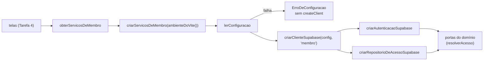

# VER-017 — E1, Tarefa 3: adaptadores Supabase do domínio Acesso e composição dos serviços de membro

## Cabeçalho

| Campo | Valor |
|---|---|
| Id | VER-017 |
| Título | E1, Tarefa 3: adaptadores Supabase do domínio Acesso e composição dos serviços de membro |
| Gravidade | média |
| Tipo | implementação · segurança · decisão de arquitetura |
| Data | 2026-11-26 (data do commit, em UTC) |
| Usuário responsável | TokumoH |
| Status de implementação | implementado (no repositório; nenhuma tela usa ainda os serviços, o que entra na Tarefa 4 do PLA-002) |
| Commits | commit que introduz este arquivo — `git log --diff-filter=A --format=%h -- docs/verificacoes/2026-11-26-017-e1-adaptadores-acesso.md` |
| Arquivos | `src/shared/infra/acessoSupabase.ts` (novo), `src/shared/infra/acessoSupabase.test.ts` (novo), `src/app/servicos.ts` (novo), `src/app/servicos.test.ts` (novo), `src/shared/infra/README.md`, `src/app/README.md`, `src/shared/README.md`, `src/README.md`, `docs/verificacoes/README.md`, este registro (10 arquivos) |

## Problema

1. **As portas do domínio Acesso não tinham implementação.** A Tarefa 1 ([VER-015](2026-11-26-015-e1-dominio-acesso.md)) criou `ServicoDeAutenticacao` e `RepositorioDeAcesso` em `src/domains/acesso/portas.ts`, testadas só com serviços falsos; nada falava com o Supabase. Sem os adaptadores, as telas da Tarefa 4 não têm como ler a sessão, o papel (`papel_atual()`) nem a lista de acesso.
2. **Ninguém compunha os serviços.** O cliente da E0 (`criarClienteSupabase`) não era criado em lugar nenhum; faltava quem lesse `import.meta.env`, validasse a configuração antes de criar o cliente e garantisse um cliente de membro só por página.
3. **Comportamentos do supabase-js 2.119.0 que mudam a tela, se tratados do jeito "natural", dariam defeito:** `getSession()` devolve `session: null` **e** `error` com a rede caída (a sessão continua guardada); `signOut({ scope: 'local' })` devolve erro mesmo depois de apagar a sessão local; o PostgREST devolve `42501` com status 401 quando a requisição sai como `anon`; o `postgrest-js` devolve a falha do `fetch` como erro com `code: ''` e status 0; um `update`/`delete` filtrado pela RLS volta sem erro e com 0 linhas.

## Era proposital?

Sim, a ausência era o plano: o PLA-002 ([Estrutura de arquivos](../planos/2026-11-26-e1-entrada-e-membros.md#estrutura-de-arquivos)) põe os adaptadores e a composição na Tarefa 3, depois do domínio (Tarefa 1) e do banco (Tarefa 2). O README de `src/shared/infra/` da E0 já dizia "Nesta etapa o cliente ainda não é usado por nenhuma tela; passa a ser na E1" ([VER-009](2026-11-17-009-e0-supabase-cliente.md)).

Cada comportamento do item 3 foi conferido no código instalado (`node_modules/@supabase/*`, todos 2.119.0) antes de virar teste:

| Afirmação do brief | Onde no supabase-js 2.119.0 | Conferido |
|---|---|---|
| `getSession()` devolve `session: null` e `error` com a sessão expirada e a rede caída, mantendo a sessão guardada | `auth-js/dist/main/GoTrueClient.js`, `__loadSession`: sessão vencida → `_callRefreshToken`; com erro e sem sessão válida guardada, `return { data: { session: null }, error }` (o `_callRefreshToken` não remove a sessão em erro retentável) | sim |
| O erro é `AuthRetryableFetchError` (por `name`) | `auth-js/dist/main/lib/errors.js`: `isAuthRetryableFetchError` confere `error.name === 'AuthRetryableFetchError'` | sim |
| `signOut({ scope: 'local' })` apaga a sessão local antes do `POST /logout`, e também quando o refresh falha por rede | `GoTrueClient.js`, `_signOut`: `if (scope === 'local') await removeCurrentSession()` antes de `this.admin.signOut(...)`; e `if (scope === 'local' && isAuthRetryableFetchError(sessionError)) await removeCurrentSession()` | sim |
| `INITIAL_SESSION` é emitido ao registrar o ouvinte | `onAuthStateChange` → `_emitInitialSession(id)` → `callback('INITIAL_SESSION', session)` | sim |
| Chamar o Supabase dentro do callback pode travar | `GoTrueClient.d.ts`, `onAuthStateChange`: "One hazard remains: calling `refreshSession` (...) from inside a `TOKEN_REFRESHED` handler (...) the two wait on each other" | sim, com ressalva (ver Riscos) |
| Falha do `fetch` no `postgrest-js` volta com `code: ''` e status 0 | `postgrest-js/dist/index.cjs`, `then`: `res.catch(fetchError => ({ error: { message, details, hint, code }, status: 0, statusText: '' }))` com `code = ""` | sim |

## Solução

- **[`src/shared/infra/acessoSupabase.ts`](../../src/shared/infra/acessoSupabase.ts)** (Pure Fabrication que implementa as portas):
  - `traduzirErro(erro, status)`: (1) status 401 ou `PGRST301`/`PGRST303` → `sessao_expirada`; (2) `23505` → `duplicado`; (3) `23514` → `invalido`; (4) `42501` → `negado`; (5) sem código (ou `''`) e status 0 → `rede`; (6) o resto → `outro`. A mensagem do servidor é descartada.
  - `criarAutenticacaoSupabase(cliente)`: `usuarioAtual` (erro devolvido **ou lançado** por `getSession` → `ErroDeAcesso('rede')`, nunca `null`); `entrarComGoogle(url)` com `prompt: 'select_account'`; `sair()` com `scope: 'local'`, que nunca lança e só avisa com texto fixo; `aoMudarSessao(ouvinte)`, que ignora `INITIAL_SESSION`, só agenda com `setTimeout(..., 0)` e devolve a função que cancela (desliga a flag `ativo`, para que um agendamento já feito não chame o ouvinte, e chama o `unsubscribe`).
  - `criarRepositorioDeAcessoSupabase(cliente)`: `rpc('papel_atual')` filtrado por `ehPapel`; listas com `select` explícito e `order('email')`, linha com papel desconhecido descartada; `insert` sem normalizar; `update`/`delete` com `.eq('email', e).select('email')` e 0 linhas → `ErroDeAcesso('nada_alterado')`.
- **[`src/app/servicos.ts`](../../src/app/servicos.ts)** (composição): `ambienteDoVite()` (só as duas variáveis do Supabase, lidas uma a uma), `criarServicosDeMembro(env)` (valida antes de criar o cliente `membro`) e `obterServicosDeMembro()` (cache em módulo, só em caso de sucesso).
- READMEs de `src/shared/infra/`, `src/app/`, `src/shared/` e `src/` (o que passava a ser falso) e a linha deste registro em `docs/verificacoes/README.md`.

## Por que esta solução

- **DDD e Pure Fabrication:** o domínio continua sem saber de Supabase (`arquitetura.test.ts` segue verde); o adaptador fica em `shared/infra`, ao lado do cliente que ele usa, e a composição em `app/`, o único lugar que conhece as duas pontas. Repositório do agregado de acesso sem classe genérica (D6).
- **Segurança:** o adaptador não decide acesso. `nada_alterado` só traduz o que a RLS já negou (inclusive a própria linha do `admin`, D1, [VER-016](2026-11-26-016-e1-banco-membros.md)); `ehPapel` impede que um valor inesperado do banco vire papel; nenhuma mensagem do servidor, e-mail ou token chega a `ErroDeAcesso` ou ao `console`.
- **Disponibilidade correta da tela:** tratar o erro de `getSession` como `rede` mantém o membro na tela "Não foi possível falar com o servidor" em vez de mandá-lo para a entrada (Foco da revisão, item 10); `sair()` que não lança mantém o estado de tela que quem chamou já decidiu (Foco, item 1); 401 antes de `42501` mostra "sessão expirada" em vez de "sem permissão" quando a sessão sumiu em outra aba.
- **Sem travar o cliente:** o ouvinte de sessão nunca roda código do Supabase dentro do callback (Foco, item 13).
- **Otimização:** um cliente por página (cache em módulo); `ambienteDoVite` com acessos estáticos deixa o Vite embutir só as duas variáveis no bundle, nunca o objeto `import.meta.env` inteiro.

## Por que não outras soluções

| Opção | Motivo de descarte |
|---|---|
| `getSession()` com erro tratado como "sem sessão" (`null`) | Com a rede caída o membro iria para a entrada com a sessão ainda guardada (Foco da revisão, item 10); a sabotagem S3 prova que o teste pega |
| `getUser()` no lugar de `getSession()` em `usuarioAtual` | Faz uma requisição ao Auth a cada avaliação; a decisão de acesso é do banco (`papel_atual()` confere a sessão no servidor), então a sessão local basta para escolher a tela |
| `signOut()` com o escopo padrão (`global`) | Encerra as sessões da pessoa em todos os aparelhos e, sem rede, não apaga a sessão local antes da resposta |
| `sair()` repassando o erro do `signOut` | A sessão local já foi apagada; lançar derrubaria a avaliação que pediu a saída (Foco, item 1; S5) |
| Chamar o ouvinte direto no callback do `onAuthStateChange` | O ouvinte reavalia chamando `getSession`/`papel_atual`; dentro do callback isso pode travar o `auth-js` (S2) |
| `update`/`delete` sem `.select('email')` | Sem `RETURNING` a resposta não diz quantas linhas mudaram; uma escrita filtrada pela RLS pareceria sucesso (S1, S16) |
| Normalizar o e-mail no adaptador | Duplicaria a regra do domínio (`normalizarEmail`); o banco já recusa maiúsculas por `CHECK` (S17) |
| Ler `import.meta.env` inteiro (`{ ...import.meta.env }`) ou dentro de `shared/infra` | Embutiria tudo o que o Vite expõe (`MODE`, `DEV`, TURN) e tiraria a testabilidade de `lerConfiguracao` (S14) |
| Criar o cliente na carga do módulo `servicos.ts` | Falharia ao importar quando faltasse variável, antes de a tela poder mostrar o erro, e criaria o cliente de membro também nas rotas de dispositivo |
| Guardar no cache também a falha de configuração | Nenhum ganho real (a configuração não muda na página) e esconderia a correção num teste; sem cache, a falha é refeita barato |

## Onde

| Arquivo | Linhas | O que mudou |
|---|---|---|
| [`src/shared/infra/acessoSupabase.ts`](../../src/shared/infra/acessoSupabase.ts#L1-L175) | 1–175 | Novo: `traduzirErro` e `motivoDoErro` (22–34), `criarAutenticacaoSupabase` (37–98), `criarRepositorioDeAcessoSupabase` (117–175) |
| [`src/shared/infra/acessoSupabase.test.ts`](../../src/shared/infra/acessoSupabase.test.ts#L1-L351) | 1–351 | Novo: cliente falso (19–68) e 14 testes |
| [`src/app/servicos.ts`](../../src/app/servicos.ts#L1-L35) | 1–35 | Novo: `ambienteDoVite`, `criarServicosDeMembro`, `obterServicosDeMembro` |
| [`src/app/servicos.test.ts`](../../src/app/servicos.test.ts#L1-L80) | 1–80 | Novo: 5 testes com `createClient` simulado |
| [`src/shared/infra/README.md`](../../src/shared/infra/README.md) | Cabeçalho, Propósito, Origem, Organização, Onde, Lógica, Verificação, Riscos | `acessoSupabase.ts` e suas regras; 3 arquivos, 31 testes |
| [`src/app/README.md`](../../src/app/README.md) | Cabeçalho, Propósito, Origem, Organização, Onde, Lógica, Verificação, Riscos | `servicos.ts` e o diagrama da composição |
| [`src/shared/README.md`](../../src/shared/README.md) | Propósito, Organização, Onde, Lógica, Riscos | `infra/` com os adaptadores; risco desatualizado ("os domínios ainda não existem") corrigido |
| [`src/README.md`](../../src/README.md) | Onde | `app/` com a composição; `shared/` com os adaptadores |
| [`docs/verificacoes/README.md`](README.md) | Cabeçalho, Onde | Este registro |

## Lógica

| Situação | Tratamento "natural" (antes) | Adaptador (depois) |
|---|---|---|
| `getSession()` → `{ session: null, error: AuthRetryableFetchError }` | `null` → tela de entrada | lança `ErroDeAcesso('rede')` → tela de falha com "Tentar de novo" |
| `signOut({ scope: 'local' })` → `{ error }` ou lança | erro sobe e derruba a avaliação | resolve; `console.warn` com o texto fixo |
| evento `TOKEN_REFRESHED` | ouvinte roda dentro do callback | `setTimeout(ouvinte, 0)` |
| evento `INITIAL_SESSION` | reavaliação duplicada no início | ignorado (a primeira avaliação é do `useAcesso`, Tarefa 4) |
| `update` filtrado pela RLS → `data: []`, sem erro | sucesso aparente | `ErroDeAcesso('nada_alterado')` → a tela reavalia (Tarefa 5) |
| `{ code: '42501' }` com status 401 | `negado` | `sessao_expirada` |
| `{ code: '' }` com status 0 | `outro` | `rede` |
| `papel_atual()` → `'superadmin'` | vira papel | `null` (sem papel) |

## Exemplo

Admin tenta remover a própria linha pela API (RLS da D1 filtra):

| | Sem `.select('email')` (S1) | Com o adaptador |
|---|---|---|
| Resposta do PostgREST | `{ data: null, error: null, status: 204 }` | `{ data: [], error: null, status: 200 }` |
| `remover('adm@revocast.test')` | resolve (parece removido) | rejeita com `ErroDeAcesso('nada_alterado')` |

Rede caída com a sessão vencida: `getSession()` → `{ data: { session: null }, error: AuthRetryableFetchError }`. Com a sabotagem S3 (`return null`), `usuarioAtual()` devolve `null` e `resolverAcesso` daria `sem_sessao` (tela de entrada); com o adaptador, lança `ErroDeAcesso('rede')` e `resolverAcesso` dá `{ tipo: 'falha' }` (teste `falha-ao-ler-sessao` da Tarefa 1).

Erro de PostgREST `{ code: '23505', message: 'Key (email)=(nova@revocast.test) already exists.' }` com 409 → `ErroDeAcesso('duplicado')`, mensagem `Erro de acesso: duplicado` (sem o e-mail).

## Verificação

**TDD.** Passo 2: `npx vitest run src/shared/infra/acessoSupabase.test.ts` → FAIL (módulo `./acessoSupabase` inexistente, "no tests"). Passo 3: 12/12 (14/14 depois dos nits N1 e N2; os 2 testes novos falharam antes da correção: `usuario-da-sessao-que-lanca` e `aoMudarSessao-cancelado-nao-chama-agendado`). Passo 4: `npx vitest run src/app/servicos.test.ts` → FAIL (módulo `./servicos` inexistente). Passo 5: `npx vitest run src/app/servicos.test.ts src/shared/infra` → 4 arquivos, 34 testes, todos passam; `npx tsc --noEmit` sem erros.

**Sabotagens** (script em Python fora do repositório: guarda cópia do arquivo, confere que o trecho aparece exatamente 1 vez, aplica, roda `npx vitest run src/shared/infra/acessoSupabase.test.ts src/app/servicos.test.ts` e restaura a cópia, conferindo o `sha256`). Primeira rodada (S1–S21, 17 testes): `acessoSupabase.ts` `8af90128…` antes e depois. Depois dos nits N1 e N2, **todas** (S1–S23) foram rodadas de novo sobre o código novo (19 testes; S2 e S7 com o trecho adaptado à flag `ativo`): `acessoSupabase.ts` `4a247fba…`, `servicos.ts` `84ce1ee3…`, idênticos antes e depois. A coluna "Caiu" é a da segunda rodada.

| # | Arquivo | Sabotagem | Caiu |
|---|---|---|---|
| S1 (brief) | `acessoSupabase.ts` | tirar o `.select('email')` do `remover` | `alterar-e-remover-com-retorno` |
| S2 (brief) | `acessoSupabase.ts` | `setTimeout(() => { if (ativo) ouvinte() }, 0)` → `ouvinte()` | `aoMudarSessao-adia-e-cancela` e `aoMudarSessao-cancelado-nao-chama-agendado` |
| S3 (brief) | `acessoSupabase.ts` | `getSession` com `error` → `return null` | `usuario-da-sessao-com-erro` |
| S4 (brief) | `acessoSupabase.ts` | conferir `42501` antes do status 401 | `traduz-erros` e `alterar-e-remover-com-retorno` |
| S5 (brief) | `acessoSupabase.ts` | `sair` sem `try`, lançando o `error` do `signOut` | `sair-sem-rede` |
| S6 (extra) | `acessoSupabase.ts` | não ignorar `INITIAL_SESSION` | `aoMudarSessao-adia-e-cancela` |
| S7 (extra) | `acessoSupabase.ts` | cancelamento que só desliga `ativo`, sem chamar `unsubscribe` | `aoMudarSessao-adia-e-cancela` |
| S8 (extra) | `acessoSupabase.ts` | `listarPermitidos` sem o filtro `ehPapel` | `listar` |
| S9 (extra) | `acessoSupabase.ts` | `papelAtual` sem o filtro `ehPapel` | `papel-atual` |
| S10 (extra) | `acessoSupabase.ts` | `rede` sem exigir status 0 | `traduz-erros` |
| S11 (extra) | `acessoSupabase.ts` | `console.warn(AVISO_SAIR, error)` | `sair-sem-rede` |
| S12 (extra) | `acessoSupabase.ts` | `queryParams: {}` | `entrar-com-google` |
| S13 (extra) | `servicos.ts` | `servicos ??=` → `servicos =` (sem cache) | `cria uma vez por página (cache em módulo)` |
| S14 (extra) | `servicos.ts` | `ambienteDoVite` devolvendo `{ ...import.meta.env }` | `devolve só as duas variáveis do Supabase` |
| S15 (extra) | `servicos.ts` | cliente do tipo `camera` no lugar de `membro` | `com as duas variáveis: um cliente de membro e os dois serviços` |
| S16 (extra) | `acessoSupabase.ts` | `alterarPapel` sem a checagem de 0 linhas | `alterar-e-remover-com-retorno` |
| S17 (extra) | `acessoSupabase.ts` | `incluir` com `email.toLowerCase()` | `incluir` |
| S18 (extra) | `acessoSupabase.ts` | `anonimo: u.is_anonymous !== false` | `usuario-da-sessao` (caso `is_anonymous` ausente) |
| S19 (extra) | `acessoSupabase.ts` | `signOut()` sem `{ scope: 'local' }` | `sair-local` |
| S20 (extra) | `acessoSupabase.ts` | `traduzirErro` acrescentando a mensagem do servidor à do `ErroDeAcesso` | `incluir` e `a mensagem não leva o e-mail nem o texto do servidor` |
| S21 (extra) | `servicos.ts` | criar o cliente antes de `lerConfiguracao` (`criarClienteSupabase({ supabaseUrl: env.VITE_SUPABASE_URL ?? '', supabaseChavePublica: '' }, 'membro')` e só depois `lerConfiguracao(env)`) | `sem configuração…`, `configuração inválida…` e `com as duas variáveis…` (a chave vazia muda o `createClient`) |
| S22 (N1) | `acessoSupabase.ts` | agendamento sem a flag: `if (ativo) ouvinte()` → `ouvinte()` | `aoMudarSessao-cancelado-nao-chama-agendado` |
| S23 (N2) | `acessoSupabase.ts` | `usuarioAtual` sem o `try/catch` em volta do `getSession()` | `usuario-da-sessao-que-lanca` |

Cada sabotagem derrubou exatamente o(s) teste(s) indicado(s) e nenhum outro; com S1 a S23, cada um dos 19 testes (14 do adaptador, 5 da composição) caiu com ao menos uma. S18 a S21 foram acrescentadas depois da primeira rodada, que deixava sem sabotagem `usuario-da-sessao`, `sair-local`, o teste da mensagem e os dois testes de configuração ausente; a mesma conferência de `sha256` vale para elas. A parte "nada fica guardado" do teste `configuração inválida…` (a segunda chamada, com a configuração corrigida, cria o cliente) não tem sabotagem própria.

**Fechamento (implementador):** `npm run check` → 0 erros: `typecheck` limpo; `npm test` 21 arquivos, 1183 testes; `check-docs` 0 (43 `.md`, 17 registros); `check-doc-secrets` 0; `rpc:grants-check` 0 e `data-api:check` 0 (2 migrações); `check-deps-audit` 0 erros e 1 aviso, anterior a esta tarefa (exceção `GHSA-fc5q-39xc-vjpf` do [VER-012](2026-11-18-012-audit-excecao-com-prazo.md) sem uso). O `npm run check` final, sobre exatamente o conteúdo do commit, é do controlador.

**Revisões independentes (dupla verificação):** revisão 1 (revisor independente): spec ✅, qualidade aprovada, 4 nits. N1: o cancelamento de `aoMudarSessao` também tem de impedir um `setTimeout` já agendado de chamar o ouvinte (flag `ativo`). N2: `usuarioAtual` com `try/catch` em volta de `getSession()`, para que um erro lançado vire `ErroDeAcesso('rede')`, como a porta promete. N3: risco do erro não retentável de `getSession` (abaixo). N4: faixa do cliente falso no "Onde" (19–68) e as outras faixas. Os quatro foram incorporados com reconferência pontual, sem nova rodada, pela decisão (a) do responsável (2026-11-22): N1 e N2 mudam o comportamento só em casos-limite (evento já agendado quando a tela cancela; `getSession` que lança em vez de devolver `error`), sem tocar em segurança, e cada um tem teste novo (falhou antes, passa depois) e sabotagem (S22, S23); N3 e N4 são de documentação. Reconferência: `npx vitest run src --maxWorkers=2`, `npm run typecheck`, `node scripts/check-docs.mjs` (resultados no relatório da tarefa).

Nits corrigidos (não zeram a contagem): nenhum até aqui.

## Riscos

- **Sem projeto Supabase real:** os adaptadores foram testados com um cliente falso que imita as respostas do supabase-js 2.119.0 lidas no código dele; a conferência real (login, papel, lista) é a Tarefa 6. Uma atualização do supabase-js pode mudar essas respostas (por exemplo, o `TODO(v3)` do `_signOut` sobre os status tratados como "já saiu").
- **Ressalva sobre a trava do `onAuthStateChange`:** a documentação do `auth-js` 2.119.0 diz que a reentrada comum (`getUser`, `getSession`) completa normalmente e que o risco que sobra é um refresh aninhado dentro de `TOKEN_REFRESHED`. O `setTimeout(..., 0)` continua correto (cobre esse caso e mantém o callback rápido, como a própria documentação pede), mas a frase "o auth-js avisa que isso pode travar" da restrição global do PLA-002 é mais ampla que o aviso atual; registrado aqui, sem mudar o plano.
- O mapeamento `PGRST301`/`PGRST303` para `sessao_expirada` segue o brief; não foi conferido contra a versão do PostgREST do Supabase hospedado.
- **Erro não retentável de `getSession` também vira `rede`:** quando o refresh é recusado pelo servidor com o token vencido (refresh token revogado ou já usado), o `auth-js` devolve `session: null` e um erro que não é `AuthRetryableFetchError`, e o adaptador o trata como `rede` (tela de falha com "Tentar de novo"), não como "sem sessão". O efeito é passageiro: nesse caso o `auth-js` remove a sessão e emite `SIGNED_OUT`, que dispara uma nova avaliação pelo `aoMudarSessao`; a seguinte lê `session: null` sem erro e leva à entrada.
- `traduzirErro` não diferencia `rede` de um `fetch` abortado (`AbortError`, também `code: ''` e status 0): os dois viram `rede`. Nenhum código da E1 aborta requisições.
- `servicos.ts` ainda não é chamado por nenhuma tela; a prova de que as rotas de dispositivo nunca criam o cliente de membro, nem pelo caminho padrão, é da Tarefa 4 (`dispositivo-nao-cria-cliente-de-membro`, `caminho-padrao-nao-cria-cliente-em-dispositivo`).
- Não foi conferido num `vite build` que só as duas variáveis entram no bundle (o teste confere o objeto devolvido, não o bundle); como `servicos.ts` ainda não é importado por `main.tsx`, o build atual o descarta.
