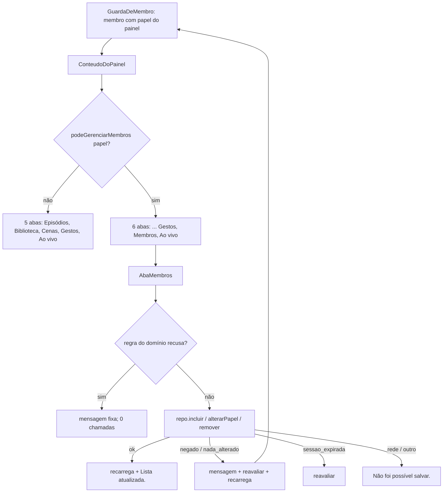

# VER-019 — E1, Tarefa 5: painel com abas e aba Membros

## Cabeçalho

| Campo | Valor |
|---|---|
| Id | VER-019 |
| Título | E1, Tarefa 5: painel com abas e aba Membros |
| Gravidade | alta |
| Tipo | implementação · segurança · decisão de arquitetura |
| Data | 2026-11-26 (data do commit, em UTC) |
| Usuário responsável | TokumoH |
| Status de implementação | implementado (no repositório; a lista real no Supabase é conferida na Tarefa 6 do PLA-002) |
| Commits | commit que introduz este arquivo — `git log --diff-filter=A --format=%h -- docs/verificacoes/2026-11-26-019-e1-painel-e-membros.md` |
| Arquivos | `src/shared/ui/Abas.tsx` (novo), `src/app/telas/AbaMembros.tsx` (novo), `src/app/telas/AbaMembros.test.tsx` (novo), `src/app/telas/Painel.test.tsx` (novo), `src/app/telas/Painel.tsx`, `src/app/App.test.tsx`, `src/shared/styles/base.css`, `src/app/telas/README.md`, `src/shared/ui/README.md`, `src/shared/styles/README.md`, `src/app/README.md`, `src/README.md`, `docs/verificacoes/README.md`, este registro (14 arquivos) |

## Problema

1. **O painel não tinha conteúdo.** Desde a Tarefa 4 ([VER-018](2026-11-26-018-e1-entrada-e-guarda.md)), `/painel` era guardado por papel mas mostrava só "Em construção — etapa E1": nenhuma das abas do DES-001 §9 (Episódios, Biblioteca, Cenas, Gestos, Membros, Ao vivo) existia.
2. **Ninguém mexia na lista de acesso pelo app.** O domínio (`montarLista`, `conferirInclusao`, `conferirMudanca`, [VER-015](2026-11-26-015-e1-dominio-acesso.md)), a política do banco que impede o `admin` de alterar a própria linha ([VER-016](2026-11-26-016-e1-banco-membros.md)) e o repositório Supabase ([VER-017](2026-11-26-017-e1-adaptadores-acesso.md)) existiam, mas incluir, trocar o papel ou remover um e-mail só era possível pelo editor SQL do Supabase.
3. **Riscos de interface que nenhum teste "natural" cobre** (Foco da revisão do [PLA-002](../planos/2026-11-26-e1-entrada-e-membros.md#foco-da-revisão), itens 2, 5, 6 e 11): e-mail com maiúsculas gravado como digitado; a própria linha do `admin` não reconhecida quando a sessão vem em maiúsculas; escrita negada pela RLS (papel trocado enquanto a pessoa está na tela) sem reavaliar o acesso; nome do Google com HTML interpretado como marcação.

## Era proposital?

Sim, a ausência era o plano: o PLA-002 ([Estrutura de arquivos](../planos/2026-11-26-e1-entrada-e-membros.md#estrutura-de-arquivos)) põe as abas e a aba Membros na Tarefa 5, depois do domínio (1), do banco (2), dos adaptadores (3) e da guarda (4). O `Painel.tsx` da Tarefa 4 dizia "as abas chegam na Tarefa 5", e o README de `src/app/telas/` dava o exemplo de trocar a função `children` da guarda. Nada no histórico contradiz a forma pedida: a decisão D8 (abas por estado, sem rota nova) e a D6 (incluir, trocar o papel e remover; sem editar o e-mail) estão no plano desde o VER-014.

## Solução

- **`shared/ui/Abas.tsx`**: componente de abas acessível (padrão "Tabs" do WAI-ARIA, ativação automática): `role="tablist"`, um `<button role="tab">` por aba com `aria-selected`, `aria-controls` e `tabIndex` móvel (só a ativa entra na ordem do Tab), um `role="tabpanel"` por aba com `aria-labelledby`. Só o painel ativo recebe o conteúdo; os outros existem vazios e `hidden`, para que todo `aria-controls` aponte para um elemento real. Setas, Home e End trocam de aba e movem o foco. Não sabe de papel nem de etapa.
- **`telas/Painel.tsx`**: a guarda entrega `usuario`, `papel`, `servicos` e `reavaliar` a `ConteudoDoPainel`, que guarda a aba escolhida em `useState('episodios')` (D8: recarregar volta para "Episódios"). `ABAS_DO_PAINEL` tem as seis abas na ordem do DES-001 §9; Membros só entra quando `podeGerenciarMembros(papel)`. Se o papel muda (admin rebaixado, vindo da reavaliação) e a aba escolhida some, a escolha volta para "Episódios" (ajuste de estado durante o render): se o papel de `admin` voltar, Membros não reabre sozinha (nit N3 da revisão 1). As provisórias mostram "Em construção — etapa E2" (Episódios, Biblioteca, Cenas, Gestos) ou "etapa E3" (Ao vivo).
- **`telas/AbaMembros.tsx`**: recebe a porta `RepositorioDeAcesso`, o usuário da sessão e `reavaliar`.
  - Carga: `listarPermitidos()` e `listarPerfis()` juntos (`Promise.all`), `montarLista(...)` numa tabela com legenda ("Lista de acesso (N e-mails)") e colunas E-mail, Nome (ou "ainda não entrou"), Papel e Ações; só a leitura mais recente aplica (contador); falha → "Não foi possível carregar a lista." e "Tentar de novo"; `sessao_expirada` na leitura → `reavaliar()`.
  - Formulário "Incluir": campo "E-mail" com `<label>`, seletor "Papel" com os três rótulos (`ROTULO_DO_PAPEL`), botão "Incluir". Antes de chamar o repositório: `normalizarEmail` (vazio ou formato → "Digite um e-mail válido.") e `conferirInclusao` (duplicado → "Esse e-mail já está na lista."). `criadoPor` = `usuario.id`. Depois de incluir, o campo é limpo.
  - Por linha: seletor de papel (rótulo só para leitor de tela, "Papel de <e-mail>") + "Salvar papel", e "Remover", que troca os botões da linha por "Confirmar remoção" / "Cancelar" (sem `window.confirm`). Antes de cada escrita, `conferirMudanca` (própria linha, sem mudança → "O papel já é esse.", último `admin` → "A lista precisa de ao menos um admin."); recusa local → mensagem e nenhuma chamada.
  - A linha da sessão (`mesmoEmail`, que ignora maiúsculas) mostra o papel como texto, a etiqueta "Você" e "Você não pode alterar o próprio acesso; peça a outro admin.", sem seletor nem botões (D1: o banco também recusa).
  - Resultado das escritas: sucesso → recarrega a lista e mostra "Lista atualizada." (`role="status"`); `duplicado` → "Esse e-mail já está na lista."; `invalido` (o `CHECK` de minúsculas do banco) → "Digite um e-mail válido."; `negado` ou `nada_alterado` → "A lista ou o seu papel mudou; conferindo de novo." + `reavaliar()` + recarga; `sessao_expirada` → `reavaliar()`; `rede`, `outro` ou erro que não é `ErroDeAcesso` → "Não foi possível salvar. Tente de novo." (`role="alert"`, como todo erro). Durante uma escrita, ficam desabilitados o botão "Incluir" e, nas linhas, os seletores de papel e os botões; o campo "E-mail" e o seletor "Papel" do formulário continuam editáveis (nit N2: o texto foi ajustado ao código).
  - Avisos (nit N4): duas regiões sempre montadas, `role="status"` ("Lista atualizada.") e `role="alert"` (erros); o texto entra depois, para o leitor de tela anunciar a mudança; vazias, usam `.so-leitor` e não ocupam espaço. A Tarefa 4 continua com `Mensagem` (inserida já com o texto); a mudança é só desta aba. A falha de carga da lista continua com `Mensagem`.
  - Foco depois de cada ação (Importante I1 da revisão 1, WCAG 2.4.3): o Chromium tira o foco de um botão que fica desabilitado, e a remoção apaga a linha; sem tratamento, o foco ia para o `<body>`. A forma escolhida, a mais simples: a ação diz o alvo (`focoPendente`), e um efeito que roda depois de cada render põe o foco nele quando a escrita acabou (`ocupado` falso, controles já habilitados). Alvos: incluir com sucesso → campo "E-mail" (já limpo); salvar papel → "Salvar papel" da mesma linha (se a linha sumiu, o aviso); remover → a região de status com "Lista atualizada."; qualquer erro, local ou do banco → a mensagem de erro. As regiões de aviso têm `tabIndex={-1}` para receber o foco.
  - `reavaliar` fica numa `ref`: um callback novo a cada render do pai não recria a função de carga nem relê a lista (teste `le-a-lista-uma-vez`).
- **`base.css`**: `.tela--larga` (cartão até 960 px, coluna `minmax(0, 1fr)`), `.abas`, `.aba`, `.aba--ativa` (ciano com `--on-accent`), `.abas__painel` (com `[hidden] { display: none }`), `.membros`, `.campo`, `.tabela-rolavel` (`overflow-x: auto`, `position: relative`), `.tabela`, `.botao--pequeno`, `.botao:disabled`, `.etiqueta`, `.so-leitor`; só variáveis de `tokens.css`.
- **`App.test.tsx`**: a frase esperada em `/painel` passa de "etapa E1" para "etapa E2" (a primeira aba).

Decisões do PLA-002 aplicadas: **D1** (a interface esconde os controles da própria linha e recusa o rebaixamento do último `admin`; quem garante é a política do banco, VER-016), **D4** (a revogação aparece na tela na próxima reavaliação, inclusive a de uma escrita negada; o aviso pelo canal fica na E3), **D6** (incluir, trocar o papel e remover; sem editar o e-mail; a tela usa a porta do agregado de acesso, sem classe genérica) e **D8** (abas por estado, sem rota nova; as provisórias dizem a etapa).

## Por que esta solução

- **Componentes e Pure Fabrication:** `Abas` é genérico e vai para `shared/ui` (a E2 e a E3 reusam no painel e no controle); `AbaMembros` só depende da porta (`RepositorioDeAcesso`), não do Supabase, e por isso é testada com o falso das portas, renderizada direto. As regras ficam todas no domínio (`normalizarEmail`, `conferirInclusao`, `conferirMudanca`, `montarLista`, `podeGerenciarMembros`); a tela só ordena, chama e mostra.
- **Segurança:** a interface só escolhe o que mostrar (restrição global "A interface nunca decide acesso a dado"); toda escrita recusada pela RLS volta como `negado`/`nada_alterado` e leva à reavaliação, que tira a aba de quem perdeu o papel. Texto vindo de fora (nome, e-mail) é sempre texto React (teste `nome-com-html-literal`); nenhuma mensagem vem do servidor ou de um erro (`TEXTO_DA_ABA`); nada vai para o `console`.
- **Otimização:** as duas leituras saem juntas; a lista só é relida depois de uma escrita (ou de uma escrita negada), e um render do pai não relê.
- **Acessibilidade:** padrão de abas do WAI-ARIA com teclado; tabela com `caption` e `th scope="col"`; todo campo com rótulo; foco previsível depois de cada ação e regiões de aviso sempre montadas; a confirmação de remoção fica na linha (sem diálogo do navegador, que não segue o visual nem o leitor de tela do app).

## Por que não outras soluções

| Opção | Motivo de descarte |
|---|---|
| Uma rota por aba (`/painel/membros`) | A D8 decidiu abas por estado; rota nova mexeria em `rotas.ts`, no `App` e na guarda sem ganho na E1 |
| Renderizar só o painel ativo (sem os painéis `hidden`) | Os `aria-controls` das abas inativas apontariam para ids que não existem (sabotagem E1 derruba `abas-acessiveis`) |
| Renderizar todas as abas com conteúdo e só esconder | A aba Membros leria a lista mesmo sem ser aberta; as outras não têm conteúdo |
| `window.confirm` para remover | Fora do visual, bloqueia a página e o plano pede a confirmação na linha |
| Desabilitar os controles da própria linha (em vez de tirá-los) | O plano pede a linha sem controles; botões desabilitados sem explicação confundem |
| Confiar só no banco para a própria linha e o último `admin` | Funciona (D1), mas a pessoa veria um erro genérico; a recusa local dá a mensagem certa sem chamada |
| `reavaliar` direto nas dependências da carga | Um pai que recrie o callback a cada render faria a lista ser relida em laço (sabotagem E10) |
| Foco: trocar `disabled` por `aria-disabled` com guarda nos handlers | Resolve o foco do botão, mas não o da remoção (a linha some) e muda o padrão dos botões do app; o alvo explícito cobre os dois casos |
| Foco: devolver ao botão que disparou a ação em todos os casos | Na remoção o botão deixa de existir; num erro, a pessoa não ouviria a mensagem no lugar do foco |
| Trava por `ref` contra clique duplo | Redundante: o clique é evento discreto, o React aplica `disabled` antes do próximo; a sabotagem que tirava só a trava não derrubava nada, então a trava saiu e a prova ficou no `disabled` (sabotagem E11) |
| Biblioteca de abas ou de tabela | Dependência nova; a E1 não precisa de nenhuma |

## Onde

| Arquivo | Linhas | O que mudou |
|---|---|---|
| [`src/shared/ui/Abas.tsx`](../../src/shared/ui/Abas.tsx#L1-L88) | 1–88 | Novo: `Aba`, `Abas` (tablist, tabs, painéis, teclado em 31–44) |
| [`src/app/telas/AbaMembros.tsx`](../../src/app/telas/AbaMembros.tsx#L1-L340) | 1–340 | Novo: `TEXTO_DA_ABA` (14–24), carga (80–93), foco depois de cada ação (103–115), `mostrar` (119–122), `escrever` (125–148), `aoIncluir` (150–164), `aoMudar` (166–178), regiões de aviso (183–190), tabela (239–337), linha da sessão (252) |
| [`src/app/telas/Painel.tsx`](../../src/app/telas/Painel.tsx#L1-L75) | 1–75 | `ABAS_DO_PAINEL`, `abasDoPapel`, `ConteudoDoPainel` com `useState('episodios')` e a escolha que volta para "Episódios" quando a aba some |
| [`src/shared/styles/base.css`](../../src/shared/styles/base.css#L101-L173) | 101–173 | Tela larga, abas, formulário (`.membros` com `position: relative` para segurar as regiões de aviso vazias), tabela, botão pequeno e desabilitado, etiqueta, `.so-leitor` |
| [`src/app/telas/Painel.test.tsx`](../../src/app/telas/Painel.test.tsx#L1-L126) | 1–126 | Novo: 8 testes (4 do plano e 4 a mais) |
| [`src/app/telas/AbaMembros.test.tsx`](../../src/app/telas/AbaMembros.test.tsx#L1-L403) | 1–403 | Novo: 27 testes (10 do plano e 17 a mais) |
| [`src/app/App.test.tsx`](../../src/app/App.test.tsx#L43) | 43 | `/painel` → "Em construção — etapa E2" |
| [`src/app/telas/README.md`](../../src/app/telas/README.md), [`src/shared/ui/README.md`](../../src/shared/ui/README.md), [`src/shared/styles/README.md`](../../src/shared/styles/README.md) | — | Arquivos novos em "Onde" e "Arquivos"; telas reais × provisórias; classes novas; riscos do `hidden` e do `.so-leitor` |
| [`src/app/README.md`](../../src/app/README.md), [`src/README.md`](../../src/README.md) | — | Frases que diziam "abas na Tarefa 5" passam ao presente |
| [`docs/verificacoes/README.md`](README.md) | — | Linha do VER-019 e campo "Arquivos" |

## Lógica

| Passo | Antes | Depois |
|---|---|---|
| Abrir `/painel` como `equipe` | "Em construção — etapa E1" | 5 abas; Episódios ativa com "Em construção — etapa E2" |
| Abrir `/painel` como `admin` | Idem | 6 abas; Membros entre Gestos e Ao vivo |
| Incluir `  Nova@Revocast.TEST ` | Só pelo editor SQL | `incluir('nova@revocast.test', 'equipe', <id da sessão>)`, lista relida, "Lista atualizada." |
| Sessão `Adm@Revocast.TEST` | — | A linha `adm@revocast.test` com "Você" e o aviso, sem controles |
| Escrita que volta `nada_alterado` | — | "A lista ou o seu papel mudou; conferindo de novo.", `reavaliar()` 1 vez, lista relida |
| `admin` rebaixado enquanto está em Membros | — | A reavaliação tira a aba; a ativa volta para Episódios |

## Exemplo

`AbaMembros` com a sessão `adm@revocast.test` e a lista `adm` (admin), `ana` (equipe, perfil "Ana"), `bia` (apresentadora, sem perfil) (teste `lista-com-perfis`): 3 linhas na ordem `adm`, `ana`, `bia`; "Ana" na linha da ana, "ainda não entrou" na da bia. Digitar `  Nova@Revocast.TEST `, papel "Equipe", "Incluir" (teste `inclui-normalizado`): `chamadas.incluir` = `[['nova@revocast.test', 'equipe', 'id-adm']]`, a linha `nova@revocast.test` aparece com "ainda não entrou" e "Lista atualizada." tem `role="status"`. Com a sabotagem S1 (sem `normalizarEmail`), a chamada leva o texto como digitado e o teste cai.

No navegador (lista interceptada): o `PATCH /rest/v1/membros_permitidos?email=eq.ana%40revocast.test&select=email` saiu uma vez para "Salvar papel" e o `DELETE ...?email=eq.bia...` só depois de "Confirmar remoção"; nenhuma escrita saiu para `nao-e-email`.

## Verificação

**TDD.** Passo 2: `npx vitest run src/app/telas` → FAIL (2 arquivos: `Painel.test.tsx` com 6 testes falhando, porque o painel não tinha `tablist`; `AbaMembros.test.tsx` sem coletar, porque `./AbaMembros` não existia). Passo 3: `npx vitest run src/app` → 7 arquivos, 77 testes, todos passam (21 em `src/app/telas`: 7 + 14 na primeira versão); `npx tsc --noEmit` limpo; nenhum aviso de `act(...)`. Depois dos testes a mais (`le-a-lista-uma-vez`, `clique-duplo-escreve-uma-vez`, `invalido-do-banco`): `src/app` → 7 arquivos, 81 testes (`Painel.test.tsx` 7, `AbaMembros.test.tsx` 17), todos passam. Depois das correções da revisão 1: `src/app` → 7 arquivos, 92 testes (`Painel.test.tsx` 8, `AbaMembros.test.tsx` 27), todos passam; `npx tsc --noEmit` limpo; nenhum aviso de `act(...)`.

**Sabotagens** (script em Python fora do repositório: guarda cópia do arquivo, confere que cada trecho aparece exatamente 1 vez, aplica, roda `npx vitest run src/app --maxWorkers=2`, restaura a cópia e confere o `sha256`). S1–S4 são as do Passo 4 do plano; E1–E12 cobrem os testes a mais; L1–L11, F1–F5, N3 e N4 vêm da revisão 1 (as L são as do revisor, com o mesmo trecho). Todas rodaram de novo, juntas, sobre a versão final do código (`src/app`: 92 testes); a coluna "Caiu" é dessa rodada final.

| # | Arquivo | Sabotagem | Caiu |
|---|---|---|---|
| S1 | `AbaMembros.tsx` | tirar `normalizarEmail` do incluir (só recusa vazio) | `inclui-normalizado`, `inclusao-recusada-localmente`, `avisos-sempre-montados`, `foco-no-erro` |
| S2 | `AbaMembros.tsx` | própria linha por `===` (sem `mesmoEmail`) | `propria-linha-sem-acoes` |
| S2b | `AbaMembros.tsx` | sem conferência da própria linha (`propria = false`) | `propria-linha-sem-acoes` |
| S3 | `AbaMembros.tsx` | não chamar `reavaliar` em `nada_alterado` | `escrita-negada-reavalia` |
| S4 | `Painel.tsx` | mostrar Membros também para `equipe` | `equipe-ve-abas-sem-membros`, `membros-some-quando-rebaixado`, `rebaixado-e-promovido-nao-reabre-membros` |
| E1 | `Abas.tsx` | renderizar só o painel ativo | `abas-acessiveis` |
| E2 | `Abas.tsx` | ignorar as teclas | `abas-com-teclado` |
| E3 | `AbaMembros.tsx` | "Remover" remove sem confirmação | `remove-com-confirmacao`, `ultimo-admin-recusado-localmente`, `sessao-expirada-ao-salvar-reavalia`, `falha-de-rede-ao-salvar`, `foco-depois-de-remover`, `foco-no-erro` |
| E4 | `AbaMembros.tsx` | sem `conferirMudanca` | `papel-igual-recusado-localmente` e `ultimo-admin-recusado-localmente` |
| E5 | `AbaMembros.tsx` | `reavaliar` também em falha de rede | `falha-de-rede-ao-salvar` |
| E6 | `AbaMembros.tsx` | nome por `dangerouslySetInnerHTML` | `nome-com-html-literal` |
| E7 | `AbaMembros.tsx` | sem `reavaliar` em `sessao_expirada` | `sessao-expirada-ao-salvar-reavalia` |
| E8 | `AbaMembros.tsx` | sem recarga depois de escrita negada | `escrita-negada-reavalia` e `rascunho-some-na-recarga` |
| E9 | `Painel.tsx` | aba ativa pela lista completa (sem voltar à primeira) | primeira rodada: `membros-some-quando-rebaixado`; rodada final: nada (ver abaixo) |
| E10 | `AbaMembros.tsx` | `reavaliar` direto nas dependências da carga | `le-a-lista-uma-vez` |
| E11 | `AbaMembros.tsx` | "Salvar papel" sem `disabled` durante a escrita | `clique-duplo-escreve-uma-vez` |
| E12 | `AbaMembros.tsx` | sem a mensagem de `invalido` | `invalido-do-banco` |
| L1 | `AbaMembros.tsx` | sem `reavaliar` quando a leitura volta `sessao_expirada` | `sessao-expirada-ao-carregar-reavalia` |
| L2 | `AbaMembros.tsx` | sem descartar a leitura velha (`numero !== ultimaLeitura.current`) | `leitura-velha-descartada` |
| L3 | `AbaMembros.tsx` | sem limpar os rascunhos na recarga | `rascunho-some-na-recarga` |
| L7 | `AbaMembros.tsx` | "Incluir" sem `disabled` durante a escrita | `clique-duplo-em-incluir-inclui-uma-vez` |
| L11 | `Abas.tsx` | sem `preventDefault` nas teclas das abas | `abas-com-teclado` |
| F1 | `AbaMembros.tsx` | efeito de foco desligado | `foco-depois-de-incluir`, `foco-depois-de-salvar`, `foco-depois-de-remover`, `foco-no-erro` |
| F2 | `AbaMembros.tsx` | remover devolve o foco ao campo "E-mail" | `foco-depois-de-remover` |
| F3 | `AbaMembros.tsx` | erro não leva o foco à mensagem | `foco-no-erro` |
| F4 | `AbaMembros.tsx` | incluir devolve o foco ao aviso | `foco-depois-de-incluir` |
| F5 | `AbaMembros.tsx` | salvar devolve o foco ao aviso (não à linha) | `foco-depois-de-salvar` |
| N3 | `Painel.tsx` | sem voltar a escolha para "Episódios" quando a aba some | `rebaixado-e-promovido-nao-reabre-membros` |
| N4 | `AbaMembros.tsx` | região `role="status"` montada só com o texto | `avisos-sempre-montados` |

E9 não derruba mais nada na rodada final, e isso é esperado: com a correção do N3, quando a aba escolhida some o `setEscolhida` durante o render refaz o render antes de qualquer coisa ser mostrada, e o `?? abas[0]` do cálculo da ativa ficou só como defesa (e para o tipo). A proteção passou para o ajuste da escolha, que a sabotagem N3 prova. Na primeira versão de F2 (remover apontando para a linha) nada caiu, porque a linha some e o alvo cai no aviso, o mesmo lugar; a sabotagem foi trocada por uma que muda o alvo de fato (campo "E-mail").

Uma sabotagem não derrubou nada na primeira rodada: tirar uma trava por `ref` contra clique duplo. Achado tratado: a trava era redundante (o `disabled` já protege, porque o React aplica o render de um clique antes do próximo) e saiu do código; a prova passou a ser o `disabled` (E11).

**Conferência no navegador** (Chromium do Playwright, `vite build` com URL fictícia + `vite preview`, sessão posta no `localStorage` e as rotas do Supabase interceptadas por um falso em memória que imita a RLS da D1): claro e escuro, 320, 390 e 1280 px.
- `equipe` vê 5 abas, `admin` vê 6; Episódios ativa com "Em construção — etapa E2"; teclado: seta para a direita na aba ativa leva o foco e a seleção à seguinte.
- Membros: tabela com legenda, nome `` mostrado como texto e nenhum `img[src="x"]` no DOM; incluir `  Nova@Revocast.TEST ` → `POST` com o e-mail em minúsculas e "Lista atualizada."; "Salvar papel" → 1 `PATCH`; "Remover" → confirmação na linha; "Confirmar remoção" → 1 `DELETE`; `nao-e-email` → "Digite um e-mail válido." e nenhuma escrita; nenhum erro no console.
- Medidas: `scrollWidth` do documento igual à largura da janela nas três larguras; o cartão termina dentro da janela (370 de 390, 300 de 320); a tabela rola dentro de `.tabela-rolavel` em 320 e 390 px e cabe em 1280 px.
- Dois defeitos vistos aqui e corrigidos antes desta versão: (1) `.abas__painel { display: grid }` vencia o `[hidden]` do navegador e os painéis vazios ocupavam espaço entre as abas e o conteúdo → `.abas__painel[hidden] { display: none; }`; (2) os rótulos `.so-leitor` (absolutos) escapavam do contêiner com rolagem e alargavam a página (`scrollWidth` 624 em 390 px) → `position: relative` em `.tabela-rolavel`. O e-mail da tabela passou a quebrar (`overflow-wrap: anywhere`) para a tabela caber em 1280 px.
- Depois das correções da revisão 1 (porta 4199, `foco.cjs` do revisor sem mudança): "apos Confirmar remocao, foco = DIV:Lista atualizada." e "apos Salvar papel, foco = BUTTON:Salvar papel" (antes, os dois davam `BODY`); regiões `status:Lista atualizada.` e `alert:` (vazia) montadas. Com o `nav.cjs` da implementação: erro local → foco em "Digite um e-mail válido."; incluir → foco no campo "E-mail", já limpo; duplicado → foco em "Esse e-mail já está na lista."; `scrollWidth` igual à janela em 320, 390 e 1280 px (as regiões vazias não alargam nem ocupam espaço); nenhum erro no console.
- O `vite preview` foi parado no fim (as duas vezes).

**Fechamento (implementador):** `npm run check` → 0 erros (resultado no relatório da tarefa). O `npm run check` final, sobre exatamente o conteúdo do commit, é do controlador.

**Revisões independentes (dupla verificação):**

- **Revisão 1** (revisor independente): spec ✅, qualidade reprovada, com 2 achados importantes e 5 nits. Nenhum achado de segurança.
  - **I1 (foco, WCAG 2.4.3):** depois de "Salvar papel" e de "Confirmar remoção", o foco ia para o `<body>`, provado no Chromium pelo `foco.cjs` do revisor. Corrigido com o alvo de foco por ação: depois de incluir, o campo; depois de salvar, o botão da linha; depois de remover, a região de status; em qualquer erro, a mensagem. Testes em jsdom: `foco-depois-de-incluir`, `foco-depois-de-salvar`, `foco-depois-de-remover` e `foco-no-erro`, que caem com F1–F5. No Chromium, os dois casos deixaram de dar `BODY`.
  - **I2 (afirmações sem teste):** as sabotagens L1, L2 e L7 do revisor sobreviviam. Agora cada uma derruba o seu teste: `sessao-expirada-ao-carregar-reavalia`, `leitura-velha-descartada` (repo antigo responde depois do novo) e `clique-duplo-em-incluir-inclui-uma-vez`.
  - **N1:** o comentário de `troca-papel` dizia que a ordem provava a recarga, mas a ordem não muda nesse caso. O comentário foi corrigido, e o novo teste `troca-papel-reordena` (bia → admin dá a ordem adm, bia, ana) prova a recarga pela ordem.
  - **N2:** o texto do registro foi ajustado ao código. Durante a escrita ficam desabilitados "Incluir" e os controles das linhas; o campo e o seletor do formulário continuam editáveis.
  - **N3:** a escolha volta para "Episódios" quando a aba some. Isso muda código (`Painel.tsx`) e tem o teste `rebaixado-e-promovido-nao-reabre-membros`.
  - **N4:** as regiões `role="status"` e `role="alert"` ficam sempre montadas, e o texto entra depois. A mudança vale só nesta aba; a Tarefa 4 continua com `Mensagem`. Teste: `avisos-sempre-montados`.
  - **N5:** testes de L3 (`rascunho-some-na-recarga`) e de L11 (asserções de `preventDefault` em `abas-com-teclado`).
- **Re-revisão focada:** vem depois, pelo controlador, porque o I1 (e também o N3 e o N4) mudam comportamento de código, o que reinicia a contagem pela decisão (a).

Nits corrigidos (não zeram a contagem): N1, N2 e N5 (testes e texto). N3 e N4 mudam código e entram na re-revisão.

**Re-revisão focada** (revisor novo; 35/35 testes de `src/app/telas` numa cópia; prova do foco refeita no Chromium; sonda extra de foco roubado ao carregar a lista, trocar de aba e incluir): **aprovada**, sem achado crítico nem importante. O I1, o I2 e os nits N1 a N5 estão resolvidos; o ajuste de estado do `Painel` converge (sem laço de render). Um nit de acessibilidade foi registrado nos Riscos, sem mudança de código, com reconferência pontual (`check-docs`), pela decisão do responsável de 2026-11-22.

## Riscos

- Mover o foco para uma região viva que acabou de receber texto ("Lista atualizada." ou a mensagem de erro) pode fazer alguns leitores de tela lerem a mensagem duas vezes; aceito (re-revisão focada).
- A lista real (Supabase, RLS e a política da D1) não foi exercitada pela tela: os testes usam o falso das portas e, no navegador, um falso em memória. A conferência real é a Tarefa 6 do PLA-002.
- A revogação aparece na tela de outra pessoa só na reavaliação seguinte (evento de sessão, volta à aba ou escrita negada); o aviso em tempo real é da E3 (D4).
- Dois admins que se removem um ao outro no mesmo instante podem zerar os admins (limite da D1, recuperação em `supabase/README.md`); a recusa local do último `admin` só vale para a lista que está na tela.
- Foco: depois de "Tentar de novo" (falha de carga) e de uma escrita com `sessao_expirada` (a guarda pode trocar de tela), não há alvo de foco definido; o foco programático na mensagem não mostra o anel quando a ação veio do mouse (`:focus-visible` do navegador).
- A falha de carga da lista ainda usa `Mensagem` (aviso montado já com o texto); só as regiões de aviso das escritas ficam sempre montadas.
- Se a leitura da lista falhar logo depois de uma escrita bem-sucedida, a tela mostra ao mesmo tempo "Lista atualizada." e "Não foi possível carregar a lista." (a escrita aconteceu; a lista é que não foi relida).
- Contraste do texto escuro sobre o botão rosa ("Incluir", "Confirmar remoção") continua abaixo do AA (risco já registrado em `src/shared/styles/README.md`); a aba ativa e "Salvar papel" usam ciano, que passa.
- Em 320 e 390 px a tabela rola na horizontal: as ações ficam fora da vista até rolar (o plano aceita a rolagem; um leiaute em cartões por linha seria outra decisão).
