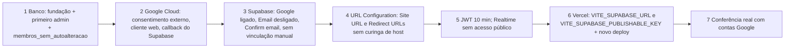

# VER-020 — E1, Tarefa 6: conferência no navegador e guia do login para o responsável

## Cabeçalho

| Campo | Valor |
|---|---|
| Id | VER-020 |
| Título | E1, Tarefa 6: conferência no navegador e guia do login para o responsável |
| Gravidade | média |
| Tipo | verificação · documentação · segurança |
| Data | 2026-11-26 (data do commit, em UTC) |
| Usuário responsável | TokumoH |
| Status de implementação | somente documentação (nenhum código de produção muda; a configuração real é passo do responsável, **pendente**) |
| Commits | commit que introduz este arquivo — `git log --diff-filter=A --format=%h -- docs/verificacoes/2026-11-26-020-e1-conferencia-e-guia.md` |
| Arquivos | `supabase/README.md`, `docs/verificacoes/README.md`, este registro (3 arquivos) |

## Problema

1. **A E1 nunca tinha sido aberta num navegador como um todo, nos dois builds que importam.** As Tarefas 4 e 5 ([VER-018](2026-11-26-018-e1-entrada-e-guarda.md), [VER-019](2026-11-26-019-e1-painel-e-membros.md)) conferiram as próprias telas no Chromium, mas ninguém tinha conferido de uma vez o build **sem** variáveis (o que a Vercel publica enquanto o responsável não as preenche) e o build **com** variáveis, nas larguras estreitas e no tema escuro, nem como a URL de retorno do Google é montada no clique real.
2. **O responsável não tinha um roteiro para ligar o login de verdade.** O que falta fazer fora do código (aplicar a migração nova da E1, configurar o Google Cloud, o Supabase Auth e a Vercel, e conferir com contas reais) estava espalhado pelo DES-001 §12, pelo PLA-002 (Tarefa 6, Passo 5) e pelos Riscos dos VER-015 a VER-019. Sem ele, o caminho mais curto para "testar na prévia" seria um curinga de host nas Redirect URLs, que entrega a sessão de um membro a quem criar um projeto na Vercel (restrição global do PLA-002, achado I1 da revisão do plano).
3. **Pendência do VER-018:** uma avaliação que nunca termina (rede pendurada sem erro) segura a fila de `useAcesso`; ficou para ser vista aqui.

## Era proposital?

Sim: o PLA-002 deixa para a última tarefa a conferência de ponta a ponta e o guia ("Tarefa 6: conferência no navegador e guia do login para o responsável"), porque só aqui todas as telas existem. A falta do guia era esperada; o VER-016 e o VER-017 o citam como passo pendente. A fila sem tempo-limite também foi consciente: a revisão 1 da Tarefa 4 a aceitou como pendência "se a T6 mostrar" (Riscos do VER-018 e N6 da mesma revisão, em `src/app/README.md`).

## Solução

- **Conferência no navegador** (Passo 1 do plano), com o Chromium do Playwright do ambiente (fora do repositório, sem virar dependência), `vite build` em pastas fora do repositório e `vite preview`; scripts e capturas também ficam fora do repositório. Resultado na seção "Verificação".
- **Guia "Login Google (E1)"** em [`supabase/README.md`](../../supabase/README.md#L80-L104), dentro de "Lógica" (é passo a passo de uso): sete passos em ordem (banco, Google Cloud, provedores do Supabase, URL Configuration, JWT e Realtime, Vercel, conferência real), só com marcadores (`<ref>`, `<domínio da Vercel>`, `<url exata da prévia>`), e o porquê de não haver curinga de host nas Redirect URLs, com a forma segura de testar uma prévia (URL exata, acrescentada e retirada depois). O "Propósito", o passo 1 de "Lógica" e o primeiro Risco remetem ao guia; um Risco novo diz que ele não foi conferido num projeto real.
- **Fila pendurada:** observada no navegador e **não** corrigida; fica como decisão do responsável (ver "Riscos"), porque um tempo-limite muda comportamento de código e o contrato da tarefa manda parar e relatar em vez de implementar sem decisão.

## Por que esta solução

- O guia fica onde o manual do banco já está (`supabase/README.md`, que já explica o editor SQL e o primeiro `admin`): um lugar só para "como ligar o projeto", perto das migrações que o passo 1 manda aplicar. Fica numa subseção de "Lógica" para não quebrar a estrutura de 11 seções dos READMEs (`CLAUDE.md`, "Organização da documentação").
- Cada valor sensível (e-mail, chave, domínio, `ref`) é um marcador: o `check-doc-secrets` passa e nenhum dado pessoal entra no repositório.
- A conferência usa os dois builds reais (o mesmo `vite build` da Vercel), com o Supabase interceptado no navegador: prova o que o bundle faz sem precisar de conta, rede ou chave.

## Por que não outras soluções

| Opção | Motivo de descarte |
|---|---|
| Guia num arquivo novo (`docs/guias/login.md`) | Pasta nova com README próprio só para isto; separa o guia do manual do banco, que o passo 1 usa |
| Guia em seção `##` própria no `supabase/README.md` | Seria uma 12.ª seção fora da estrutura dos READMEs do `CLAUDE.md`; dentro de "Lógica" ela é passo de uso, como o editor SQL |
| Curinga de host (`https://*-<time>.vercel.app/**`) para testar prévias | Qualquer pessoa cria `x-<time>` na Vercel, começa o login com o próprio `code_challenge` e toma a sessão do membro que clicar no link (restrição global do PLA-002) |
| Playwright como dependência do projeto (testes de ponta a ponta no `npm run check`) | O PLA-002 proíbe dependência nova na E1 ("Restrições globais"); a conferência é manual e o Chromium do ambiente basta |
| Implementar já um tempo-limite na fila de `useAcesso` | Muda comportamento de código sem decisão; o contrato da tarefa manda relatar. Ver "Riscos" para as opções |
| Conferir com um projeto Supabase real | Exige conta, chave e rede; é exatamente o passo 7 do guia, do responsável |

## Onde

| Arquivo | Linhas | O que mudou |
|---|---|---|
| [`supabase/README.md`](../../supabase/README.md#L18) | 18 | "Propósito": o README também diz como ligar o login Google |
| [`supabase/README.md`](../../supabase/README.md#L68) | 68 | Passo 1 de "Lógica" remete ao passo 1 do guia |
| [`supabase/README.md`](../../supabase/README.md#L80-L104) | 80–104 | Novo: subseção "Login Google (E1)" com os sete passos do responsável e o porquê de não haver curinga de host |
| [`supabase/README.md`](../../supabase/README.md#L124) | 124 | Primeiro Risco remete ao passo 1 do guia |
| [`supabase/README.md`](../../supabase/README.md#L134) | 134 | Novo Risco: guia não conferido num projeto real |
| [`docs/verificacoes/README.md`](README.md#L73) | 14, 73 | Campo "Arquivos" e linha do VER-020 em "Onde" |
| este registro | — | Novo |

## Lógica

| Passo | Antes | Depois |
|---|---|---|
| Responsável quer ligar o login | Juntar o DES-001 §12, o Passo 5 da Tarefa 6 do PLA-002 e os Riscos de cinco registros | Seguir os passos 1–7 de "Login Google (E1)" em `supabase/README.md` |
| Testar o login numa prévia da Vercel | Tentação de pôr `https://*-<time>.vercel.app/**` nas Redirect URLs | Acrescentar a URL exata da prévia, testar e tirá-la (passo 4 do guia, com o porquê) |
| Saber se o app publicado sem variáveis quebra | Só testes em jsdom | Conferido nos dois builds no Chromium: "Configuração incompleta" com o nome da variável; rotas de dispositivo intactas e sem requisição ao Supabase |
| Rede pendurada ao ler o papel | Pendência teórica (VER-018) | Observada: a tela fica em "Conferindo seu acesso…" indefinidamente; voltar à aba não destrava; recarregar destrava. Decisão pendente |

## Exemplo

Clique real em "Entrar com Google" no build com variáveis de mentira, aberto em `/painel?redirect_to=https://mal.example&next=//mal.example` (preview na porta 4272): o navegador foi para `https://exemplo.revocast.test/auth/v1/authorize?provider=google&redirect_to=http://localhost:4272/painel&code_challenge=…&code_challenge_method=s256`. O `redirect_to` é a origem da página mais o caminho fixo `/painel`; os parâmetros `redirect_to` e `next` da URL foram ignorados (Foco da revisão, item 12). Com as Redirect URLs do guia, só `https://<domínio da Vercel>/**` e os dois `localhost` são aceitos pelo Supabase; qualquer outro destino cai na Site URL.

`/painel?error=access_denied&error_description=Texto%20injetado` mostrou "O login com o Google foi cancelado.", sem "Texto injetado", e a URL passou a `/painel` (Foco da revisão, item 7).

## Verificação

**Builds** (fora do repositório; o `dist/` do repositório não foi tocado): `npm run build -- --outDir <scratch>/dist-vazio` sem nenhuma variável `VITE_*` no ambiente (`tsc` + `vite build`, 0 erros) e `VITE_SUPABASE_URL=https://exemplo.revocast.test VITE_SUPABASE_PUBLISHABLE_KEY=sb_publishable_teste npx vite build --outDir <scratch>/dist-ficticio`, com as variáveis só na linha de comando. No bundle com variáveis, `grep` achou `exemplo.revocast.test` e `sb_publishable_teste` uma vez cada, num objeto com só essas duas chaves; os nomes `VITE_TURN_*` aparecem só como texto (nomes de variável em mensagens), e `sb_secret_` só nas expressões que recusam a chave secreta. Isso fecha o risco do VER-017 "não foi conferido num `vite build` que só as duas variáveis entram no bundle".

**Conferência no navegador** (Chromium do Playwright do ambiente, `vite preview`, claro e escuro emulados por `prefers-color-scheme`, larguras 320, 390 e 1280 px; fundo do `body` conferido: `rgb(255, 250, 244)` no claro, `rgb(27, 27, 34)` no escuro):

| Build | Caso | Resultado |
|---|---|---|
| sem variáveis | `/painel`, `/entrar`, `/controle` | "Configuração incompleta" com "Variável de ambiente ausente ou vazia: VITE_SUPABASE_URL" (o nome, nunca um valor) — 18/18 |
| sem variáveis | `/camera`, `/camera#abc`, `/obs/palco`, `/obs/camera` | telas provisórias ("Em construção — etapa E4"/"E3"), sem "Configuração incompleta" — 24/24 |
| sem variáveis | todas | 0 requisições fora da origem do preview além das fontes do Google; 0 erros de página; `scrollWidth` = largura da janela em todas (sem rolagem horizontal) |
| com variáveis | `/painel` sem sessão | "Entrar com Google"; o clique leva ao `authorize` com `provider=google`, `redirect_to` fixo e PKCE (`s256`) — ver "Exemplo" |
| com variáveis | `?error=access_denied&error_description=Texto%20injetado` | "O login com o Google foi cancelado.", sem o texto da URL; URL limpa para `/painel` |
| com variáveis | `/entrar#error=server_error&error_description=Texto%20injetado` | "O Google não concluiu o login. Tente de novo.", sem o texto; URL limpa para `/entrar` |
| com variáveis | `/painel?code=abc` sem verificador | "O login não terminou neste navegador. Tente de novo por aqui."; URL limpa |
| com variáveis | sessão de `admin` em `/entrar` | vai para `/painel`; abas Episódios…Ao vivo com Membros; a própria linha mostra "Você" e 0 botões ou seletores |
| com variáveis | sessão de `equipe` em `/painel` | abas sem Membros; papel trocado para `apresentadora` + volta à aba → "Sem acesso a esta página" com link `/controle`; papel removido + volta à aba → "Acesso não liberado" com o e-mail, 1 `POST /auth/v1/logout`, e a mensagem continua depois do `SIGNED_OUT` |
| com variáveis | `rpc/papel_atual` abortado | "Não foi possível falar com o servidor"; "Tentar de novo" com a rede de volta → painel |
| com variáveis | todas as telas acima, 320 e 390 px, claro e escuro | sem rolagem horizontal da página (a tabela de Membros rola dentro do próprio contêiner, como aceito no VER-019) |

Total: 42/42 conferências do build sem variáveis e 120/120 do build com variáveis (esta rodada duas vezes, antes e depois das sabotagens), 0 erros de página. A primeira rodada do build sem variáveis acusou as requisições às fontes do Google (`fonts.googleapis.com`, `fonts.gstatic.com`, carregadas pelo `index.html` desde a E0) como "externas"; o filtro do script passou a ignorá-las e a rodada seguinte deu 42/42 com 0 requisições a qualquer outro host. Os servidores de prévia foram parados no fim (portas livres).

**Fila pendurada** (pendência do VER-018): com `rpc/papel_atual` sem resposta nenhuma, a tela ficou em "Conferindo seu acesso…" por 15 s; com a rede de volta, disparar `visibilitychange` não mudou nada (o pedido de reavaliação entra na fila atrás da avaliação presa; 1 só `papel_atual` saiu); recarregar a página destravou (o painel abriu). Não há "Tentar de novo" nesse estado.

**Sabotagens dos scripts de conferência** (provam que as conferências derrubam o que deveriam):

| # | Sabotagem | Resultado |
|---|---|---|
| S1 | Script do build sem variáveis apontado para o build com variáveis | 18 ERR (as três rotas de membro, 6 combinações de tema e largura) |
| S2 | `body { min-width: 400px }` injetado antes de cada página | 24 ERR de rolagem horizontal (6 telas × 2 temas × 320 e 390 px) |
| S3 | Cópia do bundle com o texto "O login com o Google foi cancelado." trocado | 6 ERR no caso do `access_denied` (2 temas × 3 larguras) |

**Checagens do repositório:** `npm run check-docs` 0 erros depois das edições; `npm run check` completo com 0 erros (ver relatório da tarefa).

**Revisões independentes (dupla verificação):** revisão 1 (revisor novo, com consulta à documentação pública do Supabase): **aprovada**, 1 achado importante só de texto (o caminho da validade do JWT no painel: a documentação diz *Authentication → Settings → Sessions*) e 4 nits (nome da tela de escopos, nome da tela de provedores, efeito do "Confirm email" com o Email desligado, origens JavaScript dispensáveis). Nenhum envolve falha de segurança no guia. Todos corrigidos pelo controlador em `supabase/README.md` (passos 2, 3 e 5), com reconferência pontual (`check-docs` e `check-doc-secrets`), sem nova rodada, pela decisão do responsável de 2026-11-22. Os nomes de tela do Google Cloud e da Vercel não foram conferidos contra a documentação; o guia avisa que os menus podem mudar.

Nits corrigidos (não zeram a contagem): na autorrevisão do implementador, antes das revisões, três ajustes de texto no guia (o código volta ao domínio do atacante pelo Supabase, não pelo Google; "Database → Policies" como segundo caminho para ver as políticas; ponto final duplicado no último item), com reconferência pontual (`check-docs` e `check-doc-secrets`, 0 erros).

**Passo do responsável (Passo 5 do plano):** **pendente** — nenhum dos sete passos de "Login Google (E1)" foi feito; a conferência real (passo 7) vai para o registro seguinte.

## Riscos

- **Configuração real não exercitada:** o login Google de verdade, o papel lido do banco real e a política da migração `membros_sem_autoalteracao` só foram provados em testes e com o Supabase interceptado; dependem do passo do responsável. Até a migração nova ser aplicada, no banco real um `admin` ainda remove a própria linha pela API (a interface esconde o controle).
- **Nomes de menu do guia:** vêm da documentação do Google Cloud, do Supabase e da Vercel em 2026-11, não de um console aberto; o guia avisa que podem mudar (em especial o lugar da validade do JWT e o console novo "Google Auth Platform").
- **Fila pendurada sem tempo-limite (decisão pendente do responsável):** se uma leitura ao Supabase ficar sem resposta (sem erro), a página fica em "Conferindo seu acesso…" até ser recarregada; reavaliações e ações esperam atrás dela. Opções para decidir num item próprio: (1) aceitar, já que o navegador e o servidor acabam derrubando conexões penduradas e recarregar resolve; (2) tempo-limite por avaliação em `useAcesso` (por exemplo, 15 s → tela de falha com "Tentar de novo", descartando o resultado atrasado); (3) `fetch` com `AbortSignal.timeout` no cliente Supabase (opção `global.fetch` do supabase-js), que transforma a espera em erro de rede já tratado (`rede` → falha). Nenhuma foi implementada nesta tarefa.
- **Ajustes do DES-001 (decisão D7) e decisões D1–D8:** oferecidos ao responsável no relato da tarefa; o que ele decidir vira item próprio.
- O exemplo da seção "Exemplo" de `docs/verificacoes/README.md` continua com `021`, o próximo número livre depois deste registro (nenhum plano reserva o 021).
- **Âncoras de registros antigos:** a subseção nova (linhas 79–104 do `supabase/README.md`) desloca as âncoras do VER-010 que apontam depois da linha 78 desse arquivo (`#L92`, `#L97`, `#L99` e o fim de `#L68-L87`), que já estavam deslocadas desde a E1; a linha nova do VER-020 em `docs/verificacoes/README.md` (linha 73) desloca uma linha as âncoras de registros antigos que apontam da linha 73 em diante nesse arquivo (`#L78` e `#L85-L86` do VER-002, `#L76-L79`, `#L86-L87` e `#L93` do VER-003, `#L80` do VER-004, `#L85-L88` do VER-010, `#L76` do VER-013), como já aconteceu em cada registro novo desde o VER-010. Nenhum arquivo encolheu: `supabase/README.md` passou de 107 para 134 linhas (mínimo 99) e `docs/verificacoes/README.md` de 109 para 110 (mínimo 93); o `check-docs` confere que nenhuma âncora passa do fim do arquivo.
- Capturas e scripts da conferência ficam fora do repositório (pasta temporária da sessão) e se perdem com o container.
