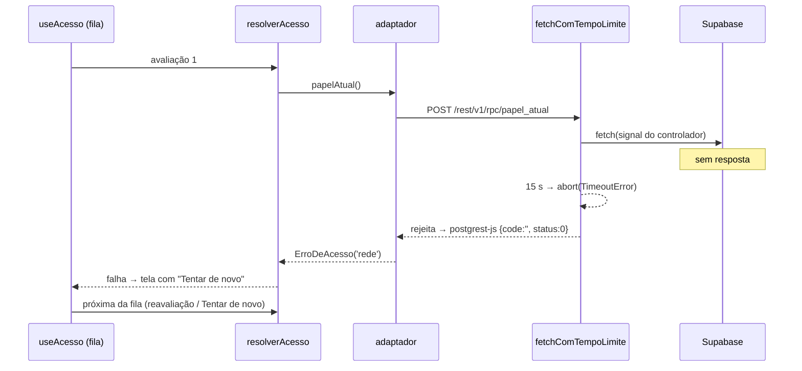

# VER-021 — Tempo-limite nas chamadas ao Supabase (fila pendurada)

## Cabeçalho

| Campo | Valor |
|---|---|
| Id | VER-021 |
| Título | Tempo-limite nas chamadas ao Supabase (fila pendurada) |
| Gravidade | média |
| Tipo | correção · robustez |
| Data | 2026-11-26 (data do commit, em UTC) |
| Usuário responsável | TokumoH |
| Status de implementação | implementado |
| Commits | commit que introduz este arquivo — `git log --diff-filter=A --format=%h -- docs/verificacoes/2026-11-26-021-tempo-limite-supabase.md` |
| Arquivos | `src/shared/infra/tempoLimite.ts`, `src/shared/infra/tempoLimite.test.ts`, `src/shared/infra/supabase.ts`, `src/shared/infra/supabase.test.ts`, `src/shared/infra/README.md`, `src/app/filaPendurada.test.tsx`, `src/app/README.md`, `docs/verificacoes/README.md`, este registro (9 arquivos) |

## Problema

Com `rpc('papel_atual')` sem resposta nenhuma (rede que não responde nem dá erro), a tela ficava indefinidamente em "Conferindo seu acesso…". Voltar à aba com a rede boa não destravava, porque a reavaliação entrava na fila de `useAcesso` atrás da avaliação presa; não havia "Tentar de novo" nesse estado; só recarregar a página resolvia. Observado no Chromium na conferência do [VER-020](2026-11-26-020-e1-conferencia-e-guia.md) (seção "Verificação", "Fila pendurada", e "Riscos"). O mesmo valia para "Entrar" e "Sair", que também passam pela fila.

## Era proposital?

Parcialmente. A fila serializada de [`useAcesso`](../../src/app/useAcesso.ts) é proposital (VER-018: uma reavaliação pedida durante outra espera e passa por `combinarEstados`). A falta de tempo-limite foi aceita conscientemente como pendência: Riscos do VER-018 e N6 da revisão 1 da Tarefa 4, em `src/app/README.md` ("se o caso aparecer, tempo-limite no adaptador"); o VER-020 observou o caso e deixou três opções para decisão do responsável. O controlador escolheu a opção 3 (tempo-limite no `fetch` do cliente Supabase). Este registro resolve a pendência do VER-020; o VER-020 não é reescrito (registro de commit enviado).

## Solução

`criarClienteSupabase` passa ao `createClient` a opção `global.fetch` com um envoltório (`fetchComTempoLimite`, em [`tempoLimite.ts`](../../src/shared/infra/tempoLimite.ts)) que aborta, depois de **15 s** (`TEMPO_LIMITE_SUPABASE_MS`), as chamadas à mesma origem do projeto com caminho `/rest/v1` ou `/auth/v1`. O Storage (`/storage/v1/`) e qualquer outra URL passam direto, sem timer. O sinal de quem chama continua abortando. A chamada abortada vira, no supabase-js 2.119.0, o erro de rede que o app já trata: `traduzirErro` → `rede` (PostgREST) e `ErroDeAcesso('rede')` (Auth) → `resolverAcesso` → `falha` → tela "Não foi possível falar com o servidor" com "Tentar de novo". A fila anda.

## Por que esta solução

- **Lugar certo (Pure Fabrication de infraestrutura):** o problema é de transporte (uma chamada HTTP que não termina), não de domínio. Corrigir no `fetch` do cliente cobre de uma vez a avaliação de acesso (`getSession`, `papel_atual`), "Entrar", "Sair" e a aba Membros, sem mexer no domínio nem no hook, e sem criar um caminho de erro novo: o erro de rede já tinha tradução, tela e testes (VER-017, VER-018).
- **Função pura e testável:** `fetchComTempoLimite(fetchBase, ms, deveLimitar)` recebe o `fetch`, o tempo e a regra; `limitarRestEAuth(supabaseUrl)` é a regra. Testadas com `fetch` falso e timers falsos, sem rede.
- **Storage fora:** os envios de vídeo da E2 vão até 50 MB (DES-001 §15); 15 s cortariam envios normais. O supabase-js entrega o mesmo `fetch` ao storage-js (conferido em `node_modules/@supabase/supabase-js/dist/index.mjs`: `new StorageClient(..., this.fetch, ...)`, e `this.fetch = fetchWithAuth(..., settings.global.fetch, ...)`), então o filtro por caminho é necessário.
- **`AbortController` + `setTimeout`** em vez de `AbortSignal.any([sinal, AbortSignal.timeout(ms)])`: o Node 22 tem os dois, mas `AbortSignal.any` falta no Safari antes da 17.4; e `AbortSignal.timeout` usa um relógio interno que os timers falsos do Vitest não controlam. O envoltório solta o timer e o ouvinte do sinal do chamador quando o `fetch` termina (sem vazamento). Segue o mesmo esquema do `withTimeout` interno do `postgrest-js` 2.119.0 (`AbortController` próprio, `setTimeout`, ouvinte no sinal do chamador, sinal já abortado passa direto, `clearTimeout` e remoção do ouvinte no `finally`; conferido em `node_modules/@supabase/postgrest-js/dist/index.mjs`), com quatro diferenças: aborta com `TimeoutError` (o `withTimeout` chama `abort()` sem motivo, um `AbortError`); repassa o motivo do chamador (o `withTimeout` não repassa); também respeita o sinal de um `Request`; e solta o timer quando o `fetch` lança na hora.
- **15 s:** folga para uma rede móvel ruim responder um `rpc` ou um refresh de token, e curto o bastante para a pessoa ver a falha antes de desistir; é também o tempo observado no VER-020.

## Por que não outras soluções

| Opção | Motivo de descarte |
|---|---|
| (1) Aceitar e depender de recarregar | Decisão do controlador: a tela presa sem "Tentar de novo" é a falha a corrigir |
| (2) Tempo-limite por avaliação em `useAcesso` | Muda o hook e a semântica da fila (resultado atrasado a descartar, corrida com a avaliação seguinte); não cobre "Entrar", "Sair" nem a aba Membros; a chamada pendurada continuaria aberta |
| `db.timeout` do supabase-js (opção nativa do PostgREST) | Só cobre o PostgREST; `getSession`/refresh do Auth continuariam sem limite |
| `.abortSignal(AbortSignal.timeout(ms))` em cada chamada do adaptador | Repetido em cada método, fácil de esquecer num novo, e não cobre o Auth |
| Tempo-limite em todo o `fetch`, inclusive Storage | Cortaria envios de vídeo de até 50 MB (E2) |
| `AbortSignal.any` + `AbortSignal.timeout` | Falta no Safari < 17.4; não testável com timers falsos |
| Abortar com `AbortError` (sem nome `TimeoutError`) para o `postgrest-js` não repetir GET | O `postgrest-js` trata `AbortError` como cancelamento de quem chamou; o nome `TimeoutError` é o do `AbortSignal.timeout` e deixa o `postgrest-js` repetir leituras idempotentes, como ele faz numa queda de rede. A demora maior das listas fica em "Riscos" |

## Onde

| Arquivo | Linhas | O que mudou |
|---|---|---|
| [`src/shared/infra/tempoLimite.ts`](../../src/shared/infra/tempoLimite.ts#L1-L81) | 1–81 (novo) | `TEMPO_LIMITE_SUPABASE_MS` (L9), `CAMINHOS_LIMITADOS` (L12), `limitarRestEAuth` (L25–L36), `fetchComTempoLimite` (L50–L81) |
| [`src/shared/infra/tempoLimite.test.ts`](../../src/shared/infra/tempoLimite.test.ts#L1-L237) | 1–237 (novo) | 16 testes com `fetch` pendurado e timers falsos |
| [`src/shared/infra/supabase.ts`](../../src/shared/infra/supabase.ts#L28-L40) | 4, 28–40 | importa o tempo-limite; `createClient` recebe `global.fetch` envolvido |
| [`src/shared/infra/supabase.test.ts`](../../src/shared/infra/supabase.test.ts#L80-L108) | 1, 7, 13–17, 63, 80–108 | opções literais com `global.fetch`; teste novo do `fetch` entregue ao `createClient` |
| [`src/app/filaPendurada.test.tsx`](../../src/app/filaPendurada.test.tsx#L75-L115) | 1–115 (novo) | 2 testes de ponta a ponta com o supabase-js real e `fetch` falso |
| [`src/shared/infra/README.md`](../../src/shared/infra/README.md) | 14, 18, 22, 26, 31–36, 66–68, 101–102, 118–121 | arquivos novos, regra, valor, por que o Storage fica fora, efeitos medidos, riscos |
| [`src/app/README.md`](../../src/app/README.md) | 14, 22, 64, 114, 123 | `filaPendurada.test.tsx`; contagem de testes; risco da fila pendurada marcado como resolvido, com o que ainda espera |
| [`docs/verificacoes/README.md`](README.md) | 14, 74, 97 | linha deste registro; exemplo passa a `2026-11-30-023-exemplo.md` |

## Lógica

| Passo | Antes | Depois |
|---|---|---|
| 1 | `createClient(url, chave, { auth })` | `createClient(url, chave, { auth, global: { fetch: fetchComTempoLimite(fetch da página, 15 000, limitarRestEAuth(url)) } })` |
| 2 | `rpc('papel_atual')` sem resposta: promessa nunca termina | aos 15 s o `fetch` rejeita com `TimeoutError`; o `postgrest-js` devolve `{ error: { code: '' }, status: 0 }` (POST não repete) |
| 3 | `resolverAcesso` preso; a fila de `useAcesso` não anda | `traduzirErro` → `rede` → `falha`; a tela mostra "Tentar de novo"; a fila anda |
| 4 | `getSession` com refresh sem resposta: preso | `_request` do `auth-js` transforma a rejeição em `AuthRetryableFetchError`; o refresh repete enquanto cabe na janela de 30 s → `usuarioAtual` lança `ErroDeAcesso('rede')` em ~30,2 s, com a sessão ainda guardada |
| 5 | Lista (GET) sem resposta: presa | `TimeoutError` que não veio do sinal de quem chamou é repetido pelo `postgrest-js` (3 vezes, esperando 1, 2 e 4 s) → `rede` em ~67 s |
| 6 | Storage, Functions, Realtime, outros hosts | sem mudança: passam direto, sem timer, com o `init` intacto |

## Exemplo

Chromium (Playwright do ambiente), build com variáveis de mentira, sessão de `equipe` guardada, Supabase interceptado e `rpc/papel_atual` sem resposta:

| Momento | Antes (VER-020) | Depois (rodada 2) |
|---|---|---|
| 0,1 s | `POST /rest/v1/rpc/papel_atual` sem resposta | igual |
| 13 s | "Conferindo seu acesso…" | "Conferindo seu acesso…" |
| 15,1 s | continua em "Conferindo…" (até recarregar) | pedido abortado (`net::ERR_ABORTED`); tela "Não foi possível falar com o servidor" em 15 483 ms, com "Tentar de novo" |
| 15,1 s | — | a reavaliação do evento do auth-js, que esperava na fila, faz o 2.º `papel_atual` (rede ainda pendurada) |
| 15,5 s | — | rede volta; clique em "Tentar de novo" (entra na fila atrás da reavaliação) |
| 30,1 s | — | 2.º pedido abortado; 3.º `papel_atual` com a rede boa |
| 30,4 s | — | painel aberto (botão "Sair"), 0 erros de página |

No supabase-js real com `fetch` falso (Node, timers falsos): `papelAtual()` → `rede` em 15 000 ms; `listarPermitidos()` → `rede` em 67 000 ms (pedidos aos 0, 16, 33 e 52 s); sessão expirada + refresh pendurado → `usuarioAtual()` → `rede` em 30 200 ms (pedidos aos 0 e 15,2 s), sessão continua no `localStorage`.

## Verificação

**Testes (TDD):** `tempoLimite.test.ts` falhou primeiro (módulo inexistente); o teste novo de `supabase.test.ts` e a forma literal das opções falharam antes da mudança em `supabase.ts` (2 falhas); depois, 16/16 e 7/7. `filaPendurada.test.tsx` (2 testes) usa o supabase-js real em jsdom com sessão guardada, `fetch` global falso e timers falsos (`setTimeout`, `clearTimeout`, `Date`, com `shouldAdvanceTime`).

**Sabotagens** (script fora do repositório; cada uma aplicada, os 3 arquivos de teste rodados, o arquivo restaurado e conferido por `sha256sum`):

| # | Sabotagem | Testes que falharam |
|---|---|---|
| S1 | sem o envoltório (`global.fetch` = fetch da página) | `filaPendurada` (fila pendurada → falha), `supabase.test` (fetch entregue ao `createClient`) |
| S2 | tempo-limite também em `/storage/v1` | `supabase.test` (fetch entregue), `tempoLimite` (storage sem timer; storage/functions/realtime fora) |
| S-A | abortar sem repassar o motivo do chamador (sabotagem do revisor; rodada depois do nit N2) | `tempoLimite` (sinal do chamador; sinal do `Request`) |
| S3 | não liga o sinal do chamador | `tempoLimite` (sinal do chamador; sinal do `Request`) |
| S4 | não limpa o timer | `tempoLimite` (resposta a tempo; sinal do chamador; fetch que lança; falha de rede) |
| S5 | ignora o sinal do `Request` | `tempoLimite` (sinal do `Request`) |
| S6 | sem proteção do `fetch` que lança na hora | `tempoLimite` (fetch que lança não deixa timer) |
| S7 | não solta o ouvinte do sinal do chamador | `tempoLimite` (resposta a tempo) |
| S8 | aborta 1 ms antes | `tempoLimite` (nem 1 ms antes) |
| S9 | não confere a origem | `tempoLimite` (outro host; storage e outro host sem timer) |
| S10 | erro sem o nome `TimeoutError` | `supabase.test` (fetch entregue), `tempoLimite` (3 testes de tempo-limite) |
| S11 | limita qualquer caminho do projeto | `supabase.test` (fetch entregue), `tempoLimite` (2 testes de caminho) |
| S12 | prefixo sem barra (`/rest/v10` passaria) | `tempoLimite` (caminhos parecidos fora) |
| S13 | 15 s viram 30 s | `tempoLimite` (é 15 s) |

**Conferência no Chromium** (Playwright do ambiente, fora do repositório; `vite build` com `VITE_SUPABASE_URL=https://exemplo.revocast.test` e chave publicável de mentira só na linha de comando, numa pasta da sessão; `vite preview`; Supabase interceptado por `page.route`): rodadas 1 e 2 com 6/6 conferências cada (conferindo aos ~13 s; falha em 15 836 e 15 483 ms; "Tentar de novo" presente; painel em 30 778 e 30 409 ms; 0 erros de página). Sabotagem: build com S1 → a conferência travou esperando a tela de falha (fica em "Conferindo…"), como esperado; arquivo restaurado e conferido por `sha256sum`. Os dois servidores de prévia foram parados (portas 4281 e 4282 livres).

**Leitura do código instalado (supabase-js 2.119.0):** `supabase-js` passa `settings.global.fetch` ao `auth-js` (`_initSupabaseAuthClient`), ao `postgrest-js` (`fetch: resolveFetch(...)` + `wrapFetch`), ao `storage-js` e ao `realtime-js` (estes dois via `fetchWithAuth`); o Realtime usa `fetch` só no broadcast por REST (`/realtime/v1/api/broadcast`), fora da regra. `postgrest-js`: `fetchWithRetry` repete GET/HEAD/OPTIONS depois de erro de `fetch`, exceto `AbortError` ou `TimeoutError` com o sinal de quem chamou abortado; o `catch` devolve `code: ''` e `status: 0`. `auth-js`: `_handleRequest` transforma qualquer rejeição do `fetch` em `AuthRetryableFetchError(…, 0)`; `_refreshAccessToken` repete enquanto `agora + espera − início < 30 s`.

**Suíte:** `npx vitest run`: 27 arquivos, 1271 testes, 0 falhas; `npm run typecheck`: 0 erros; `npm run check`: 0 erros (o `check-deps-audit` dá 1 aviso já existente, de exceção sem uso, que não é erro). A primeira rodada do `check` acusou no `check-doc-secrets` os valores da sessão de teste de `filaPendurada.test.tsx` (`access_token`/`refresh_token` com 8+ caracteres); os valores passaram a `'a'` e `'r'` (o script não foi afrouxado), a sabotagem S1 foi repetida (derruba os mesmos 2 testes) e o `check` deu 0 erros.

| # | Abordagem | Comando / método | Resultado |
|---|---|---|---|
| V1 | (a registrar pelo controlador) | — | — |
| V2 | (a registrar pelo controlador) | — | — |
| Revisão | revisor independente: cópia do código, 25 testes dos 3 arquivos, sabotagens próprias A–F, leitura do supabase-js 2.119.0 | relatório da revisão | **aprovada, 3 nits** (sem Crítico nem Importante); sabotagem A (abortar sem repassar o motivo) não derrubava nenhum teste |

Nits corrigidos (não zeram a contagem; incorporados com reconferência pontual, sem nova rodada, pela decisão (a) do controlador; nenhum código de produção mudou):

- **N1** (documentação): Riscos deste registro e `src/shared/infra/README.md` dizem que, depois dos cabeçalhos, o abort de quem chama deixa de valer para a leitura do corpo, e que hoje o app não usa `abortSignal`.
- **N2** (teste): em `tempoLimite.test.ts`, os testes "o sinal do chamador continua abortando…" e "o sinal de um Request também é respeitado" abortam com um `Error` próprio e conferem a identidade (`toBe(motivo)`), e não só o nome `AbortError`. Reconferência: `tempoLimite.test.ts` 16/16; S-A (abortar sem repassar o motivo) agora derruba os 2 testes; S3 e S5 continuam derrubando os mesmos testes; arquivo restaurado e conferido por `sha256sum`.
- **N3** (documentação): "mesmo desenho do `withTimeout`" conferido em `node_modules/@supabase/postgrest-js/dist/index.mjs` e corrigido em "Por que esta solução": mesmo esquema, com quatro diferenças nomeadas.
- Reconferência dos nits: `npx vitest run src --maxWorkers=2` e `node scripts/check-docs.mjs`, ambos sem erro.

## Riscos

- **Chamada legítima lenta:** 15 s podem cortar uma chamada boa numa rede muito ruim; vira tela de falha com "Tentar de novo" (nada se perde: as escritas da aba Membros mostram o erro e a lista é relida).
- **A fila ainda soma tempos-limite:** `useAcesso` continua sem tempo-limite próprio e sem fundir reavaliações; cada avaliação que já está na fila paga o seu. No carregamento com sessão, o evento do auth-js já pôs uma reavaliação na fila, então o primeiro "Tentar de novo" depois da falha pode esperar até mais 15 s (conferido: painel ~15 s depois do clique). Melhorar isso (por exemplo, "Tentar de novo" substituir uma reavaliação ainda não começada) mexe no hook e fica para decisão própria.
- **Listas e refresh demoram mais que 15 s:** GET sem resposta vira `rede` em ~67 s (repetições do `postgrest-js`); sessão expirada com refresh pendurado, em ~30,2 s (repetições do `auth-js`). Medido com o supabase-js real e `fetch` falso, não no navegador.
- **Corpo da resposta sem limite:** o tempo conta até os cabeçalhos; uma resposta que começa e trava no corpo não é cortada (igual ao `timeout` do próprio `postgrest-js`). Depois dos cabeçalhos, o abort de quem chama também deixa de valer para a leitura do corpo: o ouvinte do sinal do chamador já foi solto e o `fetch` segue com o sinal interno. Hoje nenhum código do app usa `abortSignal` (achado N1 da revisão).
- **Storage sem tempo-limite** (de propósito): um envio pendurado na E2 precisa de acompanhamento e cancelamento próprios.
- **Vale para os quatro tipos de sessão:** a regra está na fábrica comum; hoje só o cliente de membro é criado (as rotas de dispositivo continuam sem criá-lo, teste `dispositivo-nao-cria-cliente-de-membro`). Os clientes de dispositivo das E3/E4 herdarão o mesmo tempo-limite em `rest`/`auth`.
- **Dependência do supabase-js 2.119.0:** como o `fetch` personalizado chega a cada sub-cliente e como `TimeoutError` é tratado foram lidos no código instalado; uma atualização pode mudar isso (os testes de `supabase.test.ts` e `filaPendurada.test.tsx` usam o supabase-js real ou o contrato do `createClient` e devem acusar parte das mudanças).
- **Não conferido contra um projeto Supabase real** (a configuração real continua passo do responsável, VER-020).
- Capturas e scripts da conferência ficam fora do repositório (pasta temporária da sessão) e se perdem com o container.
- **Âncoras de registros antigos:** a linha nova em `docs/verificacoes/README.md` (linha 74) desloca uma linha as âncoras de registros antigos que apontam da linha 74 em diante nesse arquivo, como em cada registro novo desde o VER-010; `src/shared/infra/README.md` e `src/app/README.md` cresceram, o que desloca âncoras antigas que apontem depois das linhas alteradas. Nenhum arquivo encolheu; o `check-docs` confere que nenhuma âncora passa do fim do arquivo.
