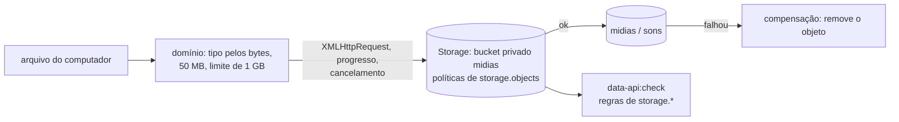

# VER-023 — Plano de implementação da etapa E2 (PLA-003): preparar um episódio

## Cabeçalho

| Campo | Valor |
|---|---|
| Id | VER-023 |
| Título | Plano de implementação da etapa E2 (PLA-003): preparar um episódio |
| Gravidade | média |
| Tipo | documentação · planejamento |
| Data | 2026-11-26 (data do commit, em UTC) |
| Usuário responsável | TokumoH |
| Status de implementação | somente documentação |
| Commits | commit que introduz este arquivo — `git log --diff-filter=A --format=%h -- docs/verificacoes/2026-11-26-023-plano-e2.md` |
| Arquivos | `docs/planos/2026-11-26-e2-preparar-episodio.md` (novo), `docs/planos/README.md`, `docs/verificacoes/README.md`, este registro (4 arquivos) |

## Problema

A E1 terminou com a entrada pelo Google, a guarda por papel e a aba Membros (VER-015 a VER-020), mas a E2 do [DES-001](../desenho/2026-11-16-revocast-cameras-desenho.md) (Biblioteca, cenas, gestos, episódios e avisos) não tinha plano com tarefas, arquivos, interfaces, testes e ordem. A E2 é a primeira a usar o Storage do Supabase, que nem a simulação dos testes nem as checagens de banco conheciam, e o PLA-001 deixou para ela as políticas de `storage.objects`.

## Era proposital?

Não. O plano é o passo seguinte depois da E1, como o PLA-002 foi depois da E0 ([VER-014](2026-11-26-014-plano-e1.md)).

## Solução

1. **PLA-003** em [`docs/planos/2026-11-26-e2-preparar-episodio.md`](../planos/2026-11-26-e2-preparar-episodio.md): decisões vigentes do responsável, restrições globais, decisões D1 a D13, foco da revisão (13 situações perigosas, cada uma com teste na tarefa dona), estrutura de arquivos e oito tarefas, cada uma com registro próprio (VER-024 a VER-031), dupla verificação, `npm run check` como último ato, commit e push:
   1. domínio Preparação (regras puras, portas e serviço da Biblioteca) — VER-024;
   2. simulação do Storage e checagens de banco para `storage.*` — VER-025;
   3. migração `biblioteca_storage` e testes de banco da E2 — VER-026;
   4. adaptadores Supabase da Preparação e composição — VER-027;
   5. aba Biblioteca — VER-028;
   6. abas Cenas e Gestos — VER-029;
   7. aba Episódios e avisos — VER-030;
   8. conferência no navegador e guia do Storage para o responsável — VER-031.
2. **Escopo da E2:** no `/painel`, as abas Biblioteca (envio de sons e imagens com prévia, rótulo, emoji e volume dos sons, uso do limite de 1 GB e exclusão segura), Cenas, Gestos (mapa dos 7 gestos, com a sugestão de ligar 👍/👎 aos sons) e Episódios (rascunhos e avisos) deixam de ser provisórias. Iniciar e encerrar o ao vivo ficam para a E3 (D2).
3. **Migração nova `biblioteca_storage`:** bucket privado `midias`, 50 MB por arquivo e 8 tipos aceitos (MP3, WAV, OGG, M4A; PNG, JPEG, WebP, GIF), com três políticas em `storage.objects` (`select`, `insert` e `delete`, todas `to authenticated`; sem `update`).
4. **Nenhuma dependência nova:** o envio usa `XMLHttpRequest` nativo, com progresso, cancelamento e corte por inatividade (D8, D9).
5. **`docs/planos/README.md`:** o PLA-003 no campo "Arquivos" e em "Onde".
6. **`docs/verificacoes/README.md`:** o VER-023 em "Arquivos" e "Onde"; o exemplo hipotético, que citava o número 024 (reservado pelo plano, assim como 025 a 031), passa a `2026-11-30-032-exemplo.md`.

**Decisões do responsável** (registradas no plano, seção "Decisões vigentes do responsável"):

| Data | Citação literal | Aplicação |
|---|---|---|
| 2026-11-22 | "Se a gravidade de erros for aceitável, prossiga sem necessidade de refazer dois testes seguidos" | Achado de texto, documentação, nit ou teste a mais, sem tocar segurança, sem mudar comportamento de código e sem enfraquecer teste: corrigir com reconferência pontual registrada; qualquer outro achado: corrigir e verificar de novo, até duas rodadas seguidas sem erro |
| 2026-11-26 | "Seja autonomo, pode seguir e me entregar o projeto completo" | Dada em resposta ao pedido de push (VER-014). O agente principal segue sem pedir aprovação a cada tarefa e faz commit e push de cada item verificado da entrega E1–E6, por autorização explícita e permanente até ser revogada; cada push informa o estado. O `CLAUDE.md` não é editado; revogada a autorização, volta a regra dele. Continuam proibidos sem pedido explícito: criar, renomear ou apagar branch; merge; PR; trazer conteúdo de outra branch ou do remoto; descartar trabalho; reescrever commit enviado; fundir commits de itens diferentes |
| 2026-11-26 | "Resolve" (sobre dependências) | Dependência npm nova só pelo procedimento do npm 11 (`npx -y npm@11`) registrado no PLA-002; a E2 não precisa de nenhuma |

**Decisões D1 a D13 do plano**, propostas pelo agente sob a autonomia e aceitas pelo controlador (seção "Decisões sobre lacunas e divergências do desenho"):

| # | Decisão |
|---|---|
| [D1](../planos/2026-11-26-e2-preparar-episodio.md#L63) | Um domínio só, `src/domains/preparacao/`, como o contexto Preparação do DES-001 §6, com os arquivos separados por agregado |
| [D2](../planos/2026-11-26-e2-preparar-episodio.md#L65) | Iniciar e encerrar o ao vivo ficam para a E3; na E2 a aba Episódios mostra o estado e nunca escreve `estado` nem `gestos_ligados` |
| [D3](../planos/2026-11-26-e2-preparar-episodio.md#L67) | Políticas de `storage.objects`: `select` para `equipe`/`admin` e `obs_palco`; `insert` para `equipe`/`admin` com o nome no formato `som/<uuid>.<ext>` ou `imagem/<uuid>.<ext>`; `delete` para `equipe`/`admin`; nenhum `update`; todas `to authenticated` e com o bucket `midias` |
| [D4](../planos/2026-11-26-e2-preparar-episodio.md#L78) | Os 8 tipos aceitos são conferidos em três lugares: no domínio pelos primeiros bytes, no bucket (`allowed_mime_types` e `file_size_limit` de 50 MB) e no nome do objeto |
| [D5](../planos/2026-11-26-e2-preparar-episodio.md#L80) | Sem sobrescrita: cada envio gera um `uuid` novo, e não há política de `update` |
| [D6](../planos/2026-11-26-e2-preparar-episodio.md#L82) | Ordem do envio e da exclusão sem transação entre Storage e banco, com compensação (o objeto é removido se o registro falhar) |
| [D7](../planos/2026-11-26-e2-preparar-episodio.md#L84) | Uso do limite pela soma de `midias.tamanho_bytes`, contra 10⁹ bytes, com aviso a partir de 80 % |
| [D8](../planos/2026-11-26-e2-preparar-episodio.md#L86) | Envio com `XMLHttpRequest` (progresso e cancelamento), não com `storage.from().upload()`, que no `storage-js` 2.119.0 não aceita `AbortSignal` nem informa progresso |
| [D9](../planos/2026-11-26-e2-preparar-episodio.md#L94) | Nenhuma dependência nova: áudio e imagem nativos, tipo por bytes mágicos, `crypto.randomUUID()`, `drop` nativo |
| [D10](../planos/2026-11-26-e2-preparar-episodio.md#L96) | Repositórios por agregado, sem classe genérica; os erros do Supabase tratados num lugar só |
| [D11](../planos/2026-11-26-e2-preparar-episodio.md#L98) | Mídia em uso: som ou cena num gesto bloqueia a exclusão; imagem em avisos pede confirmação com o número de avisos afetados |
| [D12](../planos/2026-11-26-e2-preparar-episodio.md#L100) | Mapa de gestos só com `update`; ação `cena` exige cena e `som` exige som; sugestão de ligar 👍/👎 aos sons |
| [D13](../planos/2026-11-26-e2-preparar-episodio.md#L102) | A simulação ganha o schema `storage`; o `data-api:check` recusa qualquer mudança em `storage.*` além de política em `storage.objects`, aceita só políticas no formato da D3 (bucket como conjunção de topo, só `select`/`insert`/`delete`) e confere as linhas de `storage.buckets` |

## Por que esta solução

- **DDD, GRASP Pure Fabrication e Componentes:** o domínio `preparacao` concentra as regras puras e as portas (um repositório por agregado e `ArmazenamentoDeMidia`); os adaptadores ficam em `shared/infra`; as abas recebem serviços pela composição, como na E1.
- **Segurança:** o bucket é privado; o tipo do arquivo é decidido pelos bytes, não pelo nome; o nome do objeto é gerado (`uuid`), sem o nome original; as políticas são conferidas pelas checagens de banco, que passam a cobrir `storage.*`; nenhum `update` evita sobrescrita.
- **Sem dependência nova:** o `XMLHttpRequest` nativo dá o progresso e o cancelamento que o `storage-js` não dá, sem mexer no lockfile.

## Por que não outras soluções

| Opção | Motivo de descarte |
|---|---|
| Implementar a E2 direto, sem plano | O Storage é novo para a simulação e as checagens; as decisões de segurança ficariam implícitas |
| Domínios separados `biblioteca/` e `episodios/` | Os agregados se referenciam e "mídia em uso" atravessa todos (D1) |
| `storage.from('midias').upload()` | Sem `AbortSignal` e sem progresso no 2.119.0 (D8) |
| Envio retomável (TUS) | Exige `tus-js-client` (dependência nova) ou reimplementar o protocolo (D8) |
| Bucket público | O DES-001 §8 restringe a leitura do bucket a `equipe`/`admin` e ao `obs_palco` |
| Política de `update` para trocar arquivos | Abriria sobrescrita; trocar é enviar outro e excluir o antigo (D5) |

## Onde

| Arquivo | Linhas | O que mudou |
|---|---|---|
| [`docs/planos/2026-11-26-e2-preparar-episodio.md`](../planos/2026-11-26-e2-preparar-episodio.md#L1-L700) | 1–700 | Novo: PLA-003. Decisões do responsável ([21–30](../planos/2026-11-26-e2-preparar-episodio.md#L21-L30)); restrições globais ([32–59](../planos/2026-11-26-e2-preparar-episodio.md#L32-L59)); D1 a D13 ([61–108](../planos/2026-11-26-e2-preparar-episodio.md#L61-L108)); foco da revisão ([110–126](../planos/2026-11-26-e2-preparar-episodio.md#L110-L126)); tarefas 1 a 8 ([169](../planos/2026-11-26-e2-preparar-episodio.md#L169), [293](../planos/2026-11-26-e2-preparar-episodio.md#L293), [354](../planos/2026-11-26-e2-preparar-episodio.md#L354), [427](../planos/2026-11-26-e2-preparar-episodio.md#L427), [580](../planos/2026-11-26-e2-preparar-episodio.md#L580), [630](../planos/2026-11-26-e2-preparar-episodio.md#L630), [654](../planos/2026-11-26-e2-preparar-episodio.md#L654), [675](../planos/2026-11-26-e2-preparar-episodio.md#L675)); passo do responsável ([685](../planos/2026-11-26-e2-preparar-episodio.md#L685)); "Ao fim da E2" ([694–700](../planos/2026-11-26-e2-preparar-episodio.md#L694-L700)) |
| [`docs/planos/README.md`](../planos/README.md#L14) | 14, 49 | PLA-003 no campo "Arquivos" (14) e em "Onde" (49) |
| [`docs/verificacoes/README.md`](README.md#L14) | 14, 76, 99 | VER-023 no campo "Arquivos" (14) e em "Onde" (76); exemplo hipotético passa ao número 032 (99) |

## Lógica

| Passo | Antes | Depois |
|---|---|---|
| Abas do `/painel` (Biblioteca, Cenas, Gestos, Episódios) | Provisórias | Funcionais, com as regras da Preparação |
| Storage | Fora da simulação e das checagens | Schema `storage` na simulação; regras de `storage.*`, das políticas e do bucket no `data-api:check` |
| Bucket | Nenhum | `midias`: privado, 50 MB, 8 tipos; nome `som/<uuid>.<ext>` ou `imagem/<uuid>.<ext>` |
| Dependências | — | Nenhuma nova |

## Exemplo

Foco da revisão: um arquivo de texto renomeado para `.mp3` é recusado pelo domínio, porque os primeiros bytes não são de áudio; se a tela fosse contornada, o bucket recusaria o tipo (`allowed_mime_types`), e um nome fora do formato `som/<uuid>.<ext>` seria recusado pela política de `insert`.

## Verificação

| # | Abordagem | Resultado |
|---|---|---|
| Revisão 1 do plano | Revisor independente, contra o DES-001, o `CLAUDE.md`, o repositório e as decisões do responsável, com sondas próprias | Com erros: 6 Importantes e 10 nits. Destaques: I1, a simulação do dono do Storage era infiel; foi compensada por uma regra que recusa qualquer mudança em `storage.*` além de política em `storage.objects`; I2, o bucket passou a ser exigido como conjunção de topo nas políticas, e só `select`, `insert` e `delete` são aceitos. Todos corrigidos |
| Revisão 2 do plano | Revisor novo, conferindo os 16 achados anteriores e procurando novos | Os 16 achados anteriores resolvidos. Novos: 1 Importante (o teste `storage-grant-alterado`) e 5 nits, entre eles a função de papel conferida por análise e não por texto. Todos corrigidos |
| Decisão do controlador | — | O plano é commitado sem uma terceira revisão do documento: cada tarefa terá revisão própria; o custo, se estiver errado, é retrabalho nas tarefas |
| `npm run check` sobre o conteúdo do commit | Controlador, como último ato antes do commit | Feito pelo controlador antes do commit |
| Redação | `node scripts/check-docs.mjs` e `node scripts/check-doc-secrets.mjs` | 0 erros |

## Riscos

- **Passos do responsável** (Tarefa 8, Passo 5): sem eles a Biblioteca não funciona no projeto real. Incluem as pendências da E0 e da E1, se ainda abertas (a migração de fundação, o primeiro `admin`, a migração `membros_sem_autoalteracao` e a configuração do login), aplicar a migração `biblioteca_storage` no editor SQL, a conferência por consulta do bucket e das políticas e a conferência real com uma conta `equipe`.
- **O `postgres` real em `storage`:** no Supabase, o `postgres` cria política em `storage.objects` sem ser dono, pela extensão `supautils`; isso ainda não foi confirmado num projeto real (Tarefa 2). Se o editor SQL recusar com `must be owner of table objects`, o plano manda não contornar e registrar.
- **Privilégios de `storage.*` no Supabase:** `anon` e `authenticated` têm ALL nas tabelas de `storage`, e só a RLS as protege; as checagens recusam mudanças nesse schema além das políticas de `storage.objects`, mas não conferem os dados de `storage.objects`.
- **Função de papel por presença, não por uso:** nas políticas de `storage.objects`, o `data-api:check` confere a presença da função de papel (por análise, não por texto), não o que a política faz com ela: uma política com o papel trocado por `papel_atual() is not null` passa no check e só é pega pelos testes de banco da Tarefa 3; o mesmo limite das checagens de funções (VER-011).
- **Sem terceira revisão do plano:** os achados da revisão 2 foram corrigidos sem nova rodada do documento; cada tarefa tem revisão própria.
- Esta linha nova em "Onde" de `docs/verificacoes/README.md` (76) desloca uma linha a seção "Exemplo", que registros antigos citam por linha; o arquivo não encolheu.
