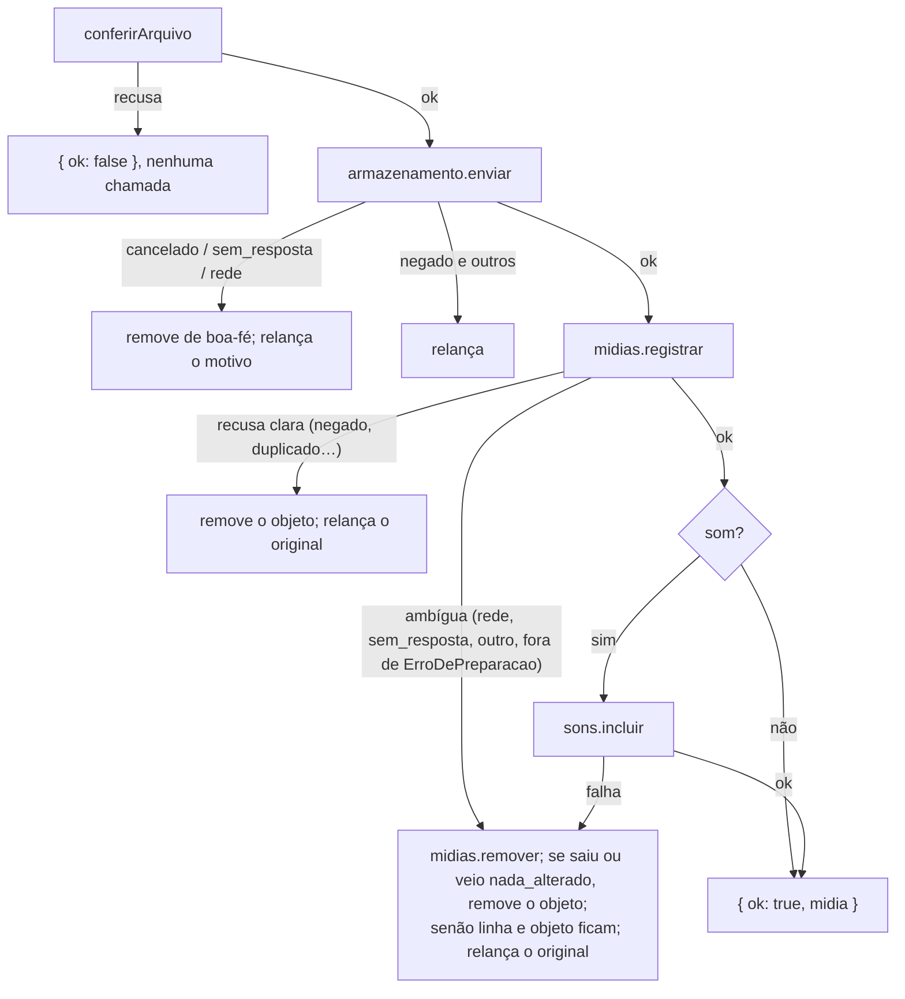

# VER-024 — E2, Tarefa 1: domínio Preparação (regras puras, portas e serviço da Biblioteca)

## Cabeçalho

| Campo | Valor |
|---|---|
| Id | VER-024 |
| Título | E2, Tarefa 1: domínio Preparação (regras puras, portas e serviço da Biblioteca) |
| Gravidade | média |
| Tipo | implementação · decisão de arquitetura · segurança |
| Data | 2026-11-26 (data do commit, em UTC) |
| Usuário responsável | TokumoH |
| Status de implementação | implementado |
| Commits | commit que introduz este arquivo — `git log --diff-filter=A --format=%h -- docs/verificacoes/2026-11-26-024-e2-dominio-preparacao.md` |
| Arquivos | `src/domains/preparacao/README.md`, `src/domains/preparacao/{midia,cenas,gestos,episodios,usos,portas,biblioteca}.ts`, `src/domains/preparacao/{midia,cenas,gestos,episodios,usos,biblioteca}.test.ts` (novos), `src/domains/README.md`, `src/README.md`, `docs/verificacoes/README.md`, `docs/planos/2026-11-26-e2-preparar-episodio.md` (linha 250), este registro (19 arquivos) |

## Problema

**Pendências da E1 (abertura exigida pelo [PLA-003](../planos/2026-11-26-e2-preparar-episodio.md#L165), "Estrutura de arquivos"):**

| Pendência | Origem | Situação em 2026-11-26 |
|---|---|---|
| Aplicar a migração `20261126142500_membros_sem_autoalteracao.sql` no editor SQL (depois da de fundação) | PLA-002, Tarefa 6, Passo 5 ([VER-016](2026-11-26-016-e1-banco-membros.md), [VER-020](2026-11-26-020-e1-conferencia-e-guia.md)) | sem resultado informado pelo responsável: **continua pendente** |
| Configurar o login Google (Google Cloud, Supabase Auth sem curinga nas Redirect URLs, validade do JWT de 10 min, variáveis na Vercel) | PLA-002, Tarefa 6, Passo 5 (guia "Login Google (E1)" em `supabase/README.md`, VER-020) | sem resultado informado pelo responsável: **continua pendente** |
| Conferência real com uma conta `admin` e uma fora da lista | PLA-002, Tarefa 6, Passo 5 (passo 7 do guia) | **continua pendente** (depende das duas acima) |
| Pendências da E0 (deploy de prévia; migração de fundação e primeiro `admin`) | PLA-001 ([VER-015](2026-11-26-015-e1-dominio-acesso.md), Problema) | sem resultado informado: **continuam pendentes** |

Nenhum código da E2 depende delas; só a conferência real da Tarefa 8 da E2.

**O problema da tarefa:** a E2 vai deixar a equipe enviar arquivos do próprio computador para um bucket do Storage, montar cenas, o mapa de gestos, episódios e avisos. Cada um desses pontos tem uma regra perigosa (Foco da revisão do PLA-003, itens 1, 2, 6, 7, 8, 9, 10 e 11): arquivo grande ou com tipo falso (um HTML chamado `.png`, um SVG com script), nome de arquivo com pastas (`../../x.mp3`) indo parar no caminho do Storage, gesto de som sem som, link `javascript:` num aviso, exclusão de mídia em uso, uso do limite de 1 GB, envio cancelado ou travado que deixa o objeto gravado, e registro que falha depois do envio. Sem um lugar único e testável, essas regras iriam para as telas (Tarefas 5 a 7), misturadas com React e com o cliente Supabase, e a ordem entre Storage e banco (que não têm transação entre si) ficaria sem prova. Também não havia **portas** para os adaptadores (Tarefa 4) e os falsos de tela (Tarefa 5) escreverem contra o mesmo contrato.

## Era proposital?

Não. O contexto **Preparação** e a pasta `src/domains/preparacao/` estão no [DES-001](../desenho/2026-11-16-revocast-cameras-desenho.md) (§6 e §6.1) desde o desenho; o PLA-003 põe a pasta na Tarefa 1 da E2 (estrutura de arquivos, linha 134 em diante). As tabelas `midias`, `sons`, `cenas`, `episodios`, `avisos` e `mapa_gestos` existem desde a migração de fundação (VER-010), sem tela nem regra no cliente até aqui.

## Solução

Nasce `src/domains/preparacao/`, só com TypeScript puro (o teste `src/domains/arquitetura.test.ts` já cobre a pasta, porque lê `./**/*.ts`):

- `midia.ts`: os 8 `TIPOS_ACEITOS` da D4 (congelados), `LIMITE_POR_ARQUIVO_BYTES = 52_428_800` (= CHECK `midias_tamanho_ate_50mb`), `LIMITE_TOTAL_BYTES = 1_000_000_000` (D7), `BYTES_PARA_DETECTAR = 16`; `detectarTipo` por uma tabela fixa de assinaturas `{ deslocamento, bytes, mascara? }` (D9; `ID3` só com a versão `03`/`04` no byte 3); `conferirArquivo` na ordem `vazio` → `grande_demais` → `tipo_recusado` → `sem_espaco`; `caminhoDaMidia` (`som|imagem/<uuid>.<ext>`, lança com id fora do uuid minúsculo); `nomeDeExibicao`; `usoDaBiblioteca` (soma, fração, alerta a 80 %); `Som` e `conferirSom`.
- `cenas.ts`: `conferirCena` (nome de exibição aparado; nome no OBS comparado **exato**).
- `gestos.ts`: `GESTOS` (os 7, na ordem do DES-001 §7, com emoji e rótulo), `ACOES`, `normalizarGesto` (zera o alvo que não corresponde à ação), `conferirGesto` (`falta_cena`, `falta_som`, `alvo_inexistente`) e `sugestoesDeSom` (D12).
- `episodios.ts`: `conferirEpisodio` (título até 120, data real com ano ≥ 0001), `podeExcluirEpisodio` (só rascunho, D2), `normalizarLink` (só `https:` absoluto, sem usuário/senha, devolve `url.href`), `conferirAviso` (duração inteira de 1 a 600 s, imagem da lista) e `trocarOrdem`.
- `usos.ts`: `usosDaMidia` (gestos pelo som; avisos com a imagem; `bloqueia` só por gesto, D11) e `usosDaCena`.
- `portas.ts`: `ErroDePreparacao` (campo declarado e atribuído no construtor, sem propriedade de parâmetro; mensagem só com o motivo), `NovaMidia`, os repositórios por agregado, `OpcoesDoEnvio`, `ArmazenamentoDeMidia` e `ServicosDePreparacao`.
- `biblioteca.ts`: `enviarMidia` e `excluirMidia` na ordem da D6, com compensação e remoção de boa-fé. Quando a falha do registro é ambígua (`rede`, `sem_resposta`, `outro` ou erro fora de `ErroDePreparacao`: a linha pode ter sido gravada e a resposta perdida), a compensação tira a linha de `midias` antes e só apaga o objeto se a linha sair ou vier `nada_alterado` (correção do achado 1 da revisão 1). O tamanho vem sempre de `corpo.size` (`ArquivoEscolhido` não tem mais o campo `tamanho`; achado 6).

**Decisões do PLA-003 aplicadas aqui:**

| Decisão | Como entra |
|---|---|
| [D1](../planos/2026-11-26-e2-preparar-episodio.md#L63) | Um domínio só, `preparacao`, com um arquivo por agregado |
| [D4](../planos/2026-11-26-e2-preparar-episodio.md#L78) | Os 8 tipos detectados pelos primeiros bytes; nome e `File.type` nunca decidem; SVG, HTML, PDF e vídeo recusados |
| [D6](../planos/2026-11-26-e2-preparar-episodio.md#L82) | Envio: conferir → enviar → registrar (e `sons`); compensação (recusa clara do registro → remove o objeto; falha ambígua ou som que não entra → tira a linha primeiro e só remove o objeto se ela sair); remoção de boa-fé em `cancelado`, `sem_resposta` e `rede`. Exclusão: linha primeiro, objeto depois. Nunca linha apontando para arquivo apagado |
| [D7](../planos/2026-11-26-e2-preparar-episodio.md#L84) | Uso pela soma de `tamanhoBytes`, limite 10⁹, alerta a 80 %, recusa do envio que passaria do limite |
| [D9](../planos/2026-11-26-e2-preparar-episodio.md#L94) | Sem dependência nova: tabela fixa de bytes mágicos; o uuid vem de fora (`gerarId`) |
| [D11](../planos/2026-11-26-e2-preparar-episodio.md#L98) | `usosDaMidia`/`usosDaCena`: som ou cena num gesto bloqueia; imagem em avisos só informa o número |
| [D12](../planos/2026-11-26-e2-preparar-episodio.md#L100) | `conferirGesto` recusa ação sem alvo; `normalizarGesto` zera o alvo que não corresponde; `sugestoesDeSom` compara sem caixa e sem acento |

**Ajustes do implementador em relação ao texto da tarefa** (cada um com teste):

1. **MP3 pela camada III, não por qualquer sincronia.** O texto pedia `b[0] === 0xff && (b[1] & 0xe0) === 0xe0`. Essa forma aceita também `FF FE` (marca de um texto UTF-16, por exemplo um HTML salvo em UTF-16) e quadros de camada I/II e de versão reservada. A tabela aceita só `FF FA/FB` (MPEG-1), `FF F2/F3` (MPEG-2) e `FF E2/E3` (MPEG-2.5), camada III, com e sem CRC; continua sem colidir com o JPEG (`FF D8`). Testes novos em `tipo-pelos-bytes`: `FF FE 3C 00` e `FF FD` → `null`; `FF F3` e `FF E3` → mp3.
2. **`conferirGesto` sem chamar `normalizarGesto` por dentro.** A sabotagem do plano "tirar `normalizarGesto` da conferência" foi executada com a primeira versão (que chamava) e **não derrubou nada** (achado): as conferências já são escolhidas pela ação, então o alvo que não corresponde nunca era olhado e a chamada não tinha efeito. A chamada saiu; o comportamento ("só o alvo da ação conta") ficou provado por `gesto-zera-alvo`, que derruba as sabotagens S4b, S4c e S4d. Quem grava (Tarefa 6) manda a linha normalizada.
3. **Compensação quando a linha pode existir:** se `sons.incluir` falha, ou se `midias.registrar` falha de forma ambígua (achado 1 da revisão 1), `midias.remover(id)` vem antes e o objeto só é removido **se a linha sair** ou vier `nada_alterado` (a linha nunca existiu); se a linha não sair, o objeto fica (a D6 proíbe linha apontando para arquivo apagado). Testes em `envio-compensa`.
4. **`trocarOrdem` com ordens repetidas** devolve **todos** os itens renumerados (0..n-1, já com a troca), para o banco sair sem empate; sem empate, só o par trocado, na ordem de cima para baixo.
5. **`nomeDeExibicao`** também tira os controles de direção do texto (U+202A–U+202E, U+2066–U+2069), que trocariam visualmente a extensão (`foto‮gnp.mp3`), e corta em 120 **pontos de código** (não parte emoji).
6. **`ArquivoEscolhido` sem `tamanho`** (achado 6 da revisão 1): o contrato do brief tinha `tamanho: number` ao lado de `corpo: Blob`; se os dois divergissem, o limite de 50 MB e o uso da D7 contariam errado. Agora o domínio usa `corpo.size` (o `Blob` que é enviado). A Tarefa 5 monta o `ArquivoEscolhido` sem `tamanho`. Teste `tamanho-do-corpo`.
7. **Falha fechada com `NaN`:** `conferirArquivo` (tamanho `NaN` → `vazio`, `Infinity` → `grande_demais`, uso `NaN` → `sem_espaco`), `conferirSom`, `conferirAviso`.

## Por que esta solução

- **DDD:** regras e portas no domínio, sem dependência de biblioteca; os adaptadores (Tarefa 4) implementam as portas e `app/` compõe.
- **GRASP Pure Fabrication:** `enviarMidia`/`excluirMidia` são fabricações que coordenam Storage e banco, o que nenhuma entidade faria sozinha; `usos.ts` junta agregados diferentes num lugar só.
- **Componentes:** um arquivo por agregado, com o teste ao lado; as telas das Tarefas 5 a 7 só chamam funções puras.
- **Segurança:** o tipo vem dos bytes (D4); o caminho nunca leva o nome do arquivo e só aceita uuid minúsculo (a mesma forma da política de `insert`, D3); o nome mostrado não tem pastas, controles nem inversão de direção; link só `https:` absoluto, sem credenciais; a mensagem de `ErroDePreparacao` não leva texto de fora; a compensação nunca esconde o erro original.
- **Otimização:** funções puras e síncronas (menos o serviço), sem estado global; o tipo é decidido com 16 bytes, sem ler o arquivo inteiro; os 66 testes rodam em menos de 1 s, sem jsdom.

## Por que não outras soluções

| Opção | Motivo de descarte |
|---|---|
| Tipo pelo `File.type` ou pela extensão | Ambos vêm de quem envia; um HTML chamado `.png` passaria (D4; sabotagens S2a e S2b) |
| Procurar texto no começo do arquivo (`includes('WAVE')`) | Aceitaria a assinatura em qualquer posição; a tabela tem posição exata |
| Sincronia de MP3 `(b[1] & 0xe0) === 0xe0` | Aceita `FF FE` (texto UTF-16) e camadas I/II (ajuste 1; sabotagem S2d) |
| Biblioteca de detecção de tipo (`file-type`) | Dependência nova (D9); 8 tipos fixos cabem numa tabela |
| Envio e exclusão dentro da tela | A ordem Storage ↔ banco e a compensação só seriam testáveis com jsdom |
| Remover o objeto antes da linha na exclusão | Deixaria linha apontando para arquivo apagado e apagaria o som que o banco recusaria por `em_uso` (sabotagem S5) |
| Remover o objeto em qualquer falha do envio | Um `negado` não gravou nada; a remoção seria uma chamada inútil (sabotagem S7b) |
| Na falha do registro, remover o objeto direto (primeira versão) | Com falha ambígua (resposta perdida depois de gravar), deixaria linha apontando para arquivo apagado (achado 1 da revisão 1; sabotagem SA1) |
| Na falha do registro, sempre tentar tirar a linha | Numa recusa clara (`negado`, `duplicado`, `invalido`) a linha não existe; a chamada seria inútil (sabotagem SA3) |
| Manter `tamanho` ao lado de `corpo` | Dois números para a mesma coisa; se divergirem, o limite e o uso contam errado (achado 6; sabotagem SN6) |
| `nomeObs` comparado sem caixa | O OBS diferencia caixa e espaços; o banco tem `unique` exato (sabotagem S14) |

## Onde

| Arquivo | Linhas | O que mudou |
|---|---|---|
| [`src/domains/preparacao/midia.ts`](../../src/domains/preparacao/midia.ts#L1-L166) | 1–166 | Novo: tipos aceitos, limites, tabela de assinaturas e `casaTrecho` (L39–L84), `detectarTipo` (L87), `conferirArquivo` (L102), `caminhoDaMidia` (L115), `nomeDeExibicao` (L127), `Midia`, `usoDaBiblioteca` (L145), `Som`, `conferirSom` (L162) |
| [`src/domains/preparacao/cenas.ts`](../../src/domains/preparacao/cenas.ts#L1-L21) | 1–21 | Novo: `Cena`, `RecusaDaCena`, `conferirCena` |
| [`src/domains/preparacao/gestos.ts`](../../src/domains/preparacao/gestos.ts#L1-L96) | 1–96 | Novo: `Gesto`, `AcaoDoGesto`, `GESTOS` (L10), `ACOES` (L21), `LinhaDoMapa`, `normalizarGesto` (L41), `conferirGesto` (L55), `sugestoesDeSom` (L87) |
| [`src/domains/preparacao/episodios.ts`](../../src/domains/preparacao/episodios.ts#L1-L104) | 1–104 | Novo: `Episodio`, `Aviso`, `conferirEpisodio` (L39), `podeExcluirEpisodio` (L48), `normalizarLink` (L57), `conferirAviso` (L74), `trocarOrdem` (L91) |
| [`src/domains/preparacao/usos.ts`](../../src/domains/preparacao/usos.ts#L1-L22) | 1–22 | Novo: `usosDaMidia`, `usosDaCena` |
| [`src/domains/preparacao/portas.ts`](../../src/domains/preparacao/portas.ts#L1-L121) | 1–121 | Novo: `MotivoDaPreparacao`, `ErroDePreparacao` (L20), `NovaMidia`, repositórios, `OpcoesDoEnvio`, `ArmazenamentoDeMidia` (L102), `ServicosDePreparacao` |
| [`src/domains/preparacao/biblioteca.ts`](../../src/domains/preparacao/biblioteca.ts#L1-L139) | 1–139 | Novo: `ArquivoEscolhido` (L9, sem `tamanho`), `ResultadoDoEnvio`, `REGISTRO_AMBIGUO`, `removerLinhaEObjetoSemFalhar`, `enviarMidia` (L76), `excluirMidia` (L131) |
| [`src/domains/preparacao/midia.test.ts`](../../src/domains/preparacao/midia.test.ts#L1-L159) | 1–159 | Novo: 31 testes |
| [`src/domains/preparacao/cenas.test.ts`](../../src/domains/preparacao/cenas.test.ts#L1-L27) | 1–27 | Novo: 2 testes |
| [`src/domains/preparacao/gestos.test.ts`](../../src/domains/preparacao/gestos.test.ts#L1-L64) | 1–64 | Novo: 4 testes |
| [`src/domains/preparacao/episodios.test.ts`](../../src/domains/preparacao/episodios.test.ts#L1-L107) | 1–107 | Novo: 5 testes |
| [`src/domains/preparacao/usos.test.ts`](../../src/domains/preparacao/usos.test.ts#L1-L49) | 1–49 | Novo: 2 testes |
| [`src/domains/preparacao/biblioteca.test.ts`](../../src/domains/preparacao/biblioteca.test.ts#L1-L307) | 1–307 | Novo: 22 testes, com portas falsas que registram a ordem das chamadas e falham quando pedido |
| [`src/domains/preparacao/README.md`](../../src/domains/preparacao/README.md#L1-L140) | 1–140 | Novo: README de 11 seções, com o diagrama das portas e a ordem do envio e da exclusão (D6) |
| [`src/domains/README.md`](../../src/domains/README.md#L14-L74) | 14, 22, 26–27, 50, 63, 69, 73–74 | `preparacao/` em "Arquivos", "Origem", "Organização", "Onde", "Lógica", "Exemplo" e "Verificação" (13 arquivos, 112 testes) |
| [`src/README.md`](../../src/README.md#L27-L47) | 27, 47 | `domains/preparacao/` em "Organização" e "Onde" |
| [`docs/verificacoes/README.md`](README.md) | "Arquivos" e "Onde" | Linha deste registro |
| [`docs/planos/2026-11-26-e2-preparar-episodio.md`](../planos/2026-11-26-e2-preparar-episodio.md#L250) | 250 | `ArquivoEscolhido` sem `tamanho` (o tamanho vem de `corpo.size`), alinhado ao contrato da correção do nit 6; corrigido pelo controlador depois da re-revisão |

## Lógica

| Passo | Antes | Depois |
|---|---|---|
| Tipo do arquivo | Não havia regra no cliente | `detectarTipo(16 primeiros bytes)` pela tabela; o nome só vira texto de exibição |
| Tamanho e espaço | — | `conferirArquivo`: `> 52 428 800` → `grande_demais`; `uso + tamanho > 10⁹` → `sem_espaco` |
| Caminho no Storage | — | `som|imagem/<uuid>.<ext>`; id fora do formato lança antes de qualquer chamada |
| Envio | — | conferir (com `corpo.size`) → `armazenamento.enviar` → `midias.registrar` → (som) `sons.incluir`; falhas conforme o diagrama abaixo |
| Exclusão | — | `midias.remover` → `armazenamento.remover`; a falha do segundo vira `arquivoFicou: true` |
| Gesto | — | `normalizarGesto` zera o alvo que não corresponde; `conferirGesto` exige o alvo da ação |
| Link de aviso | — | `normalizarLink`: só `https:` absoluto, sem credenciais, devolvido como `url.href` |

## Exemplo

| Entrada | Saída obtida |
|---|---|
| `foto.mp3`, 10 bytes começando por `89 50 4E 47 0D 0A 1A 0A`, `gerarId` = `0b6e2b8a-3c1d-4f2a-9e5b-1a2b3c4d5e6f` | `enviar('imagem/0b6e2b8a-3c1d-4f2a-9e5b-1a2b3c4d5e6f.png', corpo, 'image/png', opcoes)`; `registrar({ tipo: 'imagem', mime: 'image/png', nome: 'foto.mp3', … })`; `sons.incluir` não chamado (`mp3-que-e-png`) |
| `pagina.png` começando por `<!DOCTYPE html>` | `{ ok: false, motivo: 'tipo_recusado' }`, nenhuma chamada (`envio-recusado`) |
| 52 428 800 bytes de PNG / 52 428 801 | `ok` / `grande_demais` (`limite-50mb`) |
| uso 999 999 000 + 1 001 bytes / + 1 000 | `sem_espaco` / `ok` (`sem-espaco`) |
| `../../etc/aplauso.mp3` | nome `aplauso.mp3` (`nome-de-exibicao`) |
| `normalizarLink('https://u:s@revocast.test')`, `'javascript:alert(1)'`, `'http://revocast.test'` | `{ ok: false }` (`link-so-https`) |
| `enviar` termina em `cancelado` e a remoção também falha | relança `cancelado`; `remover` chamado 1 vez; `registrar` não chamado (`envio-interrompido-remove`) |
| `registrar` lança `negado` e a remoção lança `rede` | relança `negado` (`envio-compensa`) |
| `registrar` grava a linha no servidor e lança `rede`; `midias.remover` também lança `rede` (sequência da sonda da revisão 1) | chamadas `enviar`, `registrar`, `midias.remover`; o objeto **não** é apagado; relança `rede` (`envio-compensa: registro ambíguo`) |
| `corpo.size` = 52 428 801 com um `tamanho: 10` informado à parte | `grande_demais`, nenhuma chamada (`tamanho-do-corpo`) |
| mídias de 400 000 000 e 400 000 001 bytes | `{ bytes: 800000001, fracao: 0.800000001, alerta: true }` (`uso-da-biblioteca`) |

## Verificação

**TDD:** os testes das regras foram escritos antes do código: `npx vitest run src/domains/preparacao` → 5 arquivos com falha (`Cannot find module './usos'` e equivalentes). Depois de `midia`, `cenas`, `gestos`, `episodios`, `usos` e `portas`: 5 arquivos, 41 testes passando. `biblioteca.test.ts` escrito em seguida → falha (módulo inexistente); depois de `biblioteca.ts`: 6 arquivos, 58 testes passando. `npx vitest run src/domains`: 13 arquivos, 104 testes. `npx tsc --noEmit`: 0 erros. Depois das correções da revisão 1 (abaixo): 6 arquivos e 66 testes no domínio; 13 arquivos e 112 testes em `src/domains`.

**Sabotagens** (uma de cada vez, numa edição revertida a partir de uma cópia guardada em `scratchpad/`; nenhum `git checkout`/`restore`/`stash`; depois de cada uma, o arquivo foi comparado com a cópia):

| # | Sabotagem | Testes que caíram |
|---|---|---|
| S1 | `enviarMidia` monta o caminho com o nome do arquivo (`${tipo}/${a.nome}`) | `envio-ok-imagem`, `envio-ok-som`, `mp3-que-e-png`, `envio-compensa` (2), `envio-interrompido-remove` (3), id fora do formato |
| S1b | `caminhoDaMidia` sem validar o id | `caminho-sem-nome-do-arquivo`, id fora do formato |
| S2a | `enviarMidia` decide o tipo pela extensão do nome | `envio-recusado`, `mp3-que-e-png` (biblioteca) |
| S2b | `conferirArquivo` usa a extensão do nome antes dos bytes | `mp3-que-e-png` (midia) |
| S2c | WAV só por `RIFF` (sem `WAVE` no deslocamento 8) | `tipo-pelos-bytes: RIFF....AVI`, `tipo-pelos-bytes: RIFF....WEBP` |
| S2d | sincronia de MP3 frouxa do texto da tarefa (`FF` + `111x xxxx`) | `tipo-pelos-bytes: FF FD`, `tipo-pelos-bytes: FF FE 3C 00` |
| S3 | `normalizarLink` aceita `http:` | `link-so-https` |
| S4 | tirar `normalizarGesto` de dentro de `conferirGesto` (primeira versão) | **nenhum — achado**: a chamada não tinha efeito; removida (ajuste 2) |
| S4b | `normalizarGesto` não zera `cenaId` | `gesto-zera-alvo` |
| S4c | `conferirGesto` olha o `somId` em qualquer ação | `gesto-zera-alvo` |
| S4d | `normalizarGesto` não zera `somId` | `gesto-zera-alvo` |
| S5 | `excluirMidia` remove o objeto antes da linha | `excluir-ordem`, `excluir-em-uso`, `excluir-arquivo-ficou` |
| S6a | sem compensação quando `registrar` falha | `envio-compensa` (registro negado; falha da remoção) |
| S6b | sem remover o objeto quando `sons.incluir` falha | `envio-compensa` (som que não entra) |
| S6c | a compensação deixa vazar o erro da remoção | `envio-compensa` (falha da remoção), `envio-interrompido-remove` (3) |
| S6d | remove o objeto mesmo sem a linha de `midias` sair | `envio-compensa` (linha que não sai) |
| S7a | não remover depois de `cancelado`/`sem_resposta`/`rede` | `envio-interrompido-remove` (3) |
| S7b | remover em qualquer falha do envio | `envio-negado-nao-remove` |
| S7c | `rede` fora do conjunto da remoção de boa-fé | `envio-interrompido-remove: rede` |
| S8 | `>` por `>=` no limite de 50 MB | `limite-50mb` |
| S8b | `<=` por `<` no limite total | `sem-espaco` |
| S8c | alerta com `> 0,8` | `uso-da-biblioteca` |
| S9 | `{ tipo: 'imagem', mime: 'image/svg+xml', extensao: 'svg' }` nos aceitos, com assinatura `<svg` | `svg-e-html-recusados`, constantes |
| S10 | `import type { SupabaseClient } from '@supabase/supabase-js'` em `portas.ts` | `arquitetura.test.ts` (nenhum arquivo de domínio importa React, Supabase, `shared/` ou `app/`) |
| S11 | `nomeDeExibicao` sem tirar as pastas | `nome-de-exibicao`, `envio-ok-imagem` |
| S12 | `trocarOrdem` sem renumerar ordens repetidas | `trocar-ordem` |
| S13 | `sugestoesDeSom` sem tirar acento | `sugestao-de-som` |
| S14 | `nomeObs` comparado sem caixa | `nome-obs-exato` |
| S15 | `usosDaMidia` bloqueia por avisos | `usos-da-midia` |
| S16 | data sem conferir o calendário | `conferir-episodio` |
| SA1 | (correção 1) falha ambígua do registro apaga o objeto direto (a versão revisada) | `envio-compensa: registro ambíguo` (4 casos) |
| SA2 | (correção 1) `nada_alterado` não conta como linha fora | `envio-compensa: registro ambíguo` (4 casos) |
| SA3 | (correção 1) toda falha do registro tratada como ambígua | `envio-compensa: registro negado…` |
| SN3 | (nit 3) `ID3` só pelos 3 bytes | `tipo-pelos-bytes: texto que começa por "ID3"`, `tipo-pelos-bytes: ID3 só com 3 bytes` |
| SN5 | (nit 5) ano `0000` aceito | `conferir-episodio` |
| SN6 | (nit 6) tamanho lido de um campo informado pela tela | `tamanho-do-corpo` |

**Revisão 1** (revisor independente, só leitura, com sondas em cópia, `node --experimental-strip-types`): **spec ✅, qualidade reprovada**: 1 Importante e 5 nits, nenhum Crítico.

| Achado | Classe | Correção |
|---|---|---|
| 1. Na falha ambígua de `midias.registrar` (`rede`, `sem_resposta`, `outro`, erro fora de `ErroDePreparacao`), a compensação apagava o objeto mesmo que a linha tivesse sido gravada → linha apontando para arquivo apagado (sonda: `enviar`, `registrar (linha gravada)`, `remover objeto`, `relançou rede`) | Importante | Falha ambígua → `midias.remover(id)` antes; objeto só sai se a linha sair ou vier `nada_alterado` (`removerLinhaEObjetoSemFalhar`, também usado no som); recusa clara continua removendo o objeto direto. Teste `envio-compensa: registro ambíguo` (4 casos, com a sequência da sonda) e sabotagens SA1–SA3; fluxogramas e texto do README e deste registro atualizados |
| 2. `trocarOrdem` com empate devolve a lista inteira; as Tarefas 6 e 7 falam em "duas escritas" | Nit | O plano não é editado (decisão do controlador); registrado em Riscos (aqui e no README) |
| 3. `ID3` só por 3 bytes: um texto que comece por "ID3" virava `audio/mpeg` | Nit | Exige a versão `03` ou `04` no byte 3; testes novos em `tipo-pelos-bytes`; sabotagem SN3 |
| 4. M4A só por `ftypM4A `; áudio com `ftypmp42`/`isom` é recusado | Nit | Registrado em Riscos (aqui e no README) |
| 5. `0000-01-01` aceito, mas o Postgres não tem ano 0 | Nit | Ano ≥ 0001; teste em `conferir-episodio`; sabotagem SN5 |
| 6. `tamanhoBytes` vinha do `tamanho` informado pela tela, não de `corpo.size` | Nit | `ArquivoEscolhido` sem `tamanho`; o domínio usa `corpo.size` na conferência e no registro; teste `tamanho-do-corpo`; sabotagem SN6 |

Os testes das correções foram escritos logo depois da edição do código; a falha deles contra o código anterior foi provada revertendo cada correção (SA1, SN3, SN5, SN6). Reconferência pontual: `npx vitest run src --maxWorkers=2`, `npm run typecheck` e `node scripts/check-docs.mjs` (resultados no relatório da tarefa). **Uma re-revisão focada nas correções vem depois** (a registrar pelo controlador).

| # | Abordagem | Comando / método | Resultado |
|---|---|---|---|
| V1 | revisão independente (revisão 1) | leitura, sondas em cópia | spec ✅; qualidade reprovada (1 Importante, 5 nits), corrigidos acima |
| V2 | re-revisão focada nas correções (revisor novo; 66/66 testes; sonda do I1 refeita) | **aprovada**, sem erros | 1 nit: o PLA-003 (linha 250) ainda declarava `tamanho` em `ArquivoEscolhido`; corrigido pelo controlador, com reconferência pontual (`check-docs`), sem nova rodada (decisão do responsável de 2026-11-22) |
| Check | `npm run check` com o registro já escrito (antes da revisão 1) | `npm run check` | 0 erros (typecheck, testes, `check-docs`, `check-doc-secrets`, `rpc:grants-check`, `data-api:check`, `check-deps-audit`); o check final sobre o conteúdo do commit fica com o controlador |

Nits corrigidos (não zeram a contagem): comentário do falso de `biblioteca.test.ts` ("`null` = resolve" → "sem valor = resolve").

## Riscos

- **Objetos órfãos (D6):** se a compensação ou a remoção de boa-fé não alcançar o Storage, o objeto fica sem linha em `midias` e fora da soma do uso (D7). Se a linha de `midias` não sair na compensação (registro ambíguo ou som que não entra), linha e objeto ficam juntos de propósito; no som, a mídia fica sem a linha de `sons`. Um `nada_alterado` de `midias.remover` é lido como "a linha nunca existiu"; se a RLS esconder uma linha existente (0 linhas por política), o objeto seria apagado com a linha no lugar, o que não acontece com quem acabou de enviar (`equipe`/`admin` leem e apagam `midias`). Um erro do envio que não seja `ErroDePreparacao` (adaptador com defeito) não dispara a remoção de boa-fé; o adaptador da Tarefa 4 deve traduzir todo erro para um motivo.
- **Bytes mágicos:** só o começo é conferido; um arquivo com a assinatura certa e o resto de outro tipo passa no domínio, e o servidor do Storage confia no `Content-Type` declarado. O dano fica contido pelo bucket privado e pelo uso só em `<audio>` e `` (D4). Um MP3 sem `ID3` que comece por um quadro de camada I/II (raro) é recusado.
- **`trocarOrdem` com empate devolve a lista inteira** renumerada (o empate é o caso comum no começo, porque `cenas.ordem` e `avisos.ordem` têm `default 0`); por isso as Tarefas 6 e 7 gravam todos os itens devolvidos, não só "duas escritas" como diz o texto delas no PLA-003 (o plano não é editado).
- **Tipos reconhecidos:** o M4A só é reconhecido pela marca `ftypM4A `; áudio com `ftypmp42`, `ftypisom` ou `ftypM4B ` (gravadores de celular) é recusado. O MP3 com `ID3` v2.2 (byte 3 = `02`) é recusado.
- **Contrato da Tarefa 5:** `ArquivoEscolhido` não tem mais `tamanho` (achado 6); a tela monta o objeto com `nome`, `inicio` e `corpo`.
- **`trocarOrdem` sobre a lista da tela:** duas pessoas reordenando ao mesmo tempo podem gerar empate, que a próxima troca renumera.
- **Rótulos de `GESTOS` e `ACOES`** foram escolhidos aqui (o DES-001 fixa só os valores e os emojis); as telas da Tarefa 6 podem pedir ajuste de texto.
- **Não verificado nesta tarefa:** os adaptadores reais (Tarefa 4), as telas (Tarefas 5 a 7) e o Storage real (Tarefa 8); as pendências da E0 e da E1 acima continuam com o responsável.
