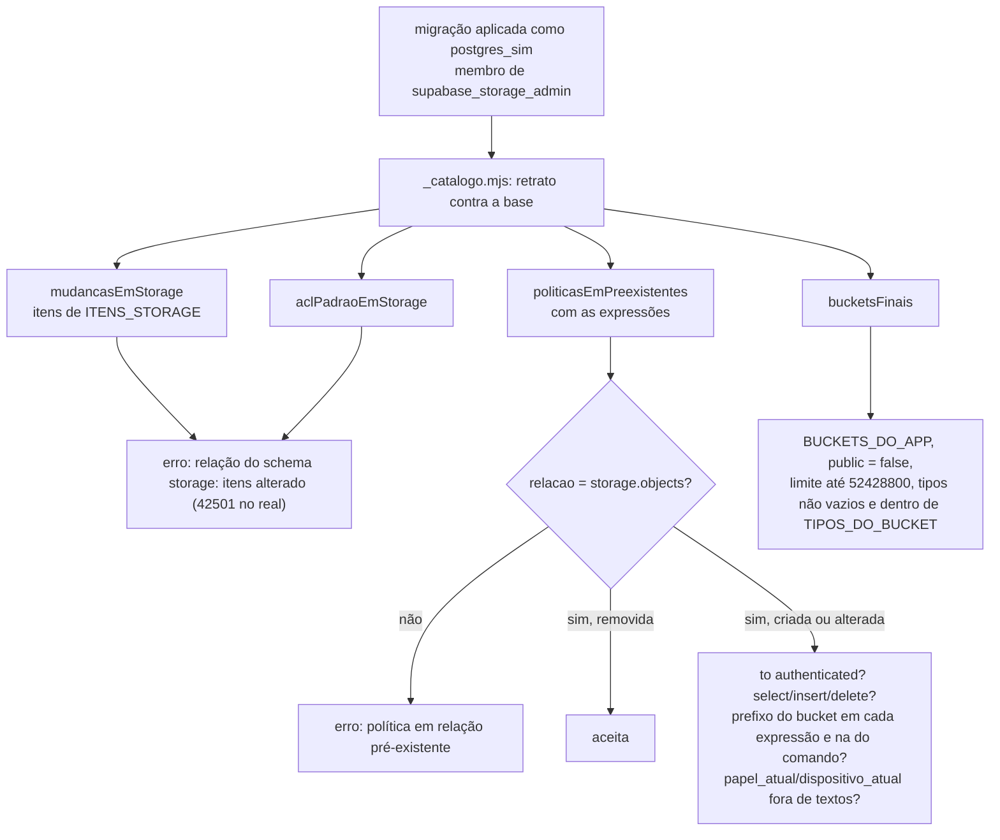

# VER-025 — E2, Tarefa 2: simulação do Storage e checagens de banco para `storage.*`

## Cabeçalho

| Campo | Valor |
|---|---|
| Id | VER-025 |
| Título | E2, Tarefa 2: simulação do Storage e checagens de banco para `storage.*` |
| Gravidade | média |
| Tipo | implementação · segurança · decisão de arquitetura |
| Data | 2026-11-26 (data do commit, em UTC) |
| Usuário responsável | TokumoH |
| Status de implementação | implementado (só testes e checagens; nada é aplicado no Supabase) |
| Commits | commit que introduz este arquivo — `git log --diff-filter=A --format=%h -- docs/verificacoes/2026-11-26-025-e2-simulacao-storage-e-checagens.md` |
| Arquivos | `supabase/tests/simulacao-supabase.sql`, `supabase/tests/dono-migracao.sql`, `supabase/tests/README.md`, `scripts/_catalogo.mjs`, `scripts/check-data-api.mjs`, `scripts/check-rpc-grants.mjs`, `scripts/README.md`, `scripts/tests/check-data-api.test.mjs`, `scripts/tests/catalogo.test.mjs`, `scripts/tests/executaveis.test.mjs`, `scripts/tests/README.md`, `docs/verificacoes/README.md`, este registro (13 arquivos) |

## Problema

1. **A simulação do Supabase não tinha `storage`.** A Tarefa 3 do [PLA-003](../planos/2026-11-26-e2-preparar-episodio.md) cria o bucket `midias` (`insert into storage.buckets`) e três políticas em `storage.objects`; sem o schema na simulação, a migração daria erro de SQL nos testes de banco e nas duas checagens.
2. **O dono simulado não conseguiria aplicar essa migração.** No Supabase, o `postgres` cria política em `storage.objects` sem ser dono dela (extensão `supautils`) e grava em `storage.buckets` por ter `BYPASSRLS`. O PGlite não tem a `supautils`, e o `postgres_sim` não tem `BYPASSRLS` (decisão da E0). Sem nada, a migração falha: `must be owner of table objects` no `create policy` e `new row violates row-level security policy for table "buckets"` no `insert` (sonda refeita nesta tarefa).
3. **As checagens recusavam qualquer política em relação pré-existente** (`política ... em relação pré-existente: forma não suportada`), inclusive as três que a E2 precisa, e não conferiam nada do bucket.
4. **A saída para o item 2 dá poder a mais.** Com a participação em `supabase_storage_admin` (D13), o dono simulado consegue o que o real não consegue: desligar a RLS de `storage.objects`, criar coluna, índice ou gatilho, mudar privilégios, dono, nome, comentário e os privilégios padrão do dono de `storage`. A impressão de relações do `_catalogo.mjs` não via coluna, padrão, índice, gatilho, restrição, comentário, `replica identity`, estatística, herança nem chave estrangeira: uma migração com essas mudanças passaria nos testes e daria `42501` no editor SQL (achado I1 e nit 1 das revisões do plano).

## Era proposital?

Sim, em parte, como etapa. O `scripts/README.md` (Riscos, desde a E0) já previa: "as políticas em `storage.objects` (E2) [...] cairão em 'política em relação pré-existente' [...]; as regras terão de mudar nessas etapas, com decisão registrada". A decisão é a D13 do PLA-003, revista duas vezes antes do commit do plano (`d8593ee`, VER-023): a primeira revisão pediu a simulação mínima com a regra de `storage.*` (I1) e o bucket como conjunção de topo (I2); a segunda pediu o caso `storage-grant-alterado` fiel aos privilégios reais, a impressão ampliada (`pg_attrdef`, `relreplident`, `pg_inherits`, `pg_statistic_ext`, `pg_description`, `tgenabled`), a conferência da função de papel por `codigoDoCorpo()` e os casos de `alter policy`. O "nenhuma checagem importa a outra" do `scripts/README.md` era regra da E0; a D13 pede expressamente reaproveitar `codigoDoCorpo()` e a expressão do `rpc:grants-check`, sem cópia, e a frase foi atualizada.

## Solução

**Passo 1 — fontes (lidas em 2026-11-26; citadas no comentário de cada bloco).** A D13 se confirma:

| Fonte | O que diz |
|---|---|
| `github.com/supabase/postgres`, commit `cceedbd`, `ansible/files/postgresql_config/supautils.conf.j2` | `supautils.policy_grants = '{"postgres":[..., "storage.buckets", ..., "storage.objects", ...]}'`: o `postgres` cria política nessas tabelas sem ser dono. Também `supautils.drop_trigger_grants` (o `postgres` pode apagar gatilhos delas) e `supabase_storage_admin` em `reserved_roles` e `reserved_memberships` |
| idem, `migrations/db/migrations/20250421084701_revoke_admin_roles_from_postgres.sql` | `revoke supabase_storage_admin from postgres;` e `revoke create on schema storage from postgres;`: desde 2025 o `postgres` não é membro do dono de `storage` (logo, `42501` em `alter table storage.objects`) |
| idem, `10000000000000_demote-postgres.sql` | `ALTER ROLE postgres NOSUPERUSER ... BYPASSRLS` (já citado na E0): grava em `storage.buckets` passando por cima da RLS |
| idem, `migrations/db/init-scripts/00000000000002-storage-schema.sql` | `CREATE SCHEMA IF NOT EXISTS storage AUTHORIZATION supabase_admin`; `CREATE USER supabase_storage_admin NOINHERIT CREATEROLE LOGIN NOREPLICATION`; `grant all on schema storage to supabase_storage_admin with grant option` |
| `github.com/supabase/storage`, commit `4341c44`, `migrations/tenant/` | `0002` (tabelas, chave `objects_bucketId_fkey`, RLS em `objects`, `foldername`, `alter default privileges in schema storage grant all on tables ... to postgres, anon, authenticated, service_role`, donos `supabase_storage_admin`), `0003` (`path_tokens` gerada), `0007` (RLS em `buckets`), `0008` (`public`), `0013`/`0014` (`allowed_mime_types`, `file_size_limit bigint`), `0018` (`owner_id`), `0060` (`foldername` atual), **`0073`** (tira `TRUNCATE`, `REFERENCES`, `TRIGGER` e `MAINTAIN` de `anon` e `authenticated`), **`0055`** (gatilho `protect_objects_delete`) |
| idem, `src/internal/database/postgres/scope.ts` | o servidor liga em cada transação `role`, `request.jwt.claims` e `storage.allow_delete_query = 'true'` |
| `supabase.com/docs/guides/storage/security/access-control` | políticas com `create policy ... on storage.objects ... to authenticated with check (bucket_id = ... and (storage.foldername(name))[1] = ...)`; envio = `INSERT`; sobrescrever (upsert) = `INSERT`, `SELECT` e `UPDATE` |
| `supabase.com/docs/guides/database/postgres/roles` | `supabase_storage_admin`: "Used by the Storage middleware [...]. Access is scoped to the storage schema." |

Gatilhos atuais de `storage.objects`, conferidos migração a migração (`0026` a `0052` criaram e apagaram os de prefixos; `0052` apagou `storage.prefixes`):

| Gatilho | Dispara em `insert`/`delete` de `authenticated`? | Escreve em outra tabela? | Na simulação? |
|---|---|---|---|
| `update_objects_updated_at` (`0011`, `before update`) | não | não | fora (não muda nenhum resultado; a D5 não tem `update`) |
| `protect_objects_delete` (`0055`, `before delete for each statement`) | `delete`: sim | não; recusa com `42501` sem `storage.allow_delete_query = 'true'` | **dentro**: muda o resultado de todo `delete` direto |

Gatilhos de `storage.buckets` (`enforce_bucket_name_length_trigger`, `protect_bucket_control_insert`, `wake_lifecycle_on_policy_write`, `protect_buckets_delete` e os de `update` de colunas de ciclo de vida): num `insert` de bucket com nome curto e sem ciclo de vida, nenhum muda o resultado; ficam fora, com o motivo no comentário.

**Passo 3 — simulação.** Bloco `storage` no fim de `simulacao-supabase.sql` (98 linhas): `supabase_storage_admin` (`nologin`); schema `storage` do superusuário do PGlite (no lugar do `supabase_admin`) com `grant all ... with grant option` a `supabase_storage_admin` e `usage` aos três papéis; privilégios padrão de `supabase_storage_admin` como na `0002` menos o que a `0073` tira; `storage.buckets` e `storage.objects` (só as colunas da interface do plano, com `path_tokens` gerada e a chave `objects_bucketId_fkey`), criadas como `supabase_storage_admin`, com RLS; `storage.foldername()` (a da `0060`), `storage.protect_delete()` e o gatilho `protect_objects_delete`. Resultado (sonda): `anon` e `authenticated` com `arwd` (select, insert, update, delete), `service_role` com tudo. Em `dono-migracao.sql`, `grant supabase_storage_admin to postgres_sim;` com o comentário da D13 (o que o real usa, por que o PGlite não reproduz, o que a participação dá a mais e o que compensa; `LOGIN NOINHERIT CREATEROLE` no real, `nologin` aqui, herança pela `inherit_option` da participação).

**Passo 4 — catálogo e regras.**
- `_catalogo.mjs`: grupo `storage` (impressão ampliada, um campo por item de `ITENS_STORAGE`: nome, dono, privilégio, RLS, opções, `replica identity`, coluna, padrão, índice, gatilho com `tgenabled`, restrição, comentário, estatística, herança, chave estrangeira de fora de `storage`); `mudancasEmStorage` (itens que mudaram, ou a remoção), e as relações de `storage` saem de `relacoesPreexistentes`; `aclPadraoEmStorage` (privilégios padrão de `supabase_storage_admin` ou do schema `storage` criados, alterados ou removidos); `politicasEmPreexistentes` na forma `{ rotulo, relacao, papeis, comando, usando, comCheck, mudanca }`; `bucketsFinais` (`select id, public, file_size_limit, allowed_mime_types from storage.buckets`, como superusuário, na mesma instância).
- `check-data-api.mjs`: `BUCKETS_DO_APP = ['midias']`, `TIPOS_DO_BUCKET` (os 8 da D4), `LIMITE_DO_BUCKET = 52428800` e as três regras da D13 (abaixo, em "Lógica").
- `check-rpc-grants.mjs`: exporta `CHAMA_FUNCAO_DE_PAPEL` (a mesma expressão de antes, agora nomeada), usada por `chamaPapel()` e pelo `check-data-api`.

**Decisões tomadas nesta tarefa (sob a decisão (b) do responsável):**
1. **`storage-grant-alterado` com a `0073`.** O plano dizia "na simulação fiel, `authenticated` já tem ALL" (vale para a `0002` sozinha). Com a `0073`, `authenticated` não tem `TRUNCATE`: o `revoke truncate ... from authenticated` do plano não muda a ACL e foi trocado por `grant truncate ... to authenticated` (que muda) e por `revoke insert ... from authenticated`; ficou também o caso de controle "`grant` do que já tem: nada muda, `[]`".
2. **Dono do schema `storage`:** o plano dizia `supabase_storage_admin`; a fonte diz `supabase_admin` (superusuário), com `grant all ... with grant option` ao `supabase_storage_admin`. A simulação segue a fonte. Efeito nos testes: nenhum (as tabelas continuam de `supabase_storage_admin`, e a participação dá o mesmo efeito).
3. **`protect_objects_delete` entra na simulação** (Passo 1(a): muda o resultado de um `delete` de `authenticated`). Consequência para a Tarefa 3: o teste `e2-storage-quem-apaga` tem de imitar o servidor e ligar `storage.allow_delete_query = 'true'` na sessão, além do papel e das claims (anotado em `supabase/tests/README.md`, Riscos).
4. **`allowed_mime_types` vazio é erro** (a D13 dizia "não nulo e contido"): no servidor do Storage, lista vazia aceita qualquer tipo (`src/storage/uploader.ts`, `allowedMimeTypes.length > 0`). Caso de teste próprio.
5. **Política sem a expressão do comando é erro de bucket e de papel:** `create policy ... for select to authenticated;` (sem `using`) vale `true` e abriria todos os buckets; a regra exige a expressão do comando (`using` em `select`/`delete`, `with check` em `insert`). Casos `storage-select-sem-using` e `storage-insert-sem-check`.
6. **Privilégios padrão de `supabase_storage_admin` (achado da revisão própria):** a participação também deixa o dono simulado mudar os privilégios padrão do dono de `storage` (que valem para as tabelas que o servidor do Storage criar depois), e nada acusava. Entraram na regra de `storage.*` (`aclPadraoEmStorage`), com 4 casos e 3 sabotagens.
8. **Objetos que não são relação no schema `storage` (revisão 1, I1):** grupo `objetosStorage` em `_catalogo.mjs` com todos os catálogos do `pg_catalog` que têm coluna `*namespace` (tipo, domínio, enum, tipo composto, operador, classe e família de operadores, collation, conversão, estatística estendida, os quatro de text search, função e procedure, extensão), menos `pg_class` (relações e índices já cobertos), `pg_default_acl` (`aclPadraoEmStorage`) e as restrições de tabela (item "restrição"); em `pg_type`, sem os tipos de linha de tabela, view e sequência nem os arrays implícitos. Cada objeto criado, alterado ou removido é um erro (`objetosEmStorage`). `storage.buckets` movida, renomeada ou apagada passa a dar uma mensagem própria (N3: antes, "não foi possível ler o catálogo").
7. **Um erro por relação, com todos os itens:** "uma mudança dá um erro só" (D13) foi implementado como um erro por relação de `storage`, que lista os itens que mudaram. Renomear `storage.objects` lista "nome, índice, gatilho" (o texto de `pg_get_indexdef`/`pg_get_triggerdef` cita a tabela); trocar o dono lista "dono, privilégio" (o concessor da ACL é reescrito).

## Por que esta solução

- **Mínimo com o mesmo efeito, e compensado:** a participação reproduz, para a migração da E2, exatamente o que a `supautils` e o `BYPASSRLS` dão ao `postgres` real (criar política em `storage.objects`, gravar em `storage.buckets`). O que ela dá a mais é recusado no catálogo, sem `BYPASSRLS` nem superusuário (decisões da E0 intactas).
- **Falha fechada:** é erro toda mudança nas relações de `storage` (impressão ampliada), em qualquer outro objeto com schema `storage` (desde a revisão 1) e nos privilégios padrão de `supabase_storage_admin` ou do schema `storage`, exceto as políticas de `storage.objects` (o que fica de fora, sem efeito de segurança, está em Riscos); as políticas só passam no formato da D13; o bucket é conferido nos dados. Política em qualquer outra relação pré-existente continua recusada.
- **GRASP Pure Fabrication e Componentes:** a leitura do catálogo continua em `_catalogo.mjs`; as regras, puras em `regrasDeTabela()`; a leitura do corpo (`codigoDoCorpo()` e `CHAMA_FUNCAO_DE_PAPEL`) é reaproveitada do `rpc:grants-check`, sem cópia (a cópia divergiria com o tempo, como a antiga leitura por texto).
- **Mensagens que nomeiam o item:** cada teste confere a mensagem exata, então tirar um item da impressão derruba o teste dele (sabotagens abaixo).

## Por que não outras soluções

| Opção | Motivo de descarte |
|---|---|
| `postgres_sim` com `BYPASSRLS` | Cobre só o `insert` no bucket (não o `create policy`) e desfaz a decisão da E0 para as tabelas de `public` |
| Migração aplicada como superusuário | Esconde tudo o que depende de o dono não ser superusuário (provas da E0) |
| Criar as políticas como `supabase_storage_admin` (`set role` na migração) | A migração real não pode fazer isso no Supabase (o `postgres` não é membro): os testes provariam uma migração diferente da aplicada |
| Simular a `supautils` com gatilho de evento | O PGlite não tem `ProcessUtility_hook`; gatilho de evento não dá permissão a quem não é dono |
| Separar bucket (migração) e políticas (painel) | Plano B da D13, só se as fontes a contradissessem; não contradisseram (`policy_grants` inclui `storage.objects`) |
| Copiar `codigoDoCorpo()` para o `check-data-api` | Duas leituras de texto que divergiriam; a D13 pede reaproveitar |
| Mover `codigoDoCorpo()` para `_catalogo.mjs` ou `_lib.mjs` | Contraria a D13 (exportar do `check-rpc-grants.mjs`) e deixaria desatualizadas as âncoras de registros antigos que apontam para ela |
| Conferir o bucket por `includes` ou por análise da árvore da expressão | `includes` aceita `bucket_id = 'midias' or ...` (sabotagem 2); a análise da árvore exigiria um parser de SQL; o prefixo literal do `pg_get_expr` é estrito e simples, e a migração escreve o bucket primeiro |
| Um erro por item mudado | Uma mudança (renomear) daria até 3 erros; a D13 pede um erro com os itens nomeados |
| Aceitar `allowed_mime_types` vazio (texto literal da D13) | Lista vazia aceita qualquer tipo no servidor do Storage |
| Deixar o gatilho `protect_objects_delete` fora | O `delete` direto de `authenticated` daria certo nos testes e `42501` no real; os testes da Tarefa 3 provariam um comportamento que não existe |

## Onde

| Arquivo | Linhas | O que mudou |
|---|---|---|
| [`supabase/tests/simulacao-supabase.sql`](../../supabase/tests/simulacao-supabase.sql#L64-L161) | 3, 64–161 | Cabeçalho cita o bloco; bloco `storage` com as fontes |
| [`supabase/tests/dono-migracao.sql`](../../supabase/tests/dono-migracao.sql#L42-L67) | 14, 42–67 | "O que continua diferente" sem `storage`; participação em `supabase_storage_admin` com o comentário da D13 |
| [`scripts/_catalogo.mjs`](../../scripts/_catalogo.mjs#L64-L198) | 7–10, 43–45, 64–123, 126, 170–198 | Cabeçalho (a única importação entre as checagens); `POLITICAS` com relação, papéis, comando e expressões; `ITENS_STORAGE` e o grupo `STORAGE`; `ACL_PADRAO` com o schema; `CATALOGOS_COM_SCHEMA` e o grupo `objetosStorage`; grupos `storage` e `objetosStorage` em `GRUPOS` |
| [`scripts/_catalogo.mjs`](../../scripts/_catalogo.mjs#L661-L724) | 348–351, 661–724 | `storageAdmin`, `schemaStorage` e `bucketsOid` na base; `objetosEmStorage`, `lerBuckets` (nulo com a tabela movida); `mudancasEmStorage`, `aclPadraoEmStorage`, `relacoesPreexistentes` sem `storage`, `bucketsFinais`, a forma nova de `politicasEmPreexistentes` |
| [`scripts/check-data-api.mjs`](../../scripts/check-data-api.mjs#L232-L291) | 13–17, 22–30, 140–154, 232–291 | Importa a leitura do corpo; `BUCKETS_DO_APP`, `TIPOS_DO_BUCKET`, `LIMITE_DO_BUCKET`; as três regras da D13 (`politicaDeStorage`, `regraDosBuckets`, mudanças em `storage`, privilégios padrão e objetos com schema `storage`; `NULL` nomeado na mensagem do bucket) |
| [`scripts/check-rpc-grants.mjs`](../../scripts/check-rpc-grants.mjs#L92-L102) | 92–102 | `CHAMA_FUNCAO_DE_PAPEL` exportada e usada por `chamaPapel()` (sem mudar o comportamento) |
| [`scripts/tests/check-data-api.test.mjs`](../../scripts/tests/check-data-api.test.mjs#L1011-L1248) | 985–1004, 1011–1248 | Catálogo montado à mão com os campos novos e o caso da política removida; bloco `storage (PLA-003, D13)` com 78 testes (79 novos no arquivo, com o da política removida) |
| [`scripts/tests/catalogo.test.mjs`](../../scripts/tests/catalogo.test.mjs#L313-L385) | 313–385 | Bloco `storage (PLA-003, D13)` com 17 testes da forma nova do catálogo, depois do bloco das premissas (N1) |
| [`scripts/tests/executaveis.test.mjs`](../../scripts/tests/executaveis.test.mjs#L245-L246) | 245–246 | O projeto temporário do caso "simulação sem o papel" copia também `check-rpc-grants.mjs` |
| [`scripts/README.md`](../../scripts/README.md#L94-L103) | 29, 48–50, 85, 94–96, 103 | Pure Fabrication (a importação), "Onde" (catálogo, regras, exportação; "relação fora de `public`" no lugar do falso "objeto fora de `public`"), "Verificação", "Riscos" (simulação com `storage`, limites da D13); linhas 52, 90 e 91 idênticas às do `ccec797` |
| [`scripts/tests/README.md`](../../scripts/tests/README.md#L59-L61) | 59–60, 93, 99, 102 | Contagens (322, 87; 679 no total), casos novos, verificação |
| [`supabase/tests/README.md`](../../supabase/tests/README.md#L26-L27) | 26–27, 41, 62–63, 109, 115, 123 | Simulação com `storage`, participação da D13, verificação e riscos (inclusive o `storage.allow_delete_query` para a Tarefa 3) |
| [`docs/verificacoes/README.md`](README.md) | "Onde", "Arquivos" e "Exemplo" | Linha deste registro (feita pelo controlador no commit) |

## Lógica

| Passo | Antes | Depois |
|---|---|---|
| Simulação | sem `storage`: a migração da E2 daria erro de SQL | `storage.buckets`/`objects` do Supabase, com RLS, privilégios e `protect_objects_delete` |
| Dono | `postgres_sim` sem nada em `storage` | membro de `supabase_storage_admin` (D13) |
| `alter table storage.objects disable row level security` | (sem `storage`) | 1 erro: `storage.objects: relação do schema storage: RLS alterado pelas migrações (...)` |
| Política em `storage.objects` | sempre "forma não suportada" | aceita só no formato da D13 |
| Política em `storage.buckets`/`auth.users` | forma não suportada | igual |
| Bucket | não conferido | regra do bucket sobre `bucketsFinais` |

## Exemplo

A migração da Tarefa 3, copiada do plano e passada em memória junto com as duas atuais: `verificarDataApi` → `[]` e `verificarGrants` → `[]`. Com `false, 52428800` trocado por `true, 52428800`: `bucket midias (storage.buckets): público (public não é false) (...)`. Com a política de exclusão sem `bucket_id`: `política midias_storage_apaga em storage.objects: o using não começa pelo bucket como conjunção de topo (...)`. Com `in ('equipe', 'admin')` trocado por `is not null` na leitura: `[]` (limite registrado: presença da função, não o uso; quem pega são os testes de banco da Tarefa 3).

## Verificação

**TDD.** Os casos novos foram escritos antes do código: com a simulação ainda sem `storage`, 68 falharam (e `auth-users-politica` passou, como hoje). Depois da simulação, 63 continuavam falhando e os 1111 testes que já existiam passavam. Depois do catálogo e das regras, todos passaram.

| # | Abordagem | Comando / método | Resultado |
|---|---|---|---|
| T1 | Suítes de banco e das checagens | `npx vitest run scripts supabase --maxWorkers=2` | 1201 passam (`scripts/tests` 679: 172 + 322 + 87 + 44 + 54; `supabase/tests` 501; 21 de `src/shared/infra` que o filtro pega) |
| T2 | Tipos | `npm run typecheck` | 0 erros |
| T3 | Checagens sobre as migrações atuais | `npm run rpc:grants-check`, `npm run data-api:check` | 0 erros, 2 migração(ões) cada |
| T4 | Documentação | `node scripts/check-docs.mjs` | 0 erros antes do registro (com o registro, falta só a linha em `docs/verificacoes/README.md`, que o controlador acrescenta no commit) |
| T5 | Sonda da simulação (fora do repositório) | PGlite com simulação, dono, as 2 migrações e a da Tarefa 3 copiada do plano | bucket gravado; 3 políticas; `insert` sem papel recusado pela RLS; `delete` sem `storage.allow_delete_query` → `42501`; com ele, 0 linhas pela RLS; `postgres_sim` desliga a RLS (o poder a mais); `supabase_storage_admin` não cria em `public` |
| T6 | Sonda sem a participação | idem, sem `grant supabase_storage_admin to postgres_sim` | `insert`: `new row violates row-level security policy for table "buckets"`; `create policy`: `must be owner of table objects` |
| T7 | Migração da Tarefa 3 nas checagens novas | `verificarDataApi`/`verificarGrants` em memória (Exemplo) | `[]`; as sabotagens de bucket público e de exclusão sem bucket dão 1 erro cada |
| T8 | Linhas fixas do `scripts/README.md` | `diff <(git show ccec797:scripts/README.md \| sed -n '52p;90p;91p') <(sed -n '52p;90p;91p' scripts/README.md)` | vazio |

**Sabotagens** (em `_catalogo.mjs` ou `check-data-api.mjs`; cópia guardada fora do repositório, restaurada depois de cada uma e conferida por `sha256sum`; cada trecho trocado ocorria 1 vez). Rodadas com `npx vitest run scripts/tests/check-data-api.test.mjs scripts/tests/catalogo.test.mjs -t "storage|bucket"`:

| # | Sabotagem | Testes que caíram |
|---|---|---|
| 1 | aceitar qualquer política em relação pré-existente | `storage-buckets-politica`, `auth-users-politica` |
| 2 | bucket por `includes` em vez de `startsWith` | `storage-bucket-em-or`, `storage-bucket-negado`, `storage-bucket-depois` |
| 3 | sem a exigência da função de papel | `storage-sem-papel`, `storage-papel-em-texto` |
| 4 | conferir só o `using` | `storage-insert-aceito`, `storage-check-sem-bucket`, `storage-insert-sem-check` |
| 5 | aceitar qualquer comando | `storage-update`, `storage-all` |
| 6 | sem `relrowsecurity` na impressão de `storage` | `storage-rls-desligada`, `storage.buckets também é coberta`, `duas mudanças na mesma relação`, `mudancasEmStorage: RLS` |
| 7 | sem `pg_attrdef` | `storage-padrao-trocado`, `mudancasEmStorage: padrão` |
| 8 | sem `tgenabled` | `storage-gatilho-desligado`, `mudancasEmStorage: gatilho` |
| 9 | função de papel no texto cru, sem `codigoDoCorpo()` | `storage-papel-em-texto` |
| 10 | erro genérico também para `storage` | 15 testes, entre eles todos os de "exatamente 1 erro" que mexem em RLS, privilégio, dono, opções e nome |
| 11 | sem os gatilhos na impressão | `storage-gatilho`, `storage-gatilho-desligado`, `storage-nome`, `mudancasEmStorage: gatilho` |
| 12 | sem a regra do bucket | os 7 casos recusados de `bucket-publico` |
| 13 | forma antiga de `politicasEmPreexistentes` (só o rótulo) | 23 testes, entre eles `storage-politica-aceita` |
| 14 | sem a regra dos privilégios padrão de `storage` | os 3 casos de então de `privilégios padrão em storage` |
| 15 | privilégios padrão só pelo papel, sem o schema | `privilégios padrão do próprio dono no schema storage` |
| 16 | privilégios padrão só pelo schema, sem o papel | `privilégios padrão globais de supabase_storage_admin` |
| 17 | política removida em `storage.objects` também julgada pela regra | `política removida: em storage.objects aceita; em auth.users, forma não suportada` |
| 18–29 | cada um dos outros itens da impressão trocado por `null` (nome, dono, privilégio, opções, `replica identity`, coluna, índice, restrição, comentário, estatística, herança, chave estrangeira) | o teste do item em cada um (`storage-nome`, `storage-dono`, os 4 de `storage-grant-alterado`, `storage-opcoes`, `storage-replica-identity`, `storage-coluna`, `storage-indice`, `storage-restricao`, `storage-comentario`, `storage-estatistica`, `storage-heranca`, `storage-chave-estrangeira`) e o de `mudancasEmStorage` correspondente |
| R1 | sem a regra dos objetos em `storage` (revisão 1) | os 9 casos de `objeto novo em storage`, `função nova em storage`, `função de storage alterada`, `função de storage removida` |
| R2 | `pg_type` fora do grupo | domínio, domínio com `check`, enum, tipo composto e o teste do catálogo `objetosEmStorage` |
| R3 | `pg_statistic_ext` fora do grupo | `estatística em storage sobre tabela de public` |
| R4 | `politicaDeStorage` aceitando `PUBLIC` (a sabotagem do revisor, que antes não derrubava nada) | `storage-para-public` |
| R5 | `politicaDeStorage` aceitando `service_role` | `storage-papeis-a-mais` |
| R6 | `bucketsFinais` sem a guarda da tabela | os 2 casos de `storage.buckets movida ou renomeada` e o teste do catálogo |
| R7 | `NULL` sem nome na mensagem do bucket | `allowed_mime_types com valor nulo` |

Na primeira passada, as sabotagens 7 e 11 deixaram o SQL da impressão inválido (71 testes caíram por erro de leitura, não pelo item); foram refeitas trocando a expressão inteira do item por `null::text`, e o resultado acima é o da segunda passada. A sabotagem da RLS da própria simulação fica para a Tarefa 3, onde existem os testes de banco que a pegam.

**Revisão 1 (independente; relatório em `rev-t2/relatorio.md`, fora do repositório):** spec ✅; qualidade reprovada, com 2 importantes e 5 nits. Correções:
- **I1 (segurança):** tipo, domínio, enum, operador, collation e text search criados em `storage` passavam nas duas checagens (no real, `42501`: o `postgres` não tem `CREATE` em `storage`), e três textos diziam o contrário. Corrigido com o grupo `objetosStorage` (decisão 8), 13 testes com as sondas do revisor (mais estatística `create statistics storage.st` sobre tabela de `public`, função nova, alterada e removida e sequência nova) e as sabotagens R1–R3. Os três textos foram corrigidos: `dono-migracao.sql` (o que a regra cobre e o que fica de fora), a "Falha fechada" deste registro e o `scripts/README.md` ("relação fora de `public`").
- **I2:** faltava teste para política `to public` e `to authenticated, service_role`. Agora há `storage-para-public` e `storage-papeis-a-mais`, e a sabotagem do revisor (R4) derruba o primeiro.
- **N1:** o `describe` de `storage` em `catalogo.test.mjs` foi movido para depois do bloco das premissas, ao qual pertence o comentário.
- **N2:** um `NULL` em `allowed_mime_types` aparece como `NULL` na mensagem (antes saía vazio).
- **N3:** `storage.buckets` movida ou renomeada dá a mensagem `tabela movida, renomeada ou ausente no fim das migrações`.
- **N4:** o comentário de `dono-migracao.sql` passou a dizer que, no Postgres 16 ou mais novo, a `inherit_option` vem do `rolinherit` do membro (`postgres_sim` com INHERIT; conferido: `rolinherit = true`, `inherit_option = true`).
- **N5 e as observações do revisor:** foram para Riscos, aqui e no `scripts/README.md`.

Depois das correções, as suítes, as checagens e o `check-docs` foram rodados de novo (T1–T4, T8). Re-revisão independente (revisor novo; sondas da revisão 1 refeitas e ampliadas — domínio, enum, tipo composto, range, operador, collation, text search, conversão, estatística sobre tabela de `public`, cast, função; consulta ao `pg_catalog` do PostgreSQL 18.6 por catálogos com namespace e sem namespace; migração da Tarefa 3 com `[]` nas duas checagens; 1201/1201 numa cópia): **aprovada**, sem achado crítico nem importante. Um nit de texto (três mudanças raras em `storage` que passam sem acusação, sem efeito de segurança) foi registrado nos Riscos deste registro e do `scripts/README.md` pelo controlador, com reconferência pontual (`check-docs`), sem nova rodada (decisão do responsável de 2026-11-22).

Nits corrigidos (não zeram a contagem): a saída esperada do `scripts/tests/README.md` dizia 582 e a verificação 583 (divergência anterior); as duas passaram a 660.

## Riscos

- **Aproximação da D13, dita com honestidade:** a participação dá ao dono simulado o poder do dono em `storage`, que o real não tem. A regra de `storage.*` acusa as mudanças no catálogo das relações de `storage` e nos privilégios padrão de `supabase_storage_admin`; fora dela ficam comentários de política, `comment on schema storage`, e os indicadores derivados de `pg_class` (cujos itens de origem estão na impressão). Desde a revisão 1, os objetos que não são relação no schema `storage` também são acusados (`objetosEmStorage`). Funções de `storage` são acusadas aqui e também pelo `rpc:grants-check`; o schema `storage` alterado, pela regra de schema pré-existente.
- **Não acusado, sem efeito de segurança (revisão 1, N5):** `alter column ... set statistics` e `set storage` em `storage.objects` (`attstattarget` e `attstorage` ficam fora do item "coluna": só mudam o planejador e o armazenamento físico). Também não acusados (re-revisão): `comment on function storage.<função>` (no Supabase real daria 42501), `grant`/`revoke usage` em tipo de linha de `storage` (o `typacl` dos tipos de linha não entra na impressão). Nenhum dá acesso a dados: tabelas e políticas continuam conferidas.
- **Observações da revisão 1:** `B and (P or true)` é aceito (o bucket fica preso, mas dentro de `midias` a política abre a qualquer `authenticated`: presença, não uso); o ramo `on conflict do update` da migração da Tarefa 3 nunca roda na simulação (sem linha prévia) e não é conferido pela regra do bucket (hoje ele está certo, `public = false`); `file_size_limit` 0 ou negativo é aceito, porque no servidor do Storage vale o menor entre o limite global e o do bucket (só restringe mais).
- **Mais estrita que o real em dois pontos:** o `postgres` real pode apagar gatilhos de `storage.objects` (`supautils.drop_trigger_grants`) e criar política em `storage.buckets` (`policy_grants`); a checagem recusa os dois.
- **Presença, não uso:** nas políticas, a checagem vê a chamada de `papel_atual()`/`dispositivo_atual()`, não o que a expressão faz com ela (`B and ((select public.papel_atual()) is null or true)` passa); os testes de banco da Tarefa 3 cobrem.
- **Prefixo literal:** `bucket_id = 'midias'::varchar` ou com `collate` é recusado (estrito; a migração usa a forma simples).
- **Dados:** a checagem não vê os dados de `storage.objects` nem as colunas de `storage.buckets` além das quatro conferidas.
- **Versão do Storage:** a simulação segue as migrações do servidor no commit `4341c44`. Um projeto que ainda não recebeu a `0073` tem também `TRUNCATE`, `REFERENCES`, `TRIGGER` e `MAINTAIN` para `anon` e `authenticated` em `storage.*`; nos dois casos só a RLS protege as tabelas, e a migração da E2 não muda privilégio nenhum. Não foi conferido num projeto Supabase real.
- **Pendência para a Tarefa 3:** com `protect_objects_delete` na simulação, o `delete` de teste que imita o servidor tem de ligar `storage.allow_delete_query = 'true'` (o `comoSessao` de `banco.ts` não liga); sem isso, `e2-storage-quem-apaga` recebe `42501` em toda sessão.
- **Acoplamento:** `check-data-api.mjs` passou a importar `check-rpc-grants.mjs` (só `codigoDoCorpo()` e `CHAMA_FUNCAO_DE_PAPEL`); quem copiar só o `check-data-api.mjs` para outro lugar precisa levar o outro junto (o teste de `executaveis.test.mjs` foi ajustado por isso).
- **Desempenho:** a impressão de `storage` cobre 2 relações por retrato; a suíte de `scripts/tests` continuou na mesma faixa de tempo (sem medição formal nesta tarefa).
