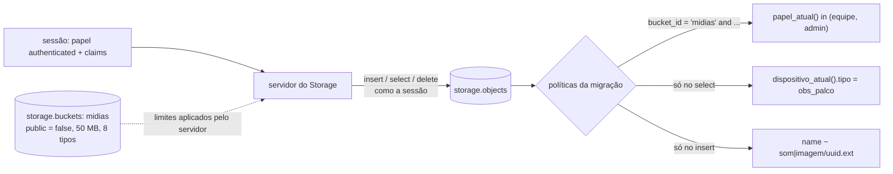

# VER-026 — E2, Tarefa 3: migração `biblioteca_storage` e testes de banco da E2

## Cabeçalho

| Campo | Valor |
|---|---|
| Id | VER-026 |
| Título | E2, Tarefa 3: migração `biblioteca_storage` (bucket privado `midias` e políticas de `storage.objects`) e testes de banco da E2 |
| Gravidade | alta |
| Tipo | implementação · segurança · banco de dados |
| Data | 2026-11-26 (data do commit, em UTC) |
| Usuário responsável | TokumoH |
| Status de implementação | implementado (nos testes e nas checagens; aplicar a migração no Supabase real é passo do responsável, Tarefa 8 do PLA-003) |
| Commits | commit que introduz este arquivo — `git log --diff-filter=A --format=%h -- docs/verificacoes/2026-11-26-026-e2-banco-biblioteca.md` |
| Arquivos | `supabase/migrations/20261126190407_biblioteca_storage.sql`, `supabase/tests/rls.test.ts`, `supabase/tests/banco.ts`, `supabase/tests/README.md`, `supabase/migrations/README.md`, `supabase/README.md`, `docs/verificacoes/README.md`, este registro (8 arquivos) |

## Problema

1. **Não havia onde guardar os sons e as imagens da Biblioteca.** A E2 do [PLA-003](../planos/2026-11-26-e2-preparar-episodio.md) envia arquivos do computador para o Storage do Supabase; sem um bucket, a aba Biblioteca (Tarefa 5) não tem destino, e criar o bucket à mão pelo painel deixaria os limites (50 MB, tipos fechados, privado) fora do versionamento e dos testes.
2. **`storage.objects` não tinha nenhuma política.** Sem política, a RLS do Storage nega tudo (nenhum envio funciona); com uma política genérica (por exemplo, "todo `authenticated`"), qualquer sessão anônima de dispositivo ou conta fora da lista enviaria e leria arquivos. O DES-001 §8 pede: só `equipe`/`admin` leem e escrevem o bucket; o `obs_palco` lê.
3. **Nada provava, no banco, as regras de que a E2 depende:** que um som ligado a um gesto não sai (`23503`), que uma imagem apagada some dos avisos sem apagá-los, que uma cena num gesto não sai, e que um `update` de título e data não mexe em `estado` nem em `gestos_ligados`.

## Era proposital?

Sim, como etapa. O PLA-001 ("Ao fim da E0") e o `supabase/migrations/README.md` (Riscos, desde a E0) deixaram as políticas de `storage.objects` para a E2, "em migrações novas". O PLA-003 decidiu a forma (D3 a D5) e a Tarefa 2 (VER-025) preparou a simulação do Storage e as checagens; a simulação tem o gatilho `protect_objects_delete`, que recusa todo `delete` direto sem `storage.allow_delete_query = 'true'` (pendência anotada no VER-025 para esta tarefa). Os 4 testes de `public` documentam o comportamento da migração de fundação (VER-010): passaram antes da migração nova, como o brief previa.

## Solução

- **Migração `20261126190407_biblioteca_storage.sql`** (texto do PLA-003, Tarefa 3, Passo 2, com o cabeçalho no padrão das anteriores):
  - `insert into storage.buckets` da linha `midias`: `public = false`, `file_size_limit = 52428800`, `allowed_mime_types` = os 8 tipos da D4 (`audio/mpeg`, `audio/wav`, `audio/ogg`, `audio/mp4`, `image/png`, `image/jpeg`, `image/webp`, `image/gif`; sem `image/svg+xml`), com `on conflict (id) do update` para um bucket criado antes pelo painel;
  - `midias_storage_le` (select: `equipe`/`admin` e o dispositivo `obs_palco`), `midias_storage_insere` (insert: `equipe`/`admin`, com `name` no formato `som/<uuid>.(mp3|wav|ogg|m4a)` ou `imagem/<uuid>.(png|jpg|webp|gif)`, uuid em minúsculas) e `midias_storage_apaga` (delete: `equipe`/`admin`), todas `to authenticated` e com `bucket_id = 'midias'` como conjunção de topo (D3 e regra da D13); sem política de `update` (D5). Nenhum `grant`, tabela ou função.
- **Testes:** bloco `E2 — Biblioteca e preparação` no fim de `supabase/tests/rls.test.ts` (22 testes, um deles acrescentado na revisão: `e2-bucket-criado-antes-fica-privado`, que roda o trecho `on conflict` lido do próprio arquivo da migração como `postgres_sim` sobre um bucket estragado; no mesmo banco e nas mesmas transações; nenhum PGlite a mais na CI). Um envio é simulado como o servidor do Storage faz: `comoSessao` com o papel `authenticated` e as claims, `insert into storage.objects (bucket_id, name, owner_id) values ('midias', $1, auth.uid()::text)`.
- **`comoSessao` ganhou a opção `deleteDoStorage`** (tipo `OpcoesDaSessao` em `banco.ts`): liga `storage.allow_delete_query = 'true'` só naquele comando, como o servidor do Storage faz em cada transação, e volta o parâmetro a vazio no fim, como as claims. O gatilho continua valendo para todos os outros testes, e `e2-storage-quem-apaga` confere o `42501` sem a opção antes de usá-la.

## Por que esta solução

- **A interface nunca decide acesso a dado** (restrição global do PLA-003): quem nega é a RLS de `storage.objects`, com as mesmas `papel_atual()` e `dispositivo_atual()` das tabelas de `public` (o servidor do Storage roda cada comando como `authenticated` com as claims da sessão).
- **Defesa em três camadas (D4):** o domínio confere os bytes (Tarefa 1), o bucket confere tamanho e tipo declarado (servidor do Storage), e a política de envio confere a pasta e a extensão do caminho, barrando `..`, subpasta, barra invertida, extensão trocada entre som e imagem, `.svg`, uuid em maiúsculas e qualquer pasta fora das duas.
- **Bucket na migração, não no painel:** os limites e o "privado" ficam versionados, testados e conferidos pelo `data-api:check` (regra do bucket da D13); o `on conflict` corrige um bucket criado antes à mão.
- **Opção explícita em `comoSessao`** em vez de desligar o gatilho: a simulação continua fiel ao Supabase (um `delete` direto sem o parâmetro dá `42501` no real) e cada teste que imita o servidor diz isso no próprio código. GRASP Pure Fabrication: a forma de falar com o banco fica em `banco.ts`; o teste só descreve o cenário.
- **Testes de `public` no mesmo bloco:** a E2 depende dessas regras da E0 (D6, D11, D2); se uma migração futura as mudar, o teste do bloco da E2 cai com o nome da regra que a Biblioteca usa.

## Por que não outras soluções

| Opção | Motivo de descarte |
|---|---|
| Criar o bucket e as políticas pelo painel do Supabase | Fora do versionamento e dos testes; plano B da D13, só se as fontes a contradissessem (VER-025: não contradisseram) |
| Desligar `protect_objects_delete` na simulação ou em `criarBanco` | O `delete` direto daria certo nos testes e `42501` no real; a pendência do VER-025 pede imitar o servidor, não afrouxar a simulação |
| Ligar `storage.allow_delete_query` para a transação inteira do teste | Valeria para os comandos seguintes do mesmo teste (inclusive os do superusuário), escondendo um `delete` que no real seria recusado; a opção vale só para o comando |
| Ajuda própria em `banco.ts` (por exemplo, `comoServidorDoStorage`) | Repetiria o savepoint, o papel e as claims de `comoSessao`; a opção reaproveita a mesma fabricação |
| Política de `update` (upsert) | D5: cada envio tem um `uuid` novo; o upsert exigiria `select`, `insert` e `update` e deixaria um envio trocar o arquivo que outra tela toca |
| `storage.foldername(name)[1] in ('som', 'imagem')` na política de envio | Confere só a pasta; a expressão regular confere também o uuid e a extensão do tipo, num lugar só |
| Testes num arquivo novo | Criaria mais um PGlite na CI (a simulação e as 3 migrações de novo); o brief pede o mesmo banco |

## Onde

| Arquivo | Linhas | O que mudou |
|---|---|---|
| [`supabase/migrations/20261126190407_biblioteca_storage.sql`](../../supabase/migrations/20261126190407_biblioteca_storage.sql#L1-L34) | 1–34 | Migração nova: cabeçalho; bucket `midias`; políticas `midias_storage_le`, `midias_storage_insere` e `midias_storage_apaga` |
| [`supabase/tests/rls.test.ts`](../../supabase/tests/rls.test.ts#L1023-L1248) | 11, 1023–1248 | Importa `MIGRACOES`; bloco `E2 — Biblioteca e preparação` (22 testes); nada mudou nos blocos anteriores |
| [`supabase/tests/banco.ts`](../../supabase/tests/banco.ts#L179-L219) | 9–10, 179–189, 200, 205, 218 | `MIGRACOES` exportada (para `e2-bucket-criado-antes-fica-privado`); tipo `OpcoesDaSessao` (`deleteDoStorage`); `comoSessao` liga e zera `storage.allow_delete_query` quando pedido |
| [`supabase/tests/README.md`](../../supabase/tests/README.md#L38) | 28, 38, 65–66, 100, 111, 125–126 | `banco.ts` com a opção; como simular envio e exclusão no Storage; `rls.test.ts` com 81 testes e o bloco E2; saída esperada 523; verificação do bloco E2; riscos (índice único de nome, `on conflict` com teste e os gatilhos reais de `storage.buckets`, limites do servidor) |
| [`supabase/migrations/README.md`](../../supabase/migrations/README.md#L54) | 14, 18, 22, 28, 54, 75, 85, 106–107 | "Arquivos", propósito, origem, schema `storage.`, linha da migração nova em "Onde", passo 6 da "Lógica" (Storage), verificação, riscos (aplicação pendente, `Content-Type` declarado, órfãos, `on conflict` e os gatilhos reais de `storage.buckets`) |
| [`supabase/README.md`](../../supabase/README.md#L68) | 18, 36, 53, 68, 113, 120, 125 | Propósito; contagens (523); as três migrações em ordem em "Onde"; passo do responsável de aplicar a terceira (caminho da E0, da E1 e da E2; quem já aplicou as duas primeiras aplica só a terceira); `migration repair` com a terceira versão; verificação; risco da aplicação pendente |
| [`docs/verificacoes/README.md`](README.md) | "Arquivos" e "Onde" | Linha deste registro (o exemplo continua em 032) |

## Lógica

| Operação | Antes (sem a migração) | Depois |
|---|---|---|
| Bucket `midias` | não existe (insert em `storage.objects` dá `23503` na chave `objects_bucketId_fkey`) | privado, 52 428 800 bytes, 8 tipos |
| Envio de `som/<uuid>.mp3` | recusado para todas as sessões | aceito para ana (`equipe`) e adm (`admin`); as outras 7 sessões: violação de RLS |
| Leitura | 0 linhas para todas | ana, adm e palco leem os 2 objetos do `midias`, nunca o do `outro`; as outras 6: 0 |
| Exclusão (com o parâmetro do servidor) | nada sai | ana e adm esvaziam o `midias`; o `outro` fica; as demais: nada muda |
| `update` | nada muda | nada muda (sem política, D5) |

## Exemplo

Antes da migração (TDD, Passo 1): `npx vitest run supabase/tests/rls.test.ts -t "E2"` → `17 failed | 4 passed` (os 17 de Storage falham: o primeiro envio dá `insert or update on table "objects" violates foreign key constraint "objects_bucketId_fkey"`; os 4 de `public` passam). Depois (com o teste da revisão): `npx vitest run supabase/tests` → `Tests 523 passed (523)`. Um envio de ana com o nome `som/0b6e2b8a-3c1d-4f2a-9e5b-1a2b3c4d5e6f.mp3.html` → `new row violates row-level security policy for table "objects"`; com `imagem/0b6e2b8a-3c1d-4f2a-9e5b-1a2b3c4d5e6f.png` → aceito. Com `false, 52428800` trocado por `true, 52428800` em memória, `verificarDataApi` dá `bucket midias (storage.buckets): público (public não é false) (...)`.

## Verificação

**TDD.** Bloco escrito antes da migração: 17 falharam e 4 passaram (os de `public`), como o brief previa. Depois da migração, os 522 testes de `supabase/tests` passaram; com o teste acrescentado na revisão, 523.

| # | Abordagem | Comando / método | Resultado |
|---|---|---|---|
| T1 | Testes de banco | `npx vitest run supabase/tests` | 523 passam (`rls.test.ts` 81, dos quais 22 do bloco E2; `restricoes.test.ts` 32; `matriz.test.ts` 410, sem mudança) |
| T2 | Checagens de banco | `npm run rpc:grants-check`, `npm run data-api:check` | 0 erros, "3 migração(ões)" cada |
| T3 | Checagens em memória | `verificarDataApi` e `verificarGrants` com as 3 migrações, a terceira com o trecho trocado | sem sabotagem: `[]` e `[]`; bucket público: 1 erro (regra do bucket); `image/svg+xml` nos tipos: 1 erro (`allowed_mime_types fora de TIPOS_DO_BUCKET: image/svg+xml`); exclusão sem `bucket_id`: 1 erro (`o using não começa pelo bucket como conjunção de topo`); leitura e envio com `is not null`: `[]` (limite registrado: a checagem confere a presença da função de papel, não o uso; quem pega são os testes de banco) |
| T4 | Projeto inteiro | `npm run check` | 0 erros (último ato, depois deste registro) |

**Sabotagens em memória** (edição temporária do laço de `criarBanco` em `banco.ts`: `replaceAll` do trecho só no arquivo alvo, com a contagem impressa e erro se o trecho faltar; suíte `npx vitest run supabase/tests --maxWorkers=2`, 522 testes; desfeita com o Edit inverso). Antes da primeira e depois da última, `git status --porcelain supabase/migrations` e `sha256sum supabase/migrations/*.sql supabase/tests/banco.ts supabase/tests/simulacao-supabase.sql` deram a mesma saída (fundação `3c82ccf7…`, segunda `81bd2fce…`, terceira `99bbdcb5…`, `banco.ts` `d6bc47ab…`, simulação `25868982…`). Cada trecho trocado ocorria 1 vez.

| # | Alvo | Sabotagem | Testes que caíram |
|---|---|---|---|
| S1 | migração nova | `false, 52428800` → `true, 52428800` | `e2-bucket-privado-com-limites` (e 1 erro no `data-api:check` em memória, T3) |
| S2 | migração nova | `'image/gif']` → `'image/gif', 'image/svg+xml']` | `e2-bucket-privado-com-limites` (e 1 erro no `data-api:check`) |
| S3 | migração nova | leitura: `in ('equipe', 'admin')\n    or` → `is not null\n    or` | `e2-storage-quem-le` (bia lê os 2; o estranho continua com papel nulo e lendo 0) |
| S4 | migração nova | envio: `... in ('equipe', 'admin')\n    and name` → `... is not null\n    and name` | `e2-storage-quem-envia` (bia envia) |
| S5 | migração nova | `and name ~ '^(som/` → `and name ~ '^(.*\|som/` (expressão válida, aceita qualquer nome) | os 11 casos de `e2-nome-fora-do-formato` |
| S6 | migração nova | `{12}\.(mp3\|wav\|ogg\|m4a)` → `{12}\.(mp3\|wav\|ogg\|m4a\|png)` | o caso `som/<UUID_A>.png` |
| S7 | migração nova | exclusão sem `bucket_id = 'midias' and ` | `e2-storage-quem-apaga` (o objeto do `outro` some; e 1 erro no `data-api:check`) |
| S8 | migração nova (extra) | envio sem `bucket_id = 'midias' and ` | `e2-outro-bucket-nao-recebe` |
| S9 | migração nova (extra) | `= 'obs_palco'` → `= 'camera'` | `e2-storage-quem-le` |
| S10 | migração nova (extra) | política de `update` a mais (`using (bucket_id = 'midias') with check (true)`) | `e2-sem-update` |
| S11 | migração nova (extra) | leitura sem `bucket_id = 'midias' and ` | `e2-storage-quem-le` |
| F1 | fundação (extra) | `mapa_gestos.som_id ... on delete set null` | `e2-som-em-gesto-nao-sai`, `chaves-estrangeiras` |
| F2 | fundação (extra) | `mapa_gestos.cena_id ... on delete set null` | `e2-cena-em-gesto-nao-sai`, `chaves-estrangeiras` |
| F3 | fundação (extra) | `on delete set null (imagem_midia_id)` → `on delete cascade` | `e2-imagem-em-aviso-vira-nulo`, `chaves-estrangeiras` |
| F4 | fundação (extra) | gatilho `before update` em `episodios` que liga `gestos_ligados` | `e2-episodio-sem-estado`, `dono-da-migracao-sem-superusuario` (a função a mais em `public`) |
| SIM | simulação (edição temporária, desfeita com o Edit inverso e conferida por `sha256sum`) | sem `alter table storage.objects enable row level security` | 16 dos 17 testes de Storage (todas as sessões leem, enviam e apagam tudo; fica só `e2-bucket-privado-com-limites`): a simulação reproduz a RLS da qual as políticas dependem |

| R1 | migração nova (revisão; troca feita na construção de `MIGRACOES` em `banco.ts`, que o teste também lê; desfeita com o Edit inverso, `sha256sum` de `banco.ts` e das migrações igual antes e depois) | `set public = false, ` → `set ` no `on conflict` | `e2-bucket-criado-antes-fica-privado` (o bucket estragado continua `public = true`) |

Com S1 a S11, F1 a F4, SIM e R1, cada um dos 22 testes do bloco E2 caiu com ao menos uma sabotagem. S8 a S11 e F1 a F4 não estavam no brief: cobrem os testes que as sabotagens do brief não alcançavam (`e2-outro-bucket-nao-recebe`, `e2-sem-update`, a leitura do palco e os 4 de `public`).

**Revisões independentes:**
- **Revisão 1** (revisor novo, só leitura; sondas numa cópia, relatório fora do repositório): spec ✅; qualidade aprovada, com 1 achado importante de teste e 2 nits. **I1:** o ramo `on conflict do update` não tinha teste, e tirar `public = false` do `set` passava em tudo → teste `e2-bucket-criado-antes-fica-privado` e sabotagem R1. **N1:** `supabase/README.md`, passo 1 de "Lógica", dizia "caminho da E0 e da E1" e não dizia que quem já aplicou as duas primeiras aplica só a terceira → corrigido, com a ordem das três conferida no restante do texto. **N2:** no real, o `on conflict do update` dispara os gatilhos de `update` de `storage.buckets`, que a simulação não tem → registrado em Riscos, aqui e nos READMEs. Tudo incorporado com reconferência pontual (`npx vitest run supabase --maxWorkers=2` e `node scripts/check-docs.mjs`), sem nova rodada, pela decisão (a) do responsável (teste a mais e documentação, sem tocar a migração nem afrouxar teste).

## Riscos

- **Não aplicada num Supabase real.** Aplicar a migração no editor SQL, depois das duas anteriores, é passo do responsável (guia na Tarefa 8 do PLA-003). Até lá o bucket não existe no projeto e os envios da Biblioteca falham.
- **`Content-Type` declarado (D4):** o servidor do Storage aplica `file_size_limit` e `allowed_mime_types` ao tamanho e ao tipo declarado no envio; um membro da equipe com acesso à API pode guardar bytes de outro tipo sob um tipo aceito, e a política de envio confere a pasta e a extensão do caminho, não o tipo (um `som/<uuid>.mp3` enviado como `image/png` passa no bucket e na política). Dano contido: bucket privado, uso só em `<audio>` e ``, quem envia já é da equipe.
- **Objetos órfãos (D6, D7):** um envio que não registra a linha em `midias`, ou uma exclusão cujo objeto não sai, deixa o objeto no bucket; ele não entra na soma do uso.
- **Simulação:** sem o índice único de nome por bucket do Storage, dois envios com o mesmo caminho dão duas linhas aqui (em `e2-storage-quem-envia`, ana e adm enviam o mesmo nome) e conflito no real; os limites do servidor do Storage não existem no PGlite (os testes conferem os valores gravados no bucket, não a recusa do envio). O ramo `on conflict do update` é exercitado por `e2-bucket-criado-antes-fica-privado` (revisão 1), mas não pela regra do bucket do `data-api:check`. No Supabase real, esse `update` também dispara os gatilhos de `update` de `storage.buckets` (por exemplo, os de colunas de ciclo de vida), que a simulação não tem: isso não foi verificado contra o real; a consulta ao bucket depois de aplicar (guia da Tarefa 8 do PLA-003) confere o resultado.
- **Presença, não uso (limite da D13):** trocar `in ('equipe', 'admin')` por `is not null` nas políticas passa nas checagens; só os testes de banco pegam (S3 e S4).
- **`deleteDoStorage`:** a opção existe só em `comoSessao`; um teste futuro que apague em `storage.objects` sem ela recebe `42501`, como no real (o comportamento esperado).
