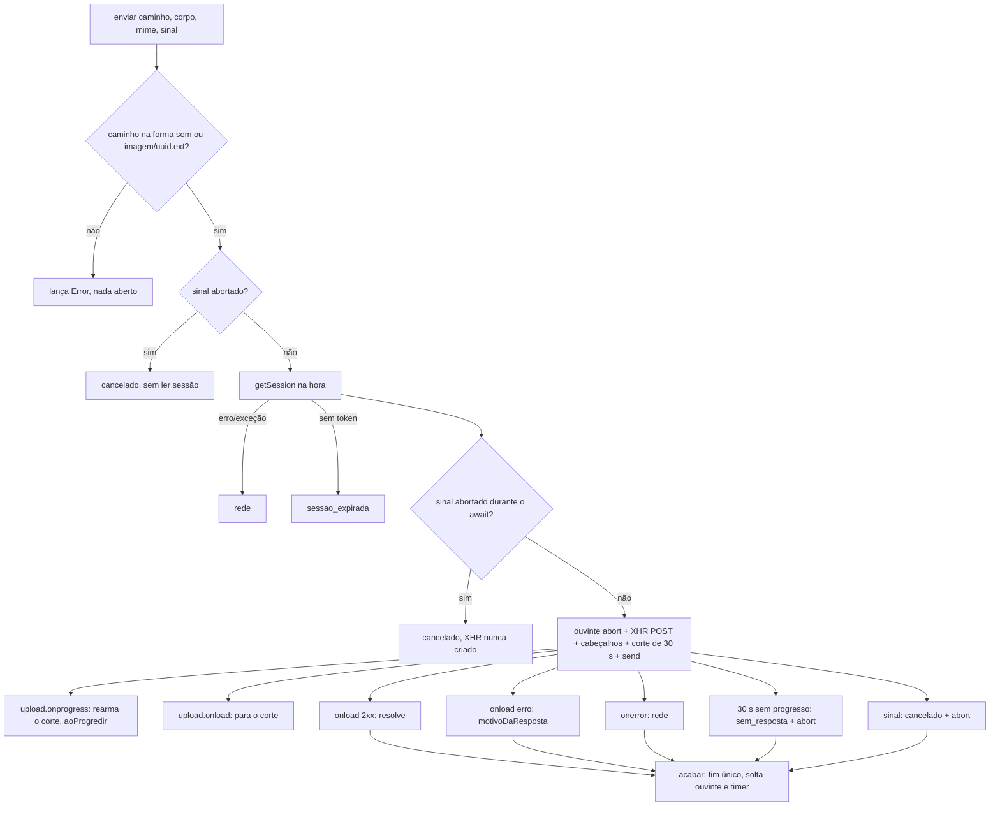

# VER-027 — E2, Tarefa 4: adaptadores Supabase da Preparação e composição

## Cabeçalho

| Campo | Valor |
|---|---|
| Id | VER-027 |
| Título | E2, Tarefa 4: adaptadores Supabase da Preparação (repositórios, envio ao Storage por `XMLHttpRequest`, tradução de erros num lugar só) e composição sobre o cliente único de membro |
| Gravidade | alta |
| Tipo | implementação · segurança · infraestrutura |
| Data | 2026-11-26 (data do commit, em UTC) |
| Usuário responsável | TokumoH |
| Status de implementação | implementado (testado com cliente Supabase falso e `XMLHttpRequest` falso; a conferência contra o Supabase real é a Tarefa 8 do PLA-003) |
| Commits | commit que introduz este arquivo — `git log --diff-filter=A --format=%h -- docs/verificacoes/2026-11-26-027-e2-adaptadores-preparacao.md` |
| Arquivos | `src/shared/infra/errosSupabase.ts`, `src/shared/infra/errosSupabase.test.ts`, `src/shared/infra/preparacaoSupabase.ts`, `src/shared/infra/preparacaoSupabase.test.ts`, `src/shared/infra/armazenamentoSupabase.ts`, `src/shared/infra/armazenamentoSupabase.test.ts`, `src/shared/infra/acessoSupabase.ts`, `src/shared/infra/acessoSupabase.test.ts`, `src/shared/infra/supabase.test.ts`, `src/shared/infra/README.md`, `src/app/servicos.ts`, `src/app/servicos.test.ts`, `src/app/dependencias.ts`, `src/app/dependencias.test.ts`, `src/app/servicosFalsos.ts`, `src/app/README.md`, `docs/verificacoes/README.md`, este registro (18 arquivos) |

## Problema

1. **As portas da Preparação não tinham implementação.** A Tarefa 1 (VER-024) declarou em [`src/domains/preparacao/portas.ts`](../../src/domains/preparacao/portas.ts) os repositórios de mídias, sons, cenas, episódios/avisos e gestos e a porta `ArmazenamentoDeMidia`; sem adaptadores, as abas da E2 (Tarefas 5 a 7) não falam com o banco nem com o bucket `midias` (VER-026).
2. **O envio de arquivo pelo SDK não serve.** No `storage-js` 2.119.0, `upload()` não aceita `AbortSignal` nem informa progresso (D8 do [PLA-003](../planos/2026-11-26-e2-preparar-episodio.md)); um envio de 50 MB numa rede ruim ficaria sem barra, sem "Cancelar" e sem corte quando trava. O `fetch` com tempo-limite de 15 s (VER-021) não alcança `/storage/v1/` de propósito, e um tempo total cortaria envios grandes saudáveis.
3. **A tradução de erros do PostgREST vivia só na E1** (`traduzirErro` em `acessoSupabase.ts`), sem `em_uso` (`23503`: som ou cena num gesto, D6/D11) nem `invalido` para `22P02`; copiar a função para a Preparação duplicaria a ordem (sessão expirada antes do `42501`), que já foi fonte de defeito na E1.
4. **A composição criava o cliente junto com os serviços de membro.** Sem guardar o cliente, montar a Preparação criaria um segundo cliente de membro na mesma página (duas sessões e dois refresh de token sobre a mesma `storageKey`), contra a restrição global "os serviços da Preparação reaproveitam o mesmo cliente".
5. **A compensação do envio depende do motivo.** `enviarMidia` (`biblioteca.ts`) decide se remove só o objeto ou tenta tirar a linha antes, conforme o motivo do erro do registro; um adaptador que deixasse passar um erro sem tradução levaria toda falha para o ramo "ambíguo".

## Era proposital?

Sim, como etapa. O PLA-003 põe estes adaptadores na Tarefa 4 ("Estrutura de arquivos") e as decisões D8 (envio por `XMLHttpRequest`, corpo bruto, erro lido como o SDK lê, corte por inatividade que para em `upload.onload`) e D10 (repositórios por agregado, sem classe genérica; `classificarErro` usado pela E1 sem mudar o comportamento) já fixavam a forma. O limite do tempo-limite fora do Storage é do VER-021 ("Envio ao Storage sem resposta (E2) continua sem tempo-limite, de propósito"), que esta tarefa não altera (teste `storage-fora-do-tempo-limite`). A guarda de cliente único vem do PLA-002 (cliente de membro preguiçoso, um por página) e é estendida aqui. Nada do comportamento da E1 foi mudado de propósito: `traduzirErro` dá o mesmo resultado para todos os casos (prova: `traduz-erros` sem mudança e `e1-traduzir-erro-sem-mudanca`).

## Solução

- **`errosSupabase.ts`** (D10): `classificarErro(erro, status)` na ordem (1) 401, `PGRST301`, `PGRST303` → `sessao_expirada` (mesmo com `42501`); (2) `23505` → `duplicado`; (3) `23503` → `em_uso`; (4) `23514` ou `22P02` → `invalido`; (5) `42501` → `negado`; (6) sem código e status 0 → `rede`; (7) `outro`. `exigirLinhas(data)`: vazio ou `null` → `ErroDePreparacao('nada_alterado')`.
- **`acessoSupabase.ts`**: `traduzirErro` passa a chamar `classificarErro` e devolve `outro` quando a classificação é `em_uso` ou é `invalido` vindo de `22P02` (o comportamento da E1). O arquivo continua com 175 linhas (âncora do plano).
- **`preparacaoSupabase.ts`**: `criarRepositoriosDePreparacao(cliente)` com um objeto por agregado. Toda consulta passa por `executar`, que traduz **todo** erro (devolvido → `classificarErro`; lançado → `outro`); todo `update`/`delete` termina em `.select(<chave>)` e 0 linhas → `nada_alterado`; episódio só manda `{ titulo, data }`; gesto passa por `normalizarGesto`; `registrar` não reconverte; linhas com `tipo`, `estado`, `gesto` ou `acao` fora do domínio são descartadas; contagem de avisos com `count: 'exact', head: true`, e sem contagem → `outro`.
- **`armazenamentoSupabase.ts`** (D8): `criarArmazenamentoSupabase(cliente, supabaseUrl, chavePublica, criarXhr?)`. O envio confere o caminho (só a forma do domínio e da política de envio: `som/<uuid>.(mp3|wav|ogg|m4a)` ou `imagem/<uuid>.(png|jpg|webp|gif)`, desde a revisão 1), o sinal, lê o `access_token` com `getSession()` na hora (erro ou exceção → `rede`; sem token → `sessao_expirada`), confere o sinal de novo depois do `await`, e abre `POST <origem>/storage/v1/object/midias/<caminho>` com `authorization`, `apikey`, `x-upsert: false`, `cache-control: max-age=3600` e `content-type` do tipo detectado; corpo = o `Blob`. Progresso por `upload.onprogress`; corte por 30 s sem progresso (`INATIVIDADE_DO_ENVIO_MS`), zerado a cada progresso e parado em `upload.onload`; cancelamento pelo `AbortSignal`; guarda de fim único (`terminou`), que também impede um progresso tardio de rearmar o corte; ouvinte e timer soltos em todo fim; `motivoDaResposta(status, corpo)` lê o `statusCode` (texto não vazio) do corpo antes do status HTTP; diferente do SDK (`statusCode || code || status`), não usa o `code` do corpo nem `statusCode` de outro tipo. `remover` e `urlDePrevia` (600 s) pelo `storage-js`, com erro devolvido ou lançado traduzido (`StorageUnknownError` → `rede`; `StorageApiError` pelo `statusCode`, depois pelo `status`).
- **`servicos.ts`**: guarda o **cliente** de membro e a configuração (`obterBase`, preguiçoso); `obterServicosDeMembro` e o novo `obterServicosDePreparacao` montam seus serviços sobre ele; `criarServicosDePreparacao(cliente, config)` compõe repositórios + armazenamento. Configuração inválida → as duas lançam `ErroDeConfiguracao` sem criar cliente.
- **`dependencias.ts`**: `Dependencias.obterPreparacao` (preguiçoso), ligado a `obterServicosDePreparacao` em `dependenciasDoNavegador`. **`servicosFalsos.ts`**: `preparacaoVazia()` e `obterPreparacao: () => preparacaoVazia()` nas dependências falsas (achado I6 da revisão do plano: o `typecheck` da tarefa passa sozinho).

## Por que esta solução

- **DDD + Pure Fabrication:** os adaptadores ficam em `src/shared/infra/` e só implementam as portas do domínio; não decidem acesso (quem nega é a RLS e as políticas de `storage.objects`, VER-026) e não conhecem tela. A ordem Storage ↔ banco e a compensação continuam no domínio (`biblioteca.ts`), que agora recebe sempre um `ErroDePreparacao` com motivo.
- **Reuso sem esconder colunas (D10):** a única coisa repetida de verdade (traduzir erro, exigir linhas) foi para `errosSupabase.ts`, usada pela E1 e pela E2; cada repositório mostra seu `select` e seus nomes de coluna.
- **Segurança:** o episódio é escrito campo a campo (nunca `estado`; foco da revisão, item 5); `x-upsert: false` (D5: sem sobrescrita); o caminho é conferido antes de abrir; o token é lido na hora e nunca registrado; o texto do servidor nunca chega ao erro (só o motivo).
- **Envio robusto (D8):** progresso e cancelamento que o SDK não oferece; corte por inatividade em vez de tempo total; o corte para quando os bytes terminam (a espera pela resposta não é cortada); fim único e limpeza de ouvinte e timer em todos os caminhos, inclusive quando o XHR não abre.
- **Cliente único:** uma sessão e um refresh de token por página; as rotas de dispositivo continuam sem criar cliente (`obterPreparacao` só é chamado dentro da guarda, Tarefas 5 a 7).

## Por que não outras soluções

| Opção | Motivo de descarte |
|---|---|
| `storage.from('midias').upload()` | Sem `AbortSignal` e sem progresso no 2.119.0 (D8) |
| Envio retomável (TUS) | Dependência nova (`tus-js-client`) ou reimplementar o protocolo; o limite é 50 MB e o envio refeito do início, com progresso e cancelamento, basta por ora (D8) |
| `fetch` com `AbortSignal` | Cancela, mas não informa progresso de envio (D8) |
| Corte por tempo total | Cortaria um envio grande e saudável numa rede lenta (D8; sabotagem S3) |
| Pôr o Storage no `fetch` com 15 s | Mesmo motivo; e mudaria o VER-021 (teste `storage-fora-do-tempo-limite`) |
| Copiar `traduzirErro` para a Preparação | Duas cópias da ordem de tradução (D10) |
| Mudar `traduzirErro` para também dar `em_uso`/`invalido` com `22P02` | Mudaria o comportamento da E1 (`MotivoDoErro` não tem `em_uso`); sabotagem S10 |
| `RepositorioSupabase<T>` genérico | Esconde nomes de coluna e o `select` de cada tabela (D10 do PLA-003, D6 do PLA-002) |
| Guardar o token na criação do adaptador | O auth-js renova a sessão; um token velho daria 401 no meio da preparação (sabotagem S5) |
| Segundo cliente de membro para a Preparação | Duas sessões e dois refresh sobre a mesma `storageKey` (sabotagem S13) |
| Deixar passar erro lançado sem tradução | A compensação do envio cairia sempre no ramo "ambíguo" (S16, S17) |

## Onde

| Arquivo | Linhas | O que mudou |
|---|---|---|
| [`src/shared/infra/errosSupabase.ts`](../../src/shared/infra/errosSupabase.ts#L1-L43) | 1–43 | Novo: `MotivoComum`, `classificarErro` (L26), `exigirLinhas` (L41) |
| [`src/shared/infra/errosSupabase.test.ts`](../../src/shared/infra/errosSupabase.test.ts#L1-L59) | 1–59 | Novo: `traduz-erros-da-preparacao` e `exigirLinhas` |
| [`src/shared/infra/acessoSupabase.ts`](../../src/shared/infra/acessoSupabase.ts#L7-L34) | 7–34 | `traduzirErro` por `classificarErro`, com `em_uso` e `22P02` → `outro` |
| [`src/shared/infra/acessoSupabase.test.ts`](../../src/shared/infra/acessoSupabase.test.ts#L347-L353) | 4–5, 347–353 | Import de `classificarErro` e teste `e1-traduzir-erro-sem-mudanca` |
| [`src/shared/infra/preparacaoSupabase.ts`](../../src/shared/infra/preparacaoSupabase.ts#L1-L322) | 1–322 | Novo: `executar`, `escreverComRetorno`, os cinco repositórios e `criarRepositoriosDePreparacao` (L314) |
| [`src/shared/infra/preparacaoSupabase.test.ts`](../../src/shared/infra/preparacaoSupabase.test.ts#L1-L295) | 1–295 | Novo: 9 testes com cliente falso |
| [`src/shared/infra/armazenamentoSupabase.ts`](../../src/shared/infra/armazenamentoSupabase.ts#L1-L193) | 1–193 | Novo: constantes (L6–L15), forma do caminho (L16–L23), `motivoDaResposta` (L42), `criarArmazenamentoSupabase` (L75) |
| [`src/shared/infra/armazenamentoSupabase.test.ts`](../../src/shared/infra/armazenamentoSupabase.test.ts#L1-L518) | 1–518 | Novo: 50 testes com `XMLHttpRequest` falso e timers falsos |
| [`src/shared/infra/supabase.test.ts`](../../src/shared/infra/supabase.test.ts#L110-L121) | 7, 110–121 | Teste `storage-fora-do-tempo-limite` |
| [`src/app/servicos.ts`](../../src/app/servicos.ts#L1-L75) | 1–75 | Cliente guardado (`obterBase`), `criarServicosDePreparacao` (L35), `obterServicosDePreparacao` (L69) |
| [`src/app/servicos.test.ts`](../../src/app/servicos.test.ts#L82-L117) | 82–117 | 3 testes: 1 `createClient` nas duas ordens; configuração inválida nas duas |
| [`src/app/dependencias.ts`](../../src/app/dependencias.ts#L14-L19) | 3, 6, 14–19, 45, 49 | `obterPreparacao` na interface e em `dependenciasDoNavegador` |
| [`src/app/dependencias.test.ts`](../../src/app/dependencias.test.ts#L32) | 5, 32 | `obterPreparacao` é `obterServicosDePreparacao` |
| [`src/app/servicosFalsos.ts`](../../src/app/servicosFalsos.ts#L17-L41) | 1–7, 17–41, 165 | `preparacaoVazia()` e `obterPreparacao` nas dependências falsas |
| [`src/shared/infra/README.md`](../../src/shared/infra/README.md) | várias | Três arquivos novos, D8, D10, contagens e riscos |
| [`src/app/README.md`](../../src/app/README.md) | várias | Composição com o cliente único, `obterPreparacao`, `preparacaoVazia`, contagens |
| [`docs/verificacoes/README.md`](README.md) | "Arquivos", "Onde" | Linha deste registro (o exemplo continua em 032) |

## Lógica

Envio de um arquivo (`ArmazenamentoDeMidia.enviar`):

| Passo | Antes | Depois |
|---|---|---|
| Portas da Preparação | só interfaces (VER-024) | repositórios e armazenamento sobre o supabase-js |
| Tradução de erros | `traduzirErro` só da E1 | `classificarErro` comum; E1 igual; Preparação com `em_uso` e `22P02` → `invalido` |
| Envio de arquivo | não existia | `XMLHttpRequest` com progresso, cancelamento e corte por inatividade |
| Composição | cliente criado junto com os serviços de membro | cliente guardado; membro e Preparação sobre ele |
| Dependências das telas | `obterServicos` | `obterServicos` + `obterPreparacao` (preguiçoso) |

## Exemplo

- **Episódio:** a tela chama `alterar('e1', { titulo: 'Novo', data: '2026-12-10', estado: 'ao_vivo', ... })` (objeto inteiro). Antes (sabotagem S1, `update(e)`): o `update` levaria `estado: 'ao_vivo'`. Depois: `update({ titulo: 'Novo', data: '2026-12-10' }).eq('id', 'e1').select('id')`, com exatamente duas chaves (teste `episodio-so-titulo-e-data`).
- **Corte por inatividade:** progresso em t = 29 999 ms zera a contagem; nada até t = 59 998 ms; em t = 59 999 ms (30 000 ms desde o progresso) `xhr.abort()` e `sem_resposta`, com 0 timers depois; um `onload` 200 e um progresso tardios não mudam o resultado nem rearmam o corte (teste `envio-sem-progresso-corta`).
- **Resposta do Storage:** HTTP 400 com `{"statusCode":"403","message":"new row violates row-level security policy"}` → `negado` (pelo status HTTP seria `invalido`); a mensagem do erro é só `Erro de preparação: negado` (teste `envio-respostas`).
- **Cliente único:** `obterServicosDePreparacao()` e depois `obterServicosDeMembro()` na mesma página → `createClient` chamado 1 vez, com `storageKey: 'revocast-auth-membro'` (antes da mudança, um segundo cliente; sabotagem S13 → 2).

## Verificação

**TDD.** Os testes novos foram escritos antes do código: `npx vitest run src/shared/infra src/app/servicos.test.ts src/app/dependencias.test.ts` deu 5 arquivos com falha (os três adaptadores inexistentes, `acessoSupabase.test.ts` sem `errosSupabase` e `servicos.test.ts`/`dependencias.test.ts` sem `obterServicosDePreparacao`). Depois da implementação, todos passam.

| # | Abordagem | Comando / método | Resultado |
|---|---|---|---|
| T1 | Testes da tarefa | `npx vitest run src/shared/infra src/app` | 15 arquivos, 208 testes passam (`src/shared/infra`: 7 arquivos, 111 testes; `armazenamentoSupabase` 50, eram 45 antes da revisão 1; `preparacaoSupabase` 9, `errosSupabase` 2, `acessoSupabase` 15, `supabase` 8) |
| T2 | E1 sem mudança | `traduz-erros` (inalterado) e `e1-traduzir-erro-sem-mudanca` | passam; `traduzirErro` dá `outro` para `22P02` e `23503`, `classificarErro` dá `invalido` e `em_uso` |
| T2b | E1 sem mudança, por outra abordagem | teste temporário (criado e apagado fora do commit) que importa o `traduzirErro` anterior (cópia do arquivo de antes, guardada no scratchpad) e o novo e compara os motivos em 308 combinações (14 códigos, inclusive ausente, `''`, `23503`, `22P02`, `PGRST301/303`; 11 status, inclusive ausente e 0; erro objeto e `null`) | 308 iguais |
| T3 | Tipos | `npm run typecheck` | 0 erros (inclusive `servicosFalsos.ts` com `obterPreparacao`) |
| T4 | Segredos | `npm run check-doc-secrets` | 1ª rodada: 5 falsos positivos da regra "atribuição de credencial" (nos testes, um token falso de 11 caracteres atribuído a `access_token` e o parâmetro de URL assinada com 8; no adaptador, a constante do token atribuída a partir de `resultado`) → valores de teste trocados por `sigilo7` e `token=abc`, variável renomeada para `jwt`; depois, 0 erros. As 23 sabotagens foram executadas de novo sobre o código final, com o mesmo resultado |
| T5 | Projeto inteiro | `npm run check` | 0 erros (último ato, depois deste registro) |

**Sabotagens** (script fora do repositório: cópia do arquivo alvo guardada no scratchpad, troca de um trecho que ocorre 1 vez, `npx vitest run <arquivo de teste>` com relatório JSON, restauração da cópia e `sha256sum` igual antes e depois em todas; nenhum `git checkout`/`restore`/`stash`):

| # | Alvo | Sabotagem | Testes que caíram |
|---|---|---|---|
| S1 | `preparacaoSupabase.ts` | `update(e)` com o episódio inteiro | `episodio-so-titulo-e-data` |
| S2 | `preparacaoSupabase.ts` | `remover` de cena sem `.select('id')` | `escrita-com-retorno` |
| S3 | `armazenamentoSupabase.ts` | corte por tempo total (progresso não rearma) | `envio-sem-progresso-corta` |
| S4 | `armazenamentoSupabase.ts` | sem `removeEventListener` | `envio-solta-ouvinte`, `envio-sem-progresso-corta`, `falha-ao-montar-o-envio-solta-tudo` |
| S5 | `armazenamentoSupabase.ts` | token guardado do primeiro envio | `envio-token-na-hora` |
| S6 | `armazenamentoSupabase.ts` | sem a segunda conferência do sinal | `cancelar-durante-sessao` |
| S7 | `armazenamentoSupabase.ts` | corte não para em `upload.onload` | `corte-para-no-fim-do-envio` |
| S8 | `armazenamentoSupabase.ts` | só o status HTTP (ignora `statusCode` do corpo) | 8 casos de `envio-respostas` (RLS no corpo, já existe, token no corpo, bucket inexistente; por `motivoDaResposta` e pelo XHR) |
| S9 | `armazenamentoSupabase.ts` | sem a guarda de fim único em `acabar` | `envio-sem-progresso-corta` |
| S10 | `acessoSupabase.ts` | `22P02` → `invalido` também em `traduzirErro` | `e1-traduzir-erro-sem-mudanca` |
| S11 | `armazenamentoSupabase.ts` | `x-upsert: true` | `envio-cabecalhos` |
| S12 | `errosSupabase.ts` | `42501` antes do 401 | `traduz-erros-da-preparacao` |
| S13 | `servicos.ts` | segundo cliente para a Preparação | os 2 testes de 1 `createClient` |
| S14 | `armazenamentoSupabase.ts` (extra) | progresso depois do fim rearma o corte | `envio-sem-progresso-corta` |
| S15 | `preparacaoSupabase.ts` (extra) | contagem nula vira 0 | `contar-avisos-com-imagem` |
| S16 | `preparacaoSupabase.ts` (extra) | erro lançado pelo PostgREST sem tradução | `erro-lancado-vira-erro-de-preparacao` |
| S17 | `armazenamentoSupabase.ts` (extra) | falha ao montar o XHR sem limpar | `falha-ao-montar-o-envio-solta-tudo` |
| S18 | `armazenamentoSupabase.ts` (extra) | `getSession` com erro, mas usando o token | `envio-sem-sessao` |
| S19 | `errosSupabase.ts` (extra) | `23503` sem `em_uso` | `traduz-erros-da-preparacao` |
| S20 | `armazenamentoSupabase.ts` (extra) | URL com `supabaseUrl` (barra no fim) em vez da origem | `envio-cabecalhos` |
| S21 | `preparacaoSupabase.ts` (extra) | mídia de tipo desconhecido não descartada | `listar-converte` |
| S22 | `preparacaoSupabase.ts` (extra) | gesto ou ação desconhecidos não descartados | `listar-converte` |
| S23 | `preparacaoSupabase.ts` (extra) | gesto sem `normalizarGesto` | `gesto-manda-alvos-normalizados` |
| R1 | `armazenamentoSupabase.ts` (revisão 1, N1) | volta a `/^[a-z0-9/.-]+$/` | `envio-cabecalhos`, na primeira entrada da lista: `imagem/../../outro/x.png: expected 'pendente' to be 'caminho inválido'` (o caminho só em minúsculas, recusado pela forma) |
| R3 | `armazenamentoSupabase.ts` (revisão 1, N3) | `statusCode` vazio aceito | os 2 casos `statusCode vazio conta como ausente` de `envio-respostas` |
| R4 | `armazenamentoSupabase.ts` (revisão 1, N4) | sem `&& e.total > 0` | `envio-com-progresso` |
| R5 | `armazenamentoSupabase.ts` (revisão 1, N5) | `xhr.abort()` antes de `acabar` | `decide-o-fim-antes-do-abort` |

S1 a S13 são as do brief; cada uma derrubou o teste previsto. S14 a S23 cobrem o que o brief não pedia (guarda no progresso, contagem nula, erro lançado, XHR que não abre, `getSession` com erro, origem, descarte de linhas e normalização do gesto). Nenhuma sabotagem passou sem derrubar teste. Limite anotado: com HTTP 400, os casos `statusCode` "413", "415" e "422" no corpo dão `invalido` também pelo status HTTP, então só os casos "403", "409", "401" e "404" distinguem a ordem corpo → HTTP (S8).

**Revisões independentes:**
- **Revisão 1** (revisor novo, só leitura; sondas e sabotagens numa cópia): spec ✅; qualidade aprovada, com 5 nits, incorporados com reconferência pontual, sem nova rodada, pela decisão (a) do responsável (o N1 só deixa a regra mais estrita; os demais são testes a mais e documentação, mais o `statusCode` vazio do N3, que passa a valer como ausente):
  - **N1:** a forma do caminho deixava passar `.`/`..` (`imagem/../../outro/x.png` abria uma URL que o `URL` normaliza para fora do bucket; não explorável, porque o caminho vem só de `caminhoDaMidia` e a política exige o formato). A regra passou à forma exata da política de envio da migração; o teste `envio-cabecalhos` lista o caso em minúsculas (antes, `../imagem/<uuid>.PNG` só caía pela maiúscula) e outros 12 recusados, e confere que os 8 formatos do domínio passam; sabotagem R1.
  - **N2:** JWT expirado recusado pelo Storage (`InvalidJWT`, `statusCode` "400" ou "403") vira `invalido`/`negado`, não `sessao_expirada` → registrado em Riscos, para conferir na Tarefa 8.
  - **N3:** escolhida a segunda opção (descrever o que o código faz), com um ajuste mínimo: `statusCode` vazio conta como ausente e vale o status HTTP (como `motivoDoStorage` já fazia); não alinhado ao SDK por inteiro porque cair para o `code` do corpo (`InvalidJWT`) esconderia o status HTTP, que é melhor reserva. Frase corrigida aqui, no comentário do código e no README; testes `statusCode vazio conta como ausente` e `code do corpo não é usado`; sabotagem R3.
  - **N4:** `progredir(0, 0, true)` em `envio-com-progresso` prova que `aoProgredir` não recebe `NaN`; sabotagem R4.
  - **N5:** teste `decide-o-fim-antes-do-abort` com um XHR falso cujo `abort()` dispara `onerror` e `onload` 200 na hora: o resultado continua `cancelado` e `sem_resposta`; sabotagem R5.
  - Reconferência: `npx vitest run src --maxWorkers=2`, `npm run typecheck`, `node scripts/check-docs.mjs`; as 16 sabotagens de `armazenamentoSupabase.ts` (S3–S9, S11, S14, S17, S18, S20, R1, R3–R5) refeitas sobre o código final, cada uma derrubando o teste indicado.

Nits corrigidos (não zeram a contagem): `src/shared/infra/README.md`, seção "Lógica": a frase sobre `criarClienteSupabase` omitia o `global.fetch` desde o VER-021; corrigida nesta tarefa, com reconferência pontual por `npm run check-docs`.

## Riscos

- **Sem projeto real:** os adaptadores foram testados com um cliente Supabase falso e um `XMLHttpRequest` falso, que imitam as respostas do supabase-js 2.119.0 lidas no código (`handleError` do `storage-js`, `dist/index.mjs` linha 326; falha de `fetch` do `postgrest-js`, que devolve `code: ''` e status 0). O CORS do Storage para os cabeçalhos do XHR, o `statusCode` no corpo das respostas reais e o envio de 50 MB ficam para a conferência real (Tarefa 8 do PLA-003).
- **JWT expirado recusado pelo Storage** (revisão 1, N2): o Storage costuma responder token inválido ou expirado com `InvalidJWT` e `statusCode` "400" (ou "403" em versões novas), que viram `invalido` ou `negado`, não `sessao_expirada`. Mitigado pelo `getSession()` na hora de cada envio (o auth-js renova perto do vencimento); a conferir na Tarefa 8 e, se confirmado, mapear `InvalidJWT` → `sessao_expirada`.
- **Prévia e remoção sem tempo-limite** (restrição global do PLA-003): `createSignedUrl` e `remove` passam pelo `fetch` do cliente sem limite; uma prévia que não carrega só deixa a prévia vazia; uma remoção pendurada segura a tela até a rede responder.
- **Espera depois dos bytes:** depois de `upload.onload`, só a resposta, um erro de rede ou o "Cancelar" terminam o envio (D8); um servidor que receba tudo e nunca responda segura a tela até a pessoa cancelar.
- **Objeto gravado e cancelado:** se o "Cancelar" ou o corte vierem depois de o servidor gravar o objeto, o objeto existe; `enviarMidia` tenta removê-lo de boa-fé (D6, VER-024); o que essa remoção não alcançar fica órfão.
- **Formato da resposta do Storage:** o adaptador lê o `statusCode` **texto, não vazio**, do corpo (o caso que o `storage-js` 2.119.0 recebe), não o `code` do corpo; um `statusCode` numérico ou vazio é ignorado e vale o status HTTP. O SDK lê `statusCode || code || status`, então os dois só divergem nesses casos raros. Uma versão futura do serviço pode mudar isso.
- **`classificarErro` recebe `message` e `name` sem usá-los** (a interface do plano os aceita para receber o erro como vem); a mensagem nunca decide nem sai.
- **`servicosFalsos.preparacaoVazia`** resolve tudo sem efeito: os testes de tela da Preparação (Tarefa 5 em diante) precisam de `criarFalsosDePreparacao`, que a Tarefa 5 acrescenta.
