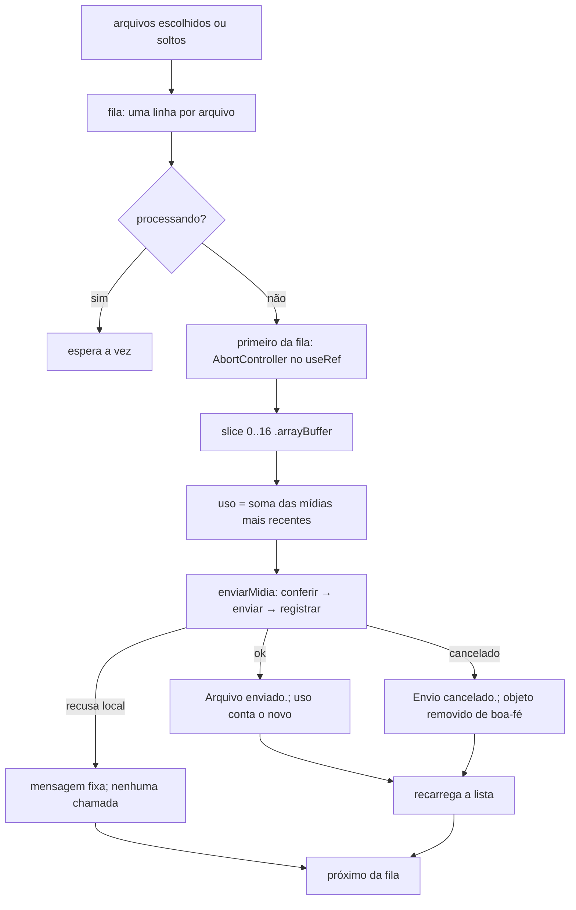

# VER-028 — E2, Tarefa 5: aba Biblioteca

## Cabeçalho

| Campo | Valor |
|---|---|
| Id | VER-028 |
| Título | E2, Tarefa 5: aba Biblioteca no `/painel` (uso do limite, envio em fila com progresso e cancelamento, sons, prévia e exclusão segura), `BarraDeProgresso` e falsos com estado da Preparação |
| Gravidade | alta |
| Tipo | implementação · interface · segurança |
| Data | 2026-11-26 (data do commit, em UTC) |
| Usuário responsável | TokumoH |
| Status de implementação | implementado (testado com os falsos das portas e conferido no Chromium com Supabase e Storage interceptados; a conferência contra o Supabase real é a Tarefa 8 do PLA-003) |
| Commits | commit que introduz este arquivo — `git log --diff-filter=A --format=%h -- docs/verificacoes/2026-11-26-028-e2-aba-biblioteca.md` |
| Arquivos | `src/app/telas/AbaBiblioteca.tsx`, `src/app/telas/AbaBiblioteca.test.tsx`, `src/app/telas/Painel.tsx`, `src/app/telas/Painel.test.tsx`, `src/app/telas/README.md`, `src/app/servicosFalsos.ts`, `src/app/README.md`, `src/shared/ui/BarraDeProgresso.tsx`, `src/shared/ui/README.md`, `src/shared/styles/base.css`, `src/shared/styles/README.md`, `docs/verificacoes/README.md`, este registro (13 arquivos) |

## Problema

1. **A aba Biblioteca era provisória.** O `/painel` mostrava "Em construção — etapa E2" na aba Biblioteca. O domínio (VER-024), o bucket `midias` com as políticas (VER-026) e os adaptadores (VER-027) já existiam, mas a equipe não tinha como enviar, ouvir, rotular nem excluir sons e imagens.
2. **Riscos próprios da tela** (Foco da revisão do [PLA-003](../planos/2026-11-26-e2-preparar-episodio.md), itens 1, 2, 8, 9 e 10):
   - chamar o envio antes de conferir o arquivo;
   - enviar vários arquivos em paralelo, o que estoura o uso de 1 GB sem conferir entre um e outro;
   - "Cancelar" que só esconde a linha e deixa o envio registrar;
   - pedir URL assinada para toda a lista ao abrir a aba;
   - deixar excluir um som ligado a gesto;
   - mostrar o nome do arquivo como HTML;
   - não reavaliar o acesso quando a escrita volta negada.
3. **Os testes de tela não tinham falsos com estado da Preparação.** A Tarefa 4 deixou só `preparacaoVazia()`. Sem um envio falso que emite progresso, respeita o `AbortSignal` e pode ser segurado, não dava para provar a fila, o progresso e o cancelamento.

## Era proposital?

Sim, como etapa. O PLA-003 põe a aba na Tarefa 5 ("Estrutura de arquivos") e já fixava o resto:

- a ordem Storage ↔ banco (D6);
- o uso pela soma de `midias.tamanho_bytes`, com aviso a 80 % (D7);
- a mídia em uso, com o bloqueio do som em gesto e a confirmação do número de avisos (D11).

O brief da tarefa citava `tamanho` em `ArquivoEscolhido`. O contrato commitado na Tarefa 1 não tem esse campo (o tamanho vem de `corpo.size`), e a tela segue o contrato commitado: monta só `{ nome, inicio, corpo }`.

O teste `aba-provisoria` de `Painel.test.tsx` clicava em "Biblioteca" para ver "Em construção". Essa era a frase provisória que esta tarefa substitui de propósito, e o teste passou a clicar em "Cenas", que continua provisória até a Tarefa 6.

## Solução

- **`AbaBiblioteca.tsx`**. Recebe `{ servicos, usuario, reavaliar }`.
  - **Carga:** `midias.listar()`, `sons.listar()` e `gestos.listar()` juntos; só a leitura mais recente aplica. Se a carga falha: mensagem fixa e "Tentar de novo"; com `sessao_expirada`, também `reavaliar()`.
  - **Uso:** "N,N MB de 1 GB" (MB = 10⁶, coerente com `LIMITE_TOTAL_BYTES` = 10⁹), mais o aviso "A biblioteca passou de 80 % do limite grátis." quando `usoDaBiblioteca().alerta`.
  - **Área de envio:** `<input type="file" accept="audio/mpeg,audio/wav,audio/ogg,audio/mp4,image/png,image/jpeg,image/webp,image/gif" multiple>`, com `<label>` "Enviar sons e imagens" e `drop` nativo (classe `envio--arrastando`). O campo fica desabilitado até a carga.
  - **Fila:** cada arquivo vira uma linha com o nome de exibição, uma barra (`BarraDeProgresso`, rótulo "Envio de <nome>") e "Cancelar". Envia **um de cada vez**. Antes de cada envio, a tela:
    - lê os primeiros bytes (`arquivo.slice(0, BYTES_PARA_DETECTAR).arrayBuffer()`);
    - calcula o uso com os dados mais recentes, contando também o arquivo que acabou de subir;
    - chama `enviarMidia` com `gerarId: () => crypto.randomUUID()`.

    Depois de cada envio, a lista é recarregada.
  - **Cancelamento:** o `AbortController` de cada envio fica num `useRef`. O "Cancelar" o aborta (o domínio remove o objeto de boa-fé e não registra), e a desmontagem aborta todos. Um item ainda na fila sai da fila sem nenhuma chamada.
  - **Desfechos na fila (revisão 1):**
    - recusa do domínio ou falha do envio: a linha fica na fila com o nome de exibição, a mensagem fixa do motivo e "Dispensar" (I1). A região de alerta anuncia a mensagem sem mover o foco. Se o foco estava no "Cancelar" da linha, vai para o "Dispensar". "Dispensar" tira a linha e põe o foco no campo de arquivos;
    - `sessao_expirada` ou `negado`/`nada_alterado`: a fila para. A linha e os itens que esperavam ficam com a mensagem ("A sessão expirou. Entre de novo e envie outra vez." ou a de `mudou`), sem tentar enviar (N4). Na sessão expirada, a fila não recarrega a lista: uma leitura também recusada chamaria `reavaliar()` de novo, então ele é chamado uma vez só (N-A da re-revisão). Em `negado`/`nada_alterado`, a lista recarrega, porque a regra do brief é mensagem + `reavaliar()` + recarga e o papel ou a biblioteca pode ter mudado;
    - depois que o `enviar` do armazenamento resolve (os bytes estão no Storage), a linha mostra "Registrando…" sem botão, porque abortar não teria mais efeito (N5). A tela passa ao domínio o armazenamento com esse aviso por cima do `enviar`; se o foco estava no "Cancelar", vai para o campo de arquivos;
    - enquanto houver item pendente (esperando, enviando ou registrando), aparece o texto fixo "Trocar de aba ou sair da página cancela os envios." junto da fila. Um ouvinte de `beforeunload` (com `preventDefault`) fica registrado nesse período e sai quando nada fica pendente ou na desmontagem (I2). Linhas só com falha não contam como pendentes.
  - **Sons:** rótulo, emoji e volume (0–100 % num `<input type="range">`, com `<output>`), salvos com "Salvar" depois de `conferirSom`.
  - **Prévia:** "Ouvir" e "Ver" pedem a URL assinada só no clique. A URL só é aceita se for `https:` ou `http:`. Os elementos são `<audio controls preload="none">` e ``. O mesmo botão vira "Ocultar prévia".
  - **Exclusão:** "Excluir" abre uma confirmação na linha que diz os usos (D11):
    - som em gesto: "Usado no gesto 👍". O botão "Confirmar exclusão" fica desabilitado, e o handler também recusa;
    - imagem: "N avisos perdem a imagem", pela contagem de `contarAvisosComImagem`;
    - sem uso: "Não está em uso.".

    A exclusão passa por `excluirMidia`: a linha sai antes do arquivo (D6). Se `arquivoFicou`, aparece "Excluído da biblioteca; o arquivo ficou no armazenamento.".
  - **Mensagens:** são as fixas do brief (`TEXTO_DA_BIBLIOTECA`), em regiões `status`/`alert` sempre montadas. `negado`/`nada_alterado` → mensagem, `reavaliar()` e recarga; `sessao_expirada` → `reavaliar()`; `rede`/`outro` → "Não foi possível concluir. Tente de novo.".
  - **Foco previsível** (WCAG 2.4.3):
    - "Excluir" → "Manter"; "Manter" → "Excluir";
    - "Salvar" → o próprio "Salvar";
    - exclusão concluída, ou "Cancelar" de uma linha que some → a região de status;
    - erro de uma ação da pessoa → a região de alerta.

    Desfechos assíncronos da fila não roubam o foco: os avisos são anunciados pelas regiões vivas.
- **`Painel.tsx`**. `ConteudoDoPainel` recebe `obterPreparacao` e guarda os serviços com `useState(obterPreparacao)`: uma vez, dentro da guarda, sobre o mesmo cliente de membro (VER-027). A aba "Biblioteca" mostra `AbaBiblioteca`.
- **`BarraDeProgresso.tsx`**. `<progress max={1} value aria-label>` mais a porcentagem visível, escondida do leitor de tela. A fração fica presa entre 0 e 1, e `NaN` vira 0.
- **`servicosFalsos.ts`**:
  - `criarFalsosDePreparacao(inicial)`. Repositórios com estado e chamadas anotadas (inclusive `previa`) antes de uma falha programada (`falharProxima('<porta>.<método>', erro)`). `midias.remover` recusa som em gesto (`em_uso`) e tira em cascata o som e a imagem dos avisos. O envio emite progresso antes de resolver, rejeita `cancelado` no abort e pode ficar segurado (`segurarEnvio()` → `progredir`, `concluir`).
  - `arquivoDeTeste(tipo, nome, tamanho?)`. Bytes mágicos e enchimento, em memória. O `File.type` vem da extensão do nome, como no navegador; assim um HTML chamado `.png` chega como `image/png` e a tela precisa decidir pelos bytes.
- **`base.css`**. Classes `.biblioteca`, `.uso`, `.envio` (com `--arrastando`), `.fila`, `.barra-de-progresso`, `.lista-de-midias`, `.campo--curto` e `.previa`, só com variáveis de `tokens.css`.

## Por que esta solução

- **DDD + Pure Fabrication + Componentes:** a tela não decide regra. Tipo, limites, caminho, uso, mídia em uso e a ordem Storage ↔ banco são do domínio (`midia.ts`, `usos.ts`, `biblioteca.ts`). A tela só escolhe o que mostrar e traduz motivos em textos fixos. `BarraDeProgresso` é componente reutilizável em `shared/ui` (as Tarefas 6–7 e a E3 podem usar).
- **Fila sequencial com reconferência:** o domínio confere `uso + tamanho ≤ 1 GB` com o uso que recebe. Enviar em paralelo daria a todos o mesmo uso antigo, e dois arquivos que cabem um de cada vez passariam juntos do limite (teste `uso-reconferido-entre-envios`).
- **Prévia só no clique:** cada URL assinada é um pedido ao Storage e vale 600 s. Pedir para a lista inteira ao abrir a aba gastaria pedidos e deixaria URLs vencidas na tela.
- **Foco com `useLayoutEffect`:** a primeira versão usava `useEffect`, como a aba Membros, e o teste de foco falhou de forma intermitente (3 falhas em cerca de 40 execuções do arquivo). Uma renderização fora de evento (o fim de uma escrita, depois de `await`) roda os efeitos passivos depois da pintura, e o aviso aparecia com o foco ainda no `<body>`. Com `useLayoutEffect`, o foco muda no mesmo commit que mostra o aviso: 25 execuções seguidas sem falha.

## Por que não outras soluções

| Opção | Motivo de descarte |
|---|---|
| Enviar os arquivos em paralelo | O uso não é reconferido entre um e outro (D7); a sabotagem derruba `fila-um-de-cada-vez`, `cancelar-na-fila` e `uso-reconferido-entre-envios` |
| "Cancelar" que só tira a linha da tela | O envio continua e registra a mídia; a sabotagem derruba `cancelar-envio` |
| URL assinada para todas as mídias ao carregar | Pedidos e URLs vencidas sem necessidade; a sabotagem derruba `previa-so-ao-pedir` |
| Manter a aba montada (escondida) ao trocar de aba, para não cancelar envios | O componente `Abas` (E1) só monta o painel ativo, e mudar isso afetaria todas as abas; registrado em Riscos |
| Uso visual com `<meter>` além do texto | Não pedido pelo plano; o texto e o aviso a 80 % bastam |
| Só a região de aviso para os desfechos da fila (versão anterior à revisão 1) | Com vários arquivos, uma recusa sumia atrás do sucesso do seguinte (I1); a mensagem fixa agora fica também na linha, ao lado do nome |
| Subir a fila para o `ConteudoDoPainel`, para sobreviver à troca de aba | Mudança maior em `Painel`; a revisão 1 aceitou a mitigação mínima (aviso fixo e `beforeunload`, I2) |
| `useEffect` para o foco (como a aba Membros) | Foco intermitente no `<body>` depois de escritas assíncronas (ver acima) |

## Onde

| Arquivo | Linhas | O que mudou |
|---|---|---|
| [`src/app/telas/AbaBiblioteca.tsx`](../../src/app/telas/AbaBiblioteca.tsx#L16) | 1–769 | Novo: `TEXTO_DA_BIBLIOTECA` (L16), desmontagem aborta os envios (L186), `beforeunload` (L199), foco por `useLayoutEffect` (L206), `tratarErro` (L231), `desfechoDoErro` (L266), `enviarItem` (L291), `marcarFalha` (L341), `processarFila` (L354), `aoCancelar` (L387), `aoDispensar` (L400), `aoPedirExclusao` (L474), `aoConfirmarExclusao` (L496), `aoAlternarPrevia` (L522), `confirmacaoDe` (L553) |
| [`src/app/telas/AbaBiblioteca.test.tsx`](../../src/app/telas/AbaBiblioteca.test.tsx) | 1–623 | Novo: 33 testes (23 da primeira versão, 8 da revisão 1 e 2 da re-revisão) |
| [`src/app/telas/Painel.tsx`](../../src/app/telas/Painel.tsx#L50) | 50, 66 | `useState(obterPreparacao)` e a aba Biblioteca real |
| [`src/app/telas/Painel.test.tsx`](../../src/app/telas/Painel.test.tsx) | 1–142 | `abrirPainel` aceita dependências extras; `aba-provisoria` passa a usar "Cenas"; novo `biblioteca-no-painel` |
| [`src/app/servicosFalsos.ts`](../../src/app/servicosFalsos.ts#L232) | 219–527 | `criarFalsosDePreparacao` (L232, `segurarEnvio` L486) e `arquivoDeTeste` (L522) |
| [`src/shared/ui/BarraDeProgresso.tsx`](../../src/shared/ui/BarraDeProgresso.tsx) | 1–16 | Novo |
| [`src/shared/styles/base.css`](../../src/shared/styles/base.css#L175) | 175–239 | Estilos da aba Biblioteca |
| [`src/app/README.md`](../../src/app/README.md), [`src/app/telas/README.md`](../../src/app/telas/README.md), [`src/shared/ui/README.md`](../../src/shared/ui/README.md), [`src/shared/styles/README.md`](../../src/shared/styles/README.md), [`README.md`](README.md) | — | "Arquivos", "Onde", organização, verificação e riscos |

## Lógica

Exclusão (D6 e D11):

| Situação | Antes (provisória) | Depois |
|---|---|---|
| Som num gesto | — | "Usado no gesto 👍", "Confirmar exclusão" desabilitado, nenhuma chamada |
| Imagem em 2 avisos | — | "2 avisos perdem a imagem"; confirmar → `midias.remover` e depois `armazenamento.remover` |
| `em_uso` vindo do banco | — | mensagem `em_uso`; o arquivo fica; lista recarregada |
| Remoção do arquivo falha | — | "Excluído da biblioteca; o arquivo ficou no armazenamento."; a linha some |

## Exemplo

O teste `lista-e-uso` tem duas mídias, de 300 000 000 e 500 000 000 bytes. A aba mostra "800,0 MB de 1 GB" e o aviso de 80 % (0,8 ≥ 0,8). A antiga aba provisória não mostrava uso nenhum.

O teste `uso-reconferido-entre-envios` parte de 999 998 000 bytes usados e envia dois PNG de 1 024 bytes:

- o primeiro cabe (999 999 024 ≤ 10⁹);
- o segundo, conferido com o uso já atualizado, daria 1 000 000 048 e é recusado com "Sem espaço: o limite grátis é 1 GB.".

`chamadas.enviar` tem 1 item, e `registrar` só tem `a.png`.

No navegador (390 px), escolher `../../pasta/foto nova.png` gerou `POST /storage/v1/object/midias/imagem/<uuid>.png`, sem o nome do arquivo no caminho, e `midias.nome` = `foto nova.png`.

## Verificação

- **TDD:** os 23 testes de `AbaBiblioteca.test.tsx` e `biblioteca-no-painel` falharam primeiro com a aba vazia (`npx vitest run src/app/telas`: 24 falhas, 35 passando) e passam com a implementação.
- **Testes:** `npm test`, 37 arquivos e 1 556 testes passando desde a re-revisão (33 em `AbaBiblioteca.test.tsx` e 1 novo em `Painel.test.tsx`; eram 1 546 antes da revisão 1 e 1 554 depois dela). `npx tsc --noEmit` sem erros.
- **Sabotagens** (cada uma numa cópia, restaurada com `cp` de uma cópia guardada e conferida com `cmp`):

| # | Sabotagem | Testes que caíram |
|---|---|---|
| 1 | Chamar `armazenamento.enviar` antes de `enviarMidia` (enviar antes de `conferirArquivo`) | `envio-recusado-localmente` (e mais 9 que contam os envios) |
| 2 | Enviar a fila em paralelo (`Promise.all`) | `fila-um-de-cada-vez`, `cancelar-na-fila`, `uso-reconferido-entre-envios` |
| 3 | "Cancelar" só tira a linha, sem abortar | `cancelar-envio` (o falso registra) |
| 4 | Pedir `urlDePrevia` de todas as mídias ao carregar | `previa-so-ao-pedir` |
| 5 | Permitir confirmar a exclusão de som em gesto | `excluir-som-em-gesto` |
| 6 | Sem `reavaliar()` em `nada_alterado` | `escrita-negada-reavalia` |
| 7 | Desmontagem sem abortar os envios | `desmontar-aborta-envio` |
| 8 | Uso tirado da carga do render em que a fila começou (sem reconferir) | `uso-reconferido-entre-envios` |
| 9 | `Painel` chama `obterPreparacao()` a cada render | `biblioteca-no-painel` |
| 10 | Foco com `useEffect` em vez de `useLayoutEffect` | Na primeira versão, nenhum em 10 execuções (falha intermitente). Desde a revisão 1 (I3): `foco-no-mesmo-commit-do-aviso`, determinístico |

- **Navegador (Chromium/Playwright):** `vite build` com URL fictícia e `vite preview`, Supabase e Storage interceptados por um falso em memória (REST, `HEAD` de contagem com `content-range`, envio, URL assinada e remoção). Claro e escuro, 320, 390 e 1280 px.
  - **Largura:** `scrollWidth` = largura da janela em todas, e nenhum elemento da aba passa da borda do cartão.
  - **Nome com HTML:** o nome ` …` aparece como texto, e `img[src="x"]` não existe.
  - **Prévia:** "Ouvir" fez a URL assinada (`preload="none"`) com o foco em "Ocultar prévia"; "Ver" carregou a miniatura.
  - **Exclusão de som em gesto:** "Usado no gesto 👍", confirmar desabilitado, foco em "Manter"; depois de "Manter", foco em "Excluir".
  - **Salvar** com volume 35: `PATCH` com 0,35 e foco em "Salvar".
  - **Envio:** barra "Envio de foto nova.png" durante o envio.
  - **SVG com nome `.png`:** "Tipo não aceito.", sem nenhuma escrita.
  - **Cancelar:** "Envio cancelado.", foco na região de status, 1 `DELETE` de boa-fé e nada registrado.
  - **Imagem em 2 avisos:** "2 avisos perdem a imagem", depois `DELETE /rest/v1/midias` antes de `DELETE /storage/v1/object/midias`, foco no status e uso de 820,0 para 520,0 MB.
  - **Console:** nenhum erro.
  - **Defeito de CSS achado e corrigido:** a miniatura (`width: 100%`) ampliava imagens pequenas. Passou para `width: auto` com `max-width: min(360px, 100%)`, e o `audio` continua com 100 %. A conferência foi refeita depois da correção.
  - O preview foi parado.
- **Revisão 1 (revisor independente):** spec ✅ e qualidade reprovada, com 3 achados importantes e 6 nits, sem defeito de segurança. Correções:

| Achado | Correção | Teste e sabotagem que o derruba |
|---|---|---|
| I1 — com vários arquivos, uma recusa sumia | A linha recusada ou com falha fica na fila, com a mensagem fixa e "Dispensar"; foco para "Dispensar" ou para o campo | `recusa-fica-na-fila` (a sonda P1 do revisor). Sabotagem "tirar da fila a linha recusada": caem `recusa-fica-na-fila`, `envio-recusado-localmente`, `sem-espaco`, `uso-reconferido-entre-envios` e `sem-resposta-no-envio` |
| I2 — troca de aba ou saída cancelava sem aviso | Texto fixo junto da fila enquanto houver item pendente; `beforeunload` registrado nesse período e removido ao terminar ou ao desmontar | `aviso-da-fila-e-saida-da-pagina`. Sabotagens "sem o texto" e "sem remover o ouvinte": cada uma derruba esse teste |
| I3 — a sabotagem `useEffect` não derrubava nada | Teste com `MutationObserver` que lê o foco no instante em que o aviso entra | `foco-no-mesmo-commit-do-aviso` (a sonda P4). A sabotagem `useEffect` passa a derrubá-lo |
| N1 — `sem_resposta` sem teste | — | `sem-resposta-no-envio`. Sabotagem S-A do revisor: derruba o teste |
| N2 — `urlDePreviaAceita` sem teste | — | `previa-com-url-recusada` (`javascript:alert(1)`: sem `<audio>`, sem `src` com `javascript`, mensagem fixa). Sabotagem S-B: derruba o teste |
| N3 — nome de exibição na fila sem teste | — | `nome-de-exibicao-na-fila`. Sabotagem S-C: derruba o teste |
| N4 — `sessao_expirada` não parava a fila | A fila para; os restantes ficam com a mensagem, sem tentar enviar; `reavaliar()` uma vez | `sessao-expirada-para-a-fila` (a sonda P2: 1 tentativa e 1 `reavaliar`). Sabotagem "marcar só o item atual": derruba o teste |
| N5 — "Cancelar" sem efeito depois dos bytes subirem | "Registrando…" sem botão desde que o `enviar` resolve | `registrando-sem-cancelar`. Sabotagem "sem o estado registrando": derruba o teste |
| N6 — `src/app/telas/README.md`, Organização, sem a Biblioteca | Texto corrigido | `check-docs` |

  As sabotagens 1 a 9 da tabela acima foram refeitas sobre o código da revisão 1. Cada uma ainda derruba o seu teste. A 2 (enviar em paralelo) foi readaptada, porque o laço mudou: uma `processarFila` por arquivo, sem a guarda. Ela derruba `fila-um-de-cada-vez`, `cancelar-na-fila`, `uso-reconferido-entre-envios` e `sessao-expirada-para-a-fila`.

  **Corrida achada e corrigida no teste novo:** o `aviso-da-fila-e-saida-da-pagina` esperava a linha da recusa aparecer, e não a mensagem dela. Por isso, a linha ainda pendente podia ser lida antes da recusa, e o teste falhou uma vez. Agora o teste espera a mensagem fixa na linha. Depois da correção, o arquivo passou em mais de 20 execuções seguidas.

  **Navegador** (390 e 1280 px, claro e escuro): com um SVG chamado `desenho.png` e um PNG lento na mesma escolha,
  - a linha da recusa fica com a mensagem e "Dispensar";
  - o aviso fixo aparece, e o `beforeunload` despachado volta com `defaultPrevented`;
  - com os bytes no Storage, a linha mostra "Registrando…" sem botão, e o foco, que estava no "Cancelar", vai para o campo de arquivos;
  - depois do registro, o aviso some e o `beforeunload` deixa de pedir confirmação;
  - "Dispensar" esvazia a fila e põe o foco no campo;
  - sem rolagem horizontal, nada fora do cartão e nenhum erro no console. O preview foi parado.

  **Re-revisão focada** (porque I1, I2, N4 e N5 mudam comportamento): aprovada, com 2 nits. Os dois foram incorporados com reconferência pontual, sem nova rodada, pela decisão (a):

| Nit | Correção | Teste e sabotagem |
|---|---|---|
| N-A — com sessão expirada de verdade, o `carregar()` do fim do passo também falhava e chamava `reavaliar()` de novo (sonda Q1: 2 chamadas) | O desfecho `parar` ganhou `recarregar`, falso na sessão expirada: a fila não recarrega. `negado`/`nada_alterado` continuam recarregando (regra do brief). O comentário de `processarFila` diz isso | `sessao-expirada-com-leitura-expirada` (envio e `midias.listar` em `sessao_expirada`: 1 `reavaliar`). A sabotagem "recarregar também na sessão expirada" o derruba |
| N-B — "Dispensar" só era testado com uma linha | — | `dispensar-so-uma-linha` (duas recusas, dispensa uma, a outra fica com a mensagem). A sabotagem "`aoDispensar` limpa a fila inteira" o derruba |

  Reconferência pontual: `npx vitest run src/app --maxWorkers=2` três vezes, `npm run typecheck` e `node scripts/check-docs.mjs`.
- **`npm run check`:** último ato, 0 erros (detalhes no relatório da tarefa).

## Riscos

- **Troca de aba cancela envios:** o `Abas` só monta o painel ativo, e trocar de aba desmonta a Biblioteca e aborta o envio em curso (com remoção de boa-fé, D6). Os outros itens da fila se perdem. Desde a revisão 1, um aviso fixo junto da fila diz isso e o `beforeunload` cobre recarga e fechamento; a troca de aba em si não pede confirmação.
- **Cancelar tarde demais:** entre o fim do envio dos bytes (`upload.onload`) e a resposta do Storage, o "Cancelar" ainda aparece. Abortar ali faz o domínio remover o objeto de boa-fé. A troca para "Registrando…" acontece quando o `enviar` resolve.
- **Sem limite na prévia:** a URL assinada da prévia vale 600 s. Depois disso, a pessoa precisa clicar em "Ocultar prévia" e em "Ouvir" de novo. O pedido de URL não tem tempo-limite (VER-027, Riscos).
- **Contagem que falha:** se a contagem de avisos com a imagem falhar, a confirmação fecha com "Não foi possível concluir." (na conferência, isso aconteceu quando o falso não expunha `content-range` por CORS; o Supabase real expõe).
- **Recarga que falha no meio da fila:** a lista vira "Não foi possível carregar a biblioteca.", mas a fila continua com o último uso conhecido, mais os arquivos enviados.
- **Foco na aba Membros:** a aba Membros (E1) usa `useEffect` para o foco e pode ter a mesma intermitência observada aqui; não foi alterada nesta tarefa.
- **Contraste:** a nota de contraste de `.botao` e `:focus-visible` (README de `src/shared/styles`) continua valendo para os botões novos.
- **Login real não conferido:** a conferência foi com rotas interceptadas; a real é a Tarefa 8.
