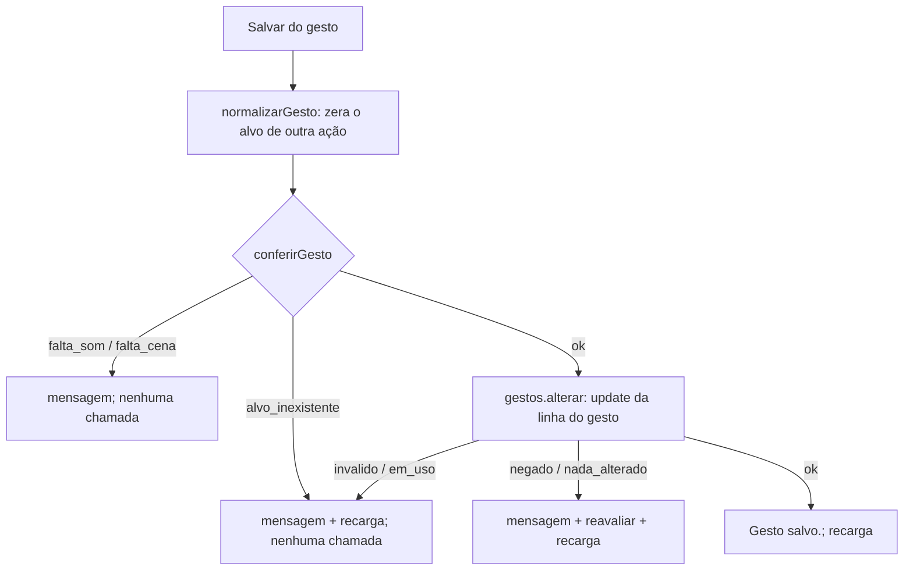

# VER-029 — E2, Tarefa 6: abas Cenas e Gestos

## Cabeçalho

| Campo | Valor |
|---|---|
| Id | VER-029 |
| Título | E2, Tarefa 6: abas Cenas (cenas do OBS: incluir, editar, subir e descer, exclusão bloqueada para cena em gesto) e Gestos (mapa global dos 7 gestos, só `update`, com a sugestão de ligar 👍/👎 aos sons "aplauso"/"buuu") no `/painel` |
| Gravidade | alta |
| Tipo | implementação · interface · segurança |
| Data | 2026-11-27 (data do commit, em UTC) |
| Usuário responsável | TokumoH |
| Status de implementação | implementado (testado com os falsos das portas e conferido no Chromium com o Supabase interceptado; a conferência contra o Supabase real é a Tarefa 8 do PLA-003) |
| Commits | commit que introduz este arquivo — `git log --diff-filter=A --format=%h -- docs/verificacoes/2026-11-27-029-e2-cenas-e-gestos.md` |
| Arquivos | `src/app/telas/AbaCenas.tsx`, `src/app/telas/AbaCenas.test.tsx`, `src/app/telas/AbaGestos.tsx`, `src/app/telas/AbaGestos.test.tsx`, `src/app/telas/Painel.tsx`, `src/app/telas/Painel.test.tsx`, `src/app/telas/README.md`, `src/shared/styles/base.css`, `src/shared/styles/README.md`, `docs/verificacoes/README.md`, este registro (11 arquivos) |

## Problema

1. **As abas Cenas e Gestos eram provisórias.** O `/painel` mostrava "Em construção — etapa E2" nas duas. O domínio (`cenas.ts`, `gestos.ts`, `trocarOrdem`, `usosDaCena`; VER-024) e os adaptadores (VER-027) já existiam, mas a equipe não tinha como cadastrar as cenas do OBS nem ligar os gestos às ações.
2. **Riscos próprios das telas** (Foco da revisão do [PLA-003](../planos/2026-11-26-e2-preparar-episodio.md), itens 6 e 8, e as notas das revisões anteriores):
   - gravar um gesto de som sem som (ou de cena sem cena);
   - gravar uma linha do mapa com o alvo de outra ação (por exemplo, `acao = 'clipe'` com `som_id` antigo, que o `CHECK mapa_gestos_equivalencia` recusa);
   - aparar o nome no OBS (o OBS diferencia espaços: "Cena " e "Cena" são cenas diferentes);
   - deixar excluir uma cena ligada a um gesto (D11);
   - subir ou descer com ordens repetidas (as colunas `ordem` começam em 0) gravando só "duas escritas" fixas, o que deixaria o empate no banco;
   - inserir ou apagar linhas de `mapa_gestos` (a decisão I2 da E0 e o DES-001 §7: as 7 linhas vêm da migração e equipe/admin só alteram);
   - mostrar nomes de cena ou rótulos de som como HTML.

## Era proposital?

Sim, como etapa: o PLA-003 põe as duas abas na Tarefa 6 ("Estrutura de arquivos"). O brief citava `trocarOrdem` com "duas escritas"; desde a revisão da Tarefa 1 (nota 1 do controlador), `trocarOrdem` com empate devolve a lista inteira renumerada, e a tela grava **todas as cenas cuja ordem mudou**. Também desde a Tarefa 1, `conferirGesto` não normaliza: a tela chama `normalizarGesto` antes de conferir e de gravar (nota 2).

A migração de fundação confirma a nota 4: `mapa_gestos` tem `gesto` como chave primária, as 7 linhas são inseridas pela própria migração, e só há políticas de `select` e `update` (`mapa_gestos_equipe_altera`), com `grant select, update` a `authenticated`.

O teste `aba-provisoria` de `Painel.test.tsx` clicava em "Cenas" para ver "Em construção". Desde esta tarefa, as provisórias são Episódios e Ao vivo, e o teste volta a "Episódios".

## Solução

- **`AbaCenas.tsx`** (`{ servicos, reavaliar }`):
  - **Carga:** `cenas.listar()` e `gestos.listar()` juntos (o mapa diz quais cenas estão em uso); só a leitura mais recente aplica. Falha: mensagem fixa e "Tentar de novo"; com `sessao_expirada`, também `reavaliar()`.
  - **Incluir cena:** campos "Nome na tela" (aparado) e "Nome no OBS" (gravado **como digitado**), com a dica "Escreva o nome exatamente como está no OBS (maiúsculas e espaços contam)" ligada ao campo por `aria-describedby`. `conferirCena` antes de gravar; recusas locais sem nenhuma chamada. A ordem da cena nova é a maior + 1.
  - **Tabela** (Ordem, Nome na tela, Nome no OBS, Ações), pela ordem do campo `ordem` (empates na ordem da lista, a mesma regra de `trocarOrdem`). A coluna Ordem mostra a posição (1, 2, 3…), não o valor gravado.
  - **Subir/Descer:** `trocarOrdem` → só as cenas cuja ordem mudou, gravadas uma por vez com `cenas.alterar` (nome e nome no OBS iguais, ordem nova). Sem empate, são as duas do par; com empate, todas as que a renumeração mudou. Se uma escrita falhar no meio, a lista recarrega (o banco pode ter parte das ordens novas) e a mensagem aparece. "Subir" na primeira e "Descer" na última ficam desabilitados.
  - **Editar** na linha (dois campos com rótulo para leitor de tela, "Salvar" e "Cancelar"), com `conferirCena(…, idEditado)`. Desde a revisão 1 (N5): Enter num campo da edição salva e Esc cancela (a linha da tabela não pode ter `<form>` próprio); com uma edição aberta, "Editar" das outras linhas fica desabilitado, para a edição não sumir sem aviso (escolhida a forma mais simples, no lugar de manter aberta e avisar).
  - **Sem limite de tamanho nos nomes** (revisão 1, N1): o domínio (`conferirCena`) e o banco (`text`) não têm limite, então os campos não têm `maxLength`; antes, o navegador cortava em silêncio um nome colado maior que 120 (OBS) ou 60 (tela) caracteres.
  - **Excluir** abre uma confirmação na linha: "Usada no gesto ✌️" (com `usosDaCena`), "Troque o gesto antes de excluir." e "Confirmar exclusão" desabilitado; o handler também recusa (defesa em profundidade). Sem uso: "Não está em uso.". O `em_uso` do banco (`23503`) mostra a mensagem e recarrega.
  - **Mensagens** (`TEXTO_DAS_CENAS`): `nome_vazio` "Dê um nome à cena."; `nome_obs_vazio` "Informe o nome da cena no OBS."; `nome_obs_duplicado` e `duplicado` do banco "Já existe uma cena com esse nome no OBS."; `em_uso` "Esta cena está ligada a um gesto. Troque o gesto antes de excluir."; `negado`/`nada_alterado` → "As cenas ou o seu papel mudaram; conferindo de novo." + `reavaliar()` + recarga; `sessao_expirada` → `reavaliar()`; o resto → "Não foi possível concluir. Tente de novo.".
- **`AbaGestos.tsx`** (`{ servicos, reavaliar }`):
  - **Carga:** `gestos.listar()`, `cenas.listar()` e `sons.listar()` juntos.
  - **Uma linha por gesto**, na ordem de `GESTOS` (chave React = o gesto): emoji, nome, seletor "Ação" com os 8 rótulos de `ACOES`, seletor "Cena" quando a ação é `cena`, seletor "Som" quando é `som`, e "Salvar". O rascunho da linha guarda os alvos até salvar.
  - **Gravar:** `normalizarGesto` (o alvo de outra ação vai nulo) e depois `conferirGesto`. `falta_som` → "Escolha o som."; `falta_cena` → "Escolha a cena."; `alvo_inexistente` → "Esse alvo não existe mais; a lista foi recarregada." + recarga, sem chamada. Erros do banco: `invalido` (o `CHECK`) e `em_uso` (no `update`, o `23503` é a chave estrangeira para uma cena ou um som apagado entre a carga e o "Salvar") → a mesma mensagem de alvo inexistente + recarga.
  - **Sem sons, "Som" desabilitado**, com o texto da D12 "Envie um som na Biblioteca."; sem cenas, "Cena" desabilitado, com "Inclua uma cena na aba Cenas." (os dois ligados aos seletores por `aria-describedby`).
  - **Sugestões** (DES-001 §7, D12): `sugestoesDeSom` → botão "Ligar 👍 ao som Aplauso" (o rótulo é o do som, como texto); grava `{ acao: 'som', somId }` pelo mesmo caminho (normalizar, conferir, gravar). Depois da recarga a linha está em `som` e o botão some.
  - **Só `update`:** um gesto sem linha no banco mostra "Sem linha no banco." e não tem "Salvar" (nada é inserido).
- **As duas abas** seguem a Biblioteca: regiões `status`/`alert` sempre montadas; foco no mesmo commit do aviso (`useLayoutEffect`); nenhum dado vira HTML; uma guarda síncrona (`escrevendo` em `useRef`) para o clique duplo, porque o `ocupado` só desabilita os botões no próximo render. Foco: incluir → campo "Nome na tela"; "Editar" → campo da linha; "Salvar"/"Cancelar" da edição → "Editar"; subir/descer → o mesmo botão da cena movida ou, se ele ficou desabilitado na ponta, o outro; "Excluir" → "Manter" e vice-versa; exclusão concluída e sugestão aplicada → região de status; "Salvar" do gesto → o próprio "Salvar"; erro → região de alerta.
- **`Painel.tsx`**: as abas "Cenas" e "Gestos" mostram `AbaCenas` e `AbaGestos`, com os mesmos serviços da Preparação (`useState(obterPreparacao)`, uma vez).
- **`base.css`**: `.cenas`, `.gestos-aba`, `.formulario-em-linha` (com `__dica`), `.tabela__nome`, `.tabela__obs`, `.tabela input`, `.confirmacao-na-linha`, `.sugestoes`, `.gestos`, só com variáveis de `tokens.css`.

## Por que esta solução

- **DDD + Pure Fabrication + Componentes:** as regras ficam no domínio (`conferirCena`, `trocarOrdem`, `usosDaCena`, `normalizarGesto`, `conferirGesto`, `sugestoesDeSom`); as telas escolhem o que mostrar e traduzem motivos em textos fixos.
- **Gravar só o que mudou, uma cena por vez:** é o contrato de `trocarOrdem` (par sem empate, lista renumerada com empate). Gravar a lista inteira sempre faria escritas inúteis; gravar só "duas" deixaria o empate. Como não há transação (a porta não tem operação em lote), a falha no meio recarrega a lista, em vez de mostrar uma ordem que o banco não tem.
- **Normalizar antes de conferir:** `conferirGesto` olha só o alvo da ação; a linha gravada tem de ser a normalizada, senão um gesto que muda de `som` para `clipe` levaria o `som_id` antigo e o banco recusaria (`CHECK`).
- **`em_uso` no `update` do gesto = alvo inexistente:** no adaptador, `23503` vira `em_uso`; numa exclusão isso quer dizer "em uso", mas no `update` de `mapa_gestos` só pode ser a chave estrangeira para um alvo que sumiu.
- **Lista de cartões para os gestos e tabela para as cenas:** as cenas são uma lista com colunas (como Membros, com rolagem horizontal no celular); os gestos têm campos que aparecem e somem, e cartões não precisam de rolagem horizontal em 320 px.

## Por que não outras soluções

| Opção | Motivo de descarte |
|---|---|
| Sempre duas escritas em "Subir"/"Descer" (o texto original do brief) | Com ordens repetidas, deixa o empate no banco (nota 1); a sabotagem S5 derruba `subir-cena-com-empate` |
| Gravar todas as cenas devolvidas por `trocarOrdem` | Escritas inúteis para as que não mudaram; a sabotagem S6 derruba `subir-cena-com-empate` |
| Trocar a ordem por uma operação em lote no banco (RPC) | A E2 não cria função (restrição global do PLA-003); a recarga na falha cobre o caso |
| Inserir a linha do gesto que faltar | Proibido pela decisão I2 da E0 (sem política de `insert`); a sabotagem S18 derruba `gesto-sem-linha-no-banco` |
| Aparar o nome no OBS | O OBS diferencia espaços e o banco tem `unique` exato; a sabotagem S3 derruba `inclui-cena` |
| Esconder as opções "Som"/"Cena" sem sons/cenas | A D12 pede a opção desabilitada com o texto, para a pessoa saber o que falta |
| Reaproveitar `.membros__incluir` para o formulário de cenas | É classe da aba Membros; `.formulario-em-linha` é genérica e serve à Tarefa 7. Trocar a Membros para ela fica para um item próprio (fora do escopo) |

## Onde

| Arquivo | Linhas | O que mudou |
|---|---|---|
| [`src/app/telas/AbaCenas.tsx`](../../src/app/telas/AbaCenas.tsx#L14) | 1–505 | Novo: `TEXTO_DAS_CENAS` (L14), `carregar` (L105), foco (L127), `tratarErro` (L163), `escrever` com a guarda (L184), `aoIncluir` (L213), `aoMover` (L235), `aoEditar` (L254), `aoSalvarEdicao` (L265), `aoTeclarNaEdicao` (L279, revisão 1), `aoConfirmarExclusao` (L299), `acoesDe` (L311) |
| [`src/app/telas/AbaCenas.test.tsx`](../../src/app/telas/AbaCenas.test.tsx) | 1–433 | Novo: 24 testes (21 da primeira versão e 3 da revisão 1) |
| [`src/app/telas/AbaGestos.tsx`](../../src/app/telas/AbaGestos.tsx#L12) | 1–330 | Novo: `TEXTO_DOS_GESTOS` (L12), `carregar` (L83), foco (L105), `alvoQueSumiu` (L130), `tratarErro` (L141), `gravar` (L153), `linhaDoGesto` (L196), sugestões (L295) |
| [`src/app/telas/AbaGestos.test.tsx`](../../src/app/telas/AbaGestos.test.tsx) | 1–351 | Novo: 22 testes (21 da primeira versão e 1 da revisão 1) |
| [`src/app/telas/Painel.tsx`](../../src/app/telas/Painel.tsx#L70) | 14–15, 69–72, comentário final | As abas Cenas e Gestos reais |
| [`src/app/telas/Painel.test.tsx`](../../src/app/telas/Painel.test.tsx#L70) | 7, 51, 70–87 | `aba-provisoria` volta a "Episódios"; novo `cenas-e-gestos-no-painel` |
| [`src/shared/styles/base.css`](../../src/shared/styles/base.css#L241) | 240–301 | Estilos das abas Cenas e Gestos |
| [`src/app/telas/README.md`](../../src/app/telas/README.md), [`src/shared/styles/README.md`](../../src/shared/styles/README.md), [`README.md`](README.md) | — | "Arquivos", "Onde", propósito, organização, verificação e riscos |

## Lógica

Subir ou descer (`trocarOrdem`, nota 1):

| Situação | Antes (brief original) | Depois |
|---|---|---|
| Ordens 0, 1, 2; subir a do meio | 2 escritas | 2 escritas (o par trocado) |
| Ordens 0, 0, 0; subir a última (C) | 2 escritas, empate fica | C → 1 e B → 2 (A já está em 0 e não é gravada) |
| Segunda escrita falha | recarrega e avisa | recarrega e avisa (qualquer escrita do lote) |

## Exemplo

O teste `subir-cena-com-empate` parte de A, B e C, todas com ordem 0. Subir C grava `['alterar', 'c', … ordem: 1]` e `['alterar', 'b', … ordem: 2]`, e a tabela passa a A, C, B. Descer A em seguida (já sem empate) grava só o par: A → 1 e C → 0, e a tabela fica C, A, B.

No navegador (390 px), com quatro cenas (Geral 0, Close 0, Convidado 0, Plateia 1), subir Close gerou três `PATCH /rest/v1/cenas`: Geral → 1, Convidado → 2 e Plateia → 3 (Close continua em 0 e não é gravada). Incluir "  Plateia  " / "Cena Plateia " gerou `POST` com `nome_exibicao` "Plateia" e `nome_obs` "Cena Plateia " (com o espaço). Na aba Gestos, mudar 👍 de `som` para `clipe` gerou `PATCH /rest/v1/mapa_gestos?gesto=eq.Thumb_Up` com `{"acao":"clipe","cena_id":null,"som_id":null}`.

## Verificação

- **TDD:** com os testes escritos e as abas inexistentes, `npx vitest run src/app/telas` falhou (os arquivos de teste das duas abas não resolvem o import, e `cenas-e-gestos-no-painel` falha; 69 passando). Com a implementação, passam.
- **Testes:** `npm test` com todos passando (contagens no relatório da tarefa); 24 em `AbaCenas.test.tsx` e 22 em `AbaGestos.test.tsx` desde a revisão 1 (eram 21 e 21), e 1 novo em `Painel.test.tsx`. Os três arquivos passaram em 10 execuções seguidas. `npx tsc --noEmit` sem erros.
- **Sabotagens** (cada uma no arquivo, restaurado com `cp` de uma cópia guardada e conferido com `cmp`):

| # | Sabotagem | Testes que caíram |
|---|---|---|
| S1 | Gravar sem `conferirGesto` | `gesto-som-sem-som-na-tela`, `gesto-cena-sem-cena-na-tela`, `alvo-fora-da-lista-recarrega-sem-gravar` |
| S2 | Gravar sem `normalizarGesto` | `troca-para-clipe-zera-alvos`, `troca-de-som-para-cena-zera-som` |
| S3 | `trim` no nome do OBS | `inclui-cena` |
| S4 | Permitir excluir cena em gesto | `excluir-cena-em-gesto` |
| S5 | Duas escritas fixas (ignora o empate) | `subir-cena-com-empate` |
| S6 | Gravar a lista inteira, sem filtrar o que não mudou | `subir-cena-com-empate` |
| S7 | `em_uso` do `update` do gesto vira mensagem genérica | `alvo-que-sumiu-pela-chave-estrangeira` |
| S8 | Tirar só a guarda de `escrever` (Cenas) | nenhum: a guarda de `aoIncluir` continua barrando (duas camadas) |
| S8b | Tirar as duas guardas de clique duplo (Cenas) | `clique-duplo-nao-duplica` |
| S9 | Tirar a guarda de clique duplo (Gestos) | `clique-duplo-nao-duplica` |
| S10 | Foco com `useEffect` (Cenas) | `foco-no-mesmo-commit-do-aviso` |
| S11 | Foco com `useEffect` (Gestos) | `foco-no-mesmo-commit-do-aviso` |
| S12 | Troca de ordem que falha no meio não recarrega | `ordem-falha-no-meio-recarrega` |
| S13 | "Som" habilitado sem sons | `som-desabilitado-sem-sons` |
| S14 | Nome no OBS com `dangerouslySetInnerHTML` | `cena-com-html-literal` |
| S15 | `Painel` sem as abas novas | `cenas-e-gestos-no-painel` |
| S16 | Sem `reavaliar()` na escrita negada (Gestos) | `escrita-negada-reavalia` |
| S17 | Sem recarga no `em_uso` da exclusão de cena | `em-uso-do-banco` |
| S18 | Gesto sem linha ganha um "Salvar" que grava | `gesto-sem-linha-no-banco` |

  **Achado durante as sabotagens e corrigido:** na primeira rodada, S8 e S9 não derrubavam `clique-duplo-nao-duplica`. Entre dois `fireEvent`, o React renderiza e o botão já está desabilitado; e, nas Cenas, `aoIncluir` também tem a guarda. Os dois testes passaram a disparar os dois eventos dentro de um mesmo `act` (sem render entre eles). Com isso, S8b e S9 derrubam o teste. S8 sozinha continua sem derrubar nada, porque a segunda camada (`aoIncluir`) barra o envio duplicado; isso foi conferido e não é falha.
- **Navegador (Chromium/Playwright):** `vite build` com URL fictícia (saída fora do repositório) e `vite preview`, com o Supabase interceptado por um falso em memória (`cenas` com `23505` e `23503`, `sons`, `mapa_gestos` com `PATCH` por `gesto=eq.`). Claro e escuro, 320, 390 e 1280 px:
  - **Largura:** `scrollWidth` = largura da janela em todas, e nenhum elemento passa da borda do cartão; a tabela de cenas rola dentro de `.tabela-rolavel` em 320 e 390 px.
  - **Nome com HTML:** ` …` aparece como texto, e `img[src="x"]` não existe.
  - **Incluir:** `POST` com o nome no OBS como digitado; foco no campo "Nome na tela". Duplicado local: nenhum pedido e foco no alerta.
  - **Subir com empate:** três `PATCH` (Close não é gravada), a ordem nova na tela e o foco no "Descer" (o "Subir" ficou desabilitado no topo).
  - **Editar:** foco no campo da linha; "Salvar" → `PATCH` e foco em "Editar".
  - **Excluir cena em gesto:** "Usada no gesto ☝️", confirmar desabilitado, foco em "Manter"; "Manter" → foco em "Excluir". Excluir cena livre: `DELETE` e foco no status.
  - **Gestos:** as duas sugestões (👍 Aplauso, 👎 Buuu); "Ligar 👍" → `PATCH` com `som_id`, foco no status, e só a de 👎 fica. "Som" sem som: "Escolha o som." e foco no alerta. Vitória → cena: `PATCH` com `som_id: null` e foco em "Salvar". 👍 → clipe: `PATCH` com os dois alvos nulos.
  - **Console:** nenhum erro. O preview foi parado.
- **Revisão 1 (revisor independente):** spec ✅; qualidade reprovada só por teste em falta, com 1 achado importante e 6 nits, sem defeito de segurança. Tudo foi incorporado com reconferência pontual, sem nova rodada, pela decisão (a): I1, N2, N3 e N4 só acrescentam testes; N1 e N5 são ajustes pequenos de comportamento, cada um com teste; N6 é informativo (o ramo de defesa `if (bloqueia)` de `aoConfirmarExclusao` é inalcançável pela interface, porque o botão está desabilitado, e não é dado como testado).

| Achado | Correção | Teste e sabotagem que o derruba |
|---|---|---|
| I1 — Gestos sem teste de sessão expirada ao salvar | — | `sessao-expirada-na-escrita` (Gestos): 1 `reavaliar()`, nenhuma mensagem nas regiões, sem recarga. Caem com R2 (sem `reavaliar`, a sabotagem do revisor), R2b (mostra a mensagem genérica) e R2c (recarrega) |
| N1 — `maxLength` cortava em silêncio os nomes | Sem `maxLength` nos quatro campos de nome (o domínio e o banco não têm limite) | `nome-obs-longo-gravado-inteiro` (nome no OBS com mais de 120 caracteres gravado igual; campos sem `maxlength`). Cai com "`maxLength={120}` de volta" e com `trim` no nome do OBS |
| N2 — Cenas: sessão expirada não provava "sem mensagem e sem recarga" | — | `sessao-expirada-na-escrita` (Cenas) reforçado. Cai com R8 (cair na mensagem genérica) |
| N3 — descarte da escolha não salva sem teste | — | `alvo-que-sumiu` confere que a linha volta a "Nenhuma", sem o seletor de cena. Cai com R1 (sem `descartarRascunho`) |
| N4 — confirmação que fecha na falha sem teste | — | `em-uso-do-banco` confere que "Confirmar exclusão" sumiu e "Excluir" voltou. Cai com R9 (sem `aoFalhar`) |
| N5 — Enter não salvava; "Editar" noutra linha descartava a edição | Enter salva e Esc cancela; "Editar" das outras linhas desabilitado com uma edição aberta | `enter-salva-a-edicao` (cai com "Enter não salva") e `editar-outra-linha-nao-descarta` (cai com "Editar habilitado") |
| N6 — ramo de defesa inalcançável | Nada a fazer | — |

  Os 3 testes novos de `AbaCenas.test.tsx` falharam contra o código anterior à revisão (`nome-obs-longo-gravado-inteiro`, `enter-salva-a-edicao`, `editar-outra-linha-nao-descarta`). As sabotagens S1–S18 foram refeitas sobre o código da revisão 1, e cada uma ainda derruba o seu teste (S8 continua sem derrubar nada, pelo motivo já registrado; S3 agora derruba também `nome-obs-longo-gravado-inteiro`). Reconferência pontual: `npx vitest run src/app --maxWorkers=2` três vezes, `npm run typecheck` e `node scripts/check-docs.mjs`.
- **`npm run check`:** último ato, 0 erros (detalhes no relatório da tarefa).

## Riscos

- **Troca de ordem sem transação:** uma falha no meio deixa parte das ordens novas no banco; a aba recarrega e mostra o que o banco tem, e a pessoa pode tentar de novo.
- **Espaços no fim do nome no OBS não aparecem na tabela:** o nome é gravado e conferido exato, mas o espaço final não fica visível na célula (`white-space: pre-wrap` mostra só os espaços internos). Ao editar, o campo mostra o valor exato.
- **Sugestão com rótulo idêntico:** com mais de um som "aplauso", a sugestão liga o primeiro da lista (regra de `sugestoesDeSom`).
- **Rascunhos de gestos não salvos:** salvar uma linha recarrega o mapa mas mantém os rascunhos das outras; um rascunho que aponte para um alvo apagado aparece como "Escolha…" e é acusado ao salvar.
- **Edição de uma linha por vez:** com uma edição aberta, "Editar" das outras linhas fica desabilitado até salvar ou cancelar (revisão 1, N5).
- **Botões "Salvar" com o mesmo nome:** os 7 botões "Salvar" têm o mesmo nome; o contexto vem do item da lista (`aria-labelledby` com o nome do gesto).
- **Estilo da Membros:** `.membros__incluir` (E1) repete as regras de `.formulario-em-linha`; não foi trocado nesta tarefa.
- **Login real não conferido:** a conferência foi com rotas interceptadas; a real é a Tarefa 8.
