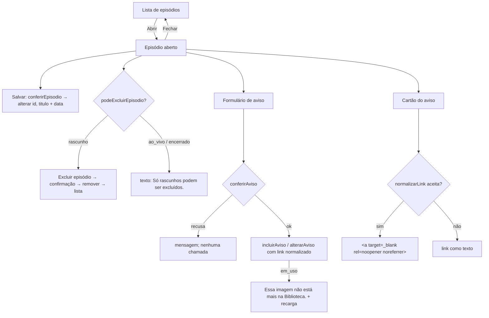

# VER-030 — E2, Tarefa 7: aba Episódios e avisos

## Cabeçalho

| Campo | Valor |
|---|---|
| Id | VER-030 |
| Título | E2, Tarefa 7: aba Episódios no `/painel` (lista com o estado, criar, editar só título e data, excluir só rascunho; avisos com texto literal, link `https://` validado antes de virar âncora, imagem da Biblioteca, duração e ordem); iniciar e encerrar o ao vivo ficam para a E3 |
| Gravidade | alta |
| Tipo | implementação · interface · segurança |
| Data | 2026-11-27 (data do commit, em UTC) |
| Usuário responsável | TokumoH |
| Status de implementação | implementado (testado com os falsos das portas e conferido no Chromium com o Supabase e o Storage interceptados; a conferência contra o Supabase real é a Tarefa 8 do PLA-003) |
| Commits | commit que introduz este arquivo — `git log --diff-filter=A --format=%h -- docs/verificacoes/2026-11-27-030-e2-episodios-e-avisos.md` |
| Arquivos | `src/app/telas/AbaEpisodios.tsx`, `src/app/telas/AbaEpisodios.test.tsx`, `src/app/telas/AbaBiblioteca.tsx`, `src/app/telas/Painel.tsx`, `src/app/telas/Painel.test.tsx`, `src/app/telas/README.md`, `src/app/App.test.tsx`, `src/app/README.md`, `src/shared/styles/base.css`, `src/shared/styles/README.md`, `docs/verificacoes/README.md`, este registro (12 arquivos) |

## Problema

1. **A aba Episódios era provisória.** O `/painel` abria em "Episódios" com "Em construção — etapa E2". O domínio (`episodios.ts`: `conferirEpisodio`, `podeExcluirEpisodio`, `conferirAviso`, `normalizarLink`, `trocarOrdem`; VER-024) e o adaptador (`preparacaoSupabase.ts`, que só manda `titulo` e `data` no `update`; VER-027) já existiam, mas a equipe não tinha como criar um episódio nem preparar os avisos.
2. **Riscos próprios da tela** (Foco da revisão do [PLA-003](../planos/2026-11-26-e2-preparar-episodio.md), itens 5 e 7, e as notas do controlador):
   - mostrar o título ou o texto de um aviso como HTML (`<b>`, `` apareceu como texto, sem `script` nem `b` no DOM; o link salvo como `http://x` apareceu como "Link fora do formato (não abre): http://x", sem `<a>`; e o link `https://revocast.test/inscricao/…` virou `<a target="_blank" rel="noopener noreferrer">`.

## Verificação

- **TDD:** com os testes escritos e a aba inexistente, `npx vitest run src/app/telas` falhou: `AbaEpisodios.test.tsx` não resolve o import e 3 testes de `Painel.test.tsx` falham (`aba-provisoria`, `episodios-no-painel`, `membros-some-quando-rebaixado`); 114 passando. Com a implementação, os 6 arquivos passam (147 testes).
- **Testes:** 32 em `AbaEpisodios.test.tsx` desde a revisão (eram 30) e 1 novo em `Painel.test.tsx` (11 no arquivo); `npm test` com todos passando (contagens no relatório da tarefa). `npm run typecheck` sem erros.
- **Sabotagens** (cada uma aplicada ao arquivo por script e desfeita com `cp` da cópia guardada, conferida com `cmp`):

| # | Sabotagem | Testes que caíram |
|---|---|---|
| S1 | Link no `href` sem `normalizarLink` (todo link vira âncora) | `link-aceito-vira-ancora` (o `http://x` salvo por fora) |
| S2 | "Excluir episódio" em qualquer estado | `excluir-so-rascunho` |
| S3 | Episódio inteiro no `alterar` (`{ ...e, titulo, data }`) | `edita-so-titulo-e-data`, `ao-vivo-fica-para-e3` |
| S4 | Todas as mídias no seletor de imagem | `aviso-com-imagem` |
| S5 | Gravar tudo o que `trocarOrdem` devolve (sem filtrar o que não mudou) | `ordem-dos-avisos-com-empate` |
| S6 | Duas escritas fixas (troca o par pela posição, ignora o empate) | `ordem-dos-avisos`, `ordem-dos-avisos-com-empate` |
| S7 | Imagem do aviso suposta existente (acessa `m.nome` sem conferir) | `imagem-apagada-mostra-sem-imagem` |
| S8 | Prévia aceita qualquer URL | `previa-com-url-recusada` |
| S9 | Texto do aviso com `dangerouslySetInnerHTML` | `aviso-com-html-literal` |
| S10 | Foco com `useEffect` | `foco-no-mesmo-commit-do-aviso` |
| S11 | Sem as guardas de clique duplo (`escrever`, `aoCriar`, `aoGravarAviso`) | `clique-duplo-nao-duplica` |
| S12 | Sem `reavaliar()` na escrita negada | `escrita-negada-reavalia` |
| S13 | `em_uso` do aviso vira mensagem genérica, sem recarga | `imagem-inexistente-do-banco` |
| S14 | Botão "Iniciar ao vivo" no episódio aberto | `ao-vivo-fica-para-e3` |
| S15 | `Painel` sem a aba Episódios | `aba-provisoria`, `episodios-no-painel`, `membros-some-quando-rebaixado` |
| S16 | Duração padrão 5 | `duracao-padrao-10`, `link-aceito-vira-ancora` |
| S17 | Sessão expirada também mostra a mensagem genérica | `sessao-expirada-na-escrita` |
| S18 | Episódio que sumiu continua aberto (sem `definirAberto(null)` na carga) | `episodio-que-sumiu-fecha` |

  **Achado durante as sabotagens e corrigido:** na primeira rodada, S18 não derrubava nada, porque a tela já volta à lista quando o episódio aberto não está na lista (o detalhe é calculado por `find`); o efeito que sobrava era a carga continuar lendo os avisos do episódio que sumiu. O teste `episodio-que-sumiu-fecha` passou a conferir que a carga seguinte não chama `listarAvisos`; com isso, S18 derruba o teste.
- **Navegador (Chromium/Playwright):** `vite build` com URL fictícia (saída fora do repositório) e `vite preview`, com o Supabase interceptado por um falso em memória (`episodios`, `avisos`, `midias`, `rpc/papel_atual` e a URL assinada do Storage). Claro e escuro, 320, 390 e 1280 px:
  - **Largura:** `scrollWidth` = largura da janela em todas, e nenhum elemento passa da borda do cartão (título sem espaços na lista, link longo e texto com quebras de linha nos cartões); a tabela de episódios rola dentro de `.tabela-rolavel` em 320 e 390 px. Achado visual corrigido: "Excluir episódio" ocupava a largura da coluna; passou a ter o tamanho do texto (`.episodio > button { justify-self: start }`), e a conferência foi refeita com o mesmo resultado.
  - **Lista:** mais recente primeiro, estados com rótulo, data padrão = hoje, nota da E3, nenhum botão "Iniciar"/"Encerrar".
  - **Ao vivo aberto:** sem "Excluir episódio", com "Só rascunhos podem ser excluídos."; foco no título; "Fechar" → foco em "Abrir".
  - **Criar:** `POST` com `titulo` aparado, `data` e `criado_por`; foco no campo "Título". Título vazio: foco no alerta, nenhum pedido.
  - **Avisos:** HTML literal; `pre-line` aplicado; âncora só no link `https://`; "Sem imagem" para imagem apagada; "Ver imagem" → `` com a URL assinada, foco no próprio botão ("Ocultar imagem"); subir com empate = 2 `PATCH` (o que não muda não é gravado); `javascript:` recusado sem pedido; seletor só com "Sem imagem" e `capa.png`; incluir → `POST` com o link normalizado, `ordem` 3 e foco no "Título do aviso"; editar → foco no "Título do aviso"; Enter salva (`PATCH` com a ordem atual) e o foco vai para "Editar"; excluir → "Manter", confirmar → `DELETE` e foco no status.
  - **Episódio:** salvar → `PATCH` só com `titulo` e `data`, foco no status; excluir → "Excluir o episódio e os seus 3 avisos?", foco em "Manter"; confirmar → `DELETE` e volta à lista com foco no status.
  - **Console:** nenhum erro. O preview foi parado.
- **Revisão 1 (revisor independente):** spec ✅; qualidade aprovada, sem achado crítico nem importante, com 3 nits. Os três entraram com reconferência pontual, sem nova rodada, pela decisão (a): N1 é um ajuste pequeno de comportamento, com teste; N2 é só CSS, sem mudar o visual; N3 só acrescenta testes.

| Achado | Correção | Teste e sabotagem que o derruba |
|---|---|---|
| N1 — aviso em edição excluído por fora deixava o formulário em modo edição de um id que não existe ("Editar" desabilitado em todos os cartões) | Na carga, se o aviso em edição não veio, `editando` e o formulário são limpos (ref `editandoAtual`, como `abertoAtual`) | `aviso-em-edicao-que-sumiu` (a sonda do revisor): depois da recarga, "Incluir aviso", sem "Cancelar edição", título vazio e "Editar" habilitado. Falhou contra o código anterior à revisão; cai com R1 (carga sem limpar a edição) |
| N2 — `.campo textarea` repetia a regra de `.campo input, .campo select` | `.campo textarea` somado àquela lista; fica à parte só `resize: vertical` | — (CSS; `check-docs` e testes sem mudança) |
| N3 — ramo `negado` sem teste de tela; links `data:` e com maiúsculas só cobertos no domínio | `escrita-negada-reavalia` ganha o caso `negado` (na inclusão de aviso: mensagem, 2º `reavaliar()`, recarga, foco no alerta); novo `links-salvos-por-fora` (`data:text/html,…` e `JAVASCRIPT:alert(1)` ficam texto; `HTTPS://Revocast.test/Inscricao` vira `<a href="https://revocast.test/Inscricao">` com `rel` e `target`; 1 âncora só) | R2 (sem `negado` no `if`) derruba `escrita-negada-reavalia`; S1 derruba `links-salvos-por-fora` e `link-aceito-vira-ancora`; R3 (`href` com o valor do banco, sem normalizar) derruba `links-salvos-por-fora` |

  Reconferência pontual: `npx vitest run src/app --maxWorkers=2` três vezes, `npm run typecheck` e `node scripts/check-docs.mjs`.
- **`npm run check`:** último ato, 0 erros (detalhes no relatório da tarefa).

## Riscos

- **Estado pela API (D2):** a tela não muda `estado`, mas a RLS filtra linhas, não colunas: `equipe` ainda consegue, pela API, mudar `estado` e excluir um episódio fora de rascunho. A E3 decide se o estado passa a mudar só por função. O "no máximo um `ao_vivo`" continua garantido pelo índice `episodios_um_ao_vivo`, e o `duplicado` vira mensagem fixa.
- **Troca de ordem sem transação:** uma falha no meio deixa parte das ordens novas; a aba recarrega e mostra o que o banco tem.
- **Prévia `http:` aceita:** a miniatura segue a regra da Biblioteca (`https:` ou `http:` para o Supabase local). Se a regra virar só `https:`, as duas abas mudam juntas, em `urlDePreviaAceita`.
- **Prévia que não carrega:** como na Biblioteca, `createSignedUrl` passa pelo `fetch` sem tempo-limite; a prévia que não chega só fica vazia.
- **Edição de aviso que sumiu:** se o aviso em edição foi excluído por fora, a recarga desfaz a edição (revisão N1) e o que a pessoa digitou se perde; a mensagem fixa explica que a lista mudou.
- **Recado antigo ao editar:** a mensagem de sucesso anterior ("Aviso incluído.") continua visível enquanto um aviso é editado, como nas outras abas.
- **Ordem do episódio por data:** episódios com a mesma data aparecem na ordem em que o banco devolve.
- **Login real não conferido:** a conferência foi com rotas interceptadas; a real é a Tarefa 8.
