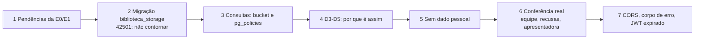

# VER-031 — E2, Tarefa 8: conferência no navegador e guia do Storage para o responsável

## Cabeçalho

| Campo | Valor |
|---|---|
| Id | VER-031 |
| Título | E2, Tarefa 8: conferência no navegador e guia do Storage para o responsável |
| Gravidade | média |
| Tipo | verificação · documentação · segurança |
| Data | 2026-11-27 (data do commit, em UTC) |
| Usuário responsável | TokumoH |
| Status de implementação | somente documentação (nenhum código de produção muda; a migração `biblioteca_storage` e a conferência real são passo do responsável, **pendente**) |
| Commits | commit que introduz este arquivo — `git log --diff-filter=A --format=%h -- docs/verificacoes/2026-11-27-031-e2-conferencia-e-guia.md` |
| Arquivos | `supabase/README.md`, `docs/verificacoes/README.md`, este registro (3 arquivos) |

## Problema

1. **A E2 nunca tinha sido aberta num navegador como um todo.** As Tarefas 5 a 7 ([VER-028](2026-11-26-028-e2-aba-biblioteca.md), [VER-029](2026-11-27-029-e2-cenas-e-gestos.md), [VER-030](2026-11-27-030-e2-episodios-e-avisos.md)) conferiram cada aba isolada, só com `equipe`, e ninguém tinha visto o fluxo de ponta a ponta (enviar um som, ligá-lo a um gesto, ver a exclusão bloqueada, usar a imagem num aviso), as quatro abas com `admin` e a recusa da `apresentadora`, nem o corte de 30 s por inatividade do envio (D8) num navegador de verdade: até aqui ele só tinha teste com `XMLHttpRequest` falso ([VER-027](2026-11-26-027-e2-adaptadores-preparacao.md)).
2. **O responsável não tinha roteiro para ligar a Biblioteca.** O passo 1 de "Lógica" e os Riscos de `supabase/README.md` remetiam a um "guia da Tarefa 8 do PLA-003" que não existia; o que conferir depois de aplicar a migração (bucket privado, limites, três políticas, nenhuma de `update`), o que fazer se o editor recusar (`42501`) e o que só o projeto real confirma (CORS do envio, corpo de erro, JWT expirado; Riscos do VER-027) estavam espalhados por quatro registros.

## Era proposital?

Sim. O [PLA-003](../planos/2026-11-26-e2-preparar-episodio.md), "Tarefa 8", deixa para a última tarefa a conferência de ponta a ponta e o guia, como o PLA-002 fez na E1 ([VER-020](2026-11-26-020-e1-conferencia-e-guia.md)), porque só aqui todas as abas existem. Os Riscos do VER-026 a VER-030 citam a Tarefa 8 como o lugar da conferência real e do guia; o VER-027 (revisão 1, N2) pede para conferir aqui o JWT expirado.

## Solução

- **Conferência no navegador** (Passo 1 do plano): `npm run build` com `VITE_SUPABASE_URL=https://exemplo.revocast.test` e `VITE_SUPABASE_PUBLISHABLE_KEY=sb_publishable_teste` só na linha de comando e `--outDir` fora do repositório; `vite preview` na porta 4173; Chromium do Playwright do ambiente (fora do repositório, sem virar dependência) com `exemplo.revocast.test` interceptado (sessão falsa no `localStorage`, PostgREST em memória, Storage com resposta lenta, segurada ou nunca respondida). O script de conferência faz **asserções** (OK/ERR) em vez de só imprimir, para que as sabotagens provem que ele pega falhas. Scripts, capturas e o arquivo de 50 MB ficam fora do repositório. Resultado em "Verificação".
- **Guia "Biblioteca no Storage (E2)"** em [`supabase/README.md`](../../supabase/README.md#L106-L141), dentro de "Lógica", no estilo do guia da E1: sete passos (pendências anteriores; aplicar a migração em ordem e não contornar um `42501`; as duas consultas de conferência com o resultado esperado; a tabela da D3–D5; nada de dado pessoal; conferência real; o que só o projeto real confirma, com o que observar na aba *Rede* e onde anotar). O "Propósito", o passo 1 de "Lógica" e o Risco da terceira migração passam a apontar para o guia; um Risco novo diz que ele não foi conferido num projeto real.

## Por que esta solução

- O guia fica ao lado do guia da E1 e do manual das migrações: um lugar só para "como ligar o projeto", na ordem em que o responsável vai fazer. Fica em "Lógica" para não criar uma 12.ª seção fora da estrutura dos READMEs (`CLAUDE.md`).
- O que não dá para saber sem o projeto real (CORS, formato do erro, renovação do JWT) virou instrução de observação com o que anotar, e o guia diz o que a tela mostra em cada caso (medido aqui com o Storage simulado), para que o responsável reconheça o sintoma.
- A conferência usa o mesmo `vite build` da Vercel; interceptar o Supabase no navegador prova o que o bundle faz sem conta, rede ou chave. Asserções com sabotagens dão prova de que a conferência não passa por acaso.

## Por que não outras soluções

| Opção | Motivo de descarte |
|---|---|
| Guia num arquivo novo (`docs/guias/storage.md`) | Pasta nova com README só para isto; separa o guia do manual das migrações que ele manda aplicar |
| Guia como seção `##` própria | 12.ª seção fora da estrutura dos READMEs; em "Lógica" ele é passo de uso, como o guia da E1 |
| Criar as políticas pelo painel (*Storage → Policies*) já no guia | Duplicaria a migração e deixaria o banco real diferente do testado; só vira caminho se o editor der `42501`, por decisão de um item próprio |
| Mapear já `InvalidJWT` para "sessão expirada" no adaptador | Muda código de produção sem saber o que o Storage real responde; o contrato da tarefa manda relatar. O guia pede a observação |
| Playwright como dependência (testes de ponta a ponta no `npm run check`) | O PLA-003 proíbe dependência nova (D9); a conferência é manual |
| Conferir com um projeto Supabase real | Exige conta, chave e rede; é o passo 6–7 do guia, do responsável |

## Onde

| Arquivo | Linhas | O que mudou |
|---|---|---|
| [`supabase/README.md`](../../supabase/README.md#L18) | 18 | "Propósito": o README também diz como ligar e conferir a Biblioteca no Storage |
| [`supabase/README.md`](../../supabase/README.md#L68) | 68 | Passo 1 de "Lógica": a conferência remete a "Biblioteca no Storage (E2)" |
| [`supabase/README.md`](../../supabase/README.md#L106-L141) | 106–141 | Novo: subseção "Biblioteca no Storage (E2)" com os sete passos do responsável |
| [`supabase/README.md`](../../supabase/README.md#L162) | 162 | Risco da terceira migração remete ao guia |
| [`supabase/README.md`](../../supabase/README.md#L172) | 172 | Novo Risco: guia do Storage não conferido num projeto real |
| [`docs/verificacoes/README.md`](README.md#L84) | 14, 84 | Campo "Arquivos" e linha do VER-031 em "Onde" |
| este registro | — | Novo |

## Lógica

| Passo | Antes | Depois |
|---|---|---|
| Responsável quer ligar a Biblioteca | Juntar a Tarefa 8 do PLA-003 e os Riscos do VER-025 a VER-030 | Seguir os passos 1–7 de "Biblioteca no Storage (E2)" |
| Editor recusa a migração com `42501` | Tentação de desligar RLS ou criar as políticas por outro caminho | Não contornar; anotar a mensagem; decisão num item próprio |
| Saber se a migração entrou certa | Abrir o painel e olhar | Duas consultas com o resultado esperado (bucket, 8 tipos, 3 políticas `{authenticated}`, nenhuma de `update`) |
| Corte de 30 s do envio | Provado só com `XMLHttpRequest` falso | Visto no Chromium: o aviso aparece aos 30,3 s, com a remoção de boa-fé |
| Envio recusado no projeto real | Sintoma desconhecido | O guia diz o que cada resposta vira na tela e o que anotar |

## Exemplo

Envio de `../../pasta/foto nova.png` (PNG de 1×1 gerado na hora) com a conta `equipe` em 390 px: o navegador fez `POST https://exemplo.revocast.test/storage/v1/object/midias/imagem/<uuid>.png` com `content-type: image/png`, `x-upsert: false`, `authorization: Bearer <token da sessão falsa>` e `apikey` com a chave publicável de mentira; o caminho não tem `foto`, `pasta` nem `..`; a linha gravada em `midias` tem `nome` = `foto nova.png` e o mesmo caminho. Com a sabotagem "nome" (o `open` do `XMLHttpRequest` acrescenta `-foto nova` ao caminho), a conferência acusou 8 ERR, entre eles "caminho imagem/<uuid>.png (`/storage/v1/object/midias/imagem/…-foto%20nova.png`)".

Envio segurado sem resposta (`travado.png`, 2 MB): "O envio parou de avançar e foi interrompido. Tente de novo." apareceu depois de 30,3 s (duas rodadas), seguido de `DELETE /storage/v1/object/midias` (remoção de boa-fé) e nenhuma linha em `midias`.

## Verificação

**Build** (fora do repositório; o `dist/` do repositório não foi tocado): `VITE_SUPABASE_URL=https://exemplo.revocast.test VITE_SUPABASE_PUBLISHABLE_KEY=sb_publishable_teste npm run build -- --outDir <scratch>/t8/dist --emptyOutDir` (`tsc` + `vite build`, 0 erros; o aviso de pedaço acima de 500 kB é o mesmo de antes). `exemplo.revocast.test` aparece uma vez no bundle.

**Conferência no navegador** (script `conferir.cjs` na pasta temporária da sessão; Chromium do Playwright do ambiente; `prefers-color-scheme` claro e escuro; 320, 390 e 1280 px; 6 combinações × 3 papéis):

| Papel | Caso | Resultado |
|---|---|---|
| `equipe` | abas | Episódios, Biblioteca, Cenas, Gestos, Ao vivo (sem Membros) — 6/6 |
| `equipe` (390 claro e 320 escuro) | PNG `../../pasta/foto nova.png`, resposta em 1,5 s | barra de progresso durante o envio; "Arquivo enviado."; caminho `imagem/<uuid>.png` sem o nome; cabeçalhos do envio; linha em `midias` com o nome de exibição |
| | MP3 `aplauso.mp3` | caminho `som/<uuid>.mp3`, `audio/mpeg`; som com rótulo "aplauso" |
| | HTML e SVG com nome `.png` | "Tipo não aceito." e nenhum `POST` ao Storage |
| | arquivo de 52 428 801 bytes com cabeçalho de MP3 | "Arquivo acima de 50 MB." e nenhum `POST` |
| | cancelar no meio (`POST` segurado) | "Envio cancelado."; `DELETE` de boa-fé no Storage; nenhuma linha em `midias` |
| | prévias | `` carregado e `<audio>`, ambos por URL assinada (`token=…`) |
| | uso | "Uso: 1,5 MB de 1 GB" |
| | Cenas | "Cena incluída."; `nome_obs` gravado como digitado |
| | Gestos | botão "Ligar 👍 ao som aplauso"; "Gesto salvo."; `PATCH` de `Thumb_Up` com `acao: som` e o `som_id` do aplauso |
| | excluir o som ligado ao gesto | "Troque o gesto antes de excluir." e "Confirmar exclusão" desabilitado |
| | Episódios | "Episódio criado."; aviso com link `https://`, a imagem enviada e duração 10 no `POST`; âncora com `target="_blank"` e `rel="noopener noreferrer"`; título `<b>…</b>` literal; nenhum pedido escreve `estado` nem `gestos_ligados` |
| `equipe` | as quatro abas, 6 combinações | sem rolagem horizontal da página; nada fora do cartão (a tabela rola dentro de `.tabela-rolavel`); fundo `rgb(255, 250, 244)` no claro e `rgb(27, 27, 34)` no escuro |
| `admin` | as quatro abas e Membros, 6 combinações | idem; Membros e Biblioteca presentes |
| `apresentadora` | `/painel`, 6 combinações | "Sem acesso a esta página", nenhuma aba, nenhum pedido a `midias`, `sons` ou ao Storage, sem rolagem horizontal |
| `equipe` (1280 claro) | `POST` nunca respondido | aviso de corte aos 30,3 s; `DELETE` de boa-fé; nenhuma linha em `midias` |
| todos | console | 0 erros de página e de console |

Total: **300/300** conferências, 0 ERR, em duas rodadas completas (antes e depois das sabotagens). A primeira rodada acusou falhas **do próprio script** (não do app), corrigidas antes da contagem: a aba Membros também lê `/rest/v1/membros` (o falso não respondia: 400 no console), a espera do MP3 casava com o "Arquivo enviado." do PNG anterior e o seletor dos avisos (`.avisos`) só existe quando há aviso. O servidor de prévia foi parado no fim (porta 4173 livre).

**Sabotagens do script de conferência** (cada uma derruba o que deveria; nenhuma altera o repositório):

| # | Sabotagem | Resultado |
|---|---|---|
| S1 `css` | `body { min-width: 400px }` injetado | 40 ERR de rolagem horizontal (320 e 390 px, os dois temas, todas as abas dos três papéis) |
| S2 `papel` | o falso responde `apresentadora` para a sessão de `equipe` | 6 ERR "equipe: painel abre" |
| S3 `nome` | `XMLHttpRequest.open` acrescenta `-foto nova` ao caminho do envio | 8 ERR (caminho do PNG e do MP3, "caminho sem o nome do arquivo", linha com o mesmo caminho) |
| S4 `texto` | bundle em trânsito com "Tipo não aceito." trocado | 4 ERR (HTML e SVG como `.png`, nos dois fluxos) |
| S5 `link` | bundle em trânsito com `noopener noreferrer` trocado | 2 ERR "âncora https com noopener noreferrer" |
| S6 `semcorte` | o envio do caso do corte é respondido em 1,5 s | 3 ERR (corte, remoção de boa-fé, linha em `midias`) |

**Respostas de erro do Storage, simuladas** (sonda `sonda-jwt.cjs`; para o passo 7 do guia): `400` com `statusCode` "400" e `error` `InvalidJWT` → "Não foi possível concluir. Tente de novo."; `400` com `statusCode` "403" (JWT expirado ou RLS) → "A biblioteca ou o seu papel mudou; conferindo de novo." e uma reavaliação do papel; `401` sem corpo JSON → "A sessão expirou. Entre de novo e envie outra vez.". Confirma o Risco do VER-027: um `InvalidJWT` não vira "sessão expirada". Não muda código (ver "Riscos").

**Checagens do repositório:** `npm run check-docs` e `npm run check-doc-secrets` com 0 erros depois das edições; `npm run check` completo com 0 erros (relatório da tarefa).

**Revisões independentes (dupla verificação):** revisão 1 (revisor novo; guia conferido contra a migração — nomes das três políticas, limite, 8 tipos, comandos, `{authenticated}`, nenhuma de update —; consultas SQL válidas; logs da conferência `TOTAL ok 300 err 0` e das sabotagens do script conferidos; sonda do JWT expirado conferida): **aprovada**, sem achado crítico nem importante e nada de segurança. Nits de texto incorporados pelo controlador no guia (`supabase/README.md`, passos 2 e 6): o que fazer se a migração parar no meio (rodar as consultas do passo 3 antes de repetir) e o alcance da conferência real (`admin` igual a `equipe` pela D3; `obs_palco` só na E3; recusa da `apresentadora` vista pela tela e conferida pela consulta e pelos testes de banco). Os nomes de tela do Supabase não foram conferidos contra a documentação pública nesta revisão; o guia avisa que os menus podem mudar. Reconferência pontual: `check-docs` e `check-doc-secrets`; sem nova rodada (decisão do responsável de 2026-11-22).

**Passo do responsável (Passo 5 do plano):** **pendente** — nenhum dos sete passos de "Biblioteca no Storage (E2)" foi feito; a conferência real (passos 6 e 7) vai para o registro seguinte.

## Riscos

- **Configuração real não exercitada:** o bucket, as políticas, o envio ao Storage real e a leitura pela URL assinada só foram provados em PGlite e com o Supabase interceptado. Até a migração ser aplicada, o bucket `midias` não existe no projeto e os envios falham.
- **O que só o projeto real confirma** (passo 7 do guia): o CORS do Storage para os cabeçalhos do `XMLHttpRequest`; o formato real do corpo de erro (`statusCode` texto); a resposta a um JWT expirado, que pode virar "Não foi possível concluir" ou "A biblioteca ou o seu papel mudou" em vez de "A sessão expirou" (mitigado pelo `getSession()` na hora de cada envio); o `supautils.policy_grants` do `postgres` real em `storage.objects` (se faltar, o editor dá `42501` e as políticas passam ao painel, por decisão própria); os gatilhos de `update` de `storage.buckets` no ramo `on conflict` (só roda se o bucket já existir).
- **Visual, sem efeito de função:** em 320 px, o "100 %" do volume quebra antes do `%`; o botão do campo de arquivo segue o idioma do navegador ("Choose Files" no Chromium do ambiente). Nenhum estoura o cartão.
- **Decisões oferecidas ao responsável** (Passo 3 do plano, no relato da tarefa): D1–D13 do PLA-003 e os ajustes do DES-001 que elas sugerem (§9: iniciar e encerrar o ao vivo na E3; §8: "sobrescrever arquivos" sem uso, D5; §3/§15: 1 GB = 10⁹ bytes, D7), com a pendência da D7 do PLA-002; o que ele decidir vira item próprio.
- O exemplo da seção "Exemplo" de `docs/verificacoes/README.md` continua com `032`, o próximo número livre depois deste registro (o PLA-003 reserva só o 023 ao 031; nenhum plano reserva o 032).
- **Âncoras de registros antigos:** a subseção nova (linhas 106–142 do `supabase/README.md`, com a linha em branco antes de "Exemplo") desloca as âncoras que apontam depois da linha 105 desse arquivo (`#L124` e `#L134` do VER-020 e as do VER-010 que já estavam deslocadas); a linha nova em `docs/verificacoes/README.md` (linha 84) desloca uma linha as âncoras que apontam da linha 84 em diante nesse arquivo, como em cada registro novo desde o VER-010. Nenhum arquivo encolheu: `supabase/README.md` passou de 135 para 173 linhas (mínimo 134) e `docs/verificacoes/README.md` de 120 para 121 (mínimo 93); o `check-docs` confere que nenhuma âncora passa do fim do arquivo.
- Scripts, capturas e o arquivo de 50 MB (apagado no fim) ficam fora do repositório, na pasta temporária da sessão, e se perdem com o container.
