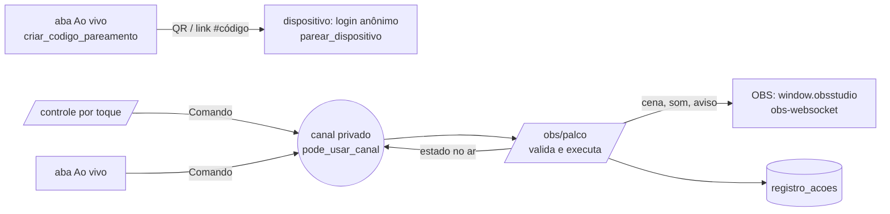

# VER-034 — Plano de implementação da etapa E3 (PLA-004): o primeiro ao vivo por toque

## Cabeçalho

| Campo | Valor |
|---|---|
| Id | VER-034 |
| Título | Plano de implementação da etapa E3 (PLA-004): o primeiro ao vivo por toque |
| Gravidade | média |
| Tipo | documentação · planejamento |
| Data | 2026-11-27 (data do commit, em UTC) |
| Usuário responsável | TokumoH |
| Status de implementação | somente documentação |
| Commits | commit que introduz este arquivo — `git log --diff-filter=A --format=%h -- docs/verificacoes/2026-11-27-034-plano-e3.md` |
| Arquivos | `docs/planos/2026-11-27-e3-ao-vivo-por-toque.md` (novo), `docs/planos/README.md`, `docs/verificacoes/README.md`, este registro (4 arquivos) |

## Problema

A E2 terminou com a preparação do episódio (Biblioteca, cenas, gestos, episódios e avisos), mas a E3 do [DES-001](../desenho/2026-11-16-revocast-cameras-desenho.md) (pareamento de dispositivos, `/obs/palco`, `/controle` por toque, modo teste, iniciar e encerrar o ao vivo) não tinha plano com tarefas, arquivos, interfaces, testes e ordem. A E3 é a primeira a usar o Realtime do Supabase (canais privados, presença) e o login anônimo, que nem a simulação dos testes nem as checagens de banco conheciam, e herda pendências dos planos anteriores: as políticas de `realtime.messages` e as funções da E3 (PLA-001), o aviso de revogação de membro e o login anônimo (PLA-002, D4 e D5) e iniciar e encerrar o ao vivo (PLA-003, D2).

## Era proposital?

Não. O plano é o passo seguinte depois da E2, como o PLA-003 foi depois da E1 ([VER-023](2026-11-26-023-plano-e2.md)).

## Solução

1. **PLA-004** em [`docs/planos/2026-11-27-e3-ao-vivo-por-toque.md`](../planos/2026-11-27-e3-ao-vivo-por-toque.md): decisões vigentes do responsável, restrições globais, decisões D1 a D16, foco da revisão (16 situações perigosas, cada uma com teste na tarefa dona), estrutura de arquivos e dez tarefas, cada uma com registro próprio (VER-035 a VER-044), dupla verificação, `npm run check` como último ato, commit e push:
   1. domínio: dispositivos (Acesso) e Ao vivo (mensagens, comandos, portas) — VER-035;
   2. simulação do Realtime e checagens de banco para `realtime.*` — VER-036;
   3. migração `ao_vivo_e_pareamento` e testes de banco da E3 — VER-037;
   4. adaptadores Supabase do pareamento, do ao vivo e do canal; composição por tipo de cliente — VER-038;
   5. Integração OBS e serviço do palco — VER-039;
   6. rotas de dispositivo: pareamento e `/obs/palco` no ar — VER-040;
   7. `/controle` por toque — VER-041;
   8. aba Ao vivo (1): dispositivos, pareamento com QR e revogação; aviso de revogação de membro — VER-042;
   9. aba Ao vivo (2): modo teste, iniciar e encerrar, checklist e comandos — VER-043;
   10. conferência no navegador e guia do ao vivo para o responsável — VER-044.
2. **Escopo da E3:** a equipe pareia os dispositivos pela aba Ao vivo (QR e link com código de uso único de 2 min; o dispositivo entra com login anônimo e chama `parear_dispositivo`), revoga quando precisar (no banco na hora; aviso pelo canal `estudio`), escolhe o modo teste e inicia e encerra o ao vivo. O `/obs/palco`, numa Fonte de navegador do OBS, segue o episódio ativo e executa cena, som, aviso, clipe e marcador pedidos por toque no `/controle` ou na aba Ao vivo, publica o estado no ar e grava `registro_acoes`. Gestos, câmera e o checklist completo ficam para E4–E6 (D8).
3. **Migração nova `ao_vivo_e_pareamento`:** a tabela `tentativas_pareamento` (RLS, nenhuma política, `revoke all`, em `SOMENTE_FUNCOES`); nove funções (`criar_codigo_pareamento`, `parear_dispositivo`, `meu_dispositivo`, `revogar_dispositivo`, `episodio_ativo`, `iniciar_ao_vivo`, `encerrar_ao_vivo`, `definir_modo_teste` e `pode_usar_canal`); duas políticas em `realtime.messages` (`canal_recebe` e `canal_envia`, `to authenticated`) chamando `pode_usar_canal`; privilégios por coluna em `episodios`, para que o estado do episódio só mude pelas funções (D7).
4. **Uma dependência nova, `lean-qr` 2.7.4** (D11, Tarefa 8): MIT, sem dependências, instalada pelo procedimento do npm 11 (`npx -y npm@11`, versão exata, `--before`, diff do lockfile e `check-deps-audit`). O obs-websocket usa `WebSocket` e `crypto.subtle` nativos, sem biblioteca (D10).
5. **`docs/planos/README.md`:** o PLA-004 no campo "Arquivos" e em "Onde".
6. **`docs/verificacoes/README.md`:** o VER-034 em "Arquivos" e "Onde"; o exemplo hipotético, que citava o número 032 (agora um registro real, como o 033), passa a `2026-11-30-045-exemplo.md`, porque o plano reserva 035 a 044.

**Decisões do responsável** (registradas no plano, seção "Decisões vigentes do responsável", e na execução):

| Data | Citação literal | Aplicação |
|---|---|---|
| 2026-11-22 | "Se a gravidade de erros for aceitável, prossiga sem necessidade de refazer dois testes seguidos" | Achado de texto, documentação, nit ou teste a mais, sem tocar segurança, sem mudar comportamento de código e sem enfraquecer teste: corrigir com reconferência pontual registrada; qualquer outro achado: corrigir e verificar de novo, até duas rodadas seguidas sem erro |
| 2026-11-26 | "Seja autonomo, pode seguir e me entregar o projeto completo" | Dada em resposta ao pedido de push (VER-014). O agente principal segue sem pedir aprovação a cada tarefa e faz commit e push de cada item verificado da entrega E1–E6, por autorização explícita e permanente até ser revogada; cada push informa o estado. O `CLAUDE.md` não é editado; revogada a autorização, volta a regra dele. Continuam proibidos sem pedido explícito: criar, renomear ou apagar branch; merge; PR; trazer conteúdo de outra branch ou do remoto; descartar trabalho; reescrever commit enviado; fundir commits de itens diferentes |
| 2026-11-26 | "Resolve" (sobre dependências) | Dependência npm nova só pelo procedimento do npm 11 (`npx -y npm@11`) registrado no PLA-002; na E3, só a `lean-qr` |
| 2026-11-27 | "pause" e, depois, "continue" | Pedido de pausa no meio das correções do plano e, em seguida, de retomada; o trabalho parou e voltou do mesmo ponto, sem mudar as outras decisões |

**Decisões D1 a D16 do plano**, propostas pelo agente sob a autonomia e aceitas pelo controlador (seção "Decisões sobre lacunas e divergências do desenho"):

| # | Decisão |
|---|---|
| [D1](../planos/2026-11-27-e3-ao-vivo-por-toque.md#L64) | Pareamento e dispositivos no domínio `acesso` (arquivo e porta próprios); nascem `src/domains/aovivo/` e `src/domains/obs/` |
| [D2](../planos/2026-11-27-e3-ao-vivo-por-toque.md#L66) | Código de pareamento não digitado, de alta entropia, de uso único e 2 min, com limite de 5 falhas em 10 min por sessão anônima (`tentativas_pareamento`) |
| [D3](../planos/2026-11-27-e3-ao-vivo-por-toque.md#L79) | A rota de dispositivo lê o fragmento uma vez, confere a forma e o apaga com `history.replaceState` antes de qualquer chamada |
| [D4](../planos/2026-11-27-e3-ao-vivo-por-toque.md#L81) | Um cliente Supabase por tipo de dispositivo; a avaliação usa `meu_dispositivo()` e recusa sessão não anônima |
| [D5](../planos/2026-11-27-e3-ao-vivo-por-toque.md#L93) | `revogar_dispositivo` marca `revogado_em`, apaga os códigos pendentes e devolve a sessão revogada, avisada pelo canal `estudio` |
| [D6](../planos/2026-11-27-e3-ao-vivo-por-toque.md#L95) | As políticas de `realtime.messages` chamam uma função só, `pode_usar_canal`; a autorização é conferida pelo servidor do Realtime por `realtime.authorize` |
| [D7](../planos/2026-11-27-e3-ao-vivo-por-toque.md#L106) | O estado do episódio só muda por função (`iniciar_ao_vivo`, `encerrar_ao_vivo`, `definir_modo_teste`), com privilégios por coluna em `episodios` |
| [D8](../planos/2026-11-27-e3-ao-vivo-por-toque.md#L108) | Ficam para depois: interruptor de gestos e onde reconhecer (E5/E4), o tópico `:video` (E4), registro em tempo real e checklist completo (E6) |
| [D9](../planos/2026-11-27-e3-ao-vivo-por-toque.md#L110) | `Comando` com `id` e ação; o palco valida, descarta repetido e de remetente revogado, executa, publica o estado no ar e grava o registro |
| [D10](../planos/2026-11-27-e3-ao-vivo-por-toque.md#L112) | obs-websocket v5 sem biblioteca, com `WebSocket` e `crypto.subtle` nativos, para o marcador e a versão do OBS |
| [D11](../planos/2026-11-27-e3-ao-vivo-por-toque.md#L119) | QR com `lean-qr` 2.7.4 (MIT, sem dependências), em vez de um codificador próprio de cerca de 400 linhas sem decodificador para provar |
| [D12](../planos/2026-11-27-e3-ao-vivo-por-toque.md#L128) | Iniciar e encerrar o ao vivo na aba Ao vivo, junto do modo teste, do checklist e dos dispositivos conectados |
| [D13](../planos/2026-11-27-e3-ao-vivo-por-toque.md#L130) | Checklist mínimo: os itens do DES-001 §10.4 como lista fixa e os automáticos com sinal de pronto/pendente |
| [D14](../planos/2026-11-27-e3-ao-vivo-por-toque.md#L132) | Presença em `estudio` com a chave `auth.uid()` e corpo sem e-mail nem nome |
| [D15](../planos/2026-11-27-e3-ao-vivo-por-toque.md#L134) | Rede caindo: o adaptador traduz os estados do canal; o `/controle` desabilita os botões e mostra "Reconectando…" |
| [D16](../planos/2026-11-27-e3-ao-vivo-por-toque.md#L136) | Na transmissão, o palco nunca mostra nada além do aviso no ar sobre fundo transparente; o selo de estado só aparece pela tecla `s`, fora do ar |

## Por que esta solução

- **DDD, GRASP Pure Fabrication e Componentes:** o pareamento fica no contexto Acesso; os contextos Ao vivo e Integração OBS (camada anticorrupção) nascem com regras puras e portas; os adaptadores (`dispositivoSupabase`, `aoVivoSupabase`, `canalSupabase`, `obsNavegador`) ficam em `shared/infra`.
- **Segurança:** o código de pareamento não sai do fragmento nem fica na URL; o pareamento tem limite de tentativas; a autorização dos canais privados fica numa função do banco conferida pelas checagens; o estado do episódio só muda por função; a revogação vale no banco na hora; a senha do OBS não sai do computador.
- **Uma dependência só:** a `lean-qr` evita um codificador de QR próprio sem prova; o obs-websocket usa APIs nativas.

## Por que não outras soluções

| Opção | Motivo de descarte |
|---|---|
| Implementar a E3 direto, sem plano | Realtime, login anônimo e OBS são novos para a simulação e as checagens; as decisões de segurança ficariam implícitas |
| Código curto digitado | A força viria do tamanho; como vai no QR ou no link, a entropia alta não custa nada (D2) |
| Uma política por tópico em `realtime.messages` | Espalharia a regra; uma função só é conferida num lugar e testada em PGlite (D6) |
| `update` livre de `estado` em `episodios` | Era o limite dos Riscos do VER-030; as funções garantem as transições (D7) |
| Codificador de QR próprio | Umas 400 linhas sem decodificador para provar (D11) |
| `obs-websocket-js` | Dependência a mais para dois pedidos (`CreateRecordChapter`, `GetVersion`) que o protocolo v5 resolve com APIs nativas (D10) |
| Iniciar e encerrar na aba Episódios (DES-001 §9) | Ficariam longe do modo teste, do checklist e dos dispositivos conectados (D12) |

## Onde

| Arquivo | Linhas | O que mudou |
|---|---|---|
| [`docs/planos/2026-11-27-e3-ao-vivo-por-toque.md`](../planos/2026-11-27-e3-ao-vivo-por-toque.md#L1-L880) | 1–880 | Novo: PLA-004. Decisões do responsável ([21–30](../planos/2026-11-27-e3-ao-vivo-por-toque.md#L21-L30)); restrições globais, com a dependência nova e as nove funções ([32–60](../planos/2026-11-27-e3-ao-vivo-por-toque.md#L32-L60)); D1 a D16 ([62–136](../planos/2026-11-27-e3-ao-vivo-por-toque.md#L62-L136)); foco da revisão ([138–157](../planos/2026-11-27-e3-ao-vivo-por-toque.md#L138-L157)); tarefas 1 a 10 ([200](../planos/2026-11-27-e3-ao-vivo-por-toque.md#L200), [324](../planos/2026-11-27-e3-ao-vivo-por-toque.md#L324), [362](../planos/2026-11-27-e3-ao-vivo-por-toque.md#L362), [550](../planos/2026-11-27-e3-ao-vivo-por-toque.md#L550), [669](../planos/2026-11-27-e3-ao-vivo-por-toque.md#L669), [723](../planos/2026-11-27-e3-ao-vivo-por-toque.md#L723), [768](../planos/2026-11-27-e3-ao-vivo-por-toque.md#L768), [794](../planos/2026-11-27-e3-ao-vivo-por-toque.md#L794), [836](../planos/2026-11-27-e3-ao-vivo-por-toque.md#L836), [851](../planos/2026-11-27-e3-ao-vivo-por-toque.md#L851)); passo do responsável ([861](../planos/2026-11-27-e3-ao-vivo-por-toque.md#L861)); "Ao fim da E3" ([874–880](../planos/2026-11-27-e3-ao-vivo-por-toque.md#L874-L880)) |
| [`docs/planos/README.md`](../planos/README.md#L14) | 14, 50 | PLA-004 no campo "Arquivos" (14) e em "Onde" (50) |
| [`docs/verificacoes/README.md`](README.md#L14) | 14, 87, 110 | VER-034 no campo "Arquivos" (14) e em "Onde" (87); exemplo hipotético passa ao número 045 (110) |

## Lógica

| Passo | Antes | Depois |
|---|---|---|
| Dispositivos | Sem pareamento | Código de uso único por QR ou link, login anônimo, `parear_dispositivo`, revogação com aviso |
| Realtime | Fora da simulação e das checagens | Simulação do Realtime e checagens para `realtime.*`; duas políticas com `pode_usar_canal` |
| Estado do episódio | `equipe` mudava `estado` pela API (Riscos do VER-030) | Só por função, com privilégios por coluna |
| Ao vivo | Abas provisórias | `/obs/palco` executando os comandos do `/controle` e da aba Ao vivo; modo teste; iniciar e encerrar |
| Dependências | — | `lean-qr` 2.7.4 |

## Exemplo

Foco da revisão: um link de pareamento com o fragmento `#<código>` é aberto no OBS. A rota confere a forma do código, apaga o fragmento antes de qualquer chamada, entra com login anônimo e chama `parear_dispositivo`; o código vale uma vez e por 2 min, e cinco palpites errados em 10 min na mesma sessão dão `limite` sem nem procurar o código (D2, D3).

## Verificação

| # | Abordagem | Resultado |
|---|---|---|
| Revisão 1 do plano | Revisor independente, contra o DES-001, o `CLAUDE.md`, o repositório e as decisões do responsável, com sondas próprias | Com erros: 6 Importantes e 6 nits. Destaques: os testes da E0 que a migração derruba, o rótulo do dispositivo, o registro de canais, a revogação na troca de papel, o palco na transmissão e o `realtime.authorize`. Corrigidos |
| Pausa e retomada | Pedido do responsável em 2026-11-27 ("pause", depois "continue") no meio das correções | O trabalho parou e voltou do mesmo ponto |
| Revisão 2 do plano | Revisor novo, conferindo os 12 achados anteriores e procurando novos | Os 12 achados anteriores resolvidos (o I3 em parte). Novos: 2 Importantes de código (canal fechado e reabertura; eco local com `self: false`) e 4 nits. Todos corrigidos |
| Decisão do controlador | — | O plano é commitado sem uma terceira revisão do documento: o código real é revisado nas Tarefas 4 e 9; o custo, se estiver errado, é retrabalho |
| `npm run check` sobre o conteúdo do commit | Controlador, como último ato antes do commit | Feito pelo controlador antes do commit |
| Redação | `node scripts/check-docs.mjs` e `node scripts/check-doc-secrets.mjs` | 0 erros |

## Riscos

- **Passos do responsável** (Tarefa 10, Passo 5): sem eles o ao vivo não funciona no projeto real. Incluem as pendências das etapas anteriores, aplicar a migração `ao_vivo_e_pareamento`, a conferência por consulta, ligar o login anônimo no Auth (com o limite de logins anônimos por IP), desligar o acesso público do Realtime, o OBS 30.2 ou mais novo configurado e a conferência real num celular Android e num iPhone (Safari).
- **O `postgres` real em `realtime.messages` e o `realtime.authorize`:** no Supabase, criar as políticas em `realtime.messages` depende da extensão `supautils`, e a autorização dos canais depende de `realtime.authorize`; os dois ainda não foram confirmados num projeto real (Tarefa 2). Se o editor SQL recusar com `42501` ou `must be owner`, o plano manda não contornar e registrar.
- **Tópico antigo:** a autorização de um canal privado só é conferida de novo na entrada, na reconexão ou na renovação do token (JWT de 10 min); até lá, quem perdeu o acesso ainda recebe o tópico.
- **Palco ao ar antes de parear:** a Fonte do OBS está em todas as cenas, e a transmissão pode começar antes do pareamento; o palco não mostra nada além do aviso no ar (D16), mas depende de o OBS estar configurado como o guia manda.
- **Eventos `*Starting` do OBS:** o comportamento deles ainda precisa ser confirmado na Tarefa 5.
- **Sem terceira revisão do plano:** os achados da revisão 2 foram corrigidos sem nova rodada do documento; o código é revisado nas tarefas.
- Esta linha nova em "Onde" de `docs/verificacoes/README.md` (87) desloca uma linha a seção "Exemplo", que registros antigos citam por linha; o arquivo não encolheu.
