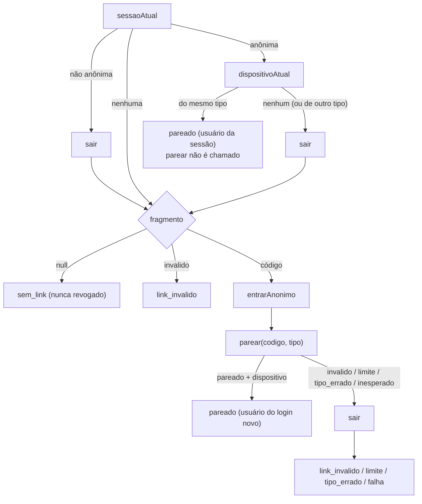

# VER-035 — E3, Tarefa 1: domínio — dispositivos (Acesso) e Ao vivo (mensagens validadas, comandos, portas)

## Cabeçalho

| Campo | Valor |
|---|---|
| Id | VER-035 |
| Título | E3, Tarefa 1: domínio — dispositivos (Acesso) e Ao vivo (mensagens validadas, comandos, portas) |
| Gravidade | média |
| Tipo | implementação · decisão de arquitetura · segurança |
| Data | 2026-11-27 (data do commit, em UTC) |
| Usuário responsável | TokumoH |
| Status de implementação | implementado |
| Commits | commit que introduz este arquivo — `git log --diff-filter=A --format=%h -- docs/verificacoes/2026-11-27-035-e3-dominio-ao-vivo.md` |
| Arquivos | `src/domains/acesso/dispositivos.ts`, `src/domains/acesso/dispositivos.test.ts`, `src/domains/acesso/portasDeDispositivo.ts`, `src/domains/aovivo/README.md`, `src/domains/aovivo/{mensagens,comandos,portas}.ts`, `src/domains/aovivo/{mensagens,comandos}.test.ts` (novos), `src/domains/acesso/README.md`, `src/domains/README.md`, `src/README.md`, `docs/verificacoes/README.md`, este registro (14 arquivos) |

## Problema

**Pendências da E2 (abertura exigida pelo [PLA-004](../planos/2026-11-27-e3-ao-vivo-por-toque.md#L196), "Estrutura de arquivos"):**

| Pendência | Origem | Situação em 2026-11-27 |
|---|---|---|
| Aplicar a migração `20261126190407_biblioteca_storage.sql` no editor SQL (e não contornar um `must be owner of table objects`) | [PLA-003](../planos/2026-11-26-e2-preparar-episodio.md#L685), Tarefa 8, Passo 5, itens 1–2 ([VER-026](2026-11-26-026-e2-banco-biblioteca.md), [VER-031](2026-11-27-031-e2-conferencia-e-guia.md)) | sem resultado informado pelo responsável: **continua pendente** |
| Conferência por consulta (bucket `midias` privado, 50 MB, 8 tipos; três políticas `midias_storage_*` para `{authenticated}`, nenhuma de `update`) | PLA-003, Tarefa 8, Passo 5, item 3 (guia "Biblioteca no Storage (E2)" em `supabase/README.md`) | **continua pendente** (depende da anterior) |
| Conferência real (`equipe` envia som e imagem, prévia, 👍 → "aplauso", exclusão bloqueada, cena com o nome do OBS, episódio com dois avisos, uso em MB; `apresentadora` sem `/painel`) | PLA-003, Tarefa 8, Passo 5, itens 4–5 | **continua pendente** |
| Pendências da E0 e da E1 (deploy de prévia; migração de fundação e primeiro `admin`; `membros_sem_autoalteracao`; login Google; conferência real) | PLA-003, Tarefa 8, Passo 5, item 1 ([VER-024](2026-11-26-024-e2-dominio-preparacao.md), Problema) | sem resultado informado: **continuam pendentes** |

Nenhum código da E3 depende delas; só a conferência real da Tarefa 10 da E3.

**O problema da tarefa:** a E3 põe dispositivos e mensagens de tempo real no app pela primeira vez. Cada ponto tem um perigo do "Foco da revisão" do PLA-004: código de pareamento fora da forma chegando à rede (item 1), sessão anônima revogada que volta a valer ou fica guardada sem dispositivo (itens 4 e 5), sessão de membro no cliente de um dispositivo (item 5), mensagem forjada no canal com campos a mais, uuid em maiúsculas ou `__proto__` (item 6), comando para cena, som ou aviso que não existe (item 8), e o toque "mostrar o aviso X", que o enum `acao_gesto` não tem. Sem um lugar único e testável, essas regras iriam para os adaptadores (Tarefa 4), o palco (Tarefa 5) e as telas (Tarefas 6 a 9), repetidas e só testáveis com `realtime-js`, jsdom ou OBS falsos. Também não havia **portas** para os adaptadores, os falsos de tela e o palco escreverem contra o mesmo contrato.

## Era proposital?

Não. `Dispositivo` e `CodigoDePareamento` estão no contexto Acesso do [DES-001](../desenho/2026-11-16-revocast-cameras-desenho.md) (§6) desde o desenho, e o contexto Ao vivo (`Comando`, `EstadoNoAr`, `RegistroDeAcao`) e a pasta `src/domains/aovivo/` também (§6 e §6.1). O PLA-004 põe os dois na Tarefa 1 da E3 ([estrutura de arquivos](../planos/2026-11-27-e3-ao-vivo-por-toque.md#L161), [Tarefa 1](../planos/2026-11-27-e3-ao-vivo-por-toque.md#L200)). A tabela `dispositivos` e `registro_acoes` existem desde a migração de fundação (VER-010), sem regra no cliente até aqui; o `src/domains/README.md` já anunciava "o pareamento entra em `acesso/` na E3".

## Solução

**Contexto Acesso** (arquivo e porta próprios, sem mexer no que a E1 provou):

- `dispositivos.ts`: `TipoDeDispositivo`; `ROTULO_DO_TIPO` e `CAMINHO_DO_TIPO` (congelados); `FORMA_DO_CODIGO` (`^[A-Za-z0-9_-]{43}$`); `COLUNAS_DE_MEU_DISPOSITIVO` (`id`, `tipo`, `rotulo`, `camera_id`: as colunas de `public.meu_dispositivo()`, que o teste de banco da Tarefa 3 e o adaptador da Tarefa 4 usam); `codigoDoFragmento` (`''`/`'#'` → `null`; `#` + código na forma → código; o resto → inválido, nada decodificado); `linkDePareamento` (`new URL(origem).origin` + caminho do tipo + `#código`; só `https:` ou `http:` em `localhost`/`127.0.0.1`; tipo fora da lista ou código fora da forma lança, e a mensagem nunca leva o código); `conferirRotulo` (aparado, 1 a 60 pontos de código); `Dispositivo`; `situacaoDoDispositivo` (revogado vence a presença; sem `pareadoEm` → nunca pareado); `EstadoDoDispositivo`; `resolverDispositivo` na ordem da D4, num `try` só.
- `portasDeDispositivo.ts`: `MotivoDoDispositivo`, `ErroDeDispositivo` (mensagem só com o motivo) e `ServicoDeDispositivo`.

**Contexto Ao vivo** (`src/domains/aovivo/`, novo, com README de 11 seções):

- `mensagens.ts`: tipos das mensagens (`MensagemDoEstudio`, `SituacaoDoObs`, `PresencaNoEstudio`, `Comando`, `ResultadoDoComando`, `EstadoNoAr`), `UUID` (minúsculas), `EVENTOS_DO_CONTROLE`, `MOTIVOS_DO_RESULTADO` (lista fechada), e os leitores `lerRemetente`, `lerMensagemDoEstudio`, `lerComando`, `lerEstadoNoAr`, `lerPresenca`: objeto simples (protótipo `Object.prototype` ou nulo), só chaves próprias, **nenhuma chave fora da forma** (inclusive `__proto__` e símbolos), cada campo no tipo, tamanho e lista, objeto novo montado campo a campo; `Revogados` (15 min, `REVOGACAO_LEMBRADA_MS = 900_000`).
- `comandos.ts`: `AcaoNoObs`, `MotivoDaRecusa`, `TAMANHO_DO_MARCADOR`, `ContextoDoComando`, `resolverComando` e `linhaDoRegistro`/`LinhaDoRegistro`.
- `portas.ts`: `MotivoDoAoVivo`, `ErroDoAoVivo`, `EstadoDoCanal`, `RespostaDoEnvio`, `CanalDoEstudio`, `CanalDoControle`, `FabricaDeCanais`, `RepositorioDoAoVivo`, `RepositorioDoPalco` e `ExecutorDeAcoes`.

**Decisões do PLA-004 aplicadas aqui:**

| Decisão | Como entra |
|---|---|
| [D1](../planos/2026-11-27-e3-ao-vivo-por-toque.md#L64) | Pareamento em `acesso/` (`dispositivos.ts` e `portasDeDispositivo.ts`); `aovivo/` só com mensagens, comandos, estado, registro e portas, inclusive `ExecutorDeAcoes` (não conhece o OBS); dependência entre domínios só de tipos, de `aovivo` para `acesso` e `preparacao` |
| [D2](../planos/2026-11-27-e3-ao-vivo-por-toque.md#L66) | `FORMA_DO_CODIGO` com 43 caracteres base64url sem `=`; `parear(codigo, tipo)` recebe o tipo da rota; as quatro respostas (`pareado`, `invalido`, `tipo_errado`, `limite`) |
| [D3](../planos/2026-11-27-e3-ao-vivo-por-toque.md#L79) | `codigoDoFragmento` confere a forma sem rede; com dispositivo válido do tipo, o fragmento é ignorado |
| [D4](../planos/2026-11-27-e3-ao-vivo-por-toque.md#L81) | `resolverDispositivo`: não anônima → sai; anônima com dispositivo do tipo (`meu_dispositivo()`, I2) → pareado; anônima sem dispositivo → sai e, com código, login anônimo **novo**; sem código → `sem_link` (nunca `revogado`, N1); toda resposta que não seja `pareado` termina com `sair()` (N1) |
| [D5](../planos/2026-11-27-e3-ao-vivo-por-toque.md#L93) | `Revogados` por 15 min; `RepositorioDoAoVivo.revogar` devolve a sessão revogada |
| [D6](../planos/2026-11-27-e3-ao-vivo-por-toque.md#L95) | Toda mensagem é validada no domínio antes de qualquer efeito (forma, tamanhos, uuid minúsculo, remetente declarado) |
| [D9](../planos/2026-11-27-e3-ao-vivo-por-toque.md#L110) | `Comando`, `EstadoNoAr`, `resolverComando` (alvo inexistente → recusa sem executar; `proxima_cena` volta ao início; `proximo_aviso` para no último), `linhaDoRegistro` (`origem = 'toque'`, `membroId` = remetente, `teste` = modo teste, `aviso` gravado como `proximo_aviso` com o `avisoId`) |
| [D14](../planos/2026-11-27-e3-ao-vivo-por-toque.md#L132) | `PresencaNoEstudio` sem e-mail e sem nome; o leitor recusa campo a mais |
| [D15](../planos/2026-11-27-e3-ao-vivo-por-toque.md#L134) | `EstadoDoCanal` e `RespostaDoEnvio` nas portas |

**Ajustes do implementador em relação ao texto da tarefa** (cada um com teste):

1. **`motivo` tipado pela lista fixa.** O brief tem `motivo: string | null` em `EstadoNoAr.ultimo` e em `ExecutorDeAcoes.executar`, e pede "`motivo` ∈ lista fixa" no leitor. Com `string`, o executor da Tarefa 5 poderia publicar um motivo que o `/controle` descartaria inteiro (o estado todo cai no leitor). Os dois passam a `MotivoDoResultado | null`, da lista `MOTIVOS_DO_RESULTADO`, que já traz as recusas de `resolverComando` e os motivos do executor previstos na Tarefa 5 (`cena_inexistente_no_obs`, `sem_permissao`, `replay_desligado`, `sem_websocket`, `sem_gravacao`, `obs_ausente`); o compilador acusa motivo fora dela, e um teste prova `MotivoDaRecusa ⊂ MOTIVOS_DO_RESULTADO` em tipo e em execução.
2. **Forma fechada nos leitores.** Qualquer chave fora da forma derruba a mensagem (não só é ignorada); são toleradas só `remetente` (acrescentado pelo adaptador em todo `payload`, Tarefa 4), `presence_ref` (acrescentado pelo `realtime-js` em cada registro de presença) e, em `estudio`, um `evento` igual ao do Broadcast. Assim "campo extra" e `__proto__` dão `null`, e o objeto devolvido é sempre novo (testes `mensagens-validadas`; sabotagens S6 e S13).
3. **`EVENTOS_DO_CONTROLE`** (`comando`, `estado`) exportado para que o adaptador e o palco usem os mesmos nomes de evento do tópico `:controle`.
4. **`ContextoDoComando.agora?: Date`** para a hora do marcador (padrão: agora), em vez de ler o relógio sem como testar; hora local do computador do OBS; título cortado para a hora caber nos 100 caracteres.
5. **`sair` que lança → `falha`.** O brief pede um `try` único; diferente do `sairSemFalhar` da E1, uma saída que falhe não deixa seguir (nunca parear com a sessão que deveria ter saído, nunca devolver uma recusa com a sessão órfã guardada). A porta promete que a saída local não lança.
6. **Resposta inesperada do `parear`** (`pareado` sem dispositivo, ou resultado fora da lista) → `sair()` e `falha`, nunca `pareado`.
7. **Sessão anônima com dispositivo de outro tipo** no cliente do tipo (não deveria existir: um `storageKey` por tipo) → tratada como sem dispositivo (sai).
8. **`proximo_aviso` com a lista vazia** → `fim_dos_avisos`; `lerPresenca` exige `obs` (nulo fora do palco); `avisoAte` ≥ 0; `nivel` inteiro de 0 a 5; versões até 40 caracteres; `presence_ref` até 100.

## Por que esta solução

- **DDD:** regras e portas no domínio, sem React, Supabase, `shared/` ou `app/` (o `arquitetura.test.ts` cobre a pasta nova sem configuração); os adaptadores (Tarefa 4) e a Integração OBS (Tarefa 5) implementam as portas.
- **GRASP Pure Fabrication:** `resolverDispositivo` coordena sessão, login anônimo e pareamento, o que nenhuma entidade faria sozinha; os leitores de `mensagens.ts` são a fabricação que separa "o que veio de fora" de "o que o app aceita"; `ExecutorDeAcoes` isola o OBS.
- **Componentes:** um arquivo por conceito, com o teste ao lado; o eco local do canal, o palco e o `/controle` passam pelo mesmo leitor.
- **Segurança:** a forma do código é conferida antes da rede e o erro nunca leva o código; o link só sai `https:` (ou `http:` local); nenhuma **resposta** de recusa do pareamento deixa sessão guardada (exceção depois do login anônimo mantém a sessão de propósito: o pareamento pode ter valido no banco, e a avaliação seguinte a recupera ou sai) e a revogada nunca volta a valer; `revogado` nunca é inventado depois de uma recarga; a mensagem do canal é recusada a menos que tenha exatamente a forma esperada; o estado no ar só leva motivos conhecidos (nunca texto de erro do OBS); a presença não leva e-mail.
- **Otimização:** funções puras e síncronas (menos `resolverDispositivo`), sem estado global; `Revogados` limpa as entradas vencidas a cada `revogar`; os 158 testes novos rodam em menos de 1 s, sem jsdom.

## Por que não outras soluções

| Opção | Motivo de descarte |
|---|---|
| Validar mensagens só no adaptador do canal | O eco local, o palco e os falsos de tela repetiriam a regra; o domínio é testável sem `realtime-js` |
| Conferir os campos e devolver `{ ...payload }` | Leva campo a mais e `__proto__` (chave própria do `JSON.parse`) para dentro do app (sabotagem S6) |
| Ignorar campos extras em vez de recusar | Um estado com `texto` ou `senha` a mais passaria adiante se alguém espalhasse o objeto depois (sabotagem S13) |
| `motivo: string` como no brief | O executor poderia publicar texto livre (mensagem do OBS) ou um motivo que o `/controle` descartaria com o estado inteiro (ajuste 1; sabotagem S12) |
| `sairSemFalhar` como na E1 | Seguiria para `entrarAnonimo`/`parear` ou devolveria uma recusa com a sessão que devia ter saído ainda guardada (ajuste 5) |
| Reaproveitar a sessão anônima sem dispositivo para parear | A sessão revogada voltaria a valer, e o aviso de revogação que citou o `uid` antigo atingiria o aparelho pareado de novo (D4; sabotagem S3) |
| Devolver `revogado` para sessão anônima sem dispositivo | Depois de recarregar não se sabe se houve revogação (nunca pareado, pareamento incompleto); "revogado" só pelo aviso do canal (N1; sabotagem S5) |
| Ler o rótulo do dispositivo por `dispositivo_atual()` | A função de fundação não tem `rotulo`; `meu_dispositivo()` (I2) devolve as quatro colunas de `COLUNAS_DE_MEU_DISPOSITIVO` |
| Pôr dispositivos em `portas.ts`/`resolverAcesso.ts` da E1 | O dispositivo não tem papel nem e-mail e usa um cliente por tipo; misturar mexeria no que a E1 provou (D1) |

## Onde

| Arquivo | Linhas | O que mudou |
|---|---|---|
| [`src/domains/acesso/dispositivos.ts`](../../src/domains/acesso/dispositivos.ts#L1-L171) | 1–171 | Novo: tipos, rótulos e caminhos (L4–L18), `FORMA_DO_CODIGO` (L21), `COLUNAS_DE_MEU_DISPOSITIVO` (L28), `codigoDoFragmento` (L37), `linkDePareamento` (L55), `conferirRotulo` (L75), `Dispositivo` (L83), `situacaoDoDispositivo` (L98), `EstadoDoDispositivo` (L105), `resolverDispositivo` (L135) |
| [`src/domains/acesso/portasDeDispositivo.ts`](../../src/domains/acesso/portasDeDispositivo.ts#L1-L35) | 1–35 | Novo: `MotivoDoDispositivo`, `ErroDeDispositivo`, `ServicoDeDispositivo` |
| [`src/domains/acesso/dispositivos.test.ts`](../../src/domains/acesso/dispositivos.test.ts#L1-L324) | 1–324 | Novo: 52 testes, com um `ServicoDeDispositivo` falso que anota a ordem das chamadas |
| [`src/domains/aovivo/mensagens.ts`](../../src/domains/aovivo/mensagens.ts#L1-L307) | 1–307 | Novo: tipos, `UUID` (L21), `EVENTOS_DO_CONTROLE` (L24), `MOTIVOS_DO_RESULTADO` (L58), `EstadoNoAr` (L75), auxiliares da forma fechada, `lerRemetente` (L137), `lerMensagemDoEstudio` (L147), `lerComando` (L181), `lerEstadoNoAr` (L241), `lerPresenca` (L262), `REVOGACAO_LEMBRADA_MS` (L282), `Revogados` (L289) |
| [`src/domains/aovivo/comandos.ts`](../../src/domains/aovivo/comandos.ts#L1-L140) | 1–140 | Novo: `AcaoNoObs` (L8), `MotivoDaRecusa` (L17), `TAMANHO_DO_MARCADOR` (L20), `ContextoDoComando` (L23), `resolverComando` (L57), `LinhaDoRegistro` (L94), `linhaDoRegistro` (L127) |
| [`src/domains/aovivo/portas.ts`](../../src/domains/aovivo/portas.ts#L1-L95) | 1–95 | Novo: `ErroDoAoVivo`, estados do canal, alças `CanalDoEstudio`/`CanalDoControle`, `FabricaDeCanais`, `RepositorioDoAoVivo`, `RepositorioDoPalco`, `ExecutorDeAcoes` |
| [`src/domains/aovivo/mensagens.test.ts`](../../src/domains/aovivo/mensagens.test.ts#L1-L289) | 1–289 | Novo: 92 testes (`mensagens-validadas`, `revogados-expiram`) |
| [`src/domains/aovivo/comandos.test.ts`](../../src/domains/aovivo/comandos.test.ts#L1-L153) | 1–153 | Novo: 13 testes (`comando-alvo-inexistente`, `proxima-cena`, `proximo-aviso`, `ocultar-sem-aviso`, `marcador-com-nome`, `registro`) |
| [`src/domains/aovivo/README.md`](../../src/domains/aovivo/README.md#L1-L114) | 1–114 | Novo: README de 11 seções; em "Lógica", o diagrama comando → palco → OBS → estado e a ordem dos leitores |
| [`src/domains/acesso/README.md`](../../src/domains/acesso/README.md#L14-L157) | 14, 18, 24–25, 31, 65–67, 81, 86–88, 106–119, 131–141, 144–145, 154–157 | Dispositivos em "Arquivos", "Propósito", "Origem", "Organização", "Onde" e no diagrama; tabela da ordem da D4 em "Lógica"; exemplo do pareamento; "Verificação" (7 arquivos, 94 testes) e três riscos novos |
| [`src/domains/README.md`](../../src/domains/README.md#L14-L76) | 14, 22, 26–27, 50–51, 65, 71, 75–76 | `aovivo/` em "Arquivos", "Origem", "Organização" (com a regra de tipos entre domínios), "Onde", "Lógica", "Exemplo" e "Verificação" (16 arquivos, 267 testes) |
| [`src/README.md`](../../src/README.md#L27-L47) | 27, 47 | `domains/aovivo/` em "Organização" e "Onde" |
| [`docs/verificacoes/README.md`](README.md) | "Arquivos" e "Onde" | Linha deste registro (o exemplo continua em 045) |

## Lógica

| Passo | Antes | Depois |
|---|---|---|
| Fragmento da rota de dispositivo | Não havia regra | `codigoDoFragmento`: forma conferida sem rede; `%2F`, `=`, 42/44 caracteres → inválido |
| Link do painel | — | `linkDePareamento`: só a origem, `https:` (ou `http:` local), código na forma; erro sem o código |
| Sessão do dispositivo | — | `resolverDispositivo` na ordem da D4 (tabela abaixo) |
| Mensagem do canal | — | leitor: objeto simples → chaves da forma → campos próprios → tipo/tamanho/lista → objeto novo |
| Comando | — | `resolverComando`: alvo inexistente → recusa com motivo, nada executado |
| Registro | — | `linhaDoRegistro`: `toque`, remetente, teste; `aviso` → `proximo_aviso` com `avisoId` |

Ordem de `resolverDispositivo` (cada passo para no primeiro que decide; erro em qualquer chamada → `falha`):

## Exemplo

| Entrada | Saída obtida |
|---|---|
| `codigoDoFragmento('#' + 43 caracteres base64url)` / `''` / `'#'` / com `=` / com `%2F` / 42 ou 44 caracteres | código / `null` / `null` / `{ invalido: true }` (`codigo-do-fragmento`) |
| `linkDePareamento('https://app.revocast.test/x?y', 'obs_palco', c)` | `https://app.revocast.test/obs/palco#<c>`; `http://revocast.test` e `javascript:alert(1)` lançam (`link-de-pareamento`) |
| sem sessão, código, `parear` → `tipo_errado` | chamadas `sessaoAtual`, `entrarAnonimo`, `parear(c, obs_palco)`, `sair`; estado `tipo_errado` (`sem-sessao-orfa`) |
| sessão anônima sem dispositivo, com código | `sessaoAtual`, `dispositivoAtual`, `sair`, `entrarAnonimo`, `parear`; `pareado` com o usuário **novo** (`nova-sessao-ao-reparear`) |
| sessão anônima sem dispositivo, sem código | `sessaoAtual`, `dispositivoAtual`, `sair`; `sem_link`, nunca `revogado` (`recarga-nao-diz-revogado`) |
| `lerComando({ id, acao: 'clipe', papel: 'admin' })` / `JSON.parse('{"__proto__":{…},"id":…,"acao":"marcador"}')` | `null` / `null` (`mensagens-validadas`) |
| `lerEstadoNoAr` com `cenaObs` de 201 caracteres, `avisoAte: Infinity` ou `motivo: 'Erro: senha do OBS é 123'` | `null` (`mensagens-validadas`) |
| `Revogados` com relógio falso: 899 999 ms depois de `revogar` / 900 000 ms | contém / não contém (`revogados-expiram`) |
| cenas de ordem `[A,B,C]`, OBS em `C`, `proxima_cena` | `trocar_cena` para `A` (`proxima-cena`) |
| avisos `[21,22,23]` pela ordem, no ar `23`, `proximo_aviso` | `{ ok: false, motivo: 'fim_dos_avisos' }` (`proximo-aviso`) |
| `marcador`, título "Episódio 12", 20:05:09 | `Episódio 12 20:05:09`; título de 120 emojis → 91 emojis + ` 20:05:09` = 100 (`marcador-com-nome`) |
| `aviso` com `avisoId` X, modo `teste`, remetente R | `{ origem: 'toque', acao: 'proximo_aviso', avisoId: X, membroId: R, teste: true, … }` (`registro`) |

## Verificação

**TDD:** os três arquivos de teste foram escritos antes do código: `npx vitest run src/domains` → 3 arquivos com falha (`Cannot find module './mensagens'` e equivalentes), 13 arquivos e 112 testes antigos passando. Depois da implementação: 16 arquivos, 265 testes passando (dois testes de `mensagens.test.ts` falharam primeiro por um defeito do próprio teste: o remetente de exemplo só com dígitos não muda em maiúsculas; o exemplo passou a ter letras). Dois testes a mais (resposta inesperada do `parear`; `MotivoDaRecusa ⊂ MOTIVOS_DO_RESULTADO`): 16 arquivos, 267 testes; depois da revisão 1 (abaixo), **16 arquivos, 269 testes**. `npx tsc --noEmit`: 0 erros.

**Sabotagens** (uma de cada vez, por um script em `scratchpad/` que guarda uma cópia do arquivo, troca um trecho que ocorre exatamente uma vez, roda o vitest da pasta, restaura a cópia e confere que o arquivo voltou idêntico; nenhum `git checkout`/`restore`/`stash`):

| # | Sabotagem | Testes que caíram |
|---|---|---|
| S1 | aceitar `=` na forma do código | `codigo-do-fragmento: com = → invalido`; `link-de-pareamento: código fora da forma → lança` |
| S2 | chamar `parear` mesmo já pareado (pular a sessão anônima quando há código) | `resolver-ordem: sessão anônima com dispositivo do mesmo tipo, com código`, `nova-sessao-ao-reparear`, `sessão anônima sem dispositivo, fragmento inválido`, `dispositivoAtual lança → falha` |
| S3 | reaproveitar a sessão anônima sem dispositivo para parear (sem `sair`) | `nova-sessao-ao-reparear`; `resolver-ordem: sessão anônima sem dispositivo, fragmento inválido` |
| S4 | não chamar `sair()` depois de `tipo_errado` | `sem-sessao-orfa: parear → tipo_errado termina com sair()` |
| S5 | devolver `revogado` para sessão anônima sem dispositivo | `recarga-nao-diz-revogado`, `nunca devolve revogado`, `resolver-ordem: dispositivo de outro tipo → sai` |
| S6a | espalhar o `payload` em `lerComando` (ações sem alvo) | `mensagens-validadas: lerComando aceita … e devolve um objeto novo só com os campos conhecidos` (5 casos) |
| S6b | espalhar o `payload` em `lerComando` (todas as ações, depois de conferir `id` e `acao`) | 16 testes de `lerComando`, inclusive `campo extra`, `clipe com alvo extra`, `__proto__ como chave`, `remetente fora da forma` |
| S7 | `proximo_aviso` voltando ao início | `proximo-aviso` |
| S8 | gravar `aviso` como `nenhuma` | `registro: aviso → proximo_aviso com o avisoId mostrado`, `registro: a linha nunca leva "nenhuma"` |
| S9 | `import type { SupabaseClient } from '@supabase/supabase-js'` em `aovivo/portas.ts` | `arquitetura.test.ts` (nenhum arquivo de domínio importa React, Supabase, `shared/` ou `app/`) |
| S10 | `cenaObs` até 201 | `lerEstadoNoAr: cenaObs com 201 caracteres → null` |
| S11 | `Revogados` com `<=` (900 000 ms ainda contém) | `revogados-expiram` (2 de 3) |
| S12 | `motivo` livre (qualquer texto) | `lerEstadoNoAr: motivo fora da lista`, `motivo herdado do protótipo` |
| S13 | aceitar chaves fora da forma | 12 testes (`campo extra`, `__proto__ como chave` em cada leitor, `obs campo extra (senha)`, `membro com e-mail`, …) |
| S14 | não conferir o protótipo do `payload` | `lerMensagemDoEstudio: payload de outra classe → null` |
| S15 | ler chave herdada (`o[chave]` sem `Object.hasOwn`) | `lerRemetente: uuid minúsculo próprio → texto; o resto → null` |
| S16 | `avisoAte` sem conferir finito e ≥ 0 | `lerEstadoNoAr: avisoAte infinito`, `NaN`, `negativo` |
| S17 | marcador sem reservar espaço para a hora | `marcador-com-nome` |
| S18 | `proxima_cena` pela ordem da lista, não pela `ordem` | `proxima-cena` |
| S19 | sessão não anônima sem `sair` | `sessao-nao-anonima-sai`; `sair lança → falha` |
| S20 | `http:` aceito em qualquer host | `link-de-pareamento: http fora de localhost`, `localhost parecido` |
| S21 | presença antes da revogação em `situacaoDoDispositivo` | `situacao: revogado vence presença`, `pareadoEm nulo → nunca_pareado` |
| S22 | erro fora da porta (`TypeError`) escapa do `try` | `resolver-ordem: erro qualquer … também → falha` |

Nenhuma sabotagem deixou de derrubar teste.

**Revisão 1** (revisor independente, só leitura, com 17 sabotagens próprias numa cópia de `src/`): **spec ✅; qualidade reprovada só por teste e texto**, com 2 Importantes e 3 nits, sem defeito de comportamento. Tudo foi incorporado sem mudar código de produção, com reconferência pontual e sem nova rodada (decisão (a)):

| Achado | Classe | Correção |
|---|---|---|
| I1. `Revogados` sem teste de que revogar um segundo remetente mantém o primeiro (a sabotagem do revisor que apaga também as entradas ainda válidas sobrevivia) | Importante (teste) | Teste novo em `revogados-expiram`: revogar A, 1 s depois revogar B → os dois contidos; A vence em 900 000 ms e B em 901 000 ms. Sabotagem SR1 abaixo |
| I2. "Nenhuma sessão anônima sem dispositivo fica guardada" não vale quando `parear` lança depois de `entrarAnonimo` (a avaliação dá `falha` sem `sair()`) | Importante (texto) | Texto corrigido em "Por que esta solução", nos Riscos e no README de `acesso/` (passo 7 e o parágrafo seguinte): nenhuma **resposta** de recusa deixa sessão guardada; a exceção depois do login anônimo mantém a sessão de propósito, porque o pareamento pode ter valido no banco, e a avaliação seguinte a recupera ou sai. O comportamento não muda (já travado por `parear lança … sem seguir`) |
| N3. "com %2F" não prova que nada é decodificado | Nit (teste) | Caso novo em `codigo-do-fragmento`: 42 caracteres válidos + `%41` → inválido. Sabotagem SR3 |
| N4. O limite de `cenaObs` não prova a contagem por pontos de código | Nit (teste) | 200 emojis aceitos e 201 recusados em `lerEstadoNoAr`. Sabotagem SR4 |
| N5. Os Riscos não dizem que a presença também é declarada | Nit (texto) | Risco novo aqui e nos READMEs de `aovivo/` e `acesso/`: "palco conectado" e o checklist são informativos e só valem para clientes que cooperam |

| # | Sabotagem (depois da revisão) | Testes que caíram |
|---|---|---|
| SR1 | `revogar` apaga também as entradas ainda válidas | `revogados-expiram: revogar outro remetente mantém o que já estava revogado` |
| SR3 | `decodeURIComponent` no fragmento | `codigo-do-fragmento: 42 válidos + %41 (só valeria decodificado) → invalido` |
| SR4 | `cenaObs` contado em unidades UTF-16 (`.length`) | `lerEstadoNoAr: aceita nulos, modo teste, motivo nulo e cenaObs de 200 caracteres` |

Reconferência pontual: `npx vitest run src/domains --maxWorkers=2` (16 arquivos, 269 testes), `npm run typecheck` (0 erros) e `node scripts/check-docs.mjs` (0 erros).

| # | Abordagem | Comando / método | Resultado |
|---|---|---|---|
| V1 | revisão independente (revisão 1) | leitura, sondas e 17 sabotagens numa cópia | spec ✅; qualidade reprovada só por teste e texto (2 Importantes, 3 nits); incorporados acima com reconferência pontual, sem nova rodada (decisão (a)) |
| V2 | segunda rodada | dispensada pela decisão do responsável de 2026-11-22 (gravidade aceitável): os achados da revisão 1 eram um teste a mais e texto, sem mudar código de produção | reconferência pontual pelo implementador (269 testes de `src/domains`, `typecheck`, `check-docs`, `check-doc-secrets`) e `npm run check` pelo controlador sobre o conteúdo exato do commit |
| Check | `npm run check` com este registro já escrito | `npm run check` | 1.ª rodada: `check-doc-secrets` acusou "possível e-mail" em `dispositivos.test.ts:66` (a URL de teste com usuário e senha antes do host `app.revocast.test` casa com o padrão de e-mail e não termina no domínio permitido); o host da URL passou a `revocast.test` (só dado de teste). 2.ª rodada: `AbaBiblioteca.test.tsx > aviso-da-fila-e-saida-da-pagina` falhou uma vez com a máquina carregada (arquivo fora desta tarefa; passou na 1.ª rodada e 3 vezes seguidas sozinho). 3.ª rodada: **0 erros** (43 arquivos, 1 804 testes; `check-docs`, `check-doc-secrets`, `rpc:grants-check`, `data-api:check`, `check-deps-audit` com 0 erros); o check final sobre o conteúdo do commit fica com o controlador |

Nits corrigidos (não zeram a contagem): a URL de teste com credenciais de `link-de-pareamento` trocou de host (`app.revocast.test` → `revocast.test`) por causa do `check-doc-secrets`; reconferência pontual: `npx vitest run src/domains` (267/267) e `npm run check` (0 erros).

## Riscos

- **Remetente declarado:** o `remetente` é o que o cliente diz; um membro pode se passar por outro membro ou pelo palco no conteúdo (DES-001 §8). `Revogados` só vale para clientes que cooperam; o corte garantido é a revalidação do Realtime com o JWT de 10 min.
- **Forma fechada:** se o `realtime-js` ou o servidor acrescentarem outra chave ao `payload` do Broadcast ou ao registro de presença (além de `presence_ref`), as mensagens serão descartadas (falha fechada). A Tarefa 4 confere no `realtime-js` 2.119.0 e o adaptador manda só os campos da mensagem e o `remetente`.
- **Lista de motivos:** um motivo novo do executor (Tarefa 5) precisa entrar em `MOTIVOS_DO_RESULTADO`; o tipo em `ExecutorDeAcoes` faz o compilador acusar.
- **`parear` que lança depois de `entrarAnonimo`:** Quando `parear` **lança** depois de `entrarAnonimo` (erro de rede, sem resposta), a avaliação dá `falha` **sem** `sair()`, de propósito: o pareamento pode ter valido no banco (o código foi usado e a resposta se perdeu), e a avaliação seguinte recupera a sessão por `meu_dispositivo()` ou, sem dispositivo, sai (passo 3). A sessão sem dispositivo não passa em `dispositivo_atual()` e não lê nada.
- **Presença declarada:** a chave (`auth.uid()` informado pelo cliente) e o corpo da presença (`tipo`, `dispositivoId`, `papel`, `obs`) também são declarados pelo cliente; o Realtime só autoriza o tópico. Qualquer membro com papel ou dispositivo não revogado poderia fazer um palco desligado aparecer como conectado. Por isso o "palco conectado" (`situacaoDoDispositivo`) e o checklist (D13) são informativos, só valem para clientes que cooperam, e a presença nunca autoriza nada.
- **`sair` que lança vira `falha`** com "Tentar de novo", inclusive depois de uma recusa do pareamento; depende de a saída local do adaptador não lançar (Tarefa 4, `sair-local`).
- **`conferirRotulo`** apara com o `trim` do JavaScript (mais espaços que o `btrim` da função); o domínio é o mais estrito, e o banco decide (Tarefa 3).
- **Hora do marcador** é a local do computador do OBS; sem `agora`, `resolverComando` lê o relógio.
- **Não verificado nesta tarefa:** a função `meu_dispositivo()` e as colunas reais (Tarefa 3, `e3-meu-dispositivo-colunas`), os adaptadores (Tarefa 4), o palco e o executor (Tarefa 5), as telas (Tarefas 6 a 9) e os canais reais (Tarefa 10). As pendências da E0, E1 e E2 acima continuam com o responsável.
- **Teste instável fora desta tarefa:** `AbaBiblioteca.test.tsx > aviso-da-fila-e-saida-da-pagina` falhou uma vez em `npm run check` com a máquina carregada e passou nas outras quatro execuções; não foi investigado aqui.
- Âncoras de linha antigas que apontam para `src/domains/acesso/README.md` ou `src/domains/README.md` (VER-015, VER-024) continuam dentro do arquivo (que só cresceu), mas o conteúdo das linhas citadas pode ter se deslocado.
