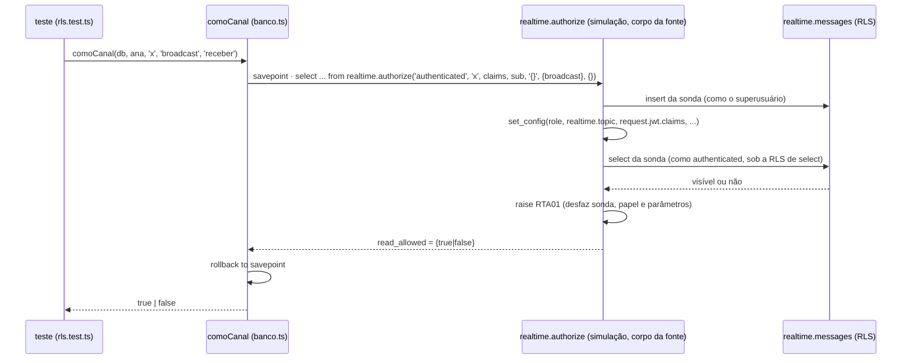

# VER-036 — E3, Tarefa 2: simulação do Realtime e checagens de banco para `realtime.*`

## Cabeçalho

| Campo | Valor |
|---|---|
| Id | VER-036 |
| Título | E3, Tarefa 2: simulação do Realtime e checagens de banco para `realtime.*` |
| Gravidade | média |
| Tipo | implementação · segurança · decisão de arquitetura |
| Data | 2026-11-27 (data do commit, em UTC) |
| Usuário responsável | TokumoH |
| Status de implementação | implementado (só testes e checagens; nada é aplicado no Supabase) |
| Commits | commit que introduz este arquivo — `git log --diff-filter=A --format=%h -- docs/verificacoes/2026-11-27-036-e3-simulacao-realtime-e-checagens.md` |
| Arquivos | `supabase/tests/simulacao-supabase.sql`, `supabase/tests/dono-migracao.sql`, `supabase/tests/banco.ts`, `supabase/tests/rls.test.ts`, `supabase/tests/README.md`, `scripts/_catalogo.mjs`, `scripts/check-data-api.mjs`, `scripts/README.md`, `scripts/tests/check-data-api.test.mjs`, `scripts/tests/catalogo.test.mjs`, `scripts/tests/README.md`, `docs/verificacoes/README.md`, este registro (13 arquivos) |

## Problema

1. **A simulação do Supabase não tinha `realtime`.** A Tarefa 3 do [PLA-004](../planos/2026-11-27-e3-ao-vivo-por-toque.md) cria as duas políticas de `realtime.messages` (D6); sem o schema, a migração daria erro de SQL nos testes de banco e nas duas checagens, e nenhum teste conseguiria conferir quem recebe e quem envia em cada canal.
2. **O dono simulado não conseguiria criar política em `realtime.messages`.** No Supabase, o `postgres` cria a política pela extensão `supautils` sem ser dono da tabela; o PGlite não tem a `supautils` (`must be owner of table messages`).
3. **As checagens recusavam qualquer política em relação pré-existente**, inclusive as duas que a E3 precisa (`política ... em relação pré-existente: forma não suportada`; previsto no PLA-001, "Ao fim da E0", e nas revisões do PLA-004).
4. **A saída para o item 2 dá poder a mais**, como em `storage` na E2 (VER-025): com a participação em `supabase_realtime_admin`, o dono simulado consegue desligar a RLS de `realtime.messages`, criar coluna, índice ou gatilho, mudar privilégios, trocar `realtime.topic()` ou `realtime.authorize(...)`. Sem regra própria, uma migração assim passaria nos testes e daria `42501` no editor SQL.
5. **A revisão do plano (I6) mostrou que o servidor do Realtime atual não autoriza pelo insert e select numa transação**, e sim pela função `realtime.authorize(...)`, numa ida só; uma simulação que imitasse a reserva poderia divergir do real (revisão do plano, I6). E a revisão (N5) pediu que a função chamada pelas políticas fosse conferida pelo `oid`, não só pelo texto.

## Era proposital?

Não. A falta de `realtime` estava registrada como pendência desde a E0: o `scripts/README.md` dizia "Não há `realtime` ... as políticas em `realtime.messages` (E3) cairão em 'política em relação pré-existente'; a regra terá de mudar nessa etapa, com decisão registrada, como mudou para `storage.objects` na E2 (D13)". A D6 do PLA-004 decide a mudança; esta tarefa a executa, com as mesmas proteções da E2 desde o começo (as revisões do VER-025 acharam objetos não-relação no schema, `to public` e função de papel por texto, e o padrão foi aplicado aqui).

## Fontes (Passo 1, lidas em 2026-11-27)

A web estava aberta (clone raso dos repositórios públicos pelo proxy da sessão; `gh api` estava fechado para repositórios fora da sessão). Tudo abaixo foi lido no código, não de memória.

| Pergunta | Fonte | Conclusão |
|---|---|---|
| (a) `realtime.messages`, partição, `realtime.topic()`, RLS, privilégios, gatilhos | `github.com/supabase/realtime`, commit `9a2cfba` (2026-11-27), `lib/realtime/tenants/repo/migrations/`: `20240401105812` (papel `supabase_realtime_admin NOINHERIT NOLOGIN NOREPLICATION`), `20240523004032` (`realtime.topic()`, `sql stable`), `20241030150047` (particionada por range de `inserted_at`, chave `(id, inserted_at)`, RLS, `grant select/insert/update` a `anon`, `authenticated`, `service_role`), `20241108114728` (`id uuid`), `20240919163303`, `20260514120000`, `20260714120000`, `20261007120000`, `20261009120000` (demais colunas e padrões), `20260925120000` (privilégios de hoje); `lib/realtime/tenants.ex` (`create_messages_partitions`: partições diárias, de ontem a daqui a 3 dias, de `supabase_realtime_admin`) | Nenhuma migração cria gatilho em `realtime.messages`. As colunas de hoje são as 8 do plano mais `binary_payload`, `skip_broadcast` e `expires_at` (entraram depois do plano; não mudam a autorização e foram incluídas por fidelidade) |
| (b) caminho principal da autorização | `lib/realtime/tenants/authorization.ex`: `@authorize_query` (`SELECT read_allowed, write_allowed FROM realtime.authorize(role_name => $1, topic_name => $2, claims => $3, sub => $4, headers => $5, read_extensions => $6, write_extensions => $7)`), `check_with_fallback` e `fallback?/1`; migrações `20261002120000`, `20261008120000` e `20261111120000` (a versão atual da função) | **Confirmado: o caminho principal é `realtime.authorize`.** A reserva (insert e select numa transação) só roda quando a própria função falha (`undefined_function` sem `where`, ou resposta inesperada). A função é `plpgsql volatile`, **não** `security definer`, de `supabase_realtime_admin`; insere as sondas de leitura como o papel da conexão, faz `set_config('role', role_name, true)` e define `realtime.topic`, `request.jwt.claims`, `request.jwt.claim.sub`, `request.jwt.claim.role` e `request.headers`; leitura = a sonda é visível (RLS de `select`); escrita = o insert passou (RLS de `insert`; `insufficient_privilege` = negado); o `raise sqlstate 'RTA01'` desfaz tudo. Extensões de leitura: `broadcast` e `presence` (`@all_extensions`); de escrita: `broadcast`, `presence` e `persistence` (`@write_extensions`; `persistence` vira `broadcast.persist`) |
| (b) renovação do token e reconexão | `lib/realtime_web/channels/realtime_channel.ex` (`maybe_assign_policies`, `handle_in("access_token", ...)`, `apply_access_token`, `check_read_permissions_revoked`, `:confirm_token`); `realtime_channel/broadcast_handler.ex` (`authorize_write`); `realtime-js` 2.119.0 (`RealtimeClient.js:519-525`, empurra `access_token` aos canais) | A leitura é conferida na entrada e de novo a cada token novo; se foi revogada, o servidor fecha o canal ("You no longer have permission to read from this Channel topic"). A escrita é conferida no primeiro envio e de novo depois de cada token novo (as políticas voltam a `nil`). O `:confirm_token` periódico confere só a validade do JWT. Reconectar é entrar de novo |
| (c) o `postgres` real cria política em `realtime.messages`? | `github.com/supabase/postgres`, commit `cceedbd`, `ansible/files/postgresql_config/supautils.conf.j2`: `supautils.policy_grants` inclui `"realtime.messages"` e `"realtime.subscription"` | **Sim** (não é o caso de parar do Passo 1). |
| (c) o `postgres` é membro de `supabase_realtime_admin`? | `supabase/postgres` `20250421084701_revoke_admin_roles_from_postgres.sql` (só `storage` e `auth`); `supabase/realtime` `20240401105812` (`GRANT supabase_realtime_admin TO postgres`) e `20260707120000_restrict_realtime_schema.ex` (`REVOKE supabase_realtime_admin FROM postgres` e `REVOKE CREATE ON SCHEMA realtime FROM postgres` quando `policy_grants` contém as duas tabelas) | **Não, desde a `20260707120000`.** Fica com `USAGE` no schema e `SELECT, INSERT` em `messages`, com grant option |
| quem chama a função | `supabase/supabase`, `docker/docker-compose.yml`: `DB_USER: supabase_admin` do serviço `realtime` | O servidor conecta como `supabase_admin` (superusuário) no auto-hospedado; no Supabase hospedado não foi conferido |
| (d) documentação | `supabase.com/docs/guides/realtime/authorization` | As políticas leem `realtime.topic()`, a coluna `extension` e `request.jwt.claims`; as permissões ficam guardadas durante a conexão e são refeitas na entrada e a cada token novo; para obrigar canal privado, desligar "Allow public access" nas configurações do Realtime (passo do responsável, Tarefa 10). A página não descreve outros efeitos da opção |

## Solução

1. **Simulação (`simulacao-supabase.sql`, bloco no fim):** `supabase_realtime_admin` (`nologin noinherit noreplication`), o schema `realtime` (`usage` para `anon`, `authenticated`, `service_role`; `all` sem grant option para o dono), `realtime.messages` particionada com as colunas da fonte, a restrição `messages_payload_exclusive`, RLS ativa, `select`, `insert` e `update` para os três papéis, uma partição só (`realtime.messages_simulacao`, de `minvalue` a `maxvalue`, sem RLS própria, como as do servidor), `realtime.topic()` e `realtime.authorize(...)` com a assinatura, o dono, o modo e o corpo da `20261111120000` (sem os comentários). As fontes vão no comentário do bloco.
2. **Dono (`dono-migracao.sql`):** `grant supabase_realtime_admin to postgres_sim`, com o comentário do que ela dá a mais que o real e da regra que compensa.
3. **`comoCanal` (`banco.ts`):** `comoCanal(db, claims, tópico, extensão, 'receber' | 'enviar'): Promise<boolean>` chama `realtime.authorize(...)` como o superusuário do PGlite, com o papel da claim `role` (`null` = `anon`), as claims em JSON, o `sub` e cabeçalhos vazios, e lê `read_allowed` ou `write_allowed`; sempre num savepoint desfeito; leitura de `persistence` lança erro (o servidor não a pede); erro da função é repassado (o servidor o trataria como negado, mas no teste esconderia defeito). A reserva do servidor não é imitada (só roda quando a função falha).
4. **Catálogo (`_catalogo.mjs`):** `SCHEMAS_PROTEGIDOS = ['storage', 'realtime']`; a impressão ampliada (`ITENS_PROTEGIDOS`, antes `ITENS_STORAGE`, com o item novo "partição") e o grupo dos objetos com schema valem para os dois; um campo de cada tipo por schema (`campoProtegido()`: `mudancasEmStorage`/`mudancasEmRealtime`, `aclPadraoEm...`, `objetosEm...`; os de `storage` com o mesmo nome e a mesma forma); a partição de um pai protegido sai no item "partição" do pai, não sozinha; a impressão dos objetos de cada schema protegido inclui o comentário (`pg_description`, revisão 1, N1); as políticas criadas ou alteradas em relação pré-existente ganham `detalheDasPoliticas` (nome, permissive e as funções chamadas, lidas pelo `oid` em `pg_depend` e escritas como `schema.nome(tipos)`).
5. **Regras (`check-data-api.mjs`):** as regras de `storage` passam a iterar `SCHEMAS_PROTEGIDOS`, com mensagem `relação do schema ${schema}` (a de `storage` idêntica), e cada campo de cada schema protegido tem de ser uma lista (sem ele, a checagem lança erro: falha fechada, revisão 1, I1); `POLITICAS_DO_CANAL` (exportada, com o texto que o PGlite imprime) e `FUNCOES_DO_CANAL`; em `realtime.messages`, a política criada ou alterada tem de ser igual a uma de `POLITICAS_DO_CANAL` no nome, no comando, nos papéis, em permissive e no texto das duas expressões e, sendo igual, chamar exatamente `public.pode_usar_canal(text, text, boolean)` e `realtime.topic()` (pelo `oid`); a removida é aceita; política em outra relação de `realtime` continua forma não suportada.

## Por que esta solução

- **Fiel ao servidor de hoje (I6):** a simulação tem a função do servidor, com o corpo copiado, e `comoCanal` faz a mesma chamada que o `@authorize_query`. A troca de papel, as claims, o tópico, a sonda por extensão e o `raise RTA01` são os da fonte; o que muda o resultado (RLS de `select` e de `insert`, a coluna `extension`, `realtime.topic()`, as claims) está todo lá.
- **Mesma regra da E2, generalizada (Componentes, reuso):** em vez de copiar a regra de `storage` para `realtime`, o catálogo e as regras passaram a iterar uma lista. Os testes da E2 não mudaram uma letra (só a linha de `import` de `check-data-api.test.mjs` e de `catalogo.test.mjs` ganhou os nomes novos), e as mensagens de `storage` são idênticas.
- **Falha fechada:** o texto exato das políticas não deixa passar `or true`, tópico em texto somado por OR, comando ou papel trocado, `restrictive` ou nome diferente; a conferência pelo `oid` pega a homônima de texto igual (sonda: com `public.pode_usar_canal(text, text, boolean, integer default 0)`, o `pg_get_expr` imprime exatamente o texto canônico).
- **Partição no pai:** como na fonte, `realtime.messages` é particionada; coluna, índice e gatilho criados no pai descem à partição, e o item "partição" do pai junta tudo num erro só ("exatamente 1 erro"), sem perder a mudança feita só na partição.

## Por que não outras soluções

| Opção | Motivo de descarte |
|---|---|
| `comoCanal` pelo insert e select numa transação (reserva) | A revisão do plano (I6) e a fonte mostram que é só a reserva do servidor; a simulação poderia divergir do caminho real (por exemplo, a escrita sem planejar as políticas de `select`, migração `20261111120000`) |
| `realtime.messages` sem partição | A fonte particiona; a partição muda o que uma migração consegue fazer em `realtime` (descer índice e coluna, mudar só a partição) e o que a checagem tem de ver |
| Partições diárias como no servidor | Os testes dependeriam da data do dia; uma partição de `minvalue` a `maxvalue` cobre qualquer data com o mesmo efeito na autorização |
| Copiar a regra de `storage` para uma regra de `realtime` | Componente repetido; duas regras para manter iguais |
| Renomear os campos do catálogo para nomes genéricos com `schema` em cada linha | Mudaria testes da E2 (`toEqual` em `catalogo.test.mjs` e os catálogos montados à mão de `check-data-api.test.mjs`), que o brief manda manter |
| Conferir só o texto das políticas | Não pega a função homônima com parâmetro a mais com valor padrão (texto igual, outra função; sonda acima); a N5 pede o `oid` |
| Aceitar política em `realtime.messages` por forma (como a de `storage.objects`: começa por X e chama Y) | As duas políticas são fixas (D6); a forma deixaria passar `R or true` e outras somas por OR |
| Dar `BYPASSRLS` ou superusuário ao `postgres_sim` | Decisão da E0: o dono simulado é mais restrito que o real de propósito |

## Onde

| Arquivo | Linhas | O que mudou |
|---|---|---|
| [`supabase/tests/simulacao-supabase.sql`](../../supabase/tests/simulacao-supabase.sql#L162-L311) | 4, 162–311 | Cabeçalho cita o bloco; bloco `realtime` com as fontes, o papel, o schema, `realtime.messages` particionada, a partição, `realtime.topic()` e `realtime.authorize(...)` |
| [`supabase/tests/dono-migracao.sql`](../../supabase/tests/dono-migracao.sql#L68-L92) | 14, 68–92 | Participação em `supabase_realtime_admin`, com as fontes, o que ela dá a mais e a regra que compensa |
| [`supabase/tests/banco.ts`](../../supabase/tests/banco.ts#L221-L271) | 221–271 | `ExtensaoDoCanal` e `comoCanal()` |
| [`supabase/tests/rls.test.ts`](../../supabase/tests/rls.test.ts#L1250-L1300) | 30, 1250–1300 | Bloco `Simulação do Realtime (E3, Tarefa 2)`: `simulacao-realtime-respeita-rls` e o caso de `persistence` |
| [`scripts/_catalogo.mjs`](../../scripts/_catalogo.mjs#L41-L60) | 9–10, 41–63, 86–99, 102–158, 205–236, 386–391, 701–744, 765–806 | `SCHEMAS_PROTEGIDOS`, `DONO_DO_SCHEMA`, `campoProtegido`; `POLITICAS` com nome, permissive e funções pelo `oid`; `ITENS_PROTEGIDOS` e `PROTEGIDAS` (com "partição"); `OBJETOS_PROTEGIDOS` (com o comentário, `obj_description`, revisão 1); os donos e schemas protegidos na base; os campos por schema, `detalheDasPoliticas`, `mudancasProtegidas` e `detalheDasPoliticas()` |
| [`scripts/check-data-api.mjs`](../../scripts/check-data-api.mjs#L34-L50) | 13–18, 34–50, 159–185, 263–287 | Import; `POLITICAS_DO_CANAL` e `FUNCOES_DO_CANAL`; regra por relação (`REGRA_DA_RELACAO`) e laço dos `SCHEMAS_PROTEGIDOS`, com a leitura que exige lista (revisão 1); `MSG_REALTIME`, `MSG_DO_SCHEMA` e `politicaDoCanal()` |
| [`scripts/tests/check-data-api.test.mjs`](../../scripts/tests/check-data-api.test.mjs#L1256-L1459) | 2, 982–986, 990, 1001, 1256–1459 | `SEM_REALTIME` nos dois catálogos montados à mão anteriores (asserções iguais); bloco `realtime (PLA-004, D6)`: 45 testes |
| [`scripts/tests/catalogo.test.mjs`](../../scripts/tests/catalogo.test.mjs#L386-L441) | 3, 386–441 | Bloco `realtime (PLA-004, D6)`: 9 testes |
| [`scripts/README.md`](../../scripts/README.md#L48-L49) | 48, 49, 94, 95, 104 | `_catalogo.mjs` e `check-data-api.mjs` em "Onde" (regras (4) e (5)), a simulação e o dono em "Riscos", risco novo do Realtime; linhas 52, 90 e 91 idênticas às do commit `ccec797` |
| [`scripts/tests/README.md`](../../scripts/tests/README.md#L59-L60) | 59, 60, 93, 99, 103 | Contagens (358, 96, 724), o que os blocos novos cobrem, a verificação da D6 |
| [`supabase/tests/README.md`](../../supabase/tests/README.md#L26-L28) | 26–28, 63–66, 100, 112, 128 | Organização, "Onde" (simulação, dono, `banco.ts`, `rls.test.ts` com 83 testes), exemplo (525), verificação e risco do bloco `realtime` |
| [`docs/verificacoes/README.md`](README.md) | 14, 89 | Linha deste registro e campo "Arquivos" |

## Lógica

| Passo | Antes | Depois |
|---|---|---|
| Migração com `create policy ... on realtime.messages` | Erro de SQL (sem `realtime`) | Criada pelo `postgres_sim` (membro do dono) |
| Política do canal no `data-api:check` | "política em relação pré-existente: forma não suportada" | Aceita se igual a uma de `POLITICAS_DO_CANAL`, com as funções certas pelo `oid` |
| `alter table realtime.messages disable row level security` | Erro de SQL | 1 erro: `realtime.messages: relação do schema realtime: RLS alterado pelas migrações (...)` |
| `create index on realtime.messages (event)` | Erro de SQL | 1 erro com "índice, partição" (o índice desce à partição) |
| `create or replace function realtime.authorize(...)` que libera tudo | Erro de SQL | 1 erro: `function realtime.authorize(...): objeto no schema realtime: alteração ...` |
| Autorização de canal nos testes | Não havia | `comoCanal`, pelo caminho principal do servidor |

## Exemplo

Sonda `t2-sondas/v2.mjs` (fora do repositório), com as três migrações e a migração da Tarefa 3 copiada da revisão do plano, chamando `realtime.authorize` direto em `estudio`:

| Sessão | receber `broadcast` | enviar `presence` | enviar `broadcast` | enviar `persistence` | receber em `outro` |
|---|---|---|---|---|---|
| ana (`equipe`) | true | true | true | false | false |
| bia (`apresentadora`) | true | true | false | false | false |
| palco (`obs_palco`) | true | true | false | false | false |
| câmera | true | true | false | false | false |

Bate com a matriz da D6 para `estudio` e com `persistence` sempre `false`; `realtime.messages` termina com 0 linhas. Na mesma cópia, `data-api:check` acusa só `public.tentativas_pareamento: sem nenhuma política` (que a Tarefa 3 põe em `SOMENTE_FUNCOES`), e `rpc:grants-check` dá 0 erros: as duas políticas do canal passam.

Texto fixado em `POLITICAS_DO_CANAL` (sonda `t2-sondas/s1.mjs`, `pg_get_expr` com o `search_path` da leitura): `public.pode_usar_canal(realtime.topic(), extension, false)` (`canal_recebe`, `r`, permissive) e `public.pode_usar_canal(realtime.topic(), extension, true)` (`canal_envia`, `a`, permissive); funções pelo `oid`: `public.pode_usar_canal(text,text,boolean)` e `realtime.topic()`.

## Verificação

| # | Abordagem | Comando / método | Resultado |
|---|---|---|---|
| TDD | Testes antes do código | `npx vitest run scripts/tests/check-data-api.test.mjs scripts/tests/catalogo.test.mjs supabase/tests/rls.test.ts --maxWorkers=2` | **44 falhas** (erro de SQL sem `realtime`; `comoCanal is not a function`), 492 passam |
| P3 | Simulação e `comoCanal` | `npx vitest run supabase/tests --maxWorkers=2` | 525 passam (os 523 de antes e os 2 novos) |
| P4 | Catálogo e regras | `npx vitest run scripts/tests --maxWorkers=2` | 724 passam (172 + 358 + 96 + 44 + 54); duas expectativas de teste corrigidas na hora (ordem dos objetos por `oid`; o caso de privilégio padrão usava `anon`, que a regra genérica também acusa, e passou a `truncate` para `authenticated`, como o de `storage`) |
| P4 | Checagens sobre as 3 migrações | `npm run data-api:check` · `npm run rpc:grants-check` | 0 erros · 0 erros |
| Sonda | Migração da Tarefa 3 (rascunho da revisão do plano) | `node scripts/check-data-api.mjs <cópia>` · `check-rpc-grants` · `t2-sondas/v2.mjs` | só `tentativas_pareamento` sem política (esperado); 0; matriz de `estudio` da D6 (Exemplo) |
| Fixas | `scripts/README.md` | `diff <(git show ccec797:scripts/README.md \| sed -n '52p;90p;91p') <(sed -n '52p;90p;91p' scripts/README.md)` | vazio |
| R1 | Revisão independente 1 (revisor novo, só leitura; clone próprio do `supabase/realtime` 9a2cfba; sondas em `rev-t2/`) | leitura das fontes, sondas de segurança sobre as políticas canônicas, a migração da Tarefa 3 da revisão do plano | **spec ✅, qualidade reprovada**: 1 importante de segurança (I1: o `?? []` tornava a regra dos schemas protegidos falha aberta, também para `storage`, regressão contra a E2, que dava `TypeError`) e 3 nits (N1: `comment on function realtime.topic()` passava com 0 erros, igual em `storage` desde a E2; N2: o nome `realtime-politica-alterada-ou-removida` prometia caminhos que o teste não exerce; N3: o `PolicyEvalShadow` da fonte não estava nos Riscos) |
| C1 | Correções da revisão 1 | I1: leitura que exige lista e lança erro (`catálogo sem <campo>: a checagem não conferiu o schema <s>`), `SEM_REALTIME` espalhado nos dois catálogos montados à mão anteriores, sem mudar asserção, 3 testes novos (sem `objetosEmRealtime`, `mudancasEmStorage`, `aclPadraoEmRealtime`: lança) e a sabotagem S19; N1: `obj_description` na impressão de `OBJETOS_PROTEGIDOS`, 3 testes (`comment on function` em `realtime.topic()`, `realtime.authorize(...)` e `storage.foldername(text)`), a sabotagem S20 e a frase de `dono-migracao.sql` e de `scripts/README.md`; N2: teste renomeado para `realtime-forma-final-depois-de-alter-ou-drop`, com o limite no comentário, e 3 testes da alteração real num catálogo montado à mão; N3: linha nos Riscos daqui e de `supabase/tests/README.md` | `npx vitest run scripts supabase --maxWorkers=2` · `npm run typecheck` · `npm run data-api:check` · `npm run rpc:grants-check` · `node scripts/check-docs.mjs` | 0 erros (ver o relatório da tarefa); S8 refeita depois da mudança na impressão dos objetos: continua derrubando `realtime-authorize-trocada` |
| V2 | Re-revisão focada nas correções (revisor novo; 733 testes de `scripts/tests` numa cópia; sonda do catálogo sem campo lança; `comment on function` em `realtime.topic()`, `realtime.authorize(...)` e `storage.foldername(text)` acusa 1 erro; as 3 migrações reais dão 0 erros nas duas checagens; comentário já existente na base não vira falso positivo; o auxiliar `SEM_REALTIME` não esconde nada; nenhuma asserção removida) | **aprovada**, sem erros | — |
| Final | Conjunto | `npm run check` | 0 erros (último ato do implementador; ver o relatório da tarefa) |

**Sabotagens** (script `t2-sab/sab.py`, fora do repositório: cópia do arquivo, edição, teste, cópia restaurada e `sha256sum` conferido igual ao de antes em todas):

| # | Sabotagem | Arquivo | Caiu |
|---|---|---|---|
| S1 | aceitar qualquer política em `realtime.messages` | `check-data-api.mjs` | os 7 de `realtime-outra-forma` |
| S2 | comparar só o texto, não o comando | `check-data-api.mjs` | os 3 de `realtime-comando` |
| S3 | não comparar papéis | `check-data-api.mjs` | os 3 de `realtime-para-anon` |
| S4 | tirar `realtime` de `SCHEMAS_PROTEGIDOS` | `_catalogo.mjs` | `realtime-rls-desligada` e os 7 de `realtime-mudancas` |
| S5 | deixar sair também o erro genérico para `realtime` | `_catalogo.mjs` | `realtime-rls-desligada` e, de `realtime-mudancas`, RLS forçada e os dois de privilégio (os de coluna, índice, gatilho e comentário não mudam a impressão genérica, que não tem esses itens) |
| S6 | mensagem com o nome fixo "storage" | `check-data-api.mjs` | `realtime-rls-desligada` |
| S7 | conferir a função da política só pelo texto | `check-data-api.mjs` | `realtime-funcao-do-canal` (4º parâmetro com valor padrão) |
| S8 | tirar `realtime.authorize` da impressão | `_catalogo.mjs` | `realtime-authorize-trocada` |
| S9 | tirar a RLS de `realtime.messages` na simulação | `simulacao-supabase.sql` | `simulacao-realtime-respeita-rls` |
| S10 | `comoCanal` ignorando a resposta (sempre `true`) | `banco.ts` | `simulacao-realtime-respeita-rls` |
| S11 | sem o item "partição" no pai | `_catalogo.mjs` | `realtime-mudancas`: coluna, índice, gatilho, privilégio na partição |
| S12 | partição devolvida sozinha | `_catalogo.mjs` | os mesmos 4 de S11 (2 erros em vez de 1) |
| S13 | remoção de política do canal recusada | `check-data-api.mjs` | `política do canal removida` (catálogo montado à mão) |
| S14 | permissive não comparado | `check-data-api.mjs` | `realtime-outra-forma: restrictive` |
| S15 | nome não comparado | `check-data-api.mjs` | `realtime-outra-forma: nome fora da lista` |
| S16 | sem a participação em `supabase_realtime_admin` | `dono-migracao.sql` | `realtime-politicas-aceitas` (`must be owner`) |
| S17 | `comoCanal` conferindo o envio pela leitura | `banco.ts` | `simulacao-realtime-respeita-rls` |
| S18 | `realtime.authorize` sem trocar de papel | `simulacao-supabase.sql` | `simulacao-realtime-respeita-rls` |
| S19 | voltar o `?? []` na leitura dos campos protegidos (revisão 1, I1) | `check-data-api.mjs` | os 3 de `catálogo sem ...: lança erro` |
| S20 | sem o comentário na impressão dos objetos (revisão 1, N1) | `_catalogo.mjs` | os 3 de `comentário em função de schema protegido` |

Achados do próprio implementador, corrigidos antes das revisões: a primeira forma de S7 (`false && a \|\| b`) não desligava a conferência (precedência) e foi refeita; a primeira S13 era vazia, porque no caso `drop` em duas migrações a política nasce e some (nenhuma entrada no catálogo), e por isso entrou o teste da remoção num catálogo montado à mão, como o de `storage.objects` da E2; a primeira S17 (pedir também a leitura no envio) não muda o resultado e foi trocada pela conferência do envio pela leitura.

Nits corrigidos (não zeram a contagem): nenhum até aqui.

## Riscos

- **Limite da N5:** um `create or replace function public.pode_usar_canal(...)` que devolva `true`, com uma chamada de papel decorativa, mantém o `oid` e passa no `data-api:check` e no `rpc:grants-check`; só os testes de banco da Tarefa 3 (`e3-canal-matriz`) o pegam (registrado em `scripts/README.md`, "Riscos").
- **Aproximações da simulação:** o servidor chama `realtime.authorize` como `supabase_admin` (superusuário; conferido só no `docker-compose.yml` auto-hospedado, não no Supabase hospedado), e `comoCanal` como o superusuário do PGlite; partições diárias no real, uma só aqui; índices, demais funções e tabelas de `realtime` e a publicação ficam de fora; cabeçalhos vazios. Um projeto ainda não atualizado pode ter outra versão de `realtime.authorize` (ou nenhuma, e então o servidor usa a reserva); a reserva não é imitada.
- **Erro na função:** `comoCanal` repassa o erro de `realtime.authorize` (por exemplo, de uma política); o servidor o trataria como negado na leitura e como erro na escrita.
- **Partição:** a mudança só na partição sai no pai como "partição", sem dizer o item; cada campo de cada schema protegido tem de ser uma lista, e a falta de um faz a checagem lançar erro (falha fechada, revisão 1, I1); os catálogos montados à mão dos testes anteriores à E3 recebem os campos de `realtime` vazios (`SEM_REALTIME`), e o de `analisarMigracoes` sempre os tem (teste `SCHEMAS_PROTEGIDOS e um campo de cada tipo por schema`).
- **Política duplicada ou `restrictive`:** recusadas por serem diferentes (estrita de propósito); uma `restrictive` só restringiria, mas a D6 fixa as duas.
- **N6 (plano):** a sabotagem da RLS da simulação derruba `simulacao-realtime-respeita-rls` nesta tarefa; na Tarefa 3, deve derrubar também `e3-canal-matriz`.
- **`PolicyEvalShadow` (revisão 1, N3):** o servidor tem um avaliador de políticas em processo (`lib/realtime/tenants/policy_eval_*.ex`), que hoje roda só em sombra, atrás de um feature flag, e não decide nada; se um dia passar a decidir, a autorização deixa de passar só por `realtime.authorize`, e a simulação e `comoCanal` teriam de ser revistos.
- **Alteração e remoção de política pelo caminho real (revisão 1, N2):** a base não tem política em `realtime.messages`, então numa sequência de migrações o `alter` é julgado como criação (forma final) e o `drop` não deixa entrada; os caminhos de "alteração" e "remoção" são provados só em catálogos montados à mão. O teste equivalente da E2 (`storage-politica-alterada-ou-removida`) tem o mesmo limite e não foi mexido.
- **Comentários:** desde a revisão 1 (N1), o comentário dos objetos de `storage` e `realtime` está na impressão; continuam fora o que não fica na linha do catálogo nem em `pg_description` (por exemplo, `security label`).
- **Pendência:** a re-revisão focada e o commit ficam com o controlador.
