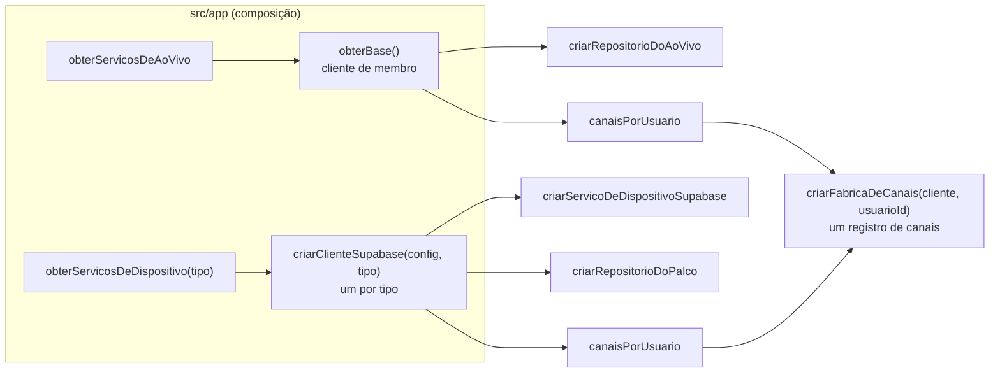

# VER-038 — E3, Tarefa 4: adaptadores do pareamento, do ao vivo e do canal; composição por tipo de cliente

## Cabeçalho

| Campo | Valor |
|---|---|
| Id | VER-038 |
| Título | E3, Tarefa 4: adaptadores Supabase do pareamento, do ao vivo e do canal Realtime; composição por tipo de cliente |
| Gravidade | alta |
| Tipo | implementação · segurança · infraestrutura |
| Data | 2026-11-27 (data do commit, em UTC) |
| Usuário responsável | TokumoH |
| Status de implementação | implementado (testado com clientes Supabase e Realtime falsos e com o teste de contrato `realtimeContrato.test.ts`, que roda as premissas contra o `realtime-js` real sem rede no `npm test`; as telas que usam estes adaptadores chegam nas Tarefas 5 a 9 do PLA-004) |
| Commits | commit que introduz este arquivo — `git log --diff-filter=A --format=%h -- docs/verificacoes/2026-11-27-038-e3-adaptadores-ao-vivo.md` |
| Arquivos | `src/shared/infra/dispositivoSupabase.ts` (novo), `src/shared/infra/dispositivoSupabase.test.ts` (novo), `src/shared/infra/aoVivoSupabase.ts` (novo), `src/shared/infra/aoVivoSupabase.test.ts` (novo), `src/shared/infra/canalSupabase.ts` (novo), `src/shared/infra/canalSupabase.test.ts` (novo), `src/shared/infra/realtimeFalso.ts` (novo), `src/shared/infra/realtimeContrato.test.ts` (novo, rodada 1), `src/app/servicos.ts`, `src/app/servicos.test.ts`, `src/app/dependencias.ts`, `src/app/dependencias.test.ts`, `src/app/servicosFalsos.ts`, `src/app/servicosFalsos.test.ts` (novo), `src/app/App.test.tsx`, `src/shared/infra/README.md`, `src/app/README.md`, `docs/verificacoes/README.md`, este registro |

## Problema

1. **As portas da Tarefa 1 não tinham implementação.** `ServicoDeDispositivo`, `RepositorioDoAoVivo`, `RepositorioDoPalco` e `FabricaDeCanais` ([`portasDeDispositivo.ts`](../../src/domains/acesso/portasDeDispositivo.ts), [`aovivo/portas.ts`](../../src/domains/aovivo/portas.ts)) existiam só como contrato; as funções da Tarefa 3 (VER-037) não eram chamadas por nada, e as telas das Tarefas 5 a 9 não tinham de onde tirar sessão anônima, pareamento, episódio ativo, listas do palco ou canais.
2. **O mesmo tópico no mesmo cliente quebraria o `realtime-js`.** No 2.119.0, `channel(topico)` devolve o canal que já existe e `on('presence')` depois do `subscribe()` lança (revisão do plano, I3): o painel e o `/controle` abrindo `estudio` pelo mesmo cliente de membro derrubariam um ao outro.
3. **Canal fechado pelo servidor não podia ser reaberto, e mensagem enviada não chegava às outras alças.** O canal fechado não entra de novo, o que está saindo devolve o mesmo objeto, e com `self: false` uma alça não recebe o que outra alça do mesmo cliente enviou (re-revisão, I-A e I-B).
4. **Não havia composição por tipo de cliente.** As rotas de dispositivo precisam de um cliente Supabase por tipo (`storageKey` própria, D4), preguiçoso, e nunca do cliente de membro; as rotas de membro precisam do ao vivo sobre o mesmo cliente de membro.

## Era proposital?

Sim, como etapa: a Tarefa 1 (VER-035) definiu as portas e deixou os adaptadores para a Tarefa 4 (comentário de `ServicoDeDispositivo`: "Adaptador em `src/shared/infra/dispositivoSupabase.ts` (Tarefa 4)"); a Tarefa 3 (VER-037) criou as funções que eles chamam; o PLA-004 descreve esta tarefa (interfaces, registro de canais I3, I-A, I-B, testes e sabotagens). Os pontos em que o código diverge do texto do plano estão em "Por que não outras soluções" (desvios, com o motivo).

**Premissa do PLA-004 corrigida (rodada 2).** A seção I-A do PLA-004 (já commitado; não editado) diz que "`leave()` só fecha quando o servidor responde ou o tempo esgota (`phoenix.cjs.js:458-473`)" e que "`subscribe()` num canal `leaving` não faz nada", e daí conclui que um `abrir()` durante um `removeChannel` pendente pegaria o canal `leaving`. No `@supabase/phoenix` 0.4.5 instalado isso não acontece: `leave()` põe o estado em `leaving` (linha 461) **antes** de `if (!this.canPush()) leavePush.trigger("ok", {})` (469-470), e `canPush()` exige `joined` (407-409); então o `ok` é disparado localmente e o `close` (que tira o canal da lista e chama o callback com `CLOSED`) roda dentro do próprio `removeChannel`, e uma resposta tardia do servidor ao `leave` é ignorada (teste de contrato `remover-fecha-na-hora`, real e falso). A janela real de remoção pendente é o `await canal.untrack()` do adaptador, que espera a resposta do servidor (até 10 s) com o canal ainda inscrito na lista; é ela que `REMOCOES_POR_CLIENTE` cobre (testes `abrir-durante-remocao` e `outra-fabrica-espera-a-remocao`). A decisão do plano continua válida: o registro sai do mapa quando o canal vai a `fechado` ou `negado`, as alças recebem o estado e reabrem fechando a própria alça e abrindo outra (canal novo), e um `abrir()` durante a remoção espera ela terminar; só a razão da espera muda (o `untrack`, não o `leave`).
## Solução

- [`dispositivoSupabase.ts`](../../src/shared/infra/dispositivoSupabase.ts#L59-L124) — `criarServicoDeDispositivoSupabase(cliente)`: `sessaoAtual` por `auth.getSession()` (anônima só com `is_anonymous === true`; erro devolvido ou lançado → `rede`); `entrarAnonimo` por `signInAnonymously()` (422, `anonymous_provider_disabled` ou "Anonymous sign-ins are disabled" → `negado`; `AuthRetryableFetchError`/status 0 ou exceção → `rede`; o resto → `outro`); `parear` por `rpc('parear_dispositivo', { p_codigo, p_tipo })`, primeira linha `(resultado, dispositivo, nome)`, resultado fora da lista → `invalido`; `dispositivoAtual` por `rpc('meu_dispositivo')`, lido pelos nomes de `COLUNAS_DE_MEU_DISPOSITIVO` (nunca `dispositivo_atual`, I2); `sair` por `signOut({ scope: 'local' })`, que nunca lança. Erros do PostgREST: `42501` → `negado`, falha do `fetch` → `rede`, o resto → `outro`. O código de pareamento só passa pelo corpo do `rpc`.
- [`aoVivoSupabase.ts`](../../src/shared/infra/aoVivoSupabase.ts#L13-L236) — `VALIDADE_NO_PALCO_S = 3600`; `traduzirErroDoAoVivo` (sessão expirada primeiro, `55000` → `estado_invalido`, `22023` → `invalido`, o resto por `classificarErro`, com `em_uso` → `outro`; `errosSupabase.ts` intocado); `criarRepositorioDoAoVivo` (`episodio_ativo`, `iniciar_ao_vivo { p_episodio }`, `encerrar_ao_vivo { p_episodio }`, `definir_modo_teste { p_episodio }`, `criar_codigo_pareamento { p_tipo, p_rotulo, p_dispositivo, p_camera }` → `{ dispositivoId, codigo, expiraEm }` a partir das colunas `(dispositivo, codigo, expira)`, `revogar_dispositivo { p_dispositivo }` → `{ usuario }` a partir do `uuid` escalar (desde a rodada 1, retorno que não é uuid nem nulo → `invalido`), e a lista de `dispositivos` por `tipo`, com tipo desconhecido descartado); `criarRepositorioDoPalco` (episódio por id, cenas por ordem, sons com `midias(caminho)`, avisos do episódio por ordem com `midias(caminho)` da imagem, `createSignedUrl(caminho, 3600)` no bucket `midias` e `insert` em `registro_acoes` com exatamente as colunas da D9, sem `select`).
- [`canalSupabase.ts`](../../src/shared/infra/canalSupabase.ts#L73-L343) — `criarFabricaDeCanais(cliente, usuarioId, agendar?)`: canais privados (`private: true`, `broadcast: { ack: true, self: false }`, `presence: { key: usuarioId }`) nos tópicos `estudio` e `episodio:<id>:controle`; **um canal por tópico por cliente** com contagem de referências e alças próprias (I3); `broadcast`, presença `sync` e `join` registrados antes do `subscribe()`; estados `SUBSCRIBED` → `conectado`, `TIMED_OUT`/`CHANNEL_ERROR` → `reconectando`, `CHANNEL_ERROR` com "unauthorized" → `negado`, `CLOSED` → `fechado`; canal fechado ou negado sai do mapa na hora (I-A), o negado é removido do cliente, o fechado não; `abrir` durante uma remoção pendente (o `untrack` esperando o servidor) espera ela terminar; eco local para as **outras** alças do tópico, com qualquer resposta do `ack` (I-B); toda mensagem passa por `lerRemetente` e pelo leitor do domínio; todo ouvinte é chamado por `agendar` (padrão `setTimeout(..., 0)`); `enviar` fora de `conectado` → `falhou` sem chamar `send`; a presença marcada é remarcada a cada volta a `conectado`. **Rodada 1:** quem se inscreve na presença com o canal já conectado recebe logo a presença atual (`presenceState`, adiada; I1); qualquer falha ao criar ou inscrever o canal (o `channel()` que devolve um canal que não é novo — inscrito por outro código ou fábrica do mesmo cliente, ou com erro —, ou um `on`/`subscribe` que lança) vira `fechado` para as alças, sem rejeição solta e sem remover o canal alheio; as remoções pendentes ficam por **cliente** (`WeakMap` no módulo), e outra fábrica do mesmo cliente as espera (I2).
- [`realtimeFalso.ts`](../../src/shared/infra/realtimeFalso.ts) — cliente Realtime falso (só para testes) que imita o pedaço do 2.119.0 que muda o adaptador (lista por tópico, `on('presence')` depois do `subscribe` lança, join único, saída da lista filtrando pelo tópico, `send` sem `ack` resolvendo `'ok'`; desde a rodada 1, `state`/`joinedOnce` públicos; desde a rodada 2, `removeChannel` que fecha o canal na hora e a janela de remoção pendente no `untrack`, segurável por `segurarUntrack`), usado pelos testes do adaptador e pelos falsos das telas. [`realtimeContrato.test.ts`](../../src/shared/infra/realtimeContrato.test.ts) (rodada 1) roda as premissas contra o cliente **real** (sem rede) e contra o falso, com os mesmos casos.
- [`servicos.ts`](../../src/app/servicos.ts#L83-L149) — `obterServicosDeAoVivo()` (repositório e canais sobre o **mesmo** cliente de membro) e `obterServicosDeDispositivo(tipo)` (um cliente por tipo, `revocast-auth-<tipo>`, `detectSessionInUrl: false`, preguiçoso, guardado num `Map`); os canais vêm de uma fábrica **por usuário e por cliente** (`canaisPorUsuario`), a mesma a cada chamada.
- [`dependencias.ts`](../../src/app/dependencias.ts#L21-L30) — `Dependencias` ganha `obterAoVivo`, `obterDispositivo(tipo)` e `limparFragmento()` (tira só o fragmento da URL com `history.replaceState`, mantendo caminho, busca e `history.state`).
- [`servicosFalsos.ts`](../../src/app/servicosFalsos.ts#L564-L773) — `criarCanalFalso` (o adaptador real sobre o Realtime falso, conectando sozinho; `definirEstado`, `responderEnvio`, `entregar`, `sincronizarPresenca`, `entrarAlguem`, `enviados`, `presencas`), `aoVivoVazio` e `criarFalsosDeDispositivo` (sessão anônima, pareamento programável, palco com URL assinada falsa e registro anotado, `ordem` das chamadas); `criarFalsos().dependencias()` ganha os três campos novos.

## Por que esta solução

- **DDD e GRASP Pure Fabrication:** os adaptadores são fabricações puras em `src/shared/infra/`, um por porta (sem classe genérica), e não decidem acesso: quem nega é o banco (`42501` das funções, RLS) ou a autorização do Realtime (`pode_usar_canal`). O domínio continua sem saber de Supabase (o teste de arquitetura dos domínios segue passando).
- **Componentes:** a composição fica em `src/app/servicos.ts`, como na E1 e na E2; as telas recebem tudo por `Dependencias` e por falsos.
- **Segurança:** o código de pareamento não vai para `console` nem para mensagem de erro (`parear-sem-console`); a sessão anônima não é confundida com a de membro (`is_anonymous === true` literal); `sair` é sempre local; mensagens do canal validadas antes de qualquer efeito, com `remetente` obrigatório e uuid em minúsculas; o envio nunca cai para o REST fora de `conectado` (o `send` do `realtime-js` faria isso, `RealtimeChannel.js:558-615`); cada rota de dispositivo cria só o próprio cliente.
- **Fidelidade ao `realtime-js`:** o registro por tópico evita a exceção do `on('presence')` e o canal devolvido pelo `channel()`; as premissas estão no teste de contrato `realtimeContrato.test.ts` (cliente real sem rede e falso, com os mesmos casos), além das duas sondas iniciais (Verificação).

## Por que não outras soluções

| Opção | Motivo de descarte |
|---|---|
| Uma fábrica nova a cada `canais(usuarioId)` | Dois registros no mesmo cliente: o segundo `on('presence')` lança no canal já inscrito pelo primeiro (sonda 1 com o `realtime-js` real); por isso `canaisPorUsuario` guarda a fábrica |
| Remover sempre o canal velho quando a última alça fecha, mesmo depois de `fechado` pelo servidor (texto do brief: "só faz `untrack()` e `removeChannel` quando a contagem chega a 0") | **Desvio.** O canal fechado já saiu da lista do cliente, e `removeChannel` dele termina em `RealtimeClient._remove`, que filtra **pelo tópico** (`RealtimeClient.js:446-447`) e tira da lista o canal novo do mesmo tópico (sonda 2). O adaptador marca o registro como morto e não remove de novo (teste `reabrir-depois-de-fechado`) |
| Deixar o canal negado (`CHANNEL_ERROR` "unauthorized") na lista do cliente | **Desvio (acréscimo).** O canal com erro continua em `client.channels` e o phoenix tenta entrar de novo sozinho; o `channel()` seguinte devolveria esse objeto (`RealtimeClient.js:338-349`), e o `subscribe()` nele não faria nada. O adaptador o remove na hora, e o próximo `abrir` espera a remoção (teste `negado-remove-o-canal`, sabotagem S18) |
| `untrack()` sempre antes do `removeChannel` | **Desvio.** Só com o canal `conectado` e uma presença marcada: num canal que nunca entrou, o `untrack` fica na fila do phoenix até o tempo esgotar (10 s) e atrasaria a remoção e a reabertura. A saída do canal apaga a presença no servidor de qualquer jeito |
| Registrar também a presença `leave` (o brief cita `sync`, `join`, `leave` no texto, mas o trecho de código registra só `sync` e `join`) | **Desvio pequeno.** O `sync` já chega depois de cada saída com a lista inteira; um ouvinte de `leave` não teria uso (código morto) |
| Presença marcada só uma vez | A reconexão entra de novo no canal e a presença do servidor começa vazia; o adaptador guarda a última presença e a remarca a cada volta a `conectado` (teste `presenca`, sabotagem S19) |
| Falsos das telas escritos à parte (um `CanalDoEstudio` de mentira) | Divergiriam do adaptador (eco local, um canal por tópico, estado para quem chega depois, validação). `criarCanalFalso` é o adaptador real sobre o Realtime falso, o mesmo dos testes do adaptador. **Acréscimos ao brief:** `realtimeFalso.ts` e `servicosFalsos.test.ts` (3 testes de fidelidade dos falsos) |
| `dispositivo-cria-so-o-proprio-cliente` só renderizando a rota | **Desvio temporário.** Nesta tarefa as telas de dispositivo ainda são provisórias e não chamam nada (a Tarefa 6 faz `useDispositivo` chamar `obterDispositivo(tipo)`, e `App.tsx` só passa `dependencias` às três rotas na Tarefa 6). O teste renderiza a rota pelo caminho padrão e, como a rota fará, chama `dependenciasDoNavegador().obterDispositivo(tipo)` duas vezes; a Tarefa 6 troca a chamada explícita pela da tela |
| Episódio que não aparece em `carregar` → `nada_alterado` | Não houve escrita; `invalido` (o id não serve) é o motivo que a tela do palco já trata |
| Separar as mídias dos sons e avisos em outra consulta | Uma consulta a mais por lista; o PostgREST embute `midias(caminho)` pela chave estrangeira única de `sons.midia_id` e `avisos.imagem_midia_id`, com a mesma RLS de `midias` (o `obs_palco` lê) |

## Onde

| Arquivo | Linhas | O que mudou |
|---|---|---|
| [`src/shared/infra/dispositivoSupabase.ts`](../../src/shared/infra/dispositivoSupabase.ts#L1-L124) | 1–124 | Novo: `criarServicoDeDispositivoSupabase` (`sessaoAtual` 61, `entrarAnonimo` 76, `parear` 89, `dispositivoAtual` 100, `sair` 113) |
| [`src/shared/infra/dispositivoSupabase.test.ts`](../../src/shared/infra/dispositivoSupabase.test.ts#L1-L229) | 1–229 | Novo: 6 testes (`sessao-atual`, `entrar-anonimo`, `parear-chama-rpc`, `parear-sem-console`, `dispositivo-atual`, `sair-local`) |
| [`src/shared/infra/aoVivoSupabase.ts`](../../src/shared/infra/aoVivoSupabase.ts#L1-L236) | 1–236 | Novo: `VALIDADE_NO_PALCO_S` (13), `traduzirErroDoAoVivo` (22), `criarRepositorioDoAoVivo` (80; `revogar` 129, com o uuid conferido na rodada 1), `criarRepositorioDoPalco` (144) |
| [`src/shared/infra/aoVivoSupabase.test.ts`](../../src/shared/infra/aoVivoSupabase.test.ts#L1-L277) | 1–277 | Novo: 6 testes (`rpcs-e-parametros`, `listar-dispositivos`, `erros-do-ao-vivo`, `palco-carrega`, `palco-url-de-arquivo`, `palco-registra`) |
| [`src/shared/infra/canalSupabase.ts`](../../src/shared/infra/canalSupabase.ts#L1-L343) | 1–343 | Novo: `REMOCOES_POR_CLIENTE`/`remocoesDo` (36–45, rodada 1; comentário da janela do `untrack` na rodada 2), `criarFabricaDeCanais` (73): `remover` (89), `encerrar` (108), `criarCanal` com `try/catch` (129) e `inscreverCanal` com a conferência de canal novo (139), `abrir` (164), `enviar` com eco local (176), `criarAlca` (192; `aoSincronizar` com a presença atual, 264), `estudio` (275), `controle` (309) |
| [`src/shared/infra/canalSupabase.test.ts`](../../src/shared/infra/canalSupabase.test.ts#L1-L659) | 1–659 | Novo: 21 testes (os 16 do brief, `negado-remove-o-canal` e, na rodada 1, `untrack-so-conectado-com-presenca`, `presenca-para-quem-chega-depois`, `criar-canal-que-falha-vira-fechado`, `outra-fabrica-espera-a-remocao`; na rodada 2, `leave-com-erro-nao-prende` saiu, `abrir-durante-remocao` e `outra-fabrica-espera-a-remocao` passaram à janela do `untrack`, e `presenca-para-quem-chega-depois` confere `conectando` e `reconectando`; `fechar-um-nao-derruba-o-outro` também confere `marcar` depois de `fechar`) |
| [`src/shared/infra/realtimeFalso.ts`](../../src/shared/infra/realtimeFalso.ts#L1-L224) | 1–224 | Novo: `criarRealtimeFalso` (só para testes; `state` e `joinedOnce` na rodada 1; na rodada 2, `removeChannel` fecha na hora e `segurarUntrack`/`liberarUntracks` no lugar de `segurarRemocao`/`responderRemocao`) |
| [`src/shared/infra/realtimeContrato.test.ts`](../../src/shared/infra/realtimeContrato.test.ts#L1-L260) | 1–260 | Novo (rodada 1): 12 casos × 2 implementações (cliente real sem rede, com o socket do phoenix controlado — `isConnected` verdadeiro e `push` anotado, `phx_join` e `phx_reply` respondidos pelo teste —, e falso): `remover-fecha-na-hora-com-canal-joined` e `untrack-pendente-ate-o-servidor` (C3), `channel-devolve-o-existente`, `canal-novo-fechado-e-nunca-entrou`, `presence-depois-do-subscribe-lanca`, `fechado-pelo-servidor-sai-da-lista-e-nao-entra-de-novo`, `remocao-filtra-pelo-topico`, `remover-fecha-na-hora` (rodada 2), `remover-tira-da-lista`, `adaptador-sobre-o-cliente`, `topico-alheio-vira-fechado`, `fechar-e-reabrir` |
| [`src/app/servicos.ts`](../../src/app/servicos.ts#L83-L149) | 1–15, 83–149 | Imports; `ServicosDeAoVivo`, `ServicosDoDispositivo`, `canaisPorUsuario`, `obterServicosDeAoVivo`, `obterServicosDeDispositivo` |
| [`src/app/servicos.test.ts`](../../src/app/servicos.test.ts#L119-L189) | 119–189 | 4 testes novos (ao vivo no mesmo cliente; configuração inválida; um cliente por tipo; configuração inválida no dispositivo) |
| [`src/app/dependencias.ts`](../../src/app/dependencias.ts#L1-L87) | 1–8, 21–30, 56–79 | `obterAoVivo`, `obterDispositivo`, `limparFragmento` na interface e em `dependenciasDoNavegador` |
| [`src/app/dependencias.test.ts`](../../src/app/dependencias.test.ts#L26-L46) | 26–46 | Identidade dos dois novos campos; teste novo `limpar-fragmento-tira-so-o-fragmento` |
| [`src/app/servicosFalsos.ts`](../../src/app/servicosFalsos.ts#L564-L773) | 1–34, 96–98, 177–207, 564–773 | Cabeçalho, imports, chamadas e dependências novas; `criarCanalFalso`, `aoVivoVazio`, `criarFalsosDeDispositivo` |
| [`src/app/servicosFalsos.test.ts`](../../src/app/servicosFalsos.test.ts#L1-L103) | 1–103 | Novo: 3 testes (`canal-falso-segue-o-adaptador`, `ao-vivo-vazio-e-dependencias`, `dispositivo-falso`) |
| [`src/app/App.test.tsx`](../../src/app/App.test.tsx#L63-L134) | 63–134 | `caminho-padrao-nao-cria-cliente-em-dispositivo` reescrito; `dispositivo-cria-so-o-proprio-cliente` novo |
| [`src/shared/infra/README.md`](../../src/shared/infra/README.md), [`src/app/README.md`](../../src/app/README.md), [`README.md`](README.md) | — | "Arquivos", "Onde", organização, lógica, verificação e riscos; linha deste registro |

## Lógica

Registro de canais (um cliente, um tópico):

| Passo | Antes (sem registro) | Depois |
|---|---|---|
| 1ª alça de `estudio` | `channel('estudio')`, `on(...)`, `subscribe()` | igual, dentro de `criarCanal`, num microtask (ou depois da remoção pendente) |
| 2ª alça (outro componente) | `channel('estudio')` devolve o mesmo canal e `on('presence')` lança | a alça entra no registro (`refs` 2), recebe o estado atual; nenhum `channel`/`on`/`subscribe` novo |
| Uma alça fecha | `removeChannel` derrubaria a outra | ouvintes dela soltos, `refs` 1; nada sai |
| Servidor fecha (`CLOSED`) | — | as alças recebem `fechado`; o registro sai do mapa; o canal não é removido de novo |
| Canal negado (`CHANNEL_ERROR` "unauthorized") | — | as alças recebem `negado`; o registro sai do mapa; o canal é removido (`removendo`) |
| Novo `abrir` durante remoção (o `untrack` esperando o servidor; rodada 2) | `channel()` devolveria o canal ainda inscrito e a alça iria a `fechado` (antes da rodada 1, presa) | a alça nasce `conectando`; o canal novo é criado quando o `untrack` responde e o `removeChannel` fecha o velho (na hora) |
| Alça A envia | com `self: false`, B (mesmo cliente) não recebe | B recebe pelo eco local, pelo mesmo leitor; A não; com qualquer `ack` |
| Alça (ou ouvinte de presença) chega depois do `sync` (rodada 1) | esperava o próximo `sync` (o checklist "palco conectado" ficava pendente) | recebe já a presença atual, adiada |
| `channel()` devolve um canal que não é novo, ou `on`/`subscribe` lança (rodada 1) | rejeição solta; a alça ficava em `conectando` para sempre | `fechado` para as alças (o `useEstudio` tenta de novo); nada registrado nem removido no canal alheio |
| Outra fábrica do mesmo cliente abre o tópico com uma remoção pendente (rodada 1) | `channel()` devolvia o canal ainda inscrito (janela do `untrack`); a alça ia a `fechado` | espera a mesma remoção (`REMOCOES_POR_CLIENTE`) e cria um canal novo |

## Exemplo

- **Painel e `/controle` no mesmo cliente:** duas alças de `estudio` → `contar('channel', 'estudio') = 1`, `subscribe = 1`; uma revogação recebida chega às duas; fechar a primeira deixa `removeChannel = 0`, e a segunda continua recebendo e enviando (`ok`); fechar a segunda → `untrack = 1`, `removeChannel = 1`, nessa ordem (`um-canal-por-topico`, `fechar-um-nao-derruba-o-outro`).
- **Revogação de token:** o servidor fecha `estudio` com duas alças abertas → as duas recebem `fechado`; um `abrir()` cria o 2º `channel` e o 2º `subscribe` mesmo com as alças antigas abertas; fechar depois a alça antiga deixa `removeChannel = 0` e o canal novo na lista (`canal-fechado-sai-do-registro`, `reabrir-depois-de-fechado`).
- **Iniciar o ao vivo:** a alça A envia `episodio_ativo_mudou` → a alça B recebe 1 vez, com `remetente` = o próprio usuário; com o `ack` `timed out`, `enviar` devolve `sem_resposta` e B recebe do mesmo jeito (`eco-local`).
- **Pareamento:** `parear(código, 'obs_palco')` → `rpc('parear_dispositivo', { p_codigo, p_tipo: 'obs_palco' })`; linha `{ resultado: 'pareado', dispositivo, nome: 'PC do estúdio' }` → `{ resultado: 'pareado', dispositivo: { id, rotulo: 'PC do estúdio' } }`; `{ resultado: 'aceito' }` → `invalido`; com 3 erros e uma exceção carregando o código na mensagem, nenhum `console.*` recebe o código.
- **Clientes por rota:** `/obs/palco` pelo caminho padrão → 1 `createClient`, com `revocast-auth-obs_palco` e `detectSessionInUrl: false`; `/painel` → só `revocast-auth-membro`.

## Verificação

| # | Abordagem | Comando / método | Resultado |
|---|---|---|---|
| Linha de base | Antes da tarefa (HEAD 005a86a) | `npm run check` do VER-037 | 1921 testes |
| Fontes (Passo 1) | Leitura do código instalado (`@supabase/realtime-js` 2.119.0, `@supabase/phoenix` 0.4.5, `@supabase/supabase-js` 2.119.0) | `grep -n`/`sed -n` nos arquivos citados | Confirmado, com as linhas: `RealtimeClient.js:338-349` (`channel()` devolve o existente do mesmo tópico); `RealtimeClient.js:446-447` (`_remove` filtra pelo tópico); `RealtimeChannel.js:99-103` (padrões `broadcast: { ack: false, self: false }`, `private: false`); `:106-108` (no `close`, sai da lista); `:140` (`subscribe()` só com o canal fechado); `:152-154` (`CHANNEL_ERROR` com o erro normalizado e `CLOSED` no callback); `:163-182` (`SUBSCRIBED`, `CHANNEL_ERROR` com a mensagem do servidor, `TIMED_OUT`); `:416-421` (`on('presence')` depois do `subscribe` lança); `:558-615` (`send` de `broadcast` fora do canal cai para o REST); `:619-625` (`send` com `ack`: `'ok'`, `'error'`, `'timed out'`; sem `ack`, `'ok'` na hora); `RealtimeChannel.js:235-252` (`track`/`untrack` por `send` de `presence`); `phoenix/presenceAdapter.js:76-85` (`presenceState` com `presence_ref`); `phoenix.cjs.js:321-323` (join único) e `:458-473` (`leave`: estado `leaving` antes do `canPush()`, então o `ok` sai localmente e o canal fecha na hora, linhas 461-470; corrigido na rodada 2, a primeira leitura dizia "fecha só na resposta ou no tempo"); token do Realtime: `supabase-js/dist/index.cjs:672` (`accessToken` = `_getAccessToken`), `:686` e `:880-891` (`onAuthStateChange` → `realtime.setAuth(token)` em `TOKEN_REFRESHED`/`SIGNED_IN`, `setAuth()` em `SIGNED_OUT`); `RealtimeChannel.js:165-167` (`setAuth()` depois de cada entrada) |
| TDD | Testes antes do código | os 3 testes dos adaptadores sem os módulos; os de `src/app` antes de `servicos.ts`/`dependencias.ts` | adaptadores: 3 arquivos falham (módulo ausente); app: **7 falhas** (4 de `servicos.test.ts`, `limpar-fragmento-tira-so-o-fragmento`, `caminho-padrao-...` e `dispositivo-cria-...`) |
| Implementação | Suíte inteira e tipos | `npx tsc --noEmit` · `npx vitest run --maxWorkers=2` | 0 erros · 47 arquivos, **1959 testes** (1921 + 38) |
| Sabotagens | 38 em memória, mais 2 repetidas (tabela abaixo) | configuração do Vitest fora do repositório (`t4-sab/sab.config.mjs`), cache de módulos desligado | todas derrubam ao menos um teste; S20 (fechar não idempotente) **não derrubava nada** na primeira rodada → achado: `fechar-um-nao-derruba-o-outro` passou a fechar a mesma alça duas vezes; repetida, cai |
| Sonda 1 | Adaptador sobre o `realtime-js` **real**, sem rede (`connect` anulado), fora do repositório (`t4-sondas/sonda.test.ts`) | `npx vitest run --config t4-sondas/sonda.config.mjs` | passa: 3 alças de `estudio` → 1 canal na lista, configuração privada com `ack: true`, `self: false` e a chave de presença; `on('presence')` no canal inscrito lança; `enviar` sem conexão → `falhou`; uma **segunda fábrica** no mesmo cliente → "cannot add `presence` callbacks" (justifica `canaisPorUsuario`) |
| Sonda 2 | `realtime-js` real: canal fechado pelo servidor (`phx_close`) e canal novo do mesmo tópico (`t4-sondas/sonda2.test.ts`) | o mesmo comando | passa: o fechado sai da lista e recebe `CLOSED`; `subscribe()` nele lança "tried to join multiple times"; `removeChannel(velho)` tira da lista **o canal novo** (justifica não remover o canal fechado) |
| Arquivos intactos | `sha256sum src/shared/infra/*.ts src/app/*.ts src/app/*.tsx` antes e depois das sabotagens | `diff` | iguais, exceto `canalSupabase.test.ts`, mudado de propósito pelo achado da S20 |
| R1 | Revisão independente 1, sobre a primeira versão | leitura do diff, 20 sabotagens e sondas P1 a P4 com o `realtime-js` real, numa cópia (cache desligado) | spec ✅; qualidade reprovada: 2 achados importantes de comportamento em `canalSupabase.ts` (I1 presença para a alça tardia; I2 falha de criação sem `catch` e remoções por fábrica) e 6 nits; sem achado de segurança. Corrigidos em C1 |
| R2 | Re-revisão focada nas correções C1 e, depois, C2 | sondas P2r, P3r, P5r a P8r com o cliente real; sabotagens X01 a X11 e repetição das R01 a R19 (cache desligado) | rodada 1: com erros (A1, importante de teste/documentação: premissa falsa de que o `leave` só fecha na resposta; 2 nits), produção correta → C2. Rodada 2: **limpa**; nit N-c (contrato real com canal `joined`) incorporado em C3 como teste a mais, com reconferência pontual (`npm run check` 0) |
| C1 | Correções da revisão 1 (I1, I2, N1 a N4; N5 tratado e registrado em Riscos; N6 mantido em Riscos) | `npx tsc --noEmit` · `npx vitest run --maxWorkers=2` | 0 erros · 48 arquivos, **1982 testes** (5 novos em `canalSupabase.test.ts`, 18 em `realtimeContrato.test.ts`; casos novos em `rpcs-e-parametros` e `fechar-um-nao-derruba-o-outro`) |
| C1 sabotagens | 13 em memória (`t4-sab/lista-r1.mjs`), cache desligado; `sha256sum` igual antes e depois | tabela "Sabotagens da rodada 1" abaixo | todas derrubam ao menos um teste; C13 na primeira forma era nula (o `r.canal` ainda não existia no ponto da falha) e foi refeita removendo o canal alheio de fato |
| C2 | Correções da re-revisão (A1: o `leave` fecha na hora; N-a; N-b) | `npx tsc --noEmit` · `npx vitest run --maxWorkers=2` | 0 erros · 48 arquivos, **1983 testes** (−1 `leave-com-erro-nao-prende`, +2 `remover-fecha-na-hora` real e falso) |
| C2 sabotagens | 8 em memória (D01 a D08, tabela abaixo) | `t4-sab/lista-r2.mjs`, cache desligado | todas caem; a C12 da rodada 1 foi retirada com o teste dela |
| C3 | Nit N-c da re-revisão da rodada 2: o contrato real passa a provar o canal `joined` (socket do phoenix controlado, sem rede nem prazo) — fechamento síncrono no `removeChannel` e `untrack` pendente até a resposta do servidor | `npx vitest run src/shared/infra/realtimeContrato.test.ts` · suíte inteira | 24 testes no contrato (+4); suíte com 48 arquivos e **1987 testes** |
| C3 sabotagens | E01 falso: `untrack` não espera o servidor · E02 falso: `removeChannel` não fecha um canal `joined` (`t4-sab/lista-r3.mjs`, cache desligado, `sha256sum` igual antes e depois) | `node rodar.mjs` | E01 cai em `untrack-pendente-ate-o-servidor` (falso), `abrir-durante-remocao`, `outra-fabrica-espera-a-remocao`; E02 cai em `remover-fecha-na-hora-com-canal-joined` (falso), `fechar-remove-canal`, `abrir-durante-remocao`, `outra-fabrica-espera-a-remocao` |
| Final | Conjunto | `npm run check` | 0 erros (último ato do implementador; ver o relatório da tarefa) |

**Sabotagens em memória.** O plugin `sabotagem` de `t4-sab/sab.config.mjs` troca o trecho só no módulo que o Vite carrega, imprime a contagem de ocorrências e lança erro se o trecho não existir; nenhum arquivo do projeto é editado. `fsModuleCache: false` (achado do VER-037: a chave do cache não inclui a sabotagem). Cada trecho ocorria 1 vez (a S24 da primeira rodada pegou 2 ocorrências de `url.hash = ''` e foi refeita com o trecho exato).

| # | Sabotagem | Caiu |
|---|---|---|
| S01 | `private: false` | `canal-privado` |
| S02 | `ack: false` | `canal-privado`, `ack`, `eco-local` |
| S03 | repassar o `payload` sem o leitor do domínio | `recebe-valida`, `eco-local` |
| S04 | chamar o ouvinte direto no callback | `ouvinte-adiado`, `fechar-remove-canal` |
| S05 | um registro (canal) novo a cada `abrir` | `um-canal-por-topico`, `fechar-um-nao-derruba-o-outro`, `presence-antes-do-subscribe`, `canal-fechado-sai-do-registro`, `eco-local` (e o `on('presence')` do falso lança) |
| S06 | `removeChannel` em todo `fechar` | `fechar-um-nao-derruba-o-outro`, `reabrir-depois-de-fechado` |
| S07 | `subscribe` antes dos `on('presence')` | 14 dos 17 de `canalSupabase.test.ts`, inclusive `presence-antes-do-subscribe` |
| S08 | manter no mapa o registro fechado | `canal-fechado-sai-do-registro`, `reabrir-depois-de-fechado`, `negado-remove-o-canal` |
| S09 | criar o canal sem esperar a remoção pendente | `abrir-durante-remocao`, `negado-remove-o-canal` |
| S10 | tirar o eco local | `eco-local` |
| S11 | ecoar também para quem enviou | `eco-local` |
| S12 | `rpc('dispositivo_atual')` | `dispositivo-atual` |
| S13 | `signOut()` global | `sair-local` |
| S14 | `console.warn` com o código num erro de `parear` | `parear-sem-console` |
| S15a | `App.tsx` chama `obterServicos` em `/obs/palco` (cliente de membro no caminho padrão) | `caminho-padrao-nao-cria-cliente-em-dispositivo`, `dispositivo-cria-so-o-proprio-cliente`, o caso `/obs/palco` do `test.each` |
| S15b | `obterServicosDeDispositivo('obs_palco')` com o cliente de membro | `caminho-padrao-...`, `dispositivo-cria-...`, `um cliente por tipo...` |
| S16 | `storageKey` de `camera` no palco | `dispositivo-cria-so-o-proprio-cliente`, `um cliente por tipo...` |
| S17 | `55000` → `outro` | `erros-do-ao-vivo` |
| S18 | negado sem remover o canal | `negado-remove-o-canal` |
| S19 | presença não remarcada na reconexão | `presenca` |
| S20 | `fechar` não idempotente | (1ª rodada: nada — achado) · repetida depois do teste reforçado: `fechar-um-nao-derruba-o-outro` |
| S21 | `send` também fora de `conectado` | `ack`, `canal-fechado-sai-do-registro` |
| S22 | estado atual não entregue a quem chega | `estados-do-canal`, `ouvinte-adiado`, `um-canal-por-topico`, `canal-fechado-sai-do-registro`, `abrir-durante-remocao` |
| S23 | fábrica nova a cada `canais()` | os dois testes de `servicos.test.ts` que conferem a mesma fábrica |
| S24 | `limparFragmento` tira a busca no lugar do fragmento | `limpar-fragmento-tira-so-o-fragmento` |
| S25 | `is_anonymous` verdadeiro por `Boolean` | `sessao-atual` |
| S26 | 422 deixa de ser `negado` | `entrar-anonimo` |
| S27 | resultado fora da lista aceito | `parear-chama-rpc` |
| S28 | tipo fora da lista aceito em `dispositivoAtual` | `dispositivo-atual` |
| S29 | lista de dispositivos sem filtro de tipo | `listar-dispositivos` |
| S30 | `registrar` com `.select('id')` | `palco-registra` |
| S31 | `VALIDADE_NO_PALCO_S = 600` | `palco-url-de-arquivo` |
| S32 | som sem caminho mantido | `palco-carrega` |
| S33 | `22023` → `outro` | `erros-do-ao-vivo` |
| S34 | código vazio aceito em `criarCodigo` | `rpcs-e-parametros` |
| S35 | episódio ativo sem conferir o uuid | `rpcs-e-parametros` |
| S36 | sessão expirada conferida depois do `55000` | `erros-do-ao-vivo` |
| S37 | canal falso sem conectar sozinho | `canal-falso-segue-o-adaptador` |
| S38 | `obterServicosDeAoVivo` sem reaproveitar | `mesmo cliente de membro...` |

**Sabotagens da rodada 1** (suíte: `canalSupabase.test.ts`, `realtimeContrato.test.ts`, `aoVivoSupabase.test.ts`, 46 testes):

| # | Sabotagem | Caiu |
|---|---|---|
| C01 | sem a entrega da presença atual a quem chega depois (I1) | `presenca-para-quem-chega-depois` |
| C02 | `criarCanal` sem `try/catch` (I2a) | `criar-canal-que-falha-vira-fechado`, `leave-com-erro-nao-prende` (teste retirado na rodada 2), `topico-alheio-vira-fechado` (real e falso), com rejeições soltas |
| C03 | sem conferir que o canal é novo | `criar-canal-que-falha-vira-fechado`, `leave-com-erro-nao-prende` (teste retirado na rodada 2) |
| C04 | remoções por fábrica, não por cliente (I2b) | `outra-fabrica-espera-a-remocao` |
| C05 | `untrack` sempre no `fechar` (R01) | `untrack-so-conectado-com-presenca`, `fechar-e-reabrir` (real) |
| C06 | `marcar` sem a guarda de alça fechada (R07) | `fechar-um-nao-derruba-o-outro` |
| C07 | `revogar` sem conferir o uuid (R13) | `rpcs-e-parametros` |
| C08 | falso: `channel()` sempre cria um novo (R17) | `channel-devolve-o-existente` (falso), `topico-alheio-vira-fechado` (falso), `criar-canal-que-falha-vira-fechado`, `leave-com-erro-nao-prende` (teste retirado na rodada 2) |
| C09 | falso: `on('presence')` depois do `subscribe` não lança (R18) | `presence-depois-do-subscribe-lanca` (falso) |
| C10 | falso: saída da lista pelo objeto, não pelo tópico (R19) | `remocao-filtra-pelo-topico` (falso) |
| C11 | falso: `joinedOnce` sempre falso | `canal-novo-fechado-e-nunca-entrou` (falso) |
| C12 | ~~falso: `leave` com erro fecha o canal~~ — retirada na rodada 2 (o cenário não existe no 2.119.0) | — |
| C13 | o `catch` remove o canal alheio do tópico | `criar-canal-que-falha-vira-fechado`, `topico-alheio-vira-fechado` (real e falso) |

**Sabotagens da rodada 2** (`t4-sab/lista-r2.mjs`; suíte `canalSupabase.test.ts` + `realtimeContrato.test.ts`, 41 testes; cache desligado; `sha256sum` igual antes e depois):

| # | Sabotagem | Caiu |
|---|---|---|
| D01 | entrega inicial da presença com o canal em qualquer estado (X04) | `presenca-para-quem-chega-depois` |
| D02 | remoções por fábrica, não por cliente (X09) | `outra-fabrica-espera-a-remocao` |
| D03 | `abrir` sem esperar a remoção pendente | `abrir-durante-remocao`, `outra-fabrica-espera-a-remocao` |
| D04 | `remover` sem esperar o `untrack` | `abrir-durante-remocao`, `outra-fabrica-espera-a-remocao` |
| D05 | falso: `removeChannel` fecha só num microtask | `remover-fecha-na-hora` (falso), `negado-remove-o-canal` |
| D06 | falso: `removeChannel` deixa o canal saindo na lista | 9, inclusive `remover-fecha-na-hora`, `remover-tira-da-lista` e `fechar-e-reabrir` (falso) |
| D07 | (C02 de novo) `criarCanal` sem `try/catch` | `criar-canal-que-falha-vira-fechado`, `topico-alheio-vira-fechado` (real e falso) |
| D08 | (C03 de novo) sem conferir que o canal é novo | `criar-canal-que-falha-vira-fechado` |

Nits corrigidos (não zeram a contagem): N-c da re-revisão (C3), teste de contrato a mais, sem mudança de código de produção; reconferência pontual registrada em C3.

## Riscos

- **Sem projeto real e sem `realtime-js` conectado:** os adaptadores foram testados com clientes falsos que imitam o 2.119.0 lido no código, e as premissas do `realtime-js` real estão no teste de contrato `realtimeContrato.test.ts` (cliente real sem rede e falso, mesmos casos), que roda no `npm test`. O comportamento do servidor (texto exato de "Unauthorized", fechamento na renovação do token, `presence` depois da reconexão) só é conferido na Tarefa 10 (passo do responsável). Uma atualização do supabase-js pode mudar qualquer dessas premissas.
- **"negado" depende do texto da mensagem** (`/unauthorized/i` no `CHANNEL_ERROR`, como o servidor do Realtime responde hoje); um texto diferente vira `reconectando`, e o phoenix continua tentando (as telas veem "Reconectando…" em vez de "Sem acesso").
- **Fábrica por usuário e tópico já em uso:** num cliente em que o usuário troca sem recarregar, a fábrica nova divide o cliente com a anterior. Desde a rodada 1, as remoções pendentes são por cliente (a fábrica nova espera a remoção de um canal que o usuário anterior fechou), e um tópico ainda aberto pela fábrica anterior (ou por outro código do mesmo cliente) leva a alça nova a `fechado`, sem rejeição solta e sem tocar o canal alheio; o `useEstudio` tenta de novo em 5 s, e só consegue depois que o dono do canal o fechar.
- **Presença por cliente:** as alças do mesmo tópico dividem uma presença (a chave é o usuário); a última marcada vale para todas.
- **`dispositivo-cria-so-o-proprio-cliente` chama `obterDispositivo` explicitamente** até a Tarefa 6 ligar as telas de dispositivo às dependências (Desvio em "Por que não outras soluções").
- **Erros do Storage em `urlDoArquivo`:** só `StorageUnknownError` → `rede`; o resto → `outro` (o palco não tem tela para `sessao_expirada` ou `negado`); o caminho vem do banco e não passa pela forma de `armazenamentoSupabase.ts` (a política do bucket decide).
- **Listas do palco** convertem as colunas sem conferir cada tipo (como os adaptadores da E2); só tipo/estado de enum desconhecido e som sem caminho são descartados.
- **Tempo-limite:** `rpc` e listas passam pelo `fetch` com 15 s (VER-021); o WebSocket e o `ack` usam o tempo do `realtime-js` (10 s padrão); a URL assinada do Storage continua sem limite (VER-027).
