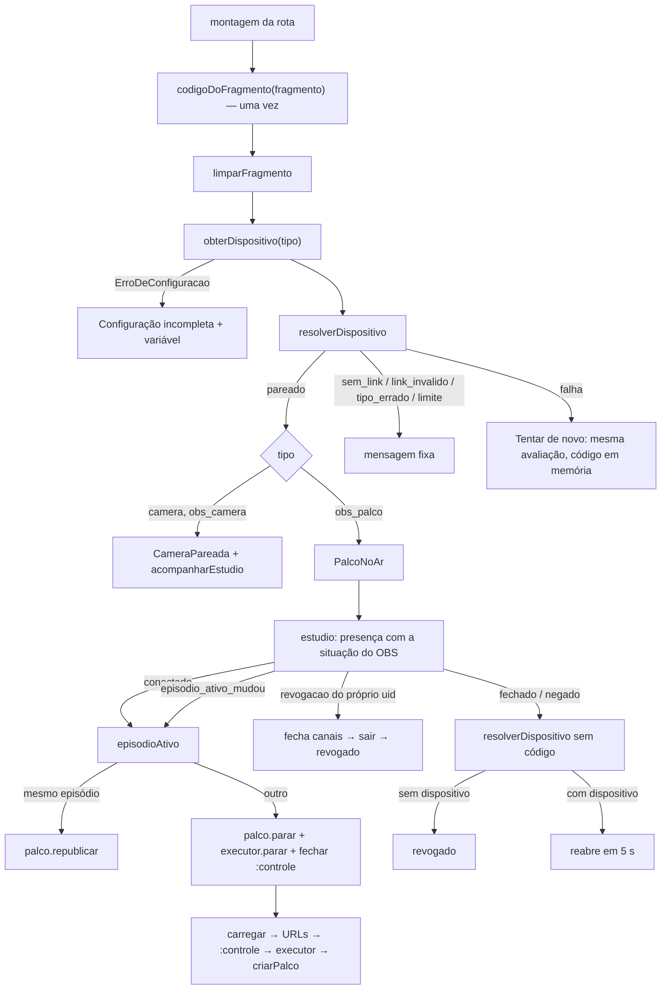

# VER-040 — E3, Tarefa 6: telas de dispositivo (pareamento e `/obs/palco` no ar)

## Cabeçalho

| Campo | Valor |
|---|---|
| Id | VER-040 |
| Título | Rotas de dispositivo ligadas: pareamento em `/camera`, `/obs/camera` e `/obs/palco` e o palco no ar na Fonte de navegador do OBS |
| Gravidade | alta |
| Tipo | funcionalidade · segurança |
| Data | 2026-11-27 |
| Usuário responsável | TokumoH |
| Status de implementação | implementado |
| Commits | commit que introduz este arquivo — `git log --format=%h -- docs/verificacoes/2026-11-27-040-e3-telas-de-dispositivo.md` |
| Arquivos | `src/app/useDispositivo.ts`, `src/app/telas/TelaDeDispositivo.tsx`, `src/app/telas/TelaDeDispositivo.test.tsx`, `src/app/telas/PalcoNoAr.tsx`, `src/app/telas/PalcoNoAr.test.tsx`, `src/app/telas/ObsPalco.tsx`, `src/app/telas/Camera.tsx`, `src/app/telas/ObsCamera.tsx`, `src/app/App.tsx`, `src/app/App.test.tsx`, `src/app/acesso.test.tsx`, `src/domains/aovivo/palco.ts`, `src/domains/aovivo/palco.test.ts`, `src/domains/obs/executor.ts`, `src/domains/obs/executor.test.ts`, `index.html`, `src/shared/styles/base.css`, `src/app/README.md`, `src/app/telas/README.md`, `src/domains/aovivo/README.md`, `src/domains/obs/README.md`, `src/shared/styles/README.md`, `docs/verificacoes/README.md`, este registro |

## Problema

Até a Tarefa 5 da E3 ([VER-039](2026-11-27-039-e3-integracao-obs-e-palco.md)) existiam o domínio do pareamento (`resolverDispositivo`, Tarefa 1), os adaptadores (Tarefa 4) e o serviço do palco com o executor do OBS (Tarefa 5), mas as três rotas de dispositivo continuavam provisórias ("Em construção — etapa E3/E4"): nenhum aparelho conseguia parear pelo link ou QR, o palco não seguia o episódio ativo nem executava comando nenhum, e o `App` nem passava as dependências a essas rotas. Efeito: o ao vivo por toque (objetivo da E3) não tinha executor. Os Riscos do [VER-038](2026-11-27-038-e3-adaptadores-ao-vivo.md) e do VER-039 deixaram para esta tarefa: tirar a chamada manual de `obterDispositivo` dos dois testes de cliente por rota; chamar `executor.parar()` junto com `palco.parar()`; chamar `atualizarSituacao()` de tempos em tempos; perceber a queda do websocket por `conectado()`/`aoFechar` sem recriar o executor; alimentar os `Revogados` do palco com os avisos de `estudio`.

## Era proposital?

Sim, por etapas. O PLA-004 (estrutura de arquivos, linha da Tarefa 6) põe `useDispositivo.ts`, `TelaDeDispositivo.tsx`, `PalcoNoAr.tsx`, as três rotas e o script do `index.html` nesta tarefa; as Tarefas 1, 4 e 5 entregaram só domínio e adaptadores, testados com falsos, e citaram esta tarefa nos seus Riscos (VER-038: "`dispositivo-cria-so-o-proprio-cliente` chama `obterDispositivo` explicitamente até a Tarefa 6"; VER-039: "Clipe depois de `parar()` (N5)", "Situação do OBS lida por último", "Websocket que cai (I1)"). As frases provisórias vinham do VER-018 (E1).

## Solução

- **Pareamento (D3, D4, N1)** — `useDispositivo(tipo, dependencias)` lê o fragmento **uma vez** (`codigoDoFragmento`), chama `limparFragmento()` **antes** de `obterDispositivo(tipo)` e de qualquer rede e chama `resolverDispositivo`. Estados de tela: os do domínio, `carregando` e `configuracao` (com o nome da variável). O código vive só numa referência em memória: esquecido depois de qualquer resposta que não seja `falha`, guardado só para o "Tentar de novo" da `falha` (a URL já não o tem). A avaliação em curso é reaproveitada pelo segundo efeito do `StrictMode` (sem segundo pareamento). `revogado` só por `marcarRevogado`.
- **Casca das rotas** — `TelaDeDispositivo` (como a `GuardaDeMembro`): mensagens fixas de `TEXTO_DO_DISPOSITIVO` com as frases do brief, "Tentar de novo" só na `falha`, `TelaConfiguracaoIncompleta` para a variável ausente e nada na tela do palco enquanto confere (ele recarrega dentro da Fonte do OBS, D16); entrega o conteúdo só ao pareado.
- **Canal `estudio` dos dispositivos (D5, D14, D15, N3)** — `acompanharEstudio` (em `useDispositivo.ts`, usado pelas câmeras e pelo palco): presença; `revogacao` do próprio `usuarioId` → fecha os canais, `sair()` e `marcarRevogado()`; de outro usuário → `aoRevogarOutro` (o palco alimenta os `Revogados`); canal `fechado` ou `negado` (também o `:controle` do palco) → fecha os canais e refaz `resolverDispositivo` sem código: sem dispositivo → tela de revogado (o `sair()` já foi feito pela avaliação), com dispositivo → reabre em 5 s (`REABRIR_CANAIS_MS`), `falha` → tenta de novo em 5 s.
- **Câmeras** — `CameraPareada`: "Pareado como <rótulo>. O vídeo chega na etapa E4.", presença `{ tipo, dispositivoId, obs: null }` e revogação.
- **Palco no ar (D9, D10, D16)** — `PalcoNoAr`, um controlador por montagem: `episodioAtivo()` ao conectar o `estudio` (a primeira vez e a cada volta) e no `episodio_ativo_mudou`; com episódio, `carregar`, URLs assinadas dos sons e das imagens (renovadas a cada 45 min; um `<audio>` tocando só troca de `src` no fim do som), `:controle`, executor do OBS e `criarPalco`; na troca, `palco.parar()` **e** `executor.parar()` e o tópico antigo fechado. Situação do OBS relida a cada 15 s e em todo evento de saída (presença e estado republicados quando muda); a releitura de 15 s também fecha selo e painel se a saída estiver no ar ou o status desconhecido (defesa se um evento do obs-browser faltar). obs-websocket: configuração em `revocast-obs-websocket` (porta e senha), um objeto por rota, queda percebida por `aoFechar` e reconexão no mesmo objeto a cada 10 s. Desde a rodada 1, **nada no websocket recria o executor, o serviço do palco ou o `:controle`**: o executor recebe sempre o mesmo objeto da porta `ObsWebsocket` (que delega ao real; queda e volta por `conectado()`) e o estado sem conexão por função (`estadoDoWebsocket: () => …`, desligado, senha recusada ou sem conexão; `executor.ts` passou a aceitar a função). Reconexão com sucesso ou com `senha_errada` e o "Salvar" só mudam a situação publicada; o aviso no ar continua. A tela pareada mostra **só** o aviso no ar (cartão; título, texto e link como texto React) e os `<audio preload="auto">`; selo (tecla `s`, 5 s) e painel de configuração (tecla `c`, 2 min, aviso fixo, `<input type="password">` vazio a cada abertura, porta, "Salvar") só com a saída parada e o status conhecido; qualquer evento de saída fecha os dois na hora, e um evento que chega durante a conferência vence.
- **Sem piscar (N2)** — `index.html` ganhou, no `<head>`, antes da folha de estilos e do módulo, um `<script>` clássico que põe a classe `palco` e `style.colorScheme = 'light'` em `<html>` só quando `location.pathname` sem as barras finais (todas, como o `resolverRota`) é `/obs/palco`; `base.css`: `html.palco, html.palco body { background: transparent }`.
- **Domínio** — `criarPalco` ganhou `republicar()` (a rota chama quando o `:controle` volta a `conectado`).

## Por que esta solução

- **Componentes e GRASP Pure Fabrication:** `useDispositivo` e `acompanharEstudio` são fabricações da camada de aplicação que só conhecem portas (`ServicoDeDispositivo`, `FabricaDeCanais`, `RepositorioDoPalco`, `ObsNoNavegador`, `ObsWebsocket`); a regra de pareamento continua no domínio (`resolverDispositivo`), o serviço do palco e o executor continuam nos seus contextos (`aovivo`, `obs`), e as telas só desenham. `acompanharEstudio` é reaproveitado pelas três rotas (presença, revogação e canal fechado num lugar só).
- **DDD:** o `PalcoNoAr` compõe os contextos Ao vivo e Integração OBS sem que um conheça o outro (D1); a única mudança de domínio é `republicar()`, uma operação do próprio serviço (não dava para republicar pela rota sem repetir a regra `paraOCanal` do palco).
- **Segurança:** o código sai da URL antes de qualquer rede e nunca vai para estado do React, armazenamento, `console` ou URL; nenhum dado vira HTML (texto React em tudo, link do aviso como texto); a senha do websocket só existe no campo enquanto se digita e no `localStorage` da Fonte (D10, DES-001 §8) e nunca volta ao campo, à presença ou ao estado; selo e painel recusados com qualquer dúvida sobre a saída (status nulo, nível abaixo de READ_OBS, sem `window.obsstudio`).
- **Otimização:** um controlador por montagem, timers num conjunto cancelado na desmontagem, presença e estado só republicados quando a situação muda.

## Por que não outras soluções

| Opção | Motivo de descarte |
|---|---|
| Guardar o código em estado do React ou no `sessionStorage` para o "Tentar de novo" | D3: o código só vive em memória da avaliação; estado do React aparece nas ferramentas de desenvolvimento e o armazenamento sobrevive à página |
| Esquecer o código também na `falha` | O fragmento já saiu da URL: depois de uma rede caída, o aparelho teria de pedir outro link para um código que nunca foi consumido |
| Republicar o estado pela rota (`canal.publicarEstado(palco.estado())`) | Repetiria a regra do palco que troca a cena longa por `null` (`paraOCanal`, VER-039 N7); `republicar()` no serviço é uma linha |
| Recriar o executor a cada queda do websocket | VER-039, I1: o executor já percebe a queda por `conectado()`; recriá-lo no meio do ar perderia o clipe pendente e o estado do aviso |
| Um executor só para a rota inteira | `executor.parar()` é definitivo (cancela o clipe na troca de episódio, N5); por isso há um executor por sessão de episódio e um de base para a situação sem episódio |
| Recriar o executor (e a sessão) quando o websocket muda de tipo (versão da entrega, reprovada na revisão 1, I1) | A reconexão automática com `senha_errada` reiniciava a sessão com a saída no ar: o aviso sumia da transmissão e o `/controle` via o estado zerado |
| Adiar a troca de executor até a saída parar | Continuaria reiniciando a sessão (perde o aviso e os `id` vistos) e exigiria uma fila de trocas pendentes; a função de estado e o objeto que delega dispensam a troca |
| Pôr a classe `palco` pelo React depois da montagem | A primeira pintura sairia com o fundo de papel na Fonte do OBS (N2); a sabotagem S6 prova que o teste pega |
| `obsSourceActiveChanged` para fechar o painel | A Fonte fica em todas as cenas e está sempre ativa (I5) |
| Um campo de senha controlado pelo React | O valor ficaria no estado do componente; o campo não controlado com `ref` é esvaziado no "Salvar" e sai do DOM ao fechar |

## Onde

| Arquivo | Linhas | O que mudou |
|---|---|---|
| [`src/app/useDispositivo.ts`](../../src/app/useDispositivo.ts#L36-L98) | 36–98 | `useDispositivo`: fragmento lido uma vez e limpo antes de `obterDispositivo` (L56–L60), avaliação reaproveitada no `StrictMode`, código esquecido depois de resposta |
| [`src/app/useDispositivo.ts`](../../src/app/useDispositivo.ts#L100-L217) | 100–217 | `OpcoesDoEstudio` e `acompanharEstudio`: presença, revogação (L175), reavaliação (L183) e canal perdido (L197) |
| [`src/app/telas/TelaDeDispositivo.tsx`](../../src/app/telas/TelaDeDispositivo.tsx#L16-L124) | 1–124 | `TEXTO_DO_DISPOSITIVO`, `TelaDeDispositivo` (L81) e `CameraPareada` (L102) |
| [`src/app/telas/PalcoNoAr.tsx`](../../src/app/telas/PalcoNoAr.tsx#L15-L62) | 15–62 | Constantes, `TEXTO_DO_PALCO` e `lerConfiguracaoDoWebsocket` |
| [`src/app/telas/PalcoNoAr.tsx`](../../src/app/telas/PalcoNoAr.tsx#L158-L214) | 158–214 | obs-websocket do executor: objeto que delega ao real (`wsDoExecutor`, L164) e estado sem conexão por função (rodada 1, I1) |
| [`src/app/telas/PalcoNoAr.tsx`](../../src/app/telas/PalcoNoAr.tsx#L216-L326) | 216–326 | URLs (adiadas para o `<audio>` tocando, L230), `iniciarSessao` (L247), `pararSessao` (os dois `parar()`, L275) e `consultarEpisodio` (L293) |
| [`src/app/telas/PalcoNoAr.tsx`](../../src/app/telas/PalcoNoAr.tsx#L328-L392) | 328–392 | Situação do OBS publicada quando muda, `mudarWs` (L343, só a situação) e `conectarWs` (L356) |
| [`src/app/telas/PalcoNoAr.tsx`](../../src/app/telas/PalcoNoAr.tsx#L394-L518) | 394–518 | Selo e configuração só com a saída parada (`saidaParada`, L400; releitura de 15 s, L443), teclas (L449), montagem (`acompanharEstudio`, L458; `aoMudarSaida`, L475) e desmontagem (L502) |
| [`src/app/telas/PalcoNoAr.tsx`](../../src/app/telas/PalcoNoAr.tsx#L520-L584) | 520–584 | "Salvar" e a tela: cartão do aviso (L541), selo, painel e `<audio>` (L572) |
| [`src/domains/obs/executor.ts`](../../src/domains/obs/executor.ts#L22-L41) | 22–41, 127–131 | `estadoDoWebsocket` aceita função, lida a cada situação, com ou sem objeto (rodada 1) |
| [`src/domains/obs/executor.test.ts`](../../src/domains/obs/executor.test.ts#L315-L335) | 315–335 | Teste `estado-do-websocket-por-funcao` |
| [`src/app/telas/ObsPalco.tsx`](../../src/app/telas/ObsPalco.tsx#L40-L63) | 1–63 | Portas do navegador (`localStorage` sem lançar) e a rota |
| [`src/app/telas/Camera.tsx`](../../src/app/telas/Camera.tsx#L1-L11), [`ObsCamera.tsx`](../../src/app/telas/ObsCamera.tsx#L1-L11) | 1–11 | Casca + `CameraPareada` |
| [`src/app/App.tsx`](../../src/app/App.tsx#L13-L35) | 13–35 | As três rotas de dispositivo recebem `dependencias` |
| [`src/domains/aovivo/palco.ts`](../../src/domains/aovivo/palco.ts#L44-L49) | 44–49, 184–186 | `republicar()` |
| [`index.html`](../../index.html#L8-L15) | 8–15 | Script clássico da classe `palco` e do esquema claro (N2) |
| [`src/shared/styles/base.css`](../../src/shared/styles/base.css#L349-L410) | 349–410 | `.tela-de-dispositivo`, `html.palco`, `.palco-no-ar`, `.aviso-no-ar`, `.selo-do-palco`, `.config-do-palco` |
| [`src/app/telas/TelaDeDispositivo.test.tsx`](../../src/app/telas/TelaDeDispositivo.test.tsx#L45-L261) | 1–261 | 20 testes do pareamento e das câmeras |
| [`src/app/telas/PalcoNoAr.test.tsx`](../../src/app/telas/PalcoNoAr.test.tsx#L162-L736) | 1–736 | 41 testes do palco e `palco-sem-piscar` |
| [`src/domains/aovivo/palco.test.ts`](../../src/domains/aovivo/palco.test.ts#L335-L351) | 335–351 | Teste `republicar` |
| [`src/app/App.test.tsx`](../../src/app/App.test.tsx#L1-L136), [`src/app/acesso.test.tsx`](../../src/app/acesso.test.tsx#L61-L83) | — | Frase das rotas de dispositivo ("não está pareado"); os testes de cliente por rota sem a chamada manual de `obterDispositivo` |
| READMEs de [`src/app/`](../../src/app/README.md), [`src/app/telas/`](../../src/app/telas/README.md), [`src/domains/aovivo/`](../../src/domains/aovivo/README.md), [`src/shared/styles/`](../../src/shared/styles/README.md) e [`docs/verificacoes/`](README.md) | — | "Onde", "Arquivos", contagens e Riscos |

## Lógica

| Passo | Antes | Depois |
|---|---|---|
| Abrir `/camera#<código>` | "Em construção — etapa E4" | fragmento limpo, login anônimo, pareamento, "Pareado como <rótulo>. O vídeo chega na etapa E4." |
| Recarregar `/obs/palco` já pareado | provisório | nada na tela; `estudio` → episódio ativo → `:controle` → comandos executados |
| Comando `aviso` com HTML | — | cartão com o texto literal; nenhum `script`, `b` ou `a` |
| Tecla `s` com a gravação ligada | — | nada aparece |
| Revogação no painel | só no banco (até 10 min no canal) | o aparelho sai na hora: canais fechados, `sair()`, "Este dispositivo foi revogado. Gere um novo link no painel." |
| Canal fechado pelo servidor | — | reavaliação; com dispositivo, canais de volta em 5 s |
| Troca de episódio com clipe esperando | o clipe seria salvo 5 s depois (VER-039 N5) | `executor.parar()` cancela; nada salvo |
| Primeira pintura do `/obs/palco` (também `/obs/palco//`) | fundo de papel | `html.palco` já transparente e com esquema claro (script antes do CSS) |
| Websocket cai no ar e volta com a senha recusada (rodada 1) | (entrega) a sessão reiniciava: aviso fora da transmissão, `:controle` reaberto, estado zerado | só a situação muda (`senha_errada` na presença); aviso, `:controle` e estado ficam |
| Renovação de 45 min com um som tocando (rodada 1) | (entrega) o `src` trocava e cortava o som | o `src` novo entra no `ended` |
| Painel aberto, transmissão começa sem evento do obs-browser (rodada 1) | (entrega) ficava até 2 min | a releitura de 15 s fecha |

## Exemplo

- `pareia-e-mostra`: `/camera#Ab3_-Ab3_-…` (43 caracteres) com o pareamento falso respondendo `{ resultado: 'pareado', dispositivo: { rotulo: 'Celular de gravação' } }` → "Pareado como Celular de gravação. O vídeo chega na etapa E4.", 1 presença em `estudio` `{ tipo: 'camera', dispositivoId, obs: null }`. `fragmento-limpo-antes-da-rede`: ordem anotada `['limparFragmento', 'obterDispositivo', 'sessaoAtual', 'entrarAnonimo', 'parear']`.
- `palco-toca-som`: som com `volume: 0.8`, `<audio>` com `currentTime = 7` → depois do comando, `currentTime` 0, `volume` 0,8, `play` 1 vez naquele elemento, estado publicado com `ultimo.resultado = 'ok'` e 1 linha de registro.
- `palco-config-escondida`: senha `senha-de-teste` e porta 4456 → armazenamento `{"porta":4456,"senha":"senha-de-teste"}`, `conectar` com os mesmos valores, presença com `websocket: 'conectado'`; `document.body.innerHTML`, as presenças e os estados publicados não contêm a senha; reaberto, o campo vem `''` e a porta `4456`; 119 999 ms depois de abrir ainda aberto, 120 000 ms fechado.
- `palco-canal-fechado`: `:controle` `negado` → 0 canais; 4 999 ms → 0; 5 000 ms → `['estudio', 'episodio:<id>:controle']`; com `dispositivoAtual` nulo, `fechado` → tela de revogado e `sair` 1 vez.

## Verificação

| # | Abordagem | Comando / método | Resultado |
|---|---|---|---|
| TDD | Testes antes do código | `npx vitest run src/app/telas/TelaDeDispositivo.test.tsx` com as rotas provisórias: 19 falhas de 19; `PalcoNoAr.test.tsx` com o `ObsPalco` provisório (de `git show HEAD`, devolvido e conferido com `cmp`): 31 falhas de 32 (o que passou é negativo: "o evento que chega durante a conferência vence" não acha campo em tela nenhuma); `palco.test.ts > republicar`: `republicar is not a function` | falharam como esperado |
| Verde | Pasta e suíte | `npx vitest run src/app` (15 arquivos, 282 testes desde a C1; 274 na entrega) e `npx vitest run` (55 arquivos, 2 105 testes desde a C1; 2 096 na entrega) | 0 falhas |
| Tipos | `npx tsc --noEmit` | — | 0 erros |
| Sabotagens | Em memória (plugin do Vite que troca o trecho só no que o Vitest carrega, `fsModuleCache: false`), `sha256sum` de todos os arquivos tocados antes e depois: iguais | `node rodar.mjs` (scratchpad `t6-sab/`) | tabela abaixo |
| Sabotagem N2 | No disco, com `sha256sum` antes e depois (iguais): S6 tirar o script do `index.html` e pôr a classe por `useEffect` no `ObsPalco`; S6b `type="module"`; S6c `startsWith('/obs/palco')`; S6d só `html.palco` no CSS | `npx vitest run --config sab.config.mjs src/app/telas/PalcoNoAr.test.tsx` | as quatro derrubam `palco-sem-piscar` |
| `npm run check` | Último ato, com este registro | `npm run check` | saída 0 (na entrega e de novo na C1): `typecheck` 0, 2 105 testes, `check-docs` 0 (71 `.md`, 40 registros), `check-doc-secrets` 0, `rpc:grants-check` 0, `data-api:check` 0, `check-deps-audit` 0 |
| C1 | Correção da rodada 1 (I1, I2 e os 5 nits) | testes novos (`websocket-sem-reiniciar-no-ar`, `palco-renova-urls`, `palco-troca-sem-vazar`, `palco-desmonta-limpo`, `palco-strict-mode`, canal fechado durante a consulta, releitura de 15 s × 2, `estado-do-websocket-por-funcao`, `/obs/palco//` e o esquema claro em `palco-sem-piscar`, `codigo-nunca-em-armazenamento` com o `limparFragmento` real) e as sabotagens da tabela "Rodada 1" (todas derrubam; a lista da entrega, repetida, continua derrubando o mesmo; `sha256sum` antes/depois iguais) | 0 falhas; `npm run check` 0 erros |
| Revisão 1 | revisão independente sobre a primeira versão: leitura do diff, sondas (S4, StrictMode, desmontagem, renovação) e sabotagens numa cópia (cache desligado) | spec ✅ (desvios aceitos); 2 achados importantes (I1 reconexão do websocket com `senha_errada` reiniciava a sessão no ar e tirava o aviso da transmissão — comportamento e registro falso; I2 7 sabotagens de ciclo de vida sem teste) e 5 nits | reprovada; tudo corrigido em C1 |
| Revisão 2 | re-revisão focada nas correções C1: sonda S4 refeita, executor comparado com `acf85be`, as 7 sabotagens de ciclo de vida e as dos nits repetidas (cache desligado) | nenhum achado | **limpa** |

| Sabotagem | Teste(s) derrubado(s) |
|---|---|
| S1 limpar o fragmento depois de `resolverDispositivo` | `fragmento-limpo-antes-da-rede` (as três rotas), `falha-e-tentar-de-novo`, `configuracao` |
| S2 guardar o código no `sessionStorage` | `codigo-nunca-em-armazenamento` |
| S3 link do aviso como `<a>` | `palco-mostra-aviso-literal` |
| S4 selo sempre visível fora do `ao_vivo` | `palco-sem-nada-sem-tecla` (sem episódio, modo teste) e mais 17 |
| S5 abrir a configuração com a saída no ar | `selo-e-config-recusados-no-ar` (6 casos) e "sem `window.obsstudio`" |
| S6, S6b, S6c, S6d (index.html e CSS, no disco) | `palco-sem-piscar` |
| S7 tratar `fechado` como `reconectando` (no `estudio` e no `:controle`) | `palco-canal-fechado` (sem dispositivo; com dispositivo, `fechado`), canal fechado na câmera |
| S8 painel de configuração sempre aberto | `palco-config-escondida`, `palco-sem-nada-sem-tecla` (3) e mais 12 |
| S9 não consultar o episódio ativo ao reconectar | `palco-reconecta`, `palco-canal-fechado` (`fechado` e `negado`) |
| P1 troca de episódio sem `executor.parar()` | `palco-troca-de-episodio` |
| P2 `StrictMode` avalia duas vezes | `strict-mode-pareia-uma-vez` |
| P3 revogação de qualquer usuário derruba | `revogado-na-hora` |
| P4 situação comparada com a lida agora | websocket caído, presença com OBS, situação relida, `palco-config-escondida`, senha recusada |
| P5 `:controle` de volta a conectado sem republicar | `palco-reconecta: o :controle de volta a conectado republica o estado` (na 1ª rodada sobreviveu; teste novo) |
| P6 evento de saída não fecha | os 4 casos "fecha o painel e o selo na hora" |
| P7 evento durante a conferência não vence | "o evento que chega durante a conferência vence" (na 1ª rodada sobreviveu: o teste mudava o status junto; corrigido para o caso real, `Starting` antes do `getStatus` mudar) |
| P8 senha salva volta ao campo | `palco-config-escondida` |
| P9 revogação de outro não alimenta os `Revogados` | "palco revogado na hora; revogação de outro descarta o remetente" |
| P10 código guardado depois de uma resposta | **nenhum** — mutante equivalente: depois de uma resposta que não seja `falha` não há caminho que avalie de novo com o código ("Tentar de novo" só existe na `falha`; a reavaliação do canal passa `null`). A linha fica por higiene (D3: o código some com a avaliação); ver Riscos |
| P11 sem reconexão do websocket | websocket salvo e reconectado depois da queda |
| P12 palco mostra a tela enquanto confere | carregando (o palco não mostra nada) — na 1ª rodada sobreviveu; teste novo |
| P13 tecla digitada no campo abre o selo | `palco-config-escondida` — na 1ª rodada sobreviveu; asserção nova |

| Sabotagem da rodada 1 | Teste(s) derrubado(s) |
|---|---|
| C1a senha recusada reinicia a sessão | `websocket-sem-reiniciar-no-ar` |
| C1b qualquer mudança do websocket reinicia a sessão | `websocket-sem-reiniciar-no-ar` |
| C1c executor ignora a função de estado | `estado-do-websocket-por-funcao`, `palco-presenca-com-obs`, senha recusada, `websocket-sem-reiniciar-no-ar` |
| A sem renovar as URLs a cada 45 min | `palco-renova-urls` |
| B sem `palco.parar()` na troca | `palco-troca-sem-vazar` |
| C sem cancelar os timers na desmontagem | `palco-desmonta-limpo` |
| D sem `removeEventListener` do teclado | `palco-desmonta-limpo` |
| I sem `soltarSaida` | `palco-desmonta-limpo` |
| K sem `estudio.parar()` na desmontagem | `palco-desmonta-limpo` |
| Q sem `consulta++` ao fechar os canais | canal fechado durante a consulta do episódio |
| N2 `<audio>` tocando troca de `src` | `palco-renova-urls` |
| N3 releitura de 15 s não fecha | releitura de 15 s (transmissão e status desconhecido) |
| N4 `limparFragmento` real não tira o fragmento (`dependencias.ts`) | `codigo-nunca-em-armazenamento` |
| N1a script com uma barra só (no disco, `sha256sum` OK) | `palco-sem-piscar` |
| N5 script sem `colorScheme` (no disco, `sha256sum` OK) | `palco-sem-piscar` |

Nits corrigidos (não zeram a contagem): os 5 nits da revisão 1 entraram na C1 (barras finais do script, `src` do áudio tocando, releitura de 15 s, espião do `history` com o `limparFragmento` real, esquema claro no script), cada um com teste e sabotagem.

## Riscos

- **Desvios do brief (registrados):** (1) `useDispositivo` devolve também `servicos` (a casca precisa entregá-los ao conteúdo; o brief listava só `estado`, `tentarDeNovo` e `marcarRevogado`); (2) `acompanharEstudio` foi posto em `useDispositivo.ts` (reuso pelas três rotas; não é arquivo novo); (3) `criarPalco` ganhou `republicar()` (`palco.ts` e o teste, fora da lista do brief), porque a publicação do começo sai com o `:controle` ainda conectando e a reconexão do próprio palco não gera entrada na presença; (4) `acesso.test.tsx` também tinha as frases provisórias e foi atualizado; (5) o palco não mostra nada no `carregando` (D16: recarrega dentro da Fonte, inclusive no ar); (6) com `fechado`/`negado` e a reavaliação em `falha` (rede), o palco tenta de novo em 5 s em vez de dizer "revogado"; (7) a senha em branco no "Salvar" mantém a salva (não dá para apagar a senha pelo painel; sem senha no obs-websocket, salve uma vez com o campo vazio antes de qualquer senha); (8) o selo no `ao_vivo` diz "Ao vivo: <título>" (o brief só nomeava os outros dois); (9) o formulário usa `noValidate` para a porta inválida mostrar a mensagem fixa em vez da validação nativa.
- **Código no "Tentar de novo":** depois de uma `falha` o código continua na referência em memória até a próxima resposta; se a `falha` veio depois de o servidor consumir o código (resposta perdida), o "Tentar de novo" responde "Link inválido ou expirado". P10 (esquecer o código depois de uma resposta) é inobservável pela tela.
- **Palco recarregando sem rede no ar:** as telas de erro do pareamento (inclusive a `falha` com "Tentar de novo") aparecem sobre o fundo transparente, também na transmissão (D16 aceita: "só acontece na configuração"); o `carregando` não aparece.
- **Sem OBS real e sem Realtime real:** tudo com falsos (o adaptador real do OBS sobre um `window.obsstudio` falso, o adaptador real do canal sobre o `realtime-js` falso); a transparência na Fonte (CEF), o efeito do esquema claro posto pelo script (`style.colorScheme`) e do `<meta name="color-scheme" content="light dark">` com o sistema escuro, a tecla no "Interagir", o `play()` sem gesto do usuário na Fonte, o tempo do `getStatus` sem permissão e a reconexão do websocket ficam para a Tarefa 10.
- **Sem conferência visual:** as classes novas seguem os tokens e as regras de largura (`max-width` com `calc(100% - …)`, `overflow-wrap: anywhere`), mas não foram abertas num navegador em 320 px nesta tarefa (Tarefa 10).
- **Selo e painel num navegador comum:** sem `window.obsstudio` nunca abrem (status desconhecido = recusado, D10); a configuração do websocket só é feita na Fonte, com o OBS parado.
- **Situação do OBS a cada 15 s:** entre duas leituras (sem evento de saída) a presença pode atrasar até 15 s.
- **Websocket e sessão (rodada 1):** nenhuma mudança do websocket reinicia a sessão (provado por `websocket-sem-reiniciar-no-ar` com a saída no ar); o que ainda reinicia a sessão é só a troca de episódio ou de modo (`episodioAtivo()` diferente), que é decisão da equipe no painel.
- **URL nova de um som que toca por mais de 15 min:** a troca espera o `ended`; um som que nunca termina (laço) ficaria com a URL antiga, que vence em 1 h (os sons da Biblioteca não têm laço).
- **Teste instável conhecido fora desta tarefa:** `AbaBiblioteca.test.tsx > aviso-da-fila-e-saida-da-pagina` (item separado pendente).
