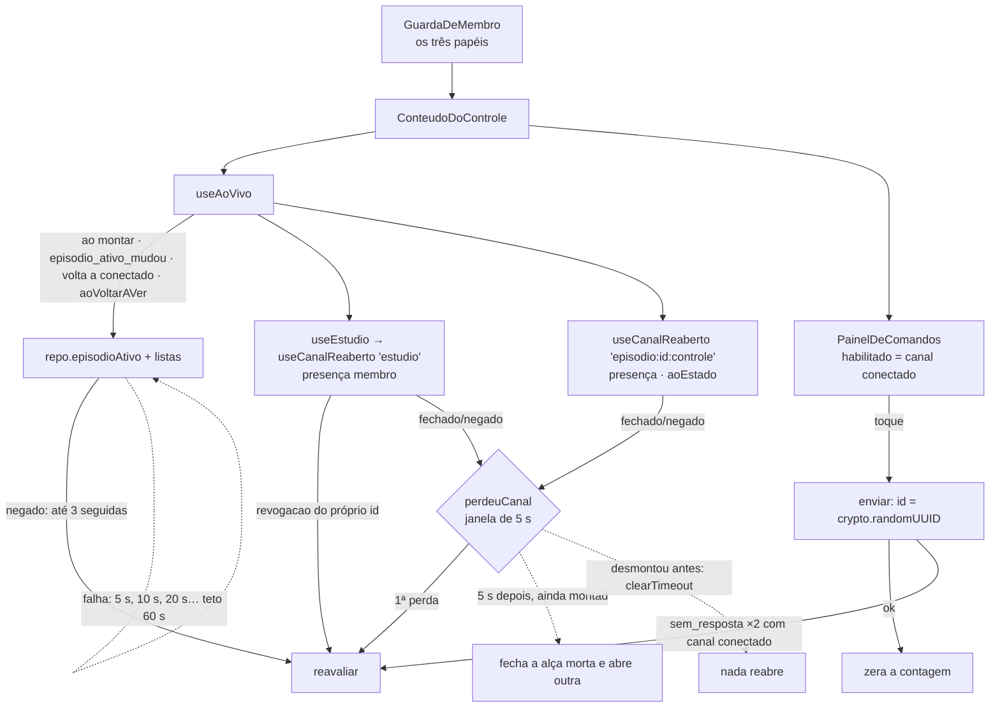

# VER-041 — E3, Tarefa 7: `/controle` por toque

## Cabeçalho

| Campo | Valor |
|---|---|
| Id | VER-041 |
| Título | `/controle` real: a equipe e a apresentadora mandam cena, som, aviso, clipe e marcador ao palco por toque, com o estado no ar, a presença do palco e as reavaliações de acesso pelo canal |
| Gravidade | alta |
| Tipo | funcionalidade · segurança |
| Data | 2026-11-27 |
| Usuário responsável | TokumoH |
| Status de implementação | implementado |
| Commits | commit que introduz este arquivo — `git log --format=%h -- docs/verificacoes/2026-11-27-041-e3-controle.md` |
| Arquivos | `src/app/useEstudio.ts`, `src/app/useAoVivo.ts`, `src/shared/ui/PainelDeComandos.tsx`, `src/app/telas/Controle.tsx`, `src/app/telas/Controle.test.tsx`, `src/domains/aovivo/mensagens.ts`, `src/domains/aovivo/comandos.ts` (rodada 1), `src/shared/ui/TelaProvisoria.tsx` (apagado na rodada 1), `src/shared/README.md` (rodada 1), `src/app/App.test.tsx`, `src/app/acesso.test.tsx`, `src/shared/styles/base.css`, `src/app/README.md`, `src/app/telas/README.md`, `src/shared/ui/README.md`, `src/shared/styles/README.md`, `src/domains/aovivo/README.md`, `docs/verificacoes/README.md`, este registro |

## Problema

Até a Tarefa 6 da E3, o palco já executava comandos (VER-039, VER-040), mas nenhum membro conseguia mandá-los: o `/controle` era a última tela provisória ("Em construção — etapa E3"). Faltava a tela de celular do DES-001 §9 com o estado no ar, os avisos, os sons, as cenas e os botões CLIPE e MARCAR, e faltava o comportamento de rede e de acesso da D15 e do N3 do [PLA-004](../planos/2026-11-27-e3-ao-vivo-por-toque.md):

- botões desligados fora de `conectado`;
- `ack` sem resposta avisado;
- nova consulta do episódio ativo na volta do canal e da aba;
- canal `fechado`/`negado` tratado como perda de acesso, com `reavaliar()` e reabertura em 5 s;
- revogação do próprio membro pelo canal `estudio` (D5).

A Tarefa 8 também precisa do hook que mantém o `estudio` de um membro (o `useEstudio` do I-A do plano).

## Era proposital?

Sim, era provisório por plano. `Controle.tsx` nasceu com `TelaProvisoria` na Tarefa 4 da E1 (VER-018), com a etapa "E3" do DES-001 §14. O PLA-004 põe o conteúdo na Tarefa 7 (D9, D15, N3, I-A). As frases provisórias em `App.test.tsx` e `acesso.test.tsx` são as que o próprio plano manda trocar ("`src/app/App.test.tsx` (frase)").

**Divergências do brief com o código commitado (seguido o código, registradas):**

1. **`Omit<Comando, 'id'>`.** No TypeScript 7.0.2 esse tipo não serve: o `Omit` não distribui sobre a união. Ele só vê as chaves comuns (`id`, `acao`), e um pedido `{ acao: 'cena', cenaId }` dá TS2353 (sonda com `npx tsc --noEmit`). Foi criado `PedidoDeComando` no domínio (`mensagens.ts`, `SemChave<Comando, 'id'>` distributivo), usado no lugar do `Omit` em `useAoVivo.enviar` e em `PainelDeComandos.enviar`.
2. **Retorno do `useAoVivo`.** Ganhou três campos além dos do brief:
   - `carregado`: sem ele, "Nenhum episódio no ar nem em teste." piscaria antes da primeira consulta;
   - `falhaAoCarregar`: a consulta pode falhar por rede;
   - `pedidoDoUltimo`: o estado no ar só traz `comandoId` e `acao` (D9), então "🎵 aplauso ✓" só é possível lembrando os pedidos que esta tela enviou.
3. **Props do `PainelDeComandos`.** Ganhou `episodio` (`{ modo, titulo }`), porque o selo "AO VIVO"/"TESTE" e o título vêm da consulta do próprio `/controle`, antes de o palco publicar qualquer estado. Ganhou também `pedidoDoUltimo` (opcional).
4. **Frases além das do brief:** "Conectando…" (canal ainda entrando), "Carregando o episódio…", "Não foi possível carregar o episódio; tentando de novo." e "O comando não foi enviado. Tente de novo." (resposta `falhou`).
5. **`src/domains/aovivo/mensagens.ts` e o README do domínio** foram tocados (fora da lista do brief), só pelo tipo da divergência 1. Na rodada 1, `comandos.ts` também foi tocado: ele passou a guardar o tipo `ListasDoAoVivo` (antes em `shared/ui`, N7).
6. **Rodada 1 (ruling do controlador):** `TelaProvisoria.tsx` foi apagado nesta tarefa, que o deixou sem uso. Antes de apagar, `grep -rn TelaProvisoria src scripts index.html` achou só a definição e as linhas de README. `git log -S TelaProvisoria` mostra só os commits que o criaram e usaram (VER-008, VER-018, VER-019, VER-040), e `docs/planos` e `docs/desenho` não planejam outro uso. O `sha256` do arquivo apagado era `45a10e4b…ebb2d604`. O VER-008 o cita só como texto, sem link, então o `check-docs` não quebra.

## Solução

- **`useEstudio.ts`** guarda as duas peças que mantêm os canais de membro.
  - `useCanalReaberto(abrir, aoPerder)` segue o I-A e o N3. A alça nasce em `conectando`. Com `fechado` ou `negado`, chama `aoPerder()` **uma vez**. Se a tela continua montada `REABRIR_CANAIS_MS` (5 s) depois, fecha a alça morta e abre outra, que cria um canal novo. Se a pessoa deixou de ser membro, a guarda desmonta a tela e a espera é cancelada.
  - `useEstudio({ canais, papel, reavaliar })` é o `estudio` com a presença `{ tipo: 'membro', papel }` (D14). A Tarefa 8 o reaproveita no painel.
- **`useAoVivo.ts`** junta o ao vivo de uma tela de membro (D5, D9, D14, D15, N3).
  - **Consulta de `episodio_ativo()`:** ao montar, no `episodio_ativo_mudou`, a cada volta do `estudio` a `conectado` (não na primeira entrada) e a cada `aoVoltarAVer`. Com episódio, lê o título, as cenas, os sons e os avisos dele.
  - **Erro na consulta:** acesso negado ou sessão vencida → `reavaliar()`, no máximo 3 vezes seguidas (`REAVALIACOES_DA_LEITURA`, rodada 1, N6). Toda falha mostra o aviso e marca nova consulta com espera crescente: 5 s, 10 s, 20 s, 40 s, até o teto de 60 s (`ESPERA_MAXIMA_DA_CONSULTA_MS`). Um sucesso zera as duas contagens. A consulta antiga que responde depois da nova é descartada pela sequência (teste `consulta-antiga-nao-sobrescreve`).
  - **`:controle` do episódio:** aberto por `useCanalReaberto`, com a presença marcada (o palco republica o estado); trocar de episódio troca o tópico e limpa o estado no ar (rodada 1, N1). O estado no ar só é aceito quando é do episódio consultado.
  - **`estudio` de fora (rodada 1, N5):** com `estudio`, como fará o painel das Tarefas 8 e 9, o hook não abre outra alça, não marca presença e não cuida da perda desse canal. O `useEstudio` aceita `canais` nulo para isso.
  - **Presença do palco:** um `obs_palco` na presença de `estudio`.
  - **`canal`:** o pior estado entre `estudio` e `:controle`.
  - **Canal perdido:** um `reavaliar()` por janela de 5 s; `estudio` e `:controle` fechados juntos, como numa renovação de token, contam uma vez.
  - **Revogação:** `revogacao` do próprio `usuario.id` → `reavaliar()`.
  - **`enviar`:** gera o `id` por `crypto.randomUUID()` e só envia com o canal `conectado`. Duas respostas `sem_resposta` seguidas → `reavaliar()`. Zeram a contagem: um `ok`, ou a volta do canal a `conectado` depois de uma queda (rodada 1, N2). A troca de episódio também zera, porque o `:controle` novo nasce em `conectando`. Nada é reenviado sozinho.
- **`PainelDeComandos.tsx`** (em `shared/ui`) segue o layout do DES-001 §9.
  - **Estado:** selo, título, cena pelo nome de exibição da lista (ou o nome do OBS, como texto), aviso no ar pelo título da lista e "Último" (`… ✓`, `… …` ou a frase do motivo).
  - **Comandos:** avisos (`<título> ▶`, "Próximo aviso", "Ocultar aviso"), sons (emoji e rótulo), cenas (nome de exibição) e CLIPE/MARCAR.
  - **Resposta do envio** numa `Mensagem`, com uma região viva só, o `role="alert"` dela (rodada 1, N4). As frases fixas ficam em `TEXTO_DOS_COMANDOS` e `TEXTO_DO_MOTIVO`. As listas vêm no tipo `ListasDoAoVivo` do domínio (`comandos.ts`, base também de `ContextoDoComando`; rodada 1, N7).
- **`Controle.tsx`:** a guarda (os três papéis) entrega `ConteudoDoControle`, que mostra as mensagens de canal ("Conectando…", "Reconectando…", "Sem acesso ao canal; conferindo o seu acesso."), "O palco não está conectado." e "Nenhum episódio no ar nem em teste.". Os botões ficam habilitados só com o canal `conectado`. O interruptor de gestos fica para a E5 (D8).
- **Estilos:** `.tela.controle`, `.comandos`, `.selo-no-ar` e `.botao-grande` (≥ 44 × 44 px, sem `hover` como sinal).

## Por que esta solução

- **DDD:** o vocabulário (`Comando`, `PedidoDeComando`, `EstadoNoAr`, `MOTIVOS_DO_RESULTADO`) e a validação do que chega pelo canal ficam no domínio `aovivo`. O adaptador de canal (VER-038) valida antes de entregar. A tela só escolhe o que mostrar, e quem decide quem envia é a RLS de `realtime.messages` (`pode_usar_canal`, VER-037).
- **GRASP Pure Fabrication:** cada fabricação da camada de aplicação conhece só portas (`RepositorioDoAoVivo`, `ServicosDePreparacao`, `FabricaDeCanais`).
  - `useCanalReaberto` tem uma responsabilidade só: manter um canal de membro.
  - `useAoVivo` cuida da consulta, das listas e do envio.
  - O `PainelDeComandos` é só visual; não conhece canal nem Supabase.
- **Componentes e reuso:**
  - `useCanalReaberto` serve ao `estudio` e ao `:controle` com a mesma regra, como o plano pede ("o `:controle` do `useAoVivo` segue a mesma regra").
  - `useEstudio` fica pronto para o painel (Tarefa 8).
  - O `PainelDeComandos` fica pronto para a aba Ao vivo (Tarefa 9).
  - `REABRIR_CANAIS_MS` é a mesma constante das rotas de dispositivo (importada de `useDispositivo.ts`, não repetida).
- **Segurança:**
  - Nenhum dado vira HTML: títulos, rótulos, emoji, nome de cena do OBS e motivos são texto React, e o motivo é sempre uma frase da lista fechada.
  - Estado forjado ou de outro episódio não muda nada.
  - O envio só sai com o canal `conectado`.
  - Revogação, canal perdido e dois `sem_resposta` reavaliam o acesso em vez de confiar na tela.
- **Otimização:**
  - Um canal por tópico no cliente: o adaptador divide e conta referências.
  - A consulta repetida é descartada pela sequência; a primeira entrada no canal não consulta de novo.
  - O "Último" guarda só os 50 últimos pedidos.

## Por que não outras soluções

| Opção | Motivo de descarte |
|---|---|
| Reaproveitar `acompanharEstudio` (`useDispositivo.ts`) para os membros | Lá a perda do canal refaz `resolverDispositivo` e decide entre revogado (com `sair()` e `marcarRevogado()`), reabrir e tentar de novo. No membro, quem decide é a guarda depois do `reavaliar()` do `useAcesso`, e a reabertura depende só de a tela continuar montada. Unificar exigiria uma estratégia injetada e mexer no código e nos testes da Tarefa 6 (VER-040), já commitados, sem ganho de comportamento. Fica compartilhado o tempo (`REABRIR_CANAIS_MS`). |
| `useEstudio` e o `:controle` com a reabertura escrita duas vezes | Duplicação. `useCanalReaberto` é genérico sobre a alça (`aoMudarEstado` + `fechar`). |
| Um `reavaliar()` por canal perdido | Na renovação do token os dois canais fecham juntos e o acesso seria reavaliado duas vezes. A janela de 5 s junta as duas perdas (teste `canal-fechado-reavalia (:controle e os dois juntos)`, sabotagem S7). |
| Desabilitar os botões com o palco fora da presença | A presença chega depois da entrada no canal e o palco pode estar só reconectando. O aviso "O palco não está conectado." já diz o risco, e o brief liga `habilitado` só ao canal. |
| `Omit<Comando, 'id'>` como no brief | Não compila com pedidos que têm alvo (divergência 1). |
| Gerar o `id` no `PainelDeComandos` | O brief manda `enviar(c sem id)` e o `id` por `crypto.randomUUID()` em quem envia; com o `id` no `useAoVivo`, a contagem de `sem_resposta` e a memória dos pedidos ficam juntas. |
| Selo pelo `estadoNoAr.modo` | Só aparece depois de o palco publicar; o modo da consulta do próprio `/controle` aparece na hora. |
| Manter `TelaProvisoria` sem uso | Código morto deixado por esta tarefa; apagado na rodada 1 por ruling do controlador (divergência 6). |
| `if (!vivo) return` dentro da espera de 5 s (`useCanalReaberto`) | Redundante: a limpeza do efeito sempre chama `clearTimeout(espera)`, então o callback nunca roda depois de desmontar. Uma sabotagem que tira só essa linha não derrubaria nada (achado pela regra do plano); saiu na rodada 1. O que prova o cancelamento é `desmontar-na-espera-nao-reabre`, com as sabotagens C1-I2a/b. |
| Zerar `sem_resposta` também num efeito da troca de episódio | Redundante: a troca já passa por `conectando` (o `:controle` novo), e a volta a `conectado` zera; o efeito explícito não seria derrubado por sabotagem nenhuma. |
| Reavaliar a cada falha de leitura negada, sem limite | Com a guarda mantendo a pessoa (por exemplo, uma política de leitura quebrada), sairia um `reavaliar()` a cada 5 s para sempre. Escolhidos 3 seguidos mais a espera crescente com teto; o aviso de falha fica na tela. |
| Parar as novas consultas depois de N falhas | A tela ficaria parada até recarregar; com espera crescente até 60 s ela se recupera sozinha quando a causa passa. |
| Tipo `ListasDoAoVivo` em `shared/ui` | `app` dependeria de `shared/ui` para um tipo de dados (N7); no domínio ele ainda é a base de `ContextoDoComando`, sem repetir os três campos. |

## Onde

| Arquivo | Linhas | O que mudou |
|---|---|---|
| [`src/app/useEstudio.ts`](../../src/app/useEstudio.ts#L1-L105) | 1–105 | Novo: `AlcaReabrivel`, `CanalReaberto`, `useCanalReaberto` (L33; perda e reabertura com a alça morta fechada, L63–L74; limpeza com `clearTimeout`, L81) e `useEstudio` (L95; presença do membro; `canais` nulo para o `estudio` de fora) |
| [`src/app/useAoVivo.ts`](../../src/app/useAoVivo.ts#L1-L289) | 1–289 | Novo: `REAVALIACOES_DA_LEITURA` e `ESPERA_MAXIMA_DA_CONSULTA_MS` (L15–L17), `AoVivo`, `pior` (L55), perda de canal juntada (L119), consulta do episódio com sequência (L140, L144), limite de reavaliações e espera crescente (L167, L172), `estudio` de fora (L195), revogação (L203), nova consulta na volta a `conectado` (L215), `:controle` (L224) e limpeza do estado na troca (L229), contagem zerada na volta a `conectado` (L250), `enviar` com a guarda (L253, L255) e os dois `sem_resposta` (L267) |
| [`src/shared/ui/PainelDeComandos.tsx`](../../src/shared/ui/PainelDeComandos.tsx#L1-L194) | 1–194 | Novo: `TEXTO_DOS_COMANDOS` (L9), `TEXTO_DO_MOTIVO` (L35), descrição do "Último", `PainelDeComandos` (L96) |
| [`src/app/telas/Controle.tsx`](../../src/app/telas/Controle.tsx#L1-L119) | 1–119 | `TEXTO_DO_CONTROLE` (L15), `ConteudoDoControle` (L33), serviços obtidos uma vez e `Controle` (L113); sai a `TelaProvisoria` |
| [`src/app/telas/Controle.test.tsx`](../../src/app/telas/Controle.test.tsx#L1-L683) | 1–683 | Novo: 29 testes. Os 14 do brief; `controle-mostra-ao-vivo`, `ultimo-resultado`, `negado` e os dois canais juntos em `canal-fechado-reavalia`, `falha-ao-carregar-tenta-de-novo`, `acesso-negado-ao-carregar-reavalia`, `controle-strict-mode`. Na rodada 1: a alça morta fechada em `canal-fechado-reavalia`, `desmontar-na-espera-nao-reabre` (`fechado` e `negado`), `consulta-antiga-nao-sobrescreve`, `troca-de-episodio-limpa-o-estado`, `sem-resposta-zera-na-queda-e-na-troca`, `enviar-so-com-canal-conectado`, `estudio-de-fora`, `leitura-sempre-negada-reavalia-com-limite` e a região viva única em `ack-sem-resposta-avisa` (sonda dos hooks: `SondaDoHook`) |
| [`src/domains/aovivo/mensagens.ts`](../../src/domains/aovivo/mensagens.ts#L51-L55) | 51–55 | `SemChave` e `PedidoDeComando` (divergência 1) |
| [`src/domains/aovivo/comandos.ts`](../../src/domains/aovivo/comandos.ts#L23-L30) | 23–30 | `ListasDoAoVivo` (rodada 1, N7); `ContextoDoComando` passa a estendê-lo (mesmos três campos) |
| `src/shared/ui/TelaProvisoria.tsx` | — | Apagado (rodada 1, divergência 6) |
| [`src/shared/README.md`](../../src/shared/README.md) | Onde | `ui/` sem `TelaProvisoria` e com os componentes atuais |
| [`src/app/App.test.tsx`](../../src/app/App.test.tsx#L48) | 48 | Frase do `/controle`: "Nenhum episódio no ar nem em teste." |
| [`src/app/acesso.test.tsx`](../../src/app/acesso.test.tsx#L292) | 292 | Mesma frase em `controle-guardado` |
| [`src/shared/styles/base.css`](../../src/shared/styles/base.css#L412-L425) | 412–425 | `.tela.controle`, `.comandos` (e elementos), `.selo-no-ar`, `.botao-grande` |
| [`src/app/README.md`](../../src/app/README.md) | Cabeçalho, Propósito, Origem, Organização, Onde, Verificação, Riscos | `useEstudio.ts` e `useAoVivo.ts` |
| [`src/app/telas/README.md`](../../src/app/telas/README.md) | Cabeçalho, Propósito, Origem, Organização, Onde, Exemplo, Riscos | `Controle` real, `Controle.test.tsx`, tabela das frases e dos motivos |
| [`src/shared/ui/README.md`](../../src/shared/ui/README.md) | Cabeçalho, Propósito, Origem, Por que esta organização, Onde, Lógica, Riscos | `PainelDeComandos.tsx`; `TelaProvisoria` apagado (a frase falsa "as telas usam `TelaProvisoria`" saiu) |
| [`src/shared/styles/README.md`](../../src/shared/styles/README.md) | Organização, Onde, Verificação | Classes do `/controle` |
| [`src/domains/aovivo/README.md`](../../src/domains/aovivo/README.md) | Organização, Onde | `PedidoDeComando` e `ListasDoAoVivo` |
| [`docs/verificacoes/README.md`](README.md) | Cabeçalho, Onde | Este registro (o exemplo continua 045) |

## Lógica

| Situação | Antes (Tarefa 6) | Depois |
|---|---|---|
| Abrir `/controle` como membro | "Em construção — etapa E3" | Estado, avisos, sons, cenas, CLIPE, MARCAR; ou "Nenhum episódio no ar nem em teste." |
| Canal `reconectando` | — | Botões desligados e "Reconectando…" |
| Canal `fechado`/`negado` | — | "Sem acesso ao canal; conferindo o seu acesso.", `reavaliar()` 1 vez, canal novo 5 s depois se continuar membro |
| `ack` sem resposta | — | "O comando não chegou (rede ou acesso). Tente de novo."; a segunda seguida reavalia |
| Revogação do próprio membro | só na próxima reavaliação | `reavaliar()` na hora pelo `estudio` |
| Estado forjado no canal | — | Descartado pelo leitor do domínio; a tela não muda |
| Leitura sempre negada com a pessoa mantida pela guarda (rodada 1) | — | 3 `reavaliar()`, depois só o aviso de falha; novas consultas a 5, 10, 20, 40 e 60 s (teto) |
| Consulta antiga respondendo depois da nova (rodada 1) | — | Descartada; o `:controle` do episódio novo fica |

## Exemplo

O episódio `Ensaio geral` está em modo teste, com o palco presente. A apresentadora toca "👏 aplauso".

1. O `useAoVivo` envia `{ acao: 'som', somId, id: <uuid>, remetente: <id dela> }` em `episodio:<id>:controle`.
2. O palco publica o estado com `ultimo: { comandoId: <o mesmo uuid>, acao: 'som', resultado: 'ok', motivo: null }`.
3. A tela mostra "Último: 🎵 aplauso ✓" (teste `ultimo-resultado`).

Ela toca "Geral", mas a cena não existe no OBS: o estado volta com `motivo: 'cena_inexistente_no_obs'` e a tela mostra "Cena não existe no OBS".

O token é renovado depois de uma remoção da lista e o servidor fecha `estudio` e `:controle`:

1. A tela mostra "Sem acesso ao canal; conferindo o seu acesso.".
2. `reavaliar()` é chamado **1** vez, não 2.
3. Com a pessoa ainda membro, aos 4,999 s nada reabriu (1 canal criado por tópico); aos 5 s há 2 canais criados por tópico, o `fechar` da alça morta foi chamado 1 vez e a mensagem some (teste `canal-fechado-reavalia`).
4. Com a pessoa removida, a guarda desmonta a tela antes dos 5 s. Logo depois de desmontar, `vi.getTimerCount() = 0`; 10 s depois continua 1 canal criado por tópico, `abertos() = []` e `reavaliar` 1 vez (teste `desmontar-na-espera-nao-reabre`, `fechado` e `negado`).

Leitura sempre negada (uma política quebrada com a pessoa ainda na lista): as consultas saem em t = 0, 5, 15, 35, 75, 135 e 195 s, com `reavaliar` 3 vezes e o aviso "Não foi possível carregar o episódio; tentando de novo." na tela. Uma consulta bem-sucedida zera as contagens (teste `leitura-sempre-negada-reavalia-com-limite`).

## Verificação

| Etapa | O que | Comando | Resultado |
|---|---|---|---|
| Passo 2 (TDD) | Testes antes do código | `npx vitest run src/app/telas/Controle.test.tsx` | **FAIL**: 18 de 18 (`ConteudoDoControle` e `TEXTO_DO_CONTROLE` não existiam) |
| Sonda | `Omit<Comando, 'id'>` com alvo | `npx tsc --noEmit` num arquivo temporário (apagado) | TS2353: `cenaId` não existe em `Omit<Comando, "id">` (divergência 1) |
| Passo 3 | Implementação | `npx vitest run src/app/telas/Controle.test.tsx` | 18 de 18 passam (um ajuste no próprio teste: o seletor `img` pegava o logo; passou a `img[src="x"]`) |
| Testes a mais | `falha-ao-carregar-tenta-de-novo`, `acesso-negado-ao-carregar-reavalia`, `controle-strict-mode` | idem | 21 de 21 |
| Frases antigas | `App.test.tsx`, `acesso.test.tsx` | `npx vitest run src/app/App.test.tsx src/app/acesso.test.tsx` | 37 de 37 |
| Suíte | Tudo | `npx vitest run --maxWorkers=2` | 56 arquivos, **2126 testes** na entrega e **2134 testes** depois da C1, 0 falhas |
| Sabotagens | Em memória (plugin do Vite que troca o trecho exato só no que o Vitest carrega, `fsModuleCache: false`, trecho conferido 1 vez); `sha256sum` dos cinco arquivos antes e depois: iguais | `rodar.sh` (scratchpad `t7-sab/`) | tabela abaixo; todas derrubam |
| `npm run check` | Último ato da entrega | `npm run check` | 0 erros |
| R1 | Revisão independente 1, sobre a primeira versão: leitura do diff, sondas e sabotagens numa cópia (cache desligado) | spec ✅ (desvios aceitos); 4 achados importantes (I1 a I3 testes de alça morta, desmontagem na espera e corrida de consulta; I4 documentação de `TelaProvisoria`) e 7 nits | reprovada; tudo corrigido em C1 |
| C1 | Correções da rodada 1: I1 a I4 e os nits N1 a N7 | testes novos (29 no arquivo); sabotagens C1 abaixo e repetição de S1 a S16 (com o S16 refeito sobre a linha nova), em memória, `fsModuleCache: false`, `sha256sum` antes e depois iguais; `npx vitest run --maxWorkers=2`; `npm run check` | todas as sabotagens derrubam; ver o relatório da tarefa para o `npm run check` (0 erros) |
| R2 | Re-revisão focada nas correções C1: sabotagens I1 a I3, N1 a N3, N5 e N6 repetidas, retiradas do `if (!vivo) return` e do zero explícito avaliadas por sonda, remoção de `TelaProvisoria` conferida (cache desligado) | limpa; 2 nits (total da suíte nesta tabela; JSDoc órfão em `comandos.ts`) corrigidos pelo controlador, com reconferência pontual (`npm run check` 0 no commit) | **limpa** |

| Sabotagem | Derruba |
|---|---|
| S1 botões habilitados em `reconectando` (brief) | `botoes-desligados-sem-conexao` |
| S2 ignorar o resultado do `ack` (brief) | `ack-sem-resposta-avisa`, `dois-sem-resposta-reavalia` |
| S3 não reconsultar ao voltar à aba (brief) | `voltar-a-ver-reconecta` |
| S4 não reavaliar na revogação (brief) | `membro-revogado-reavalia` |
| S5 tratar `fechado` como `reconectando` (brief) | `canal-fechado-reavalia (fechado)`, `canal-fechado-reavalia (:controle e os dois juntos)` |
| S6 reavaliar já no primeiro `sem_resposta` (brief) | `ack-sem-resposta-avisa`, `dois-sem-resposta-reavalia` |
| S7 sem juntar as perdas (cada canal reavalia) | `canal-fechado-reavalia (:controle e os dois juntos)` |
| S8 sem presença no `:controle` | `troca-de-episodio` |
| S9 aceitar estado de outro episódio no ouvinte | `controle-mostra-estado` |
| S10 não reconsultar na volta a `conectado` | `voltar-a-ver-reconecta` |
| S11 não reabrir depois de 5 s | `canal-fechado-reavalia` (os três casos) |
| S12 título do aviso como HTML (`dangerouslySetInnerHTML`) | `titulo-com-html-literal` |
| S13 sem lembrar o pedido | `ultimo-resultado` |
| S14 `id` fixo no lugar de `crypto.randomUUID()` | `toque-envia-comando` |
| S15 sem nova tentativa depois da falha da consulta | `falha-ao-carregar-tenta-de-novo` |
| S16 sem reavaliar no `negado` da leitura (refeita na C1 sobre a linha nova) | `acesso-negado-ao-carregar-reavalia`, `leitura-sempre-negada-reavalia-com-limite` |

Sabotagens da rodada 1 (C1). Na repetição, S1 a S16 continuam derrubando; algumas derrubam também testes novos.

| Sabotagem | Derruba |
|---|---|
| C1-I1 reabrir sem fechar a alça morta (sem `soltarAtual()`) | `canal-fechado-reavalia` (`fechado` e `negado`) |
| C1-I2a sem `clearTimeout(espera)` na limpeza | `desmontar-na-espera-nao-reabre` (`fechado` e `negado`) |
| C1-I2b sem `clearTimeout` e sem `vivo = false` (as duas juntas) | `desmontar-na-espera-nao-reabre` (`fechado` e `negado`) |
| C1-I2c tirar só o `if (!vivo) return` da espera | não se aplica: a linha saiu do código (redundante, ver "Por que não outras soluções") |
| C1-I3 consulta sem a sequência | `consulta-antiga-nao-sobrescreve` |
| C1-N1 não limpar o estado na troca de episódio | `troca-de-episodio-limpa-o-estado` |
| C1-N2 não zerar `sem_resposta` na volta a `conectado` | `sem-resposta-zera-na-queda-e-na-troca` |
| C1-N3 `enviar` sem a guarda do canal `conectado` | `enviar-so-com-canal-conectado` |
| C1-N4 região viva aninhada de volta | `ack-sem-resposta-avisa` |
| C1-N5 ignorar o `estudio` de fora | `estudio-de-fora`, `canal-fechado-reavalia` (`fechado` e `negado`) |
| C1-N6a reavaliar sem limite | `leitura-sempre-negada-reavalia-com-limite` |
| C1-N6b espera fixa de 5 s | `leitura-sempre-negada-reavalia-com-limite` |
| C1-N6c sucesso não zera as contagens | `leitura-sempre-negada-reavalia-com-limite` |

Decisões do plano conferidas nesta tarefa:

- **D5 (membros):** a `revogacao` com o próprio `id` → `reavaliar()`; a de outro não faz nada. Os três papéis comandam (`apresentadora-usa`, pela guarda).
- **D9:** a forma do `Comando` com `id` uuid e `remetente` (`toque-envia-comando`). Só ids no estado; títulos pelas listas da tela (`controle-mostra-estado`). Motivos só da lista fechada (`estado-forjado-invalido-ignorado`, com motivo em texto livre).
- **D15:** botões, `ack`, nova consulta na volta do canal e da aba.
- **N3:** `fechado` = `negado`, a frase de `sem_resposta` e os dois seguidos.

## Riscos

- **Não verificado em navegador nem em celular real.** As larguras de 320 px, o toque no iPhone, o modo escuro e o tamanho real dos botões foram conferidos só pelas regras de CSS; a conferência visual é da Tarefa 10, e o iPhone, passo do responsável.
- **`crypto.randomUUID()`** só existe em contexto seguro (HTTPS ou `localhost`). Por HTTP numa rede local, o envio lançaria, e a tela mostraria "O comando não foi enviado. Tente de novo." pela rejeição. O app publicado é HTTPS (Vercel); `AbaBiblioteca` já depende do mesmo.
- **Palco fora da presença:** só gera aviso. O `ack` do servidor diz que o Realtime recebeu, não que o palco executou; o "Último" (estado publicado pelo palco) é a confirmação.
- **"Último" com alvo** só para os 50 últimos comandos desta tela; os de outra pessoa aparecem só com a ação ("✂️ Clipe …").
- **Dois toques rápidos** mandam dois comandos (`id` diferentes); nada é deduplicado na tela (D15: nada é reenviado sozinho, mas a pessoa pode tocar duas vezes). O palco segura um clipe pendente por vez (D9).
- **Painel das Tarefas 8 e 9 (rodada 1, N5):** a aba Ao vivo deve passar ao `useAoVivo` o `estudio` do `useEstudio` do painel. Senão haverá duas alças (o adaptador divide o canal) e, a cada perda do `estudio`, dois `reavaliar()`: um do painel e um do hook, porque a janela de 5 s é de cada hook. Mesmo passando, numa renovação de token sai um `reavaliar()` do painel (pelo `estudio`) e um do hook (pelo `:controle`). Juntar esses dois exigiria uma janela compartilhada entre os hooks; fica para a Tarefa 9 decidir.
- **Leitura sempre negada:** depois de 3 reavaliações, a tela só avisa e tenta de 60 em 60 s; a pessoa pode recarregar ou sair.
- **Janela de 5 s das perdas:** uma segunda perda do mesmo canal dentro de 5 s da primeira não reavalia de novo (a reabertura acontece igual). Fora dela, cada perda reavalia.
- **`TelaProvisoria` apagado** na rodada 1. A aba Ao vivo do painel continua com o seu `
Em construção — etapa E3
` próprio até a Tarefa 8.
- **Desvios do brief:** as divergências 1 a 6 de "Era proposital?".
- **Teste instável conhecido**, fora desta tarefa: `AbaBiblioteca.test.tsx > aviso-da-fila-e-saida-da-pagina` (não falhou nas execuções desta tarefa).
