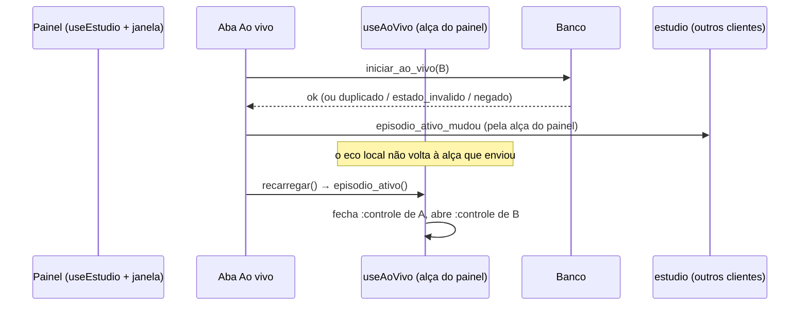

# VER-043 — E3, Tarefa 9: aba Ao vivo (2) — modo teste, iniciar e encerrar o ao vivo, checklist e comandos

## Cabeçalho

| Campo | Valor |
|---|---|
| Id | VER-043 |
| Título | Aba Ao vivo completa (parte 2): seção Episódio (modo teste só com rascunhos, iniciar e encerrar com confirmação, aviso `episodio_ativo_mudou`), checklist mínimo (D13) e comandos por toque no painel; o `useAoVivo` da aba usa o `estudio` do painel e a janela de perda dele; `dispositivo_mudou` de outro painel recarrega a lista; nota da aba Episódios (D12); na rodada 1, comandos desabilitados durante a ação no episódio e o painel ouvindo a revogação do próprio membro (D5) |
| Gravidade | alta |
| Tipo | funcionalidade · segurança (estado do episódio só por função, D7) |
| Data | 2026-11-27 |
| Usuário responsável | TokumoH |
| Status de implementação | implementado |
| Commits | commit que introduz este arquivo — `git log --format=%h -- docs/verificacoes/2026-11-27-043-e3-aba-ao-vivo-episodio.md` |
| Arquivos | `src/app/telas/AbaAoVivo.tsx`, `src/app/telas/AbaAoVivo.test.tsx`, `src/app/telas/Painel.tsx`, `src/app/telas/Painel.test.tsx`, `src/app/telas/AbaEpisodios.tsx`, `src/app/telas/AbaEpisodios.test.tsx`, `src/app/App.test.tsx`, `src/app/useAoVivo.ts`, `src/app/useEstudio.ts`, `src/app/telas/Controle.tsx`, `src/app/telas/Controle.test.tsx`, `src/shared/ui/PainelDeComandos.tsx`, `src/shared/styles/base.css`, `src/app/telas/README.md`, `src/app/README.md`, `src/shared/ui/README.md`, `src/shared/styles/README.md`, `docs/verificacoes/README.md`, este registro |

## Problema

Depois da Tarefa 8 ([VER-042](2026-11-27-042-e3-aba-ao-vivo-dispositivos.md)), a aba Ao vivo só pareava e revogava dispositivos. O banco já tinha `iniciar_ao_vivo`, `encerrar_ao_vivo` e `definir_modo_teste` desde o [VER-037](2026-11-27-037-e3-banco-ao-vivo.md) (D7), mas nenhuma tela os chamava. Efeitos:

- a equipe não tinha como escolher o modo teste, iniciar nem encerrar o ao vivo; o palco e o `/controle` nunca tinham episódio ativo;
- a aba Episódios ainda dizia "Iniciar e encerrar o ao vivo chegam na etapa E3." (a D12 põe esses botões na aba Ao vivo);
- a situação do OBS que o palco publica na presença desde o [VER-039](2026-11-27-039-e3-integracao-obs-e-palco.md) não aparecia em lugar nenhum do painel (D13);
- o painel não tinha os comandos por toque do `/controle`;
- pendências registradas para esta tarefa: um `dispositivo_mudou` vindo de outro painel não recarregava a lista (VER-042, Riscos); as duas alças e os dois `reavaliar()` dentro do painel (VER-041, Riscos, N5; VER-042, Riscos).

## Era proposital?

Sim, por etapas. O PLA-004 divide a aba em duas tarefas (8: dispositivos; 9: episódio, checklist e comandos). A nota da aba Episódios foi escrita na E2 (VER-030) dizendo que a E3 traria os botões; a D12 os pôs na aba Ao vivo. A Tarefa 7 deixou o `useAoVivo` aceitando um `estudio` de fora justamente para esta tarefa (VER-041, N5), e a Tarefa 8 deixou o `estudio` aberto uma vez no painel (VER-042).

**Divergência entre o brief e o código commitado (seguido o código):** o brief pede que o `useAoVivo` da aba receba o `episodio_ativo_mudou` enviado pela própria aba "pelo eco local" do adaptador. Mas o eco local do `criarFabricaDeCanais` entrega só às **outras** alças do tópico (`distribuir`, `canalSupabase.ts`: `if (a === de) continue`), e o VER-041/VER-042 decidiram que o painel passa a **mesma** alça ao `useAoVivo` (instrução do controlador para esta tarefa). Com uma alça só, o eco nunca chega ao hook da aba. A aba passa a chamar `av.recarregar()` depois de cada ação. O teste `comando-vai-ao-episodio-novo` continua com o adaptador real sobre o Realtime falso e prova o efeito pedido (o CLIPE vai para `episodio:<B>:controle`, nunca para `episodio:<A>:controle`). A sabotagem do brief ("tirar o eco local") não derruba esse teste, como esperado; o eco local continua provado pelo teste `eco-local` do adaptador (S4b), e a sabotagem que tira a nova consulta da aba (S6) derruba o teste. Ver "Verificação".

## Solução

- **Seção Episódio** (`SecaoDoEpisodio`): estado atual pelo `episodio_ativo()` do `useAoVivo` ("Ao vivo" ou "Modo teste" + título, ou "Nenhum episódio no ar nem em teste."); seletor só com rascunhos (mais recente primeiro; padrão: o episódio em teste); "Usar no modo teste"; "Sair do modo teste" (com teste ativo); "Iniciar o ao vivo" com confirmação que cita o título; no ar, só "Encerrar o ao vivo", com confirmação. Depois de cada ação aceita pelo banco: `estudio.enviar({ evento: 'episodio_ativo_mudou' })`, depois `av.recarregar()` e a lista de episódios lida de novo. Erros: `duplicado` "Já existe um episódio ao vivo."; `estado_invalido` "O episódio mudou de estado; a lista foi recarregada." (+ recarga); `negado` → `reavaliar()` e a frase da aba Episódios; sessão vencida → só `reavaliar()`; o resto, "Não foi possível concluir. Tente de novo." (como nas outras abas). Sem canal: "Feito no banco, mas o aviso pelo canal não saiu. Se o palco ou o /controle não mudarem, recarregue-os." Uma confirmação aberta some se o episódio ativo mudar.
- **Checklist** (`ChecklistDoAoVivo`, `itensDoChecklist`): a lista fixa do DES-001 §10.4 e a conferência automática da D13 pela presença do palco (o `obs_palco` da lista com a sessão atual na presença, a mesma regra de "Conectado"): palco, OBS detectado, nível Avançado (4) ou mais, obs-websocket, versão ≥ 30.2 (só com o websocket; sem ele, "Versão do OBS desconhecida" e a do plugin), Replay Buffer, gravação e câmera (informativo).
- **Comandos** (`SecaoDosComandos`): o `PainelDeComandos` com o `useAoVivo` da aba, só com episódio ativo, habilitado só com `av.podeComandar` (canal `conectado` **e** a última consulta do episódio ativo sem falha; rodada 2, a mesma regra do `/controle`) **e sem ação no episódio em curso** (rodada 1, I1): do clique em "Usar no modo teste", "Sair do modo teste", "Confirmar início" ou "Confirmar encerramento" até a nova consulta terminar, os botões ficam desabilitados (o `ocupado` da seção Episódio subiu para a aba); na falha da ação, voltam; se a ação valeu e a consulta seguinte falhou, continuam desabilitados, com a frase de falha, até uma consulta dar certo (o episódio na tela pode ser o anterior). Os títulos dos grupos são `h3` dentro do `h2` "Comandos" (`nivelDoTitulo`, rodada 1, N1; o `/controle` continua com `h2`), e o aviso do canal vem de `avisoDoCanal`, compartilhado com o `/controle` (N2).
- **Revogação do próprio membro no painel** (rodada 1, I2; D5): o `ConteudoDoPainel` ouve o seu `estudio` e, com `revogacao` do próprio id, chama `reavaliar()`, em qualquer aba. O `useAoVivo` com o `estudio` de fora deixa de ouvir a revogação (um `reavaliar()` só com a aba Ao vivo aberta); o `/controle`, que abre o próprio `estudio`, continua ouvindo pelo `useAoVivo`.
- **Uma regra para os comandos** (rodada 2, R2-1): o `useAoVivo` expõe `podeComandar` (canal `conectado` e `!falhaAoCarregar`), usado como `habilitado` no `/controle` e na aba, e o `enviar` devolve `falhou` sem ele. No `/controle`, a troca de episódio por outro painel com a consulta caindo não deixa mais um toque ir ao episódio anterior.
- `executar` recebe um pedido tipado (`PedidoNoEpisodio`): `sair` sem episódio, as outras ações com `id: string` (rodada 1, N3; saiu o `id as string`).
- **Um `estudio`, uma janela de perda:** o painel passa ao `useAoVivo` da aba a alça e o estado do seu `estudio`, e a janela `useUmaReavaliacaoPorPerda` (nova, em `useEstudio.ts`), dividida com o próprio `estudio`: a perda do `:controle` e a do `estudio` numa renovação de token dão um `reavaliar()` só. O `useAoVivo` ganhou `aoPerderCanal?` e `recarregar()`; sem `aoPerderCanal` (o `/controle`) usa a janela própria, como antes.
- **`dispositivo_mudou`** de outro painel recarrega a lista de dispositivos.
- **Aba Episódios:** a nota passa a "Iniciar e encerrar o ao vivo ficam na aba Ao vivo." (só a frase e o nome da chave; o arquivo mantém as 832 linhas).
- Estilos `.ao-vivo`, `.episodio-ao-vivo`, `.episodio-no-ar`, `.checklist`, `.comandos-do-painel`.

## Por que esta solução

- **Componentes:** a aba compõe três componentes pequenos no mesmo arquivo (Episódio, Checklist, Comandos) e reaproveita o `PainelDeComandos` e o `useAoVivo` do `/controle`. **Pure Fabrication / DDD:** a interpretação da situação do OBS (`itensDoChecklist`) é uma função pura, testada por inteiro; a regra da versão vem do domínio (`versaoAtende`, `VERSAO_MINIMA_DO_OBS`) e o nível de `NIVEL_DE_CONTROLE`; a interface só escolhe o que mostrar, quem recusa é o banco (D7).
- **Nova consulta direta em vez do eco:** funciona também com o `estudio` fora (o envio devolve `falhou` antes do `send` e não há eco nenhum), caso em que o eco deixaria os comandos indo para o episódio antigo (teste `comando-vai-ao-episodio-novo-sem-canal`).
- **Janela dividida:** fecha a pendência do VER-041 sem mudar o comportamento do `/controle` e sem um estado global.
- **Segurança:** títulos, rótulos e versões vindos de fora são texto React (testes com `<b>` no título); nenhuma mensagem vem do servidor; nada vai para armazenamento ou `console`.

## Por que não outras soluções

| Opção | Motivo de descarte |
|---|---|
| `useAoVivo` com uma alça própria do `estudio`, para o eco local chegar (o que o brief supunha) | Volta as duas alças e os dois `reavaliar()` que o VER-041 e o VER-042 mandaram evitar; e sem canal o eco não sai, deixando o comando no episódio antigo |
| Eco local também para a alça que enviou | Muda o contrato do adaptador da Tarefa 4 (teste `eco-local`, I-B) e faria o painel tratar o próprio aviso duas vezes |
| Esconder "Iniciar" quando a tela acha que já há ao vivo, sem tratar `duplicado` | A tela pode estar atrasada (outro painel): quem decide é o índice único; a frase do `duplicado` é necessária (teste `iniciar-com-outro-ao-vivo`) |
| Checklist num arquivo de domínio novo (`domains/obs/checklist.ts`) | As regras (versão, nível) já estão no domínio; o que sobra é escolher frases da tela. Um arquivo a mais sem regra nova |
| Janela de perda compartilhada por módulo (estado global) | Vazaria entre painéis e testes; a função vem do painel por propriedade |
| Deixar os comandos habilitados durante a ação no episódio (versão anterior à rodada 1) | Descartada na rodada 1 (I1): um toque entre o aceite do banco e o fim da nova consulta ia ao `:controle` do episódio antigo. Se o palco já tinha mudado, o comando se perdia em silêncio (o `ack` é do servidor, não do palco); se não, era gravado como modo teste do antigo durante o ao vivo do novo. A frase "não há dano" da primeira versão deste registro era falsa |
| `useAoVivo` expor um estado "consultando depois de ação" | A janela começa antes da consulta (na chamada ao banco e no `ack` do aviso); o estado da ação já existia na seção Episódio e só subiu para a aba |
| O painel e o `useAoVivo` ouvirem a revogação, com a mesma janela de perda | A janela é das perdas de canal; misturar causas esconderia uma perda real logo depois de uma revogação. Um só ouvinte (o de quem abriu o `estudio`) é mais simples de provar |

## Onde

| Arquivo | Linhas | O que mudou |
|---|---|---|
| [`src/app/telas/AbaAoVivo.tsx`](../../src/app/telas/AbaAoVivo.tsx#L1-L952) | 1–952 | Imports; `TEXTO_DO_EPISODIO` ([L47–L73](../../src/app/telas/AbaAoVivo.tsx#L47-L73)) e `TEXTO_DO_CHECKLIST` ([L78–L115](../../src/app/telas/AbaAoVivo.tsx#L78-L115)); `itensDoChecklist` ([L186–L212](../../src/app/telas/AbaAoVivo.tsx#L186-L212)); props novas, `useAoVivo` com o `estudio` do painel e `episodioOcupado` (rodada 1) ([L251–L294](../../src/app/telas/AbaAoVivo.tsx#L251-L294)); presença com a situação do OBS e `dispositivo_mudou` ([L341–L358](../../src/app/telas/AbaAoVivo.tsx#L341-L358)); palco e câmera do checklist ([L493–L495](../../src/app/telas/AbaAoVivo.tsx#L493-L495)); seções na ordem Dispositivos, Episódio, Checklist, Comandos ([L498–L637](../../src/app/telas/AbaAoVivo.tsx#L498-L637), o bloco dos dispositivos só reindentado); `PedidoNoEpisodio` ([L651](../../src/app/telas/AbaAoVivo.tsx#L651)); `SecaoDoEpisodio` ([L675–L895](../../src/app/telas/AbaAoVivo.tsx#L675-L895), `executar` tipado na [L742](../../src/app/telas/AbaAoVivo.tsx#L742)); `ChecklistDoAoVivo` ([L898–L924](../../src/app/telas/AbaAoVivo.tsx#L898-L924)); `SecaoDosComandos` com `bloqueado`, `avisoDoCanal` e `nivelDoTitulo={3}` ([L926–L952](../../src/app/telas/AbaAoVivo.tsx#L926-L952)) |
| [`src/app/telas/AbaAoVivo.test.tsx`](../../src/app/telas/AbaAoVivo.test.tsx#L1-L1134) | 1–1134 | Harness `AbaComEstudio` (o `estudio` aberto fora da aba pelo `useEstudio`, como no painel); `solta-a-presenca-ao-desmontar` conta cada inscrição (aba e `useAoVivo`); parte 2 a partir da [L563](../../src/app/telas/AbaAoVivo.test.tsx#L563): `bancoDeTeste` com as regras da D7 e 17 testes; na rodada 1, `comandos-bloqueados-durante-a-acao` ([L989](../../src/app/telas/AbaAoVivo.test.tsx#L989)), `comandos-com-titulos-h3-na-aba`; na rodada 2, `comandos-desabilitados-com-consulta-falha` e os comandos habilitados de novo depois da falha em `iniciar-com-outro-ao-vivo` |
| [`src/app/telas/Painel.tsx`](../../src/app/telas/Painel.tsx#L1-L158) | 1–158 | `aoVoltarAVer` das dependências; `useUmaReavaliacaoPorPerda` ([L70](../../src/app/telas/Painel.tsx#L70)) no `useEstudio`; ouvinte da `revogacao` do próprio membro (rodada 1, [L77–L88](../../src/app/telas/Painel.tsx#L77-L88)); `AbaAoVivo` com estado do `estudio`, canais, Preparação, usuário, papel e a janela ([L121–L134](../../src/app/telas/Painel.tsx#L121-L134)) |
| [`src/app/telas/Painel.test.tsx`](../../src/app/telas/Painel.test.tsx#L116-L245) | 116–245, 332–343 | `painel-e-ao-vivo-no-mesmo-cliente`, `uma-reavaliacao-na-renovacao`, `painel-reavalia-na-revogacao-propria` (rodada 1, [L214](../../src/app/telas/Painel.test.tsx#L214)); frase nova em `episodios-no-painel` |
| [`src/app/useAoVivo.ts`](../../src/app/useAoVivo.ts#L1-L299) | 45–54, 93–96, 118, 134–139, 202–219, 249–262, 293–297 | `recarregar()` na interface e no retorno; `aoPerderCanal?`; janela própria por `useUmaReavaliacaoPorPerda` (o código antigo da janela saiu); rodada 1: com o `estudio` de fora, não ouve a `revogacao` (`ouveRevogacao`); rodada 2: `podeComandar` na interface, no cálculo e no `enviar` |
| [`src/shared/ui/PainelDeComandos.tsx`](../../src/shared/ui/PainelDeComandos.tsx#L33-L52) | 33–52, 122–134, 184–204 | Rodada 1: `TEXTO_DO_CANAL` e `avisoDoCanal` (N2); `nivelDoTitulo` (`h2` padrão, `h3` na aba; N1) |
| [`src/app/telas/Controle.tsx`](../../src/app/telas/Controle.tsx#L15-L68) | 15–68 | Rodada 2: `habilitado={av.podeComandar}` e o comentário sobre ele. Rodada 1 (N2): as três frases do canal vêm de `TEXTO_DO_CANAL`; o aviso por `avisoDoCanal` (o tom vem junto, sem comparar texto), com o comentário que explica a escolha; comportamento igual |
| [`src/app/telas/Controle.test.tsx`](../../src/app/telas/Controle.test.tsx#L226) | 226–232 e os testes das rodadas 2 e 3 | Rodada 1: `controle-titulos-h2`; rodada 2: `controle-desabilitado-com-consulta-falha`; rodada 3: `enviar-bloqueado-depois-de-consulta-falha` (pelo `SondaDoHook`) |
| [`src/app/useEstudio.ts`](../../src/app/useEstudio.ts#L106-L133) | 106–133 | `useUmaReavaliacaoPorPerda` |
| [`src/app/telas/AbaEpisodios.tsx`](../../src/app/telas/AbaEpisodios.tsx#L24) | 24, 114, 819 | Só a frase da nota (chave `notaDoAoVivo`) e o comentário; nenhuma linha a mais ou a menos |
| [`src/app/telas/AbaEpisodios.test.tsx`](../../src/app/telas/AbaEpisodios.test.tsx#L225-L233) | 22, 225–233 | Constante da frase nova; `episodios-nota-aponta-ao-vivo` |
| [`src/app/App.test.tsx`](../../src/app/App.test.tsx#L47) | 47 | Frase de `/painel` |
| [`src/shared/styles/base.css`](../../src/shared/styles/base.css#L446-L473) | 416, 446–473 | Estilos da parte 2; `.comandos h3` com o tamanho do `h2` (rodada 1) |
| [`src/app/telas/README.md`](../../src/app/telas/README.md), [`src/app/README.md`](../../src/app/README.md), [`src/shared/ui/README.md`](../../src/shared/ui/README.md), [`src/shared/styles/README.md`](../../src/shared/styles/README.md), [`README.md`](README.md) | — | Propósito, origem, lógica, "Onde", contagens de testes, riscos; linha do VER-043 |

## Lógica

| Passo | Antes | Depois |
|---|---|---|
| Modo teste, iniciar, encerrar | sem tela | seção Episódio, com confirmação (início e fim) e aviso no `estudio` |
| Comandos depois de iniciar B | — | desabilitados do clique até a nova consulta terminar (rodada 1) e enquanto a última consulta tiver falhado (rodada 2); depois vão para `episodio:<B>:controle` (com ou sem canal) |
| `/controle` com troca de episódio por outro painel e a consulta falhando | toque ia ao episódio anterior | desabilitado com a frase de falha até a próxima consulta (rodada 2) |
| `revogacao` do próprio membro no painel | só reavaliava com a aba Ao vivo aberta (pelo `useAoVivo`) | o painel reavalia em qualquer aba, uma vez (rodada 1, D5) |
| Títulos da seção Comandos | `h2` dentro do `h2` | `h3` na aba, `h2` no `/controle` (rodada 1) |
| Situação do OBS | só na presença | checklist com pronto/pendente/informativo |
| `estudio` no painel com a aba aberta | — | 1 `channel('estudio')`, 1 alça, 1 presença |
| Renovação do token (estudio + :controle) | 2 `reavaliar()` previstos (VER-041) | 1 |
| `dispositivo_mudou` de outro painel | lista parada | lista relida |
| Nota da aba Episódios | "chegam na etapa E3" | "ficam na aba Ao vivo" |

## Exemplo

Modo teste em "Ensaio geral" (A), aba Ao vivo aberta (`comando-vai-ao-episodio-novo`): canais abertos `['estudio', 'episodio:<A>:controle']`. Escolher "Programa de sexta" (B), "Iniciar o ao vivo", "Confirmar início": `iniciar(B)` chamado 1 vez; canais `['estudio', 'episodio:<B>:controle']`; um toque em "✂️ CLIPE" → 1 clipe em `episodio:<B>:controle`, 0 em `episodio:<A>:controle`; `channel('estudio')` chamado 1 vez.

Rodada 1 (`comandos-bloqueados-durante-a-acao`): com a função do banco e a consulta seguinte seguradas, o CLIPE fica desabilitado nas duas esperas e 0 clipes vão para A; depois da consulta, 1 clipe para B. Antes da correção, a sonda da revisão deu `clipes A 1 B 0`. `painel-reavalia-na-revogacao-propria`: `revogacao` com o próprio id nas abas Episódios, Membros e Ao vivo → `usuarioAtual` +1 em cada uma; com o id de outra pessoa, +0.

Checklist com o palco em nível 3 (BASIC): "Dê acesso Avançado à Fonte do palco" pendente; nível 4 com tudo certo: 8 itens prontos, de "Palco conectado" a "Câmera conectada" (`checklist-itens`). Versão 30.1.2 → "OBS abaixo de 30.2"; websocket com senha errada → "Versão do OBS desconhecida (plugin do navegador 2.24.0)".

Renovação do token (`uma-reavaliacao-na-renovacao`): `estudio` e `:controle` fechados juntos, nas duas ordens → `usuarioAtual` +1 (antes da janela dividida: +2, sabotagem S7); os dois reabrem 5 s depois.

## Verificação

| Etapa | O que | Comando | Resultado |
|---|---|---|---|
| Passo 1–2 (TDD) | Testes antes do código | `npx vitest run src/app/telas src/app/App.test.tsx` | **FAIL**: 21 testes (os 15 novos da aba, os 2 do painel, a nota da aba Episódios em 3 lugares e `solta-a-presenca-ao-desmontar`, com a contagem nova de inscrições) |
| Passo 3 | Implementação | `npx vitest run src/app` | 17 arquivos, 351 testes, 0 falhas (ajustes só nos próprios testes: o texto do item do checklist lido do `.checklist__texto`, e um `findByRole` que não anda com relógio falso trocado por `getByRole`) |
| Autoverificação | Leitura do diff | — | 1 achado: uma confirmação de "Encerrar" ficava aberta depois de outro painel trocar o episódio ativo (confirmar encerraria o antigo, recusado pelo banco). Corrigido (a confirmação some quando o ativo muda) e coberto por `confirmacao-some-se-o-ativo-muda` (S16) |
| Varredura de segurança | `git diff -U0 -- src`, procurando `innerHTML`, `dangerouslySetInnerHTML`, `console.`, `localStorage`, `sessionStorage` nas linhas novas | `grep` | nada |
| 320 px | HTML da aba desenhado pelo `App` (jsdom) com títulos e rótulos longos, sem espaços, confirmação aberta, checklist com pendências, comandos; carregado com `tokens.css` + `base.css` no Chromium do Playwright do ambiente (não é dependência), 320 px, claro e escuro | `t9-320/dump.test.tsx` e `t9-320/medir.cjs` (scratchpad) | `scrollWidth` = 320 nos 4 casos; nenhum elemento passa da borda |
| Suíte | Tudo | `npm test` | 58 arquivos, **2177 testes**, 0 falhas |
| Sabotagens | Em memória: um plugin do Vite troca o trecho exato só no que o Vitest carrega, com `fsModuleCache: false`, e o trecho é conferido 1 vez. `sha256sum` dos dez arquivos tocados antes e depois: iguais | `t9-sab/rodar.sh` (scratchpad) | tabela abaixo |
| `npm run check` | Último ato da entrega | `npm run check` | 0 erros (`typecheck`; 58 arquivos e 2177 testes; `check-docs` 74 .md e 43 registros; `check-doc-secrets` 231 arquivos; `rpc:grants-check` e `data-api:check` 4 migrações; `check-deps-audit` 0 avisos) |
| R1 | Revisão independente 1, sobre a primeira versão | leitura do diff, sondas e 9 sabotagens (R1 a R8, R10) numa cópia (cache desligado) | spec ✅ (divergência do eco local aceita); reprovada: 2 achados importantes de comportamento (I1 CLIPE logo depois de "Iniciar" ia ao episódio antigo; I2 painel não ouvia a `revogacao` do próprio membro fora da aba) e 3 nits. Corrigidos em C1 |
| C1 | Correções da rodada 1: I1 (comandos desabilitados durante a ação; teste `comandos-bloqueados-durante-a-acao`, e a falha que os devolve também em `iniciar-com-outro-ao-vivo`), I2 (painel ouve a `revogacao` do próprio membro; `useAoVivo` com `estudio` de fora não ouve; teste `painel-reavalia-na-revogacao-propria`), N1 (`nivelDoTitulo`; testes `comandos-com-titulos-h3-na-aba` e `controle-titulos-h2`), N2 (`avisoDoCanal` compartilhado), N3 (`PedidoNoEpisodio`); linha "não há dano" corrigida; `Controle.tsx` mantido com 119 linhas (âncora do VER-041) | `npx vitest run src/app` (17 arquivos, 356 testes); sabotagens C1 abaixo e as S1–S16 refeitas sobre o código corrigido, com `fsModuleCache: false` e `sha256sum` dos 13 arquivos igual antes e depois (`t9-sab/rodar.sh`); `npm test` (58 arquivos, 2181 testes); `npm run check` | as C1 derrubam o teste esperado; S1–S16 e S4b como antes (S4 continua sem derrubar, como explicado; S9 agora derruba também `painel-reavalia-na-revogacao-propria`); `npm run check` 0 erros |
| C2 | Correções da rodada 2: R2-1 (`podeComandar` no `useAoVivo`, a mesma regra no `/controle` e na aba, e no `enviar`; testes `comandos-desabilitados-com-consulta-falha` e `controle-desabilitado-com-consulta-falha`); R2-2 (as duas últimas linhas do comentário em `Controle.tsx` passaram a explicar o `habilitado`; o arquivo segue com 119 linhas e `TEXTO_DO_CONTROLE`, `ConteudoDoControle` e `Controle` em L15, L33 e L113) | `npx vitest run src/app/telas` (10 arquivos, 287 testes); sabotagens C2 abaixo; C1 e S1–S16 refeitas sobre o código da rodada 2 (C1-I1 com o trecho novo `habilitado={av.podeComandar && !bloqueado}`), `fsModuleCache: false`, `sha256sum` dos 13 arquivos igual antes e depois; `npm test` (58 arquivos, 2183 testes); `npm run check` | as C2 derrubam o teste esperado; C1 e S1–S16 como antes (S4 sem derrubar, como explicado); `npm run check` 0 erros |
| C3 | Rodada 3 (R3-1, nit; só teste e documentação, nenhum código de produção mudou): `enviar-bloqueado-depois-de-consulta-falha` em `Controle.test.tsx`, pelo `SondaDoHook` (com os dois canais conectados e a última consulta falha, `enviar` devolve `falhou` e nada sai); frase de Riscos sobre a trava do `enviar` corrigida | sabotagem C3 com `fsModuleCache: false`, `sha256sum` igual antes e depois; `npm test` (58 arquivos, 2184 testes); `npm run check` | C3 derruba o teste novo; `npm run check` 0 erros |
| R2 | Re-revisão focada em C1, C2 e C3 | sondas `clipes A/B`, `r2-consulta-falha` e `r2-janela` refeitas; I2a a I2e; suíte completa na cópia | rodada 1: com erros (R2-1 importante: consulta pós-ação que falha deixava os comandos no episódio antigo; R2-2 nit) → C2 (regra única `podeComandar`, também no `/controle`). Rodada 2: **limpa**; nit R3-1 (teste da trava do `enviar` pelo hook e frase de Riscos) incorporado em C3 como teste a mais, com reconferência pontual (`npm run check` 0) |

| Sabotagem | Teste que derruba |
|---|---|
| S1 (brief) listar todos os episódios no seletor | `modo-teste-so-rascunho`, `encerrar-confirma`, `estado-invalido-recarrega` |
| S2 (brief) iniciar sem confirmação | `iniciar-confirma` (e mais 5) |
| S3 (brief) não avisar no `estudio` | `define-modo-teste-e-avisa`, `sair-do-modo-teste`, `iniciar-confirma`, `encerrar-confirma`, `comando-vai-ao-episodio-novo-sem-canal` |
| S4 (brief) tirar o eco local do registro (`distribuir` em `enviar`) | **nenhum na aba**, como esperado: a aba não depende do eco (ver "Era proposital?"). O mesmo trecho derruba `eco-local` em `canalSupabase.test.ts` (S4b) |
| S5 (brief) nível 3 como suficiente | `checklist-itens` |
| S6 tirar a nova consulta da aba (`av.recarregar()`) | `comando-vai-ao-episodio-novo`, `comando-vai-ao-episodio-novo-sem-canal`, `comandos-no-painel` e mais 6 |
| S7 painel sem `aoPerderCanal` | `uma-reavaliacao-na-renovacao` |
| S8 sem ouvinte de `dispositivo_mudou` | `dispositivo-mudou-recarrega` |
| S9 `useAoVivo` sem o `estudio` do painel (abre o próprio) | `painel-e-ao-vivo-no-mesmo-cliente` |
| S10 `estado_invalido` sem recarga | `estado-invalido-recarrega` |
| S11 `duplicado` com a frase comum | `iniciar-com-outro-ao-vivo` |
| S12 `negado` sem `reavaliar()` | `acao-negada-reavalia` |
| S13 nota antiga na aba Episódios | `episodios-nota-aponta-ao-vivo`, `ao-vivo-fica-para-e3` |
| S14 janela sem bloqueio | `uma-reavaliacao-na-renovacao` |
| S15 palco de outra sessão conta no checklist | `checklist-itens` |
| S16 confirmação não some com o ativo novo | `confirmacao-some-se-o-ativo-muda` |
| C1-I1 comandos habilitados durante a ação (`habilitado` sem `!bloqueado`) | `comandos-bloqueados-durante-a-acao` |
| C1-I1b a falha não devolve os comandos (`setOcupado(false)` fora do erro) | `comandos-bloqueados-durante-a-acao`, `iniciar-com-outro-ao-vivo`, `acao-negada-reavalia` |
| C1-I2a painel sem ouvinte de `revogacao` | `painel-reavalia-na-revogacao-propria` (abas Episódios e Membros) |
| C1-I2b `useAoVivo` ouve também com `estudio` de fora | `painel-reavalia-na-revogacao-propria` (aba Ao vivo: 2 `reavaliar()`) |
| C1-I2c painel reavalia com a `revogacao` de qualquer id | `painel-reavalia-na-revogacao-propria` (outra pessoa) |
| C1-I2d `useAoVivo` nunca ouve a revogação (o `/controle` perderia a D5) | `membro-revogado-reavalia` (`Controle.test.tsx`) |
| C1-N1a títulos sempre `h2` | `comandos-com-titulos-h3-na-aba` |
| C1-N1b títulos sempre `h3` | `controle-titulos-h2` |
| C1-N2 `avisoDoCanal` troca a frase de `reconectando` | `botoes-desligados-sem-conexao` (`Controle.test.tsx`) |
| C2-a aba com `habilitado` só pelo canal | `comandos-desabilitados-com-consulta-falha` |
| C2-b `/controle` com `habilitado` só pelo canal | `controle-desabilitado-com-consulta-falha` |
| C2-c `podeComandar` sem `!carga.falhou` (no `/controle` e na aba) | `controle-desabilitado-com-consulta-falha`; `comandos-desabilitados-com-consulta-falha` |
| C3 trava do `enviar` só pelo canal (`vistaDoEnvio` com `podeComandar: canal === 'conectado'`) | `enviar-bloqueado-depois-de-consulta-falha (sem depender do botão)` |

Nits corrigidos (não zeram a contagem): nenhum até aqui.

## Riscos

- **Sem o aviso no `estudio`** (canal fora), a ação vale no banco e a própria aba se acerta, mas o palco e outros `/controle` só mudam ao reconsultar (reconexão, volta à aba ou recarga); a tela diz isso. Quem já estava no tópico antigo continua nele até reconectar ou renovar o token (D6, N6).
- **Reavaliações:** com a janela dividida, uma renovação de token dá um `reavaliar()`. Continuam possíveis reavaliações por outras causas na mesma janela (leitura negada do `useAoVivo`, até 3; `negado` numa ação, que também relê a lista e pode reavaliar de novo se a leitura for negada), como nas outras abas.
- **Revogação do próprio membro** (resolvido na rodada 1): o painel reavalia em qualquer aba, uma vez. Continua dependendo do aviso pelo canal: com o `estudio` fora, a reavaliação vem na próxima ação negada ou na renovação do token (D5).
- **Comandos desabilitados depois de uma consulta falha** (rodada 2): até a próxima consulta dar certo (5 s, dobrando até 1 min, VER-041), nenhum toque sai, nem no `/controle`; a frase de falha fica na tela. O bloqueio no `enviar` é defesa extra: os testes que passam pelo botão não o alcançam (o botão já está desabilitado), mas ele está coberto pelo teste do hook `enviar-bloqueado-depois-de-consulta-falha` (rodada 3, sabotagem C3).
- **Comandos desabilitados durante a ação:** enquanto a função do banco ou a consulta seguinte demoram (até o tempo-limite de 15 s do `fetch`), nenhum toque sai da aba; é a troca escolhida contra um toque no episódio errado.
- **Checklist:** depende da presença do palco; sem ela, a situação do OBS é "desconhecida". Os itens da lista fixa são texto, sem marcação. A câmera é informativa até a E4.
- **Acessibilidade** (resolvido na rodada 1): os grupos da seção Comandos são `h3` na aba e `h2` no `/controle`.
- **320 px:** conferido com o CSS real sobre o HTML desenhado no jsdom (sem as fontes da Google). A conferência no navegador com o app é da Tarefa 10.
- **Divergência do brief** (eco local): registrada em "Era proposital?".
- Teste instável conhecido, fora da tarefa: `AbaBiblioteca.test.tsx > aviso-da-fila-e-saida-da-pagina` (não falhou nas rodadas desta tarefa).
- Os textos fixos estão em `TEXTO_DO_EPISODIO` e `TEXTO_DO_CHECKLIST` e repetidos nos testes e neste registro.
