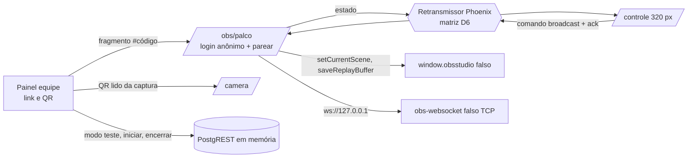

# VER-044 — E3, Tarefa 10: conferência no navegador e guia do ao vivo para o responsável

## Cabeçalho

| Campo | Valor |
|---|---|
| Id | VER-044 |
| Título | E3, Tarefa 10: conferência ponta a ponta no navegador (Supabase, Realtime e OBS simulados), guia "Ao vivo e pareamento (E3)" e decisões D1–D16 oferecidas ao responsável |
| Gravidade | média |
| Tipo | verificação · documentação · segurança |
| Data | 2026-11-27 (data do commit, em UTC) |
| Usuário responsável | TokumoH |
| Status de implementação | somente documentação (nenhum código de produção muda; a migração `ao_vivo_e_pareamento`, as configurações do Supabase e do OBS e a conferência real são passo do responsável, **pendente**) |
| Commits | commit que introduz este arquivo — `git log --diff-filter=A --format=%h -- docs/verificacoes/2026-11-27-044-e3-conferencia-e-guia.md` |
| Arquivos | `supabase/README.md`, `docs/verificacoes/README.md`, este registro (3 arquivos) |

## Problema

1. **A E3 nunca tinha sido aberta num navegador de ponta a ponta.** As Tarefas 1 a 9 ([VER-035](2026-11-27-035-e3-dominio-ao-vivo.md) a [VER-043](2026-11-27-043-e3-aba-ao-vivo-episodio.md)) provaram cada peça com falsos em jsdom e PGlite. Ninguém tinha visto o painel, o `/obs/palco`, o `/controle` e o `/camera` conversando pelo protocolo real do `realtime-js` (quadros Phoenix, `ack`, presença). Também faltava ver o QR lido de uma captura e a queda do WebSocket com a volta. Os Riscos do VER-039 a VER-043 deixaram para cá:
   - a transparência do palco no tema escuro;
   - as teclas `s` e `c`;
   - o `ws://127.0.0.1` a partir de `https`;
   - o `play()` sem gesto;
   - os 320 px;
   - a leitura do QR.
2. **O responsável não tinha roteiro para ligar o ao vivo.** O passo 1 de "Lógica" e o Risco da quarta migração em `supabase/README.md` remetiam a um "guia da E3 (Tarefa 10 do PLA-004)" que não existia. O que aplicar, o que conferir por consulta, o que ligar no Supabase e no OBS e em que ordem (a senha do obs-websocket antes de iniciar a gravação) estavam espalhados pelo PLA-004 e por nove registros.

## Era proposital?

Sim. O [PLA-004](../planos/2026-11-27-e3-ao-vivo-por-toque.md), "Tarefa 10", deixa para a última tarefa a conferência de ponta a ponta, o guia e a oferta das decisões ao responsável, como o PLA-002 e o PLA-003 fizeram ([VER-020](2026-11-26-020-e1-conferencia-e-guia.md), [VER-031](2026-11-27-031-e2-conferencia-e-guia.md)). Só aqui todas as telas existem.

## Solução

- **Conferência no navegador** (Passo 1 do plano), fora do repositório:
  - `npm run build` com variáveis de mentira só na linha de comando (`VITE_SUPABASE_URL=https://exemplo.revocast.test`, `VITE_SUPABASE_PUBLISHABLE_KEY=sb_publishable_teste`) e `--outDir` na pasta temporária da sessão; `vite preview` na porta 4173;
  - Chromium do Playwright do ambiente (Chromium 153, fora do repositório), com `exemplo.revocast.test` interceptado: Auth com login anônimo falso, PostgREST e `rpc` em memória com a semântica da migração (código de uso único, `tipo_errado` sem consumir, limite, revogação, estado do episódio só por função);
  - WebSocket do Realtime simulado por `routeWebSocket`, com um retransmissor Phoenix mínimo: quadros `vsn=2.0.0` em JSON e o *push* binário de `broadcast`; `phx_join` com `access_token`, recusado com "Unauthorized: …" conforme a tabela da D6 (permissões calculadas na entrada, como o servidor); `broadcast` sem permissão descartado sem resposta (o cliente vê `timed out`, N3); `ack`, `presence_state`, `presence_diff` e *heartbeat*;
  - `window.obsstudio` falso injetado no palco e um obs-websocket falso **de verdade** (servidor TCP em `127.0.0.1` com `Hello`/`Identify` e hash da senha conferido);
  - o QR é lido da **captura**: o centro de cada módulo é amostrado nos pixels e a matriz vai a um decodificador próprio, independente do `lean-qr` (formato, máscara, blocos, conferência Reed-Solomon e modos), com autoteste de 16 casos;
  - asserções OK/ERR e 4 sabotagens. Resultado em "Verificação".
- **Guia "Ao vivo e pareamento (E3)"** em [`supabase/README.md`](../../supabase/README.md#L143-L191), dentro de "Lógica", no estilo dos guias da E1 e da E2, em dez passos:
  1. as pendências anteriores;
  2. a migração `20261127124303_ao_vivo_e_pareamento.sql`, sem contornar um `42501`;
  3. as três consultas de conferência, com o resultado esperado;
  4. o login anônimo e o JWT de 10 min;
  5. o Realtime sem acesso público;
  6. o OBS, com a senha antes de iniciar a gravação e o Replay Buffer, e a reserva do atalho;
  7. a tabela da D2, D6 e D7;
  8. nada de dado pessoal;
  9. a conferência real;
  10. a limpeza opcional das sessões anônimas.

  O "Propósito", o passo 1 de "Lógica" e o Risco da quarta migração passam a apontar para o guia. Um Risco novo diz que o guia não foi conferido num projeto real e registra o bloqueio do `ws://127.0.0.1` medido aqui.
- **Decisões oferecidas ao responsável** (Passo 3 do plano): lista em "Riscos".

## Por que esta solução

- O guia fica ao lado dos guias da E1 e da E2 e do manual das migrações: um lugar só para "como ligar o projeto", na ordem em que o responsável vai fazer. Fica em "Lógica" para não criar uma 12.ª seção fora da estrutura dos READMEs (`CLAUDE.md`).
- A conferência usa o mesmo `vite build` da Vercel e o `realtime-js` real dentro do bundle. Só o servidor é simulado: o retransmissor fala o protocolo que o `realtime-js` 2.119.0 instalado usa, conferido no código (`serializer.js`: *push* binário de `broadcast`; `RealtimeChannel.js`: erro de entrada como texto da resposta, `ack`). Ele segue a matriz da D6 da função `pode_usar_canal`.
- Ler o QR da captura com um decodificador independente prova que o desenho na tela (SVG, cores dos dois temas, zona de silêncio) leva exatamente o link do campo. Comparar com o `lean-qr` provaria só que o desenho copia o codificador.
- As sabotagens provam que as asserções não passam por acaso.

## Por que não outras soluções

| Opção | Motivo de descarte |
|---|---|
| Guia num arquivo novo (`docs/guias/ao-vivo.md`) | Pasta nova com README só para isto; separa o guia do manual das migrações que ele manda aplicar (o mesmo motivo do VER-031) |
| Guia como seção `##` própria | 12.ª seção fora da estrutura dos READMEs |
| Retransmissor que aceita tudo (sem a matriz) | Não provaria que o app funciona sob a D6 (por exemplo, que o palco não tenta marcar presença no `:controle`, que só a `equipe` publica em `estudio`) |
| Interceptar também o obs-websocket por `routeWebSocket` | O Playwright troca o `WebSocket` da página; não passaria pela política de rede do navegador, que é justamente o que a sonda `https` mede. O servidor TCP de verdade passa |
| Comparar o QR com a matriz do `lean-qr` | Não prova legibilidade (ver "Por que esta solução"); a leitura por um celular de verdade fica no passo 9 do guia |
| Playwright como dependência (testes de ponta a ponta no `npm run check`) | Dependência nova fora do PLA-004 (a E3 tem só o `lean-qr`, D11); a conferência é manual, como na E1 e na E2 |
| Corrigir aqui o achado A1 (cena atual do OBS) | Muda código de produção; o contrato da tarefa manda relatar, e o controlador decide se vira item próprio |

## Onde

| Arquivo | Linhas | O que mudou |
|---|---|---|
| [`supabase/README.md`](../../supabase/README.md#L18) | 18 | "Propósito": o README também diz como ligar o ao vivo e o pareamento |
| [`supabase/README.md`](../../supabase/README.md#L68) | 68 | Passo 1 de "Lógica": a quarta migração remete a "Ao vivo e pareamento (E3)" |
| [`supabase/README.md`](../../supabase/README.md#L143-L191) | 143–191 | Novo: subseção "Ao vivo e pareamento (E3)" com os dez passos do responsável |
| [`supabase/README.md`](../../supabase/README.md#L212) | 212 | Risco da quarta migração remete ao guia |
| [`supabase/README.md`](../../supabase/README.md#L223) | 223 | Novo Risco: guia não conferido num projeto real; `ws://127.0.0.1` bloqueado a partir de `https` num Chromium moderno |
| [`docs/verificacoes/README.md`](README.md#L97) | 14, 97 | Campo "Arquivos" e linha do VER-044 em "Onde" (o exemplo continua 045, o próximo número livre) |
| este registro | — | Novo |

## Lógica

| Passo | Antes | Depois |
|---|---|---|
| Responsável quer ligar o ao vivo | Juntar a Tarefa 10 do PLA-004 e os Riscos do VER-035 a VER-043 | Seguir os passos 1–10 de "Ao vivo e pareamento (E3)" |
| Editor recusa as políticas de `realtime.messages` | Tentação de criá-las pelo painel | Não contornar; anotar a mensagem; decisão num item próprio |
| Saber se a migração entrou certa | Abrir o painel e olhar | Três consultas: só `canal_recebe`/`canal_envia` `{authenticated}`, `codigos_pareamento` ilegível, 9 funções |
| Ordem no OBS | Não escrita | Senha do obs-websocket pela tecla `c` com tudo parado; só depois Replay Buffer e gravação |
| Fluxo de ponta a ponta | Provado por partes, com falsos | Visto no Chromium com o protocolo real do `realtime-js`: 132 asserções |

## Exemplo

Link do palco gerado no painel: `http://localhost:4173/obs/palco#<43 caracteres>`.

1. Aberto num `/camera` novo: "Este link é de outro tipo de dispositivo." O fragmento sai da barra, o código continua com `usado_em` nulo e a sessão anônima é apagada (`sair()`).
2. Aberto no palco: pareia. A barra fica `http://localhost:4173/obs/palco`; os dois `fetch` (`/auth/v1/signup` e `rpc/parear_dispositivo`) saem com `location.hash` vazio; o `localStorage` tem só `revocast-auth-obs_palco`; o código não aparece em armazenamento nem no console.
3. Aberto de novo num navegador novo: "Link inválido ou expirado. Gere outro no painel."

Com a sabotagem "fragmento" (`history.replaceState` sem efeito), a conferência acusou 4 ERR, entre eles "nenhum fetch com o fragmento ainda na URL" (o `signup` saiu com `#<código>` na URL).

Clipe: o toque em "✂️ CLIPE" no `/controle` (320 px) mostrou "Último: ✂️ Clipe …". O `saveReplayBuffer` veio 5 045 ms e 5 049 ms depois (duas rodadas), e então "Último: ✂️ Clipe ✓".

## Verificação

**Build** (fora do repositório; o `dist/` do repositório não foi tocado): `VITE_SUPABASE_URL=https://exemplo.revocast.test VITE_SUPABASE_PUBLISHABLE_KEY=sb_publishable_teste npm run build -- --outDir <scratch>/t10-nav/dist --emptyOutDir`, com 0 erros (`tsc` + `vite build`; o aviso de pedaço acima de 500 kB é o mesmo de antes). `exemplo.revocast.test` aparece uma vez no bundle.

**Conferência no navegador** (script `conferir.cjs` na pasta temporária da sessão). As páginas, cada uma num contexto próprio e todas sobre o mesmo estado simulado:

- painel (`equipe`) em 1280 px claro;
- `/camera` em 390 px;
- `/obs/palco` em 1280×720 com `prefers-color-scheme` escuro;
- `/controle` (`apresentadora`) em 320 px claro e (`equipe`) em 320 px escuro;
- painel em 320 px claro e escuro;
- palco `https` roteado.

| Grupo | O que foi conferido | Resultado |
|---|---|---|
| painel e QR | abre com `equipe`; QR ao parear a câmera; link `/camera#` com 43 caracteres; QR da captura (1280 claro) decodificado = link do campo, com Reed-Solomon sem erro (versão 5, nível M, só modo byte, módulo de 6,09 px); zona de silêncio clara e contraste; o código não sai do navegador do painel | 10/10 |
| câmera | pareia pelo link do QR; fragmento sai da barra; `p_tipo` = `camera` | 3/3 |
| tipo errado | link do palco em `/camera` → "Este link é de outro tipo de dispositivo."; fragmento sai; código não consumido; sessão anônima apagada | 4/4 |
| palco | link sem QR; pareia; fragmento sai da barra; nenhum `fetch` com o fragmento na URL; `localStorage` só com a sessão; código fora do armazenamento; nada visível sem aviso | 8/8 |
| palco no tema escuro | `html.palco`, `html` e `body` com fundo `rgba(0, 0, 0, 0)`; captura com fundo omitido com alfa 0 nos cantos e no centro | 2/2 |
| reuso | o mesmo link de novo → "Link inválido ou expirado. Gere outro no painel." | 1/1 |
| modo teste | "Modo teste ligado."; o `/controle` segue (TESTE e título); o palco entra no `:controle` do episódio; o `/controle` recebe o estado; "Cena: — · No ar: nenhum aviso" antes do primeiro toque (achado A1) | 6/6 |
| checklist | pela presença do palco: OBS detectado, nível Avançado, Replay Buffer ativo, gravação em andamento, "obs-websocket não configurado no palco.", câmera conectada | 1/1 |
| `/controle` 320 px claro e escuro | sem rolagem horizontal; nada fora do cartão; fundo do tema; todos os botões grandes com pelo menos 44 px | 9/9 |
| toques | cena → `setCurrentScene("Cena Plateia")` e "Último: 🎬 Plateia ✓"; cena fora do OBS → "Cena não existe no OBS", sem chamada; som → `play()` com a URL assinada; aviso com HTML literal no palco (sem `<b>`, link como texto sem `<a>`, texto em duas linhas, imagem por URL assinada carregada) e no "No ar" do `/controle`; próximo aviso; ocultar; clipe pendente, `saveReplayBuffer` em ~5 s e "✓"; marcador sem websocket → "obs-websocket não conectado no palco" | 19/19 |
| registro | `registro_acoes` pelo palco com `origem = 'toque'`, `teste`, `membro_id` = remetente; "mostrar aviso" gravado como `proximo_aviso` com o aviso mostrado (D9) | 2/2 |
| teclas `s` e `c` | com a saída parada: selo ("Pareado como Palco do OBS", "Modo teste: …"), que some em 5 s; painel com o aviso fixo e campo `password`; `obsRecordingStarting` fecha o painel na hora; com a gravação em andamento, `s` e `c` não mostram nada | 7/7 |
| obs-websocket (`http://localhost`) | `Hello` → `Identify` com o hash da senha → `Identified` no servidor TCP; porta e senha só no `localStorage` da Fonte; senha fora dos campos depois de salvar; checklist "obs-websocket conectado" e "OBS 31.0.0" (`GetVersion`); marcador → `CreateRecordChapter` e "Último: 🔖 Marcador ✓"; senha fora de console, canal e pedidos | 7/7 |
| matriz D6 (sonda pelo WebSocket da página; 8 das 12 asserções são autoconferência do retransmissor simulado, e só as 4 "o app: …" provam algo do app) | palco: `estudio` sim, `broadcast` em `estudio` sem resposta, presença no `:controle` sem resposta, `:video` negado, `broadcast` no `:controle` aceito; câmera: `estudio` sim, `:controle` negado; apresentadora: `broadcast` em `estudio` sem resposta, no `:controle` aceito, outro episódio negado; equipe: `broadcast` em `estudio` aceito; nada de dispositivo ou apresentadora entregue em `estudio`; o app: só o painel publica em `estudio`, a câmera só usa `estudio`, o palco não marca presença no `:controle`, todo canal é privado | 12/12 |
| queda do WebSocket | o retransmissor derruba todas as conexões e recusa as novas por 4 s: "Reconectando…" e todos os botões desabilitados no `/controle`; na volta, o aviso some, os botões voltam, o palco republica o estado, o `/controle` consulta `episodio_ativo` de novo e mostra o estado | 7/7 |
| iniciar e encerrar | confirmação cita o título; "Ao vivo iniciado."; AO VIVO no `/controle`; o palco publica `modo: ao_vivo`; um toque chega; registro com `teste = false`; "Ao vivo encerrado."; o `/controle` fica sem episódio; o palco sai do `:controle` | 9/9 |
| revogação | "Dispositivo revogado."; o palco mostra "Este dispositivo foi revogado. Gere um novo link no painel." e apaga a sessão; a linha fica "Revogado" | 4/4 |
| painel 320 px claro e escuro | aba Ao vivo com QR sem rolagem horizontal nem nada fora do cartão (a tabela rola dentro de `.tabela-rolavel`); fundo do tema; QR da captura decodificado = link (módulo de 3,96 px), escuro sobre claro nos dois temas; console sem erros | 12/12 |
| segredos, console e simulação | nenhum código de pareamento nem token no console; 0 erros de console nas páginas; nenhum pedido fora do previsto | 9/9 |

Total: **132/132** asserções, 0 ERR, em duas rodadas completas (antes e depois das sabotagens). A primeira execução acusou falhas **do próprio script**, corrigidas antes da contagem:

- o tópico no fio leva o prefixo `realtime:` e o retransmissor o comparava sem ele (todas as entradas negadas);
- a asserção "Cena: Geral" supunha que o palco lê a cena atual do OBS, o que ele não faz (achado A1 abaixo);
- a sonda da câmera contava entradas de conexão sem tópico.

O servidor de prévia e o navegador foram parados no fim (porta 4173 livre).

**Itens dos Riscos dos registros anteriores:**

| Item | Resultado |
|---|---|
| Transparência do palco no tema escuro (VER-040) | conferida: fundo transparente e alfa 0 na captura |
| Teclas `s` e `c` (VER-040) | conferidas com o `window.obsstudio` falso (os eventos do obs-browser simulados por `dispatchEvent`) |
| `play()` sem gesto (VER-040) | no Chromium 153 *headless*, sem bandeira de autoplay, o `play()` resolveu e o `/controle` mostrou "Último: 🎵 aplauso ✓". O navegador embutido do OBS tem política própria: depende do responsável (passo 9 do guia) |
| `ws://127.0.0.1` a partir de `https` (VER-039) | a partir de `http://localhost`, conectou. A partir de uma origem `https` (`isSecureContext` verdadeiro), o Chromium 153 bloqueou com `net::ERR_BLOCKED_BY_LOCAL_NETWORK_ACCESS_CHECKS`, sem nenhuma conexão TCP. O CEF do OBS é outro navegador: depende do responsável (reserva: atalho do OBS). Registrado em Riscos do guia |
| 320 px (VER-041 a VER-043) | conferidos no `/controle` e no painel, claro e escuro |
| Leitura do QR (VER-042) | conferida da captura com decodificador independente (1280 claro; 320 claro e escuro). A leitura por um celular de verdade depende do responsável |

**Sabotagens do script de conferência** (cada uma derruba o que deveria; nenhuma altera o repositório):

| # | Sabotagem | Resultado |
|---|---|---|
| S1 `matriz` | o retransmissor aceita `broadcast` de dispositivo em `estudio` | 2 ERR: "palco: … broadcast em estudio sem resposta" (veio `ok`) e "nada de dispositivo … entregue em estudio" (entregue ao painel e à câmera) |
| S2 `fragmento` | `history.replaceState` sem efeito (o fragmento não sai) | 4 ERR: "fragmento sai da barra" (câmera, tipo errado, palco) e "nenhum fetch com o fragmento ainda na URL" |
| S3 `semvolta` | o retransmissor continua recusando conexões depois da queda | 5 ERR: aviso não some, botões não voltam, palco não republica, sem nova consulta, e o "Ao vivo iniciado." seguinte (o aviso pelo canal não sai) |
| S4 `css` | `.controle .comandos { min-width: 400px }` injetado | 2 ERR: "sem rolagem horizontal" no `/controle` 320 claro e escuro (doc 482 > 320) |

**Achados da conferência (não corrigidos nesta tarefa; o controlador decide se viram item próprio):**

- **A1 (baixa, comportamento):** o palco não lê a cena atual do OBS.
  - O `EstadoNoAr` nasce com `cenaObs: null` ([`src/domains/aovivo/palco.ts`](../../src/domains/aovivo/palco.ts#L59)) e só muda num `trocar_cena` do próprio palco (linha 117). A porta `ObsNoNavegador.cenaAtual()` (`getCurrentScene`, [`src/shared/infra/obsNavegador.ts`](../../src/shared/infra/obsNavegador.ts#L95)) existe e não tem uso em produção.
  - Efeito: o `/controle` mostra "Cena: —" até o primeiro toque de cena, e uma troca feita direto no OBS não aparece. A `proxima_cena` (D9, "a partir da cena atual do OBS"; ainda sem botão, só pelos gestos da E5) começa da primeira cena em vez da atual.
  - Reprodução: modo teste com o OBS na "Cena Geral" → o `/controle` diz "Cena: — · No ar: nenhum aviso".
- **Visual, sem efeito de função:** em 320 px, as colunas "Situação" e "Ações" da tabela de dispositivos ficam fora da vista e são alcançadas pela rolagem dentro de `.tabela-rolavel`, como nas tabelas da E2.

**Checagens do repositório:** `npm run check-docs` e `npm run check-doc-secrets` com 0 erros depois das edições; `npm run check` completo com 0 erros (relatório da tarefa).

**Revisões independentes (dupla verificação):** R1 — revisão independente sobre a versão entregue (logs da conferência conferidos: 132 OK, 0 ERR; sabotagens com 2, 4, 5 e 2 ERR; guia confrontado com a migração): spec ✅, qualidade aprovada; 1 achado importante de documentação (a tabela da D7 no guia omitia o `insert` de `criado_por` em `episodios`) e 7 nits (vírgula no README; pendência do palco sem pareamento e `READ_OBS`; asserções da matriz que conferem o retransmissor; recepção binária não exercitada; `cenaAtual()` sem uso no A1; filtro de schema na consulta de `pg_proc`; esta linha). Todos corrigidos pelo controlador — só documentação, sem segurança nem comportamento de código (decisão do responsável de 2026-11-22) —, com reconferência pontual: `npm run check` 0 no conteúdo exato do commit.

**Passo do responsável (Passo 5 do plano):** **pendente**. Nenhum dos dez passos de "Ao vivo e pareamento (E3)" foi feito, e as pendências da E1 e da E2 (VER-020, VER-031) continuam sem confirmação neste repositório. A conferência real (passo 9) vai para o registro seguinte.

## Riscos

- **Configuração real não exercitada:** a migração, as políticas de `realtime.messages`, o login anônimo, o servidor do Realtime e o OBS só foram provados em PGlite e no navegador com tudo simulado.
  - O retransmissor segue a D6 e o protocolo do `realtime-js` instalado, mas não é o servidor do Realtime: a revalidação na renovação do token, os limites do plano Free e o formato exato das mensagens do servidor só se confirmam no projeto real.
  - Do mesmo modo, o `window.obsstudio` falso segue o README do obs-browser (VER-039), e o obs-websocket falso implementa só `Hello`, `Identify`, `GetVersion` e `CreateRecordChapter`.
- **Navegador embutido do OBS:** os resultados do `play()` sem gesto e do `ws://127.0.0.1` valem para o Chromium 153 do ambiente, não para o CEF do OBS. O bloqueio pela verificação de acesso à rede local a partir de `https`, medido aqui, sugere que o marcador pelo obs-websocket pode não funcionar na Fonte em produção. A reserva é o atalho do OBS (passo 6 do guia); se a conferência real confirmar o bloqueio, a decisão vira item próprio.
- **Achado A1** (acima): pendente de decisão do controlador.
- **Decisões oferecidas ao responsável** (Passo 3 do plano, no relato da tarefa; o que ele decidir vira item próprio):
  - as decisões D1–D16 do PLA-004:
    - D1, onde fica cada coisa;
    - D2, código de 244 bits;
    - D3, fragmento;
    - D4, sessão por tipo e `meu_dispositivo`;
    - D5, revogação;
    - D6, canais por uma função;
    - D7, estado só por função;
    - D8, o que fica para depois;
    - D9, comandos e registro;
    - D10, obs-websocket sem biblioteca;
    - D11, `lean-qr`;
    - D12, iniciar e encerrar na aba Ao vivo;
    - D13, checklist mínimo;
    - D14, presença;
    - D15, rede caindo;
    - D16, o que aparece na transmissão;
  - os ajustes do DES-001 que elas sugerem:
    - §8: o código de 244 bits e o limite de tentativas;
    - §8 e §7: `estado` e modo teste só por função, `estudio_estado` só leitura;
    - §9: iniciar e encerrar na aba Ao vivo;
    - §7: o toque "mostrar aviso" gravado como `proximo_aviso`;
    - §8: `definir_gestos_ligados` e `definir_reconhecimento` na E5 e na E4;
    - §8: a assinatura `parear_dispositivo(p_codigo, p_tipo)`, com o tipo da rota, no lugar de `parear_dispositivo(código)`, e o resultado em linha em vez de exceção;
    - §8: a função nova `meu_dispositivo()`;
    - §8: só a remoção da lista revoga membro;
    - §9 e §10.4: o palco não mostra selo nem configuração com a saída no ar;
  - as pendências anteriores:
    - a D7 do PLA-002 (premissas desatualizadas do PLA-001 e do DES-001; §7 `membros_permitidos`; §12 Redirect URLs);
    - o Passo 3 da Tarefa 8 do PLA-003 (D1–D13 da E2 e os ajustes §9, §8 "sobrescrever arquivos" e §3/§15 "1 GB = 10⁹ bytes").
- **Pendências conhecidas do "Ao fim da E3"** (PLA-004), que continuam:
  - o remetente das mensagens é declarado pelo cliente;
  - a URL da Fonte guarda um código já usado;
  - sessões anônimas sem dispositivo acumulam (limpeza manual, passo 10 do guia);
  - a simulação dá ao dono das migrações mais poder em `realtime`;
  - a versão do OBS só é lida com o websocket;
  - `pode_usar_canal` trocada por uma função que devolva `true` só é pega pelos testes de banco (N5);
  - o tópico antigo vale até reconectar ou renovar o token (N6);
  - um `broadcast` sem permissão parece rede ruim (N3);
  - o painel de configuração fecha sozinho em 2 min se uma transmissão por outro caminho não aparecer no `getStatus` (I5).
  - o palco mostra as telas de pareamento e de erro enquanto não está pareado (só na configuração) e, com o nível de controle abaixo de `READ_OBS`, não sabe se a saída está no ar e por isso recusa selo e configuração;
  - a recepção binária de `broadcast` do `realtime-js` (kind 4) não foi exercitada na conferência: o retransmissor entrega o `broadcast` aos ouvintes como JSON em texto (o envio binário do cliente foi exercitado);
  - achado A1 da conferência: o palco não lê a cena atual do OBS; a porta `cenaAtual()` (`src/domains/obs/portas.ts`, `src/shared/infra/obsNavegador.ts`) existe sem uso em produção — vira item próprio depois da E3 (corrigir, usando a porta, ou remover).
- O exemplo da seção "Exemplo" de `docs/verificacoes/README.md` continua com `045`, o próximo número livre depois deste registro (o PLA-004 reserva até o 044).
- **Âncoras de registros antigos:** a subseção nova (linhas 143–191 do `supabase/README.md`, com a linha em branco antes de "Exemplo") desloca as âncoras que apontam depois da linha 142 desse arquivo, por exemplo `#L162` e `#L172` do VER-031. A linha nova em `docs/verificacoes/README.md` (linha 97) desloca em uma linha as âncoras que apontam da linha 97 em diante nesse arquivo, como em cada registro novo. Nenhum arquivo encolheu: `supabase/README.md` passou de 174 para 224 linhas (mínimo 172) e `docs/verificacoes/README.md` de 133 para 134 (mínimo 93). O `check-docs` confere que nenhuma âncora passa do fim do arquivo.
- Scripts, capturas, o `dist/` e os logs ficam fora do repositório, na pasta temporária da sessão, e se perdem com o container.
