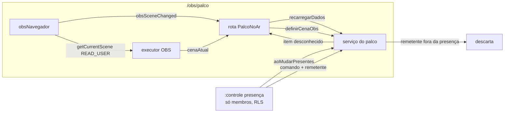

# VER-046 — E3: correções da revisão final (I1 a I5, A1 do VER-044 e N1 a N7)

## Cabeçalho

| Campo | Valor |
|---|---|
| Id | VER-046 |
| Título | Correções, numa onda só, do que a revisão final da etapa E3 achou entre as tarefas (I1 a I5, N1 a N7) e do achado A1 do [VER-044](2026-11-27-044-e3-conferencia-e-guia.md) |
| Gravidade | média (I1 e I4 vão ao ar ou são de segurança; os nits, baixa) |
| Tipo | correção · segurança · documentação · refatoração |
| Data | 2026-11-27 |
| Usuário responsável | TokumoH |
| Status de implementação | implementado (I4 em parte: a parte B, defesa no palco; a separação do estado num tópico próprio é o item VER-047) |
| Commits | commit que introduz este arquivo — `git log --diff-filter=A --format=%h -- docs/verificacoes/2026-11-27-046-e3-correcoes-revisao-final.md` |
| Arquivos | código: `src/app/canais.ts` (novo), `src/app/useAoVivo.ts`, `src/app/useDispositivo.ts`, `src/app/useEstudio.ts`, `src/app/telas/{AbaEpisodios,ObsPalco,Painel,PalcoNoAr,TelaDeDispositivo}.tsx`, `src/domains/aovivo/{mensagens,palco,portas}.ts`, `src/domains/obs/{executor,portas}.ts`, `src/domains/preparacao/midia.ts`, `src/shared/infra/{aoVivoSupabase,armazenamentoSupabase,canalSupabase,obsNavegador}.ts`, `supabase/migrations/20261127200000_episodio_em_teste_nao_se_apaga.sql` (nova); testes: `src/app/telas/{AbaAoVivo,AbaEpisodios,Controle,Painel,PalcoNoAr}.test.tsx`, `src/domains/aovivo/palco.test.ts`, `src/domains/obs/executor.test.ts`, `src/shared/infra/{aoVivoSupabase,canalSupabase,obsNavegador}.test.ts`, `supabase/tests/{matriz,restricoes,rls}.test.ts`; documentação: `src/app/README.md`, `src/app/telas/README.md`, `src/domains/{acesso,aovivo,obs,preparacao}/README.md`, `src/shared/infra/README.md`, `supabase/README.md`, `supabase/migrations/README.md`, `supabase/tests/README.md`, `docs/verificacoes/README.md` e este registro |

Revisões: R1 — revisão independente da primeira versão (sabotagens S1, S2, S4, S5, S7, S8, S10 e variantes numa cópia, sondas do `Starting`, catálogo do PGlite): spec ❌, qualidade reprovada por 2 achados importantes de comportamento (cartão de revogado voltava entre `Starting` e `Started`; corrida entre `definir_modo_teste` e `delete` pelo `on delete set null`) e 3 nits — corrigidos na rodada de correção 1; R2 — re-revisão focada da rodada 1 (sonda refeita, R1, R2, R4, R6 e variantes repetidas numa cópia): **limpa**, com 3 nits incorporados (linha C2) e reconferência pontual (`npm run check` 0 no commit). Rodada 2: re-revisão limpa, com três nits (um teste e dois textos de Riscos), incorporados (linha C2). Rodada de correção 1: achados 1 e 2 (Importantes) e 3 a 5 (nits) da revisão R1, incorporados abaixo (marcados "rodada 1").

## Problema

A revisão final da E3 (VER-035 a VER-044) leu o código das camadas do ao vivo e achou falhas que só aparecem quando se juntam as tarefas. O VER-044 já tinha deixado aberto o A1.

| Achado | O que estava errado | Efeito |
|---|---|---|
| I1 | No `/obs/palco`, o `TelaDoEstado` só escondia o `carregando`. Com o palco pareado e no ar, a revogação ou a troca do aparelho levava a rota a `revogado`, e o cartão rosa "Este dispositivo foi revogado" era desenhado | o cartão ia para a Fonte, que está em todas as cenas, e daí para a transmissão, a gravação e os clipes, contra a D16 e o VER-040 |
| I2 | O palco lia cenas, sons e avisos só ao trocar de episódio ou de modo. O `/controle` e a aba Ao vivo releem a cada consulta | no teste (fluxo "conferir, testar, corrigir, testar"), um aviso, cena ou som criado ou corrigido dava `aviso_inexistente`, texto antigo ou o `nome_obs` antigo no palco |
| A1 (VER-044) | O palco nascia com `cenaObs: null` e nunca lia a cena atual do OBS (`obsNavegador.cenaAtual()` sem uso) | `proxima_cena` não partia da cena atual do OBS (D9), e a troca feita à mão no OBS não aparecia no estado |
| I3 | `estudio_estado.episodio_teste_id` tem `on delete set null`. A política `episodios_equipe_apaga` aceitava o rascunho do modo teste | apagar esse rascunho na aba Episódios desligava o teste sem função e sem `episodio_ativo_mudou` (contra a D7). Palco e `/controle` ficavam até 10 min no tópico do episódio apagado |
| I4 | Em `:controle`, `pode_usar_canal` deixa o `obs_palco` enviar broadcast. A RLS não distingue o evento, e `palco.ts` não filtrava o remetente | um segundo `obs_palco` (o banco permite) ou a sessão antiga de um palco trocado que não coopere comandava o palco como se fosse membro. O Foco 6 do PLA-004 ("dispositivos não publicam comando") ficou falso |
| I5 | `conferirRotulo` (`acesso/dispositivos.ts`) não tinha uso em produção. O Risco do VER-037 (linha 212) dizia que "o adaptador da Tarefa 4 manda o rótulo já conferido por `conferirRotulo`" | documentação falsa e código morto |
| N1 | A porta `ObsWebsocket` era mais larga do que o executor precisa | `PalcoNoAr` tinha três funções de mentira (`conectar`, `aoFechar`, `fechar`) |
| N2 | Duas regras de "palco presente": qualquer `obs_palco` na presença (`useAoVivo`) e a sessão atual do dispositivo (`AbaAoVivo`) | diferença não registrada |
| N3 | O `/controle` aceitava `estado` de remetente revogado | a frase da D5 ("os demais descartam") sugeria mais do que o código fazia |
| N4 | A regex de UUID estava em três arquivos. Os leitores de linha de cenas e avisos estavam repetidos entre `aoVivoSupabase` e `preparacaoSupabase` | risco de as cópias divergirem |
| N5 | A célula de `servicos.test.ts` em `src/app/README.md` começava com "8 testes" e terminava com "(12 testes)" | contagem contraditória |
| N6 | Âncoras dos VER-035, 040, 041 e 042 ficaram deslocadas pelas tarefas seguintes, e nenhum registro anotou | links que apontam para linhas erradas |
| N7 | `useEstudio`, `useAoVivo` e os testes de membro importavam `REABRIR_CANAIS_MS` de `useDispositivo.ts` | as telas de membro dependiam do arquivo do hook de dispositivo |

## Era proposital?

Não, nenhum dos achados. Evidências:

- **I1:** o comentário do `TelaDoEstado` e a D16 dizem que as telas de erro "aparecem enquanto o palco não está pareado, o que só acontece na configuração". O VER-040 registrou só o caso "recarregando sem rede". O teste `palco revogado na hora…` confirmava o cartão na rota do palco, porque foi escrito para provar a revogação, não o que vai ao ar. O passo 9 do guia mandava revogar depois de iniciar a gravação.
- **I2:** o comentário de `consultarEpisodio` só republicava com o mesmo episódio. Nenhum registro ou README cita a diferença em relação ao `/controle`.
- **A1:** o próprio VER-044 o registrou como pendência.
- **I3:** a política foi recriada na D7 só com `estado = 'rascunho'`, e a sonda da revisão final provou o furo. O teste `apresentadora-nao-apaga-nem-altera-estudio` tinha um controle que apagava justamente o episódio do teste: o controle provava a permissão, não o comportamento desejado.
- **I4:** o comentário da migração diz "broadcast todo membro (comando) e o obs_palco (estado)". A intenção era separar por evento, mas a RLS não separa (ver abaixo).
- **I5:** a frase do VER-037 descrevia o plano, não o código.
- **N1 a N7:** sem intenção registrada.

**Evidência que decidiu o desenho do I4.** A coluna `event` de `realtime.messages` existe, mas não chega à autorização do Realtime. Fonte: `github.com/supabase/realtime`, commit 9a2cfba, o mesmo da simulação. Os arquivos foram baixados para o scratchpad da sessão (`item-046/authorization.ex` e `item-046/broadcast_handler.ex`, fora do repositório).

| Onde | O que mostra |
|---|---|
| `lib/realtime/tenants/authorization.ex:26` | o contexto da autorização é `defstruct [:tenant_id, :topic, :headers, :jwt, :claims, :role, :sub]`, sem evento e sem payload |
| `authorization.ex:504-507` (`check_write_policy`, caminho de reserva) | a sonda de escrita é `Message.changeset(%Message{}, %{topic: ..., extension: extension})`: só tópico e extensão, então `event` fica nulo |
| [`simulacao-supabase.sql`](../../supabase/tests/simulacao-supabase.sql#L292-L295) (corpo de `realtime.authorize`, caminho principal, copiado da migração 20261111120000 do servidor) | `insert into realtime.messages (topic, extension, inserted_at, updated_at)`, também sem `event` |
| `lib/realtime_web/channels/realtime_channel/broadcast_handler.ex:269-282` e `310-325` (`authorize_write`, `extensions_to_probe`) | a resposta de escrita fica guardada por conexão ("`write` and `persist` are cached per socket"), conferida no primeiro envio e de novo a cada token novo. Os envios seguintes, de **qualquer** evento, não passam pela RLS |
| `broadcast_handler.ex:214-215` | o `event` só é gravado na mensagem **persistida** (`Messages.persist(..., topic, event, ...)`) |
| [`simulacao-supabase.sql`](../../supabase/tests/simulacao-supabase.sql#L218) | a coluna `event text` existe na simulação, com a mesma fonte |

Uma política sobre `event` não separa `comando` de `estado`. Com `event = 'estado'`, a sonda chega nula e o `obs_palco` perde todo envio, inclusive o legítimo. Com `event is distinct from 'estado'` para membros, passa sempre. E mesmo que a sonda levasse o evento, a resposta do primeiro envio valeria para os seguintes. O controlador decidiu pela opção C: a parte B (defesa no palco) neste item e a separação do estado num tópico próprio (opção A) no item VER-047, logo depois.

## Solução

1. **I1:** `SoComSaidaParada`, em `PalcoNoAr.tsx`, envolve as telas de estado sem pareamento do `/obs/palco` (`cobrirTela`, prop opcional nova de `TelaDeDispositivo`, passada pelo `ObsPalco`).
   - A tela aparece só fora do OBS (sem `window.obsstudio` não há transmissão) ou com a saída parada e o status conhecido: `saidaParada(obs)`, extraída do `PalcoNoAr`, é a mesma regra do selo e do painel (D10).
   - Com a saída no ar ou o status desconhecido, a Fonte fica vazia.
   - Um evento de início esconde a tela na hora (já no `Starting`), e a conferência é refeita a cada 15 s.
   - **Rodada 1:** o `getStatus` do obs-browser só marca a saída depois do `*Started`, então reler o status logo depois do `Starting` trazia o cartão de volta. A guarda nova `criarGuardaDaSaida` guarda as saídas iniciadas (o adaptador passa a dizer o tipo, `inicio` ou `fim`, e a saída, pelo nome do evento) e recusa até o `*Stopped` da mesma saída ou até duas releituras periódicas seguidas (`RELEITURAS_PARA_LIBERAR`, ao menos um período inteiro de 15 s) acharem a saída parada (um início que falhou e não teve fim). O selo (`s`) e o painel de configuração (`c`) tinham o mesmo furo (abriam entre o `Starting` e o `Started`; o teste antigo `o evento que chega durante a conferência vence` dizia isso como controle) e passaram a usar a mesma guarda.
   - No guia, a revogação passou a ser feita com a saída parada, e o guia diz o que acontece com ela ligada.
2. **I2:** o serviço do palco relê as listas pela rota (`recarregarDados`, uma releitura por vez) em três momentos:
   - quando um comando tem item desconhecido (`RECUSAS_QUE_RELEEM`: cena, som ou aviso inexistente e `sem_cenas`). Relê uma vez e depois responde;
   - quando alguém entra na presença do `:controle` (a mesma hora em que a aba Ao vivo e o `/controle` releem as suas);
   - na consulta do mesmo episódio (`conectado` e `episodio_ativo_mudou`).

   No máximo uma releitura a cada 5 s (`RELEITURA_MINIMA_MS`, rodada 1): dentro da janela, o pedido reaproveita a releitura em curso ou fica com as listas da última, e o comando com item desconhecido é recusado na hora. A rota troca a carga da tela e assina só as URLs dos arquivos novos. Um som relido toca por um `<audio>` avulso se o React ainda não desenhou a URL.
3. **A1:** o executor lê `getCurrentScene` em cada `atualizarSituacao`, só com nível READ_USER ou mais, e guarda também a cena que ele mesmo trocou. Expõe isso em `cenaAtual()`.
   - A rota passa a cena ao serviço (`palco.definirCenaObs`) ao iniciar a sessão (a situação é lida logo depois), a cada 15 s, nos eventos de saída e no evento `obsSceneChanged` do obs-browser (`aoMudarCena`, porta nova; o `detail` não é lido).
   - `proxima_cena` parte dessa cena. O limite de 200 caracteres continua: uma cena longa vai `null` ao canal.
4. **I3:** migração nova `20261127200000_episodio_em_teste_nao_se_apaga.sql`. Ela recria `episodios_equipe_apaga` com `id is distinct from (select e.episodio_teste_id from public.estudio_estado e)` e, desde a rodada 1, troca a chave estrangeira `estudio_estado_episodio_teste_id_fkey` de `on delete set null` para `on delete no action` (`alter table ... drop constraint ..., add constraint ...`, mesmo nome). A política sozinha deixava uma corrida: ela é avaliada com a foto do início do comando, então `definir_modo_teste(X)` numa transação e `delete X` noutra podiam terminar com o `set null` desligando o teste. A checagem da chave usa foto nova e trava a linha: a corrida e qualquer delete que contorne a política (dono, superusuário) terminam em `23503`. A política continua para a recusa sem erro (0 linhas) no caso comum. As funções `definir_modo_teste`, `iniciar_ao_vivo` e `encerrar_ao_vivo` só gravam `estudio_estado` e não apagam episódio: não mudam. A política lê o modo teste pela leitura de membro (`estudio_estado_le`); sem ela, a chave mantém a recusa (falha fechada), e um teste fixa isso. A aba Episódios consulta `episodio_ativo()` antes de excluir e mostra "Saia do modo teste antes de apagar.". Se a consulta falhar, a tentativa segue, e o banco recusa.
5. **I4 (parte B):** o palco só aceita comando de quem está na presença do `:controle`. A porta nova `CanalDoControle.aoMudarPresentes` entrega as chaves uuid com ao menos um registro. Só membros marcam presença ali, e quem decide isso é a RLS (`pode_usar_canal`: presença em `:controle` só para `v_papel is not null`).
6. **I5:** `criarCodigo` (`aoVivoSupabase.ts`) passou a conferir o rótulo com `conferirRotulo` antes da rede: fora do limite → `invalido`, sem chamar o banco. Fica corrigida aqui a afirmação do Risco do VER-037 (linha 212): até este item, nenhum adaptador conferia o rótulo; desde ele, o `criarCodigo` confere.
7. **N1:** porta `MarcadorObs` (`versao`, `marcar`, `conectado`), estendida por `ObsWebsocket`. O executor e o `wsDoExecutor` do palco usam só ela, e as três funções de mentira saíram.
8. **N2:** as duas regras ficam diferentes de propósito, porque o `/controle` não lê `dispositivos` (a RLS não deixa a apresentadora). A diferença está registrada nos Riscos de `telas/README.md` e em `app/README.md`.
9. **N3:** o `useAoVivo` guarda um `Revogados` alimentado pelas revogações de outros em `estudio` e descarta o `estado` desses remetentes por 15 min, como o palco faz.
10. **N4 (em parte):** o UUID é um só. `preparacao/midia.ts` o exporta, `aovivo/mensagens.ts` o reexporta, e `armazenamentoSupabase.ts` monta o caminho seguro com `UUID.source`. Os leitores de linha não foram unificados (ver "Por que não outras soluções").
11. **N5:** a célula passou a dizer "12 testes", e a linha da Verificação diz desde quando.
12. **N6:** os deslocamentos estão registrados em "Onde", sem editar os registros antigos. Nenhum arquivo encolheu, e o `check-docs` confere que nenhuma âncora passa do fim do arquivo.
13. **N7:** `src/app/canais.ts` guarda `REABRIR_CANAIS_MS`, importado por `useEstudio`, `useAoVivo`, `useDispositivo`, `PalcoNoAr` e os testes de membro. `acompanharEstudio` fica em `useDispositivo.ts`.

## Por que esta solução

- **Arquitetura (DDD, GRASP Pure Fabrication, Componentes):**
  - o filtro de presença, a releitura e a cena entram no serviço do palco (`domains/aovivo/palco.ts`), que depende só de portas. Quem relê o banco e assina URLs é a rota, que entrega `recarregarDados`;
  - a leitura da cena, com o nível conferido, fica no executor do OBS (camada anticorrupção). O adaptador só avisa do evento;
  - `aovivo` continua sem conhecer o OBS (D1).
- **I1:** reaproveita a regra que já protege o selo e o painel (D10), sem regra nova. Fora do OBS a tela continua aparecendo, o que mantém o diagnóstico num navegador comum e todos os testes das três rotas.
- **I2:** a releitura no item desconhecido cobre o caso que dá recusa errada. A releitura na entrada cobre o texto corrigido no fluxo do teste, porque a pessoa volta à aba Ao vivo para testar, e ela remonta e entra no `:controle`. São as mesmas horas em que o `/controle` relê: as duas pontas ficam iguais sem mensagem nova no canal.
- **A1:** a cena vem de `getCurrentScene`, que confere o nível. Confiar no `detail` do evento passaria por cima do READ_USER, porque o README do obs-browser não diz que os eventos dependem de nível.
- **I3:** a política é a defesa que vale também pela API. É o mesmo padrão da D7 (condição na política de `delete`) e não precisa de função nem de gatilho. A consulta na aba dá a frase certa, porque a recusa por RLS volta como 0 linhas (`nada_alterado`), igual a "a lista mudou".
- **I4 (parte B):** a presença do `:controle` é o único sinal que a RLS restringe a membros. Exigir que o remetente esteja nela é mais forte que "não ser um dispositivo na presença de `estudio`", e dá para testar.
- **I5:** usar a função onde o rótulo sai (adaptador) é menor que remover e manter a regra só no banco. O domínio já tinha os testes de borda.
- **N7:** só a constante saiu de `useDispositivo.ts`. `acompanharEstudio` é do dispositivo e só as rotas de dispositivo o usam, então a direção já estava certa.

## Por que não outras soluções

| Opção | Motivo de descarte |
|---|---|
| I1: esconder sempre as telas de estado no `/obs/palco` | num navegador comum (configuração, diagnóstico) a pessoa não veria por que a Fonte está vazia; e três testes de pareamento das rotas deixariam de valer para o palco |
| I1: mostrar a mensagem só pela tecla `s` | exige teclado no "Interagir" para saber que o palco foi revogado com tudo parado; a D16 já admite as telas com nada no ar |
| I2: aviso novo `listas_mudaram` em `estudio`, publicado pelas abas Episódios, Cenas e Biblioteca | mexe em três abas, no `Painel` e no leitor de mensagens; se perde com o canal do painel fora; a releitura na entrada já cobre o fluxo do teste |
| I2: reler as listas a cada comando | 4 consultas e assinaturas por toque, com atraso na troca de cena ao vivo |
| I2: reler de tempos em tempos | janela de texto antigo e tráfego sem motivo |
| A1: remover a porta `cenaAtual` | contra a D9 ("a partir da cena atual do OBS") |
| A1: ler a cena do `detail` do `obsSceneChanged` | passaria por cima do nível READ_USER exigido por `getCurrentScene` |
| I3 (rodada 1): só a política, sem trocar a chave estrangeira | corrida entre `definir_modo_teste(X)` e `delete X` em transações concorrentes (a política vê a foto do início do comando, e o `set null` desliga o teste); não reproduzível no PGlite (uma conexão só), mas segue da semântica do Postgres em READ COMMITTED |
| I3 (rodada 1): `on delete restrict` | a mesma recusa, mas com `23001` (`restrict_violation`), que os adaptadores não traduzem; `no action` dá `23503` (`em_uso`) e é o padrão do Postgres; sem `deferrable`, as duas conferem na hora |
| I1 (rodada 1): depois do evento, esperar um atraso fixo de alguns segundos antes de reler | um `Started` que demore mais que o atraso traria o cartão de volta; o fim da mesma saída é o sinal certo, e duas releituras periódicas cobrem o início que falhou |
| I3: gatilho `before delete` que recusa com `55000` | o `rpc:grants-check` exige chamada de papel no corpo de toda função; seria preciso afrouxar a regra ou fazer uma chamada decorativa |
| I3: a aba chamar `definir_modo_teste(null)` antes de apagar | deixa o furo pela API e muda o modo teste sem a pessoa pedir |
| I4 (a): política de `realtime.messages` por `event` | o `event` não chega à autorização, e a resposta fica guardada por conexão (evidência em "Era proposital?"); fica para o VER-047, com tópicos separados |
| I4 (b): descartar quem é dispositivo na presença de `estudio` | um `obs_palco` que não coopere declara qualquer `uid` fora dessa presença e passa; a presença do `:controle`, restrita a membros pela RLS, é mais forte |
| I5: remover `conferirRotulo` | perderia a conferência antes da rede (o domínio é o mais estrito, `trim` × `btrim`) e os testes de borda já escritos |
| N4: unificar também os leitores de linha (conversores exportados por `preparacaoSupabase.ts`) | foi feito e desfeito: `aoVivoSupabase.ts` cairia de 236 para 215 linhas, e as âncoras `#L1-L236` e `#L13-L236` do VER-038 passariam do fim do arquivo (`check-docs`); o VER-038 não é editado. A divergência continua coberta por `palco-carrega` e pelos testes de `preparacaoSupabase` |
| N7: levar também `acompanharEstudio` para o módulo neutro | `useDispositivo.ts` cairia de 217 para 90 linhas, e as âncoras `#L36-L98` e `#L100-L217` do VER-040 passariam do fim; e a função é do dispositivo |

## Onde

| Arquivo | Linhas | O que mudou |
|---|---|---|
| [`PalcoNoAr.tsx`](../../src/app/telas/PalcoNoAr.tsx#L74-L158) | 74–158 | `saidaParada(obs)`, `RELEITURAS_PARA_LIBERAR`, `criarGuardaDaSaida` (rodada 1) e `SoComSaidaParada` com a guarda (I1) |
| [`PalcoNoAr.tsx`](../../src/app/telas/PalcoNoAr.tsx#L256-L281) | 256–281 | `wsDoExecutor` como `MarcadorObs` (N1); `urlsAtuais` e o `<audio>` avulso no `tocarSom` (I2) |
| [`PalcoNoAr.tsx`](../../src/app/telas/PalcoNoAr.tsx#L316-L390) | 316–390 | `renovarUrls(s, soNovos)`, `recarregarDados` e `iniciarSessao` com `recarregarDados` (I2) |
| [`PalcoNoAr.tsx`](../../src/app/telas/PalcoNoAr.tsx#L433-L470) | 433–470 | mesmo episódio relê (I2); `definirCenaObs(executor.cenaAtual())` (A1) |
| [`PalcoNoAr.tsx`](../../src/app/telas/PalcoNoAr.tsx#L524-L610) | 524–610 | selo e painel pela guarda; o evento de saída alimenta a guarda e a releitura periódica conta (rodada 1); `obs.aoMudarCena` (A1) |
| [`TelaDeDispositivo.tsx`](../../src/app/telas/TelaDeDispositivo.tsx#L81-L105) | 81–105 | `cobrirTela` opcional (I1) |
| [`ObsPalco.tsx`](../../src/app/telas/ObsPalco.tsx#L59-L67) | 59–67 | passa `SoComSaidaParada` (I1) |
| [`palco.ts`](../../src/domains/aovivo/palco.ts#L11-L47) | 11–47 | `RECUSAS_QUE_RELEEM`, `RELEITURA_MINIMA_MS` (rodada 1), `recarregarDados` (I2) |
| [`palco.ts`](../../src/domains/aovivo/palco.ts#L182-L226) | 182–226 | `reler` com intervalo mínimo; filtro de presença (I4); releitura no item desconhecido (I2) |
| [`palco.ts`](../../src/domains/aovivo/palco.ts#L245-L284) | 245–284 | entrada relê; `aoMudarPresentes`; `definirCenaObs` (A1); `recarregarListas` |
| [`portas.ts` (aovivo)](../../src/domains/aovivo/portas.ts#L49-L55) | 49–55 | `CanalDoControle.aoMudarPresentes` (I4) |
| [`portas.ts` (obs)](../../src/domains/obs/portas.ts#L38-L83) | 38–83 | `aoMudarSaida` com tipo e saída (rodada 1); `aoMudarCena` (A1); `MarcadorObs` e `ObsWebsocket extends MarcadorObs` (N1) |
| [`executor.ts`](../../src/domains/obs/executor.ts#L15-L32) | 15–32 | `cenaAtual()` no `ExecutorObs`; `ws: MarcadorObs` (A1, N1) |
| [`executor.ts`](../../src/domains/obs/executor.ts#L175-L186) | 175–186 | leitura da cena só com READ_USER (A1) |
| [`obsNavegador.ts`](../../src/shared/infra/obsNavegador.ts#L32-L33) | 32–33, 112–118 e 120–125 | `EVENTO_DE_CENA`; tipo e saída no `aoMudarSaida` (rodada 1); `aoMudarCena` (A1) |
| [`canalSupabase.ts`](../../src/shared/infra/canalSupabase.ts#L329-L336) | 329–336 | `aoMudarPresentes` no `:controle` (I4) |
| [`20261127200000_episodio_em_teste_nao_se_apaga.sql`](../../supabase/migrations/20261127200000_episodio_em_teste_nao_se_apaga.sql#L1-L39) | 1–39 | migração nova: chave estrangeira do modo teste `no action` (rodada 1) e política de `delete` sem o episódio do teste, com a dependência de `estudio_estado_le` comentada (I3) |
| [`AbaEpisodios.tsx`](../../src/app/telas/AbaEpisodios.tsx#L372-L379) | 27, 39, 132, 261–265, 372–379 | frase, `EpisodioNoModoTeste`, prop `episodioAtivo`, tratamento e consulta antes de excluir (I3) |
| [`Painel.tsx`](../../src/app/telas/Painel.tsx#L111) | 111 | passa `episodioAtivo` (I3) |
| [`aoVivoSupabase.ts`](../../src/shared/infra/aoVivoSupabase.ts#L118-L121) | 118–121 | `conferirRotulo` antes da rede (I5) |
| [`useAoVivo.ts`](../../src/app/useAoVivo.ts#L137) | 137, 215, 249 | `Revogados` e descarte do `estado` revogado (N3) |
| [`canais.ts`](../../src/app/canais.ts#L1-L8) | 1–8 | novo: `REABRIR_CANAIS_MS` (N7) |
| [`useDispositivo.ts`](../../src/app/useDispositivo.ts#L7-L18) | 7, 17–18 | importa a constante de `canais.ts` (N7) |
| [`midia.ts`](../../src/domains/preparacao/midia.ts#L111-L116) | 111–116 | `UUID` exportado (N4); reexportado em [`mensagens.ts`](../../src/domains/aovivo/mensagens.ts#L21-L22) e usado em [`armazenamentoSupabase.ts`](../../src/shared/infra/armazenamentoSupabase.ts#L24) |
| [`rls.test.ts`](../../supabase/tests/rls.test.ts#L1919-L1963) | 1919–1963 e 652 | `e3-episodio-do-teste-nao-se-apaga`, `e3-episodio-do-teste-fk-restrict` e `e3-episodio-do-teste-dependencia-da-leitura` (rodada 1); o controle de `apresentadora-nao-apaga-nem-altera-estudio` sai do teste antes de apagar (I3) |
| [`restricoes.test.ts`](../../supabase/tests/restricoes.test.ts#L262) | 262 | `chaves-estrangeiras`: `estudio_estado (episodio_teste_id)` com `no action` (rodada 1) |
| [`matriz.test.ts`](../../supabase/tests/matriz.test.ts#L114-L127) | 114–127 e 430 | recorte `apagavel(x, teste)`, com o teste lido antes do delete (I3) |
| [`PalcoNoAr.test.tsx`](../../src/app/telas/PalcoNoAr.test.tsx#L721-L941) | 168–178 e 721–941 | presença no helper `comando`; bloco `revisão final da E3 (VER-046)` (16 testes: 3 da rodada 1 e 1 da rodada 2); o teste antigo do selo no `Starting` passou a exigir a recusa |
| [`palco.test.ts`](../../src/domains/aovivo/palco.test.ts#L563-L699) | 563–699 | 5 testes (I4, I2, A1 e o intervalo mínimo da rodada 1) e presença no falso |
| [`executor.test.ts`](../../src/domains/obs/executor.test.ts#L343-L381) | 343–381 | 4 testes da cena (A1) |
| Outros testes | — | [`AbaEpisodios.test.tsx`](../../src/app/telas/AbaEpisodios.test.tsx#L229) (3), [`Controle.test.tsx`](../../src/app/telas/Controle.test.tsx#L361) (1), [`canalSupabase.test.ts`](../../src/shared/infra/canalSupabase.test.ts#L221) (1), [`obsNavegador.test.ts`](../../src/shared/infra/obsNavegador.test.ts#L153) (1), [`aoVivoSupabase.test.ts`](../../src/shared/infra/aoVivoSupabase.test.ts#L120) (rótulo antes da rede); imports de `REABRIR_CANAIS_MS` em `AbaAoVivo`, `Controle` e `Painel.test.tsx` |
| READMEs | — | os listados no cabeçalho: guia "Ao vivo e pareamento (E3)" (migração nova no passo 2, revogação com a saída parada e conferências novas no passo 9, D7 na tabela), ordem das migrações, contagens e Riscos |

**Âncoras de registros antigos (N6).** Nenhum registro antigo foi editado. Deslocamentos conhecidos, conferidos pelo script da revisão final (`rev-final/ancoras.py`, que procura o símbolo citado na linha da âncora):

| Registro | Arquivo | Exemplo do deslocamento | Causa |
|---|---|---|---|
| [VER-035](2026-11-27-035-e3-dominio-ao-vivo.md) (linhas 103–104) | `mensagens.ts`, `comandos.ts` | `lerComando` L181 → 188; `resolverComando` L57 → 61 | Tarefa 7 e este item (+1 em `mensagens.ts`) |
| [VER-040](2026-11-27-040-e3-telas-de-dispositivo.md) (linhas 62–68) | `useDispositivo.ts`, `TelaDeDispositivo.tsx`, `PalcoNoAr.tsx` | `acompanharEstudio` L175 → 131; `CameraPareada` L102 → 111; `iniciarSessao` L247 → 322; `aoMudarSaida` L502 → 550 | Tarefas 7 a 9 e este item (+78 linhas no `PalcoNoAr.tsx`) |
| [VER-041](2026-11-27-041-e3-controle.md) (linhas 112–113) | `useAoVivo.ts`, `PainelDeComandos.tsx` | `pior` L55 → 64; `TEXTO_DO_MOTIVO` L35 → 54 | Tarefa 9 e este item |
| [VER-042](2026-11-27-042-e3-aba-ao-vivo-dispositivos.md) (linhas 90–93) | `AbaAoVivo.tsx`, `Painel.tsx`, `Painel.test.tsx` | `AbaAoVivo` L126 → 251; `avisarRevogacao` L72 → 89 | Tarefa 9 |
| [VER-030](2026-11-27-030-e2-episodios-e-avisos.md) (linha 79) | `AbaEpisodios.tsx` | `aoConfirmarExclusaoDoEpisodio` L346 → 366 | Tarefa 9 e este item (+27) |
| [VER-038](2026-11-27-038-e3-adaptadores-ao-vivo.md) | `aoVivoSupabase.ts` | âncoras de corpo inteiro (`#L1-L236`) | este item (+4; o arquivo tem 240 linhas) |

No total, o script achou 56 âncoras com o símbolo fora da linha citada nos registros 030 a 045, sem nenhuma passar do fim do arquivo. Nenhum arquivo tocado encolheu (contagem de linhas antes e depois de cada um, por exemplo `useDispositivo.ts` 217 → 218, `aoVivoSupabase.ts` 236 → 240).

## Lógica

| Passo | Antes | Depois |
|---|---|---|
| Palco revogado com a gravação ligada | cartão rosa na Fonte (em todas as cenas, na gravação e nos clipes) | Fonte vazia; a mensagem aparece só com a saída parada |
| `obsRecordingStarting` com o `getStatus` ainda "parado" (rodada 1) | 1ª versão: some no evento e volta na releitura imediata | vazia até o `obsRecordingStopped` ou duas releituras de 15 s com a saída parada; o selo e o painel também recusam |
| `definir_modo_teste(X)` e `delete X` concorrentes (rodada 1) | `set null` podia desligar o teste em silêncio | a chave `no action` recusa com `23503` |
| Comandos com item desconhecido em rajada (rodada 1) | uma releitura completa por comando | no máximo uma a cada 5 s; dentro da janela, recusa |
| Aviso criado com o teste ligado, tocado no `/controle` | `recusado`/`aviso_inexistente` até trocar de modo ou de episódio | uma releitura e `ok`, com o aviso na tela |
| Texto de aviso corrigido e a aba Ao vivo reaberta | texto antigo no palco | a entrada no `:controle` relê, e o texto novo vai ao ar |
| Cena trocada à mão no OBS | estado com a cena antiga; `proxima_cena` a partir dela | estado com a cena nova (evento ou releitura de 15 s); `proxima_cena` parte dela |
| `delete` do rascunho do teste pela API | aceito; modo teste desligado em silêncio | 0 linhas; modo teste intacto; a aba diz "Saia do modo teste antes de apagar." |
| Comando de um `obs_palco` (fora da presença do `:controle`) | executado | descartado (com o `uid` de um membro presente declarado, ainda passa até o VER-047) |
| Rótulo vazio em `criarCodigo` | ia ao banco (que recusava) | `invalido` antes da rede |
| `estado` de um palco revogado no `/controle` | aceito | descartado por 15 min |

## Exemplo

- **I1:** em `PalcoNoAr.test.tsx` (bloco do VER-046), o palco pareado no modo teste recebe a revogação com `getStatus` dizendo `streaming: true`. Antes: `container.textContent` era "Este dispositivo foi revogado. Gere um novo link no painel." (o teste antigo `palco revogado na hora…` confere essa frase com a saída parada). Depois: `''` com transmissão, gravação, status nulo ou nível 0, inclusive 15 s depois. Com tudo parado a frase aparece, e o `obsStreamingStarting` a tira na hora.
- **I3:** em PGlite, `definir_modo_teste(<id>)` e depois `delete from public.episodios where id = <id> returning id`, como `equipe` e como `admin`. Antes (sonda da revisão final): devolvia o id, e `episodio_ativo()` passava de `[{modo:'teste'}]` para `[]`. Depois: `[]` nas duas sessões, `episodio_ativo()` continua `[{ modo: 'teste' }]` e `episodio_teste_id` é o mesmo id. Depois de `definir_modo_teste(null)`, o mesmo `delete` devolve o id.
- **A1:** o `getCurrentScene` falso devolve "Abertura" e o estado publicado traz `cenaObs: 'Abertura'`. A cena muda para "Conversa" com `obsSceneChanged` e o estado traz "Conversa". Com nível 1 (READ_OBS), `getCurrentScene` não é chamado e `cenaObs` fica `null`.
- **I4:** um comando de `b0000000-…-0000000000b2` (fora da presença) não mostra o aviso nem grava registro. O mesmo comando de um membro presente mostra o aviso.

## Verificação

TDD: os testes novos foram escritos junto de cada mudança e rodados antes do resto. Todas as sabotagens rodaram com o cache do Vitest desligado (`--cache=false`), com o arquivo restaurado e `sha256sum` igual antes e depois. As S1 a S13 rodaram no próprio repositório (script `item-046/sab/sabotar.py`, com restauração); a revisão R1 apontou isso, e as R1 a R7 da rodada 1 rodaram numa cópia (`item-046/sab/sabotar_copia.py`).

| # | Abordagem | Comando / método | Resultado |
|---|---|---|---|
| T1 | testes por camada durante o trabalho | `npx vitest run --cache=false <arquivos>` | todos passando ao fim de cada achado |
| V1 | suíte inteira e tipos, no meio do trabalho | `npx tsc --noEmit -p .` e `npx vitest run --cache=false` | 58 arquivos, 2209 testes passando (antes dos testes do som avulso, da presença no adaptador e do `aoMudarCena`, e da correção do recorte da matriz) |
| V2 | checagem completa do projeto, primeira rodada | `npm run check` | 2 falhas por tempo (60 s) em `scripts/tests/catalogo.test.mjs` e `scripts/tests/executaveis.test.mjs`, com a máquina carregada (190 s de suíte contra 67 s). Rodados sozinhos, os dois arquivos passaram (140 testes em 31 s); não dependem do código deste item, só leem as migrações, e passam com a migração nova |
| V3 | checagem completa do projeto, segunda rodada, sem outro processo pesado | `npm run check` | 0 erros: `typecheck`; 58 arquivos e 2211 testes; `check-docs` 0 (77 `.md`, 46 registros); `check-doc-secrets` 0; `rpc:grants-check` 0 (5 migrações); `data-api:check` 0 (5 migrações); `check-deps-audit` 0 |
| S1 | `SoComSaidaParada` sempre mostra | `PalcoNoAr.test.tsx` | 6 falhas (as 4 células de revogado no ar, a troca do aparelho e a mensagem que some no início da saída) |
| S2 | sem releitura no item desconhecido | `palco.test.ts` e `PalcoNoAr.test.tsx` | 2 falhas (`item-criado-depois-e-relido`; aviso e som criados depois) |
| S3 | sem releitura na entrada | os mesmos | 2 falhas (`quem-entra-faz-reler`; aviso corrigido) |
| S4 | o executor não lê a cena | `executor.test.ts` e `PalcoNoAr.test.tsx` | 4 falhas |
| S5 | a leitura da cena sem conferir READ_USER | os mesmos | 3 falhas |
| S6 | sem ouvir `obsSceneChanged` | `PalcoNoAr.test.tsx` | 1 falha (troca à mão) |
| S7 | sem o filtro de presença | `palco.test.ts` e `PalcoNoAr.test.tsx` | 2 falhas |
| S8 | política sem a condição do modo teste | `rls.test.ts` e `matriz.test.ts` | 3 falhas (`e3-episodio-do-teste-nao-se-apaga` e as 2 células de `delete` de `episodios`). A primeira versão do recorte da matriz, que lia o modo teste depois do delete, deixava a sabotagem passar na matriz (1 falha só) e foi corrigida |
| S9 | a aba sem a consulta antes de excluir | `AbaEpisodios.test.tsx` | 1 falha |
| S10 | `criarCodigo` sem `conferirRotulo` | `aoVivoSupabase.test.ts` | 1 falha (`rpcs-e-parametros`) |
| S11 | `/controle` aceita `estado` revogado | `Controle.test.tsx` | 1 falha |
| S12 | som relido sem o `<audio>` avulso | `PalcoNoAr.test.tsx` | 1 falha. A primeira versão do teste não exercitava o caminho (o `act` desenha o `<audio>` antes do toque); o teste passou a tirar o `src` do elemento |
| S13 | `aoMudarPresentes` sem exigir registro | `canalSupabase.test.ts` | 1 falha (`presentes-no-controle`) |
| C1 | rodada de correção 1 (achados 1 a 5 da R1): testes novos antes do código (a sonda `Starting` com o status parado falhava), suíte inteira, sabotagens numa **cópia** do repositório (`item-046/copia`, `node_modules` por symlink; o script confere que o arquivo da cópia é igual ao do repositório antes e que o repositório fica intacto) e `npm run check` | `npx vitest run --cache=false` na cópia; `npm run check` no repositório | R1 a R7 abaixo, todas derrubando testes; `npm run check` com 0 erros: `typecheck`; 58 arquivos e 2218 testes; `check-docs` 0 (77 `.md`, 46 registros); `check-doc-secrets` 0; `rpc:grants-check` 0 e `data-api:check` 0 (5 migrações); `check-deps-audit` 0 |
| R1 | a guarda libera na primeira releitura (sem `RELEITURAS_PARA_LIBERAR`) | `PalcoNoAr.test.tsx`, na cópia | 4 falhas (as 3 saídas do `Starting` com o status parado e o selo) |
| R2 | o `Stopped` de qualquer saída libera | o mesmo | 3 falhas |
| R3 | o selo sem a guarda (`saidaParada` direto) | o mesmo | 1 falha (o selo depois do `Starting`) |
| R4 | chave estrangeira de volta a `set null` | `rls.test.ts` e `restricoes.test.ts`, na cópia | 3 falhas (`e3-episodio-do-teste-fk-restrict`, `e3-episodio-do-teste-dependencia-da-leitura`, `chaves-estrangeiras`) |
| R5 | sem a condição nova da política (a chave fica) | `rls.test.ts` e `matriz.test.ts`, na cópia | 3 falhas (o `delete` da equipe passa a dar `23503` em vez de 0 linhas) |
| R6 | sem o intervalo mínimo da releitura | `palco.test.ts`, na cópia | 1 falha |
| R7 | tipo do evento invertido no adaptador | `obsNavegador.test.ts` e `PalcoNoAr.test.tsx`, na cópia | 7 falhas |
| C2 | rodada 2 (nits da re-revisão): teste novo `depois de um início que falhou e foi liberado, um Starting novo volta a esconder` (início sem `Stopped`, liberado por duas releituras, e um `Starting` novo com o status ainda "parado": a tela continua vazia depois de `esperar()` e de mais uma releitura); sabotagem numa cópia nova do repositório, com o cache desligado: tirar a linha `releituras = 0` do início novo em `criarGuardaDaSaida` derruba esse teste (1 falha, 56 passam; `sha256sum` da cópia igual antes e depois e igual ao do repositório); textos dos Riscos "Releitura" e "I1" corrigidos | `npx vitest run --cache=false src/app/telas/PalcoNoAr.test.tsx` na cópia; `npm run check` no repositório | 1 falha na sabotagem; `npm run check` com 0 erros: 58 arquivos e 2219 testes, `check-docs`, `check-doc-secrets`, `rpc:grants-check`, `data-api:check` (5 migrações) e `check-deps-audit` com 0 |
| Refatorações sem mudança de comportamento | N1, N4 (UUID), N7 | `tsc` e a suíte inteira | sem falha; os testes existentes do executor, do Storage e dos canais passam sem mudança de asserção |
| Documentação | links, "Onde", "Arquivos", âncoras | `npm run check-docs` | 0 erros (dentro do `npm run check`) |

Nits corrigidos (não zeram a contagem): N5 (contagem do README) e a descrição dos deslocamentos de âncora (N6).

## Riscos

- **I4 aberto até o VER-047.** A RLS do canal não separa `comando` de `estado` (evidência em "Era proposital?"). Duas fontes podem explorar o furo:
  - um segundo `obs_palco` criado por chamada direta a `criar_codigo_pareamento` por alguém da equipe ou do admin (a interface reaproveita um só);
  - a sessão antiga de um palco trocado ou revogado que não coopere, por até 10 min (a validade do JWT, depois da qual a revalidação do Realtime corta).

  Qualquer um deles pode mandar `comando` em `:controle` declarando o `uid` de um membro que esteja na presença do `:controle` naquele momento. E isso é trivial: o `obs_palco` **recebe** a presença do `:controle` (`pode_usar_canal` deixa o `obs_palco` receber nesse tópico), então vê os `uid` presentes. O filtro deste item corta só o cliente ingênuo (que manda o próprio `uid` ou um qualquer), não o malicioso. Além disso, um segundo `obs_palco` (ou a sessão antiga que não coopera) também pode publicar `estado` falso em `:controle`, e o `/controle` e a aba Ao vivo o aceitam: só descartam revogados avisados (N3), e um segundo palco nunca é revogado. O VER-047 trata as duas coisas no desenho do tópico de estado (quem publica o estado e como o `/controle` reconhece o palco atual). O VER-047, logo depois deste, separa o estado num tópico próprio (só o palco envia) e deixa o `:controle` só para os comandos dos membros.
- **Foco 6 do PLA-004 corrigido aqui (o plano não é editado).** "Dispositivos não publicam comando (Tarefa 3, `e3-canal-matriz`)" vale para `camera` e `obs_camera`, mas **não** para o `obs_palco`, que envia broadcast em `:controle` até o VER-047. O que vale desde este item é: o palco descarta comando de quem não está na presença do `:controle`, onde só membros marcam presença.
- **Comando que chega antes da presença:** um membro cujo `track` em `:controle` ainda não sincronizou no palco tem o comando descartado em silêncio (o `ack` do servidor diz `ok`). Na prática a presença chega antes do primeiro toque, e a reconexão marca de novo, mas não há teste com Realtime real.
- **Releitura com intervalo mínimo (rodada 1):** no máximo uma a cada 5 s; um item criado e tocado logo depois de outra releitura (dentro da janela) é recusado uma vez, e o toque seguinte, passada a janela, relê. Quem tem um `uid` presente força no máximo uma releitura (4 consultas e as assinaturas novas) a cada 5 s.
- **Releitura:** um texto corrigido com a aba Ao vivo já aberta e um `/controle` aberto há tempo segue antigo no palco até alguém entrar no `:controle`, o canal voltar ou o episódio mudar. O `/controle` tem a mesma limitação. Um comando que chega com uma releitura já em curso espera essa mesma releitura, que pode ter começado antes de o item existir (raro). Um toque seguinte dentro de 5 s da última releitura é recusado na hora (`RELEITURA_MINIMA_MS`); só depois da janela ele relê de novo.
- **I1:** com a saída no ar, a revogação não tem confirmação visual no OBS (a Fonte fica vazia); a aba Ao vivo mostra o dispositivo revogado. Fora do OBS a tela aparece sempre.
- **A1:** o README do obs-browser não diz se os eventos dependem do nível; o evento é só um aviso, e a leitura confere o nível. Sem permissão ou sem resposta, a cena fica a última conhecida. Antes da primeira leitura, `proxima_cena` vai à primeira cena.
- **I3:** a migração nova não foi aplicada num Supabase real (passo 2 do guia, do responsável). Até lá, a aba recusa pela consulta, mas a API ainda apaga. A corrida entre `definir_modo_teste(X)` e `delete X` em duas transações não é reproduzível no PGlite (uma conexão só): está fechada por construção pela chave estrangeira `no action` (checagem com foto nova e trava), e o teste prova a recusa do delete direto (superusuário e dono). Depois de aplicada, quem apagar o episódio do teste à mão no editor SQL recebe `23503` e precisa sair do teste antes.
- **Dependência da política (rodada 1):** a condição nova lê `estudio_estado` pela leitura de membro (`estudio_estado_le`). Se uma migração futura estreitar essa leitura, a condição deixa de filtrar, e a recusa passa a vir só da chave estrangeira (`23503` em vez de 0 linhas, e a aba mostra a frase genérica de falha). O teste `e3-episodio-do-teste-dependencia-da-leitura` fixa esse comportamento, e a migração comenta a dependência.
- **I1, janela da guarda (rodadas 1 e 2):**
  - num início que falha sem `Stopped` (por exemplo, uma gravação que não chegou a começar), a tela de erro, o selo e o painel ficam recusados de 15 a 30 s (duas releituras periódicas), e a Fonte fica vazia nesse tempo;
  - numa transmissão que leva mais de 15 s para conectar (do `Starting` ao `Started`), duas releituras com o status ainda "parado" liberam, e o cartão pode voltar antes do `Started`, que o esconde na hora;
  - nada sai antes de a saída ficar ativa: o OBS só grava ou transmite depois do `Started`, e o `Started` esconde de novo; um `Starting` novo recomeça a contagem (teste da rodada 2).
- **N4 em parte:** os leitores de linha continuam repetidos entre os dois adaptadores (motivo em "Por que não outras soluções").
- **N7 em parte:** `acompanharEstudio` continua em `useDispositivo.ts` (motivo em "Por que não outras soluções").
- Sem Supabase, OBS ou iPhone reais: tudo foi provado com falsos e PGlite; a conferência real do guia (passo 9, com as conferências novas) é do responsável.
