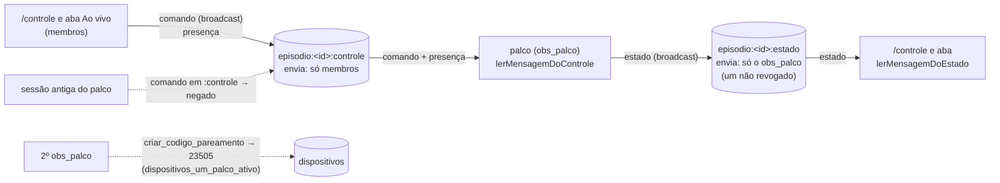

# VER-047 — E3: estado do palco num tópico próprio, comandos só de membros e um palco ativo só (fecha o I4)

## Cabeçalho

| Campo | Valor |
|---|---|
| Id | VER-047 |
| Título | O estado no ar do palco passa ao tópico `episodio:<id>:estado`, onde só o `obs_palco` envia; em `episodio:<id>:controle` só membros enviam; no máximo um `obs_palco` não revogado (fecha no banco o I4 da revisão final da E3, aberto no [VER-046](2026-11-27-046-e3-correcoes-revisao-final.md)) |
| Gravidade | média (segurança: um segundo palco ou a sessão antiga de um palco trocado comandava o palco e publicava estado falso) |
| Tipo | segurança · correção · decisão de arquitetura (mudança da D6 do PLA-004) |
| Data | 2026-11-27 |
| Usuário responsável | TokumoH |
| Status de implementação | implementado (a migração nova ainda não foi aplicada num Supabase real: passo 2 do guia "Ao vivo e pareamento (E3)") |
| Commits | commit que introduz este arquivo — `git log --diff-filter=A --format=%h -- docs/verificacoes/2026-11-27-047-e3-estado-em-topico-proprio.md` |
| Arquivos | banco: `supabase/migrations/20261127220000_estado_do_palco_em_topico_proprio.sql` (nova); código: `src/domains/aovivo/{mensagens,palco,portas}.ts`, `src/shared/infra/canalSupabase.ts`, `src/app/{useAoVivo,useDispositivo,useEstudio,servicosFalsos}.ts`, `src/app/telas/{PalcoNoAr,AbaAoVivo}.tsx`; testes: `supabase/tests/{rls,restricoes,matriz}.test.ts`, `src/domains/aovivo/{mensagens,palco}.test.ts`, `src/shared/infra/canalSupabase.test.ts`, `src/app/telas/{PalcoNoAr,Controle,AbaAoVivo,Painel}.test.tsx`; documentação: `supabase/README.md`, `supabase/migrations/README.md`, `supabase/tests/README.md`, `src/domains/aovivo/README.md`, `src/shared/infra/README.md`, `src/app/README.md`, `src/app/telas/README.md`, `docs/verificacoes/README.md` e este registro |

Revisões: R1 — revisão independente (fonte do Realtime conferida: presença só com leitura, escrita guardada por socket; sabotagens S1, S2, S3, S7, S8, S13 e variantes numa cópia): spec ✅, qualidade reprovada por 1 achado importante de teste de segurança (matriz sem tópicos parecidos: sufixo e maiúsculas passavam) e 5 nits — corrigidos na rodada 1 (linha C1); R2 — re-revisão focada (T2, T2c, T3, T3c e 10 variações temporárias de tópico negadas pela função real): **limpa**, com 1 nit (coluna com espaço/tab no fim; `btrim` sobrevivia) incorporado em C2 como teste a mais, com reconferência pontual (`npm run check` 0 no commit).

## Problema

No Realtime, a permissão de envio num canal privado é conferida só pelo tópico e pela extensão: o `event` do Broadcast não chega à autorização, e a resposta fica guardada por conexão até o token novo (evidência no VER-046, "Era proposital?", com a fonte do servidor, commit 9a2cfba: `authorization.ex:26` e `:504-507`, `broadcast_handler.ex:269-282` e `:310-325`). Até aqui o `obs_palco` tinha envio em `episodio:<id>:controle` para publicar o `estado`, e com isso:

| Furo | Efeito |
|---|---|
| Qualquer `obs_palco` podia publicar `comando` em `:controle` | um segundo `obs_palco` (criado por chamada direta a `criar_codigo_pareamento` por alguém da equipe) ou a sessão antiga, não cooperante, de um palco trocado (até 10 min) comandava o palco. O filtro de presença do VER-046 era contornável: o `obs_palco` recebe a presença do `:controle` e declara o `uid` de um membro presente |
| Um segundo `obs_palco` podia publicar `estado` falso | o `/controle` e a aba Ao vivo aceitavam (só descartam remetentes revogados avisados; um segundo palco nunca é revogado) |
| O Foco 6 do PLA-004 ("dispositivos não publicam comando") | falso para o `obs_palco` (Riscos do VER-046) |

## Era proposital?

Não. O comentário da migração `20261127124303` dizia "broadcast todo membro (comando) e o obs_palco (estado)": a intenção era separar por evento, o que a RLS do Realtime não faz. O VER-046 registrou o furo, provou com a fonte que não há separação por evento e deixou a separação por tópico (opção A) para este item, por decisão do controlador (opção C: parte B no VER-046, parte A aqui). Nenhum teste fixava o envio do palco em `:controle` como regra desejada: a célula `palco × controle = 'rb rp eb'` da matriz copiava o desenho da D6.

## Solução

1. **Migração nova** `20261127220000_estado_do_palco_em_topico_proprio.sql` (nenhuma migração aplicada foi editada):
   - `create or replace function public.pode_usar_canal(...)`, mesma assinatura (o oid fica, e as duas políticas de `realtime.messages` continuam iguais; `data-api:check` e `rpc:grants-check` sem mudança de regra), `security definer`, `search_path = ''`, chamada de `public.papel_atual()`, `revoke`/`grant` repetidos:
     - `episodio:<ativo>:controle`: membros recebem e enviam (comando e presença); o `obs_palco` só recebe (comandos e a presença dos membros, que ele usa para republicar o estado e no filtro do VER-046); outros dispositivos nada;
     - `episodio:<ativo>:estado` (novo): só o `obs_palco` envia broadcast; membros e o `obs_palco` recebem (a leitura é o que deixa o palco entrar no canal); presença, ninguém; outros dispositivos nada;
     - `estudio`, `:video`, outro episódio e qualquer outro tópico: sem mudança.
   - índice único parcial `dispositivos_um_palco_ativo on public.dispositivos (tipo) where tipo = 'obs_palco' and revogado_em is null`: no máximo um palco não revogado, pareado ou pendente. A aba Ao vivo já reaproveitava o palco cadastrado (`existente(lista, 'obs_palco')`, Tarefa 8, como a câmera), então nada mudou nela; só a chamada direta à API cai no `23505`.
2. **Domínio:** `EVENTOS_DO_CONTROLE` passa a ter só `comando`; `EVENTOS_DO_ESTADO = { estado }`; `topicoDoControle`/`topicoDoEstado`; leitores por tópico `lerMensagemDoControle` (só `comando`) e `lerMensagemDoEstado` (só `estado`). Porta nova `CanalDoEstado` (`aoEstado`, `aoMudarEstado`, `publicarEstado`, `fechar`); `CanalDoControle` perde `aoEstado` e `publicarEstado`; `FabricaDeCanais.estado(episodioId)`. O serviço do palco recebe `canalDoEstado` e publica só nele.
3. **Adaptador** (`canalSupabase.ts`): `estado(episodioId)` sobre o mesmo registro por tópico (um canal por tópico por cliente, contagem de referências, eco local, fechado/negado saem do mapa, `leave` na hora; sem presença, sem `untrack`).
4. **App:** o palco abre `:controle` e `:estado` por sessão de episódio; a volta de qualquer dos dois a `conectado` republica, e a perda de qualquer um chama `canalPerdido` (fecha tudo, reabre em 5 s por `acompanharEstudio`); a troca de episódio fecha os dois. O `useAoVivo` (`/controle` e aba) abre o `:estado` por `useCanalReaberto` (mesma janela de reavaliação), lê o estado só dali, marca a presença no `:controle` quando o `:estado` está conectado (a entrada faz o palco republicar com o canal já aberto) e passa `canal` = pior entre `estudio`, `:controle` e `:estado` (entra em `podeComandar`, VER-043). A guarda de saída do palco (VER-046) não muda.
5. **Filtro de presença do VER-046:** fica, como defesa em profundidade (vale também enquanto a migração não for aplicada no banco real; custo: o comando de quem ainda não sincronizou a presença é descartado, já registrado no VER-046).
6. **Canais por cliente:** 3 (`estudio`, `:controle`, `:estado`), num socket só, nas telas de membro e no palco (antes, 2). Não muda o número de conexões simultâneas do plano Free; os limites de canais por conexão e de mensagens não foram conferidos nesta sessão (Riscos).

**Mudança da D6 para a lista de decisões do responsável:** a matriz do canal da D6 do PLA-004 passa a ter o tópico `episodio:<ativo>:estado` (só o `obs_palco` publica; membros recebem), e o `obs_palco` deixa de publicar em `:controle`; e o banco passa a aceitar só um `obs_palco` não revogado. O plano não é editado; vale este registro.

## Por que esta solução

- **Segurança:** a RLS do Realtime separa por tópico; com estado e comando em tópicos diferentes, "quem envia o quê" volta a ser decidido no banco, numa função testada caso a caso. Com um palco ativo só, o tópico do estado tem um autor só.
- **Arquitetura (DDD, GRASP Pure Fabrication, Componentes):** o domínio diz qual evento vale em cada tópico (`lerMensagemDoControle`/`lerMensagemDoEstado`), o adaptador só liga tópico a leitor, e o serviço do palco depende de duas portas estreitas (`CanalDoControle` só lê comandos; `CanalDoEstado` publica). Nenhuma regra nova na interface.
- **Mínimo:** `create or replace` mantém o oid (políticas e checagens iguais); o índice é uma linha e já vale para qualquer caminho (função, dono, superusuário); a aba já reaproveitava o palco.

## Por que não outras soluções

| Opção | Motivo de descarte |
|---|---|
| Política por `event` em `realtime.messages` | o `event` não chega à autorização e a resposta fica guardada por conexão (VER-046) |
| Só o filtro de presença no palco (VER-046) | contornável: o `obs_palco` vê a presença do `:controle` e declara o `uid` de um membro presente |
| `/controle` reconhecer o palco atual pelo `remetente` (comparar com o dispositivo pareado) | o `remetente` é declarado; a apresentadora não lê `dispositivos` (RLS); exigiria função nova e não fecha o envio de comando |
| Regra de um palco só dentro de `criar_codigo_pareamento` (em vez do índice) | reescreveria a função inteira; não cobre o re-pareamento de um revogado nem o insert do dono; o índice cobre tudo com uma linha |
| `criar_codigo_pareamento` reaproveitar sozinha o palco ativo quando `p_dispositivo` é nulo | muda o contrato (rótulo ignorado em silêncio); a aba já reaproveita; a recusa explícita (`23505`) é mais clara |
| Tirar o filtro de presença do VER-046 | enquanto a migração não for aplicada, ele é a única defesa; depois, custa só o descarte do comando antes da presença, já registrado |
| Presença do membro também em `:estado` (para o palco republicar) | daria envio de presença a membros no tópico do estado; a presença do `:controle` já serve de sinal de entrada |
| Trocar os testes de pareamento genéricos para criar palcos revogando o semeado | muda mais testes; os que só precisam de "um tipo qualquer" ficam mais claros com `camera`; só `e3-parear-ok` (palco lê `midias`) revoga o semeado |

## Onde

| Arquivo | Linhas | O que mudou |
|---|---|---|
| [`20261127220000_estado_do_palco_em_topico_proprio.sql`](../../supabase/migrations/20261127220000_estado_do_palco_em_topico_proprio.sql#L1-L76) | 1–76 | migração nova: índice `dispositivos_um_palco_ativo` (24–25) e `pode_usar_canal` reescrita (39–72), com `revoke`/`grant` (75–76) |
| [`mensagens.ts`](../../src/domains/aovivo/mensagens.ts#L24-L42) | 24–42 e 285–299 | `EVENTOS_DO_CONTROLE` só `comando`, `EVENTOS_DO_ESTADO`, `topicoDoControle`, `topicoDoEstado`; `lerMensagemDoControle` e `lerMensagemDoEstado` |
| [`portas.ts`](../../src/domains/aovivo/portas.ts#L44-L84) | 44–84 | `CanalDoControle` sem estado; `CanalDoEstado`; `FabricaDeCanais.estado` |
| [`palco.ts`](../../src/domains/aovivo/palco.ts#L27-L33) | 27–33, 60–76 e 129 | dependência `canalDoEstado`; comentário do filtro como defesa em profundidade; publicação só em `:estado` |
| [`canalSupabase.ts`](../../src/shared/infra/canalSupabase.ts#L309-L363) | 2–4 e 309–363 | `controle()` com `lerMensagemDoControle`; `estado()` novo |
| [`PalcoNoAr.tsx`](../../src/app/telas/PalcoNoAr.tsx#L370-L418) | 5, 181–183, 307, 370–418, 601 | a sessão abre e fecha `:controle` e `:estado`; os dois republicam e perdem o canal juntos |
| [`useAoVivo.ts`](../../src/app/useAoVivo.ts#L246-L266) | 8, 38, 90–96, 246–266 | `:estado` por `useCanalReaberto`; presença no `:controle` com o `:estado` conectado; `canal` com os três |
| `useDispositivo.ts`, `useEstudio.ts`, `servicosFalsos.ts`, `AbaAoVivo.tsx` | — | só comentários |
| [`rls.test.ts`](../../supabase/tests/rls.test.ts#L2006-L2210) | 2006–2210 | matriz com 16 tópicos (7 da primeira versão, 7 parecidos da rodada 1 e 2 com espaço ou tab no fim, do nit da rodada 2) e as colunas documentadas abaixo; `e3-canal-segue-o-episodio-ativo` e `e3-revogado-sem-canal` com `:estado`; 6 testes novos, entre eles `e3-guia-revoga-o-palco-que-sobra` (rodada 1, 2189–2210, com as consultas do guia em 2136–2143); testes de pareamento genéricos com `camera`, e `e3-parear-ok` e `e3-sessao-em-um-dispositivo-so` (rodada 1: troca entre tipos palco → câmera recuperada, 1695–1708) revogando o semeado (1458–1710); `claims-incompletas-negam` com uma câmera (261) |
| [`restricoes.test.ts`](../../supabase/tests/restricoes.test.ts#L159-L175) | 136–141 e 159–175 | `dispositivos-sem-sessao` com câmeras; `um-palco-ativo (VER-047)` |
| [`matriz.test.ts`](../../supabase/tests/matriz.test.ts#L224) | 224 e 262 | linhas extras de `dispositivos` como câmeras (o índice recusaria um segundo palco) |
| [`mensagens.test.ts`](../../src/domains/aovivo/mensagens.test.ts#L298-L323) | 2–20, 51–53 e 298–323 | constantes por tópico; bloco `mensagens por tópico do episódio` (3) |
| [`palco.test.ts`](../../src/domains/aovivo/palco.test.ts#L361-L371) | 38–90 e 361–371 | falso com `:controle` (conta envios) e `:estado`; `estado-so-em-topico-proprio` |
| [`canalSupabase.test.ts`](../../src/shared/infra/canalSupabase.test.ts#L365-L396) | 13–14, 36–160, 250–275, 365–396 e 590–606 | os testes de estado sobre `estado()`; tópicos trocados e, desde a rodada 1, outro evento no `:estado` descartados em `recebe-valida`; `estado-em-topico-proprio` |
| [`PalcoNoAr.test.tsx`](../../src/app/telas/PalcoNoAr.test.tsx#L992-L1065) | 162–167 e 992–1065 | `m.estado()`; estados lidos do `:estado`; bloco do VER-047 (6) |
| [`Controle.test.tsx`](../../src/app/telas/Controle.test.tsx#L623-L683) | 54–56, 68–69, 85 e 623–683 | `estadoT()`; opção `conectarSozinho`; `estado-so-de-topico-proprio`, `reconexao-do-estado` e `presenca-so-com-o-estado-conectado` (rodada 1) |
| [`AbaAoVivo.test.tsx`](../../src/app/telas/AbaAoVivo.test.tsx#L1109-L1136) | 1093–1135 e 1109–1136 | tópicos abertos com `:estado`; `estado-do-palco-pelo-topico-proprio` |
| [`Painel.test.tsx`](../../src/app/telas/Painel.test.tsx#L150) | 150–215 | `:estado` aberto, removido ao sair da aba e do painel; três tópicos caindo juntos dão um `reavaliar()` |
| READMEs | — | os do cabeçalho: guia "Ao vivo e pareamento (E3)" (migração nova no passo 2 com o palco fechado, a contagem de palcos antes e, na rodada 1, as duas consultas do dono para dois palcos ativos; conferências novas no passo 3, D6 revista no passo 7, conferência no passo 9), ordem e descrição das migrações, contagens, Riscos |

**Células da matriz `e3-canal-matriz` mudadas** (o resto ficou igual):

| Sessão | Tópico | Antes | Depois |
|---|---|---|---|
| palco | `controle` | `rb rp eb` | `rb rp` |
| ana, bia, adm | `estado` (coluna nova) | — | `rb rp` |
| palco | `estado` (coluna nova) | — | `rb rp eb` |
| anon, estranho, camera, obs_camera, solta, revogado | `estado` (coluna nova) | — | `` (nada) |
| todas | `outro_estado` (coluna nova: o `:estado` de outro episódio) | — | `` (nada) |
| todas | `estado_x` (rodada 1: `episodio:<ativo>:estadox`, sufixo colado) | — | `` (nada) |
| todas | `estado_sub` (rodada 1: `episodio:<ativo>:estado:x`, subtópico) | — | `` (nada) |
| todas | `estado_maiusculo` (rodada 1: `episodio:<ativo>:ESTADO`) | — | `` (nada) |
| todas | `topico_estado_maiusculo` (rodada 1: `EPISODIO:<ATIVO>:ESTADO`, o tópico inteiro em maiúsculas) | — | `` (nada) |
| todas | `controle_x` (rodada 1: `episodio:<ativo>:controlex`) | — | `` (nada) |
| todas | `controle_sub` (rodada 1: `episodio:<ativo>:controle:x`) | — | `` (nada) |
| todas | `controle_maiusculo` (rodada 1: `EPISODIO:<ATIVO>:CONTROLE`) | — | `` (nada) |
| todas | `estado_espaco` (nit da rodada 2: `episodio:<ativo>:estado ` com espaço no fim) | — | `` (nada) |
| todas | `controle_tab` (nit da rodada 2: `episodio:<ativo>:controle` com tab no fim) | — | `` (nada) |

As 7 colunas da rodada 1 provam a igualdade exata do tópico: uma `pode_usar_canal` com `like '...:estado%'`, `like '...:controle%'`, `lower(...)` ou `ilike` as abriria (sabotagens T2, T2c, T3 e T3c); as 2 do nit da rodada 2 pegam uma comparação com `btrim` (T4 e T4c).

**Âncoras de registros antigos:** nenhum registro antigo foi editado e nenhum arquivo encolheu (`git diff --numstat` sem linha com remoções maiores que inclusões). As âncoras dos VER-035 a VER-046 em `mensagens.ts`, `canalSupabase.ts`, `palco.ts`, `portas.ts`, `PalcoNoAr.tsx` e `useAoVivo.ts` podem apontar algumas linhas acima do símbolo citado; o `check-docs` confere que nenhuma passa do fim do arquivo.

## Lógica

| Passo | Antes | Depois |
|---|---|---|
| `obs_palco` envia broadcast em `:controle` | permitido (`pode_usar_canal` = true) | negado |
| `obs_palco` recebe em `:controle` (comandos, presença) | permitido | permitido |
| membro envia em `:estado` | tópico inexistente (negado) | negado |
| `obs_palco` envia em `:estado` | negado | permitido |
| câmera ou `obs_camera` em `:estado` | negado | negado |
| `criar_codigo_pareamento('obs_palco', 'PC 2', null, null)` com um palco ativo | cria um segundo palco | `23505` (`dispositivos_um_palco_ativo`), nada criado |
| re-pareamento do palco cadastrado (`p_dispositivo` = o palco) | mesmo dispositivo, sessão nova | igual; um palco ativo |
| estado válido entregue em `:controle` ao `/controle` | aceito | ignorado |
| comando válido entregue em `:estado` ao palco | tópico não ouvido | ignorado |
| canais por cliente (membro e palco) | 2 | 3 |
| tópico parecido (`:estadox`, `:estado:x`, `:ESTADO`, `:controlex`, `:controle:x`, maiúsculas) | negado (sem teste) | negado, com teste (rodada 1) |
| presença do membro no `:controle` | ao abrir o `:controle` | só com o `:estado` conectado (teste direto na rodada 1) |
| banco com dois palcos ativos antes da migração | — | duas consultas do dono no guia (teste `e3-guia-revoga-o-palco-que-sobra`) |

## Exemplo

- **Banco (PGlite, `comoCanal`, modo teste com o episódio semeado):** `palco` em `episodio:<id>:controle`, `broadcast`/`enviar`: antes `true` (célula `rb rp eb`), depois `false` (`rb rp`); em `episodio:<id>:estado`, `broadcast`/`enviar`: `true` só para `palco`; `ana`, `bia`, `adm` recebem (`rb rp`) e não enviam; `camera` nada.
- **Palco único:** com o palco semeado ativo, `criar_codigo_pareamento('obs_palco', 'PC 2', null, null)` como `adm` dá `23505` com a restrição `dispositivos_um_palco_ativo`, e `count(*)` de `dispositivos` e de `codigos_pareamento` não muda. Revogado o semeado, um palco novo é criado; pedir um código para o revogado funciona, mas o pareamento dele dá `23505` e o código fica `usado_em = null`.
- **Re-pareamento:** `criar_codigo_pareamento('obs_palco', null, <palco semeado>, null)` devolve o mesmo id; a sessão nova pareia (`nome: 'PC do estúdio (palco)'`), envia em `:estado`, e a sessão antiga já não recebe nem envia na próxima autorização.
- **App:** no `/controle`, `entregar('episodio:<EP>:controle', 'estado', { cenaObs: 'Cena Geral', ... })` não muda a região "Estado"; o mesmo em `episodio:<EP>:estado` mostra "Geral". No palco, `entregar('episodio:<EP>:estado', 'comando', { acao: 'aviso', ... })` não mostra o aviso; pelo `:controle`, mostra. Os estados do palco saem só em `episodio:<EP>:estado` (`enviados(':controle')` = `[]`).

## Verificação

TDD: os testes de banco novos e a matriz foram escritos antes da migração (sem ela, 12 testes caem: S5); os de domínio, adaptador e telas, antes do código de cada camada (4 de `mensagens.test.ts` e 8 de `canalSupabase.test.ts` falhando antes da implementação). Sabotagens numa **cópia** do repositório (`item-047/copia` no scratchpad da sessão, `node_modules` por symlink), com o script `item-047/sab/sabotar.py`: confere que o arquivo da cópia é igual ao do repositório antes, aplica a troca, roda `npx vitest run --cache=false` nos arquivos citados, restaura e confere `sha256sum` igual antes e depois, na cópia e no repositório.

| # | Abordagem | Comando / método | Resultado |
|---|---|---|---|
| T1 | testes por camada | `npx vitest run --cache=false supabase/tests`, `src/domains/aovivo`, `src/shared/infra/canalSupabase.test.ts`, `src/app` | 592 de banco; 136 de domínio; 23 do adaptador; 387 de app; todos passando |
| V1 | tipos e suíte inteira | `npx tsc --noEmit -p .` e `npx vitest run --cache=false` | 0 erros de tipo; 58 arquivos, 2239 testes passando |
| V2 | checagens de banco | `npm run rpc:grants-check` e `npm run data-api:check` | 0 erros, 6 migrações |
| V3 | checagem completa, sem outro processo pesado | `npm run check` | 0 erros: `typecheck`; 58 arquivos e 2239 testes; `check-docs` 0 (78 `.md`, 47 registros); `check-doc-secrets` 0; `rpc:grants-check` 0 e `data-api:check` 0 (6 migrações); `check-deps-audit` 0 |
| S1 | `obs_palco` volta a enviar em `:controle` | `rls.test.ts` | 3 falhas (`e3-canal-matriz: palco`, `e3-palco-nao-envia-em-controle`, `e3-canal-funcao-que-libera-tudo-e-pega`) |
| S2 | membros também enviam em `:estado` | `rls.test.ts` | 4 falhas (matriz de `ana`, `bia`, `adm` e `e3-estado-so-o-palco-envia`) |
| S3 | sem o índice de um palco ativo | `rls.test.ts`, `restricoes.test.ts` | 2 falhas (`um-palco-ativo`, `e3-um-palco-ativo`) |
| S4 | `pode_usar_canal` devolve `true` (N5 do PLA-004) | `rls.test.ts`; `check-data-api.mjs` e `check-rpc-grants.mjs` na cópia | 16 falhas nos testes; as duas checagens continuam com 0 erros (o limite da N5, que só os testes de banco pegam) |
| S5 | sem a migração nova | `supabase/tests` | 12 falhas (as 4 linhas de membro e palco da matriz, `e3-canal-segue-o-episodio-ativo`, `e3-revogado-sem-canal` e os 6 testes novos) |
| S6 | `lerMensagemDoEstado` ignora o evento | `mensagens.test.ts` | 1 falha |
| S7 | `estado()` abre o tópico do `:controle` (estado aceito e publicado em `:controle`) | `canalSupabase`, `Controle`, `PalcoNoAr`, `AbaAoVivo` | 47 falhas |
| S8 | `controle()` lê todo evento como comando | `canalSupabase.test.ts`, `PalcoNoAr.test.tsx` | 1 falha (`recebe-valida`) |
| S9 | o palco não fecha o `:estado` ao parar a sessão | `PalcoNoAr.test.tsx` | 12 falhas (troca de episódio, desmontagem, revogação, reabertura) |
| S10 | o palco não ouve o estado do `:estado` | `PalcoNoAr.test.tsx` | 3 falhas (republicação na volta e reabertura no fechado e no negado) |
| S11 | `canal` do `useAoVivo` sem o `:estado` | `Controle.test.tsx`, `Painel.test.tsx` | 1 falha (`reconexao-do-estado`) |
| S12 | presença no `:controle` sem esperar o `:estado` conectado | `Controle.test.tsx`, `AbaAoVivo.test.tsx` | 3 falhas (a presença sai duas vezes; os testes conferem uma) |
| S13 | o serviço do palco publica pelo `:controle` | `palco.test.ts` | 12 falhas |
| C1 | rodada de correção 1 (revisão: Importante 1, nits 1 a 5): 7 colunas de tópicos parecidos na matriz; outro evento no `:estado` em `recebe-valida`; `presenca-so-com-o-estado-conectado` (Realtime falso com `conectarSozinho: false`); as duas consultas do guia para dois palcos ativos, com teste que as lê do próprio README; janela da escrita guardada em `:controle` nos Riscos e no guia (palco fechado); `e3-sessao-em-um-dispositivo-so` de volta à troca palco → câmera. Sabotagens numa cópia nova (cache desligado, `sha256sum` igual antes e depois) | `item-047/sab/sabotar.py` na cópia; `npm run check` no repositório | T2 (`:estado` com sufixo, `like '...:estado%'`): 5 falhas (matriz de ana, bia, adm, palco e o controle do N5); T2c (o mesmo no `:controle`): 5; T3 (`lower(p_topico)` no `:estado`): 5; T3c (`ilike` no `:controle`): 5; S7b (o adaptador do `:estado` aceita qualquer evento): 1 (`recebe-valida`); S12 (presença sem esperar o `:estado`): 4, entre elas `presenca-so-com-o-estado-conectado`, direta; S1 a S13 de novo: S1 3, S2 4, S3 3 (com `e3-guia-revoga-o-palco-que-sobra`), S4 16, S6 1, S7 48, S8 1, S9 12, S10 3, S11 1, S13 12; `npm run check` com 0 erros (linha V4) |
| C2 | nit da re-revisão da rodada 2: colunas `estado_espaco` e `controle_tab` na matriz (NADA para todas as sessões). Sabotagens numa cópia nova, cache desligado, `sha256sum` igual antes e depois | `item-047/sab/sabotar.py` na cópia; `npm run check` no repositório | T4 (`btrim(p_topico)` no `:estado`): 5 falhas (matriz de ana, bia, adm, palco e o controle do N5); T4c (`btrim(p_topico, ' '||chr(9))` no `:controle`): 5 falhas; `npm run check` com 0 erros (linha V5) |
| V4 | checagem completa depois da rodada 1 | `npm run check` | 0 erros: `typecheck`; 58 arquivos e 2241 testes; `check-docs` 0 (78 `.md`, 47 registros); `check-doc-secrets` 0; `rpc:grants-check` 0 e `data-api:check` 0 (6 migrações); `check-deps-audit` 0 |
| V5 | checagem completa depois do nit da rodada 2 | `npm run check` | 0 erros: `typecheck`; 58 arquivos e 2241 testes (as colunas novas estão dentro dos 10 testes da matriz); `check-docs` 0 (78 `.md`, 47 registros); `check-doc-secrets` 0; `rpc:grants-check` 0 e `data-api:check` 0 (6 migrações); `check-deps-audit` 0 |

## Riscos

- **Sem Supabase nem Realtime reais:** a matriz foi provada pela simulação de `realtime.authorize` (VER-036); a migração nova não foi aplicada no banco real (passo 2 do guia, do responsável). Até ela ser aplicada, o furo I4 continua no banco real e o app desta versão fica sem estado no `/controle` e na aba (o palco não tem envio em `:estado`): aplicar a migração antes de publicar o app.
- **Residual da sessão antiga:** a sessão de um palco re-pareado (trocado) continua com a resposta de escrita em `:estado` guardada pelo Realtime até a renovação do token (até 10 min) e pode publicar estado falso nesse tempo. Mitigação: `meu_dispositivo` e a checagem a cada entrada no canal já a recusam; o `/controle` e a aba descartam por 15 min o remetente avisado em `revogacao` (a aba avisa a sessão antiga no pareamento, D5). Comando ela não manda mais: não tem envio em `:controle`.
- **Migração com dois palcos ativos:** o `create unique index` falha com `23505` e nada é aplicado. O passo 2 do guia confere a contagem antes e, com dois ou mais, dá as duas consultas do dono (rodada 1): a aba não mostra "revogar" para palco nunca pareado (`AbaAoVivo.tsx`), e `revogar_dispositivo` no editor SQL dá `42501`. O teste `e3-guia-revoga-o-palco-que-sobra` roda as consultas como `postgres_sim`; que o editor SQL roda como `postgres` vem da documentação da Supabase, não de um projeto real.
- **Janela de transição em `:controle` (rodada 1):** um palco conectado antes de a migração ser aplicada já tem guardada no socket a resposta de escrita (broadcast) em `:controle` e pode publicar comando ali até a renovação do token (até 10 min), porque o Realtime não confere de novo a cada envio. O guia manda aplicar a migração com o palco fechado (Fonte removida ou OBS fechado); se não der, a janela fecha sozinha no token novo.
- **Re-pareamento de um revogado com outro ativo:** `parear_dispositivo` dá `23505` (exceção, não uma linha `resultado`); a tela do dispositivo mostra a falha genérica. A aba não chega a esse caso (reaproveita o ativo); só a chamada direta à API.
- **Estado depois da reconexão só do `:estado`:** a presença é remarcada no `:controle` quando o `:estado` volta a `conectado`; se a remarcação não gerar `join` no palco, o estado chega no periódico de 30 s. Não há teste com Realtime real.
- **Limites do plano Free:** 3 canais por cliente num socket só (antes 2); os limites de canais por conexão e de mensagens por segundo da documentação da Supabase não foram conferidos nesta sessão (o estado continua a cada 30 s e por mudança).
- **Leitura de presença em `:estado`:** membros e o palco têm `rp` em `:estado` (simetria com o `:controle` e para a entrada com presença ligada no cliente); ninguém marca presença ali.
- **Ordem da presença:** desde a rodada 1, `presenca-so-com-o-estado-conectado` prova direto que a presença no `:controle` só sai com o `:estado` conectado (S12 o derruba); a corrida com tempos reais do Realtime não tem teste.
