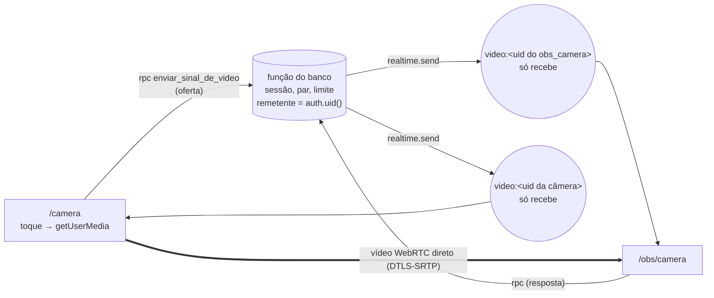

# VER-048 — Plano de implementação da etapa E4 (PLA-005): o celular como câmera

## Cabeçalho

| Campo | Valor |
|---|---|
| Id | VER-048 |
| Título | Plano de implementação da etapa E4 (PLA-005): o celular como câmera |
| Gravidade | média |
| Tipo | documentação · planejamento |
| Data | 2026-11-27 (data do commit, em UTC) |
| Usuário responsável | TokumoH |
| Status de implementação | somente documentação |
| Commits | commit que introduz este arquivo — `git log --diff-filter=A --format=%h -- docs/verificacoes/2026-11-27-048-plano-e4.md` |
| Arquivos | `docs/planos/2026-11-27-e4-celular-como-camera.md` (novo), `docs/planos/README.md`, `docs/verificacoes/README.md`, este registro (4 arquivos) |

## Problema

A E3 terminou com o primeiro ao vivo por toque (VER-035 a VER-047), e o "Ao fim da E3" do [PLA-004](../planos/2026-11-27-e3-ao-vivo-por-toque.md#L874-L880) deixou para a E4 três coisas: o `/camera` com tela preta e vídeo até o `/obs/camera`, o tópico de vídeo e o `definir_reconhecimento`. Essa entrega do [DES-001](../desenho/2026-11-16-revocast-cameras-desenho.md) §14 ainda não tinha plano com tarefas, arquivos, interfaces, testes e ordem.

A E4 traz coisas que o projeto ainda não tinha: WebRTC (`RTCPeerConnection`), `getUserMedia`, Wake Lock e a sinalização de vídeo. Ela também herda duas lições da E3:

- a autorização do Realtime não vê o `event` e guarda a permissão por conexão até o token novo ([VER-046](2026-11-27-046-e3-correcoes-revisao-final.md), [VER-047](2026-11-27-047-e3-estado-em-topico-proprio.md));
- as telas que vão ao ar precisam da guarda de saída do OBS (VER-046, I1).

## Era proposital?

Não. O plano é o passo seguinte depois da E3, como o PLA-004 foi depois da E2 ([VER-034](2026-11-27-034-plano-e3.md)).

## Solução

1. **PLA-005** em [`docs/planos/2026-11-27-e4-celular-como-camera.md`](../planos/2026-11-27-e4-celular-como-camera.md). O plano tem:
   - as decisões vigentes do responsável e as restrições globais revistas;
   - as fontes das premissas (F1 a F22), cada uma dizendo o que foi conferido e o que só o responsável confirma;
   - as decisões D1 a D14;
   - o foco da revisão, com 15 situações perigosas, cada uma com teste na tarefa dona;
   - a estrutura de arquivos e sete tarefas, cada uma com registro próprio (VER-049 a VER-055):
     1. domínio Captura (sinais, portas, emissor, receptor) e presença com vídeo — VER-049;
     2. `realtime.send` na simulação, migração `video_da_camera` e testes de banco — VER-050;
     3. adaptadores: canal de vídeo, `RTCPeerConnection`, câmera e tela ligada; composição — VER-051;
     4. `/camera` com tela preta e vídeo — VER-052;
     5. `/obs/camera` só com o vídeo; guarda de saída compartilhada — VER-053;
     6. aba Ao vivo: situação do vídeo, checklist e troca do `obs_camera` — VER-054;
     7. conferência no Chromium com WebRTC real e câmera falsa; guia; revisão final da etapa; passo do responsável — VER-055.
2. **Sinalização (D2, decisão do controlador na revisão 1, C1, opção 1).** Nenhum cliente envia pelo Broadcast nos tópicos de vídeo. Cada sinal sai pela função nova `enviar_sinal_de_video`. A cada chamada, ela:
   - confere `dispositivo_atual()`, o episódio ativo e o par não revogado;
   - põe o remetente (`auth.uid()`) no servidor;
   - limita por remetente: 10 sinais em 10 s, 600 por hora e 1 000 000 caracteres de SDP por hora, contados com uma trava de transação;
   - publica com `realtime.send` no tópico `video:<uid da sessão atual do par>`.

   O cliente só recebe no tópico da própria sessão. A sessão antiga de um aparelho trocado ou revogado não sinaliza mais e não recebe sinais novos.
3. **Migração nova `video_da_camera`** (Tarefa 2):
   - a função `enviar_sinal_de_video`;
   - `pode_usar_canal` reescrita por `create or replace`: cada sessão só recebe no tópico de vídeo dela, e ninguém envia;
   - o índice `dispositivos_um_obs_camera_ativo`, no máximo um `obs_camera` não revogado no banco (decisão do controlador na revisão 3, N11, com base no DES-001 §2: várias câmeras simultâneas são não-objetivo).
4. **Nenhuma dependência nova** (D11): APIs nativas do navegador e o `supabase-js` que já está no projeto.
5. **`docs/planos/README.md`:** o PLA-005 no campo "Arquivos" e em "Onde".
6. **`docs/verificacoes/README.md`:** o VER-048 em "Arquivos" e "Onde". O exemplo hipotético passa do número 048 (agora este registro) a `2026-11-30-056-exemplo.md`, porque o plano reserva 049 a 055 (a mesma regra do VER-034).

**Decisões do responsável** (copiadas no plano, seção "Decisões vigentes do responsável", com datas e citações):

| Data | Citação literal | Aplicação |
|---|---|---|
| 2026-11-22 | "Se a gravidade de erros for aceitável, prossiga sem necessidade de refazer dois testes seguidos" | Achado leve corrigido com reconferência pontual; qualquer outro, verificado de novo até duas rodadas seguidas sem erro |
| 2026-11-26 | "Seja autonomo, pode seguir e me entregar o projeto completo" | Autorização permanente de commit e push de cada item verificado da E1 à E6 (VER-014); continuam proibidos, sem pedido explícito, branch, merge, PR, trazer conteúdo de fora, descartar trabalho, reescrever commit enviado e fundir itens |
| 2026-11-26 | "Resolve" (sobre dependências) | Dependência npm nova só pelo procedimento do npm 11; a E4 não precisa de nenhuma |
| — | Sem serviço pago e sem cartão (DES-001 §2) | STUN público; nenhum TURN pago nem servidor de mídia; o TURN gratuito do Metered só se o responsável quiser (D9) |

**Decisões D1 a D14 do plano**, propostas pelo agente sob a autonomia e aceitas pelo controlador:

| # | Decisão |
|---|---|
| [D1](../planos/2026-11-27-e4-celular-como-camera.md#L97) | Nasce `src/domains/captura/`; as portas usam tipos opacos e o domínio não conhece o navegador |
| [D2](../planos/2026-11-27-e4-celular-como-camera.md#L99) | Sinalização por função do banco com `realtime.send`, tópico por sessão destinatária, limite por remetente, um `obs_camera` ativo |
| [D3](../planos/2026-11-27-e4-celular-como-camera.md#L145) | A câmera sempre oferece e o `obs_camera` só responde; o `pronto` não fura as esperas |
| [D4](../planos/2026-11-27-e4-celular-como-camera.md#L147) | ICE não incremental; SDP até 12 000 caracteres, com a mesma regra na função e no domínio |
| [D5](../planos/2026-11-27-e4-celular-como-camera.md#L157) | O tópico é da sessão; o vídeo segue o episódio ativo; o canal de vídeo só abre com episódio |
| [D6](../planos/2026-11-27-e4-celular-como-camera.md#L159) | Reconexão com esperas crescentes, prazo de conexão de 20 s e situação `sem_conexao_direta`; SDP fora da regra vira `sinal_grande` |
| [D7](../planos/2026-11-27-e4-celular-como-camera.md#L169) | Tela preta; a câmera só liga com um toque e desliga sem episódio, na revogação e ao sair da página; prévia de 15 s |
| [D8](../planos/2026-11-27-e4-celular-como-camera.md#L183) | O `/obs/camera` não mostra nada além do vídeo; a guarda de saída sai do palco e passa a servir os dois |
| [D9](../planos/2026-11-27-e4-celular-como-camera.md#L185) | Sem TURN pago; TURN gratuito opcional, desligado por padrão |
| [D10](../planos/2026-11-27-e4-celular-como-camera.md#L194) | O celular não vai ao ar; o que não pode é vazar imagem na própria tela |
| [D11](../planos/2026-11-27-e4-celular-como-camera.md#L196) | Nenhuma dependência nova |
| [D12](../planos/2026-11-27-e4-celular-como-camera.md#L198) | `definir_reconhecimento` e os gestos ficam para a E5 |
| [D13](../planos/2026-11-27-e4-celular-como-camera.md#L200) | Situação do vídeo na presença (no máximo a cada 10 s) e na aba Ao vivo |
| [D14](../planos/2026-11-27-e4-celular-como-camera.md#L202) | O que se prova em jsdom, no Chromium com câmera falsa e no aparelho real |

## Por que esta solução

- **DDD, GRASP Pure Fabrication e Componentes:** o contexto Captura do DES-001 §6 nasce com regras puras e portas. A conexão, a câmera e a tela ficam em `shared/infra`, e a guarda de saída sai da tela do palco para o domínio `obs`.
- **Segurança:** quem envia sinal e para quem é decidido no banco a cada chamada, porque a permissão guardada por conexão daria poder à sessão antiga. O remetente é posto pelo servidor, e o limite por remetente mais o `obs_camera` único limitam o disco. A câmera só liga com consentimento visível, e o `/obs/camera` não mostra nada além do vídeo.
- **Sem custo:** sem TURN pago, sem servidor de mídia, sem dependência nova.

## Por que não outras soluções

| Opção | Motivo de descarte |
|---|---|
| `episodio:<id>:video` com os dois lados enviando (DES-001) | A autorização não vê o `event` e guarda a escrita por conexão |
| Dois tópicos por câmera com Broadcast direto (primeira versão do plano) | A sessão antiga continuava enviando e recebendo até o token novo, com remetente declarado: trocava ou desviava o vídeo (revisão 1, C1) |
| Geração do pareamento no tópico (sugestão 2 da revisão 1) | Fecha a oferta falsa, mas não o desvio pelo `obs_camera` antigo |
| Aceitar o resíduo com quarentena (sugestão 3 da revisão 1) | Depende de clientes que cooperam |
| Um `obs_camera` por câmera | O teto de disco cresceria com o número de câmeras criadas pela API (revisão 3, N11) |
| Uma câmera ativa só | Contraria o "modelo já permite" do DES-001 §2 e quebraria os testes da E3 que criam câmeras genéricas |
| Tabela própria de contagem para o limite | Uma tabela a mais; o índice `messages_replay_index` do Realtime já responde |
| `simple-peer` ou `peerjs` | Dependências que escondem o que o domínio precisa controlar |

## Onde

| Arquivo | Linhas | O que mudou |
|---|---|---|
| [`docs/planos/2026-11-27-e4-celular-como-camera.md`](../planos/2026-11-27-e4-celular-como-camera.md#L1-L773) | 1–773 | Novo: PLA-005. Seções: • decisões do responsável ([21–33](../planos/2026-11-27-e4-celular-como-camera.md#L21-L33)); • restrições globais ([35–64](../planos/2026-11-27-e4-celular-como-camera.md#L35-L64)); • fontes F1 a F22 ([66–93](../planos/2026-11-27-e4-celular-como-camera.md#L66-L93)); • D1 a D14 ([95–215](../planos/2026-11-27-e4-celular-como-camera.md#L95-L215)); • foco da revisão ([217–237](../planos/2026-11-27-e4-celular-como-camera.md#L217-L237)); • tarefas 1 a 7 ([273](../planos/2026-11-27-e4-celular-como-camera.md#L273), [366](../planos/2026-11-27-e4-celular-como-camera.md#L366), [545](../planos/2026-11-27-e4-celular-como-camera.md#L545), [601](../planos/2026-11-27-e4-celular-como-camera.md#L601), [663](../planos/2026-11-27-e4-celular-como-camera.md#L663), [712](../planos/2026-11-27-e4-celular-como-camera.md#L712), [727](../planos/2026-11-27-e4-celular-como-camera.md#L727)); • passo do responsável ([753](../planos/2026-11-27-e4-celular-como-camera.md#L753)); • "Ao fim da E4" ([767–773](../planos/2026-11-27-e4-celular-como-camera.md#L767-L773)) |
| [`docs/planos/README.md`](../planos/README.md#L14) | 14, 51 | PLA-005 no campo "Arquivos" (14) e em "Onde" (51) |
| [`docs/verificacoes/README.md`](README.md#L14) | 14, 101, 124 | VER-048 no campo "Arquivos" (14) e em "Onde" (101); o exemplo hipotético passa ao número 056 (124) |

## Lógica

| Passo | Antes (fim da E3) | Depois (plano) |
|---|---|---|
| `/camera` e `/obs/camera` | "Pareado como <rótulo>. O vídeo chega na etapa E4." | Tela preta com toque para ligar; o `/obs/camera` mostra só o vídeo |
| Sinalização | Tópico `episodio:<id>:video` fechado | Função do banco com `realtime.send` e tópico por sessão; ninguém envia direto |
| Sessão antiga de aparelho trocado | — | Não sinaliza (`42501`) e não recebe sinais novos |
| Disco | — | Limite por remetente e um `obs_camera` ativo: cerca de 2,4 MB por hora e 230 MB em 4 dias, no máximo |
| Guarda de saída do OBS | Dentro de `PalcoNoAr.tsx` | Em `src/domains/obs/saida.ts`, para o palco e o `/obs/camera` |

## Exemplo

Foco da revisão, item 2: o celular da câmera é trocado com o vídeo no ar. A aba pareia o aparelho novo no mesmo dispositivo, e a sessão antiga continua inscrita no canal até o token novo.

- Se ela chamar `enviar_sinal_de_video`, o banco responde `42501`, porque `dispositivo_atual()` está vazio para ela.
- Se tentar um Broadcast direto, a política nega, porque ninguém envia em `video:*`.
- A resposta do `obs_camera` é publicada em `video:<uid da sessão nova>`, então o tópico antigo não recebe mais nada.

Isso é o que provam `e4-repareamento-reusa-a-camera` e `e4-repareamento-reusa-o-obs-camera`, na Tarefa 2.

## Verificação

| # | Abordagem | Resultado |
|---|---|---|
| Rodada 1 | Revisor independente, contra o brief, o `CLAUDE.md`, o DES-001, as migrações, o código da E3 e a documentação do Realtime | Com erros: 1 Crítico, 6 Importantes, 5 nits. **C1:** a sessão antiga, que não coopera, continuava sinalizando e recebendo (escrita e leitura guardadas por conexão; remetente declarado). **I1:** laço de reentrada sem episódio. **I2:** sem prazo para `conectando`. **I3:** a falha simulada tirava os candidatos de um SDP só. **I4:** o `pronto` furava as esperas. **I5:** faltava `colorScheme` no `/obs/camera`. **I6:** faltavam testes de repareamento e do `23505`. **N1 a N5:** constante da guarda, contas de linhas, `TelaDoEstado`, `SELO_VISIVEL_MS` duplicado, `dispositivo_atual()` chamada três vezes |
| Ruling C1 | Controlador | Opção 1: sinalização por RPC com `realtime.send`, conferindo a sessão a cada chamada, remetente no servidor, ninguém enviando nos tópicos de vídeo. A viabilidade foi conferida na fonte (`realtime.send` existe, aceita `private` e roda com o papel de quem chama; F15 a F19) |
| Correções da rodada 1 | Redator | D2 a D6 reescritas; Tarefa 2 reescrita (simulação com `realtime.send`, tópico por sessão, testes de sessão antiga e de remetente); I1 a I6 e N1 a N5 incorporados; o `cameraId` saiu do dispositivo pareado, por não ter mais uso |
| Rodada 2 | Re-revisão | Desenho do C1 e os 12 achados confirmados. Novos: **I7:** sem limite de chamadas, cada uma grava até cerca de 20 KB por até 4 dias. **N6:** D14 desatualizada. **N7:** F16 incompleta; faltavam `insert` e `update` diretos. **N8:** a função era menos estrita que o leitor. **N9:** faltava a limpeza no guia |
| Correções da rodada 2 | Redator | Limite por remetente na função (10 em 10 s, 600 por hora, 1 000 000 caracteres de SDP por hora, `54000`) contado pelo índice do Realtime (F20); SDP máximo de 20 000 para 12 000 pela medida no Chromium 153 (F21: oferta de 4 224, resposta de 3 925); adaptador e emissor tratam `limite`; N6 a N9 incorporados |
| Rodada 3 | Re-revisão | I7 e N6 a N8 resolvidos. Novos: **I8:** a limpeza do guia por `delete` não funcionaria, porque o `postgres` não é dono e não tem `DELETE`. **N10:** contar e gravar não eram atômicos. **N11:** o teto de disco crescia com o número de câmeras. **N12:** o `update` direto precisava de uma linha legível. **N13:** um SDP real maior que o teto faria tentativas eternas |
| Ruling N11 | Controlador | Um `obs_camera` ativo no banco, com base no DES-001 §2 |
| Correções da rodada 3 | Redator | Limpeza por `update` do conteúdo; o `update` não reenvia (F22), e o teste roda a consulta do guia com um papel que imita o `postgres` real; `pg_advisory_xact_lock` por remetente; índice `dispositivos_um_obs_camera_ativo`, com os dois testes da E3 ajustados sem enfraquecer; linha legível no teste do `update`; `conferirSdp` e a situação `sinal_grande` |
| Rodada 4 | Re-revisão | **Aprovado**, sem Crítico nem Importante, com 4 nits. **N14:** F22 dependia da flag `broadcast_persistence`. **N15:** a publicação pela função também tinha de ser provada pelo papel que imita o `postgres` real. **N16:** a frase do `23505` só aparece numa corrida, e faltava o caso do `obs_camera` de outra câmera. **N17:** o teto de disco não estava nas Pendências nem no Passo 4 |
| Correções da rodada 4 | Redator, com reconferência pontual (decisão (a)) | F22 reescrita (a garantia é o leitor só tratar `Insert`); `e4-funcao-publica-pelo-dono` com o papel que imita o real; frase registrada como defensiva e aviso real na Tarefa 6 (`obs-camera-de-outra-camera-avisa`); teto nas Pendências e no Passo 4 |
| Redação | `node scripts/check-docs.mjs` e `node scripts/check-doc-secrets.mjs`, a cada rodada | 0 erros |
| `npm run check` sobre o conteúdo do commit | Controlador, como último ato antes do commit | Feito pelo controlador antes do commit |

## Riscos

Fica para o responsável:

- **Mudança de desenho da sinalização** (D2; Tarefa 7, Passo 4). Os sinais de vídeo saem pela função `enviar_sinal_de_video` com `realtime.send`, para o tópico da sessão atual do par, no lugar do Broadcast em `episodio:<id>:video`. A E4 cria uma função, e o banco aceita no máximo um `obs_camera` ativo. Decidido pelo controlador sob a decisão (b) e oferecido para aprovação.
- **Retenção dos SDPs.** Os SDPs, com IPs de rede, ficam em `realtime.messages` de 72 h a 4 dias (F18). A limpeza do guia é um `update` que apaga o conteúdo das linhas com mais de 1 hora, porque o `postgres` não tem `DELETE` (F17); as linhas em si saem com as partições.
- **Teto de disco por desenho.** Só o par câmera ↔ `obs_camera` ativo sinaliza: cerca de 2,4 MB por hora e cerca de 230 MB nos até 4 dias, abaixo dos 500 MB do banco Free.
- **Premissas que só o responsável confirma:**
  - F6: gesto para o `getUserMedia` no iPhone;
  - F7: Wake Lock no iPhone;
  - F10: WebRTC na Fonte do OBS;
  - F11: cadastro do Metered sem cartão, se quiser o TURN gratuito;
  - F14: isolamento de clientes no Wi-Fi da faculdade;
  - F17: o `BYPASSRLS` do `postgres` num projeto real e a publicação pela função chegando aos clientes;
  - F18: a limpeza das partições.
- **Pendências da E3:**
  - as decisões D1 a D16 do PLA-004 e os ajustes do DES-001 oferecidos no VER-044;
  - a mudança da D6 registrada no VER-047;
  - a D7 do PLA-002 e o Passo 3 da Tarefa 8 do PLA-003;
  - as migrações e a conferência real do guia "Ao vivo e pareamento (E3)".
- **Ordem de implantação:** a migração `video_da_camera` vem antes de publicar o build da E4 (Tarefa 7, Passo 6, item 2).
- **Mais de uma câmera criada pela API:** o `obs_camera` ativo pode estar ligado a outra câmera. A aba avisa e não o reaproveita (Tarefa 6); pela API direta, o vídeo não conecta sem outro aviso.
- **Concorrência real do limite:** a trava de transação não dá para provar no PGlite, que tem uma conexão só.
- **Âncoras de linha:** a linha nova em "Onde" de `docs/verificacoes/README.md` (101) desloca uma linha a seção "Exemplo", que registros antigos citam por linha; o arquivo não encolheu.
