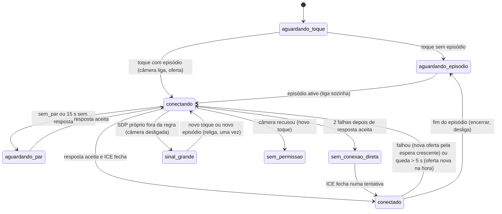

# VER-049 — E4, Tarefa 1: domínio Captura (sinais, portas, emissor, receptor) e presença com vídeo

## Cabeçalho

| Campo | Valor |
|---|---|
| Id | VER-049 |
| Título | E4, Tarefa 1: domínio Captura (sinais, portas, emissor, receptor) e presença com vídeo |
| Gravidade | média |
| Tipo | implementação · decisão de arquitetura · segurança |
| Data | 2026-11-27 (data do commit, em UTC) |
| Usuário responsável | TokumoH |
| Status de implementação | implementado |
| Commits | commit que introduz este arquivo — `git log --diff-filter=A --format=%h -- docs/verificacoes/2026-11-27-049-e4-dominio-captura.md` |
| Arquivos | `src/domains/captura/README.md`, `src/domains/captura/{sinais,portas,agenda,emissor,receptor,falsos}.ts`, `src/domains/captura/{sinais,emissor,receptor}.test.ts` (novos), `src/domains/aovivo/mensagens.ts`, `src/domains/aovivo/mensagens.test.ts`, `src/domains/arquitetura.test.ts`, `src/domains/README.md`, `src/domains/aovivo/README.md`, `src/README.md`, `docs/verificacoes/README.md`, este registro (17 arquivos) |

## Problema

**Pendências da E3 (abertura exigida pelo [PLA-005](../planos/2026-11-27-e4-celular-como-camera.md#L267), "Estrutura de arquivos"):**

| Pendência | Origem | Situação em 2026-11-27 |
|---|---|---|
| Aplicar no editor SQL as migrações `20261127124303_ao_vivo_e_pareamento.sql`, `20261127200000_episodio_em_teste_nao_se_apaga.sql` e `20261127220000_estado_do_palco_em_topico_proprio.sql`, em ordem, com o login anônimo e o Realtime configurados | guia "Ao vivo e pareamento (E3)" de [`supabase/README.md`](../../supabase/README.md#L143), [VER-044](2026-11-27-044-e3-conferencia-e-guia.md), [VER-046](2026-11-27-046-e3-correcoes-revisao-final.md), [VER-047](2026-11-27-047-e3-estado-em-topico-proprio.md) | sem resultado informado pelo responsável: **continua pendente** |
| Conferência real do ao vivo e do pareamento (QR, palco no OBS, `/controle`, revogação no meio do programa, um palco ativo) | mesmo guia | **continua pendente** (depende da anterior) |
| Decisões D1 a D16 do PLA-004 e os ajustes do DES-001 (VER-044); a mudança da D6 (VER-047); a D7 do PLA-002 e o Passo 3 da Tarefa 8 do PLA-003; as pendências da E0 a E2 | [VER-048](2026-11-27-048-plano-e4.md), Riscos | sem resposta informada: **continuam pendentes** |

Nenhum código da E4 depende delas; só a conferência real da Tarefa 7.

**O problema da tarefa:** a E4 põe vídeo no app pela primeira vez. Cada ponto tem um perigo do "Foco da revisão" do PLA-005 que é do domínio: sinalização forjada ou do lado errado (item 3), sessão antiga ou revogada que troca ou desvia o vídeo (itens 2 e 4), câmera ligada sem o usuário saber (item 6), NAT que impede a conexão e o ICE parado em `checking` (item 7), reconexão (item 8), `pronto` furando as esperas e enchendo `realtime.messages` (item 9), SDP próprio acima do teto (D6, revisão 3, N13). Sem um lugar único e testável, essas regras iriam para os adaptadores (Tarefa 3) e as telas (Tarefas 4 e 5), só testáveis com falsos do navegador. Também não havia **portas** para os adaptadores, os falsos de tela e as máquinas escreverem contra o mesmo contrato, nem a situação do vídeo na presença (D13).

## Era proposital?

Não. O contexto **Captura** ("câmera, reconhecimento de gesto, confirmação, envio de vídeo") e a `ConexaoDeVideo`, a `SinalizacaoWebRTC` e o `ManterTelaLigada` estão no [DES-001](../desenho/2026-11-16-revocast-cameras-desenho.md) (§6 e §6.1) desde o desenho; o PLA-004 deixou o vídeo para a E4 ("Ao fim da E3"); o PLA-005 põe tudo na Tarefa 1 ([estrutura de arquivos](../planos/2026-11-27-e4-celular-como-camera.md#L244-L249), [Tarefa 1](../planos/2026-11-27-e4-celular-como-camera.md#L273-L365)). Nenhum código anterior trata de vídeo (`grep -rn "RTCPeerConnection\|getUserMedia" src` só acha comentários e os testes novos).

**Divergências entre o brief e o código commitado (seguido o código) e escolhas desta tarefa:**

| Ponto | Brief / plano | Feito | Motivo |
|---|---|---|---|
| Tipo do envio | D1: `captura` importa de `aovivo` `EstadoDoCanal` e `RespostaDoEnvio` | só `EstadoDoCanal`; `RespostaDoSinal = 'ok' \| 'sem_par' \| 'limite' \| 'falhou'` em `portas.ts`, igual à união da interface | a interface `CanalDeVideo.enviar` do brief já devolve a união própria; `RespostaDoEnvio` (`sem_resposta`) não serve |
| Arquivos a mais | brief lista `sinais`, `portas`, `emissor`, `receptor` | mais `agenda.ts` (um agendamento por motivo e o `depois` com 0 ms, comum aos dois lados) e `falsos.ts` (falsos das portas, só para os testes) | reuso (`CLAUDE.md`): a regra do Passo 3 e os falsos são os mesmos para emissor e receptor |
| `tsc` pedindo correção em `src/app/` | "se o `tsc` pedir" | nada mudou em `src/app/` | `video` é opcional; `tsc --noEmit` passou sem tocar nos construtores de presença |
| Detector de API do navegador | lista com `MediaStream` | `MediaStream\w*` (pega `MediaStreamTrack`) | a faixa também é do navegador |
| `src/README.md` | "se citar a lista de domínios" | cita: entra `captura/` e o `obs/` que faltava desde a E3 | texto desatualizado (nit) |
| Pendências da E3 no registro | "anotando o que o responsável já confirmou" | nada confirmado nesta sessão | nenhuma resposta do responsável no histórico do controlador |

## Solução

**`sinais.ts`** (D2–D4, D6, D13): `EVENTO_DO_SINAL`, `topicoDoVideo` (lança fora de uuid minúsculo), `TAMANHO_MAXIMO_DO_SDP = 12_000`, `SinalDaCamera`, `SinalDaObs`, `conferirSdp` (`grande` acima de 12 000; `forma` sem `v=0\r\n` no começo ou com caractere fora de ASCII imprimível, `\r` e `\n`: a regra da função do plano), `lerSinalDaCamera` (só `oferta` e `encerrar`) e `lerSinalDaObs` (só `pronto`, `resposta` e `encerrar`), que montam o objeto campo a campo, aceitam `remetente` e `id` (uuid) sem levá-los ao sinal e exigem o `sdp` exatamente nos tipos que o levam; `EstadoDoVideo`, `SituacaoDoVideo`, `lerSituacaoDoVideo` (bateria finita em [0, 1] ou `null`); as esperas e `esperaDaTentativa`.

**`portas.ts`** (D1): `FaixaDeVideo` e `FluxoDeVideo` opacos, `CanalDeVideo`, `FabricaDeCanaisDeVideo`, `EstadoDaConexao`, `ConexaoDeVideo`, `FabricaDeConexoes`, `FalhaDaCamera`, `CameraDoAparelho`, `ManterTelaLigada`, exatamente como no brief.

**`emissor.ts`** (D3, D5–D7) e **`receptor.ts`** (D3, D5, D6): as máquinas de estado, só com portas e o `agendar`; regras no "Lógica".

**`aovivo/mensagens.ts`** (D13): `PresencaNoEstudio` de dispositivo ganha `video?: SituacaoDoVideo`; `lerPresenca` aceita `video` só em `camera` e `obs_camera` (no `obs_palco`, ou inválido → `null`); sem `video`, igual à E3.

**`arquitetura.test.ts`**: `dominio-sem-navegador` e o teste do detector.

## Por que esta solução

- **DDD e Pure Fabrication:** as máquinas e os leitores ficam no domínio, testáveis sem jsdom; o navegador entra só pelos adaptadores (Tarefa 3), atrás de portas com tipos opacos, e o teste de arquitetura impede o contrário.
- **Segurança:** os leitores repetem no recebimento a mesma regra da função do banco (defesa em profundidade, D4); cada lado aceita só os sinais do outro (o emissor nunca responde, o receptor nunca oferece); revogados, respostas repetidas e de sessão antiga são descartados; a câmera nunca liga sem o toque e desliga sem episódio.
- **Otimização (Free):** o `pronto` não fura as esperas nem fecha conexão em `conectando`; toda nova tentativa sai pela espera crescente; `sinal_grande` não tenta sozinho; uma simulação de 1 h com falhas e limites aleatórios deu de 89 a 95 ofertas (o plano estima até ~125), nunca duas a menos de 2 s.
- **Sem laço de porta dentro de porta:** todo ouvinte passa por `agenda.depois` (0 ms), e cada prazo tem um único agendamento por motivo (`agenda.porMotivo`), cancelado ao trocar; provado desde a rodada 1 por `ouvinte-adiado` nos dois lados, que olha o efeito antes do `avancar(0)` (sabotagem R1).

## Por que não outras soluções

| Opção | Motivo de descarte |
|---|---|
| Ler o sinal no adaptador e passar o `payload` cru ao domínio | O falso de tela e o adaptador repetiriam a regra; o leitor do domínio é testável sem `realtime-js` |
| Espalhar o `payload` depois de conferir (`{ ...payload }`) | Levaria `remetente`, `id` e qualquer chave extra para dentro; sabotagem S3 |
| Atender todo `pronto` | Furaria a espera crescente e derrubaria conexões em `conectando` (revisão 1, I4); sabotagem S11 |
| Tratar `caiu` como sessão livre (oferta nova a qualquer `pronto`) | O `pronto` do `obs_camera` (a cada 10 s sem `conectado`) furaria a espera de 5 s da queda |
| `sinal_grande` como falha comum | Tentaria para sempre com o mesmo SDP (revisão 3, N13); sabotagem E4 |
| `limite` no receptor com o próximo `pronto` em 2 s | Mais frequente que o ciclo normal de 10 s justo quando o banco pediu menos; usado `max(10 s, espera)` |
| `revogado` só no adaptador | Defesa em profundidade da D1: a máquina descarta também (sabotagens S7 e S7b) |
| Estado `outro` novo em `EstadoDoVideo` | A lista é fechada pelo plano (D13) e entra na presença; `outro` volta a pedir o toque |

## Onde

| Arquivo | Linhas | O que mudou |
|---|---|---|
| [`src/domains/captura/sinais.ts`](../../src/domains/captura/sinais.ts#L14-L187) | 14–187 | novo: tópico (L20), teto (L29), sinais (L31–L32), situação (L35–L53), esperas (L56–L77), `conferirSdp` (L88), leitores (L147, L155), `lerSituacaoDoVideo` (L179) |
| [`src/domains/captura/portas.ts`](../../src/domains/captura/portas.ts#L12-L82) | 12–82 | novo: tipos opacos, `RespostaDoSinal`, portas; o `aoVideo` da conexão é o fluxo recebido, não vídeo no ar ([L55–L56](../../src/domains/captura/portas.ts#L55-L56), rodada 1, I2) |
| [`src/domains/captura/agenda.ts`](../../src/domains/captura/agenda.ts#L10-L53) | 10–53 | novo: `criarAgenda` |
| [`src/domains/captura/emissor.ts`](../../src/domains/captura/emissor.ts#L60-L414) | 60–414 | novo: `criarEmissorDeVideo`; situação (L85), `falhar` (L138), `oferecer` (L164; em `sinal_grande` desliga a câmera, rodada 1, N2), conexão (L210), resposta (L237), sinais (L257), câmera (L300), métodos (L349–L412) |
| [`src/domains/captura/receptor.ts`](../../src/domains/captura/receptor.ts#L55-L268) | 55–268 | novo: `criarReceptorDeVideo`; `pronto` (L100), limite (L112), vídeo só em `conectado` (`mostrarOuRetirar`, L129, rodada 1, I2), conexão (L149), resposta (L165), sinais (L213) |
| [`src/domains/captura/falsos.ts`](../../src/domains/captura/falsos.ts#L11-L261) | 11–261 | novo: relógio, canal (pelo leitor real), conexões e câmera falsos; `ligar` e `responder` que podem ficar seguros e o registro da câmera (rodada 1) |
| [`src/domains/captura/sinais.test.ts`](../../src/domains/captura/sinais.test.ts) | 1–216 | novo: 85 testes |
| [`src/domains/captura/emissor.test.ts`](../../src/domains/captura/emissor.test.ts) | 1–773 | novo: 45 testes; rodada 1: faixa atrasada ([L566–L600](../../src/domains/captura/emissor.test.ts#L566-L600)), `ouvinte-adiado` e as lacunas R2, R14, R18 ([L695–L773](../../src/domains/captura/emissor.test.ts#L695-L773)) |
| [`src/domains/captura/receptor.test.ts`](../../src/domains/captura/receptor.test.ts) | 1–450 | novo: 24 testes; rodada 1: `receptor-video-so-conectado`, `ouvinte-adiado`, `receptor-falha-so-depois-de-responder` ([L359–L450](../../src/domains/captura/receptor.test.ts#L359-L450)); rodada 2: o fluxo novo com o antigo na tela (L393–L401) |
| [`src/domains/captura/README.md`](../../src/domains/captura/README.md) | inteiro | novo, 11 seções; diagrama de sequência e tabela de estados em "Lógica" |
| [`src/domains/aovivo/mensagens.ts`](../../src/domains/aovivo/mensagens.ts#L59-L65) | 2, 59–65, 307–334 | import de `lerSituacaoDoVideo`; `video?` na presença; `TIPOS_COM_VIDEO` e `lerPresenca` com `video` ([L307–L334](../../src/domains/aovivo/mensagens.ts#L307-L334)) |
| [`src/domains/aovivo/mensagens.test.ts`](../../src/domains/aovivo/mensagens.test.ts#L241-L269) | 241–269 | `presenca-com-video` (7 testes) |
| [`src/domains/arquitetura.test.ts`](../../src/domains/arquitetura.test.ts#L32-L114) | 32–49, 83–114 | `NAVEGADOR` (desde a rodada 1 também `RTC\w+`, `globalThis`, `setTimeout`, `setInterval`, `clear*`), `semComentarios`, `citacoesDoNavegador`; `dominio-sem-navegador` e o detector |
| [`src/domains/README.md`](../../src/domains/README.md) | cabeçalho, Origem, Organização, Onde, Lógica, Exemplo, Verificação, Riscos | `captura/`, setas entre domínios, `dominio-sem-navegador`, contagem (22 arquivos, 485 testes) |
| [`src/domains/aovivo/README.md`](../../src/domains/aovivo/README.md) | Organização, Onde, Verificação, Riscos | presença com `video`, exceção de valor de `captura`, contagem (143) |
| [`src/README.md`](../../src/README.md#L27) | 27, 47 | `captura/` (E4) e o `obs/` que faltava (nit) |
| [`docs/verificacoes/README.md`](README.md) | cabeçalho, Onde | linha do VER-049 |

## Lógica

**Emissor (celular):**

| Passo | Antes (sem a E4) | Depois |
|---|---|---|
| Abrir `/camera` com episódio | nada de vídeo | `aguardando_toque`; `camera.ligar` não é chamado |
| Toque | — | consentimento; sem episódio → `aguardando_episodio` (câmera desligada); com episódio → `camera.ligar` → faixa → sessão nova → `oferecer` (ICE) → `conferirSdp` → `oferta` pela função |
| Resposta | — | só a primeira da sessão atual, de remetente não revogado → `aceitarResposta`; prazo de 20 s para `conectado` |
| `pronto` | — | oferta só sem sessão pendente (nenhuma sessão aberta, nenhuma oferta agendada, fora da espera) |
| `caiu` / `falhou` / 15 s sem resposta / 20 s sem `conectado` / `sem_par` / `limite` | — | 5 s de espera na queda; o resto, nova oferta pela espera crescente; `falhou` e o prazo depois de resposta aceita contam para `sem_conexao_direta` (2) |
| Faixa perdida | — | `camera.ligar` de novo → `trocarFaixa`; falso → oferta nova; `outro` → tenta em `voltarAVer` |
| Fim do episódio / `parar` | — | `encerrar` da sessão, `conexao.fechar`, `camera.desligar`; `parar` solta ouvintes e agendamentos; a faixa que chega depois disso é desligada ao chegar |
| SDP próprio fora da regra | — | nada enviado, conexão fechada, câmera desligada (rodada 1, N2), `sinal_grande`; novo toque ou novo episódio religam e tentam uma vez |

**Receptor (`/obs/camera`):** `pronto` na hora e a cada 10 s com episódio, canal conectado e a conexão fora de `conectado`; oferta → `responder` → `resposta` com a mesma sessão; o fluxo do evento `track` fica guardado e só vai à tela com a conexão em `conectado`, e sai (`aoVideo(null)`) ao deixar `conectado` (rodada 1, I2: antes, ia à tela no `track` e só saía no fechamento, contra a D3 e a D8); oferta de outra sessão fecha a anterior antes de criar a nova (`aoVideo(null)` e depois o fluxo novo); `encerrar` da sessão e do remetente atuais, `revogarPar`, `falhou`, sem episódio e `parar` → fecha e limpa o vídeo; `limite` → próximo `pronto` em `max(10 s, espera crescente)`.

## Exemplo

Teste `emissor-espera-crescente`, relógio falso: oferta em 0 ms; `falhou` → nada em 1 999 ms, oferta em 2 000 ms; `falhou` → 4 000; depois 8 000, 16 000, 30 000, 30 000. Uma resposta aceita e `conectado` zeram: o `falhou` seguinte volta a 2 000 ms. Com a sabotagem S9 (espera fixa de 2 s), a terceira oferta sai em 2 000 ms em vez de 4 000 e o teste cai.

Teste `sinais-validados`: `lerSinalDaCamera('sinal', { tipo: 'oferta', sessao, sdp: 'v=0\r\n…', remetente, id })` → `{ tipo, sessao, sdp }` (objeto novo, `Object.keys` = `['tipo', 'sessao', 'sdp']`); o mesmo com `"__proto__"` como chave (de `JSON.parse`) → `null`; com 12 001 caracteres → `null`; com 12 000 → aceito (a fronteira da função).

## Verificação

TDD: os testes foram escritos antes do código; `npx vitest run src/domains` antes da implementação: 5 arquivos falhando (os três de `captura/` por módulo inexistente; `presenca-com-video` recusando `video`; `dominio-sem-navegador` sem `./captura/emissor.ts` no glob), 329 passando.

| # | Abordagem | Comando / método | Resultado |
|---|---|---|---|
| T1 | testes do domínio | `npx vitest run src/domains` | 22 arquivos, 485 testes passando depois da rodada 2 (484 depois da rodada 1, 470 antes dela; 322 no `HEAD` cf03b70, contados numa extração `git archive` fora do repositório) |
| T2 | tipos | `npx tsc --noEmit` | 0 erros, sem tocar em `src/app/` |
| T3 | suíte inteira | `npm test` | 61 arquivos, 2 404 testes passando depois da rodada 2 (2 403 depois da rodada 1, 2 389 antes) |
| S | sabotagens do brief, a mais e da rodada 1, uma de cada vez | script `t1/sab/sabotar.py` no scratchpad da sessão: numa **cópia** do repositório (`node_modules` por symlink), confere que o arquivo da cópia é igual ao do repositório, troca o trecho, roda `npx vitest run --cache=false` em `src/domains/captura`, `mensagens.test.ts` e `arquitetura.test.ts`, restaura e confere `sha256sum` igual antes e depois, na cópia e no repositório | as 51 derrubam o teste esperado (tabela abaixo); na rodada 1, todas rodadas de novo numa cópia nova, com as 12 novas |
| Sim | simulação, fora do repositório | na cópia: 8 corridas de 1 h com sementes diferentes (`pronto` a cada 10 s, resposta, `falhou`, `limite`, `sem_par` aleatórios) e uma ponta a ponta emissor ↔ receptor por canais falsos | 89 a 95 ofertas por hora, nunca duas a menos de 2 s; só a última conexão aberta; `parar` sem agendamento sobrando; a ponta a ponta conecta e reconecta depois de `falhou` |
| V1 | revisão independente, rodada 1 | leitura do diff, 19 sabotagens e 3 sondas numa cópia (cache desligado) | spec ✅ (divergências e concerns aceitas); reprovada: 3 achados importantes (I1 teste da faixa atrasada, D7; I2 receptor entregava vídeo fora de `conectado`; I3 regra do agendar 0 ms sem teste) e 5 nits — corrigidos em C1 |
| C1 | rodada de correção 1 (revisão: I1 a I3 Importantes; N1 a N5): I1 o teste da faixa atrasada confere a ordem `ligar#0`, `desligar`, `faixa#0`, `desligar` (fim do episódio e `parar`); I2 o receptor só entrega o fluxo em `conectado` e o retira ao sair dele; I3 `ouvinte-adiado` nos dois lados olha o efeito antes do `avancar(0)`; N1 testes para R2, R10, R12, R14 e R18; N2 `sinal_grande` desliga a câmera; N3 detector com `globalThis`, relógios e `RTC\w+`; N4 contagens, diagrama e risco da resposta perdida; N5 núcleo comum de `EstadoDoCanal` nos Riscos. Sabotagens numa cópia nova (cache desligado, `sha256sum` igual antes e depois) | `t1/sab/sabotar.py` na cópia; `npm run check` no repositório | as 39 anteriores de novo e as 12 novas: R1 (`depois` síncrono) 2 (`ouvinte-adiado` dos dois lados); R2 1; R10 5; R12 1; R14 3; R18 1; R19 2 (os dois testes da faixa atrasada); I2a (fluxo no `track`) 3; I2b (sem retirar ao sair de `conectado`) 1; N2 2; N3a (`globalThis.setTimeout`) 1 e N3b (`setTimeout` solto) 1, ambas em `dominio-sem-navegador`; `npm run check` com 0 erros (linha C) |
| V2 | revisão independente, rodada 2 | R19, R1, R2, R10, R12, R14, R18 repetidas e sonda A refeita numa cópia | **limpa**; 2 nits (N6 piscada em queda breve do ICE, registrada; N7 teste do fluxo novo) incorporados em C2 com reconferência pontual (`npm run check` 0 no commit) |
| C2 | nits da re-revisão da rodada 2 (só texto e teste; código de produção igual): N6 a piscada no ar numa queda breve do ICE, nos Riscos daqui e do README da captura, como pendência para o responsável; N7 teste do fluxo novo, diferente, com o antigo na tela (`receptor-video-so-conectado`, [`receptor.test.ts`](../../src/domains/captura/receptor.test.ts#L393-L401)). Sabotagem numa cópia (cache desligado, `sha256sum` igual antes e depois) | `t1/sab/sabotar.py X4` na cópia; `npm run check` no repositório | X4 (`if (s.entregue && s.fluxo !== fluxo)` → `if (false)`, `receptor.ts:177`): 1 falha (o teste novo); `npm run check` com 0 erros (linha C) |
| C | `npm run check` | rodado pelo implementador sobre esta versão, depois da rodada 2 (o controlador repete como último ato antes do commit) | 0 erros: `typecheck`; 61 arquivos e 2 404 testes; `check-docs` (82 `.md`, 49 registros); `check-doc-secrets`; `rpc:grants-check` e `data-api:check` (6 migrações); `check-deps-audit` |

Sabotagens: 52 corridas = as 16 do brief (S1–S16, com a S7 em duas: 17), 22 a mais na primeira versão (S3b, E1–E20, E11b) e 12 da rodada 1 (R1, R2, R10, R12, R14, R18, R19, I2a, I2b, N2, N3a, N3b) e 1 da rodada 2 (X4). As contagens de falhas abaixo são as da corrida da rodada 1 (com os testes novos, algumas derrubam mais testes que na primeira corrida); R1 e R2 vieram da revisão:

| Id | Sabotagem | Teste que caiu (falhas no total) |
|---|---|---|
| S1 | aceitar `resposta` em `lerSinalDaCamera` | `sinal-do-lado-errado` e `receptor-ignora-resposta` (2) |
| S2 | tirar o limite do SDP | `sinais-validados` (12 001, nos dois leitores), `conferir-sdp`, `emissor-sdp-grande`, `receptor-sdp-grande` (6) |
| S3 | espalhar o `payload` no leitor | `sinais-validados` (objeto novo só com os campos conhecidos) (1) |
| S3b | aceitar chave fora da forma (`__proto__`) | `sinais-validados` (`__proto__`, campo extra, `sdp` onde não cabe) e `presenca-com-video` (10) |
| S4 | ligar a câmera sem toque | `emissor-so-liga-depois-do-toque` e outros (9) |
| S5 | não desligar sem episódio | `emissor-desliga-sem-episodio` (2) |
| S6 | aceitar toda resposta | `emissor-primeira-resposta-vale` (1) |
| S7 | não consultar `revogado` no emissor | `emissor-descarta-revogado` (2) |
| S7b | não consultar `revogado` no receptor | `receptor-revoga-par` (1) |
| S8 | oferta nova já no `caiu` | `emissor-queda-breve`, `emissor-parar` (2) |
| S9 | espera fixa de 2 s | `emissor-espera-crescente`, `emissor-sem-par`, `emissor-limite` (3) |
| S10 | `sem_conexao_direta` na primeira falha | `emissor-sem-conexao-direta`, `emissor-prazo-da-conexao`, `emissor-limite` (3) |
| S11 | atender todo `pronto` | `emissor-pronto-respeita-a-espera` (4), `emissor-oferece-ao-pronto` (2), `emissor-limite` (7) |
| S12 | sem o prazo da conexão | `emissor-prazo-da-conexao` (1) |
| S13 | receptor responde com sessão nova | `receptor-responde`, `receptor-sdp-grande` (2) |
| S14 | não fechar a conexão antiga | `receptor-oferta-nova-fecha-a-antiga` (1) |
| S15 | `pronto` também com vídeo | `receptor-pronto` (2), `receptor-falhou` (4) |
| S16 | `window.setTimeout` em `emissor.ts` | `dominio-sem-navegador` (e os testes do emissor, sem `window` no Node) (40) |
| E1 | `limite` conta para `sem_conexao_direta` | `emissor-limite` (1) |
| E2 | `limite` com oferta na hora | `emissor-limite` (1) |
| E3 | receptor ignora o `limite` | `receptor-limite` (2) |
| E4 | emissor envia SDP fora da regra | `emissor-sdp-grande` (3) |
| E5 | receptor envia SDP fora da regra | `receptor-sdp-grande` (1) |
| E6 | `obs_palco` aceito com `video` | `presenca-com-video` (1) |
| E7 | bateria sem teto | `situacao-do-video`, `presenca-com-video` (2) |
| E8 | `topicoDoVideo` sem conferir o uuid | `topico-do-video` (5) |
| E9 | sem resposta não tenta de novo | `emissor-sem-resposta` (1) |
| E10 | receptor ignora `encerrar` | `receptor-encerrar` (1) |
| E11 | `parar` do emissor sem cancelar a agenda | `emissor-parar` (1) — na primeira corrida **não caiu** (achado: o teste só cobria o `caiu`, cujo prazo o `fecharSessao` já cancela); acrescentado o caso "durante a espera crescente" e a corrida repetida caiu |
| E11b | `parar` do receptor sem cancelar a agenda | `receptor-parar` (1), com o caso novo "com o ciclo do pronto correndo" |
| E12 | religar sem trocar a faixa | `faixa-terminada-religa`, `emissor-voltar-a-ver` (2) |
| E13 | canal que volta não oferece | `emissor-canal-volta` (2) |
| E14 | falha da câmera não derruba o consentimento | `emissor-falha-da-camera` (4) |
| E15 | `voltarAVer` não religa | `emissor-voltar-a-ver` (1) |
| E16 | receptor sem `pronto` depois de `falhou` | `receptor-falhou` (1) |
| E17 | receptor responde oferta repetida | `receptor-oferta-repetida` (1) |
| E18 | receptor aceita oferta sem episódio | `receptor-sem-episodio` (1) |
| E19 | receptor não conta falhas | `receptor-sem-conexao-direta` (1) |
| E20 | espera crescente sem o teto de 30 s | `espera-da-tentativa`, `emissor-espera-crescente`, `receptor-limite` (3) |
| R1 | `agenda.depois` síncrono (ouvinte chama a porta na hora) | `ouvinte-adiado` do emissor e do receptor (2) — confirmada também na re-revisão |
| R2 | `encerrar` do emissor sem conferir o par | `emissor-encerrar-so-do-par` (1) — confirmada também na re-revisão |
| R10 | leitor sem conferir o protótipo | `sinais-validados` (protótipo diferente e instância de classe, nos dois leitores) e `situacao-do-video` (5) |
| R12 | receptor conta `falhou` sem ter respondido | `receptor-falha-so-depois-de-responder` (1) |
| R14 | `desligarCamera` sem esquecer a faixa | `emissor-sem-faixa-velha`, `emissor-sdp-grande` (3) |
| R18 | `sem_par` sem zerar as falhas | `emissor-sem-par-zera-falhas` (1) |
| R19 | a faixa que chega atrasada não é desligada | `emissor-falha-da-camera`: depois do fim do episódio e depois do `parar` (2) |
| I2a | receptor entrega o fluxo no evento `track`, fora de `conectado` | `receptor-video-so-conectado` (2), `receptor-oferta-nova-fecha-a-antiga` (3) |
| I2b | receptor não retira o vídeo ao sair de `conectado` | `receptor-video-so-conectado` (`caiu`) (1) |
| N2 | `sinal_grande` sem desligar a câmera | `emissor-sdp-grande` (2) |
| N3a | `globalThis.setTimeout` no emissor (num ramo que nunca roda) | `dominio-sem-navegador` (1) |
| N3b | `setTimeout` solto no receptor (num ramo que nunca roda) | `dominio-sem-navegador` (1) |
| X4 | fluxo novo sem retirar o antigo da tela (rodada 2) | `receptor-video-so-conectado` (fluxo novo com o antigo na tela) (1) |

Nits corrigidos (não zeram a contagem): `src/README.md` não citava `domains/obs/` (desde a E3). Na rodada 1: contagem de sabotagens do README da captura (dizia 16 + 22; agora 51, igual a este registro), diagrama de estados (a queda faz a oferta na hora, sem espera crescente) e os Riscos abaixo (resposta perdida no receptor; núcleo comum de `EstadoDoCanal`).

## Riscos

- **Só falsos:** nada aqui toca `RTCPeerConnection`, `getUserMedia`, Wake Lock nem o Realtime reais; isso vem nas Tarefas 2 (função e matriz), 3 (adaptadores), 7 (Chromium real) e no aparelho real, só o responsável (D14, F5–F8). F6 (gesto no Safari) não muda o código: a câmera só liga depois do toque de qualquer jeito.
- **Escolhas não fixadas pelo brief** (para a revisão): `caiu` conta como sessão pendente (o `pronto` não fura a espera de 5 s); `encerrar` do par fecha a sessão e vai a `aguardando_par` sem nova oferta sozinha (o `pronto` do `obs_camera` traz a próxima); `definirEpisodio` repetido com o mesmo valor não faz nada (a rota pode chamar a cada consulta de `episodioAtivo()` sem reabrir `sinal_grande`); `outro` da câmera volta a `aguardando_toque` no primeiro toque e, ao religar, fica para `voltarAVer`; o receptor manda `encerrar` no `parar` (não no fim do episódio, D5), usa uma sessão nova em cada `pronto` e conta `sem_conexao_direta` pelas falhas que vê; desde a rodada 1 (I2, decisão do controlador pela saída mais segura), o receptor só entrega o fluxo com a conexão em `conectado` e manda `aoVideo(null)` ao sair dele; o `id` do `realtime.send`, quando presente, tem de ser uuid.
- **Piscada no ar numa queda breve do ICE** (re-revisão da rodada 2, N6): `conectado` → `caiu` → `conectado` em menos de 1 s tira o vídeo da Fonte (`aoVideo(null)`) e o põe de volta, uma piscada na transmissão. Segue a D3 ("sem vídeo" é conexão fora de `conectado`) e a D8, e no `disconnected` a mídia em geral já parou (o quadro mostrado seria um congelado). A Tarefa 7 confere o caso no Chromium; manter o último quadro durante uma queda curta exigiria mudar a D3: **pendência para o responsável decidir**.
- **Ciclo entre domínios:** `aovivo/mensagens.ts` importa um valor de `captura/sinais.ts`, e `captura/portas.ts` importa um tipo de `aovivo/portas.ts`; sem ciclo em tempo de execução hoje. Se crescer (a E5, com os gestos), mover `EstadoDoCanal` para um núcleo compartilhado de tipos de canal tira o ciclo (rodada 1, N5; não pede mudança agora).
- **Resposta perdida conta como falha no receptor:** a resposta é marcada como dada antes de o `enviar` terminar; se ela se perder no caminho (a câmera nunca a recebe e oferece de novo pelo prazo de 15 s), o receptor conta a oferta anterior como falha, e o `sem_conexao_direta` do selo pode aparecer antes de o da câmera (rodada 1, N4).
- **`sinal_grande` desliga a câmera** (rodada 1, N2): nada sairia dela; o novo toque ou um novo episódio religam (o toque no iPhone é gesto, F6).
- **`falsos.ts` fora de `.test.ts`:** passa pelo teste de arquitetura como código de domínio e não é importado pelo app; se um dia for, entraria no build sem efeito.
- **Âncoras antigas:** `mensagens.ts` e `mensagens.test.ts` cresceram (linhas inseridas no meio); âncoras de registros antigos nesses arquivos continuam dentro do arquivo, mas podem apontar para linhas deslocadas. Nenhum arquivo encolheu (`mensagens.ts` 362 ≥ 307; `mensagens.test.ts` 353 ≥ 323; `arquitetura.test.ts` 115 ≥ 63; `src/domains/README.md` 85 ≥ 79; `src/domains/aovivo/README.md` 124 ≥ 114; `src/README.md` 75 ≥ 47).
- **Presença coalescida** (`PRESENCA_MINIMA_MS`) só é declarada aqui; quem a usa é a Tarefa 4.
