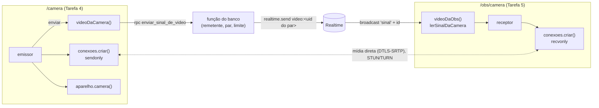

# VER-051 — E4, Tarefa 3: adaptadores do vídeo (canal de vídeo, `RTCPeerConnection`, câmera, tela ligada) e composição

## Cabeçalho

| Campo | Valor |
|---|---|
| Id | VER-051 |
| Título | E4, Tarefa 3: canal de vídeo (recepção em `video:<sessão>`, envio pela `rpc`), `conexaoWebrtc.ts`, `cameraNavegador.ts`, composição com o TURN opcional e falsos do vídeo |
| Gravidade | alta |
| Tipo | implementação · segurança |
| Data | 2026-11-28 (data do commit, em UTC; o plano e os registros 049 e 050 são de 2026-11-27) |
| Usuário responsável | TokumoH |
| Status de implementação | implementado |
| Commits | commit que introduz este arquivo — `git log --diff-filter=A --format=%h -- docs/verificacoes/2026-11-28-051-e4-adaptadores-video.md` |
| Arquivos | `src/domains/captura/emissor.ts`, `src/domains/captura/receptor.ts`, `src/domains/captura/portas.ts`, `src/domains/captura/emissor.test.ts`, `src/domains/captura/receptor.test.ts`, `src/domains/captura/README.md` (os seis desde a rodada 1), `src/shared/infra/conexaoWebrtc.ts` (novo), `src/shared/infra/conexaoWebrtc.test.ts` (novo), `src/shared/infra/cameraNavegador.ts` (novo), `src/shared/infra/cameraNavegador.test.ts` (novo), `src/shared/infra/canalSupabase.ts`, `src/shared/infra/canalSupabase.test.ts`, `src/shared/infra/realtimeContrato.test.ts`, `src/app/servicos.ts`, `src/app/servicos.test.ts`, `src/app/servicosFalsos.ts`, `src/app/servicosFalsos.test.ts`, `src/shared/infra/README.md`, `src/app/README.md`, `docs/verificacoes/README.md`, este registro |

## Problema

A Tarefa 1 ([VER-049](2026-11-27-049-e4-dominio-captura.md)) deixou o domínio da Captura (sinais, portas, emissor e receptor) e a Tarefa 2 ([VER-050](2026-11-27-050-e4-banco-video.md)) o banco (`enviar_sinal_de_video`, o tópico `video:<uid>` só para receber). Faltava o meio: nada implementava as portas `FabricaDeCanaisDeVideo`, `FabricaDeConexoes`, `CameraDoAparelho` e `ManterTelaLigada` de [`src/domains/captura/portas.ts`](../../src/domains/captura/portas.ts), e a composição (`src/app/servicos.ts`) não dava às rotas de dispositivo nem as conexões WebRTC nem o aparelho, nem lia as variáveis do TURN opcional. Efeito: as telas das Tarefas 4 a 6 não tinham o que usar, e os falsos de tela (`servicosFalsos.ts`) não imitavam o vídeo.

## Era proposital?

Sim, a ordem é a do plano: o [PLA-005](../planos/2026-11-27-e4-celular-como-camera.md) põe os adaptadores na Tarefa 3, depois do domínio e do banco, com as decisões D1 (o canal de vídeo no mesmo registro de `canalSupabase.ts`), D2 (ninguém envia pelo Broadcast nos tópicos de vídeo; envio pela função), D4 (ICE não incremental), D6 (estados da conexão), D7 (restrições de captura, faixa perdida, `maxBitrate`), D9 (STUN público e TURN só pelas variáveis) e D11 (nenhuma dependência nova). Nada no código commitado (HEAD `723c9f6`) já implementava essas portas: `grep -rn "FabricaDeConexoes\|CameraDoAparelho" src --include=*.ts` só achava o domínio e os falsos dele.

**Divergências do brief, registradas (o código commitado e as regras do controlador prevalecem):**

| Brief | Feito | Motivo |
|---|---|---|
| Passo 6: "commit; push" | nem commit nem push | o subagente não faz commit (`CLAUDE.md`, seção Commit); fica para o agente principal |
| registro `AAAA-MM-DD-051` (pedido: `2026-11-27-051`) | `2026-11-28-051` | a execução passou da meia-noite UTC; o plano manda a data do commit no nome ("se a execução cair em outro dia, o nome acompanha"); se o commit sair em outro dia, o nome acompanha de novo |
| `criarManterTelaLigada(nav?: Navigator, doc?: Document)`, `lerBateria(nav?: Navigator)` | `nav?: { wakeLock?: WakeLock }`, `doc?: Pick<Document, 'visibilityState' \| 'addEventListener' \| 'removeEventListener'>`; `lerBateria(nav?: Navigator)` | o `lib.dom` declara `wakeLock` sempre presente, mas ele falta fora de contexto seguro e em navegadores antigos (F7); o tipo mais estreito aceita o `navigator` e o `document` reais |
| `realtimeFalso.ts` "se o contrato pedir" | sem mudança | o contrato não pediu: o `emitirBroadcast` do falso já entrega `{ type, event, payload }` como o real (provado no `video-contrato`); a `rpc` não é Realtime, então os testes juntam ao cliente falso uma `rpc` falsa |
| `video-recebe-valida`: "oferta e encerrar com outro tipo do lado errado" | na câmera, `oferta` (tipo do outro lado) descartada; `encerrar` é válido nos dois lados (D4), então o caso do lado errado do `obs_camera` é `resposta`/`pronto` | o `encerrar` existe nos dois leitores do domínio (`sinais.ts`); descartá-lo quebraria o fim de sessão |

**Fontes do Passo 1 (conferidas no `node_modules` instalado, 2026-11-28):**

| # | Premissa | Fonte (arquivo:linha) | Resultado |
|---|---|---|---|
| P1 | O tópico de vídeo usa a mesma configuração: `private`, `broadcast`, presença com chave; com ligações de presença, `presence.enabled` vai `true` no `phx_join` (o banco permite a leitura de presença no `video:<uid>` próprio, `pode_usar_canal` com `p_enviar = false`, VER-050) | `@supabase/realtime-js/dist/main/RealtimeChannel.js:90-115` (padrões e `private`), `:141-147` (`presence_enabled`); `supabase/migrations/20261127230000_video_da_camera.sql:81-85` | nada muda para o tópico de vídeo; o canal só recebe (nenhum `track`, nenhum `send`) |
| P2 | Como chega uma mensagem do banco: o socket decodifica o quadro (texto `[join_ref, ref, topic, event, payload]` ou binário tipo 4 `userBroadcast` com tópico, evento, metadados e JSON) e o canal recebe `event = 'broadcast'` com `payload = { type: 'broadcast', event, payload, meta? }` | `realtime-js/dist/main/lib/serializer.js:108-119` (`decode`), `:129-153` (`_decodeUserBroadcast`; `dist/module`: `:106` e `:127`); `RealtimeClient.js:667-686` e `lib/constants.js:8` (`DEFAULT_VSN` 2.0.0 → este serializer) | provado no `video-contrato` com o cliente real, nos dois quadros |
| P3 | O socket entrega a todo canal com o tópico (`isMember`: tópico igual e `join_ref` nulo ou o atual) e o canal chama as ligações; a ligação `broadcast` com `event: '*'` aceita qualquer `payload.event` | `@supabase/phoenix/priv/static/phoenix.cjs.js:1813-1840` (`onConnMessage`; `phoenix.mjs:1781`), `:496-506` (`isMember`), `:527-537` (`trigger`); `RealtimeChannel.js:742-753` (filtro `bindEvent === '*'`) | o `canalSupabase.ts` lê `m.event` e `m.payload` como já fazia |
| P4 | O `payload` publicado traz o `id` acrescentado pelo `realtime.send` | F15 do plano; corpo copiado em `supabase/tests/simulacao-supabase.sql:336-361` (`jsonb_set(payload, '{id}', ...)`) | o leitor da Tarefa 1 aceita `id` (uuid) e não o põe no sinal; `video-recebe-valida` e `video-contrato` |
| P5 | `rpc` passa pelo `fetch` do cliente com tempo-limite de 15 s: `supabase.rpc` → `rest.rpc`; o `rest` é um `PostgrestClient` em `<url>/rest/v1` com `fetchWithAuth(settings.global.fetch)`; `rpc` faz `POST <url>/rpc/<fn>` | `@supabase/supabase-js/dist/index.cjs:769-774`, `:676-680`; `@supabase/postgrest-js/dist/index.cjs:4006-4024`; `src/shared/infra/supabase.ts:33-40` e `tempoLimite.ts` (`/rest/v1` limitado, VER-021) | `rpc('enviar_sinal_de_video')` com tempo-limite de 15 s; o erro de rede e o `TimeoutError` chegam como `{ code: '', status: 0 }` → `falhou` |
| P6 | Tipos do navegador no `lib.dom.d.ts` do TypeScript 7.0.2 (`node_modules/@typescript/typescript-linux-x64/lib/lib.dom.d.ts`) | `RTCConfiguration` `:2127-2133` (`bundlePolicy`, `iceServers`); `RTCIceServer` `:2225-2229`; `RTCRtpEncodingParameters.maxBitrate` `:2384-2386`; `MediaDevices.getUserMedia` `:23869`; `Navigator.mediaDevices` `:25828`; `Navigator.wakeLock` `:25859`; `RTCPeerConnectionEventMap` `:29392-29402`; `RTCPeerConnection` `:29409` (`connectionState` `:29421`, `iceGatheringState` `:29445`, `localDescription` `:29451`, `addTransceiver` `:29519`); `RTCRtpSender` `:29756` (`getParameters` `:29786`, `replaceTrack` `:29798`, `setParameters` `:29804`); `RTCTrackEvent.streams` `:29976-29988`; `WakeLock.request` `:38528-38534`; `WakeLockSentinel` `:38552`; `RTCIceGatheringState` `:44411`; `RTCPeerConnectionState` `:44417` | todos existem; **`getBattery` não existe** (`grep -c getBattery` = 0): interface local mínima `NavegadorComBateria`, sem `any` |
| P7 | Fake timers do Vitest: um `setTimeout(f, 0)` agendado **dentro** de um avanço do relógio vence em +1 ms | sonda no repositório (arquivo temporário apagado): `setTimeout(() => setTimeout(f, 0), 3000)`, avançar 2 999 + 1 → `f` não chamado | o teste `faixa-perdida` avança 1 ms depois do prazo para ver o aviso adiado (não muda o código) |

## Solução

1. **Canal de vídeo** em `canalSupabase.ts`: `videoDaCamera()` e `videoDaObs()` abrem pelo mesmo registro (um canal por tópico por cliente, contagem de referências, fechado e negado saem do mapa) só `topicoDoVideo(usuarioId)`, com o leitor do lado (`lerSinalDaObs` na câmera, `lerSinalDaCamera` no `obs_camera`). `enviar(s)` é `cliente.rpc('enviar_sinal_de_video', { p_tipo, p_sessao, p_sdp })`, nunca `canal.send`; `enviado` → `ok`, `sem_par` → `sem_par`, `54000` → `limite`, o resto → `falhou`. A fábrica passa a ter o tipo `FabricaDeCanais & FabricaDeCanaisDeVideo`.
2. **`conexaoWebrtc.ts`**: `STUN_PUBLICO`, `BITRATE_MAXIMO`, `servidoresIce(config)` e `criarFabricaDeConexoes({ ice, criarPc?, agendar? })`, com `sendonly` na câmera, `recvonly` pela oferta no `obs_camera`, ICE não incremental, estados da D6 avisados por `agendar(0)`, `maxBitrate` depois de aceitar a resposta, e erros com frase fixa (sem SDP).
3. **`cameraNavegador.ts`**: `RESTRICOES_DE_CAPTURA`, `MUDO_TOLERADO_MS`, `ESPERA_DA_CAMERA_MS`, `criarCameraDoAparelho`, `criarManterTelaLigada` e `lerBateria`.
4. **Composição** (`servicos.ts`): `ambienteDoVite` lê também `VITE_TURN_URL`, `VITE_TURN_USUARIO`, `VITE_TURN_SENHA` (uma a uma); `ServicosDoDispositivo` ganha `conexoes` (com `servidoresIce` da configuração) e `aparelho` (`camera()`, `tela()`, `bateria()`).
5. **Falsos** (`servicosFalsos.ts`): o canal falso envia o vídeo por uma `rpc` falsa (`sinaisDeVideo`, `responderSinal`); `criarVideoFalso()` imita conexões, câmera, tela e bateria; `criarFalsosDeDispositivo` passa a trazê-los (`video`).
6. **Rodada 1 da revisão (C1):** (I1) Wake Lock com um pedido por vez e uma sentinela só (`pedirUmaVez`); (I2) URL de TURN estrita (`urlDeTurnValida`, RFC 7065: host, porta de 1 a 65535, `?transport=udp|tcp`), construção do `RTCPeerConnection` protegida (de novo só com o STUN; se falhar, uma conexão cujas descrições rejeitam) e `conexoes.criar()` protegido no emissor e no receptor; (N1) `enviar` com a alça fechada → `falhou` sem chamar a `rpc`, documentado na porta; (N2) a porta `CameraDoAparelho.ligar` avisa que para o fluxo atual; (N3) `fechar()` interrompe a espera do ICE e a descrição rejeita.

## Por que esta solução

- **Arquitetura (DDD, Pure Fabrication, Componentes):** cada adaptador é uma fabricação pura que implementa uma porta do domínio, sem regra de negócio (quem decide quando oferecer, esperar ou desistir é o emissor/receptor da Tarefa 1). O canal de vídeo reaproveita o registro de `canalSupabase.ts` (D1; reuso, sem um segundo registro de canais por cliente). A composição continua em `src/app/servicos.ts`, um cliente por tipo.
- **Segurança (D2):** o adaptador não tem caminho de envio pelo Broadcast nos tópicos de vídeo: a alça não expõe `send` nem `marcarPresenca`, e o eco local (`distribuir`) só roda no `enviar` do Broadcast, que o vídeo não usa. O cliente só manda `tipo`, `sessao` e `sdp`; o remetente vem do banco e o leitor descarta o que não tiver remetente uuid. O SDP, os candidatos e a credencial TURN não vão para `console` nem para mensagem de erro: a rejeição do navegador (que pode citar a descrição) vira frase fixa. Nada é gravado em armazenamento.
- **Otimização:** um `RTCPeerConnection` só quando a rota pede (`criar()`); a espera do ICE solta ouvinte e prazo em todo caminho (sem timer pendurado, conferido por `vi.getTimerCount()`); a câmera para o fluxo anterior ao religar e para na hora o fluxo que chega depois do prazo (luz apagada, bateria).
- **D6 e o adiamento:** cada aviso do navegador passa pelo `agendar(0)` (como os ouvintes do `realtime-js` desde a E3), e depois de `fechar()` nada é avisado, nem o que já estava agendado.

## Por que não outras soluções

| Opção | Motivo de descarte |
|---|---|
| Enviar pelo `canal.send` com o canal conectado (como `estudio`) | contra a D2: a permissão de escrita fica guardada por conexão e o remetente seria declarado pelo cliente; o banco nega o envio nos tópicos de vídeo de qualquer jeito |
| Um registro de canais só para o vídeo | duplicaria a contagem de referências e as remoções pendentes do VER-038; o mesmo tópico em dois registros quebraria o "um canal por tópico por cliente" |
| `rpc` só com o canal `conectado` | a `rpc` vai pelo PostgREST e não depende do socket; o `encerrar` no fim do episódio precisa sair mesmo com o canal já caindo (a função recusa com `55000` se não houver episódio) |
| Repassar o erro do navegador (`throw e`) | a mensagem do `RTCPeerConnection` pode citar trechos do SDP (endereços); a frase fixa basta ao emissor, que só reage à rejeição |
| `addTransceiver(faixa, { direction: 'sendonly', streams: [fluxo] })` para o `obs_camera` receber o fluxo pronto | o brief fixa `{ direction: 'sendonly' }` e o domínio só tem a faixa (opaca) no `oferecer`; o receptor monta `new MediaStream([track])` quando o evento vem sem fluxo |
| ICE incremental (um sinal por candidato) | contra a D4: dezenas de chamadas `rpc` e linhas em `realtime.messages` por sessão |
| TURN aceitando qualquer URL com credencial | uma URL `https:` ou `stun:` com credencial é engano de configuração; a D9 pede só `turn:`/`turns:` |
| `getBattery` como `any` ou `@ts-expect-error` | o projeto não usa `any`; a interface local mínima documenta o que é lido (`level`) |
| Mudar `realtimeFalso.ts` para ter `rpc` | a `rpc` não é do Realtime; o falso continua imitando só o `realtime-js` (o contrato prova que ele entrega a mensagem do banco como o real) |
| Uma câmera só por página no falso (a primeira versão do `criarVideoFalso`) | divergia da composição real (uma câmera nova a cada `aparelho.camera()`): esconderia uma tela que criasse duas câmeras; agora o falso cria uma por chamada e conta (`camera.criadas`) |

## Onde

| Arquivo | Linhas | O que mudou |
|---|---|---|
| [`src/shared/infra/canalSupabase.ts`](../../src/shared/infra/canalSupabase.ts#L1-L7) | 1–7 | imports da Captura (portas, `lerSinalDaCamera`, `lerSinalDaObs`, `topicoDoVideo`) |
| [`src/shared/infra/canalSupabase.ts`](../../src/shared/infra/canalSupabase.ts#L75-L83) | 75–83 | doc da fábrica (vídeo) e tipo `FabricaDeCanais & FabricaDeCanaisDeVideo` |
| [`src/shared/infra/canalSupabase.ts`](../../src/shared/infra/canalSupabase.ts#L284-L323) | 284–323 | `enviarSinal` (a `rpc` e a tradução da resposta) e `canalDeVideo` (alça só de recepção com o leitor do lado; desde a rodada 1, `falhou` sem `rpc` com a alça fechada) |
| [`src/shared/infra/canalSupabase.ts`](../../src/shared/infra/canalSupabase.ts#L415-L423) | 415–423 | `videoDaCamera()` e `videoDaObs()` |
| [`src/shared/infra/conexaoWebrtc.ts`](../../src/shared/infra/conexaoWebrtc.ts#L1-L280) | 1–280 | novo: `STUN_PUBLICO`, `BITRATE_MAXIMO`, `servidoresIce`, `criarFabricaDeConexoes` (espera do ICE, estados, `track`, `maxBitrate`, `replaceTrack`, erros sem detalhe) |
| [`src/shared/infra/cameraNavegador.ts`](../../src/shared/infra/cameraNavegador.ts#L1-L286) | 1–286 | novo: restrições, câmera com prazo e faixa perdida, tela ligada, bateria |
| [`src/app/servicos.ts`](../../src/app/servicos.ts#L20-L33) | 20–33 | `ambienteDoVite` com as três variáveis do TURN |
| [`src/app/servicos.ts`](../../src/app/servicos.ts#L97-L115) | 97–115 | `AparelhoDoDispositivo`; `ServicosDoDispositivo` com `conexoes`, `aparelho` e o canal de vídeo no tipo de `canais` |
| [`src/app/servicos.ts`](../../src/app/servicos.ts#L152-L181) | 152–181 | `APARELHO_DO_NAVEGADOR` e a composição com `servidoresIce(config)` |
| [`src/app/servicosFalsos.ts`](../../src/app/servicosFalsos.ts#L586-L592) | 586–592 | `RESPOSTA_DA_FUNCAO` (o que a `rpc` falsa devolve) |
| [`src/app/servicosFalsos.ts`](../../src/app/servicosFalsos.ts#L606-L671) | 606–671 | `criarCanalFalso` com a `rpc` falsa, `sinaisDeVideo` e `responderSinal` |
| [`src/app/servicosFalsos.ts`](../../src/app/servicosFalsos.ts#L674-L859) | 674–859 | `criarVideoFalso` (conexões, câmera e tela por chamada, bateria) |
| [`src/app/servicosFalsos.ts`](../../src/app/servicosFalsos.ts#L979-L982) | 979–982 | `criarFalsosDeDispositivo` com `conexoes`, `aparelho` e `video` |
| [`src/shared/infra/canalSupabase.test.ts`](../../src/shared/infra/canalSupabase.test.ts#L744-L958) | 744–958 | bloco "canal de vídeo" (7 testes; rodada 1: `video-enviar-depois-de-fechar`) |
| [`src/domains/captura/emissor.ts`](../../src/domains/captura/emissor.ts#L169-L175) | 169–175 | rodada 1 (I2): `conexoes.criar()` protegido; uma fábrica que lança conta como falha (espera crescente) |
| [`src/domains/captura/receptor.ts`](../../src/domains/captura/receptor.ts#L170-L178) | 170–178 | rodada 1 (I2): `conexoes.criar()` protegido, como um `responder` que falha |
| [`src/domains/captura/portas.ts`](../../src/domains/captura/portas.ts#L31-L35) | 31–35 | rodada 1 (N1): `enviar` com a alça fechada → `falhou` |
| [`src/domains/captura/portas.ts`](../../src/domains/captura/portas.ts#L64-L80) | 64–80 | rodada 1 (I2, N2): `criar` não lança; `ligar` para o fluxo atual |
| [`src/domains/captura/emissor.test.ts`](../../src/domains/captura/emissor.test.ts#L775-L813) | 775–813 | rodada 1: `rejeicoesSoltas` e `emissor-criar-que-lanca` |
| [`src/domains/captura/receptor.test.ts`](../../src/domains/captura/receptor.test.ts#L452-L489) | 452–489 | rodada 1: `rejeicoesSoltas` e `receptor-criar-que-lanca` |
| [`src/domains/captura/README.md`](../../src/domains/captura/README.md) | onde, verificação | contagens da rodada 1 |
| [`src/shared/infra/conexaoWebrtc.test.ts`](../../src/shared/infra/conexaoWebrtc.test.ts#L1-L555) | 1–555 | novo: `RTCPeerConnection` falso e 15 testes (rodada 1: `turn-url-malformada`, `construtor-que-lanca`, `fechar-durante-o-ice`) |
| [`src/shared/infra/cameraNavegador.test.ts`](../../src/shared/infra/cameraNavegador.test.ts#L1-L393) | 1–393 | novo: falsos de câmera, faixa, Wake Lock, documento e bateria; 17 testes (rodada 1: `tela-dois-travar`, `tela-travar-e-visibilidade`, `tela-soltar-durante-pedido`) |
| [`src/shared/infra/realtimeContrato.test.ts`](../../src/shared/infra/realtimeContrato.test.ts#L22-L148) | 22–148 | `publicarPeloBanco` nas duas implementações, `quadroBinario`, `abrirAlca` e os casos por tópico (`estudio` e `video:<uuid>`) |
| [`src/shared/infra/realtimeContrato.test.ts`](../../src/shared/infra/realtimeContrato.test.ts#L305-L363) | 305–363 | `video-contrato` (mensagem do banco e envio só pela `rpc`) |
| [`src/app/servicos.test.ts`](../../src/app/servicos.test.ts#L42-L63) | 42–63 | `ambienteDoVite` com as cinco variáveis |
| [`src/app/servicos.test.ts`](../../src/app/servicos.test.ts#L203-L274) | 203–274 | `conexoes-com-turn`, `conexoes-sem-turn`, `aparelho e um cliente por tipo` |
| [`src/app/servicosFalsos.test.ts`](../../src/app/servicosFalsos.test.ts#L106-L230) | 106–230 | falsos do vídeo (4 testes) |
| [`src/shared/infra/README.md`](../../src/shared/infra/README.md) | cabeçalho, propósito, origem, organização, onde, lógica, verificação, riscos | os dois arquivos novos, o canal de vídeo e as contagens |
| [`src/app/README.md`](../../src/app/README.md) | organização, onde, verificação, riscos | composição do vídeo e falsos |
| [`docs/verificacoes/README.md`](README.md) | cabeçalho e onde | este registro |

## Lógica

| Passo | Antes | Depois |
|---|---|---|
| Canal de vídeo | inexistente (`FabricaDeCanais` sem `videoDa*`) | mesmo registro, só `video:<usuarioId>`, recepção validada pelo leitor do lado, envio só pela `rpc` |
| Resposta do envio | — | `enviado`/`sem_par`/`54000`/outro → `ok`/`sem_par`/`limite`/`falhou` |
| Conexão | inexistente | `RTCPeerConnection` com `{ iceServers, bundlePolicy: 'max-bundle' }`, ICE não incremental (até 3 s), estados por `agendar(0)` |
| Câmera | inexistente | `getUserMedia(RESTRICOES_DE_CAPTURA)` com prazo de 30 s, faixa perdida com tolerância de 3 s ao mudo |
| Tela ligada | inexistente | `wakeLock.request('screen')`, pedido de novo ao voltar a ver |
| Rodada 1: Wake Lock concorrente | `travar()` + `travar()` (ou + `visibilitychange`) → 2 pedidos e uma sentinela presa depois de `soltar` | um pedido em curso por vez, reaproveitado; sentinela tardia solta se ninguém quer a trava |
| Rodada 1: TURN malformado | `turn:host com espaço` passava; o construtor lançaria e o `void oferecer()` deixaria rejeição solta, sem nova tentativa | URL fora da RFC 7065 ignorada (só STUN); construção protegida (de novo só com STUN; depois, conexão que rejeita); o domínio protege `criar()` |
| Rodada 1: `fechar()` na espera do ICE | a descrição resolvia até 3 s depois | rejeita na hora, prazo solto |
| Ambiente | `ambienteDoVite` com 2 variáveis (o TURN ficava de fora) | 5 variáveis; `lerConfiguracao` só monta `turn` com as três |
| Serviços do dispositivo | `{ servico, palco, canais }` | `{ servico, palco, canais, conexoes, aparelho }` |

## Exemplo

- **TURN:** com `VITE_TURN_URL=turn:turn.revocast.test:3478`, `VITE_TURN_USUARIO=usuario-de-teste`, `VITE_TURN_SENHA=senha-de-teste`, `obterServicosDeDispositivo('camera').conexoes.criar()` cria o `RTCPeerConnection` com `iceServers = [{ urls: 'stun:stun.l.google.com:19302' }, { urls: 'turn:turn.revocast.test:3478', username: 'usuario-de-teste', credential: 'senha-de-teste' }]` (`conexoes-com-turn`); sem a senha, só o STUN (`conexoes-sem-turn`). Antes: `ambienteDoVite` devolvia 2 chaves e o TURN nunca chegava à configuração.
- **ICE:** com a coleta completando em 100 ms, `oferecer` devolve o SDP com o candidato `192.0.2.10` em 100 ms (em 99 ms, nada); sem `complete`, devolve o SDP sem candidatos em 3 000 ms (em 2 999 ms, nada) e nenhum timer fica pendente (`ice-nao-incremental`).
- **Envio:** `camera.enviar({ tipo: 'encerrar', sessao })` chama `rpc('enviar_sinal_de_video', { p_tipo: 'encerrar', p_sessao, p_sdp: null })`; resposta `{ error: { code: '54000' } }` → `limite`; `{ data: 'sem_par' }` → `sem_par`; e `canal.enviados` continua `[]` (`video-envia-pela-rpc`).
- **Mensagem do banco:** um quadro binário tipo 4 com `{ tipo: 'oferta', sessao, sdp, remetente, id }` chega ao ouvinte bruto do cliente real como `{ type: 'broadcast', event: 'sinal', payload }` e ao `aoSinal` do `obs_camera` como `[{ tipo: 'oferta', sessao, sdp }, remetente]` (`video-contrato`).

## Verificação

**TDD.** Os testes foram escritos antes do código; a primeira rodada (`npx vitest run src/shared/infra src/app/servicos`) deu **6 arquivos com falha, 26 testes falhando** e 234 passando (os casos do contrato que não dependem do adaptador já passavam com o tópico de vídeo, como esperado; registro em `sdd-e4/t3-red.txt` no scratchpad da sessão). Depois da implementação: `npm test` = **63 arquivos, 2521 testes, 0 falhas** (na rodada 1: **2530**, com 9 testes novos: 3 em `conexaoWebrtc.test.ts`, 3 em `cameraNavegador.test.ts`, 1 em `canalSupabase.test.ts`, 1 em `emissor.test.ts`, 1 em `receptor.test.ts`; todos escritos antes da correção, os 4 de concorrência e URL falhando contra o código da rodada 0) (68 desta tarefa: 12 em `conexaoWebrtc.test.ts`, 14 em `cameraNavegador.test.ts`, 6 em `canalSupabase.test.ts`, 29 a mais em `realtimeContrato.test.ts` (24 → 53), 3 a mais em `servicos.test.ts` (12 → 15) e 4 a mais em `servicosFalsos.test.ts` (3 → 7); logo, 2453 no HEAD `723c9f6`).

**Sabotagens** numa cópia do repositório (`sdd-e4/sab-t3/copia`, arquivos de `git ls-files -co --exclude-standard` e o `node_modules` por link), cada uma aplicada sozinha sobre os arquivos restaurados do repositório, com `npx vitest run <testes> --cache=false` (script `sdd-e4/sab-t3-scripts/sabotar.py`); 32 sabotagens na rodada 0 e 44 na rodada 1 (as 32, com as trocas das sabotagens 01, 07, 11 e 23 ajustadas ao código novo, e mais 12), todas derrubando ao menos um teste; `sha256sum` dos 259 arquivos do repositório (`git ls-files -co --exclude-standard`) igual antes e depois de cada rodada (`sdd-e4/sab-t3/sha-antes-final.txt`/`sha-depois-final.txt` e `sha-antes-r1.txt`/`sha-depois-r1.txt`; logs `sab-final2.log` e `sab-r1.log`).

| # | Sabotagem | Teste que caiu |
|---|---|---|
| 01 | `enviar` pelo `canal.send` (alça do Broadcast) em vez da `rpc` | `video-envia-pela-rpc` |
| 02 | tópico pelo id de um dispositivo (uuid fixo) em vez do `usuarioId` | `video-topico-da-sessao` (e mais 5 do bloco) |
| 03 | câmera lendo com `lerSinalDaCamera` (leitor do lado errado) | `video-recebe-valida`, `video-um-canal-por-topico` |
| 04a | `sem_par` tratado como `ok` | `video-envia-pela-rpc` |
| 04b | `54000` tratado como `falhou` | `video-envia-pela-rpc` |
| 05 | `direction: 'sendrecv'` | `oferta-sendonly` |
| 06 | SDP devolvido sem esperar o ICE | `ice-nao-incremental`, `oferta-sendonly`, `resposta-recvonly` |
| 07 | TURN aceitando `https:` | `servidores-ice` |
| 08 | `audio: true` | `restricoes-de-captura` |
| 09 | `getUserMedia` sem tempo-limite | `camera-que-nao-responde` |
| 10 | `mute` sem tolerância | `faixa-perdida` |
| 11 | Wake Lock não pedido ao voltar a ver | `tela-ligada` |
| 12 | `console.debug(String(e))` no erro (com o SDP na mensagem do navegador) | `sdp-nunca-no-console` |
| 13 | ouvinte chamado dentro do evento (sem `agendar`) | `aviso-adiado`, `estados-da-conexao` |
| 14 | sem o teto de bitrate | `bitrate-maximo` |
| 15 | erro do navegador repassado (`throw e`) | `sdp-nunca-no-console` |
| 16 | credencial TURN no `console.info` | `turn-nunca-no-console` |
| 17 | aviso depois de `fechar()` (sem as três guardas de `fechada`) | `estados-da-conexao` (ver achado A1) |
| 18 | `desligar` sem parar as faixas | `desligar-para-tudo` |
| 19 | câmera que responde depois do prazo não é parada | `camera-que-nao-responde` |
| 20 | `soltar` da tela sem `release` | `tela-ligada` |
| 21 | bateria fora de [0, 1] aceita | `bateria` |
| 22 | canal de vídeo marcando presença | `video-fechar`, `video-sem-presenca` |
| 23 | `fechar` do vídeo sem remover o canal | `video-fechar` |
| 24 | `ambienteDoVite` sem `VITE_TURN_URL` | `ambienteDoVite` (cinco variáveis), `conexoes-com-turn` |
| 25 | composição com `servidoresIce({})` (sem TURN) | `conexoes-com-turn` |
| 26 | `realtimeFalso` entregando o broadcast sem `type` (falso diverge do real) | `video-contrato: mensagem do banco chega com o id` (caso do falso) |
| 27 | vídeo falso que não conecta sozinho depois da resposta | `criarVideoFalso: conexão` |
| 28 | religar sem parar o fluxo anterior antes do pedido novo | `desligar-para-tudo` |
| 29 | adaptador entregando um `sinal` inválido com o payload cru | `video-recebe-valida` |
| 30 | `addTransceiver` repassando o erro do navegador | `sdp-nunca-no-console` |
| 31 | parâmetros sem `encodings` (lê `.length` direto) | `bitrate-maximo` |
| R1a | (I1, P1) `travar` sem conferir o pedido em curso | `tela-dois-travar`, `tela-travar-e-visibilidade`, `tela-soltar-durante-pedido` |
| R1b | (I1, P2) o `visibilitychange` pede por fora do pedido único | `tela-travar-e-visibilidade`, `tela-ligada` |
| R1c | (I1, P3) `soltar` esquece o pedido em curso (o `travar` seguinte pede de novo) | `tela-soltar-durante-pedido` |
| R1d | (I1, P3) sentinela que chega depois de `soltar` não é solta | `tela-soltar-durante-pedido`, `tela-ligada` |
| R2a | (I2) URL de TURN aceita só pelo prefixo | `turn-url-malformada` |
| R2b | (I2) construção do `RTCPeerConnection` sem proteção | `construtor-que-lanca` |
| R2c | (I2) sem a segunda tentativa só com o STUN | `construtor-que-lanca` |
| R2d | (I2) emissor sem proteger `conexoes.criar()` | `emissor-criar-que-lanca` (sem nova oferta e com rejeição solta) |
| R2e | (I2) receptor sem proteger `conexoes.criar()` | `receptor-criar-que-lanca` (rejeição solta, pega pelo próprio teste) |
| N1 | `enviar` com a alça fechada chamando a `rpc` | `video-enviar-depois-de-fechar` |
| N3a | `fechar()` sem interromper a espera do ICE | `fechar-durante-o-ice` |
| N3b | SDP devolvido depois de `fechar()` | `fechar-durante-o-ice` |
| N4 | (rodada 2) rótulo do host da URL de TURN aceitando espaço | `turn-url-malformada` (caso `turn:host com espaco`, só ASCII) |
| N5 | (rodada 2) sem o bloco `if (ativa())` de `pedir` (sentinela excedente) | **nenhum: sobrevive por ser código defensivo** — com `pedirUmaVez` (um pedido por vez, nenhum com a trava ativa) o bloco não é alcançável; fica como defesa em profundidade, com comentário no código |
| base | nenhuma sabotagem (os 8 arquivos de teste, com `emissor.test.ts` e `receptor.test.ts` desde a rodada 1) | 208 passaram |

**Achados da execução das sabotagens (corrigidos antes do relatório):**

- **A1 (teste fraco):** a primeira versão da sabotagem 17 (tirar as guardas de `fechada`) não derrubou nada, porque `fechar()` também esvazia os ouvintes. O teste `estados-da-conexao` passou a inscrever um ouvinte **depois** do `fechar()` e a emitir `closed` e `failed`: sem as guardas, o aviso já agendado o alcança e o teste cai. As duas camadas ficam (o `clear()` solta as referências; a guarda impede o aviso); sozinho, tirar o `clear()` não muda comportamento visível (higiene de memória), e por isso não é sabotagem.
- **A2 (script):** a sabotagem 05 achou o texto `{ direction: 'sendonly' }` duas vezes (comentário e código); o script passou a trocar só a chamada.
- **A3 (script):** a cópia não recebia os testes alterados depois de criada; o script passou a restaurar também os arquivos de teste antes de cada sabotagem.
- **A5 (revisão própria do código):** (1) o religar parava o fluxo anterior só quando o novo chegava; aparelhos que não abrem a câmera duas vezes devolveriam `NotReadableError` (`outro`) e o vídeo não voltaria: o fluxo anterior passou a sair antes do pedido (o emissor só pede a câmera sem faixa boa: `emissor.ts`, `ligarPeloToque` e `definirEpisodio`), e `desligar-para-tudo` confere a ordem; (2) uma exceção de `addTransceiver` saía crua: agora com frase fixa (`sdp-nunca-no-console` com o caso); (3) parâmetros sem `encodings` (navegador que não os informa antes da negociação) caíam no `catch` sem teto: agora um encoding é criado (`bitrate-maximo` com o caso). Sabotagens 28, 30 e 31.
- **A4 (falso divergente):** `criarVideoFalso` devolvia a mesma câmera a cada `aparelho.camera()`, mas a composição real cria uma nova; o falso passou a criar uma por chamada (`camera.criadas`, `tela.criadas`), e o teste confere estado próprio por instância.

**Conferências:**

| # | Abordagem | Comando / método | Resultado |
|---|---|---|---|
| V0 | testes do que mudou | `npx vitest run src/shared/infra src/app/servicos` | 18 arquivos, 286 testes, 0 falhas |
| V0 | suíte inteira | `npm test` | 63 arquivos, 2521 testes, 0 falhas (2530 depois da C1) |
| V0 | tipos | `npx tsc --noEmit` | 0 erros |
| V0 | integridade da cópia | `sha256sum` de `git ls-files -co --exclude-standard` antes e depois das sabotagens | iguais |
| V0 | check completo | `npm run check` (último ato do implementador) | 0 erros: `typecheck`; 63 arquivos e 2521 testes; `check-docs` (84 `.md`, 51 registros); `check-doc-secrets` (258 arquivos); `rpc:grants-check` e `data-api:check` (7 migrações); `check-deps-audit` (0 avisos) |
| C1 | correção da rodada 1 da revisão (I1, I2, N1, N2, N3) | testes novos antes do código; 44 sabotagens; `npm run check` | 2530 testes, 0 falhas; 44/44 sabotagens derrubam teste; `npm run check` 0 erros |
| C2 | nits da re-revisão da rodada 2 (N4, N5, N6 e a observação para a Tarefa 4), sem mudar comportamento de produção | reconferência pontual: `conexaoWebrtc.test.ts` e `cameraNavegador.test.ts`; sabotagens N4, N5, R1a–R1d, R2a e base numa cópia (`--cache=false`, `sha256sum` igual antes e depois, `sab-t3/sab-r2.log`); `npm run check` | N4 derruba `turn-url-malformada`; N5 sobrevive (defensivo, registrado); R1a–R1d e R2a seguem derrubando; base 208/208; `npm run check` 0 erros, 2530 testes |
| V1 | revisão independente (6 sabotagens e sondas P1–P5 numa cópia) | spec ✅; reprovada: 2 achados importantes de comportamento (I1 sentinela do Wake Lock presa em pedidos concorrentes; I2 URL de TURN malformada quebrava a construção do `RTCPeerConnection` com rejeição solta) e 3 nits; sem achado de segurança — corrigidos em C1 |
| V2 | re-revisão focada (P1–P4 refeitas, P2b, P3b, P6, P6b; 10 sabotagens) | **limpa**; 3 nits (N4 teste ASCII; N5 bloco defensivo comentado; N6 regra estrita registrada) e a observação para a Tarefa 4 incorporados em C2 com reconferência pontual (`npm run check` 0 no commit) |

Nits corrigidos (não zeram a contagem): na C1, o caso `turn:usuario@…` de `turn-url-malformada` passou a ser montado em partes (o `check-doc-secrets` o lia como e-mail); reconferência pontual: `conexaoWebrtc.test.ts` 15/15 e as sabotagens 07 e R2a rodadas de novo (derrubam `servidores-ice` e `turn-url-malformada`).

## Riscos

- **Navegador real não exercitado:** o `RTCPeerConnection`, o `getUserMedia`, a Wake Lock e o `getBattery` foram provados só com falsos escritos a partir do `lib.dom.d.ts` e do MDN (F5, F7, F8). O real entre duas páginas com câmera falsa é a Tarefa 7; iPhone, Android e OBS, o passo do responsável. Em particular: o `setParameters` com `maxBitrate` (falha ignorada: o vídeo segue sem teto), o `new MediaStream([track])` do evento `track` sem fluxo (o teste usa um `MediaStream` falso) e o tempo real da coleta ICE.
- **Mensagem do banco:** a forma `{ type: 'broadcast', event: 'sinal', payload }` foi provada no serializer e no phoenix instalados com quadros montados no teste, não com o servidor do Realtime; se o servidor entregar o `id` só em `meta`, o leitor continua aceitando (o `id` é opcional). A conferência real é a Tarefa 7.
- **`enviar` e o estado do canal:** a `rpc` sai mesmo com o canal caído (não vai pelo socket), mas, desde a rodada 1 (N1), não com a alça fechada (`falhou`, como as outras alças); quem precisa do `encerrar` o envia antes de fechar (o `emissor.parar()` já faz assim; a rota da Tarefa 4 deve fechar o canal depois de `parar()`).
- **`agendar` da fábrica de canais:** o envio pela `rpc` não passa pelo `agendar` (não é ouvinte de evento); os ouvintes de recepção continuam adiados como na E3.
- **Câmera ao religar:** o fluxo anterior (com a faixa perdida) é parado antes do pedido novo (achado A5); se o pedido novo falhar, a câmera fica desligada até o emissor tentar de novo (`voltarAVer`, novo toque ou novo episódio). Se um dia o emissor pedir a câmera com uma faixa boa, ela seria parada antes do pedido (hoje não acontece: `ligarPeloToque` não pede com faixa boa, e `definirEpisodio(true)` só religa depois de desligar).
- **Tela ligada:** o novo pedido ao voltar a ver é feito pelo adaptador; se o navegador recusar, nada é avisado (a porta só tem `travar`/`soltar`); a tela da Tarefa 4 pode chamar `travar` de novo no `aoVoltarAVer` para saber o resultado: desde a rodada 1 (I1) isso reaproveita o pedido do adaptador e nunca gera duas sentinelas.
- **URL de TURN estrita (N6, rodada 2):** a URL não é normalizada; maiúsculas no esquema (`TURN:`), `_` no host e ponto final no host (`turn.revocast.test.`) são recusados, como qualquer forma fora da regra documentada em `src/shared/infra/README.md`. Efeito seguro: fica só o STUN (o vídeo segue sem o TURN, e a situação `sem_conexao_direta` continua sendo o diagnóstico).
- **Navegador sem WebRTC (observação para a Tarefa 4):** sem `RTCPeerConnection`, `criar()` devolve a conexão que rejeita, e o emissor chama `falhar(false)` a cada tentativa; essa falha não conta para `sem_conexao_direta` (só conta a falha depois de resposta aceita), então a situação fica em `conectando` para sempre. A Tarefa 4 precisa mostrar a causa na tela (por exemplo, conferir `typeof RTCPeerConnection` ao montar e avisar que o navegador não tem vídeo direto).
- **Brief da Tarefa 4 (N2):** `CameraDoAparelho.ligar` para o fluxo atual antes do pedido novo; a tela só deve pedir a câmera pelo emissor (que só chama `ligar` sem faixa boa), nunca por conta própria com a câmera ligada.
- **TURN e construção (I2):** a URL é validada pela forma da RFC 7065, não por DNS nem pelo navegador real; uma URL bem formada que o navegador ainda recuse cai na segunda tentativa só com o STUN (o TURN some sem aviso na tela; o diagnóstico continua sendo a situação `sem_conexao_direta`). Se até o STUN for recusado, cada oferta rejeita e o emissor tenta pela espera crescente (até 30 s por tentativa).
- **TURN público por natureza (D9):** `VITE_TURN_SENHA` vai no bundle; o padrão é sem TURN; nenhum agente criou conta.
- **Âncoras antigas:** `canalSupabase.ts` (mínimo 363) tem 419 linhas, `canalSupabase.test.ts` (659) 940, `realtimeContrato.test.ts` (260) 363, `realtimeFalso.ts` (224) sem mudança, `servicos.ts` (149) 181, `servicos.test.ts` (189) 274, `servicosFalsos.ts` (773) 1004, `src/shared/infra/README.md` (95) 241; nenhum encolheu. As linhas citadas por registros antigos dentro de `canalSupabase.ts` e `realtimeContrato.test.ts` se deslocaram (o conteúdo continua no arquivo).
- **Data no nome:** se o commit sair depois de 2026-11-28 (UTC), o nome deste arquivo e os links dos READMEs acompanham.
