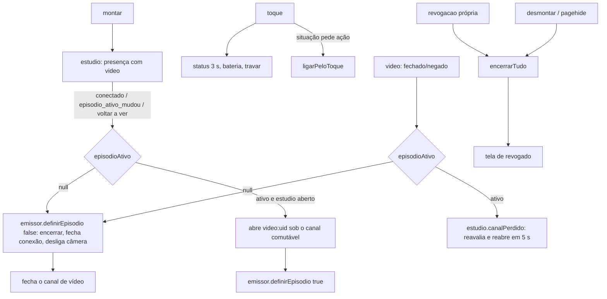

# VER-052 — E4, Tarefa 4: `/camera` com tela preta e vídeo

## Cabeçalho

| Campo | Valor |
|---|---|
| Id | VER-052 |
| Título | E4, Tarefa 4: `/camera` pareado vira a tela preta com vídeo (`CameraNoAr`): toque, Wake Lock, canal de vídeo só com episódio, status, prévia, presença coalescida, revogação e saída da página |
| Gravidade | alta |
| Tipo | implementação · segurança · privacidade |
| Data | 2026-11-28 (data do commit, em UTC) |
| Usuário responsável | TokumoH |
| Status de implementação | implementado |
| Commits | commit que introduz este arquivo — `git log --diff-filter=A --format=%h -- docs/verificacoes/2026-11-28-052-e4-camera-tela-preta.md` |
| Arquivos | `src/app/telas/CameraNoAr.tsx` (novo), `src/app/telas/CameraNoAr.test.tsx` (novo), `src/app/canalDeVideoComutavel.ts` (novo), `src/app/canalDeVideoComutavel.test.ts` (novo), `src/app/telas/Camera.tsx`, `src/app/useDispositivo.ts`, `src/app/telas/PalcoNoAr.tsx`, `src/app/telas/TelaDeDispositivo.tsx`, `src/app/telas/TelaDeDispositivo.test.tsx`, `src/app/servicos.ts`, `src/app/servicos.test.ts`, `src/app/servicosFalsos.ts`, `src/app/servicosFalsos.test.ts`, `src/shared/styles/base.css`, `src/shared/styles/tokens.css` (rodada 1), `src/domains/captura/sinais.ts`, `src/domains/captura/sinais.test.ts`, `src/domains/aovivo/mensagens.test.ts` (os três da rodada 1), `src/app/README.md`, `src/app/telas/README.md`, `src/shared/styles/README.md`, `src/domains/captura/README.md`, `src/domains/aovivo/README.md` (os dois da rodada 1), `src/app/lerArquivoDoRepositorio.ts` (novo) e `src/app/telas/PalcoNoAr.test.tsx` (os dois da rodada 2), `docs/verificacoes/README.md`, este registro |

## Problema

Depois das Tarefas 1 a 3 ([VER-049](2026-11-27-049-e4-dominio-captura.md), [VER-050](2026-11-27-050-e4-banco-video.md), [VER-051](2026-11-28-051-e4-adaptadores-video.md)), o domínio, o banco e os adaptadores do vídeo existiam, mas nenhuma tela os usava: o `/camera` pareado ainda mostrava "Pareado como … O vídeo chega na etapa E4." (`CameraPareada`). Efeito: o celular não servia de câmera. Os Riscos do VER-051 deixaram três pedidos para esta tarefa: não chamar `ligar()` com faixa boa (ele para o fluxo atual), chamar `travar()` de novo ao voltar à aba, e mostrar a causa quando o navegador não tem WebRTC (o emissor fica em `conectando` para sempre, porque `falhar(false)` não conta para `sem_conexao_direta`).

## Era proposital?

Sim, a ordem é a do [PLA-005](../planos/2026-11-27-e4-celular-como-camera.md): a tela vem na Tarefa 4, com as decisões D5 (canal de vídeo só com episódio, o vídeo segue o episódio ativo), D6 (frase de `sem_conexao_direta` e de `sinal_grande`), D7 (tela preta e consentimento), D10 (o celular não vai ao ar, mas não vaza imagem) e D13 (presença com a situação, no máximo a cada 10 s). No HEAD `ca86624`, `grep -rn "criarEmissorDeVideo" src --include=*.tsx` não achava nenhuma tela.

**Divergências do brief, registradas (o código commitado e as regras do controlador prevalecem):**

| Brief | Feito | Motivo |
|---|---|---|
| registro `AAAA-MM-DD-052-e4-camera-tela-preta.md` | `2026-11-28-052-e4-camera-tela-preta.md` | data da execução (UTC); se o commit sair em outro dia, o nome e os links acompanham |
| Passo 6: "commit; push" | nem commit nem push | o subagente não faz commit (`CLAUDE.md`, seção Commit) |
| modificar `App.test.tsx` (frase de `/camera`) | `App.test.tsx` sem mudança; mudou `TelaDeDispositivo.test.tsx` | o `App.test.tsx` só vê o `/camera` sem link (a frase de `sem_link`, da casca, que não mudou); quem via a frase do `/camera` pareado era o `TelaDeDispositivo.test.tsx` (`pareia-e-mostra`, `falha-e-tentar-de-novo`, `revogado-na-hora`, `canal fechado na câmera`, `strict-mode-pareia-uma-vez`) |
| arquivos da tarefa sem `canalDeVideoComutavel.ts` | arquivo novo `src/app/canalDeVideoComutavel.ts` (+ teste) | o emissor recebe **um** `CanalDeVideo` para sempre (`DependenciasDoEmissor.canal`), mas a D5 manda abrir o canal real só com episódio e fechá-lo quando acaba; recriar o emissor a cada episódio perderia o consentimento da página (D7, passo 2: "com episódio ativo de novo, liga sozinha"). A fabricação pura liga e desliga o canal real por baixo do mesmo emissor; o receptor da Tarefa 5 tem a mesma forma e pode reusá-la |
| `useDispositivo.ts`: `presencaMinimaMs` com padrão `PRESENCA_MINIMA_MS` | feito; e o `PalcoNoAr.tsx` passa `presencaMinimaMs: 0` | com a janela de 10 s também no palco, 6 testes do `PalcoNoAr.test.tsx` caíram (a presença com a situação do OBS deixava de sair na hora: `palco-presenca-com-obs`, senha recusada, websocket…; sabotagem X11). A D13 é da situação do vídeo; o palco já só remarca quando a situação do OBS muda (`situacaoPublicada`) e segue como na E3 |
| aviso sem WebRTC (Riscos do VER-051, "conferir `typeof RTCPeerConnection` ao montar") | `AparelhoDoDispositivo.videoDireto()` em `servicos.ts` (real: `typeof globalThis.RTCPeerConnection === 'function'`; falso: `config.videoDireto`) | a tela não lê o navegador direto (o jsdom não tem `RTCPeerConnection`, e a tela ficaria sempre no aviso nos testes); a pergunta vai pela composição, como a câmera e a tela ligada |
| `EstadoDoVideo` sem situação para "sem WebRTC" | **rodada 1 (I2, decisão do controlador):** `sem_video_direto` entra em `EstadoDoVideo` e no leitor da presença; a rota a publica (tela e presença) | na primeira entrega a frase ficava só na tela e a presença em `aguardando_toque`, e a aba mandaria "tocar" numa câmera que nunca liga; a aba e o selo que mostram a causa são da Tarefa 6 (pendência abaixo) |

## Solução

1. **`CameraNoAr`** ([`CameraNoAr.tsx`](../../src/app/telas/CameraNoAr.tsx#L95-L400)): um controlador por montagem (efeito) compõe `acompanharEstudio`, `criarEmissorDeVideo` sobre o canal comutável, `servicos.conexoes`, uma câmera e uma tela ligada da rota (`aparelho.camera()`, `aparelho.tela()`), `Revogados` (15 min, `agora` injetável) e `palco.episodioAtivo()`.
   - **Toque (D7):** a área de toque (`<button class="toque-da-camera">`) cobre a tela; nas situações que pedem ação (`aguardando_toque`, `sem_permissao`, `sem_camera`, `inseguro`, `sinal_grande`) o toque chama `emissor.ligarPeloToque()` (que só pede a câmera sem faixa boa: Riscos do VER-051, N2); todo toque mostra o status por `STATUS_VISIVEL_MS` (3 s), lê a bateria e, sem a tela travada, pede `travar()`.
   - **Episódio (D5):** consulta ao conectar o `estudio`, no `episodio_ativo_mudou` e ao voltar a ver. Com episódio e o `estudio` conectado → abre `videoDaCamera()` e `definirEpisodio(true)`; sem episódio → `definirEpisodio(false)` (o `encerrar` sai pelo canal ainda ligado) e **depois** fecha o canal. `fechado`/`negado` do canal de vídeo → nova consulta: sem episódio fica fechado (sem `canalPerdido`, sem `dispositivoAtual`); com episódio → fecha e `estudio.canalPerdido()` (reavalia e reabre em 5 s).
   - **Tela (D7, D10):** `<main class="tela-preta">` com o ponto (`role="img"`, `aria-label` = frase da situação; cinza, ciano em `conectado`, rosa com problema); a frase fica escrita só nas situações que pedem ação, nas outras aparece pelo toque; a bateria ("Bateria: 87%") só com leitura; sem Wake Lock, as instruções do DES-001 §10.4, item 3 (iPhone e Android) ficam na tela; o botão "Prévia" (com o status e a câmera ligada) mostra um `<video autoPlay muted playsInline>` com o `srcObject` de `fluxoDaPrevia()` por `PREVIA_MS` (15 s), com "Esconder"; a prévia some se a câmera desliga.
   - **Presença (D13):** `{ tipo: 'camera', dispositivoId, obs: null, video: { estado, telaLigada, bateria } }`, pedida a cada mudança e coalescida pelo `acompanharEstudio`.
   - **Revogação:** a própria → `encerrarTudo()` (emissor parado, câmera desligada, canal de vídeo fechado, tela solta) **antes** de `marcarRevogado()`; a do par → `revogados.revogar` e `emissor.revogarPar`.
   - **Saída:** desmontar e `pagehide` → `encerrarTudo()` (com o `encerrar` antes de fechar o canal); `pageshow` com `persisted` (página restaurada do cache de navegação) recria o controlador e pede o toque de novo.
   - **Sem WebRTC:** `aparelho.videoDireto()` falso → a situação fica em `sem_video_direto` (rodada 1, I2: na tela, ponto rosa, e na presença; o emissor não a sobrescreve), o toque não liga a câmera nem pede a trava, e o canal de vídeo não abre nem com episódio (rodada 1, N2).
2. **Canal comutável** ([`canalDeVideoComutavel.ts`](../../src/app/canalDeVideoComutavel.ts#L1-L74)): `ligar(real)` repassa sinais e estados; `desligar()` avisa `fechado` aos ouvintes e devolve o real sem fechar; sem real, `enviar` → `falhou` sem chamar nada.
3. **Presença coalescida** ([`useDispositivo.ts`](../../src/app/useDispositivo.ts#L107-L258)): `presencaMinimaMs` (padrão 10 s); depois de cada marcação, uma janela; mudanças dentro dela saem uma vez no fim; corpo igual ao último marcado nunca é remarcado; `0` marca na hora.
4. **Composição:** `AparelhoDoDispositivo.videoDireto()`; `Camera.tsx` usa a `CameraNoAr` com `dependencias.aoVoltarAVer`.
5. **Estilos** (`base.css`): `.tela-preta` (`#000`, exceção declarada como o transparente do palco; texto `--texto-na-tela-preta`, token novo, `#858589`, igual nos dois modos, 5,7:1 sobre o preto, desde a rodada 1, N3), `.toque-da-camera`, `.camera-no-ar`, `.ponto-da-camera--{cinza,ciano,rosa}`, `.status-da-camera`, `.botao-da-camera` (44 px), `.previa-da-camera` (`object-fit: contain`, `max-width: 100%`). As instruções saem durante a prévia. **Rodada 1 (I1):** na coluna, `flex-shrink: 0` em todos os filhos e só a prévia encolhe (`flex: 0 1 auto; min-height: 0; height: auto`): com a tela baixa ou deitada, a prévia diminui e o texto e o botão ficam inteiros.
6. **Domínio (rodada 1, I2):** `sem_video_direto` em `EstadoDoVideo` e em `ESTADOS_DO_VIDEO` (`sinais.ts`), aceito por `lerSituacaoDoVideo` e, por ele, por `lerPresenca`. O emissor e o receptor não a produzem.

## Por que esta solução

- **Arquitetura (DDD, Pure Fabrication, Componentes):** a regra (quando ligar, oferecer, esperar, desligar) continua no emissor do domínio; a tela só compõe portas e mostra frases. O canal comutável é uma fabricação pura da camada `app`, sem regra de negócio, reusável pelo receptor da Tarefa 5. A presença coalescida fica no `acompanharEstudio`, comum às três rotas.
- **Segurança e privacidade:** a câmera só liga pelo toque (D7); desliga sem episódio, na revogação (antes da tela de revogado), ao desmontar e no `pagehide`; nenhuma imagem fora da prévia pedida, que some em 15 s; frases fixas, texto pelo React (nada de `innerHTML`); o fluxo vai por `srcObject`, nunca por URL; o SDP nunca vai para `console`, armazenamento ou presença (teste `sdp-nunca-no-console`); a sessão revogada não chama mais a função (o `encerrar` não sai: o canal já foi desligado pelo `aoFecharCanais`).
- **Otimização:** canal de vídeo e câmera só com episódio; presença no máximo a cada 10 s (F1: 5 chamadas por 30 s); nenhum timer pendurado depois de desmontar (`vi.getTimerCount() === 0`); nenhum segundo `getUserMedia` na prévia.

## Por que não outras soluções

| Opção | Motivo de descarte |
|---|---|
| Recriar o emissor a cada episódio, com o canal novo | perde o consentimento e o estado das esperas; exigiria repetir na tela a regra "religa sozinha com episódio de novo" que já está no emissor |
| Abrir o canal de vídeo sempre e deixar o banco negar sem episódio | contraria a D5 (revisão 1, I1): `negado` → `canalPerdido` → laço de reavaliação a cada 5 s |
| Frase da situação sempre na tela | ilumina a sala e contraria a tela preta (D7); só as situações que pedem ação ficam escritas |
| Botão "Prévia" sempre visível | texto e alvo permanentes na tela preta; ele aparece com o status (pelo toque) e só com a câmera ligada |
| Janela de 10 s também no palco | derrubava 6 testes do palco sem ganho: a D13 é do vídeo, e o palco já só remarca quando a situação muda |
| `encerrar` do `pagehide` com `fetch(..., { keepalive: true })` (rodada 1, N4) | a `rpc` do `supabase-js` 2.119.0 (`postgrest-js`) só aceita `head`, `get` e `count` por chamada; `keepalive` exigiria mudar o `fetch` global do cliente (`supabase.ts`/`tempoLimite.ts`, comum a todas as chamadas) ou chamar o PostgREST à mão com o token; fica nos Riscos (o `obs_camera` percebe pela queda do ICE) |
| Ler `typeof RTCPeerConnection` na tela | a tela passaria a conhecer o navegador, e o jsdom ficaria sempre no aviso; vai pela composição (`aparelho.videoDireto`) |
| Abrir o canal de vídeo ao voltar a ver mesmo com o `estudio` caído | abriria um canal durante a reavaliação do dispositivo; a volta do `estudio` a `conectado` consulta de novo |

## Onde

| Arquivo | Linhas | O que mudou |
|---|---|---|
| [`src/app/telas/CameraNoAr.tsx`](../../src/app/telas/CameraNoAr.tsx#L15-L56) | 15–56 | `STATUS_VISIVEL_MS`, `PREVIA_MS`, `TEXTO_DA_CAMERA` (com `sem_video_direto`), `PEDEM_TOQUE`, `PERMANENTES`, `PROBLEMAS` |
| [`src/app/telas/CameraNoAr.tsx`](../../src/app/telas/CameraNoAr.tsx#L95-L411) | 95–411 | `CameraNoAr` (novo): controlador, canal de vídeo só com episódio (`abrirVideo` 177, `consultarEpisodio` 200, guarda sem WebRTC 224), `encerrarTudo` (254), toque e prévia (299), saída (345), tela (362; a coluna com o toque, rodada 2, 371) |
| [`src/app/telas/CameraNoAr.test.tsx`](../../src/app/telas/CameraNoAr.test.tsx) | 1–782 | 39 testes (novo; rodada 2: `toque-na-coluna`; rodada 1: `previa-sem-fluxo`, `css-da-camera`, `sem_video_direto` no `tela-preta-sem-video` e no `sem-webrtc-avisa`) |
| [`src/app/canalDeVideoComutavel.ts`](../../src/app/canalDeVideoComutavel.ts#L1-L74) | 1–74 | `criarCanalComutavel` (novo) |
| [`src/app/canalDeVideoComutavel.test.ts`](../../src/app/canalDeVideoComutavel.test.ts) | 1–103 | 4 testes (novo) |
| [`src/app/useDispositivo.ts`](../../src/app/useDispositivo.ts#L107-L258) | 107–258 | `presencaMinimaMs`, `marcar` com janela, `atualizarPresenca` coalescido |
| [`src/app/telas/PalcoNoAr.tsx`](../../src/app/telas/PalcoNoAr.tsx#L594-L597) | 594–597 | `presencaMinimaMs: 0` |
| [`src/app/telas/Camera.tsx`](../../src/app/telas/Camera.tsx#L1-L12) | 1–12 | usa a `CameraNoAr` |
| [`src/app/telas/TelaDeDispositivo.tsx`](../../src/app/telas/TelaDeDispositivo.tsx#L107-L110) | 107–110 | comentário: a `CameraPareada` fica só no `/obs/camera` |
| [`src/app/telas/TelaDeDispositivo.test.tsx`](../../src/app/telas/TelaDeDispositivo.test.tsx#L60-L71) | 12, 60–71, 111, 176, 186, 195, 207, 259 | frase e presença do `/camera` pareado |
| [`src/app/servicos.ts`](../../src/app/servicos.ts#L103-L108) | 103–108, 162 | `videoDireto` |
| [`src/app/servicosFalsos.ts`](../../src/app/servicosFalsos.ts#L705-L710) | 705–710, 842 | `config.videoDireto` |
| [`src/app/servicos.test.ts`](../../src/app/servicos.test.ts), [`src/app/servicosFalsos.test.ts`](../../src/app/servicosFalsos.test.ts) | — | asserções de `videoDireto` |
| [`src/shared/styles/base.css`](../../src/shared/styles/base.css#L475-L525) | 475–525 | estilos da tela preta (rodada 1: só a prévia encolhe; texto no token novo, sem `opacity`) |
| [`src/shared/styles/tokens.css`](../../src/shared/styles/tokens.css#L19) | 19 | `--texto-na-tela-preta` (rodada 1, N3) |
| [`src/domains/captura/sinais.ts`](../../src/domains/captura/sinais.ts#L34-L51) | 34–51, 179 | `sem_video_direto` (rodada 1, I2) |
| [`src/domains/captura/sinais.test.ts`](../../src/domains/captura/sinais.test.ts#L189-L193) | 189–193 | teste da situação nova |
| [`src/domains/aovivo/mensagens.test.ts`](../../src/domains/aovivo/mensagens.test.ts#L244-L247) | 244–247 | presença com `sem_video_direto` aceita |
| [`src/app/lerArquivoDoRepositorio.ts`](../../src/app/lerArquivoDoRepositorio.ts#L1-L11) | 1–11 | leitor de arquivo comum dos testes (rodada 2, R2-N3) |
| [`src/app/telas/PalcoNoAr.test.tsx`](../../src/app/telas/PalcoNoAr.test.tsx#L946-L954) | 946–954 | `lerArquivo` delega ao auxiliar comum; o arquivo fica com as mesmas 1 065 linhas, nas mesmas posições (âncoras antigas) |
| READMEs de `src/app/`, `src/app/telas/`, `src/shared/styles/`, `src/domains/captura/`, `src/domains/aovivo/`, `docs/verificacoes/` | — | "Onde", "Arquivos", organização, verificação e riscos |

## Lógica

| Antes | Depois |
|---|---|
| `/camera` pareado: cartão com "Pareado como … O vídeo chega na etapa E4." | tela preta; "Toque para ligar a câmera." até o toque |
| presença `{ tipo, dispositivoId, obs: null }` | com `video: { estado, telaLigada, bateria }`, no máximo a cada 10 s |
| `atualizarPresenca()` marcava na hora | coalesce na janela (o palco continua na hora) |
| sem WebRTC: presença em `aguardando_toque` e canal de vídeo aberto à toa | `sem_video_direto` na tela e na presença; nenhum canal de vídeo (rodada 1) |
| prévia de 60vh numa coluna que não encolhe: botão fora da tela deitado ou baixo | só a prévia encolhe; botão inteiro nas 6 medidas (rodada 1) |
| coluna sem rolagem e sem receber toque (`pointer-events: none`) | coluna com `overflow-y: auto`, que recebe o toque (fora dos botões, vale como toque na tela): o botão fica alcançável por rolagem quando não cabe (rodada 2) |

## Exemplo

Teste `presenca-com-video`: ao abrir, 1 marcação (`aguardando_toque`, `telaLigada: null`). O toque e a resposta levam a `conectando` → `conectado` e à tela `travada` em menos de 1 s: nenhuma marcação nova até 9 500 ms; em 10 100 ms, a 2ª (`conectado`, `travada`). Uma queda breve (`conectado` → `conectando` → `conectado`) dentro da nova janela não gera marcação (o corpo final é o já marcado), nem em mais 30 s. Fora da janela, o fim do episódio sai na hora (3ª, `aguardando_episodio`). Sem a coalescência (sabotagem B7) seriam 4 marcações a mais no primeiro segundo.

## Verificação

**TDD:** os testes novos falharam antes da implementação: `CameraNoAr.test.tsx` sem o módulo (arquivo inteiro falha); `canalDeVideoComutavel.test.ts` sem o módulo; `presenca-com-video` com o `useDispositivo.ts` do HEAD (numa cópia: 1 falha, 33 passam); `servicos.test.ts` e `servicosFalsos.test.ts` sem `videoDireto` (2 falhas); `TelaDeDispositivo.test.tsx` + `CameraNoAr.test.tsx` com o `Camera.tsx` do HEAD (38 falhas).

**Testes:** `npm test` — 65 arquivos, 2575 testes desde a rodada 2 (39 em `CameraNoAr.test.tsx`; 2574 na rodada 1, 4 em `canalDeVideoComutavel.test.ts`, mais 1 em `sinais.test.ts` e 1 em `mensagens.test.ts`; eram 2569 na primeira entrega). `npm run typecheck` sem erro.

**Sabotagens** (numa cópia em `sab-t4/copia` no scratchpad, `vitest --cache=false`, uma por vez; duas rodadas, a 2ª sobre o código final, numa cópia nova; `sha256sum` dos 263 arquivos do repositório igual antes e depois):

| # | Sabotagem | Testes que caíram |
|---|---|---|
| B1 | prévia sempre visível com a câmera ligada | `tela-preta-sem-video` (4 situações), `previa-por-15s` |
| B2 | ligar ao montar sem toque | `toque-liga-a-camera` e mais 6 |
| B3 | não desligar no fim do episódio | `episodio-encerrado-desliga` (2) e mais 4 |
| B4 | prévia sem prazo | `previa-por-15s` |
| B5 | sem as instruções | `sem-wake-lock-avisa` |
| B6 | Wake Lock não pedido ao voltar | `wake-lock-volta-ao-ver` |
| B7 | presença a cada mudança | `presenca-com-video` |
| B8 | não desligar ao desmontar | `saida-da-pagina-desliga (desmontar)` |
| B9 | esquecer o desligar na revogação | **na 1ª rodada, nada caiu** (a desmontagem que vem depois desligava); achado: o teste passou a conferir que a câmera desliga com a tela preta ainda montada (antes da tela de revogado); na 2ª rodada, `revogado-desliga-tudo` |
| X1 | vídeo abre com o `estudio` caído | voltar a ver com o `estudio` caído |
| X2 | presença igual remarcada | `presenca-com-video` |
| X3 | `desligar` sem avisar `fechado` | `desligar: avisa fechado…` (canal comutável) |
| X4 | sem conferir o WebRTC | `sem-webrtc-avisa` |
| X5 | canal fechado antes do `encerrar` | `episodio-encerrado-desliga` (2) |
| X6 | toque não tenta de novo em `sem_permissao` | `sem-permissao` |
| X7 | status sem prazo | `status-por-3s`, `tela-preta-sem-video` (5) |
| X8 | `pageshow` ignorado | `pagina-restaurada-pede-toque` |
| X9 | revogação do par sem `revogarPar` | `revogacao-do-par` |
| X10 | `negado` sem episódio reavalia | `canal-de-video-so-com-episodio` |
| X11 | palco com a janela de 10 s | 6 testes do `PalcoNoAr.test.tsx` |

**320 px:** página fora do repositório com o `tokens.css` e o `base.css` e o pior caso (frase da D6, bateria, instruções, prévia, botão), no Chromium do ambiente (Playwright 1.63), 320×640 e 320×480, claro e escuro: `scrollWidth` 320, nenhum elemento além da borda, botão de 44 px de altura, área de toque 320×640, fundo `rgb(0, 0, 0)`, texto `rgb(104, 104, 104)` (claro) e `rgb(180, 180, 188)` (escuro).

**Âncoras antigas:** `useDispositivo.ts` 258 (mínimo 217), `TelaDeDispositivo.tsx` 133 (124), `TelaDeDispositivo.test.tsx` 263 (261), `PalcoNoAr.tsx` 724 (610), `Camera.tsx` 12 (11), `base.css` 523 (473), `servicos.ts` (149), `servicosFalsos.ts` (773), `src/app/telas/README.md` (62), `docs/verificacoes/README.md` (93): nenhum encolheu.

**Revisões independentes:** R1 — revisão independente (16 sabotagens, medidas no Chromium): spec ✅, reprovada por 2 achados importantes (I1 botão da prévia fora da tela em tela baixa e deitado, com frase falsa nos Riscos; I2 sem WebRTC sem situação própria na presença) e 6 nits — corrigidos na rodada 1; R2 — re-revisão focada (medidas refeitas, 7 sabotagens, `postgrest-js` conferido): **limpa**, com 3 nits (R2-N1 botão fora da tela deitado no Safari; R2-N2 `opacity` em `.tela-preta`; R2-N3 reuso do leitor de arquivo) — corrigidos na rodada 2, que mexeu no toque (coluna que rola e recebe o toque); R3 — conferência focada dessa mudança (sonda com toque emulado no Chromium: arrastar não conta como toque, botões não contam, o consentimento da D7 não é afetado; auxiliar de teste fora do bundle; 48 medidas): **limpa**, com 1 nit de registro (R3-N1, abaixo em Riscos). `npm run check` 0 no conteúdo exato do commit.

**Rodada 1 da revisão (C1)** — revisão independente: spec ✅, qualidade reprovada (I1 botão da prévia fora da tela em tela baixa e deitado; I2 sem WebRTC sem situação na presença, decidido corrigir agora; nits N1–N6). Correções: I1 (CSS), I2 (`sem_video_direto` no domínio e na rota), N1 (teste `previa-sem-fluxo`), N2 (sem canal de vídeo sem WebRTC), N3 (token `--texto-na-tela-preta`, 5,7:1, igual nos dois modos; sem `opacity` no texto), N4–N6 (Riscos). TDD: os testes novos falharam antes (`sem_video_direto` em `sinais.test.ts` e `mensagens.test.ts`: 2 falhas; `sem-webrtc-avisa` e `css-da-camera`: 2 falhas; `previa-sem-fluxo` passa com a guarda, e a sabotagem C1a o derruba).

| Linha | O quê | Como | Resultado |
|---|---|---|---|
| C1 | sabotagens, cópia nova, `--cache=false`, `sha256sum` dos 264 arquivos igual antes e depois | as 20 anteriores de novo e mais 9 | todas derrubam testes: C1a (R12 do revisor, prévia sem conferir o fluxo) → `previa-sem-fluxo`; C1b (coluna encolhe o botão) e C1c (prévia sem `min-height: 0`) → `css-da-camera`; C1d (token `#686868`) e C1e (texto de volta ao `--gray`) → `css-da-camera`; C1f (leitor sem `sem_video_direto`) → `sinais.test.ts` e `mensagens.test.ts`; C1g (rota publica `aguardando_toque`) e C1h (emissor sobrescreve a situação) → `sem-webrtc-avisa` e `tela-preta-sem-video (sem_video_direto)`; C1i (canal de vídeo sem WebRTC) → `sem-webrtc-avisa`; B1–B9 e X1–X11 continuam caindo |
| C1 | medidas da altura (I1) | página fora do repositório com o `tokens.css` e o `base.css` atuais, prévia num `<canvas>` com o tamanho do fluxo (720×1280 em pé; 1280×720 deitado), Chromium do ambiente (Playwright 1.63), claro e escuro; 320×480, 320×568, 360×640, 568×320, 640×360 e 844×390 | 36 medidas, 0 falhas: com a frase da D6, a bateria e a prévia em pé (botão em 420–464 a 320×480; 260–304 a 568×320; 300–344 a 640×360; 330–374 a 844×390), com a frase comum e a prévia deitada (260–304 a 568×320; 300–344 a 640×360) e com as instruções sem Wake Lock e o botão "Prévia": botão de 44 px inteiro dentro de `innerHeight`, `elementFromPoint` no centro do botão é o botão, status a partir do topo, `scrollWidth` igual à largura; cor do texto `rgb(133, 133, 137)` nos dois modos |
| C1 | contraste (N3) | teste `css-da-camera` calcula a razão WCAG do token sobre `#000` | 5,7:1 (≥ 4,5:1), o token aparece uma vez (não muda no escuro) |

| C2 | rodada 2 (re-revisão limpa; nits R2-N1 a R2-N3, todos entram) | R2-N1: `.camera-no-ar` com `overflow-y: auto` (sem `pointer-events: none`) e `onClick` na coluna que chama o toque fora dos botões, teste `toque-na-coluna`; R2-N2: `css-da-camera` recusa `opacity` em toda regra do bloco da câmera que não é o ponto; R2-N3: `src/app/lerArquivoDoRepositorio.ts`, usado pelos dois testes de tela. Vermelhos antes: `toque-na-coluna` e `css-da-camera` (2 falhas). Sabotagens numa cópia nova, `--cache=false`, `sha256sum` dos 265 arquivos igual: as 29 anteriores e mais 7, **36, todas derrubam testes**: C2a (`opacity: 0.5` em `.tela-preta`) e C2b (`opacity` no status) → `css-da-camera`; C2c (coluna sem `overflow-y: auto`) e C2d (`pointer-events: none` de volta) → `css-da-camera`; C2e (toque na coluna ignorado) e C2f (botões contam como toque) → `toque-na-coluna`; C2g (leitor comum quebrado) → `css-da-camera` e `palco-sem-piscar` | 0 sobreviventes |
| C2 | medidas da altura, de novo | as 3 páginas da linha C1 com o CSS atual, Chromium do ambiente, claro e escuro, em 320×480, 320×568, 360×640, 568×320, 640×360, 844×390, 568×260 e 568×230 | 48 medidas, 0 falhas: botão de 44 px inteiro dentro de `innerHeight` e sob o ponteiro; direto em 44 delas; nas 4 com as instruções sem Wake Lock a 568×260 e 568×230 (topo do botão em 273, fora da tela), visível depois de rolar a coluna com a roda (topo em 200 e 170); `scrollWidth` igual à largura; fundo `rgb(0, 0, 0)` em todas |

**`npm run check`:** 0 erros (`typecheck`, 2575 testes, `check-docs` com 85 arquivos e 52 registros, `check-doc-secrets`, `rpc:grants-check` e `data-api:check` com 7 migrações, `check-deps-audit`), rodado depois de este registro existir.

## Riscos

- **Toque que interrompe a rolagem por inércia (R3, R3-N1):** a sonda com toque emulado não reproduz o toque que para uma rolagem por inércia no iPhone e no Android reais; se esse toque virar `click`, o pior efeito é mostrar o status ou repetir o pedido da câmera quando o consentimento já foi dado — nunca liga a câmera sem consentimento. Conferir no aparelho real (passo do responsável da Tarefa 7).
- **Navegador e aparelho reais não exercitados:** WebRTC, `getUserMedia`, Wake Lock e bateria foram provados com os falsos de `servicosFalsos.ts`; o Chromium com câmera falsa é a Tarefa 7, e iPhone/Android, o passo do responsável (gesto exigido pelo Safari, F6; Wake Lock no iOS 16.4+, F7; `pageshow` com `persisted` no Safari).
- **Pendência para a Tarefa 6 (rodada 1, I2):** a situação `sem_video_direto` já chega pela presença, mas a aba Ao vivo (lista e checklist) e o selo do `/obs/camera` ainda não têm frase para ela; a Tarefa 6 precisa mostrar a causa ("o navegador do celular não faz vídeo direto"), e a Tarefa 5 decide se o `/obs/camera` também a publica.
- **`encerrar` no `pagehide` (rodada 1, N4):** sai por `fetch` comum (a `rpc`), sem `keepalive`, e o navegador pode cancelá-lo ao descarregar a página; o `obs_camera` percebe pela queda do ICE (D6). `keepalive` não é viável sem mexer no `fetch` global do cliente (ver "Por que não outras soluções").
- **Revogação descoberta só pela reavaliação (rodada 1, N5):** quando o `estudio` cai por `negado` e só o `resolverDispositivo` descobre a revogação, o canal de vídeo fecha na hora (`aoFecharCanais`), mas a conexão P2P já aberta segue até a resposta (até cerca de 15 s, o tempo-limite do `/rest`); a revogação normal, pelo aviso `revogacao` em `estudio`, desliga na hora. O corte do outro lado é a Tarefa 5.
- **`justify-content: safe center` (rodada 1, N6):** num Safari sem suporte a `safe`, a declaração inteira é descartada e a coluna fica no topo (seguro: nada sai da tela por cima).
- **Queda breve:** o ponto do celular passa por cinza (`conectando`) numa queda curta do ICE; a presença coalescida não pisca na aba quando a queda cabe na janela, mas uma queda fora da janela sai na hora e a volta sai no fim da janela seguinte (até 10 s de atraso). A piscada no `/obs/camera` é a do VER-049 (pendência da D3) e da Tarefa 5.
- **Prévia e faixa religada:** se a faixa termina e é religada durante a prévia sem a situação mudar, a prévia continua com o fluxo antigo (parado) até ser reaberta.
- **Bateria:** lida só no toque; a presença leva o valor do último toque.
- **Altura pequena:** a área central não rola (a área de toque fica por baixo). Na primeira entrega este item dizia que tirar as instruções da prévia bastava para caber em 320×480; era falso com a frase da D6 (medida do revisor: botão em 486–530 px a 320×480, e fora da tela deitado). Desde a rodada 1 só a prévia encolhe, e as 36 medidas da linha C1 deixam o botão inteiro; a re-revisão da rodada 2 achou que, sem Wake Lock e deitado com as barras do Safari (568×260 e 568×230), o que saía da tela era o **botão** "Prévia", não só texto. Desde a rodada 2 a coluna rola (`overflow-y: auto`) e recebe o toque: nesses casos o botão fica alcançável por rolagem (linha C2). A rolagem real por toque no iPhone e no Android (e a `overscroll-behavior` no Safari) não foi medida aqui: fica para o passo do responsável.
- **`crypto.randomUUID`** só existe em contexto seguro; o emissor só oferece depois de a câmera ligar, o que já exige `https` (sem ele, `inseguro`).
- **Palco sem janela:** o palco segue marcando a presença na hora (como na E3); o teto de 5 chamadas por 30 s (F1) depende de a situação do OBS mudar pouco.
- **Data no nome:** se o commit sair depois de 2026-11-28 (UTC), o nome deste arquivo e os links acompanham.
