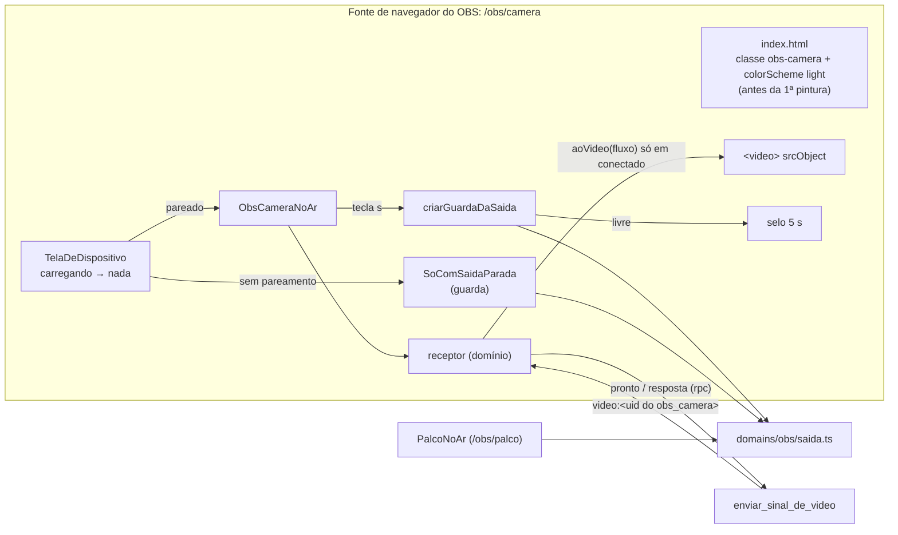

# VER-053 — E4, Tarefa 5: `/obs/camera` com só o vídeo; guarda de saída compartilhada

## Cabeçalho

| Campo | Valor |
|---|---|
| Id | VER-053 |
| Título | E4, Tarefa 5: `/obs/camera` pareado mostra só o vídeo na Fonte do OBS (`ObsCameraNoAr`), com selo pela tecla `s` e telas de erro só com a saída parada; a guarda de saída sai do `PalcoNoAr.tsx` para `src/domains/obs/saida.ts` e a `SoComSaidaParada` para o `TelaDeDispositivo.tsx` |
| Gravidade | alta |
| Tipo | implementação · segurança (o que vai ao ar) · refatoração sem mudança de regra |
| Data | 2026-11-28 (data do commit, em UTC) |
| Usuário responsável | TokumoH |
| Status de implementação | implementado |
| Commits | commit que introduz este arquivo — `git log --diff-filter=A --format=%h -- docs/verificacoes/2026-11-28-053-e4-obs-camera.md` |
| Arquivos | `src/domains/obs/saida.ts` (novo), `src/domains/obs/saida.test.ts` (novo), `src/app/telas/ObsCameraNoAr.tsx` (novo), `src/app/telas/ObsCameraNoAr.test.tsx` (novo), `src/app/telas/ObsCamera.tsx`, `src/app/telas/PalcoNoAr.tsx`, `src/app/telas/TelaDeDispositivo.tsx`, `src/app/telas/TelaDeDispositivo.test.tsx`, `src/app/telas/ObsPalco.tsx`, `index.html`, `src/shared/styles/base.css`, `src/app/lerArquivoDoRepositorio.ts` (só o comentário), `src/domains/obs/README.md`, `src/domains/README.md`, `src/domains/captura/README.md`, `src/app/README.md`, `src/app/telas/README.md`, `src/shared/styles/README.md`, `docs/verificacoes/README.md`, este registro |

## Problema

Depois das Tarefas 1 a 4 ([VER-049](2026-11-27-049-e4-dominio-captura.md) a [VER-052](2026-11-28-052-e4-camera-tela-preta.md)), a câmera já oferecia o vídeo, mas o `/obs/camera` pareado ainda era a `CameraPareada`: um cartão "Pareado como … O vídeo chega na etapa E4." e nenhum receptor. Efeitos:

1. **O vídeo não chegava ao OBS:** ninguém montava o `criarReceptorDeVideo` nem abria o tópico `video:<uid>` do `obs_camera`; a câmera ficava em `aguardando_par` para sempre (nenhum `pronto`, nenhuma resposta).
2. **Texto no ar:** o cartão, o `carregando` ("Conferindo o pareamento…") e as telas de erro (`sem_link`, revogado, falha) apareciam na Fonte do OBS sem nenhuma guarda, com a transmissão no ar (a lição da D16 do PLA-004 e do VER-046, I1, valia só para o palco).
3. **Pintura escura na Fonte:** o `index.html` só punha a classe transparente e o `colorScheme = 'light'` no `/obs/palco`; no `/obs/camera`, com o sistema em tema escuro, o `color-scheme: light dark` pintaria o fundo opaco (revisão 1, I5 do PLA-005).
4. **A guarda morava na tela do palco:** `saidaParada`, `criarGuardaDaSaida` e `SoComSaidaParada` estavam no `PalcoNoAr.tsx`; usá-las no `/obs/camera` faria a casca da câmera depender da tela do palco (ou copiar a guarda, D8).

Pendências de registros anteriores que esta tarefa fecha ou decide: o selo do `/obs/camera` sem frase para `sem_video_direto` (VER-052, Riscos, rodada 1, I2: "a Tarefa 5 decide se o `/obs/camera` também a publica"); o corte do outro lado na revogação (VER-052, Riscos, N5: "o corte do outro lado é a Tarefa 5"); a piscada do vídeo na queda breve (VER-049, N6; VER-052, Riscos) segue pendente do responsável.

## Era proposital?

Sim, a ordem é a do [PLA-005](../planos/2026-11-27-e4-celular-como-camera.md): o `/obs/camera` vem na Tarefa 5, com as decisões D3 (o `obs_camera` só responde; `pronto` a cada 10 s sem vídeo), D5 (canal de vídeo só com episódio), D8 (só o vídeo; selo e telas de erro pela mesma guarda do palco, que sai do `PalcoNoAr.tsx`; classe `obs-camera` e esquema claro no `index.html`), D10 (quem vai ao ar é o `/obs/camera`) e D13 (presença com a situação). No HEAD `5e97a93`, `grep -rn "criarReceptorDeVideo" src --include=*.tsx` não achava nenhuma tela, e a `CameraPareada` dizia no próprio comentário que o vídeo chegava "na Tarefa 5 da E4".

**Divergências do brief, registradas (o código commitado e as regras do controlador prevalecem):**

| Brief | Feito | Motivo |
|---|---|---|
| registro `AAAA-MM-DD-053-e4-obs-camera.md` | `2026-11-28-053-e4-obs-camera.md` | data da execução (UTC); se o commit sair em outro dia, o nome e os links acompanham |
| Passo 6: "commit; push" | nem commit nem push | o subagente não faz commit (`CLAUDE.md`, seção Commit) |
| modificar `App.test.tsx` (frase de `/obs/camera`) | `App.test.tsx` sem mudança | como no VER-052: o `App.test.tsx` só vê o `/obs/camera` **sem link** (a frase de `sem_link`, da casca, que não mudou; fora do OBS, a `SoComSaidaParada` mostra o cartão). Quem via a frase do `/obs/camera` pareado era o `TelaDeDispositivo.test.tsx` (`pareia-e-mostra`), que mudou |
| `PalcoNoAr.tsx` "perto de 629" linhas | 632 | o arquivo tinha 724 linhas no HEAD (o plano contou 721 antes do VER-052, que somou 3); saíram 92 (90 da guarda e da `SoComSaidaParada`, 2 da constante `SITUACAO_A_CADA_MS`); o mínimo é 610 |
| `TelaDeDispositivo.tsx` "perto de 145" | 147 | mínimo 124 |
| o selo do `/obs/camera` com as frases "· aguardando a câmera", "· sem conexão direta" e "Pareado como <rótulo>" (D8) | e mais uma frase por situação que o receptor produz (`aguardando_episodio`, `conectando`, `conectado`, `sinal_grande`) e por `sem_video_direto` | o selo mostra a situação atual; sem frase própria, essas situações cairiam numa frase errada. As situações do lado da câmera (toque, permissão…) nunca chegam ao receptor e valem "aguardando a câmera" |
| `sem_video_direto` no `/obs/camera` (decisão pendente do VER-052) | **publicada** pela rota (presença e selo), e o canal de vídeo não abre | o mesmo do `/camera` (VER-052, rodada 1, I2 e N2): sem `RTCPeerConnection` (F10 ainda sem prova no CEF do OBS), a aba Ao vivo (Tarefa 6) recebe a causa em vez de "aguardando a câmera", e nenhum canal fica aberto à toa |
| testes listados no brief | todos, e mais `selo-literal`, `sem-webrtc-no-obs-camera`, `obs-camera-desmonta-limpo`, a releitura periódica do selo e o `Starting`/`Stopped` nas telas de erro | as sabotagens X4, X9, X10, X11 e X14 (abaixo) não tinham teste que as derrubasse com só a lista do brief; duas delas (X4, X9) sobreviveram na primeira rodada e os testes foram reforçados |

## Solução

1. **Guarda movida** ([`saida.ts`](../../src/domains/obs/saida.ts#L1-L66)): `SELO_VISIVEL_MS` (5000), `SITUACAO_A_CADA_MS` (15 000), `saidaParada`, `RELEITURAS_PARA_LIBERAR` (2) e `criarGuardaDaSaida` saem do `PalcoNoAr.tsx` com o corpo igual, letra por letra; só dependem da porta `ObsNoNavegador`. O `PalcoNoAr.tsx` importa a guarda e **reexporta** `SELO_VISIVEL_MS` e `SITUACAO_A_CADA_MS` (o `PalcoNoAr.test.tsx` as importa da tela e não muda).
2. **Casca** ([`TelaDeDispositivo.tsx`](../../src/app/telas/TelaDeDispositivo.tsx#L110-L147)): a `SoComSaidaParada` entra no lugar da `CameraPareada` (que sai), com o mesmo corpo e o `SITUACAO_A_CADA_MS` de `domains/obs/saida.ts`; o `TelaDoEstado` esconde o `carregando` também no `obs_camera` ([linhas 53–55](../../src/app/telas/TelaDeDispositivo.tsx#L53-L55); revisão 1, N3). O `ObsPalco.tsx` passa a importá-la da casca.
3. **`ObsCamera.tsx`** ([`ObsCamera.tsx`](../../src/app/telas/ObsCamera.tsx#L1-L26)): como o `ObsPalco`, guarda uma porta do OBS (a do navegador ou a dos testes), passa `cobrirTela={(t) => <SoComSaidaParada obs={obs}>{t}</SoComSaidaParada>}` e, pareado, a `ObsCameraNoAr`.
4. **`ObsCameraNoAr`** ([`ObsCameraNoAr.tsx`](../../src/app/telas/ObsCameraNoAr.tsx#L59-L308)): um controlador por montagem (efeito), no molde da `CameraNoAr`:
   - **Receptor** (`criarReceptorDeVideo`) sobre o canal comutável (`criarCanalComutavel<SinalDaObs, SinalDaCamera>`, do VER-052), `servicos.conexoes`, `Revogados` (15 min) e sessões por `crypto.randomUUID()`.
   - **Episódio (D5):** `episodioAtivo()` ao conectar o `estudio` e no `episodio_ativo_mudou`; com episódio e o `estudio` aberto → `videoDaObs()` (o tópico `video:<usuarioId do pareado>`) por baixo do receptor e `definirEpisodio(true)` (o receptor manda o `pronto`); sem episódio → `definirEpisodio(false)` (fecha e limpa o vídeo) e o canal fecha; `fechado`/`negado` do canal de vídeo → nova consulta (sem episódio, fica fechado; com episódio, `canalPerdido` do `estudio`).
   - **Tela (D8):** só `<video className="video-da-obs-camera" autoPlay muted playsInline>`, com o `srcObject` por `ref`, e só enquanto o receptor entrega o fluxo (conexão em `conectado`); nenhuma frase na tela.
   - **Selo:** tecla `s` (sem repetição nem modificador, fora de campos) → `guarda.livre()`; livre → selo por `SELO_VISIVEL_MS` com "Pareado como <rótulo>" e a frase da situação (`TEXTO_DA_OBS_CAMERA`), como texto do React. Evento de saída → `guarda.evento`, fecha o selo na hora e invalida o pedido em curso (`geracaoDaSaida`); a cada `SITUACAO_A_CADA_MS`, `contarReleitura` e, com o selo aberto, nova conferência (se um evento faltar).
   - **Presença (D13):** `{ tipo: 'obs_camera', dispositivoId, obs: null, video: { estado, telaLigada: null, bateria: null } }`, coalescida pelo `acompanharEstudio` (10 s).
   - **Revogação:** a própria → `encerrarTudo()` (receptor parado, conexão fechada, canal fechado, selo fechado) **antes** de `marcarRevogado()`; a tela de revogado passa pela `SoComSaidaParada`. A do par → `revogados.revogar` e `receptor.revogarPar`.
   - **Sem WebRTC:** `aparelho.videoDireto()` falso → situação `sem_video_direto` (presença e selo), o receptor não a sobrescreve e o canal de vídeo não abre.
   - **Desmontar:** `encerrarTudo()` (o `encerrar` sai pelo canal ainda ligado), ouvintes e relógios soltos.
5. **`index.html`** ([`index.html`](../../index.html#L8-L19)): o mesmo `<script>` clássico, agora numa função imediata, põe `palco` para `/obs/palco` e `obs-camera` para `/obs/camera` (com as barras finais tiradas, como o `resolverRota`) e, nos dois, `document.documentElement.style.colorScheme = 'light'`.
6. **`base.css`** ([`base.css`](../../src/shared/styles/base.css#L529-L535), no fim do arquivo para não deslocar âncoras antigas): `html.obs-camera, html.obs-camera body { background: transparent; }`, `html.obs-camera { color-scheme: light; }`, `.obs-camera-no-ar` (fixa, tela cheia) e `.video-da-obs-camera` (tela cheia, `object-fit: contain`, fundo transparente); o selo reusa o `.selo-do-palco`.

## Por que esta solução

- **Arquitetura (DDD, Pure Fabrication, Componentes):** a guarda é regra pura sobre uma porta do domínio Integração OBS, então vai para `src/domains/obs/` (nenhuma API do navegador, `arquitetura.test.ts` passa); a casca React que a usa fica na casca das rotas de dispositivo, junto do `cobrirTela`; o palco e a câmera do OBS usam o **mesmo** componente (sem cópia). A regra do vídeo (quando responder, `pronto`, sessão, revogado) continua no receptor do domínio; a tela só compõe portas e mostra o vídeo. O canal comutável do VER-052 é reusado sem mudança.
- **Segurança (o que vai ao ar):** nenhum texto na Fonte sem a tecla; o selo e as telas de erro só com a saída parada **e** o status conhecido (READ_OBS ou mais); o `carregando` nunca aparece; nenhum dado vira HTML (rótulo como texto do React; teste `selo-literal`); o fluxo vai por `srcObject`, nunca por URL; o SDP nunca vai para `console`, armazenamento ou presença; a sessão revogada não chama mais a função.
- **Otimização:** um canal de vídeo só com episódio; `pronto` só sem vídeo (o receptor para de mandar em `conectado`); presença no máximo a cada 10 s; nenhum relógio pendurado depois de desmontar (`vi.getTimerCount() === 0`).

## Por que não outras soluções

| Opção | Motivo de descarte |
|---|---|
| Copiar a guarda para o `/obs/camera` | duas regras para a mesma situação perigosa; uma correção numa não chega à outra (a D8 manda a mesma guarda) |
| Importar a guarda e a `SoComSaidaParada` do `PalcoNoAr.tsx` no `ObsCamera.tsx` | a câmera do OBS passaria a depender da tela do palco (e de tudo o que ela importa: executor, websocket, palco) |
| `SoComSaidaParada` em `src/domains/obs/` | é React (estado e efeito); o domínio não importa React (`arquitetura.test.ts`) |
| Reusar a `Previa` da `CameraNoAr` para o vídeo recebido | a `Previa` é privada e tem a classe da prévia do celular; exportá-la ou movê-la mexeria na `CameraNoAr` (VER-052), e tirá-la do arquivo o deixaria com menos de 400 linhas, a âncora `#L95-L400` do VER-052. O componente novo tem 12 linhas; fica como sugestão para a revisão final da etapa |
| Mostrar o último quadro durante uma queda breve do ICE | muda a D3 ("sem vídeo é conexão fora de `conectado`"); pendência do responsável desde o VER-049 (N6) |
| Selo com uma classe nova (`.selo-da-obs-camera`) | mesmo visual e mesma regra do selo do palco; o `.selo-do-palco` já existe (reuso) |
| Pôr a classe `obs-camera` pelo React ao montar | a primeira pintura sairia com o fundo pontilhado (e escuro com o sistema em tema escuro) antes do app; sabotagem S5 |
| Um segundo `<script>` só para o `/obs/camera` | duas regras iguais para o mesmo momento; o teste exige um script clássico só, antes da folha |
| `CSS` novo no meio do `base.css`, junto do palco | deslocaria em 7 linhas as âncoras de VER-041 a VER-052 para o `base.css`; no fim, nenhuma âncora muda |
| Não publicar `sem_video_direto` no `/obs/camera` | a aba Ao vivo mostraria "aguardando a câmera" numa Fonte que nunca vai receber vídeo (a mesma lição do VER-052, rodada 1, I2) |

## Onde

| Arquivo | Linhas | O que mudou |
|---|---|---|
| [`src/domains/obs/saida.ts`](../../src/domains/obs/saida.ts#L1-L66) | 1–66 | novo: a guarda movida (`SELO_VISIVEL_MS`, `SITUACAO_A_CADA_MS`, `saidaParada`, `RELEITURAS_PARA_LIBERAR`, `criarGuardaDaSaida`) |
| [`src/domains/obs/saida.test.ts`](../../src/domains/obs/saida.test.ts#L1-L159) | 1–159 | novo: 19 testes da guarda direto na função (os casos do VER-046) |
| [`src/app/telas/ObsCameraNoAr.tsx`](../../src/app/telas/ObsCameraNoAr.tsx#L1-L308) | 1–308 | novo: `TEXTO_DA_OBS_CAMERA`, `VideoRecebido`, `ObsCameraNoAr` |
| [`src/app/telas/ObsCameraNoAr.test.tsx`](../../src/app/telas/ObsCameraNoAr.test.tsx#L1-L569) | 1–569 | novo: 34 testes (33 e, desde a rodada C1, a liberação do selo por duas releituras) |
| [`src/app/telas/ObsCamera.tsx`](../../src/app/telas/ObsCamera.tsx#L1-L26) | 1–26 | porta do OBS, `cobrirTela` com a `SoComSaidaParada`, `ObsCameraNoAr` |
| [`src/app/telas/PalcoNoAr.tsx`](../../src/app/telas/PalcoNoAr.tsx#L1-L26) | 8–16 | importa a guarda de `domains/obs/saida.ts` (sai o `NIVEL_DE_CONTROLE`) e reexporta `SELO_VISIVEL_MS` e `SITUACAO_A_CADA_MS`; as antigas linhas 70–159 (guarda e `SoComSaidaParada`) saem; nenhum comportamento muda |
| [`src/app/telas/TelaDeDispositivo.tsx`](../../src/app/telas/TelaDeDispositivo.tsx#L1-L147) | 1–12, 53–55, 94–97, 110–147 | imports; `carregando` invisível no `obs_camera`; comentário do `cobrirTela`; `SoComSaidaParada` no lugar da `CameraPareada` |
| [`src/app/telas/TelaDeDispositivo.test.tsx`](../../src/app/telas/TelaDeDispositivo.test.tsx#L61-L75) | 61–75, 240–253 | `pareia-e-mostra (/obs/camera)`: nenhum texto e presença com `video`; `carregando-invisivel-no-obs-camera` |
| [`src/app/telas/ObsPalco.tsx`](../../src/app/telas/ObsPalco.tsx#L6-L7) | 6–7 | `SoComSaidaParada` importada do `TelaDeDispositivo.tsx` |
| [`index.html`](../../index.html#L8-L19) | 8–19 | classe `obs-camera` e esquema claro também para `/obs/camera` (função imediata, sem variável global) |
| [`src/shared/styles/base.css`](../../src/shared/styles/base.css#L529-L535) | 529–535 | `html.obs-camera`, `.obs-camera-no-ar`, `.video-da-obs-camera` |
| [`src/app/lerArquivoDoRepositorio.ts`](../../src/app/lerArquivoDoRepositorio.ts#L1-L7) | 4–6 | comentário: também usado pelo `ObsCameraNoAr.test.tsx` |
| [`src/domains/obs/README.md`](../../src/domains/obs/README.md) | cabeçalho, organização, onde, verificação, riscos | `saida.ts` e o teste |
| [`src/domains/README.md`](../../src/domains/README.md) | onde, verificação | a guarda em `obs/`; 23 arquivos e 508 testes (corrige também a contagem do VER-052, 489, que o README não tinha somado) |
| [`src/domains/captura/README.md`](../../src/domains/captura/README.md) | lógica | `sem_video_direto` também publicada pela rota do `obs_camera` |
| [`src/app/README.md`](../../src/app/README.md) | organização, onde | canal comutável e leitor de arquivo também usados pelo `/obs/camera` |
| [`src/app/telas/README.md`](../../src/app/telas/README.md) | cabeçalho, organização, onde, lógica, riscos | `ObsCameraNoAr` e o teste; a `CameraPareada` sai; a guarda movida |
| [`src/shared/styles/README.md`](../../src/shared/styles/README.md) | organização, onde, lógica, verificação, riscos | as classes do `/obs/camera` |
| [`docs/verificacoes/README.md`](README.md) | cabeçalho e onde | este registro (o exemplo continua 056) |

**Âncoras de registros antigos que passam a apontar linhas deslocadas** (nenhum registro antigo editado; nenhum arquivo citado ficou menor do que a âncora: `check-docs` sem erro): no `PalcoNoAr.tsx`, a linha antiga *N* ≥ 160 está agora em *N* − 92, as antigas 23–69 em *N* − 2 (as 21–22, a constante `SITUACAO_A_CADA_MS`, saíram) e as 1–20 ficam no mesmo lugar, a menos de uma linha (o import do `NIVEL_DE_CONTROLE` deu lugar ao de `saida.ts`, e a constante `SELO_VISIVEL_MS` ao comentário e à reexportação); as do [VER-046](2026-11-27-046-e3-correcoes-revisao-final.md) passam a ser `#L74-L158` → a guarda está em [`saida.ts`](../../src/domains/obs/saida.ts#L15-L66) e na [`SoComSaidaParada`](../../src/app/telas/TelaDeDispositivo.tsx#L110-L147); `#L256-L281` → 164–189; `#L316-L390` → 224–298; `#L433-L470` → 341–378; `#L524-L610` → 432–518; a do [VER-047](2026-11-27-047-e3-estado-em-topico-proprio.md) `#L370-L418` → 278–326; a do [VER-052](2026-11-28-052-e4-camera-tela-preta.md) `#L594-L597` → 502–505; as do [VER-040](2026-11-27-040-e3-telas-de-dispositivo.md) já estavam deslocadas pelo VER-046 e andam mais 92. No `TelaDeDispositivo.tsx`, a do VER-046 `#L81-L105` → 84–108 e a do VER-052 `#L107-L110` (comentário da `CameraPareada`) → hoje o comentário da `SoComSaidaParada`; no `index.html`, a do VER-040 `#L8-L15` → 8–19; a do VER-040 `ObsCamera.tsx#L1-L11` cobre agora o começo do arquivo novo; no `TelaDeDispositivo.test.tsx`, a do VER-052 `#L60-L71` → 61–75.

## Lógica

| Passo | Antes (HEAD `5e97a93`) | Depois |
|---|---|---|
| `/obs/camera` pareado | cartão "Pareado como … O vídeo chega na etapa E4." | nada na Fonte; `<video>` só com a conexão em `conectado` |
| Canal de vídeo | nenhum | `video:<usuarioId do pareado>` só com episódio ativo; `pronto` na hora e a cada 10 s sem vídeo; resposta com a sessão da oferta |
| `carregando` na Fonte | "Conferindo o pareamento…" | nada (como o palco) |
| Telas de erro na Fonte | sempre | só fora do OBS ou com a saída parada e o status conhecido; somem no `Starting` |
| Selo | — | tecla `s`, 5 s, só com a saída parada; evento de saída fecha na hora; releitura a cada 15 s fecha se um evento faltar |
| Primeira pintura | fundo pontilhado (escuro com o sistema escuro) | transparente, esquema claro |
| Revogação da câmera | — | conexão fechada; ofertas dela ignoradas por 15 min |
| Revogação própria | `sair` e a tela de revogado (sem guarda) | conexão e canais fechados antes da troca de tela, `sair` 1 vez, a tela de revogado só com a saída parada |
| Guarda | no `PalcoNoAr.tsx` | em `domains/obs/saida.ts` (pura) e na casca (`SoComSaidaParada`); o palco importa |

## Exemplo

- **Só o vídeo:** com o OBS parado (nível 1), episódio em teste e nenhuma oferta, depois de 10 s a presença marca `aguardando_par` e `container.textContent` é `''`, sem `<video>`; a câmera oferece (sessão `90000000-0000-4000-8000-000000000001`), o `obs_camera` responde com a mesma sessão e, conectado, aparece um `<video>` com `muted`, `autoplay`, `playsinline` e `srcObject` = o fluxo recebido, sem atributo `src` (`obs-camera-so-o-video`, `video-com-srcobject`). Antes: "Pareado como OBS do estúdio. O vídeo chega na etapa E4." na Fonte.
- **Selo:** tecla `s` com a saída parada → "Pareado como OBS do estúdio" e "Câmera do OBS · aguardando a câmera"; 4 900 ms depois ainda está, 5 000 ms depois a Fonte está vazia (`selo-por-tecla`). Com `streaming: true` (ou gravação, Replay Buffer, câmera virtual, status `null`, nível 0, ou sem `window.obsstudio`), nada em 4 s nem depois (`selo-recusado-no-ar`).
- **Telas de erro:** sem pareamento e transmitindo → nada em 4 s; parada → "Este aparelho não está pareado (ou foi revogado)…"; `obsRecordingStarting` → some na hora; `obsRecordingStopped` → volta (`telas-de-erro-so-com-saida-parada`).
- **Script:** `/obs/camera`, `/obs/camera/` e `/obs/camera//` → classe `obs-camera`, `colorScheme` `light`; `/obs/camerax`, `/obs/camera/x`, `/camera` e `/obs` → nenhuma classe, `colorScheme` `''`; `/obs/palco` → só `palco` (`obs-camera-sem-piscar`).
- **Contagens:** `npm test` foi de 65 arquivos e 2 575 testes (HEAD, contado num `git archive`) para 67 e 2 628 (+19 de `saida.test.ts`, +34 de `ObsCameraNoAr.test.tsx`; o `TelaDeDispositivo.test.tsx` continua com 20).

## Verificação

**TDD:** os testes novos foram escritos antes do código; a primeira rodada (`npx vitest run src/domains/obs src/app/telas/ObsCameraNoAr.test.tsx src/app/telas/TelaDeDispositivo.test.tsx`) falhou como esperado: `saida.test.ts` e `ObsCameraNoAr.test.tsx` sem os módulos (`Cannot find module './saida'`, `Failed to resolve import "../../domains/obs/saida"`), `pareia-e-mostra (/obs/camera)` (presença sem `video`) e `carregando-invisivel-no-obs-camera` ("Câmera (OBS)Conferindo o pareamento…").

**Guarda movida sem mudar uma regra:** o corpo de `saidaParada`, `criarGuardaDaSaida`, a linha de `RELEITURAS_PARA_LIBERAR` e o corpo da `SoComSaidaParada` foram comparados, como texto, entre o `PalcoNoAr.tsx` do HEAD e os arquivos novos: idênticos (os comentários de documentação mudaram só para dizer onde moram). `git diff --stat src/app/telas/PalcoNoAr.test.tsx`: nenhuma mudança, e o arquivo passa inteiro (63 testes).

**Sabotagens** (numa cópia do repositório em `scratchpad/sdd-e4/sab-t5/copia`, com `node_modules` por link, `--cache=false`, uma de cada vez, restaurando os arquivos antes de cada uma; na rodada final, com os testes já finais, `sha256sum` dos 270 arquivos versionados e novos do repositório igual antes e depois (`sha-antes-final.txt`, `sha-depois-final.txt`); as 24 caíram):

| # | Sabotagem | Teste que caiu |
|---|---|---|
| S1 | frase da situação na tela pareada | `obs-camera-so-o-video` (as 4) e mais 13 que esperam a Fonte vazia |
| S2 | `video.src` em vez de `srcObject` | `video-com-srcobject` |
| S3 | selo sem a guarda (`livre = true`) | `selo-recusado-no-ar` (8 casos) |
| S4 | `ObsCamera` sem `cobrirTela` | `telas-de-erro-so-com-saida-parada` (4) e `revogado-na-hora (transmitindo)` |
| S5 | classe e esquema pelo React depois da montagem (fora do script) | `obs-camera-sem-piscar` |
| S6 | tópico pelo id do dispositivo | `obs-camera-abre-o-topico-da-sua-sessao` e mais 12 |
| S7 | `TelaDoEstado` sem o caso do `obs_camera` | `carregando-invisivel-no-obs-camera` |
| S8 | script sem o `colorScheme` do `obs-camera` | `obs-camera-sem-piscar` |
| S9 | `RELEITURAS_PARA_LIBERAR = 1` em `saida.ts` | `saida.test.ts` (constantes; duas releituras) e, no `PalcoNoAr.test.tsx`, os testes do VER-046: `Starting de Recording/Streaming/Replaybuffer … duas releituras (I1, rodada 1)` e `depois de um início que falhou e foi liberado, um Starting novo volta a esconder (I1, rodada 2)` |
| X1 | `<video>` sempre (sem esperar `conectado`) | 7, entre eles `obs-camera-so-o-video` (3) e `sem-episodio-limpa` |
| X2 | revogação do par sem `revogarPar` | `revogacao-da-camera-corta-o-video` |
| X3 | revogação do par sem `Revogados` | `revogacao-da-camera-corta-o-video` |
| X4 | revogação própria sem `encerrarTudo` | primeira rodada: **nenhum** (a desmontagem fechava a conexão depois); teste reforçado (`revogado-na-hora`: a conexão fecha com a tela pareada ainda no documento) → `revogado-na-hora` (2) |
| X5 | sem episódio sem `definirEpisodio(false)` | `sem-episodio-limpa` |
| X6 | presença sem `video` | 7, entre eles `presenca-obs-camera` |
| X7 | evento de saída não fecha o selo | `selo-recusado-no-ar: obsStreamingStarting…` |
| X8 | selo sem prazo | `selo-por-tecla` (2) |
| X9 | releitura periódica não confere o selo | primeira rodada: **nenhum** (o teste abria o selo longe da releitura, e ele vencia sozinho); teste refeito (selo aberto 2 s antes da releitura) → `selo-recusado-no-ar: a releitura periódica…` |
| X10 | sem WebRTC abre o canal | `sem-webrtc-no-obs-camera` |
| X11 | desmontar sem encerrar | `obs-camera-desmonta-limpo` |
| X12 | guarda: início durante a leitura não vence | `saida.test.ts` (`início durante a leitura vence`) |
| X13 | CSS sem o `html.obs-camera` transparente | `obs-camera-sem-piscar` |
| X14 | rótulo por `dangerouslySetInnerHTML` | `selo-literal` |
| X15 | `negado` sem episódio reavalia | `sem-episodio-limpa` |

Registro bruto: `scratchpad/sdd-e4/sab-t5/sab.log` (rodada 1: X4 e X9 sobreviveram), `sab-x4x9.log` (X4 e X9 com os testes reforçados) e `sab-final.log` (a rodada final, as 24, cada uma com o arquivo de teste que a derruba).

**Outras conferências:** `npx tsc --noEmit` sem erro; `npm run check-docs` sem erro de âncora antes do registro existir (só os links para ele); `grep -n "innerHTML\|dangerouslySetInnerHTML" src/app/telas/ObsCameraNoAr.tsx src/app/telas/ObsCamera.tsx src/app/telas/TelaDeDispositivo.tsx`: nada; `ObsCameraNoAr.test.tsx` e `TelaDeDispositivo.test.tsx` rodados 5 vezes seguidas: 53 de 53 em todas (54 desde a rodada C1, de novo estáveis em 3 rodadas). Um teste (`obs-camera-abre-o-topico-da-sua-sessao`) precisou de mais uma volta de `esperar()` antes de olhar o `pronto`: os efeitos da tela pareada só rodam no fim do `act` do primeiro `esperar()`, e o canal de vídeo, o `pronto` e a `rpc` vêm na volta seguinte. Com uma volta só, o teste falha sempre, também com o arquivo rodando sozinho (sabotagem N4 da rodada C1; corrige a explicação da primeira entrega, que culpava o agendador do React e outros arquivos).

| # | Abordagem | Comando / método | Resultado |
|---|---|---|---|
| V0 | implementação (este subagente): TDD, sabotagens, comparação de texto da guarda, `npm run check` | acima | sem erro; X4 e X9 achados e corrigidos nos testes |
| V1 | revisão independente, rodada 1 | leitura do diff (guarda comparada ao HEAD por diff), mapa das âncoras conferido, 17 sabotagens numa cópia | spec ✅, qualidade **aprovada**; 0 crítico, 0 importante; 5 nits (3 testes, 1 explicação, 1 risco) — incorporados em C1 |
| V2 | reconferência pontual do controlador depois dos nits (só testes e texto; código de produção sem mudança) | `npm run check` no conteúdo exato do commit | 0 erros — limpa (decisão do responsável de 2026-11-22) |
| C1 | nits da revisão (N1 a N5; só teste e texto, código de produção igual): N1 teste novo `selo-recusado-no-ar: Starting sem Stopped libera o selo depois de duas releituras` (o `contarReleitura` do `/obs/camera`); N2 `obs-camera-desmonta-limpo` confere que os ouvintes de `keydown` e dos eventos de saída postos em `window` são todos tirados; N3 `video-com-srcobject` recusa o atributo `controls`; N4 explicação do segundo `esperar()` corrigida (aqui e no comentário do teste); N5 a janela de cerca de 1 s nos Riscos. Sabotagens numa cópia (cache desligado, `sha256sum` de 270 arquivos igual antes e depois, `sab-t5/sab-nits.log`) | `sab-t5-scripts/nits.py` na cópia; `npm run check` no repositório | R2 (sem `guarda.contarReleitura()`) → o teste novo do N1; R6 (sem `removeEventListener('keydown')`) e R7 (sem `soltarSaida()`) → `obs-camera-desmonta-limpo`; R16 (`controls` no `<video>`) → `video-com-srcobject`; sem o segundo `esperar()`, `obs-camera-abre-o-topico-da-sua-sessao` cai rodando sozinho; `npm run check` com 0 erros (67 arquivos, 2 628 testes) |
| Check | `npm run check` sobre o conteúdo do commit | `npm run check` | 0 erros no clone de commit (2 628 testes; 7 migrações) |

Nits corrigidos (não zeram a contagem): N1–N5 da revisão V1 (linha C1), só testes e texto, com reconferência pontual.

## Riscos

- **Sem OBS real e sem WebRTC real:** a Fonte do OBS 30.2+ com `RTCPeerConnection` e vídeo recebido (F10), a transparência real (o CEF pintar o fundo como transparente) e o efeito do `colorScheme` dentro do OBS só são conferidos na Tarefa 7 (Chromium, com `window.obsstudio` falso) e no passo do responsável.
- **Nível da Fonte (F9):** a guarda exige READ_OBS para ler o `getStatus`; com menos, o selo e as telas de erro nunca aparecem no `/obs/camera` (seguro, sem diagnóstico na Fonte; a aba Ao vivo continua mostrando a situação pela presença). O guia da Tarefa 7 precisa pedir "Read access to OBS status information".
- **Piscada na queda breve do ICE** (VER-049, N6): `conectado` → `caiu` → `conectado` tira o `<video>` da Fonte e o põe de volta (o `srcObject` é reposto); segue a D3. **Pendência do responsável.**
- **`object-fit: contain`:** com a proporção do vídeo diferente da Fonte, sobram faixas transparentes; enquadrar e cortar é da transformação da Fonte no OBS.
- **Sem `pagehide` no `/obs/camera`:** ao recarregar a Fonte, o `encerrar` não sai (o OBS não desmonta o React); a câmera percebe pela queda do ICE (D6) e o `pronto` da página nova traz a próxima oferta.
- **Janela de cerca de 1 s na revogação durante o início da saída** (revisão, N5): a guarda do selo (dentro da `ObsCameraNoAr`) e a da `SoComSaidaParada` são instâncias separadas. Um `*Starting` visto com a rota pareada se perde quando a revogação troca para a tela de revogado, e a `SoComSaidaParada` nova confia no `getStatus`, que diz "parado" até o `*Started`; uma revogação nessa janela pode mostrar o cartão de revogado no começo da transmissão. É o mesmo desenho do palco (VER-046), não é regressão, e a coincidência é rara; uma guarda compartilhada pela rota (criada no `ObsCamera`/`ObsPalco`) fecharia a janela. **Fica para a revisão final da E4** (e decisão do responsável).
- **Situação inicial na presença:** a primeira marcação sai com `aguardando_episodio` antes da consulta do episódio; com episódio, `aguardando_par` sai no fim da janela de 10 s.
- **`VideoRecebido` e a `Previa` da `CameraNoAr` são parecidos** (12 linhas cada): unificá-los mexe na `CameraNoAr` e na âncora do VER-052; sugestão para a revisão final da etapa.
- **Âncoras deslocadas:** as do VER-040, VER-046, VER-047 e VER-052 para o `PalcoNoAr.tsx`, e algumas do `TelaDeDispositivo.tsx`, do `index.html` e do `TelaDeDispositivo.test.tsx`, apontam linhas deslocadas (mapa na seção "Onde"); o `check-docs` só confere que nenhuma passa do fim do arquivo.
