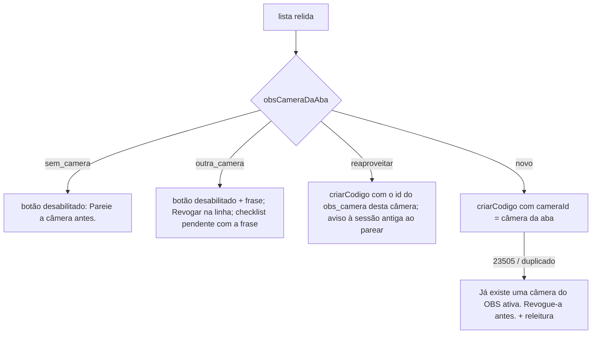

# VER-054 — E4, Tarefa 6: aba Ao vivo com a situação do vídeo, o checklist do vídeo e a troca do `obs_camera`

## Cabeçalho

| Campo | Valor |
|---|---|
| Id | VER-054 |
| Título | E4, Tarefa 6: a aba Ao vivo mostra a situação do vídeo da presença na lista; o checklist troca "Câmera conectada" (informativo) por "Vídeo da câmera no OBS" e "Tela do celular ligada"; o "Link da câmera do OBS" reaproveita só o `obs_camera` da própria câmera e avisa quando o ativo é de outra; frase defensiva do `23505`; aviso à sessão antiga do `obs_camera` provado |
| Gravidade | alta |
| Tipo | implementação · segurança (vídeo ligado à câmera errada; sessão antiga) |
| Data | 2026-11-28 (data do commit, em UTC) |
| Usuário responsável | TokumoH |
| Status de implementação | implementado |
| Commits | commit que introduz este arquivo — `git log --diff-filter=A --format=%h -- docs/verificacoes/2026-11-28-054-e4-aba-ao-vivo-video.md` |
| Arquivos | `src/app/telas/AbaAoVivo.tsx`, `src/app/telas/AbaAoVivo.test.tsx`, `src/shared/styles/base.css`, `src/app/telas/README.md`, `src/shared/styles/README.md`, `docs/verificacoes/README.md`, este registro |

## Problema

Depois das Tarefas 4 e 5 ([VER-052](2026-11-28-052-e4-camera-tela-preta.md), [VER-053](2026-11-28-053-e4-obs-camera.md)), o `/camera` e o `/obs/camera` publicavam a situação do vídeo na presença de `estudio` (campo `video`, D13 do [PLA-005](../planos/2026-11-27-e4-celular-como-camera.md)), mas a aba Ao vivo ignorava o campo:

1. A lista mostrava só "Conectado"; quem opera o painel não via se o vídeo chegava, se faltava o toque no celular, se não havia conexão direta ou se o navegador não fazia WebRTC (a causa de `sem_video_direto` que o VER-052, Riscos, deixou para esta tarefa).
2. O checklist tinha "Câmera conectada" como item **informativo** (D13 do PLA-004): pronto com a câmera na presença, mesmo sem vídeo nenhum no OBS, e sem nada sobre a tela do celular apagar.
3. O "Link da câmera do OBS" usava `existente(lista, 'obs_camera', <da câmera>)`, que, sem um `obs_camera` desta câmera, caía no **primeiro ativo de qualquer câmera** e, sem ativo, no primeiro revogado de qualquer câmera. Com duas câmeras (só pela API), o link reaproveitava um `obs_camera` ligado a outra câmera: o vídeo nunca conectava (a função `enviar_sinal_de_video` escolhe o par pelo `camera_id`, VER-050) ou reativava a ligação errada (revisão 4, N16).
4. O `23505` do índice `dispositivos_um_obs_camera_ativo` (VER-050) virava "Não foi possível gerar o código. Tente de novo.", que manda tentar de novo algo que nunca passa.

## Era proposital?

Parcialmente. O item informativo era a decisão D13 do PLA-004 "até a E4" (comentário no código: "só informativo (a câmera, até a E4)"); o PLA-005 (D13, Tarefa 6) manda trocá-lo agora. O `existente` com preferência foi escrito na E3 (VER-042), quando o banco ainda permitia vários `obs_camera` e não havia vídeo: preferir o da câmera e cair em qualquer um era razoável. O índice de um `obs_camera` ativo e a ligação câmera → par pelo banco vieram na Tarefa 2 (VER-050), e a revisão 4 do plano (N16) registrou que a aba precisava deixar de reaproveitar o de outra câmera. O aviso à sessão antiga na troca de sessão já valia para todos os tipos (`antigo` no `CodigoNaTela`, VER-042); faltava a prova para o `obs_camera` (foco da revisão 2 do PLA-005).

Divergência entre o brief e o código commitado: nenhuma de comportamento. O brief chama de `revogar-camera-avisa` o teste existente; ele se chama `revogar-avisa` (citado pelo VER-042) e foi mantido com o nome; `revogar-camera-avisa` é um teste novo, para a revogação do `obs_camera` de outra câmera que a frase da aba pede.

## Solução

Tudo em `AbaAoVivo.tsx` (componente da aba; nenhum domínio, porta ou migração muda):

1. **Presença inteira:** o mapa de presença guarda a presença do dispositivo (tipo, `obs`, `video`) em vez de só o `obs`. `videoDe(d)` dá a situação do vídeo de um dispositivo com a **sessão atual** na presença: `undefined` fora ou revogado (desde a rodada C1, N1); `null` sem situação ou com a presença declarando **outro tipo** (ela não fala pelo dispositivo).
2. **Lista:** a câmera e o `obs_camera` conectados mostram abaixo de "Conectado" um `` com frases fixas (`TEXTO_DO_VIDEO`, `fraseDoVideo`): "vídeo chegando", "sem conexão direta", "aguardando toque", "aguardando episódio", "conectando", "sem permissão da câmera", "sem câmera traseira", "endereço sem https", "sinal grande demais"; `aguardando_par` e `sem_video_direto` dependem do lado ("aguardando a câmera do OBS" / "aguardando o celular"; "navegador sem vídeo direto (WebRTC)" / "Fonte do OBS sem vídeo direto (WebRTC)"); mais "tela pode apagar" (`sem_trava`) e "bateria N%" (arredondado). Tudo texto do React.
3. **Checklist:** `itensDoChecklist(palco, video)` recebe os itens do vídeo no lugar do booleano da câmera; `itensDoVideo(vínculo, câmera, obs)` dá os dois itens (detalhe na Lógica). O tipo `'info'` sai do checklist (nenhum item é mais informativo).
4. **`obsCameraDaAba(lista)`**: a regra única do `obs_camera` da aba, usada pelo botão, pelo `gerar` (depois da releitura) e pelo checklist: `sem_camera`; `reaproveitar` (o ativo desta câmera, ou, sem ativo, o revogado desta câmera); `outra_camera` (o ativo de outra câmera); `novo`.
5. **Outra câmera:** o botão "Link da câmera do OBS" fica desabilitado com a frase "A câmera do OBS está ligada a outra câmera. Revogue a câmera do OBS e gere um link novo." (`aria-describedby`, como "Pareie a câmera antes."); o `gerar` relê a lista e, se o ativo for de outra câmera, mostra a frase sem chamar `criarCodigo`; o checklist fica pendente com a mesma frase; a linha desse `obs_camera` ganha "Revogar" **mesmo nunca pareada** (senão a frase pediria o impossível).
6. **`23505`:** `criarCodigo` de `obs_camera` rejeitado com `duplicado` mostra "Já existe uma câmera do OBS ativa. Revogue-a antes." (D2) e relê a lista; outros tipos continuam com a frase comum.
7. **Estilo:** `.situacao-do-video` no fim de `base.css`.
8. `existente` perde o parâmetro `preferir` (sem uso depois do item 4).

## Por que esta solução

- **Arquitetura (DDD, Pure Fabrication, Componentes):** a regra de exibição é da aba (camada de app); o domínio já entrega a presença validada (`lerPresenca` → `lerSituacaoDoVideo`, VER-049), e a decisão de quem é o par continua no banco (D2). As funções puras exportadas (`obsCameraDaAba`, `itensDoVideo`, `fraseDoVideo`) seguem o padrão do `itensDoChecklist` já existente. As instruções de tela vêm de `TEXTO_DA_CAMERA.semTrava` (`CameraNoAr.tsx`), reaproveitadas, como a `AbaEpisodios` reaproveita da `AbaBiblioteca`; o mesmo vale para a frase longa de `sem_conexao_direta` (D6: "a aba Ao vivo mostra a mesma situação").
- **Segurança:** nenhum dado da presença vira texto na tela; o estado escolhe uma frase fixa, e a bateria é um número arredondado. A presença de outro tipo ou de sessão antiga não fala por ninguém. O link nunca reaproveita um `obs_camera` de outra câmera (nem revogado), e a decisão é refeita depois da releitura do clique (a lista na tela pode estar velha).
- **Uma regra só:** botão, `gerar` e checklist usam o mesmo `obsCameraDaAba`, então não divergem.
- **Causa no checklist:** "pendente com a frase da situação" escolhe a causa mais útil: a do `obs_camera` quando ela já é a causa (`sem_conexao_direta`, `sinal_grande`, `sem_video_direto`); senão a da câmera quando ela não está só esperando (toque, permissão, sem WebRTC...); senão o lado ausente; senão a situação do `obs_camera`. Pronto só com o `obs_camera` em `conectado` (D13: quem decide é o lado que recebe).

## Por que não outras soluções

| Opção | Motivo de descarte |
|---|---|
| Mostrar a situação só no checklist | o brief e a D13 pedem a situação na lista (cada aparelho tem a sua) |
| Item "Câmera conectada" continuar e acrescentar os dois | duplicaria a informação; o plano manda substituir |
| Botão do link sempre habilitado, só avisando no clique | o padrão da aba (sem câmera) é desabilitar com a dica; a releitura no clique continua para a lista velha |
| Reaproveitar o `obs_camera` de outra câmera e mandar `cameraId` novo | a função `criar_codigo_pareamento` ignora `p_camera` com dispositivo dado (migração da E3); mudar exigiria migração e o plano não pede |
| Deixar "Revogar" só para pareados (como na E3) | um `obs_camera` de outra câmera nunca pareado ficaria preso: a frase manda revogar e não haveria como; a exceção vale só para esse dispositivo |
| Liberar "Revogar" para todo nunca pareado | muda o comportamento da E3 sem pedido; a exceção mínima resolve |
| Frases da lista vindas de `TEXTO_DA_CAMERA` / `TEXTO_DA_OBS_CAMERA` | são frases longas e escritas do ponto de vista de cada aparelho ("Toque para ligar…", "Câmera do OBS · …"); a célula pede frase curta |
| Mesmo texto "Pareie a câmera antes." no checklist sem câmera | o teste `obs-camera-exige-camera` (E3) procura a frase uma vez na página; o checklist usa "Vídeo da câmera no OBS: pareie a câmera antes" |

## Onde

| Arquivo | Linhas | O que mudou |
|---|---|---|
| [`src/app/telas/AbaAoVivo.tsx`](../../src/app/telas/AbaAoVivo.tsx#L7-L23) | 7–23 | imports: `PresencaNoEstudio`, `EstadoDoVideo`, `SituacaoDoVideo`, `TEXTO_DA_CAMERA` |
| [`src/app/telas/AbaAoVivo.tsx`](../../src/app/telas/AbaAoVivo.tsx#L32-L90) | 32–90 | `outraCamera` e `obsCameraDuplicada` em `TEXTO_DA_ABA_AO_VIVO`; `TEXTO_DO_VIDEO`, `fraseDoVideo`, `frasesDoVideo` |
| [`src/app/telas/AbaAoVivo.tsx`](../../src/app/telas/AbaAoVivo.tsx#L123-L170) | 123–170 | `TEXTO_DO_CHECKLIST`: sai `camera`, `cameraAusente` e `info`; entram os textos do vídeo e da tela |
| [`src/app/telas/AbaAoVivo.tsx`](../../src/app/telas/AbaAoVivo.tsx#L226-L336) | 226–336 | `PresencaDeDispositivo`; `ItemDoChecklist` sem `info`; `itensDoChecklist(palco, video)`; `ObsCameraDaAba`/`obsCameraDaAba`; `LadoNaPresenca`; `itensDoVideo` |
| [`src/app/telas/AbaAoVivo.tsx`](../../src/app/telas/AbaAoVivo.tsx#L342-L349) | 342–349 | `existente` sem `preferir` |
| [`src/app/telas/AbaAoVivo.tsx`](../../src/app/telas/AbaAoVivo.tsx#L378-L383) | 378–383 | comentário da aba: parte 3 |
| [`src/app/telas/AbaAoVivo.tsx`](../../src/app/telas/AbaAoVivo.tsx#L421-L425) | 421–425 | o mapa de presença guarda a presença inteira |
| [`src/app/telas/AbaAoVivo.tsx`](../../src/app/telas/AbaAoVivo.tsx#L550-L582) | 550–582 | `gerar`: `obsCameraDaAba` depois da releitura; outra câmera sem `criarCodigo`; `duplicado` do `obs_camera` → frase da D2 e releitura |
| [`src/app/telas/AbaAoVivo.tsx`](../../src/app/telas/AbaAoVivo.tsx#L627-L646) | 627–646 | `vinculo`, `bloqueioDoLink`, `situacaoDoPalco` pela presença inteira, `videoDe` (sem revogado, C1), itens do vídeo |
| [`src/app/telas/AbaAoVivo.tsx`](../../src/app/telas/AbaAoVivo.tsx#L687-L701) | 687–701 | linha da lista: situação do vídeo e `podeRevogar` |
| [`src/app/telas/AbaAoVivo.tsx`](../../src/app/telas/AbaAoVivo.tsx#L733-L747) | 733–747 | botão do link desabilitado com a frase do bloqueio |
| [`src/app/telas/AbaAoVivo.tsx`](../../src/app/telas/AbaAoVivo.tsx#L788) | 788 | checklist com os itens do vídeo |
| [`src/app/telas/AbaAoVivo.tsx`](../../src/app/telas/AbaAoVivo.tsx#L1055) | 1055 | sinal do checklist sem `info` |
| [`src/app/telas/AbaAoVivo.test.tsx`](../../src/app/telas/AbaAoVivo.test.tsx#L906-L972) | 906–972 | `checklist-itens`: presença com `video` e o `obs_camera`; os dois itens do vídeo no lugar de "Câmera conectada" |
| [`src/app/telas/AbaAoVivo.test.tsx`](../../src/app/telas/AbaAoVivo.test.tsx#L1172-L1516) | 1172–1516 | bloco novo com os 7 testes da tarefa (desde a C1, `revogado-na-presenca-nao-conta` e os casos de N2 e N3) |
| [`src/shared/styles/base.css`](../../src/shared/styles/base.css#L537-L539) | 537–539 | `.situacao-do-video` (no fim, sem deslocar âncoras antigas) |
| [`src/app/telas/README.md`](../../src/app/telas/README.md) | Organização, Onde | parte 3 da aba e os testes novos (43) |
| [`src/shared/styles/README.md`](../../src/shared/styles/README.md) | Organização, Onde, Verificação | `.situacao-do-video` e a medida a 320 px |
| [`docs/verificacoes/README.md`](README.md) | Cabeçalho, Onde | este registro |

## Lógica

Item "Vídeo da câmera no OBS" (`itensDoVideo`), na ordem:

| Condição | Antes | Depois |
|---|---|---|
| sem câmera | informativo "Câmera não conectada" | pendente "Vídeo da câmera no OBS: pareie a câmera antes" |
| `obs_camera` ativo de outra câmera | (link gerado para ele) | pendente com a frase de outra câmera |
| sem `obs_camera` pareado (nenhum, revogado, nunca pareado) | — | pendente "Gere o link da câmera do OBS" |
| `obs_camera` fora da presença | — | pendente "…: a Fonte /obs/camera não está conectada" |
| `obs_camera` em `conectado` | pronto "Câmera conectada" (bastava a câmera na presença) | pronto "Vídeo da câmera no OBS" |
| `obs_camera` em `sem_conexao_direta` / `sinal_grande` / `sem_video_direto` | — | pendente com a causa do `obs_camera` (`sem_conexao_direta` com a instrução de rede do `/camera`) |
| câmera fora de `conectado`/`conectando`/`aguardando_par` | — | pendente com a causa da câmera |
| câmera fora da presença | — | pendente "…: o celular de gravação não está conectado" |
| `obs_camera` sem `video` | — | pendente "…: situação desconhecida" |
| resto | — | pendente com a situação do `obs_camera` |

Item "Tela do celular ligada": câmera fora → pendente "Tela do celular: a câmera não está conectada"; sem situação ou `telaLigada` nula (antes do toque) → pendente "Tela do celular: situação desconhecida"; `sem_trava` → pendente "Tela do celular pode apagar." com as instruções do iPhone e do Android (DES-001 §10.4, item 3); `travada` → pronto.

## Exemplo

Lista com a câmera da aba (`…0001`), outra câmera (`…0004`) e o `obs_camera` ativo ligado à outra (`cameraId = …0004`):

- Antes: "Link da câmera do OBS" → `criarCodigo({ tipo: 'obs_camera', dispositivoId: <obs_camera>, cameraId: null })`; a Fonte pareava e mostrava a outra câmera; o checklist dizia "Câmera conectada" (pronto) com a câmera na presença.
- Depois: o botão fica desabilitado com "A câmera do OBS está ligada a outra câmera. Revogue a câmera do OBS e gere um link novo."; 0 chamadas a `criarCodigo`; o checklist mostra a mesma frase como pendente; "Revogar" na linha do `obs_camera` → `revogacao` da sessão dele e `dispositivo_mudou`; o botão volta e o checklist passa a "Gere o link da câmera do OBS" (testes `obs-camera-de-outra-camera-avisa` e `revogar-camera-avisa`).

Presença da câmera `{ estado: 'sem_video_direto', telaLigada: 'sem_trava', bateria: 0.07 }`: antes, "Conectado"; depois, "Conectado" e "navegador sem vídeo direto (WebRTC) · tela pode apagar · bateria 7%" (medida a 320 px abaixo).

## Verificação

| # | O quê | Como | Resultado |
|---|---|---|---|
| V1 | TDD (vermelho) | testes escritos antes; `npx vitest run src/app/telas/AbaAoVivo.test.tsx` | 6 falhas (`checklist-itens`, `situacao-do-video-na-lista`, `checklist-video`, `checklist-tela-ligada`, `obs-camera-de-outra-camera-avisa`, `revogar-camera-avisa`), 36 passando; `repareamento-da-obs-camera-avisa-sessao-antiga` já passava (o aviso existia para todos os tipos; a tarefa só o prova) |
| V2 | testes da pasta | `npx vitest run src/app/telas` | 12 arquivos, 397 testes passando na primeira entrega (398 depois da C1) |
| V3 | suíte inteira | `npm test` | 67 arquivos, 2635 testes, 0 falhas (`AbaAoVivo.test.tsx`: 36 → 43; 42 na primeira entrega) |
| V4 | tipos | `npx tsc --noEmit` | 0 erros |
| V5 | sabotagens | numa **cópia** do repositório (`node_modules` por link), script `sab-t6-scripts/sabotar.py` no scratchpad da sessão: confere `sha256` da cópia igual ao do repositório antes de cada troca, troca um trecho, roda `npx vitest run src/app/telas/AbaAoVivo.test.tsx --cache=false`, restaura e confere `sha256` iguais no repositório e na cópia ao fim | as 19 derrubam o teste esperado (tabela abaixo); na C1, as 19 de novo e mais 3 (C1a–C1c), 22 de 22, com `sabotar-c1.py`; `sha256sum` de `AbaAoVivo.tsx`, `AbaAoVivo.test.tsx`, `base.css` e `CameraNoAr.tsx` iguais antes e depois |
| V6 | layout | marcação real da aba (o `App` em `/painel` com os falsos, presença com as frases mais longas, nos cenários "outra câmera" e "própria câmera") despejada num HTML com `tokens.css` e `base.css`, medida no Chromium 153 (Playwright do ambiente) a 320 px, claro e escuro | largura da página 320 (sem rolagem horizontal); nenhum elemento fora da tabela passa da borda; a tabela rola por dentro do `.tabela-rolavel` (501 × 212), como antes; `.situacao-do-video` com 138 px; texto herda a cor do tema (claro `rgb(27, 27, 34)`, escuro `rgb(255, 250, 244)`) |
| V7 | dados na tela | `situacao-do-video-na-lista`: estado com HTML (`<b>x</b>`) é descartado pelo leitor e não aparece no `innerHTML`; frases só de constantes | ok |
| V8 | documentação | `npm run check` (inclui `check-docs`) | 0 erros (último ato) |

Sabotagens (cada uma sozinha):

| Id | Sabotagem | Teste que caiu |
|---|---|---|
| S1 | reaproveitar o `obs_camera` ativo de qualquer câmera (o `existente` antigo) | `obs-camera-de-outra-camera-avisa`, `revogar-camera-avisa` |
| S2 | checklist pronto com qualquer `obs_camera` presente | `checklist-video` |
| S3 | ignorar `telaLigada` | `checklist-tela-ligada` |
| S4 | não avisar a sessão antiga do `obs_camera` | `repareamento-da-obs-camera-avisa-sessao-antiga` |
| E1 | reaproveitar o revogado de outra câmera | `obs-camera-de-outra-camera-avisa` |
| E2 | `23505` sem a frase defensiva | `obs-camera-de-outra-camera-avisa` |
| E3 | `gerar` sem conferir outra câmera depois da releitura | `obs-camera-de-outra-camera-avisa` |
| E4 | lista mostra o estado cru | `situacao-do-video-na-lista` |
| E5 | presença de outro tipo fala pelo dispositivo | `situacao-do-video-na-lista` |
| E6 | sem "Revogar" no nunca pareado de outra câmera | `revogar-camera-avisa` |
| E7 | causa da câmera ignorada no checklist | `checklist-video` |
| E8 | `sem_conexao_direta` sem a instrução de rede | `checklist-video` |
| E9 | sem trava sem as instruções | `checklist-tela-ligada` |
| E10 | lista sem a bateria | `situacao-do-video-na-lista` |
| E11 | lista sem "tela pode apagar" | `situacao-do-video-na-lista` |
| E12 | Fonte ausente vira pronto | `checklist-itens`, `checklist-video` |
| E13 | `obs_camera` nunca pareado conta como pareado | `checklist-video` |
| E14 | tela pela presença do `obs_camera` | `checklist-itens`, `checklist-tela-ligada`, `checklist-video` |
| E15 | `23505` sem reler a lista | `obs-camera-de-outra-camera-avisa` |
| C1a | `videoDe` volta a aceitar dispositivo revogado (N1 revertido) | `revogado-na-presenca-nao-conta` |
| C1b | `CAUSAS_DO_OBS` sem `sinal_grande` e `sem_video_direto` (N2) | `checklist-video` |
| C1c | bateria sem `Math.round` (N3) | `situacao-do-video-na-lista` |

**Revisões independentes:** R1 — revisão independente (15 sabotagens numa cópia): spec ✅, qualidade **aprovada**; 0 crítico, 0 importante; 5 nits — incorporados em C1 (N1 com mudança de comportamento); R2 — conferência focada do N1 (re-pareado continua aparecendo; checklist com revogados; C1a–C1c e variantes repetidas; 2 635 testes, `tsc` 0): **limpa**, com 1 nit de comportamento informativo (exceção da câmera revogada com o `obs_camera` ainda em `conectado`), registrado na linha N1 da C1 e em Riscos em vez de mudar o código — gravidade aceitável (decisão do responsável de 2026-11-22). `npm run check` 0 no conteúdo exato do commit.

**C1 — correções dos nits da revisão (rodada 1: spec ✅, qualidade aprovada, 5 nits):**

| Nit | Correção | Prova |
|---|---|---|
| N1 (comportamento) | `videoDe` devolve `undefined` para dispositivo revogado: a sessão revogada que ainda está na presença (até o corte, ou cliente que não coopera) não mostra "vídeo chegando" ao lado de "Revogado" nem conta pela própria presença no checklist (exceção conhecida, rodada 2 da revisão: com a única câmera revogada e o `obs_camera` ligado a ela ainda ativo e em `conectado`, "Vídeo da câmera no OBS" fica pronto pela presença do `obs_camera` até ele receber a `revogacao`, em segundos, ou até o corte, em no máximo 10 min se o aviso falhar; item só informativo, ver Riscos) | teste novo `revogado-na-presenca-nao-conta` (câmera revogada com `conectado`/`travada` na presença → linha só "Revogado", nenhum item pronto; `obs_camera` revogado em `conectado` → "Gere o link da câmera do OBS"); sabotagem C1a |
| N2 (teste) | `checklist-video` fixa que a causa do `obs_camera` vence a da câmera em `sinal_grande` e `sem_video_direto` | sabotagem C1b |
| N3 (teste) | `situacao-do-video-na-lista` fixa bateria 0,333 → "bateria 33%" | sabotagem C1c |
| N4 (estrutura) | não aplicado; registrado nos Riscos como sugestão para a revisão final da E4 (mover as frases mudaria o `CameraNoAr.tsx` abaixo da âncora do VER-052) | — |
| N5 (doc) | linha nova nos Riscos: os dois itens novos vêm da presença declarada pelo cliente e são informativos | — |

Depois da C1: `npm test` 67 arquivos, 2635 testes, 0 falhas; 22 sabotagens de 22; `npm run check` 0 erros (último ato).

## Riscos

- **Checklist com a câmera revogada e o `obs_camera` ainda conectado (R2):** "Vídeo da câmera no OBS" pode ficar pronto pela presença do `obs_camera` até ele receber a `revogacao` (segundos) ou até o corte (até 10 min se o aviso falhar). O item é só informativo e a linha da câmera mostra "Revogado"; a revisão final da E4 pode decidir mostrar pendente nesse caso.
- **Teste existente alterado:** `checklist-itens` passou a esperar os dois itens do vídeo no lugar de "Câmera conectada" e a presença com `video` (mudança de comportamento pedida pela D13); o caso "câmera fora → informativo" virou "dois itens pendentes".
- **Exceção do "Revogar":** a linha de um `obs_camera` nunca pareado ganha "Revogar" só quando ele é o ativo de outra câmera; os outros nunca pareados continuam sem o botão (como na E3). Decisão desta tarefa, para a revisão.
- **Causa escolhida no checklist:** a ordem (causa do `obs_camera` → causa da câmera → lado ausente → situação do `obs_camera`) é escolha desta tarefa, não fixada pelo brief; as frases curtas também (o brief fixa "vídeo chegando", "sem conexão direta", "aguardando toque", "tela pode apagar").
- **Várias câmeras:** a câmera da aba continua sendo `existente(lista, 'camera')` (a primeira não revogada); a interface segue sem escolher câmera (DES-001 §2).
- **Presença atrasada:** a situação chega coalescida (até 10 s, `PRESENCA_MINIMA_MS`); a lista e o checklist podem mostrar a situação anterior nesse intervalo.
- **Zoom 200 % (viewport de 160 px):** a página passa a 200 px, mas os elementos que passam da borda incluem os já existentes (abas, lista fixa do checklist, seção Episódio); não comparei com o HEAD nesse tamanho. A 320 px, nada estoura.
- **Medida sem o navegador do celular nem o OBS:** só Chromium com a marcação despejada do jsdom (sem as fontes do Google, offline).
- **Âncoras antigas:** `AbaAoVivo.tsx` cresceu de 952 para 1106 linhas e `AbaAoVivo.test.tsx` de 1163 para 1476; `base.css` de 535 para 539 (acréscimo no fim). Nenhum encolheu; as âncoras de registros antigos dentro de `AbaAoVivo.tsx` (ex.: `#L926-L952` do `SecaoDosComandos`) passam a apontar para linhas deslocadas (o conteúdo continua no arquivo).
- **Itens do checklist vêm da presença declarada pelo cliente (N5):** "Vídeo da câmera no OBS" e "Tela do celular ligada" são informativos para quem opera, como o resto da presença (`src/domains/aovivo/README.md`, `src/domains/acesso/README.md`): um cliente pareado pode declarar qualquer situação válida; nada no banco depende deles, e a decisão de quem sinaliza continua na função `enviar_sinal_de_video` (D2).
- **Sugestão para a revisão final da E4 (N4, preferência de estrutura):** a aba do painel importa `TEXTO_DA_CAMERA` do `CameraNoAr.tsx` (o módulo do `/camera` entra no grafo do painel; o bundle já é um só, sem rotas preguiçosas). Um módulo de textos compartilhados resolveria, mas mover as frases agora deixaria o `CameraNoAr.tsx` abaixo das linhas citadas pelo VER-052; fica para a revisão final decidir.
- **Teste instável fora desta tarefa:** a primeira corrida do `npm run check` teve 1 falha em `src/shared/infra/obsWebsocket.test.ts` (`autenticacao`, linha 89: o quadro de autenticação ainda não tinha saído depois do `esperar()`, sob carga); o arquivo não foi tocado, passou 5 de 5 vezes sozinho e na corrida seguinte do `npm run check` (0 erros). Fica como pendência à parte (espera fixa de microtarefas contra o `crypto.subtle`).
- **Data no nome:** se o commit sair depois de 2026-11-28 (UTC), o nome deste arquivo e os links dos READMEs acompanham.
