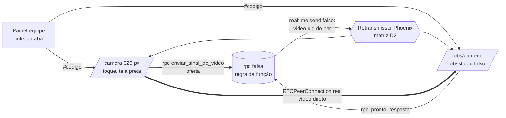

# VER-055 — E4, Tarefa 7: conferência no navegador com WebRTC real e guia do vídeo para o responsável

## Cabeçalho

| Campo | Valor |
|---|---|
| Id | VER-055 |
| Título | E4, Tarefa 7: conferência ponta a ponta no Chromium com `RTCPeerConnection` real entre o `/camera` e o `/obs/camera` (câmera falsa; Supabase, Realtime e OBS simulados), guia "Vídeo da câmera (E4)" e decisões D1–D14 oferecidas ao responsável |
| Gravidade | média |
| Tipo | verificação · documentação · segurança |
| Data | 2026-11-28 (data do commit, em UTC) |
| Usuário responsável | TokumoH |
| Status de implementação | somente documentação (nenhum código de produção muda; a sétima migração, as configurações do Supabase e do OBS e a conferência real no celular são passo do responsável, **pendente**) |
| Commits | commit que introduz este arquivo — `git log --diff-filter=A --format=%h -- docs/verificacoes/2026-11-28-055-e4-conferencia-e-guia.md` |
| Arquivos | `supabase/README.md`, `docs/verificacoes/README.md`, este registro (3 arquivos) |

## Problema

1. **O vídeo da E4 nunca tinha passado por um navegador de verdade.** As Tarefas 1 a 6 ([VER-049](2026-11-27-049-e4-dominio-captura.md) a [VER-054](2026-11-28-054-e4-aba-ao-vivo-video.md)) provaram cada peça com falsos: o domínio com portas falsas, o banco em PGlite, os adaptadores com `RTCPeerConnection`, `getUserMedia` e Wake Lock escritos a partir do `lib.dom`, e as telas em jsdom. Ninguém tinha visto uma oferta real do Chromium atravessar a `rpc('enviar_sinal_de_video')`, chegar como mensagem do banco no tópico da sessão do par e virar vídeo no `/obs/camera`. Os Riscos do VER-049 a VER-054 deixaram para cá:
   - a piscada numa queda breve do ICE (VER-049, N6; VER-053);
   - o tamanho real do SDP medido de novo (F21), com a nota de que Safari e o CEF do OBS ficam para o responsável;
   - a falha sem conexão direta, com os candidatos tirados dos dois SDPs e sem STUN (D6; revisão 1, I3);
   - o limite `54000` no uso real;
   - a forma da mensagem do banco no `realtime-js` (VER-051);
   - o `replaceTrack`, o `maxBitrate`, a coleta ICE e o Wake Lock no navegador (VER-051, VER-052);
   - a transparência e a guarda de saída do `/obs/camera` com `window.obsstudio` (VER-053).
2. **O responsável não tinha roteiro para ligar o vídeo.** A seção "Vídeo da câmera (E4)" de `supabase/README.md` nasceu na Tarefa 2 ([VER-050](2026-11-27-050-e4-banco-video.md)) só com as consultas que os testes de banco leem, e dizia "não aplicar a sétima migração" até esta tarefa. Faltavam: quando aplicar (antes do build da E4), o que conferir por consulta, a Fonte do OBS com acesso de leitura ao status, o celular, a rede, o TURN opcional, a conferência real e a limpeza dos SDPs; e conferir que `realtime` não está entre os schemas expostos da Data API (VER-050, N4).

## Era proposital?

Sim. O [PLA-005](../planos/2026-11-27-e4-celular-como-camera.md), "Tarefa 7", deixa para a última tarefa da etapa a conferência no Chromium com WebRTC real, o guia e a oferta das decisões ao responsável, como o PLA-004 fez no [VER-044](2026-11-27-044-e3-conferencia-e-guia.md). Só aqui as duas telas e a aba existem juntas. O VER-050 deixou a seção do guia incompleta de propósito ("Seção do guia incompleta de propósito", Riscos).

## Solução

- **Conferência no navegador** (Passo 1 do plano), fora do repositório, sobre o script da E3 (VER-044):
  - `npm run build` com variáveis de mentira só na linha de comando (`VITE_SUPABASE_URL=https://exemplo.revocast.test`, `VITE_SUPABASE_PUBLISHABLE_KEY=sb_publishable_teste`) e `--outDir` na pasta temporária da sessão; `vite preview` na porta 4173;
  - Chromium 153.0.8010.12 do Playwright 1.63 do ambiente, lançado com `--use-fake-device-for-media-stream --use-fake-ui-for-media-stream` (câmera falsa com o padrão de teste do Chromium; permissão concedida sem diálogo);
  - `exemplo.revocast.test` interceptado como na E3 (Auth com login anônimo falso; PostgREST e `rpc` em memória com a semântica das migrações), mais o índice `dispositivos_um_obs_camera_ativo` (`23505`) e a `rpc('enviar_sinal_de_video')` com a regra da função `20261127230000_video_da_camera.sql`: `42501` sem câmera nem `obs_camera` da sessão atual; `55000` sem episódio ou com a câmera revogada; `22023` com tipo fora do lado ou SDP fora da forma; destino lido na hora (o `obs_camera` não revogado da câmera, ou a câmera do `camera_id`); `sem_par` sem destino; limite por remetente (10 em 10 s, 600 por hora, 1 000 000 caracteres de SDP por hora → `54000`); payload montado pelo falso com o `remetente` da sessão que chamou e o `id` do `realtime.send`, gravado numa lista (a "linha" de `realtime.messages`) e entregue como `broadcast` `sinal` a quem está em `video:<uid do destino>`;
  - WebSocket do Realtime por `routeWebSocket`, com o retransmissor Phoenix da E3 ampliado com a matriz da D2: `video:<auth.uid()>` só recebe, só a própria sessão, câmera ou `obs_camera`, com episódio e câmera não revogada; todo `broadcast` e toda presença de cliente em `video:*` descartados; `estudio`, `:controle` e `:estado` como no VER-047;
  - páginas: painel (`equipe`, 1280 px claro), `/camera` em 320×640 (claro e escuro pela `emulateMedia`) e `/obs/camera` em 1280×720 (escuro e claro) com um `window.obsstudio` falso por `addInitScript` (nível `READ_OBS`, status com a transmissão ligada);
  - **`RTCPeerConnection` real entre as páginas**: o vídeo vai direto entre os dois contextos; só os sinais passam pelo retransmissor. O script só observa o `RTCPeerConnection` (subclasse que anota os estados), o `getUserMedia`, o `replaceTrack` e o Wake Lock;
  - 123 asserções OK/ERR em 19 grupos e 5 sabotagens do script. Resultado em "Verificação".
- **Guia "Vídeo da câmera (E4)"** completo em [`supabase/README.md`](../../supabase/README.md#L207-L278), dentro de "Lógica", no estilo dos guias anteriores, em dez passos (os do Passo 6 do plano), mais a tabela da D2, D6, D7 e D9:
  1. as pendências anteriores (inclusive "Allow anonymous sign-ins", "Allow public access" desligado e o JWT de 10 min);
  2. a contagem de `obs_camera` ativos e as consultas para os que sobram (as mesmas que o teste `e4-guia-conta-obs-cameras` lê) e a sétima migração **antes** de publicar o build da E4, sem contornar uma recusa;
  3. as quatro consultas de conferência com o resultado esperado e a conferência de que `realtime` não está entre os *Exposed schemas* da Data API (VER-050, N4);
  4. nada de cartão (TURN do Metered só se o cadastro não pedir cartão, nas variáveis da Vercel);
  5. a Fonte do OBS com "Read access to OBS status information", por referência, e a tecla `s`;
  6. o celular (QR, toque, traseira, tela preta, instruções sem Wake Lock);
  7. a rede (mesma Wi-Fi; roteador ou hotspot se houver isolamento);
  8. nada de dado pessoal;
  9. a conferência real (inclusive 1 hora com o celular no carregador, o iPhone, o SDP do Safari e o toque no meio de uma rolagem por inércia, do VER-052);
  10. a limpeza opcional dos SDPs pelo `update` (a mesma consulta que o teste `e4-guia-limpa-sinais-antigos` lê).

  O "Propósito", o "Onde", o passo 1 de "Lógica", o passo 4 de "Exemplo" e o Risco da sétima migração passam a apontar para o guia; um Risco novo diz que o guia não foi conferido num projeto real e registra o que a conferência mediu (candidatos só mDNS, nenhum `srflx`).
- **Decisões oferecidas ao responsável** (Passo 4 do plano): lista em "Riscos".

## Por que esta solução

- A conferência usa o mesmo `vite build` da Vercel e o `realtime-js` real dentro do bundle; só o servidor é simulado. O ponto novo da E4 é o vídeo, e ele **não** é simulado: as duas páginas negociam com o `RTCPeerConnection` do Chromium, e o `/obs/camera` recebe quadros de verdade da câmera falsa (o `requestVideoFrameCallback` dispara). Isso prova a cadeia inteira que os falsos das Tarefas 3 a 5 só imitavam: `addTransceiver` `sendonly`, coleta ICE não incremental, SDP pela `rpc`, mensagem do banco no tópico da sessão, `setRemoteDescription`, evento `track`, `srcObject`.
- A `rpc` falsa segue a função linha a linha, inclusive o destino lido a cada chamada: é isso que faz a sessão antiga parar de receber depois do repareamento. A sabotagem `rpc-antiga` (destino guardado da primeira chamada) mostra que a conferência pega o furo que a D2 fecha.
- A falha da conexão direta é provocada nos dois lados, como o plano pede (revisão 1, I3): o falso do `realtime.send` tira as linhas `a=candidate` da oferta e da resposta, e as páginas criam o `RTCPeerConnection` sem servidores ICE. Sem candidato remoto, nenhum lado faz verificação de conectividade, então nenhum aprende um candidato *peer-reflexive*; a sabotagem `candidatos` (sem tirar) prova que a asserção "não chegou a `connected`" pega uma conexão que conectaria.
- As frases conferidas são as fixas do código (`TEXTO_DA_CAMERA`, `TEXTO_DO_VIDEO`, `TEXTO_DA_OBS_CAMERA`), lidas na tela ou no `aria-label` do ponto, e a tela preta é conferida nos pixels da captura, com um controle positivo (a captura com a prévia tem a imagem colorida).
- O guia fica ao lado dos guias da E1, da E2 e da E3 e do manual das migrações, na ordem em que o responsável vai fazer; em "Lógica", para não criar uma 12.ª seção fora da estrutura dos READMEs (`CLAUDE.md`).

## Por que não outras soluções

| Opção | Motivo de descarte |
|---|---|
| Simular o `RTCPeerConnection` também (falso nas duas páginas) | Repetiria os testes da Tarefa 3; o que só o navegador prova (SDP real, ICE, quadros, `replaceTrack`) ficaria sem prova (D14) |
| Passar o vídeo pelo retransmissor | Contraria a D2 e o DES-001 §8: a mídia nunca passa pelo Supabase |
| Provocar a falha só sem STUN (candidatos `host` mantidos) | No mesmo computador os candidatos `host` (mDNS) conectam: a simulação não falharia |
| `iceTransportPolicy: 'relay'` numa cópia do build, logo de saída | O plano o deixa como reserva se a retirada dos candidatos não bastasse; ela bastou (o `connectionState` ficou em `new`), sem mexer no build |
| Derrubar a rede de verdade para a queda breve do ICE | O Playwright não corta o UDP local entre dois contextos; o evento sintético (com o `connectionState` trocado na instância por 600 ms) exercita o mesmo caminho do adaptador e do receptor, e a piscada medida é a da D3 |
| Guia num arquivo novo ou numa seção `##` própria | Mesmos motivos do VER-044 (pasta nova sem necessidade; 12.ª seção fora da estrutura) |
| Playwright como dependência (testes de ponta a ponta no `npm run check`) | Dependência nova contra a D11; a conferência é manual, como na E1, na E2 e na E3 |
| Corrigir aqui o que a conferência observou | Muda código de produção; o contrato da tarefa manda relatar, e o controlador decide se vira item próprio (nenhum achado de código nesta conferência; observações em "Verificação") |

## Onde

| Arquivo | Linhas | O que mudou |
|---|---|---|
| [`supabase/README.md`](../../supabase/README.md#L18) | 18 | "Propósito": o README também diz como ligar o celular como câmera |
| [`supabase/README.md`](../../supabase/README.md#L53) | 53 | "Onde": a sétima migração é aplicada pelo guia "Vídeo da câmera (E4)" |
| [`supabase/README.md`](../../supabase/README.md#L68) | 68 | Passo 1 de "Lógica": caminho da E0 à E4, a sétima migração na ordem e quem aplica só a sétima |
| [`supabase/README.md`](../../supabase/README.md#L207-L278) | 207–278 | "Vídeo da câmera (E4)": o "em construção" sai; os dez passos do responsável (as consultas do VER-050 continuam literais nos passos 2 e 10) e a tabela da D2, D6, D7 e D9 |
| [`supabase/README.md`](../../supabase/README.md#L287) | 287 | Passo 4 de "Exemplo": `20261127230000` no `migration repair` |
| [`supabase/README.md`](../../supabase/README.md#L301) | 301 | Risco da sétima migração: aplicar antes do build da E4, pelo guia |
| [`supabase/README.md`](../../supabase/README.md#L314) | 314 | Novo Risco: guia não conferido num projeto real; candidatos só mDNS e nenhum `srflx` na conferência |
| [`docs/verificacoes/README.md`](README.md#L108) | 14, 108 | Campo "Arquivos" e linha do VER-055 em "Onde" (o exemplo continua `056`, o próximo número livre) |
| este registro | — | Novo |

## Lógica

| Passo | Antes | Depois |
|---|---|---|
| Responsável quer ligar o vídeo | Seção com "não aplicar" e duas consultas | Dez passos, na ordem: pendências, contagem e migração antes do build, conferência por consulta e da Data API, OBS, celular, rede, conferência real, limpeza |
| Saber se a sétima migração entrou certa | Não escrito | Quatro consultas com o resultado esperado (1 linha; as mesmas duas políticas; 2 funções; `false`) |
| Vídeo de ponta a ponta | Provado por partes, com falsos | Visto no Chromium com WebRTC real: 123 asserções, 5 sabotagens |

## Exemplo

Modo teste ligado no painel com a câmera já tocada (consentimento dado) e o `/obs/camera` pareado:

1. A câmera abre `video:<uid da câmera>` (entrada aceita; sem episódio, a mesma entrada tinha sido negada), pede a câmera (`audio: false`, `facingMode: { ideal: 'environment' }`) e chama a `rpc` com a oferta: 4 220 a 4 224 caracteres conforme a rodada, um candidato `host` UDP com endereço `.local`, `a=sendonly`. Resultado `enviado`.
2. O falso publica em `video:<uid do obs>` com `remetente` = uid da câmera; o `/obs/camera` responde (3 925 ou 3 926 caracteres, `a=recvonly`, um candidato `.local`), publicado em `video:<uid da câmera>`.
3. 3,6 a 3,7 s depois do clique, o `<video>` do `/obs/camera` tem `videoWidth` 320 × 180 (o começo da estimativa de banda do WebRTC), o `currentTime` avança e o `requestVideoFrameCallback` dispara 3 vezes; os dois `RTCPeerConnection` estão em `connected`; a aba mostra "vídeo chegando" nas duas linhas.

Repareamento do `obs_camera` com o vídeo no ar: a página nova pareia o **mesmo** dispositivo com sessão nova; a câmera manda uma oferta nova, entregue à sessão nova, e o vídeo aparece nela. Depois do repareamento, **nenhuma** mensagem foi publicada no tópico da sessão antiga, a única `rpc` da página antiga (`pronto`) deu `42501` e a mesma `rpc` chamada com o token antigo também. Com a sabotagem `rpc-antiga` (o destino guardado da primeira chamada), as ofertas continuaram indo ao tópico antigo e o vídeo não chegou à página nova (ver "Verificação").

## Verificação

**Build** (fora do repositório; o `dist/` do repositório não foi tocado): `VITE_SUPABASE_URL=https://exemplo.revocast.test VITE_SUPABASE_PUBLISHABLE_KEY=sb_publishable_teste npm run build -- --outDir <scratch>/t7-nav/dist --emptyOutDir`, com 0 erros (`tsc` + `vite build`; o aviso de pedaço acima de 500 kB é o de antes). Uma cópia (`dist-sab-previa`) com `PREVIA_MS` trocado por 1 h serve só a sabotagem `previa`, entregue por `route` ao contexto da câmera.

**Conferência no navegador** (script `conferir.cjs` na pasta temporária da sessão). Ordem: pareamento → sem episódio → modo teste e vídeo → matriz D2 → tela preta e prévia → SDP → iniciar o ao vivo → faixa terminada → visibilidade → queda do WebSocket → queda breve do ICE → falha da conexão direta (e volta) → repareamento do `obs_camera` → revogação do `obs_camera` → outro `obs_camera` → encerrar → novo modo teste (outro rascunho) → revogação da câmera → selo → console.

| Grupo (item do plano) | O que foi conferido | Resultado |
|---|---|---|
| 1 pareamento | painel com `equipe`; links `/camera#` e `/obs/camera#` com 43 caracteres (o do OBS sem QR); as duas páginas pareiam e o fragmento sai da barra; o `obs_camera` ligado à câmera da aba (`camera_id`); `/obs/camera` pareado sem nada visível e com `html` e `body` transparentes no tema escuro; linha "Conectado" na aba | 11/11 |
| 2 vídeo | sem episódio: `video:<uid>` negado, o toque **não** pede a câmera (0 `getUserMedia`, nenhuma faixa `live`), "Câmera desligada: nenhum episódio no ar nem em teste.", nenhuma página tenta o tópico de vídeo; modo teste: `<video>` com `videoWidth > 0`, `currentTime` avançando e quadros; uma faixa só de vídeo `live`, restrições sem áudio e traseira; oferta e resposta pela `rpc` com `enviado`, entregues nos tópicos das sessões do par; remetente posto pelo falso; `connected` nos dois lados; "vídeo chegando" nas duas linhas e o item "Vídeo da câmera no OBS" no checklist | 14/14 |
| matriz D2 (sonda pelo WebSocket da página; 5 das 7 conferem o retransmissor simulado, inclusive "nada de cliente entregue em `video:*`", e só as 2 "o app…" provam algo do app) | câmera: entra no próprio `video:<uid>`, `broadcast` e presença nele descartados; `video:<uid do obs>`, `episodio:<id>:video`, uid em maiúsculas, `:x`, espaço no fim e `video:<id do dispositivo>` negados; `obs_camera`: o próprio sim (`broadcast` descartado), o da câmera negado; o app nunca envia em `video:*`; nada de cliente entregue em `video:*`; todo canal privado | 7/7 |
| 3 tela preta | nenhum `<video>` com o vídeo no ar; captura clara e escura com 95,4 % de pixels escuros e 0,04 % coloridos (o ponto; o resto é o texto cinza das instruções sem Wake Lock, que o *headless* recusa); toque → "Vídeo chegando ao OBS."; "Prévia" → um `<video>` mudo, `playsinline`, com imagem, sem segundo `getUserMedia`; controle da medida: com a prévia, a captura tem a imagem colorida; a prévia some sozinha (15 233 a 15 254 ms) e a captura volta a não ter imagem | 10/10 |
| 4 SDP | oferta (4 220 a 4 224) e resposta (3 925 a 3 926) abaixo de 12 000; candidatos nos dois SDPs (ICE não incremental) | 2/2 |
| 5 ao vivo | "Ao vivo iniciado."; o mesmo fluxo continua avançando; o mesmo `RTCPeerConnection`, sempre `connected`; nenhuma oferta nova | 4/4 |
| 6 faixa | `ended` na faixa → `getUserMedia` de novo e `replaceTrack`; o vídeo continua; sem oferta nova; uma só faixa `live` | 5/5 |
| 7 tela ligada | Wake Lock pedido de novo depois de `hidden` → `visible`; o vídeo segue | 2/2 |
| 8 queda | o retransmissor derruba as conexões e recusa novas por 5 s: a câmera e o obs voltam aos próprios `video:<uid>`; o vídeo continua (o mesmo `RTCPeerConnection`, que não depende do socket) | 3/3 |
| 8b queda breve do ICE | `connected` → `disconnected` → `connected` em 600 ms (evento sintético no `RTCPeerConnection` do obs): o vídeo volta; nenhuma oferta nova | 2/2 |
| 9 sem conexão direta | sem candidatos e sem STUN, nenhum `RTCPeerConnection` criado depois chegou a `connected` (todos ficaram em `new`, também o `iceConnectionState`); a câmera chegou a `sem_conexao_direta` em 54,4 s (duas vezes o prazo de 20 s, mais a espera de 2 s e a coleta); a frase da D6 no ponto e na tela depois do toque; ponto rosa; "sem conexão direta" na linha da aba; `/obs/camera` vazio; com os candidatos de volta, o vídeo volta | 8/8 |
| 10 repareamento | a página nova pareia o mesmo `obs_camera` com sessão nova; vídeo nela; oferta nova entregue à sessão nova; nada publicado no tópico antigo; a página antiga não recebe sinal; `42501` na `rpc` da sessão antiga (direta e a da própria página); a página antiga sem `<video>` e com as conexões fechadas, sem tela nenhuma (saída no ar) | 10/10 |
| 10 revogação | revogar o `obs_camera`: "Dispositivo revogado."; o obs sem vídeo e com o `RTCPeerConnection` `closed`; a câmera fecha a conexão e mostra "Procurando o computador do OBS…" (`sem_par` da função); outro `obs_camera` → o vídeo volta; revogar a câmera (depois do item 11): "Este dispositivo foi revogado. Gere um novo link no painel.", faixas `ended`, `/obs/camera` vazio e `RTCPeerConnection` `closed` | 9/9 |
| 11 encerrar | "Ao vivo encerrado."; todas as faixas `ended`; `/obs/camera` vazio; "Câmera desligada: …"; ninguém fica em `video:*`; modo teste com outro rascunho → a câmera religa sozinha (o consentimento da página continua) e o vídeo volta | 6/6 |
| 12 selo | com a transmissão ligada, a tecla `s` não mostra selo e não há tela; o obs revogado com a saída no ar não mostra tela de erro; com a saída parada (`obsStreamingStopped`), o selo "Pareado como Câmera do OBS" + "Câmera do OBS · …" aparece e some sozinho (cerca de 5,6 s contando a espera do script); `/obs/camera` vazio transparente no tema claro (alfa 0) | 6/6 |
| 13 console | nenhum SDP, candidato, token ou código de pareamento no console; 0 erros de app nas cinco páginas | 8/8 |
| 14 320 px | `/camera` claro e escuro com o vídeo, com o status, com a prévia, depois da volta (instruções), com a frase da D6 e revogado: sem rolagem horizontal, nada fora da tela, botões com pelo menos 44 px | 14/14 |
| simulação e limite | nenhum pedido fora do previsto; nenhuma `rpc` bateu no `54000` | 2/2 |

Total: **123/123** asserções, 0 ERR, em duas rodadas completas seguidas (`run4` e `run5`). As primeiras execuções acusaram falhas **do próprio script**, corrigidas antes da contagem:

- o toque: a coluna `.camera-no-ar` fica por cima do botão do tamanho da tela e recebe o clique (de propósito, VER-052, R2-N1); o script passou a tocar a tela por coordenada;
- o tipo das linhas da aba é "Câmera" e "Câmera (OBS)" (`ROTULO_DO_TIPO`), não o rótulo;
- a tela preta: o limiar de 97 % de pixels escuros não cabia as instruções sem Wake Lock (texto cinza); a medida passou a ser "nenhuma imagem" (pixels coloridos), com controle positivo na prévia;
- o console: o Chromium registra como erro o 4xx de uma `fetch` ("Failed to load resource"), que não é mensagem do app; o script separa esses registros (só os da `rpc` de sinal) e os anota.

**Medidas e itens dos Riscos dos registros anteriores:**

| Item | Resultado |
|---|---|
| SDP real (F21) | oferta 4 220 a 4 224 caracteres e resposta 3 925 a 3 926, como a sonda da revisão 2 (4 224 e 3 925): um candidato cada, só ASCII, `max-bundle`, `m=video` com 23 formatos. Safari e o CEF do OBS (mais perfis e candidatos) ficam para o responsável (passo 9 do guia) |
| Candidatos (F12) | só `host` UDP com endereço mDNS (`.local`) **nos dois lados**, também na câmera, que tinha a permissão de câmera; a premissa F12 ("com permissão, o IP local real") **não se reproduziu** no Chromium 153 *headless* com `--use-fake-ui-for-media-stream`. Nenhum `srflx`: o STUN público não respondeu no ambiente (uma sonda UDP direta a `stun.l.google.com:19302` ficou sem resposta em 4 s) |
| Falha da conexão direta (revisão 1, I3) | conferida; o `connectionState` (e o `iceConnectionState`) ficou em `new`, não em `checking`: sem candidato remoto, o Chromium não começa as verificações. Quem levou a `sem_conexao_direta` foi o prazo de 20 s (`ESPERA_DA_CONEXAO_MS`); o caminho `checking` → `failed` do adaptador **não** foi exercitado. A reserva `iceTransportPolicy: 'relay'` não foi necessária. Sugestão para uma conferência futura: trocar os candidatos por endereços TEST-NET (RFC 5737, `192.0.2.x`), que não respondem, para o ICE entrar em `checking` e chegar a `failed` |
| Queda breve do ICE (VER-049, N6) | o `<video>` saiu 2 ms depois do `disconnected` e voltou 601 ms depois (piscada de cerca de 600 ms, igual à queda emulada), como a D3 manda; nenhuma oferta nova (a câmera espera 5 s). Confirma a pendência para o responsável decidir; a perda real de rede não foi provocada |
| Limite `54000` | nunca atingido: 20 a 21 sinais gravados por rodada inteira (13 a 14 do lado do obs, 7 da câmera), no máximo 4 do mesmo remetente em 10 s (teto 10), 56 506 caracteres de SDP somados; a falha da conexão direta (o pior caso desta conferência) ficou longe dos tetos |
| Mensagem do banco no `realtime-js` (VER-051) | a forma `{ type: 'broadcast', event: 'sinal', payload }`, com `id` no payload, chegou aos ouvintes e foi aceita pelo leitor (a forma do servidor real só o projeto real confirma) |
| `replaceTrack` (F8) | conferido no Chromium: troca sem oferta nova. O `track.stop()` chamado pelo script, sozinho, não dispara `ended` (pela especificação, o `stop()` não gera o evento): nada acontece até o navegador terminar a faixa; o script disparou o `ended` como o navegador faz quando perde a câmera |
| Wake Lock e bateria (F7, F13) | no Chromium 153 *headless*, `navigator.wakeLock` existe, mas o pedido dá `NotAllowedError` (3 pedidos: toque, `travar` e a volta a ver); as instruções sem trava aparecem. `navigator.getBattery` existe e informa 100 % (o status mostra "Bateria: 100%"): valor do *headless*, sem significado. Consumo, calor e o Wake Lock de verdade só no aparelho (passo 9 do guia). A verificação de acesso à rede local (F13) não foi medida para o WebRTC: as duas páginas estão em `http://localhost` no mesmo navegador |
| Toque que interrompe uma rolagem por inércia (VER-052) | não reproduzível com toque emulado; vai ao passo 9 do guia (aparelho real) |
| `realtime` fora dos schemas expostos (VER-050, N4) | no guia, passo 3 |

**Sabotagens do script de conferência** (cada uma liga só uma mudança; nenhuma altera o repositório):

| # | Sabotagem | Resultado |
|---|---|---|
| S1 `rpc-antiga` | a `rpc` falsa guarda o destino da câmera da primeira chamada e continua publicando para a sessão antiga depois do repareamento | 6 ERR (117/123): "a câmera passa a falar com a página nova" (sem vídeo), "oferta nova entregue à sessão nova", "nada publicado no tópico da sessão antiga" (2 publicadas), "sem_par à câmera sem obs_camera", "outro obs_camera: o vídeo volta" e "novo modo teste: o vídeo volta" |
| S2 `matriz` | o retransmissor aceita `broadcast` e presença de cliente em `video:*` | 4 ERR (119/123): `broadcast` e presença da câmera no próprio tópico com `ok`, `broadcast` do `obs_camera` com `ok`, "nada de cliente entregue em `video:*`" (a sonda chegou à página) |
| S3 `previa` | cópia do build com `PREVIA_MS` de 1 h (prévia sempre visível), servida só à câmera | 2 ERR (121/123): "a prévia some sozinha em 15 s" (ainda lá aos 18,8 s) e "depois da prévia, nenhuma imagem na captura" (22,8 % de pixels coloridos) |
| S4 `candidatos` | o falso do `realtime.send` **não** tira os candidatos (as páginas continuam sem STUN) | 6 ERR (117/123): as conexões chegam a `connected` (`new` → `connecting` → `connected`), a câmera fica em "Vídeo chegando ao OBS." (ponto ciano), sem a frase da D6, sem ponto rosa, sem "sem conexão direta" na aba e com vídeo no `/obs/camera`; prova que a falha do item 9 vem da retirada dos candidatos, não do ambiente |
| S5 `console` | o `setLocalDescription` observado escreve o SDP local no console | 1 ERR (122/123): "nenhum SDP nem candidato no console" (página da câmera) |

**Observações da conferência (não são defeitos de código; o controlador decide se alguma vira item próprio):**

- **O1 (baixa, ruído no console do navegador):** ao encerrar o ao vivo, a câmera manda o `encerrar` depois de o episódio acabar e a função recusa com `55000` (previsto na D5: "senão a função recusa com `55000` e nada é feito"), e o `/obs/camera`, ao perder a conexão, manda um `pronto` que também dá `55000`. Na repareação, a página antiga manda um `pronto` que dá `42501`. Nada muda para o usuário, mas cada recusa aparece no console do navegador como "Failed to load resource: … 400/403" (registro de rede do Chromium, sem URL completa nem corpo). Reprodução: modo teste com vídeo → "Encerrar o ao vivo" → no console das duas páginas, uma linha 400 da `rpc/enviar_sinal_de_video`.
- **O2 (premissa):** a F12 não se reproduziu (candidatos só mDNS também com a câmera permitida; ver a tabela acima). Numa rede que bloqueie o multicast, os candidatos `.local` não se resolvem; sem `srflx` (STUN) e sem TURN, a câmera chega a "sem conexão direta". Está coberto pela D6 e pelo passo 7 do guia; registrado no Risco novo do `supabase/README.md`.
- **O3 (pendência já registrada):** a piscada de cerca de 600 ms na queda breve do ICE (VER-049, N6) foi medida; a decisão continua com o responsável.

**Checagens do repositório:** `npm run check-docs` e `npm run check-doc-secrets` com 0 erros depois das edições; `npm run check` completo com 0 erros (relatório da tarefa). `supabase/README.md` passou de 270 para 316 linhas (mínimo 223); `docs/verificacoes/README.md`, de 144 para 145 (mínimo 93).

**Revisões independentes (dupla verificação):** R1 — revisão independente sobre a versão entregue (logs da conferência conferidos: 123 OK, 0 ERR; sabotagens com 6, 4, 2, 6 e 1 ERR; guia confrontado com a migração real): spec ✅, qualidade aprovada; 1 achado importante de documentação (contagem das asserções da matriz D2) e 7 nits (filtro de schema nas consultas; `obs_camera` nunca pareado no passo 2; exemplo de erro; teto por par de sessões; F11; caminho `checking` → `failed` não exercitado; esta linha). Todos corrigidos — só documentação, sem segurança nem comportamento de código (decisão do responsável de 2026-11-22) —, com reconferência pontual: `check-docs`, `check-doc-secrets`, os testes que leem o guia e `npm run check` 0 no conteúdo exato do commit.

**Passo do responsável (Passo 6 do plano):** **pendente**. Nenhum dos dez passos de "Vídeo da câmera (E4)" foi feito; as pendências da E1, da E2 e da E3 (VER-020, VER-031, VER-044; o VER-049 registrou "nada confirmado nesta sessão") continuam sem confirmação neste repositório. A conferência real (passo 9) vai para o registro seguinte.

## Riscos

- **TURN gratuito (F11):** que o cadastro do Metered Open Relay não peça cartão e a cota de 20 GB por mês só o responsável confere, ao criar a conta (passo 4 do guia); nenhum agente cria conta em serviço.
- **Configuração real não exercitada:** a sétima migração, o `realtime.send` gravando com o `BYPASSRLS` do `postgres` (F17), a entrega pelo servidor do Realtime, a Fonte do OBS e o celular só foram provados em PGlite e no navegador com tudo simulado, exceto o WebRTC.
  - O retransmissor segue a D2 e o protocolo do `realtime-js` instalado, mas não é o servidor do Realtime: a revalidação na renovação do token, os limites do plano Free, a criação da partição do dia (F19) e a forma exata da mensagem do banco só se confirmam no projeto real.
  - A `rpc` falsa segue a função, mas não é ela: a trava por remetente, o índice `messages_replay_index` e o fuso de `inserted_at` são provados só em PGlite (VER-050).
  - As duas páginas estão no mesmo computador: a conexão por candidatos `host` aqui não diz nada da rede real (isolamento de clientes, NAT, dados móveis; F14).
- **O que só o aparelho e o OBS reais mostram:** WebRTC e vídeo na Fonte do OBS 30.2+ (F10); transparência no CEF; gesto exigido pelo Safari (F6); Wake Lock no iOS 16.4+ e no Android (F7); orientação; bateria, calor e travadas em 1 hora; tamanho do SDP do Safari e do CEF (F21; acima de 12 000, a câmera diz "sinal grande demais" e a correção é migração nova); o toque que interrompe uma rolagem por inércia (VER-052).
- **Observações O1 a O3** (acima): pendentes de decisão do controlador.
- **Decisões oferecidas ao responsável** (Passo 4 do plano, no relato da tarefa; o que ele decidir vira item próprio):
  - as decisões D1–D14 do PLA-005:
    - D1, onde fica cada coisa (`src/domains/captura/`, adaptadores em `src/shared/infra/`);
    - D2, sinalização por função do banco e tópico por sessão destinatária, um `obs_camera` ativo e o limite por remetente;
    - D3, a câmera sempre oferece e o `obs_camera` só responde;
    - D4, sinais e tamanhos (ICE não incremental, teto de 12 000);
    - D5, o tópico ligado à sessão, não ao episódio, e os canais de vídeo só com episódio;
    - D6, reconexão, queda e falha da conexão direta;
    - D7, tela preta e consentimento;
    - D8, o `/obs/camera` só com o vídeo e a guarda de saída compartilhada;
    - D9, sem TURN pago e o TURN gratuito opcional;
    - D10, a mesma lição da guarda de saída para a câmera;
    - D11, nenhuma dependência nova;
    - D12, o que fica para depois (E5);
    - D13, situação do vídeo na presença e na aba Ao vivo;
    - D14, o que se prova onde;
  - os ajustes do DES-001 que elas sugerem:
    - §6.1, §8 e §10.3 (**mudança de desenho da revisão 1, C1**): os sinais de vídeo saem pela função `enviar_sinal_de_video` com `realtime.send`, conferindo a sessão a cada chamada e pondo o remetente no servidor, para o tópico `video:<uid da sessão do par>`, em que nenhum cliente envia, no lugar do Broadcast em `episodio:<id>:video`; abertos só com episódio ativo; custo: os SDPs, com IPs, ficam em `realtime.messages` de 72 h a 4 dias;
    - §8, Segurança, "Toda função": a E4 cria uma função;
    - §2 e §8: um `obs_camera` não revogado no banco, porque várias câmeras simultâneas são não-objetivo (revisão 3, N11);
    - §9: o toque para ligar a câmera antes de o toque mostrar o status;
    - §8: `definir_reconhecimento` e o tópico dos gestos na E5;
    - §10.4: a Fonte do `/obs/camera` com acesso de leitura ao status do OBS;
    - §3 e §10.3: o TURN do Metered continua opcional e desligado por padrão;
    - **teto de disco por desenho** (revisão 4, N17): só o par câmera ↔ `obs_camera` ativo sinaliza, cerca de 2,4 MB por hora e cerca de 230 MB nos até 4 dias de retenção por par de sessões (cada repareamento troca uma sessão e recomeça a conta, então repareamentos seguidos somam), com a limpeza por `update` do guia;
  - a decisão sobre a piscada na queda breve do ICE (VER-049, N6; medida aqui, O3): manter (D3) ou guardar o último quadro durante uma queda curta (muda a D3);
  - as pendências que já aguardam:
    - as decisões D1–D16 do PLA-004 e os ajustes do DES-001 que elas sugerem (VER-044);
    - a mudança da D6 registrada no VER-047 (tópico `episodio:<ativo>:estado`, o `obs_palco` sem envio em `:controle`, um `obs_palco` não revogado);
    - a D7 do PLA-002 (premissas desatualizadas do PLA-001 e do DES-001; §7 `membros_permitidos`; §12 Redirect URLs);
    - o Passo 3 da Tarefa 8 do PLA-003 (D1–D13 da E2 e os ajustes §9, §8 "sobrescrever arquivos" e §3/§15 "1 GB = 10⁹ bytes").
- **Pendências conhecidas do "Ao fim da E3" que continuam** (VER-044; o A1 foi corrigido no VER-046 e o envio do palco em `:controle`, no VER-047):
  - o remetente das mensagens de `estudio` e `:controle` é declarado pelo cliente (o dos sinais de vídeo, desde a D2, é posto pelo servidor);
  - a URL da Fonte guarda um código já usado;
  - sessões anônimas sem dispositivo acumulam (limpeza manual, passo 10 do guia da E3);
  - a simulação dá ao dono das migrações mais poder em `realtime` (F17);
  - a versão do OBS só é lida com o websocket;
  - `pode_usar_canal` trocada por uma função que devolva `true` só é pega pelos testes de banco (N5);
  - o tópico antigo vale até reconectar ou renovar o token (N6), agora só para `estudio`, `:controle` e `:estado` (nos de vídeo, a função deixa de publicar para a sessão antiga);
  - um `broadcast` sem permissão parece rede ruim (N3);
  - o painel de configuração do palco fecha sozinho em 2 min se uma transmissão por outro caminho não aparecer no `getStatus` (I5);
  - a recepção binária de `broadcast` do `realtime-js` não foi exercitada (o retransmissor entrega em JSON, aqui também).
- **Pendências do "Ao fim da E4"** (PLA-005), que continuam: o teto de disco por desenho; o `obs_camera` ativo ligado a outra câmera com câmeras criadas pela API (N16); sem TURN, redes com NAT simétrico, dados móveis ou isolamento não conectam; a credencial pública do TURN gratuito, se ligado; o `RTCPeerConnection` já aberto com uma sessão antiga só fecha pelo lado que coopera; os SDPs em `realtime.messages` de 72 h a 4 dias (F18); `realtime.send` engole erros (F19); o ICE não incremental pode atrasar o começo em até 3 s (na conferência, o vídeo chegou em cerca de 3,7 s); a câmera não liga sozinha depois de recarregar (de propósito); a limitação N5; a migração e a conferência real dependem do responsável.
- **Revisão final da etapa (Passo 3 do plano):** VER-049 a VER-055 juntos, a fazer pelo controlador antes do relato final; o que ela achar vira item próprio.
- **Âncoras de registros antigos:** a seção reescrita (linhas 207–278 do `supabase/README.md`) desloca as âncoras que apontam depois da linha 210 desse arquivo; a maior âncora achada para ele é `#L223` (VER-044), dentro do arquivo. A linha nova em `docs/verificacoes/README.md` (linha 108) desloca em uma linha as âncoras da linha 108 em diante nesse arquivo; a maior achada é `#L98`. Nenhum arquivo encolheu (contagens em "Verificação"); o `check-docs` confere que nenhuma âncora passa do fim do arquivo.
- Scripts, capturas, o `dist/`, a cópia sabotada do build e os logs ficam fora do repositório, na pasta temporária da sessão, e se perdem com o container.
