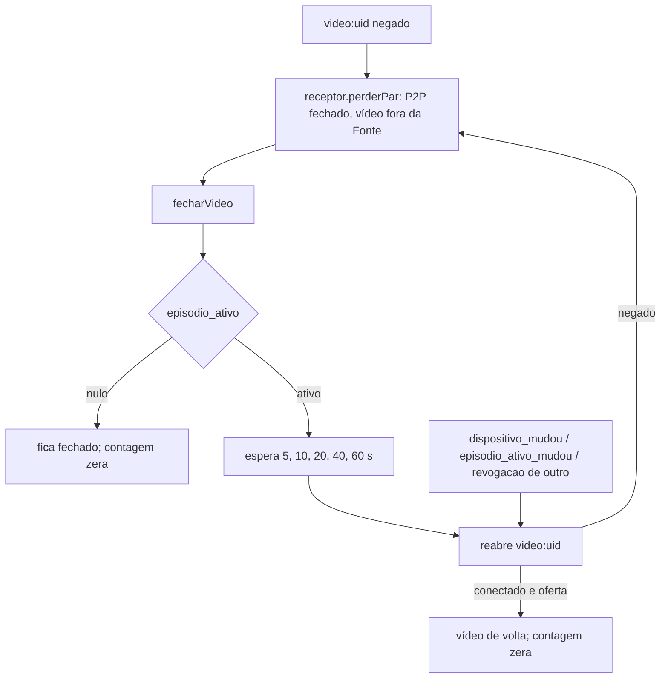

# VER-056 — E4: correções da revisão final (I1, I2 e N1 a N6)

## Cabeçalho

| Campo | Valor |
|---|---|
| Id | VER-056 |
| Título | Correções, numa onda só, do que a revisão final da etapa E4 (VER-048 a VER-055) achou entre as tarefas: I1, I2 e N1 a N6 |
| Gravidade | média (I1 e I2 são de comportamento, com segurança em segundo plano; os nits, baixa) |
| Tipo | correção · segurança · refatoração · documentação |
| Data | 2026-11-28 |
| Usuário responsável | TokumoH |
| Status de implementação | implementado (N3 registrado e deixado: quebraria a âncora do VER-052; ver "Por que não outras soluções") |
| Commits | commit que introduz este arquivo — `git log --diff-filter=A --format=%h -- docs/verificacoes/2026-11-28-056-e4-correcoes-revisao-final.md` |
| Arquivos | código: `src/app/canais.ts`, `src/app/canalDeVideoComutavel.ts`, `src/app/useAoVivo.ts`, `src/app/useDispositivo.ts`, `src/app/telas/{AbaAoVivo,CameraNoAr,ObsCamera,ObsCameraNoAr,ObsPalco,PalcoNoAr,TelaDeDispositivo}.tsx`, `src/app/telas/textosDoVideo.ts` (novo), `src/domains/captura/{emissor,receptor}.ts`; testes: `src/app/canalDeVideoComutavel.test.ts`, `src/app/telas/{AbaAoVivo,ObsCameraNoAr,PalcoNoAr}.test.tsx`, `src/domains/captura/{emissor,receptor}.test.ts`; documentação: `src/app/README.md`, `src/app/telas/README.md`, `src/domains/README.md`, `src/domains/{aovivo,captura,obs}/README.md`, `supabase/README.md` (guia "Vídeo da câmera (E4)", passo 9), `docs/verificacoes/README.md` e este registro |

Revisões: R1 — revisão independente (sondas I1 e I2 refeitas: P2P fecha no mesmo tick do `negado`, nenhuma reavaliação em 120 s, reabertura em 0/5/15/35/75 s, corrida da troca de episódio reabre no evento; `pronto` de outro par gera 2 ofertas e fecha a conexão antiga; N2 sem regressão no palco e no `/obs/camera`; 4 sabotagens repetidas numa cópia): spec ✅, qualidade **aprovada**; 0 crítico, 0 importante; 2 nits (comentário de `obs-camera-desmonta-limpo`; teste de `pronto-de-outro-par` sem distinguir o 1º `pronto`) — incorporados em C1 com reconferência pontual (`npm run check` 0 no conteúdo exato do commit).

## Problema

A revisão final da E4 leu o código do vídeo do banco à tela e achou dois problemas entre as tarefas e seis nits. Todos foram conferidos de novo no código atual (não só pelas linhas do relatório) antes de corrigir; todos se confirmaram.

| Achado | O que estava errado | Efeito |
|---|---|---|
| I1 | A migração da E4 ([`20261127230000_video_da_camera.sql`](../../supabase/migrations/20261127230000_video_da_camera.sql#L81-L85)) só deixa o `obs_camera` receber em `video:<uid>` com a câmera do `camera_id` não revogada. O `/obs/camera` tratava todo `negado` do tópico de vídeo com episódio como perda do `estudio`: `fecharVideo()` e `estudio.canalPerdido()` | com a câmera do par revogada e episódio ativo, um laço a cada ~5 s: reavaliação (`dispositivo_atual`), `estudio` fechado e reaberto com presença marcada (acima das 5 chamadas de presença por 30 s da F1), `episodio_ativo` e o tópico negado de novo; o `obs_camera` piscava na aba; e a sessão P2P com a câmera revogada não fechava (o `<video>` ficava na Fonte se ela não cooperasse e o aviso `revogacao` não tivesse chegado) |
| I2 | `emissor.ts` atendia um `pronto` só sem sessão pendente, sem olhar o remetente | com o `obs_camera` pareado de novo e o aviso `revogacao` perdido, a câmera continuava mandando o vídeo à sessão antiga pelo P2P e descartava os `pronto` do par novo a cada 10 s, embora só o `obs_camera` atual consiga mandar `pronto` (o banco escolhe o destino e põe o remetente) |
| N1 | `src/app/telas/README.md`, Propósito: "o `/obs/camera` continua com a `CameraPareada` até a Tarefa 5" | documentação desatualizada (a T5 trocou pela `ObsCameraNoAr`) |
| N2 | A `SoComSaidaParada` criava a própria guarda; a tela pareada (palco e `/obs/camera`) tinha outra | uma revogação entre o `*Starting` e o `*Started` mostrava o cartão de revogado por cerca de 1 s no começo da saída (a guarda nova não tinha visto o início, e o `getStatus` ainda diz "parada") |
| N3 | `Previa` (`CameraNoAr.tsx`) e `VideoRecebido` (`ObsCameraNoAr.tsx`): 12 linhas iguais | duplicação da regra "fluxo só por `srcObject`" |
| N4 | `AbaAoVivo.tsx` importava `TEXTO_DA_CAMERA` de `CameraNoAr.tsx` | o painel dependia do módulo da rota da câmera (emissor e canal comutável junto) |
| N5 | `canalDeVideoComutavel.ts`: `ligado()` só usado nos testes | código morto pequeno |
| N6 | Ciclo de tipos `aovivo` ↔ `captura` sem decisão; `src/domains/aovivo/README.md:30` dizia "só `obs/` importa tipos de `aovivo`" | documentação contraditória e decisão de arquitetura pendente |

## Era proposital?

- **I1: não.** A D5 do PLA-005 (T4/T5) só previu o `negado` "sem episódio" (Foco 15) e tratou o `negado` com episódio como perda do `estudio`, o que vale para o próprio dispositivo revogado. A matriz da T2 (VER-050) criou outro motivo de `negado` com episódio e com o dispositivo válido: a câmera do par revogada. A conferência da T7 (VER-055) revogou e pareou de novo sem reautorização no meio. Nenhum registro nem Risco tratava disso. Para a `CameraNoAr` o desenho original continua certo (ver "Solução").
- **I2: não.** O teste "pronto com a conexão conectado → nada" ([`emissor.test.ts`](../../src/domains/captura/emissor.test.ts#L210-L216)) fixa o comportamento só com o mesmo remetente. O "Ao fim da E4" aceitava que o P2P aberto só fecha "pelo lado que coopera"; aqui o lado que coopera é a própria câmera, que tinha a prova e a descartava. O receptor já tinha o simétrico: a oferta de uma sessão nova da câmera fecha a antiga.
- **N2: sim, como pendência registrada** (VER-046 e VER-053, Riscos: "guardas separadas"). **N3: sim, adiado** pelo VER-053 por causa da âncora do VER-052. **N4 e N5: não** (sobras da T6 e da T4). **N6: sim, registrado** (VER-049, Riscos; `captura/README.md`), sem a decisão. **N1: não** (a T5 e a T6 não atualizaram o parágrafo).

## Solução

- **I1 (`/obs/camera`):** um `negado` do tópico de vídeo fecha **na hora** a sessão do receptor (`receptor.perderPar()` novo: conexão fechada, `aoVideo(null)`, sem `encerrar`, que a função recusaria) e o canal de vídeo, e só depois consulta o episódio. Sem episódio, fica fechado, como antes. Com episódio, **não** fecha o `estudio` nem reavalia o dispositivo: agenda a reabertura do tópico pela espera crescente `esperaDaReabertura` (5, 10, 20, 40 s, até 60 s) ou reabre na hora num `dispositivo_mudou` (novo `aoDispositivoMudar` do `acompanharEstudio`), `episodio_ativo_mudou` ou `revogacao` de outro (o aviso do repareamento). A contagem zera quando o vídeo volta a `conectado` ou o episódio acaba. O `fechado` com episódio continua perda do `estudio`.
- **I1 (`/camera`): avaliado e mantido.** O tópico da câmera depende só dela (a migração usa a própria câmera, não o `obs_camera`), então um `negado` com episódio quer dizer que o próprio aparelho foi revogado ou trocado: a reavaliação leva à tela de revogado, sem laço. A docstring da `CameraNoAr` diz isso agora.
- **I2:** em `aoSinal`, um `pronto` com `sessao.par !== null` e remetente diferente do par fecha a sessão com o par antigo e chama `pedirOferta()` (como `revogarPar`). A oferta segue sujeita a `podeOferecer`, ao `limite` e às esperas da D6. Com o par ainda nulo (oferta aguardando resposta), na espera crescente ou de remetente revogado, nada muda.
- **N1:** o parágrafo do Propósito de `telas/README.md` cita a T5 (VER-053), a T6 (VER-054) e este item.
- **N2:** uma guarda por rota: `criarGuardaDaRota`/`useGuardaDaRota` em `TelaDeDispositivo.tsx`, criada no `ObsPalco` e no `ObsCamera` como a porta `obs`. Só ela ouve os eventos de saída e conta as releituras, e avisa depois (`aoMudarSaida`, `aoReler`). A `SoComSaidaParada`, o `PalcoNoAr` e a `ObsCameraNoAr` recebem a mesma guarda. A regra (`criarGuardaDaSaida`, VER-046) não mudou.
- **N3: registrado e deixado.** Ver a tabela abaixo.
- **N4:** `src/app/telas/textosDoVideo.ts` (`FRASE_SEM_CONEXAO_DIRETA`, `TEXTO_SEM_TRAVA`), sem imports. O `TEXTO_DA_CAMERA` aponta para as mesmas constantes, e a aba importa só o módulo novo.
- **N5:** `ligado()` removido; os testes conferem o estado observável (`enviar` devolve `falhou` sem chamar o canal real).
- **N6:** decisão registrada (Riscos): o ciclo fica na E4, só de tipo; antes da E5, mover `EstadoDoCanal` para um núcleo comum de tipos de canal. `aovivo/README.md:30` passa a dizer "`obs/` e, desde a E4, `captura/`".
- **Guia (passo 9):** o que acontece entre revogar a câmera e parear de novo.
- **Reuso:** a espera crescente da consulta do `useAoVivo` (a mesma conta, 5 s × 2ⁿ até 60 s) passou a usar o `esperaDaReabertura` de `canais.ts` (as linhas do arquivo não mudaram).

## Por que esta solução

- **I1:** o `negado` do tópico é a única prova que chega do banco de que o par deixou de valer, e não depende de o aviso `revogacao` chegar. Fechar o P2P na hora é o certo em todos os casos (sem episódio, câmera revogada, próprio `obs_camera` revogado). O `estudio` não caiu, e o próprio `obs_camera` revogado cai também pelo `estudio`, na mesma renovação do token. A espera crescente tira o laço e mantém a volta automática depois do repareamento. Os eventos encurtam a volta quando a aba avisa. Pure Fabrication: a política fica na rota, que já cuidava da abertura do tópico; o domínio ganha só a operação `perderPar` (a regra "o banco negou: fecha a sessão").
- **I2:** usa a garantia da T2 (destino e remetente postos pelo banco) dentro do domínio da T1, sem porta nova. Só remetentes que o banco deixou chegar entram, e a troca só acontece com um par já aceito. O par novo nunca dispara outra troca, então não há laço. As esperas da D6 continuam valendo.
- **N2:** a guarda nasce onde nasce a porta `obs` (a rota), dura enquanto a Fonte estiver montada e passa pelas trocas pareado ↔ não pareado. Os eventos e as releituras têm um dono só, então a contagem de releituras não dobra com dois relógios, e o VER-046 (duas releituras ou o `Stopped`) e o VER-053 seguem iguais.
- **N4:** o módulo de textos é uma folha sem dependências, de que as duas telas dependem.

## Por que não outras soluções

| Opção | Motivo de descarte |
|---|---|
| I1: manter o `canalPerdido` e só limitar as reavaliações | o `estudio` continua caindo e voltando (presença acima da F1, o `obs_camera` piscando na aba) e o P2P com a câmera revogada continua aberto |
| I1: reabrir o tópico a cada 5 s, sem reavaliar | tira a reavaliação, mas mantém uma entrada negada a cada 5 s durante toda a revogação (horas, se ninguém parear de novo) |
| I1: reavaliar uma vez e decidir pelo tipo do motivo | o cliente não sabe o motivo do `negado` (o Realtime só diz "não autorizado"); `dispositivo_atual` não diz se a câmera do par foi revogada |
| I1: mudar a `CameraNoAr` igual | lá o `negado` com episódio só vem do próprio aparelho revogado ou trocado: a reavaliação é a resposta certa e não entra em laço |
| I2: `revogar` o remetente antigo em `Revogados` | o par antigo não conseguiria mais mandar nada pelo banco, então não precisa; e marcar um usuário como revogado sem aviso do painel mudaria a regra da D1 |
| I2: trocar de par também no `encerrar` de outro remetente | o `encerrar` de outro remetente já é descartado de propósito (a sessão só fecha pelo par); só o `pronto` prova a troca |
| N2: guarda global de módulo | duas Fontes no mesmo navegador (testes, StrictMode) dividiriam o estado; a guarda por montagem da rota segue a porta `obs` |
| N2: a tela pareada passar a guarda para a casca na desmontagem | depende da ordem de desmontagem e montagem do React; a guarda criada acima das duas não depende |
| N3: `VideoDoFluxo` compartilhado | tirar a `Previa` (13 linhas, com a linha em branco; o import novo devolve 1) deixaria o `CameraNoAr.tsx` com cerca de 399 linhas; a âncora do VER-052 vai até a L411 (`CameraNoAr.tsx#L95-L411`), e o `check-docs` reprova âncora depois do fim do arquivo. O mínimo do pedido era 400, mas a âncora real é 411. Fica para o próximo item que mexer nas duas telas e puder crescer a `CameraNoAr` com conteúdo de verdade |
| N4: deixar `textosDoVideo.ts` importar de `CameraNoAr.tsx` | o painel continuaria puxando a rota da câmera |
| N5: manter `ligado()` justificado | nenhuma rota precisa; o teste confere melhor o comportamento (o envio não chega ao real) |
| N6: mover `EstadoDoCanal` agora | mexe em `aovivo`, `captura`, `obs`, adaptadores e telas por um ciclo só de tipo, sem efeito em tempo de execução; a E5 é a hora (é ela que põe os gestos em `captura`) |

## Onde

| Arquivo | Linhas | O que mudou |
|---|---|---|
| [`src/app/telas/ObsCameraNoAr.tsx`](../../src/app/telas/ObsCameraNoAr.tsx#L60-L338) | 71–76, 91–92, 120–123, 142, 164–170, 184–223, 291–298, 308–315 | I1: docstring "Vídeo negado"; `negacoes` e `videoNegado`; contagem zerada no `conectado`; `negado` → `perderPar` + `fecharVideo` + `consultarEpisodio('negado')` (espera crescente); `aoDispositivoMudar` e `revogacao` de outro reabrem já. N2: a guarda vem da rota (`guarda`), sem `obs` nem relógio próprios |
| [`src/domains/captura/receptor.ts`](../../src/domains/captura/receptor.ts#L49-L63) | 49–50, 58–62, 270–275 | `perderPar()` (I1) |
| [`src/domains/captura/emissor.ts`](../../src/domains/captura/emissor.ts#L53-L54) | 53–54, 269–277 | I2: `pronto` de outro remetente com par aceito troca o par |
| [`src/app/useDispositivo.ts`](../../src/app/useDispositivo.ts#L120-L121) | 120–121, 135, 206 | `aoDispositivoMudar` (o `dispositivo_mudou` de `estudio`) |
| [`src/app/canais.ts`](../../src/app/canais.ts#L10-L16) | 10–16 | `ESPERA_MAXIMA_DA_REABERTURA_MS` e `esperaDaReabertura` |
| [`src/app/useAoVivo.ts`](../../src/app/useAoVivo.ts#L12-L18) | 12, 18, 185 | reuso de `esperaDaReabertura` (mesma conta, mesmas linhas) |
| [`src/app/telas/TelaDeDispositivo.tsx`](../../src/app/telas/TelaDeDispositivo.tsx#L110-L197) | 110–143, 145–197 | N2: `SoComSaidaParada` com a guarda da rota; `GuardaDaRota`, `criarGuardaDaRota`, `useGuardaDaRota` |
| [`src/app/telas/ObsCamera.tsx`](../../src/app/telas/ObsCamera.tsx#L8-L28) e [`ObsPalco.tsx`](../../src/app/telas/ObsPalco.tsx#L35-L71) | 8–28; 35–71 | N2: a guarda da rota criada aqui e passada à casca e à tela pareada |
| [`src/app/telas/PalcoNoAr.tsx`](../../src/app/telas/PalcoNoAr.tsx#L106-L115) | 9, 14, 106, 114–115, 521–530, 553, 561 | N2: a guarda vem da rota; a releitura do selo e do painel vem do `aoReler` |
| [`src/app/telas/textosDoVideo.ts`](../../src/app/telas/textosDoVideo.ts#L1-L17) | 1–17 | N4: novo |
| [`src/app/telas/CameraNoAr.tsx`](../../src/app/telas/CameraNoAr.tsx#L13-L38) | 13, 22–23, 31, 38, 83–87 | N4: as duas frases vêm de `textosDoVideo.ts`; I1: por que o `negado` com episódio continua `canalPerdido` aqui |
| [`src/app/telas/AbaAoVivo.tsx`](../../src/app/telas/AbaAoVivo.tsx#L23-L23) | 23, 165–166, 315 | N4: importa `textosDoVideo.ts`, não a rota da câmera |
| [`src/app/canalDeVideoComutavel.ts`](../../src/app/canalDeVideoComutavel.ts#L15-L22) | 15–16, 18–22, 71–72 | N5: sem `ligado()` (o arquivo segue com 74 linhas, a âncora do VER-052) |
| [`src/app/telas/ObsCameraNoAr.test.tsx`](../../src/app/telas/ObsCameraNoAr.test.tsx#L375-L394) | 375–394, 480–572 | N2 e I1 (a sonda I1 vira teste; espera crescente; eventos; contagem zerada; `fechado`) |
| [`src/app/telas/PalcoNoAr.test.tsx`](../../src/app/telas/PalcoNoAr.test.tsx#L754-L773) | 754–773 | N2 no palco |
| [`src/domains/captura/emissor.test.ts`](../../src/domains/captura/emissor.test.ts#L398-L450) | 398–450 | I2 (a sonda I2 vira teste e mais 3) |
| [`src/domains/captura/receptor.test.ts`](../../src/domains/captura/receptor.test.ts#L212-L228) | 212–228 | `receptor-perde-o-par` |
| [`src/app/telas/AbaAoVivo.test.tsx`](../../src/app/telas/AbaAoVivo.test.tsx#L1521-L1536) | 1521–1536 | N4: a aba não importa o `/camera` |
| [`src/app/canalDeVideoComutavel.test.ts`](../../src/app/canalDeVideoComutavel.test.ts#L42-L104) | 49, 101–103 | N5 |
| [`supabase/README.md`](../../supabase/README.md#L260-L260) | 260 | guia, passo 9: entre revogar e parear de novo |
| [`src/app/telas/README.md`](../../src/app/telas/README.md#L18-L18), [`src/app/README.md`](../../src/app/README.md#L34-L34), [`src/domains/README.md`](../../src/domains/README.md#L77-L77), [`src/domains/aovivo/README.md`](../../src/domains/aovivo/README.md#L30-L30), [`src/domains/captura/README.md`](../../src/domains/captura/README.md#L134-L134), [`src/domains/obs/README.md`](../../src/domains/obs/README.md#L97-L97), [`README.md`](README.md) | — | N1, N6, contagens, arquivos novos, a linha deste registro e o exemplo (passa a 057) |

## Lógica

| Passo | Antes | Depois |
|---|---|---|
| I1: `negado` do vídeo com episódio | `fecharVideo()` e `estudio.canalPerdido()`: `estudio` fechado, reavaliação, reabertura em 5 s com presença, vídeo de novo, negado de novo | P2P fechado e vídeo fora da Fonte na hora; `estudio` intacto; tópico reaberto em 5, 10, 20, 40, 60 s ou no aviso |
| I1: `fechado` do vídeo com episódio | perda do `estudio` | igual |
| I1: `negado` na `CameraNoAr` | reavaliação → tela de revogado | igual (o motivo é sempre o próprio aparelho) |
| I2: `pronto` de outro remetente, conectado | ignorado; vídeo segue para a sessão antiga | sessão antiga fechada, oferta nova uma vez |
| I2: `pronto` do mesmo par, ou par nulo, ou na espera | ignorado | igual |
| N2: revogação entre `*Starting` e `*Started` | a casca nasce com guarda nova, o `getStatus` diz "parada", o cartão aparece ~1 s | a casca usa a guarda da rota, que viu o `Starting`: Fonte vazia até o `Stopped` ou duas releituras |
| N4 | aba → `CameraNoAr.tsx` (emissor, canal comutável) | aba → `textosDoVideo.ts` (sem imports) |

## Exemplo

- **Sonda I1** (relatório da revisão final, agora o teste `video-negado-com-episodio (sonda I1)`): `obs_camera` pareado, episódio em teste, vídeo conectado; em 6 ciclos de 5 s, o tópico de vídeo é negado sempre que aberto. Antes: reavaliações 6, presenças 6, `<video>` na Fonte `true`, conexão fechada `false`, 7 aberturas de `video:<uid>`. Depois: reavaliações 0, `estudio` criado 1 vez, no máximo 1 presença nova (a mudança para `aguardando_par`), `<video>` fora da Fonte, conexão fechada, 3 aberturas em ~30 s (a do começo, 5 s e 15 s).
- **Espera:** depois de cada negação, nada até `ms − 200` e a reabertura em `ms + 200`, para 5 000, 10 000, 20 000, 40 000, 60 000 e 60 000 ms; um `dispositivo_mudou` reabre na hora; a oferta da câmera nova devolve o vídeo à Fonte, sem nenhuma reavaliação no teste inteiro.
- **Sonda I2** (agora `pronto-de-outro-par-troca-o-par`): vídeo conectado com o par `PAR`, depois 5 `pronto` de outra sessão. Antes: ofertas 1, conexão antiga aberta. Depois: conexão antiga fechada, ofertas 2 (os 4 `pronto` seguintes chegam com a oferta nova pendente), e o `pronto` do par novo depois de conectado não troca nada.
- **N2:** palco e `/obs/camera` pareados, `getStatus` "parado", `obsStreamingStarting`, revogação: antes, o cartão "Este dispositivo foi revogado" aparecia; depois, a Fonte fica vazia (também 1 s depois) e o cartão só aparece no `obsStreamingStopped`.

## Verificação

TDD: os testes do I2 e do N2 foram escritos antes da correção e falharam (I2: 2 de 4; N2: os 2). O teste do `perderPar` e os do I1 na rota foram escritos logo antes do código, sem rodada vermelha à parte: a sabotagem S1 (o `negado` volta a ser perda do `estudio`, o comportamento antigo) e a S6 (`perderPar` vazio) mostram que eles falham sem a correção. O teste estrutural do N4 foi escrito depois da mudança; a S11 mostra que ele falha com a aba importando a rota da câmera.

| # | Abordagem | Comando / método | Resultado |
|---|---|---|---|
| V1 | suíte inteira, `tsc` e documentação no repositório | `npx tsc --noEmit`; `npx vitest run --cache=false` (JSON); `node scripts/check-docs.mjs` | 0 erros de tipo; 2 647/2 647 (eram 2 635: +4 emissor, +1 receptor, +5 `/obs/camera`, +1 palco, +1 aba); `check-docs` 0 depois deste registro |
| Sabotagens | 13 alterações propositais numa cópia (`tar` sem `.git`, `node_modules` por link; `--cache=false`; arquivo restaurado depois de cada uma; cópia conferida igual ao repositório por `diff -rq`) | script em Python, um `vitest` por sabotagem | 13/13 pegas: S1 `negado` como perda do `estudio` (3 testes); S2 sem `perderPar` (2); S3 espera fixa de 5 s (2); S4 `dispositivo_mudou` ignorado (1); S5 contagem sem zerar (1); S6 `perderPar` vazio (1); S7 `pronto` de outro ignorado (2); S8 `pronto` sem respeitar a espera (9); S9 casca com guarda própria (6, inclusive os 2 do N2); S10 releitura sem contar na guarda da rota (5); S11 a aba importando a rota da câmera (1); S12 `fechado` tratado como `negado` (1); S13 espera sem teto em `canais.ts` (2: `/obs/camera` e `/controle`) |
| V2 | outra abordagem: suíte inteira numa cópia nova, em ordem embaralhada | `npx vitest run --cache=false --sequence.shuffle` (semente 1795847341909) | 67 arquivos, 2 647/2 647, sem erro |
| Check | `npm run check` no repositório | `npm run check` | 0 erros (no fim do item) |

Âncoras antigas conferidas (os arquivos não encolheram abaixo delas): `CameraNoAr.tsx` 411 (âncora do VER-052 até a L411; o pedido dizia 400), `TelaDeDispositivo.tsx` 197 (âncora do VER-053 até a L147; o pedido dizia 124), `PalcoNoAr.tsx` 632 (≥ 610), `ObsCameraNoAr.tsx` 338 (≥ 308), `AbaAoVivo.tsx` 1 107 (≥ 1 055), `canalDeVideoComutavel.ts` 74 (= 74). As âncoras do VER-046, do VER-052 e do VER-053 para `TelaDeDispositivo.tsx`, `CameraNoAr.tsx` e `PalcoNoAr.tsx` passam a apontar linhas deslocadas, como já acontecia nas tarefas anteriores.

Nits corrigidos (não zeram a contagem):

| # | Nit da revisão | Correção | Reconferência pontual |
|---|---|---|---|
| C1 | (1) o comentário de `obs-camera-desmonta-limpo` ([`ObsCameraNoAr.test.tsx`](../../src/app/telas/ObsCameraNoAr.test.tsx#L616-L616)) ainda dizia que a `SoComSaidaParada` ouvia os eventos de saída; (2) o primeiro teste de `pronto-de-outro-par-troca-o-par` ([`emissor.test.ts`](../../src/domains/captura/emissor.test.ts#L401-L418)) só conferia as ofertas depois dos 5 `pronto`, e os `pronto` seguintes oferecem sozinhos pelo caminho normal | (1) o comentário diz que, desde o N2, só a guarda da rota ouve os eventos (11 ouvintes); (2) `ofertas()` com 2 logo depois do primeiro `pronto` | sabotagem numa cópia, com `--cache=false`: sem o `pedirOferta` da troca, o teste cai (2 de 50 no `emissor.test.ts`, inclusive este); no repositório, `emissor.test.ts` e `ObsCameraNoAr.test.tsx` 89/89 e `npm run check` com saída 0 |

## Riscos

- **I1, Realtime real:** o laço e a correção foram mostrados com o Realtime falso, negando à mão a cada abertura. O momento exato da reautorização no Realtime real (token novo ou reconexão) e a reação dele à entrada negada repetida não foram medidos. Pior caso, depois da correção: uma entrada negada em `video:<uid>` por minuto enquanto a câmera estiver revogada com episódio ativo.
- **I1, o próprio `obs_camera` revogado sem aviso:** o `negado` do vídeo agora não reavalia. Quem leva à tela de revogado é o `estudio`, que é negado na mesma reautorização (mesmo token). Se o `estudio` ficasse conectado sem reautorizar (não acontece no Realtime, que reautoriza por conexão), a tela de revogado só viria no aviso. O vídeo já sai da Fonte no `negado`, nos dois casos.
- **I1, repareamento sem o aviso:** sem a `revogacao` da sessão antiga da câmera (aba fechada antes de ver o pareamento, ou canal fora), a Fonte só tenta de novo na próxima espera, em até 60 s. O guia diz isso.
- **I2:** mostrado no domínio. O caminho real (aviso perdido e sessão antiga que não coopera) não foi montado no navegador. Um par antigo que não coopera pode manter o P2P aberto do lado dele, mas a câmera fecha a conexão, e sem ela não há mídia.
- **N2:** conferido com o `window.obsstudio` falso. O relógio das releituras agora é o da rota: a casca que aparece depois da revogação conta a partir da montagem da rota, não da própria (o que só pode encurtar a espera depois de um início sem fim, nunca liberar antes de duas releituras).
- **N3, pendente:** `Previa` × `VideoRecebido` continuam duplicadas (12 linhas), pela âncora `CameraNoAr.tsx#L95-L411` do VER-052. Fazer no próximo item que crescer a `CameraNoAr` com conteúdo.
- **N6, decisão:** o ciclo de tipos `aovivo` ↔ `captura` fica na E4 (só tipo, sem ciclo em tempo de execução). Proposta para antes da E5: mover `EstadoDoCanal` para um núcleo comum de tipos de canal (por exemplo, `src/domains/canal/` ou `shared/`), importado por `aovivo`, `captura` e os adaptadores.
- **Plano:** a frase da D5 do PLA-005 sobre o `negado` com episódio ficou incompleta para o `/obs/camera`; o plano não é editado, e este registro e o guia valem daqui em diante.
