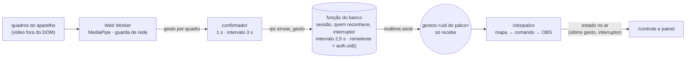

# VER-057 — Plano de implementação da etapa E5 (PLA-006): gestos

## Cabeçalho

| Campo | Valor |
|---|---|
| Id | VER-057 |
| Título | Plano de implementação da etapa E5 (PLA-006): gestos |
| Gravidade | média |
| Tipo | documentação · planejamento |
| Data | 2026-11-28 (data do commit, em UTC) |
| Usuário responsável | TokumoH |
| Status de implementação | somente documentação |
| Commits | commit que introduz este arquivo — `git log --diff-filter=A --format=%h -- docs/verificacoes/2026-11-28-057-plano-e5.md` |
| Arquivos | `docs/planos/2026-11-28-e5-gestos.md` (novo), `docs/planos/README.md`, `docs/verificacoes/README.md`, este registro (4 arquivos) |

## Problema

A E4 terminou com o celular como câmera (VER-048 a VER-056). O "Ao fim da E4" do [PLA-005](../planos/2026-11-27-e4-celular-como-camera.md#L767-L773) deixou para a E5:

- os gestos com o MediaPipe;
- `definir_reconhecimento` e a leitura de `reconhecer_no`;
- o tópico dos gestos, com autor por tópico;
- o interruptor de gestos e `definir_gestos_ligados`.

O VER-056 deixou mais duas pendências: o núcleo comum de `EstadoDoCanal` antes de o ciclo `aovivo` ↔ `captura` crescer (N6) e a unificação `Previa` × `VideoRecebido` (N3). Essa entrega do [DES-001](../desenho/2026-11-16-revocast-cameras-desenho.md) §14 ainda não tinha plano.

A E5 traz coisas que o projeto ainda não tinha:

- a primeira dependência pesada (`@mediapipe/tasks-vision`, com um WASM de 14,7 MB);
- um arquivo de modelo de 8,4 MB;
- um Web Worker;
- reconhecimento de imagem no aparelho.

Ela também herda as lições da E3 e da E4: papéis separados por tópico, nunca por evento (VER-046, VER-047); envio sensível por função do banco, com remetente posto pelo servidor e limite com trava (VER-050); a câmera só liga com o toque; e uma guarda de saída por rota (VER-056).

## Era proposital?

Não. O plano é o passo seguinte depois da E4, como o PLA-005 foi depois da E3 ([VER-048](2026-11-27-048-plano-e4.md)).

## Solução

1. **PLA-006** em [`docs/planos/2026-11-28-e5-gestos.md`](../planos/2026-11-28-e5-gestos.md). O plano tem:
   - as decisões vigentes do responsável e as restrições globais revistas;
   - as fontes das premissas (F1 a F18), cada uma dizendo o que foi conferido e o que só o responsável confirma;
   - as decisões D1 a D14;
   - o foco da revisão, com 15 situações perigosas, cada uma com teste na tarefa dona;
   - a estrutura de arquivos e nove tarefas, cada uma com registro próprio (VER-058 a VER-066):
     1. domínio: núcleo de canal, gestos, confirmador e laço do reconhecimento — VER-058;
     2. o palco executa gestos; estado no ar com o interruptor e a origem — VER-059;
     3. migração `gestos` e testes de banco — VER-060;
     4. adaptadores: canal de gestos, as `rpc` e a carga do palco — VER-061;
     5. dependência, modelo com a licença, integridade e configuração de build e deploy — VER-062;
     6. guarda de rede, núcleo do reconhecedor, worker e quadros — VER-063;
     7. palco com o tópico de gestos; interruptor e confirmação no `/controle` e no painel; escolha de onde reconhecer — VER-064;
     8. reconhecimento no `/camera` e no `/obs/camera`; presença com gestos; `VideoDoFluxo` — VER-065;
     9. conferência no Chromium com o modelo real; guia; revisão final da etapa; passo do responsável — VER-066.
2. **Caminho do gesto (D2).** Nenhum cliente envia pelo Broadcast nos tópicos `gestos:<uid>`. O gesto confirmado sai pela função nova `enviar_gesto`, que publica com `realtime.send` em `gestos:<uid da sessão atual do palco>`. A cada chamada, a função confere:
   - a sessão, o episódio ativo e a câmera não revogada;
   - se este aparelho é o que reconhece;
   - se o interruptor está ligado;
   - o intervalo de 2,5 s;
   - o limite de 600 por hora.

   O remetente e o dispositivo são postos pelo servidor.
3. **Segurar 1 s e intervalo de 3 s (D3).** A regra fica no domínio. O banco e o palco repetem o intervalo com 500 ms de margem, para o atraso da rede não fazer um gesto legítimo se perder.
4. **Interruptor (D4).** `definir_gestos_ligados` serve a qualquer membro.
   - A própria função avisa, sem o valor, e quem recebe relê no banco.
   - Só publica quando o valor muda.
   - O limite global vale só para "ligar"; "desligar" nunca é negado.
5. **Onde reconhecer (D5).** O padrão é o celular (`reconhecer_no` nulo = celular). Entram `definir_reconhecimento` e `situacao_dos_gestos`.
6. **No aparelho (D8 a D11).** O MediaPipe roda num Web Worker de módulo.
   - O modelo e o WASM vêm da própria origem e têm o SHA-256 conferido no teste e no worker.
   - Uma guarda de rede bloqueia tudo o que não é da própria origem, inclusive a telemetria embutida no MediaPipe.
   - Os quadros vêm de um `<video>` fora do DOM com `play()` explícito, em 256 px e a 10 quadros/s (5 quando o aparelho não acompanha). Se o aparelho continuar lento, o reconhecimento para.
7. **Migração nova `gestos`** (Tarefa 3):
   - quatro funções novas;
   - `pode_usar_canal` reescrita por `create or replace`, com `gestos:<uid>` só para receber.
8. **Dependência nova:** `@mediapipe/tasks-vision` 1.2.3 (Apache-2.0), pelo procedimento do npm 11. O modelo `gesture_recognizer.task` fica versionado no repositório com `LICENSE` e `NOTICE`.
9. **`docs/planos/README.md`:** o PLA-006 no campo "Arquivos" e em "Onde".
10. **`docs/verificacoes/README.md`:** o VER-057 em "Arquivos" e "Onde". O exemplo hipotético passa a `2026-11-30-067-exemplo.md`, porque o plano reserva de 058 a 066 (a mesma regra do VER-034 e do VER-048).

**Decisões do responsável** (copiadas no plano, seção "Decisões vigentes do responsável", com datas e citações):

| Data | Citação literal | Aplicação |
|---|---|---|
| 2026-11-22 | "Se a gravidade de erros for aceitável, prossiga sem necessidade de refazer dois testes seguidos" | Achado leve corrigido com reconferência pontual; qualquer outro, verificado de novo até duas rodadas seguidas sem erro |
| 2026-11-26 | "Seja autonomo, pode seguir e me entregar o projeto completo" | Autorização permanente de commit e push de cada item verificado da E1 à E6 (VER-014); continuam proibidos, sem pedido explícito: criar, renomear ou apagar branch; merge; PR; trazer conteúdo de fora; descartar trabalho; reescrever commit enviado; fundir itens |
| 2026-11-26 | "Resolve" (sobre dependências) | Dependência npm nova só pelo procedimento do npm 11; a E5 precisa de uma |
| — | Sem serviço pago e sem cartão (DES-001 §2) | Reconhecimento no aparelho; nenhum vídeo nem quadro para servidor; modelo e WASM servidos pela Vercel |

**Decisões D1 a D14 do plano**, propostas pelo agente sob a autonomia e aceitas pelo controlador:

| # | Decisão |
|---|---|
| [D1](../planos/2026-11-28-e5-gestos.md#L95) | Núcleo `src/domains/canal/` com `EstadoDoCanal`; `captura` não importa `aovivo` |
| [D2](../planos/2026-11-28-e5-gestos.md#L103) | Gesto por função do banco (`enviar_gesto`) para o tópico da sessão do palco, em que ninguém envia |
| [D3](../planos/2026-11-28-e5-gestos.md#L136) | Segurar 1 s, intervalo de 3 s no aparelho e de 2,5 s no banco e no palco |
| [D4](../planos/2026-11-28-e5-gestos.md#L142) | Interruptor com aviso pelo servidor; só a mudança publica; limite só no "ligar"; risco do "ligar" bloqueado registrado |
| [D5](../planos/2026-11-28-e5-gestos.md#L155) | `reconhecer_no` nulo = celular; `definir_reconhecimento` e `situacao_dos_gestos` |
| [D6](../planos/2026-11-28-e5-gestos.md#L160) | O palco executa o gesto pelo caminho do toque; confirmação no `/controle` e no painel; registro com o dispositivo posto pelo servidor |
| [D7](../planos/2026-11-28-e5-gestos.md#L162) | Interruptor `role="switch"` que segue o estado no ar |
| [D8](../planos/2026-11-28-e5-gestos.md#L164) | Nenhum quadro sai do aparelho |
| [D9](../planos/2026-11-28-e5-gestos.md#L166) | Dependência, modelo, licença, integridade por SHA-256, guarda de rede, cache e rewrite de `/assets/` |
| [D10](../planos/2026-11-28-e5-gestos.md#L184) | `<video>` fora do DOM com `play()`, 256 px |
| [D11](../planos/2026-11-28-e5-gestos.md#L186) | 10 → 5 quadros/s, situação `lento`, worker encerrado ao desligar |
| [D12](../planos/2026-11-28-e5-gestos.md#L195) | Situação dos gestos na presença e na tela |
| [D13](../planos/2026-11-28-e5-gestos.md#L197) | N3 do VER-056 só com o `CameraNoAr.tsx` em 411 linhas ou mais; uma guarda de saída por rota |
| [D14](../planos/2026-11-28-e5-gestos.md#L199) | O que se prova em jsdom, no Chromium com o modelo real e no aparelho real |

## Por que esta solução

- **DDD, GRASP Pure Fabrication e Componentes.** O contexto Captura ganha regras puras (confirmador e laço) sobre portas. O MediaPipe, o worker, a guarda e os quadros ficam em `shared/infra`. O núcleo `canal` fecha o ciclo de tipos.
- **Segurança.**
  - Um gesto é um comando, então só entra por função do banco, com conferência a cada chamada e remetente posto pelo servidor.
  - O interruptor sempre pode ser desligado.
  - Nenhum quadro nem métrica sai do aparelho.
  - O modelo e o WASM têm integridade conferida.
- **Sem custo.** O reconhecimento é no aparelho, e os arquivos saem da própria Vercel. O teto de disco é contado.

## Por que não outras soluções

| Opção | Motivo de descarte |
|---|---|
| Gestos em `episodio:<id>:video` com o dispositivo enviando (DES-001) | A autorização não vê o `event` e guarda a escrita por conexão; dispositivo publicaria comando (VER-047) |
| Aviso do cliente em `:controle` depois de `definir_gestos_ligados` (DES-001 §7) | O palco teria de aceitar outro evento ali, e os dispositivos não leem `:controle` |
| Mesmo limiar de 3 s no aparelho, no banco e no palco | O atraso da rede perderia gestos legítimos (revisão 1, I1) |
| Limite do interruptor por membro, ou também no "desligar" | Sem teto pelo número de membros (I4), ou um membro impediria desligar os gestos (I10) |
| CDN público para o WASM e o modelo | Contra o DES-001 §11; o arquivo pode mudar |
| Deixar a telemetria do MediaPipe ligada | Métricas a um terceiro sem consentimento informado (F6); decisão do responsável |
| Uma tarefa só para dependência, worker e quadros | Grande demais para revisar (revisão 1, N13) |

## Onde

| Arquivo | Linhas | O que mudou |
|---|---|---|
| [`docs/planos/2026-11-28-e5-gestos.md`](../planos/2026-11-28-e5-gestos.md#L1-L784) | 1–784 | Novo: PLA-006. Seções: • decisões do responsável ([23–35](../planos/2026-11-28-e5-gestos.md#L23-L35)); • restrições globais ([37–66](../planos/2026-11-28-e5-gestos.md#L37-L66)); • fontes F1 a F18 ([68–91](../planos/2026-11-28-e5-gestos.md#L68-L91)); • D1 a D14 ([93–210](../planos/2026-11-28-e5-gestos.md#L93-L210)); • foco da revisão ([212–230](../planos/2026-11-28-e5-gestos.md#L212-L230)); • tarefas 1 a 9 ([267](../planos/2026-11-28-e5-gestos.md#L267), [350](../planos/2026-11-28-e5-gestos.md#L350), [384](../planos/2026-11-28-e5-gestos.md#L384), [556](../planos/2026-11-28-e5-gestos.md#L556), [581](../planos/2026-11-28-e5-gestos.md#L581), [617](../planos/2026-11-28-e5-gestos.md#L617), [685](../planos/2026-11-28-e5-gestos.md#L685), [713](../planos/2026-11-28-e5-gestos.md#L713), [740](../planos/2026-11-28-e5-gestos.md#L740)); • passo do responsável ([765](../planos/2026-11-28-e5-gestos.md#L765)); • "Ao fim da E5" ([778–784](../planos/2026-11-28-e5-gestos.md#L778-L784)) |
| [`docs/planos/README.md`](../planos/README.md#L14) | 14, 52 | PLA-006 no campo "Arquivos" (14) e em "Onde" (52) |
| [`docs/verificacoes/README.md`](README.md#L14) | 14, 110, 133 | VER-057 no campo "Arquivos" (14) e em "Onde" (110); o exemplo hipotético passa ao número 067 (133) |

## Lógica

| Passo | Antes (fim da E4) | Depois (plano) |
|---|---|---|
| Comando por gesto | Inexistente; só toque | Gesto confirmado no aparelho → função do banco → palco |
| Interruptor | Coluna `gestos_ligados` sem função | `definir_gestos_ligados` com aviso pelo servidor; desligar sempre possível |
| Onde reconhecer | `reconhecer_no` sem uso | Celular (padrão) ou computador, escolhido por câmera na aba |
| Ciclo de tipos `aovivo` ↔ `captura` | Registrado no VER-056, N6 | Fechado pelo núcleo `canal` |
| Disco | Teto da E4, cerca de 230 MB em 4 dias | E5 com cerca de 36 MB em 4 dias a mais; total de cerca de 266 MB |

## Exemplo

Foco da revisão, item 4: uma câmera que não coopera manda dois gestos com 1 s de intervalo.

- O aparelho que coopera nem confirmaria o segundo gesto (`intervalo-de-3s`).
- Pela chamada direta, `enviar_gesto` devolve `intervalo` e não publica (`e5-intervalo-no-banco`, com o `inserted_at` medido a partir do `now()` da mesma transação).
- O palco também descartaria o segundo gesto (`palco-respeita-o-intervalo`).
- Dois gestos legítimos a 3 s um do outro, com 400 ms de diferença de atraso, passam nos dois lados por causa da margem de 500 ms.

## Verificação

| # | Abordagem | Resultado |
|---|---|---|
| Fontes | Redator: `npx -y npm@11 view` (só leitura); pacote 1.2.3 baixado com `npm pack` para uma pasta isolada do rascunho, fora do repositório, e lido com `grep`; documentação pública do MediaPipe, MDN, Hugging Face e Vercel; cabeçalhos `HEAD` do modelo | F1 a F18 registradas. Achado: telemetria embutida para `odml.pa.googleapis.com` a cada 60 s (F6), bloqueada pela guarda e levada ao responsável |
| Rodada 1 | Revisor independente | Com erros: 0 Críticos, 9 Importantes, 13 nits. **I1:** mesmo limiar de 3 s em três relógios. **I2:** fronteira instável no teste do intervalo. **I3:** faltava o teste de plano de consulta. **I4:** o teto de disco não contava os avisos do interruptor. **I5:** a guarda cobria só `fetch` e XHR. **I6:** a ordem "guarda antes do import" não tinha teste. **I7:** `<video>` fora do DOM sem `play()`. **I8:** `emissor.ts` e `receptor.ts` fora de "Modificar". **I9:** `/obs/camera` pode parar de reconhecer quando a Fonte sai da cena. **N1 a N13:** trava antes da contagem; recepção com câmera revogada; `42501`/`55000` como `negado`; faixas do confirmador; tolerância a 5 quadros/s; `worker.format`; rewrite e compressão da Vercel; licença; origem da chave da telemetria; F13 sem fonte; observar a telemetria bloqueada; Blob do WASM com tipo; dividir a T5 |
| Correções da rodada 1 | Redator | `INTERVALO_DO_SERVIDOR_MS` = 2 500 com testes cruzados; `inserted_at` relativo a `now()`; `e5-contagens-usam-o-indice`; limite global do interruptor com destinos em ordem e teto recalculado; `guardaDeRede.ts` com `self.import`, `importScripts`, `WebSocket` e `EventSource`; guarda instalada pelo núcleo; `play()` com `video-tocando`; F17 e F18; N1 a N13 incorporados; T5 dividida (nove tarefas, VER-058 a VER-066) |
| Rodada 2 | Re-revisão | Os 22 achados aceitos. Novos: **I10:** com o limite global, qualquer membro esgotaria a cota e impediria desligar os gestos. **N14:** `desligados` deixava o worker ligado. **N15:** a asserção do índice tinha uma saída fraca. **N16:** a frase do limite valia só para o minuto |
| Correções da rodada 2 | Redator | Só a mudança de valor publica; limite só no "ligar"; desligar nunca negado; teto recalculado (cerca de 36 MB em 4 dias); testes `e5-desligar-nunca-limitado` e `e5-mesmo-valor-nao-publica`; `desligados-reavalia`; `enable_seqscan` desligado; frase nova |
| Rodada 3 | Re-revisão | I10 e N14 a N16 resolvidos. Novos: **I11:** a contagem do "ligar" no tópico do palco contava também os gestos e bloquearia o religar. **N17:** registrar o risco de um membro manter o "ligar" bloqueado |
| Correções da rodada 3 | Redator | `and m.event = 'gestos_mudaram'` nas duas contagens; teste `e5-gestos-nao-contam-no-limite` com sabotagem; o teste do índice cobre o filtro; N17 na D4 e nas Pendências |
| Redação | `node scripts/check-docs.mjs` e `node scripts/check-doc-secrets.mjs`, a cada rodada | 0 erros |
| `npm run check` sobre o conteúdo do commit | Controlador, como último ato antes do commit | Feito pelo controlador antes do commit |

## Riscos

Fica para o responsável:

- **Telemetria do MediaPipe** (F6; Tarefa 9, Passo 4). O pacote envia métricas de uso ao Google a cada 60 s, e o README dele exige consentimento informado. O plano bloqueia isso por padrão. Liberar exige um aviso de consentimento: a decisão é do responsável.
- **Modelo versionado e licença.**
  - O `gesture_recognizer.task` (8 373 440 bytes) entra no repositório, conferido pelo SHA-256 publicado.
  - O build da Vercel cresce cerca de 23 MB (WASM e modelo), baixados só quando o reconhecimento liga, uma vez por aparelho.
  - A redistribuição leva o texto da Apache-2.0 e um `NOTICE`.
- **Teto de disco.** A E5 soma cerca de 36 MB em 4 dias ao teto da E4: cerca de 266 MB no total, abaixo dos 500 MB do banco Free.
- **Quem liga e desliga os gestos.**
  - Qualquer membro muda o interruptor (DES-001 §7, §9).
  - Um membro pode manter o "ligar" bloqueado alternando ligar e desligar. Isso falha para o lado seguro, e a saída é a equipe ou um admin removerem o membro.
  - O valor ligado no modo teste continua no ao vivo do mesmo episódio; o checklist mostra.
- **Premissas que só o responsável confirma:**
  - F11: WebGL no worker do iPhone, do Android e do CEF do OBS;
  - F12: WASM e worker de módulo no iPhone;
  - F13: `<video>` fora do DOM no iPhone;
  - F14 e F17: o deploy com os arquivos grandes, a compressão e a banda da Vercel;
  - F18: o `/obs/camera` reconhecendo com a Fonte fora da cena no ar;
  - a conversa de 10 min para medir gesto acidental e 1 h de bateria.
- **Pendências da E3 e da E4:**
  - D1 a D16 do PLA-004 e os ajustes do DES-001 (VER-044);
  - a mudança da D6 (VER-047);
  - D1 a D14 do PLA-005 e a mudança de desenho da sinalização (VER-055);
  - as correções do VER-048 e a piscada no ar numa queda breve do ICE (VER-049);
  - D7 do PLA-002 e o Passo 3 da Tarefa 8 do PLA-003;
  - as migrações e as conferências reais dos guias da E3 e da E4.
- **Ordem de implantação:** a migração `gestos` vem antes de publicar o build da E5 (Tarefa 9, Passo 6, item 2).
- **Concorrência real das travas:** a trava de transação não dá para provar no PGlite, que tem uma conexão só.
- **Âncoras de linha:** a linha nova em "Onde" de `docs/verificacoes/README.md` (110) desloca uma linha a seção "Exemplo", que registros antigos citam por linha; o arquivo não encolheu.
