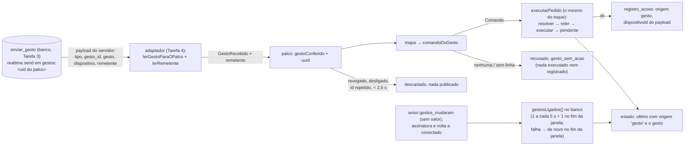

# VER-059 — E5, Tarefa 2: o palco executa gestos; estado no ar com interruptor e origem

## Cabeçalho

| Campo | Valor |
|---|---|
| Id | VER-059 |
| Título | E5, Tarefa 2: o palco executa gestos pelo tópico `gestos:<uid>`, o estado no ar ganha `gestosLigados` e a origem do último comando, e o registro ganha o autor `dispositivoId` |
| Gravidade | média |
| Tipo | implementação · segurança |
| Data | 2026-11-28 (data do commit, em UTC) |
| Usuário responsável | TokumoH |
| Status de implementação | implementado |
| Commits | commit que introduz este arquivo — `git log --diff-filter=A --format=%h -- docs/verificacoes/2026-11-28-059-e5-palco-com-gestos.md` |
| Arquivos | `src/domains/aovivo/{comandos,mensagens,portas,palco}.ts`, `src/domains/aovivo/{comandos,mensagens,palco}.test.ts`, `src/shared/ui/PainelDeComandos.tsx`, `src/shared/infra/aoVivoSupabase.ts`, `src/shared/infra/aoVivoSupabase.test.ts`, `src/shared/infra/canalSupabase.test.ts`, `src/app/servicosFalsos.ts`, `src/app/telas/PalcoNoAr.tsx`, `src/app/telas/{PalcoNoAr,Controle,AbaAoVivo}.test.tsx`, READMEs de `src/domains/`, `src/domains/aovivo/`, `src/shared/ui/`, `src/shared/infra/`, `src/app/` e `src/app/telas/`, `docs/verificacoes/README.md`, este registro (24 arquivos) |

## Problema

Depois da Tarefa 1 ([VER-058](2026-11-28-058-e5-dominio-gestos.md)), o aparelho sabe confirmar um gesto e a Captura sabe ler o tópico de gestos, mas **o palco, único executor (DES-001 §10.1), não sabe o que fazer com um gesto**: não recebe o tópico `gestos:<uid>`, não conhece o mapa de gestos nem o interruptor, e o estado no ar não diz se os gestos estão ligados nem se o último comando veio de um toque ou de um gesto. O registro (`registro_acoes`) só sabe gravar o toque (`membroId`), embora a tabela tenha `dispositivo_id` desde a E0.

Efeitos, se ficasse assim: nenhum gesto teria efeito; e, se o palco aceitasse gestos sem as defesas, três perigos do "Foco da revisão" do [PLA-006](../planos/2026-11-28-e5-gestos.md#L212-L230) ficariam sem defesa em profundidade no palco: **dispositivo publicando comando** (item 2: comando pelo tópico de gestos ou gesto pelo `:controle`), **repetição sem o intervalo** (item 4) e **gesto com gestos desligados** (item 5); e o item 11 (**interruptor mentindo**) dependeria de confiar no aviso.

## Era proposital?

Não: é a Tarefa 2 do plano ([PLA-006, Tarefa 2](../planos/2026-11-28-e5-gestos.md#L350-L383)), com as decisões [D2](../planos/2026-11-28-e5-gestos.md#L103-L108) (o palco aceita gesto só do tópico da própria sessão, descarta revogado, repetido, desligado e o que vem a menos de 2,5 s), [D3](../planos/2026-11-28-e5-gestos.md#L136-L141) (margem de 500 ms: `INTERVALO_DO_SERVIDOR_MS` no palco), [D4](../planos/2026-11-28-e5-gestos.md#L142-L147) (o aviso não leva valor; o palco relê no banco, no máximo uma vez a cada `RELEITURA_MINIMA_MS`, mais uma no fim da janela) e [D6](../planos/2026-11-28-e5-gestos.md#L160-L160) (o gesto pelo caminho do toque; `nenhuma` → `gesto_sem_acao`; registro com o `dispositivoId` posto pelo servidor). Nenhum código anterior trata gesto no palco; o `check` `registro_acoes_um_autor` (um autor só) existe desde a E0 ([fundação](../../supabase/migrations/20261117000000_fundacao.sql#L155-L169)).

**Divergências entre o brief e o código commitado, e escolhas desta tarefa (nenhuma muda uma regra do plano):**

| Ponto | Brief / plano | Feito | Motivo |
|---|---|---|---|
| `acao` do `ultimo` num gesto sem ação | o brief acrescenta só `origem` e `gesto` ao `ultimo`; `acao` era `Comando['acao']`, sem valor para "nenhuma" | `ultimo.acao: Comando['acao'] \| 'nenhuma'` (tipo novo `UltimoNoAr`); o leitor aceita `nenhuma` só com `origem: 'gesto'`, `recusado` e `gesto_sem_acao`, e `gesto_sem_acao` só com `nenhuma` | o teste `gesto-sem-acao` exige um estado `recusado` com `gesto_sem_acao`, e nenhuma das 8 ações do toque descreve "o mapa não pede ação"; usar uma delas mentiria no `/controle` |
| `PainelDeComandos` | "só no que o `tsc` pedir" | a frase de `gesto_sem_acao` em `TEXTO_DO_MOTIVO` e uma guarda de tipo para `nenhuma` em `descreverUltimo` | o `Record` dos motivos e o índice `NOME_DA_ACAO` não compilariam; a confirmação com emoji é da Tarefa 7 |
| `aoVivoSupabase.registrar` | "só no que o `tsc` pedir" | grava `membro_id` no toque e `dispositivo_id` no gesto (espalhando só a chave do autor, o toque grava as mesmas colunas de antes), com 2 testes novos (`palco-registra-gesto`, `palco-gestos-neutros`) | `l.membroId` deixou de existir na união; gravar `membro_id: null` no gesto violaria o `check` de um autor só; nenhum gesto chega ao palco em produção antes da Tarefa 7 |
| Canal de gestos na rota do palco | `DependenciasDoPalco` ganha `canalDeGestos` (obrigatório); a rota é da Tarefa 7 | `PalcoNoAr.tsx` passa `SEM_CANAL_DE_GESTOS`, um canal congelado que nunca entrega gesto nem aviso | valor neutro, como `gestosLigados: false` e `mapa: []`: o `tsc` pede o campo e a Tarefa 7 abre o tópico de verdade |
| `cena` ou `som` sem alvo no mapa | o brief não diz | `comandoDoGesto` devolve `null` (como `nenhuma`) | o CHECK `mapa_gestos_equivalencia` não deixa gravar; um alvo nulo não pode virar comando |
| Gesto sem linha no mapa | o brief não diz | tratado como `nenhuma` (`gesto_sem_acao`) | o mapa tem 7 linhas pela migração, mas a carga neutra (`mapa: []`) e um adaptador futuro podem trazer menos |
| Memória dos `id` | "`gesto-repetido` (mesmo `id` → uma vez)" | memória **própria** dos gestos (200), separada da dos comandos | o `id` do gesto vira `comandoId` no estado, que os membros veem; um membro que repetisse esse `id` num toque não pode apagar um gesto, nem o contrário (teste no fim de `gesto-repetido`) |
| Interruptor da carga relida | "o mapa entra no palco com as listas e é relido com elas" | o mapa é relido com as listas; o `gestosLigados` da carga relida **não** é usado | uma releitura de listas começada antes de um aviso poderia chegar depois e desfazer o valor relido; o interruptor só muda pela leitura própria (D4) |
| Leituras do interruptor fora de ordem | o brief não diz | a resposta de uma leitura superada por outra mais nova é descartada (sequência) | a leitura do fim da janela e uma anterior lenta podiam chegar invertidas |

## Solução

1. **`comandos.ts`:** `AutorDoRegistro` e `LinhaDoRegistro` como união por autor (`{ origem: 'toque'; membroId }` ou `{ origem: 'gesto'; dispositivoId }`); `linhaDoRegistro(c, a, { episodioId, modo, autor })` monta a linha campo a campo (nunca espalha o autor); `comandoDoGesto(linha, id)` (puro): `cena`/`som` com o alvo, as cinco ações sem alvo, `nenhuma` → `null`.
2. **`mensagens.ts`:** `gesto_sem_acao` em `MOTIVOS_DO_RESULTADO`; `UltimoNoAr` com `origem` e `gesto`; `EstadoNoAr.gestosLigados`; `lerEstadoNoAr` exige os três campos novos e confere as combinações (toque sem gesto, gesto com um dos 7, `nenhuma` só no gesto recusado sem ação).
3. **`portas.ts`:** `CanalDeGestosDoPalco` (`aoGesto`, `aoAviso`, `aoMudarEstado`, `fechar`; só recebe); a carga do `RepositorioDoPalco` com `mapa` e `episodio.gestosLigados`, e `gestosLigados(episodioId)`.
4. **`palco.ts`:** `canalDeGestos` nas dependências; cada gesto passa por `gestoConferido` (forma fechada de novo), remetente uuid, `Revogados`, interruptor do estado, memória própria e intervalo de `INTERVALO_DO_SERVIDOR_MS` pela chegada; o mapa vira comando e segue os passos do toque (`executarPedido`, comum aos dois) com `origem: 'gesto'` e o gesto no `ultimo`; o registro leva o `dispositivoId` do payload. O aviso `gestos_mudaram` relê `gestosLigados()` com janela e republica o estado. O primeiro estado leva o interruptor da carga. **Rodada 1:** o gesto que esperou a releitura das listas confere o interruptor de novo antes de executar (I1); o interruptor é relido também logo depois de assinar o tópico de gestos, a cada volta dele a `conectado` e, quando a leitura falha (erro ou resposta não booleana), de novo no fim da janela; só um valor diferente publica o estado (I2).
5. **Fora do domínio, só valores neutros** (`gestosLigados: false`, `mapa: []`, canal que nunca entrega) e os campos novos nos estados montados à mão dos testes.

## Por que esta solução

- **DDD e Pure Fabrication:** a regra (o que um gesto pede, quem é o autor, o que o estado pode dizer) fica no domínio `aovivo`, puro e testável com falsos; `comandoDoGesto` e `linhaDoRegistro` não conhecem canal, banco nem OBS. O palco continua só conhecendo portas.
- **Reuso (Componentes):** o gesto segue o **mesmo** `resolverComando`, a mesma releitura das listas (`RECUSAS_QUE_RELEEM`, `RELEITURA_MINIMA_MS`), o mesmo executor, o mesmo `pendente` do clipe e o mesmo `paraOCanal`; `executarPedido` é o antigo corpo de `tratar`, agora comum ao toque e ao gesto, sem mudar o comportamento do toque (os 28 testes do palco da E3 passam só com os campos novos acrescentados nas expectativas).
- **Segurança (defesa em profundidade):** o banco já confere tudo (Tarefa 3), mas o palco não confia no adaptador: confere de novo a forma do gesto (nenhuma chave a mais, nenhum `__proto__`, os 7 gestos, uuids minúsculos), descarta revogado, desligado, repetido e rajada, e grava como autor o `dispositivoId` **posto pelo servidor**, nunca o remetente. O aviso nunca carrega valor: o palco relê no banco (item 11 do foco).
- **Otimização:** o aviso relê no máximo uma vez a cada 5 s (mais uma no fim da janela): um membro que alterne o interruptor não força leituras seguidas; nada é publicado para um gesto descartado.

## Por que não outras soluções

| Opção | Motivo de descarte |
|---|---|
| Gesto pelo `:controle`, como comando | reabre o furo do VER-047 (dispositivo publicando comando) e a autoria declarada (D2) |
| Palco confiar no adaptador e pular a conferência do gesto | um adaptador com defeito entregaria um comando ou um gesto fora da forma (teste `gesto-so-pelo-topico-de-gestos`, sabotagens S7 e X12) |
| Intervalo do palco igual a `INTERVALO_MS` (3 s) | dois gestos legítimos a 3 s no aparelho, com 400 ms de diferença de atraso, chegariam a 2,6 s e o segundo se perderia (sabotagem S3; D3, revisão 1, I1) |
| Contar o intervalo a partir de qualquer gesto recebido (também dos ignorados) | uma rajada manteria a janela aberta para sempre e bloquearia o gesto legítimo seguinte (sabotagem X4) |
| `ligados` no aviso | um aviso forjado ou atrasado ligaria os gestos; o aviso não leva valor (D4; sabotagem S6) |
| Uma releitura por aviso, sem janela | quem alterna o interruptor forçaria uma leitura do banco por aviso (sabotagem X10) |
| `ultimo.acao` com uma ação qualquer no gesto sem ação | o `/controle` mostraria uma ação que não aconteceu |
| `ultimo` como união discriminada por origem | o brief e o plano descrevem os campos planos; o leitor confere as combinações, e as telas não precisam de estreitamento de tipo |
| `membroId` no gesto (autor declarado) | o remetente do gesto é a sessão anônima da câmera, que não é membro; o servidor já põe o `dispositivo` no payload, autoria mais forte (D6; sabotagens S4a, S4b) |
| Memória comum de `id` para comando e gesto | um `comandoId` visível no estado viraria um jeito de um membro anular um gesto (ou o contrário) (sabotagem X3) |

## Onde

| Arquivo | Linhas | O que mudou |
|---|---|---|
| [`src/domains/aovivo/comandos.ts`](../../src/domains/aovivo/comandos.ts#L97-L179) | 3, 97–179 | `AutorDoRegistro` (L102), `LinhaDoRegistro` em união (L105), `linhaDoRegistro` com `ctx.autor` (L136), `comandoDoGesto` (L164) |
| [`src/domains/aovivo/mensagens.ts`](../../src/domains/aovivo/mensagens.ts#L86-L141) | 2–4, 86–141, 279–325 | `gesto_sem_acao` (L105), `UltimoNoAr` (L114), `EstadoNoAr.gestosLigados` (L127); [`lerUltimo`](../../src/domains/aovivo/mensagens.ts#L279-L303) com origem e gesto (rodada 1, N3: gesto com `acao: 'aviso'` recusado, L298) e [`lerEstadoNoAr`](../../src/domains/aovivo/mensagens.ts#L305-L325) com `gestosLigados` |
| [`src/domains/aovivo/portas.ts`](../../src/domains/aovivo/portas.ts#L84-L141) | 3, 6, 84–141 | `CanalDeGestosDoPalco` (L89); `RepositorioDoPalco` com a carga nova e `gestosLigados` (L130–L140) |
| [`src/domains/aovivo/palco.ts`](../../src/domains/aovivo/palco.ts#L1-L456) | 1–5, 33–37, 63–99, 117–132, 161–175, 230–240, 275–405, 414–427, 450–451 | dependência `canalDeGestos`; `Autoria`, `memoria`, `gestoConferido`; `gestosLigados` inicial (L175); `anotar` com a autoria e `anotarSemAcao` (L236); `executarPedido` (L278) com a guarda do interruptor depois da releitura (L285, rodada 1, I1), `tratar` (L316), `tratarGesto` (L327), `lerInterruptor` com nova tentativa na falha (L349), `agendarLeituraDoInterruptor` (L375), `relerInterruptor` (L394); ouvintes do canal de gestos, inclusive `aoMudarEstado` → `conectado` (L414–L422), e a releitura depois de assinar (L427) (rodada 1, I2); `parar` cancela a leitura agendada (L450) |
| [`src/domains/aovivo/comandos.test.ts`](../../src/domains/aovivo/comandos.test.ts#L157-L199) | 6, 117–118, 157–199 | `comando-do-gesto` (9) e `registro-do-gesto`; o bloco `registro` passa o autor (mesmas expectativas) |
| [`src/domains/aovivo/mensagens.test.ts`](../../src/domains/aovivo/mensagens.test.ts#L373-L422) | 40–49, 150–163, 200, 373–422 | `estado-com-interruptor-e-origem` (18, com o caso da N3); campos novos nos estados montados à mão |
| [`src/domains/aovivo/palco.test.ts`](../../src/domains/aovivo/palco.test.ts#L825-L1347) | 1–54, 126–178, 213–240, 275–312, 825–1347 | canal de gestos falso pelo leitor real (com `estado()` desde a rodada 1), repositório com o interruptor (começa igual à carga), `ligados()`; bloco `palco com gestos` (19; rodada 1: `palco-rele-o-interruptor` refeito com a leitura depois de assinar (L1006), leitura fora de ordem ou depois de `parar` (L1058), `interruptor-leitura-que-falha-e-repetida` (L1102), sonda A (L1188), `interruptor-aviso-perdido-corrigido-no-conectado` (L1214), `interruptor-relido-depois-de-assinar` (L1234), `gesto-desligado-durante-a-releitura` (L1265), guardas da N1 e R7 (L1295); rodada 2, N4: `interruptor-uma-leitura-agendada-so` (L1148)); campos novos nas expectativas da E3 |
| [`src/shared/ui/PainelDeComandos.tsx`](../../src/shared/ui/PainelDeComandos.tsx#L54-L106) | 67, 104–105 | frase de `gesto_sem_acao`; guarda de `nenhuma` |
| [`src/shared/infra/aoVivoSupabase.ts`](../../src/shared/infra/aoVivoSupabase.ts#L205-L243) | 205–210, 238–239 | carga e `gestosLigados` neutros; `registrar` com um autor só |
| [`src/shared/infra/aoVivoSupabase.test.ts`](../../src/shared/infra/aoVivoSupabase.test.ts) | — | `palco-carrega` com os campos neutros; `palco-registra-gesto` e `palco-gestos-neutros` (novos) |
| [`src/shared/infra/canalSupabase.test.ts`](../../src/shared/infra/canalSupabase.test.ts#L17-L17), [`src/app/telas/Controle.test.tsx`](../../src/app/telas/Controle.test.tsx#L57-L57), [`AbaAoVivo.test.tsx`](../../src/app/telas/AbaAoVivo.test.tsx), [`PalcoNoAr.test.tsx`](../../src/app/telas/PalcoNoAr.test.tsx#L33-L42) | — | campos novos nos estados e na carga montados à mão (nenhuma expectativa mudou) |
| [`src/app/servicosFalsos.ts`](../../src/app/servicosFalsos.ts#L976-L983), [`src/app/telas/PalcoNoAr.tsx`](../../src/app/telas/PalcoNoAr.tsx#L69-L84) | — | `gestosLigados()` neutro no palco falso; `SEM_CANAL_DE_GESTOS` (L75) passado ao palco (L303) |
| READMEs de [`src/domains/`](../../src/domains/README.md), [`aovivo/`](../../src/domains/aovivo/README.md), [`src/shared/ui/`](../../src/shared/ui/README.md), [`src/shared/infra/`](../../src/shared/infra/README.md), [`src/app/`](../../src/app/README.md), [`src/app/telas/`](../../src/app/telas/README.md) e [`README.md`](README.md) desta pasta | — | o que cada arquivo passa a ter, contagens de testes, sabotagens, riscos; linha deste registro |

## Lógica

| Passo | Antes | Depois |
|---|---|---|
| Canais do palco | `:controle` (recebe) e `:estado` (envia) | mais `gestos:<uid>` (só recebe; a rota abre na Tarefa 7) |
| Carga do palco | episódio, cenas, sons, avisos | mais `mapa` e `episodio.gestosLigados` (neutros até a Tarefa 4) |
| Estado no ar | sem interruptor; `ultimo` sem origem | `gestosLigados`; `ultimo.origem` e `ultimo.gesto`; `acao: 'nenhuma'` só no gesto sem ação |
| Registro | só toque (`membroId`) | toque (`membroId`) ou gesto (`dispositivoId`), um autor só |
| Interruptor no palco | — | carga; aviso; logo depois de assinar o tópico; volta a `conectado`; falha → nova tentativa no fim da janela (rodada 1, I2); só valor diferente publica |
| Gesto que espera a releitura das listas | — | interruptor conferido de novo depois da releitura; desligado → nada executado, registrado nem publicado (rodada 1, I1) |
| Leitor do estado | 7 campos | 8 campos, combinações conferidas; o estado antigo (sem `gestosLigados`) passa a ser descartado pelo `/controle` (o palco e as telas mudam no mesmo commit) |

## Exemplo

Relógio falso começando em 1 000 000 ms, mapa padrão dos testes (Victory → `proxima_cena`, ILoveYou → `clipe`, Thumb_Down → `nenhuma`), interruptor ligado:

| Entrada | Antes (E3/E4) | Depois |
|---|---|---|
| Victory (`gesto_id` G1, `dispositivo` D1, `remetente` C1) | não havia caminho | executa `trocar_cena` Abertura; `ultimo = { comandoId: G1, acao: 'proxima_cena', resultado: 'ok', motivo: null, origem: 'gesto', gesto: 'Victory' }`; registro `{ origem: 'gesto', acao: 'proxima_cena', cenaId: CENA_A, dispositivoId: D1, … }` |
| Closed_Fist em 1 000 000 e em 1 002 499 (2 499 ms) | — | o segundo é ignorado (nada publicado); outro em 1 002 500 é aceito |
| gestos a 3 000 ms no aparelho, atrasos de 600 e 200 ms (chegam a 2 600 ms) | — | os dois aceitos (com `INTERVALO_MS` no palco, o segundo se perderia: sabotagem S3) |
| Thumb_Down | — | `ultimo = { acao: 'nenhuma', resultado: 'recusado', motivo: 'gesto_sem_acao', origem: 'gesto', gesto: 'Thumb_Down' }`; nada executado nem registrado |
| três avisos em 1 s (interruptor ligado no banco, depois desligado) | — | 1 leitura na hora; nenhuma até 1 009 999; 1 em 1 010 000, que publica `gestosLigados: false` |
| estado da E3 sem `gestosLigados` chegando ao `/controle` | aceito | `null` (descartado) |

## Verificação

| # | Abordagem | Comando / método | Resultado |
|---|---|---|---|
| TDD | testes antes do código | `npx vitest run src/domains/aovivo` com os testes novos e sem nenhuma mudança de produção | FAIL como esperado: 37 testes (`comando-do-gesto` 9, `registro-do-gesto`, os 3 de `registro` com `ctx.autor`; `estado-com-interruptor-e-origem` (aceitação) e os 3 de leitura de estado com o campo novo; 11 do bloco `palco com gestos` e 9 da E3 pelos campos novos); passavam já os casos de recusa do leitor e `palco-ignora-com-desligados` e `comando-nao-vem-do-topico-de-gestos` (verdadeiros sem gesto nenhum), por isso provados pelas sabotagens S1 e S7 |
| T1 | implementação | `npx vitest run src/domains/aovivo` | 3 arquivos, 194/194 (`comandos` 23, `mensagens` 130, `palco` 41), antes da rodada 1; 201/201 depois (linha C1) |
| T2 | tipos e suíte inteira | `npx tsc --noEmit`; `npm test` | 0 erros de tipo depois dos valores neutros (8 erros antes: `servicosFalsos.ts`, `PalcoNoAr.tsx` e `.test.tsx`, `aoVivoSupabase.ts` (2), `canalSupabase.test.ts`, `PainelDeComandos.tsx` (2)); `npm test` mostrou 9 falhas em `Controle.test.tsx` e `AbaAoVivo.test.tsx` (estados montados à mão sem os campos novos, agora descartados pelo leitor), corrigidas só acrescentando os campos; depois, 70 arquivos, 2 841/2 841 |
| S | sabotagens, uma de cada vez | `t2/sab/sabotar.py` no scratchpad da sessão: numa **cópia** do repositório (`tar` sem `.git`, `node_modules` por link, igual por `diff -rq`), confere o `sha256sum` do arquivo na cópia e no repositório, troca o trecho (único), roda `npx vitest run --cache=false --fsModuleCache=false --reporter=json src/domains/aovivo src/shared/infra/aoVivoSupabase.test.ts`, restaura e confere o `sha256sum` de novo | 25/25 derrubaram o teste esperado; `sha256sum` igual antes e depois em todas (tabela abaixo) |
| V1 | revisão do diff por outra abordagem (leitura linha a linha contra o brief, o plano e o código commitado; âncoras) | `git diff`; `wc -l` dos arquivos citados por âncoras antigas: `palco.ts` 423 (era 288), `comandos.ts` 179 (144), `mensagens.ts` 412 (375), `portas.ts` 152 (121), `palco.test.ts` 1 107 (731), `mensagens.test.ts` 447 (396), `comandos.test.ts` 199 (153); nenhum encolheu; `npm run check-docs` | nenhum erro de lógica; o toque tem o mesmo caminho (os testes da E3 sem mudar expectativa além dos campos novos) |
| V2 | suíte inteira numa cópia nova (igual ao repositório por `diff -rq`), ordem embaralhada, cache desligado | `npx vitest run --cache=false --fsModuleCache=false --sequence.shuffle` (semente 1795854719576) | 70 arquivos, 2 841/2 841, sem erro |
| R1 | revisão independente, rodada 1 (sondas A e B; 16 sabotagens numa cópia) | spec ✅; reprovada: 2 achados importantes no interruptor (I1 gesto executado quando o interruptor era relido como desligado durante o `reler`; I2 interruptor do palco sem recuperação de leitura falha nem de aviso perdido) e 3 nits — corrigidos na rodada 1 (linha C1) |
| C1 | rodada de correção 1 (I1 gesto executado com o interruptor relido desligado durante a releitura das listas, sonda B; I2 interruptor do palco sem recuperação, sonda A; N1 guardas sem teste e R7; N2 contagem do README; N3 gesto com `acao: 'aviso'`) | testes novos (6 no palco, 1 no leitor, mais uma conferência no teste das guardas); `npx vitest run src/domains/aovivo`; `npx tsc --noEmit`; `npm test`; as 36 sabotagens (as 25 de antes, com 4 trechos ajustados ao código novo, S6, X7, X10 e X11, e C1–C11) numa cópia nova, cache desligado, `sha256sum` igual antes e depois | `aovivo` 201/201 (`comandos` 23, `mensagens` 131, `palco` 47); 0 erros de tipo; 70 arquivos, 2 848/2 848; 36/36 sabotagens derrubaram o teste esperado (a C9 sobreviveu na primeira corrida, porque a releitura depois de `parar` não troca as listas; o teste das guardas passou a conferir que nada é anotado no estado, e a C9 caiu) |
| R2 | re-revisão focada (sondas A e B refeitas; Q1–Q12; suíte inteira numa cópia, 2 848) | **limpa**; 2 nits (N4 teste da guarda de leitura agendada; N5 risco da leitura que nunca responde) incorporados em C2 com reconferência pontual (`npm run check` 0 no conteúdo exato do commit) |
| C2 | rodada de correção 2 (nits da re-revisão; código de produção sem mudança): N4 teste da guarda contra duas leituras agendadas (`agendarLeituraDoInterruptor`); N5 risco da leitura que nunca responde | teste `interruptor-uma-leitura-agendada-so` (a leitura depois de assinar fica pendurada, um aviso agenda o fim da janela, a leitura pendurada falha: continua uma só agendada e uma só leitura no fim); sabotagem Q7 (sem `cancelarLeituraAgendada !== null` na guarda) e C4 de novo numa cópia nova (cache desligado, `sha256sum` igual antes e depois); `npx vitest run src/domains/aovivo`; `npm run check` | `aovivo` 202/202 (`palco` 48); Q7 derrubou `interruptor-uma-leitura-agendada-so` e C4 continuou derrubando os 2 testes dela |
| C | `npm run check` como último ato do implementador, com este registro já escrito (depois da rodada 2) | `npm run check` | 0 erros (`typecheck`, `npm test` 2 849/2 849, `check-docs`, `check-doc-secrets`, `rpc:grants-check`, `data-api:check`, `check-deps-audit`); o do commit é do controlador |

**Sabotagens** (as 8 do brief em 9, S1–S8 com a do `membroId` dividida entre o registro e o palco, 16 a mais, X1–X16, 11 da rodada 1, C1–C11, e a Q7 da rodada 2; resultados da última corrida de cada uma):

| Id | Sabotagem | Teste que caiu |
|---|---|---|
| S1 | aceitar gesto com o interruptor desligado (sem `if (!estado.gestosLigados) return`) | `palco-ignora-com-desligados`, `palco-rele-o-interruptor` |
| S2 | sem intervalo no palco | `palco-respeita-o-intervalo` |
| S3 | intervalo do palco igual a `INTERVALO_MS` (`INTERVALO_DO_SERVIDOR_MS + 500`, sem margem) | `palco-respeita-o-intervalo` (o caso do atraso) |
| S4a | `membroId` no registro do gesto (`linhaDoRegistro`) | `registro-do-gesto`, `palco-executa-gesto`, `clipe-por-gesto-pendente` |
| S4b | autor do gesto = o remetente (no palco) | `palco-executa-gesto`, `clipe-por-gesto-pendente` |
| S5 | `nenhuma` virando `proxima_cena` | `comando-do-gesto: nenhuma`, `gesto-sem-acao` |
| S6 | confiar num valor em vez de ler (o aviso alterna o interruptor) | `palco-rele-o-interruptor` |
| S7 | aceitar `comando` no canal de gestos | `gesto-so-pelo-topico-de-gestos` |
| S8 | leitor do estado sem exigir `gestosLigados` booleano | `estado-com-interruptor-e-origem` (3: texto, nulo, número) |
| X1 | sem a deduplicação dos gestos | `gesto-repetido` |
| X2 | sem o descarte de remetente revogado no gesto | `palco-descarta-gesto-revogado` |
| X3 | memória comum de comandos e gestos | `gesto-repetido` |
| X4 | o gesto ignorado pelo intervalo também abre a janela | `palco-respeita-o-intervalo` |
| X5 | o comando do gesto não é refeito depois da releitura (mapa novo ignorado) | `gesto-com-alvo-sumido` |
| X6 | estado inicial sempre com os gestos desligados | `estado-inicial-com-interruptor` e mais 8 |
| X7 | sem descartar a leitura do interruptor superada | leitura que chega fora de ordem |
| X8 | `parar` não cancela a leitura agendada | `parar` cancela a releitura agendada |
| X9 | `ultimo` sempre com `origem: 'toque'` | `palco-executa-gesto`, `gesto-com-alvo-sumido`, `clipe-por-gesto-pendente` |
| X10 | releitura do interruptor sem janela | `palco-rele-o-interruptor` e o teste do `parar` |
| X11 | sem a leitura do fim da janela | `palco-rele-o-interruptor` |
| X12 | `gestoConferido` aceitando chave a mais | `gesto-so-pelo-topico-de-gestos` |
| X13 | leitor sem a regra `nenhuma` ⇔ `gesto_sem_acao` | `estado-com-interruptor-e-origem` (2) |
| X14 | leitor aceitando toque com gesto | `estado-com-interruptor-e-origem` (toque com gesto) |
| X15 | adaptador gravando `membro_id` no gesto | `palco-registra-gesto` |
| X16 | o palco não ouve o aviso | `palco-rele-o-interruptor` e o teste do `parar` |
| C1 | sem a guarda do interruptor depois da releitura das listas (I1) | `gesto-desligado-durante-a-releitura` |
| C2 | sem a releitura logo depois de assinar (I2) | `interruptor-relido-depois-de-assinar`, `palco-rele-o-interruptor`, `interruptor-leitura-que-falha-e-repetida`, `interruptor-aviso-perdido-corrigido-no-conectado` |
| C3 | sem reler na volta a `conectado` (I2) | `interruptor-aviso-perdido-corrigido-no-conectado` |
| C4 | sem nova tentativa quando a leitura falha (I2) | `interruptor-leitura-que-falha-e-repetida`, sonda A |
| C5 | sem `typeof ligados !== 'boolean'` (N1) | `interruptor-leitura-que-falha-e-repetida` (resposta `'true'`) |
| C6 | `Boolean(...)` em vez de `=== true` na carga (N1) | guardas (carga `'sim'`) |
| C7 | `gestoConferido` sem a conferência do protótipo (N1) | guardas (`Object.create` com as 3 chaves) |
| C8 | sem `parado` na resposta da leitura (N1) | leitura que chega depois de `parar` |
| C9 | sem `if (parado) return` depois da releitura no toque (R7) | guardas (nada anotado no estado depois de `parar`) |
| C10 | leitor aceitando gesto com `acao: 'aviso'` (N3) | `estado-com-interruptor-e-origem` (gesto com aviso) |
| C11 | o mesmo valor do interruptor publica o estado | `palco-rele-o-interruptor` e 14 da E3 (contagem de publicações) |
| Q7 | `agendarLeituraDoInterruptor` sem a guarda contra uma segunda agendada (rodada 2, N4) | `interruptor-uma-leitura-agendada-so` |

**Testes além dos citados no brief** (5): `comando-do-gesto` com alvo de outra ação e `cena`/`som` sem alvo; o teste do interruptor que falha, chega fora de ordem ou fica agendado no `parar`; `palco-registra-gesto` e `palco-gestos-neutros` no adaptador; e, dentro dos citados, o gesto sem linha no mapa (`gesto-sem-acao`), o som que chega na releitura (`gesto-com-alvo-sumido`), a memória separada (`gesto-repetido`) e o adaptador com defeito (`gesto-so-pelo-topico-de-gestos`).

Nits corrigidos (não zeram a contagem): na rodada 1, N1 (testes das guardas e da R7), N2 (contagem histórica do `palco.test.ts` no `aovivo/README.md` marcada como "28 até o VER-058") e N3 (gesto com `acao: 'aviso'`). Como a rodada mexeu em código de produção (I1, I2, N3), as verificações recomeçam e as rodadas R1 e R2 ficam com o controlador.

## Riscos

- **Valores neutros até a Tarefa 4 e a Tarefa 7:** o adaptador devolve `gestosLigados: false` e `mapa: []`, e a rota do palco passa um canal de gestos que nunca entrega nada. Em produção, nenhum gesto chega ao palco antes da Tarefa 7; o estado no ar já leva `gestosLigados: false` (o valor seguro).
- **Mudança de forma do estado no ar:** o leitor exige os campos novos, então um palco de um build anterior (sem `gestosLigados`) tem o estado descartado pelo `/controle` de um build novo, e vice-versa; o palco e as telas mudam no mesmo commit, e a publicação do build é uma só (Vercel).
- **Intervalo pela chegada (D3):** dois gestos legítimos com mais de 500 ms de diferença de atraso na rede podem ter o segundo descartado pelo palco depois de o banco aceitar (o `/camera` mostraria "enviado" e nada aconteceria); limite aceito no plano. Um gesto recusado por `gesto_sem_acao` conta para o intervalo, como no banco.
- **Interruptor relido com atraso:** um gesto que chega entre a mudança no banco e a leitura do palco ainda usa o valor antigo (até 5 s com avisos seguidos); o banco confere o interruptor a cada `enviar_gesto` (Tarefa 3), então o palco só ignoraria a mais. Desde a rodada 1 (I2), o palco relê logo depois de assinar o tópico, a cada volta dele a `conectado` e, enquanto a leitura falhar, uma vez a cada `RELEITURA_MINIMA_MS` (5 s); durante uma queda longa do banco, são 12 leituras por minuto, e o valor fica o anterior até uma leitura dar certo (não há "falha → desligado": publicaria um desligado que o banco não tem). O gesto que espera a releitura das listas confere o interruptor de novo (I1); um gesto já entregue ao executor (o clipe de 5 s) não é interrompido.
- **Leitura que nunca responde (rodada 2, N5):** uma chamada a `gestosLigados()` que fica pendurada (não resolve nem falha) não ganha nova tentativa sozinha: o palco só relê no próximo aviso `gestos_mudaram` ou na próxima volta do tópico a `conectado` (se a janela já passou; dentro dela, uma leitura fica agendada para o fim). A Tarefa 4 põe tempo-limite na porta do adaptador (o `fetch` do cliente Supabase tem 15 s, `tempoLimite.ts`), e o tempo-limite vira falha, que já tem nova tentativa no fim da janela.
- **Para a Tarefa 7 (tela do interruptor, rodada 1, I2):** `definir_gestos_ligados` com o valor igual ao atual não grava nem avisa (D4, revisão 2, I10), então um toque que pede o valor que o banco já tem nunca recebe confirmação pelo estado. O palco agora converge ao banco sozinho (assinatura, `conectado`, nova tentativa), mas a tela precisa tratar "O palco não confirmou a mudança." (`ESPERA_DO_INTERRUPTOR_MS`) sem travar: voltar a habilitar o switch, mostrar o valor do estado no ar e deixar tentar de novo; e, como a função devolve o valor gravado, pode usar esse retorno para saber que não houve mudança.
- **Frase provisória:** "Gesto sem ação no mapa" é só a frase do motivo; a confirmação com emoji ("🤟 Clipe ✓") e as frases do gesto no `PainelDeComandos` são da Tarefa 7.
- **Não verificado:** o tópico real `gestos:<uid>`, o adaptador real da carga e o `registro_acoes` real com `dispositivo_id` (Tarefas 3, 4 e 9); tudo aqui foi provado com falsos e relógio falso.
- **Revisões independentes:** R1 reprovada e corrigida na rodada 1 (linha C1); R2 limpa com 2 nits incorporados (linha C2).
